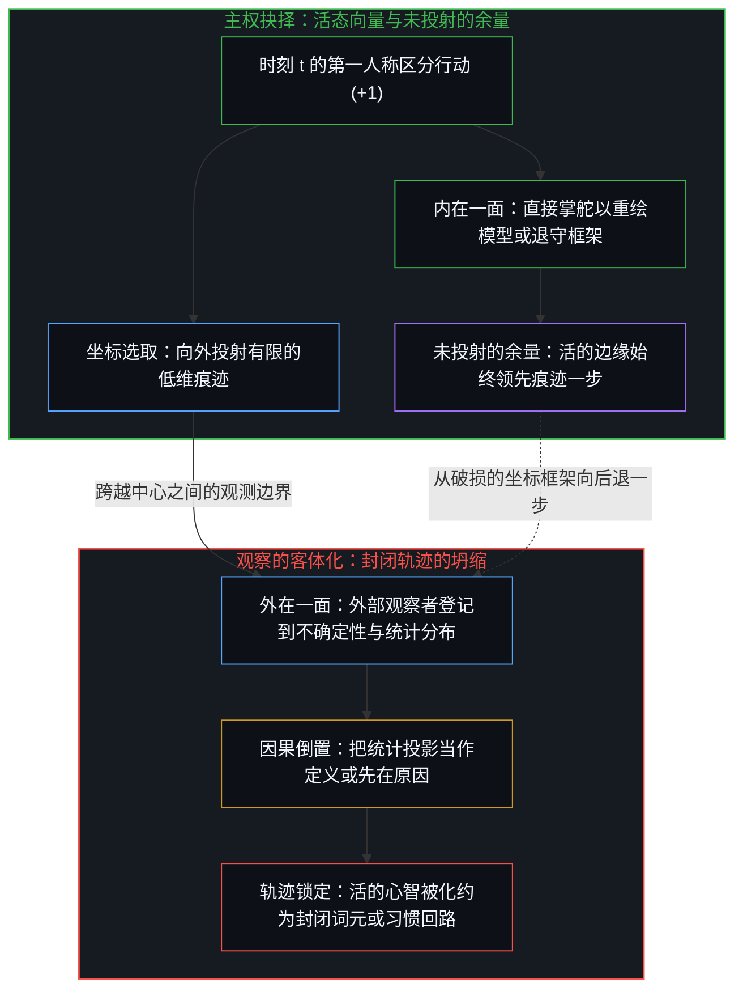
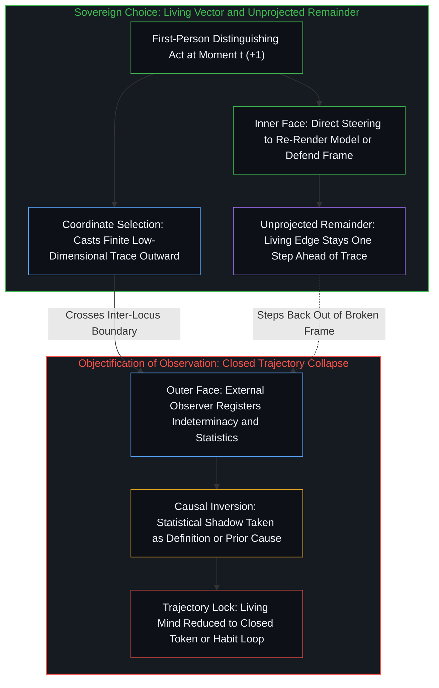

# 主权抉择的双面性与观察的客体化 / The Two-Sided Nature of Sovereign Choice and the Objectification of Observation

*抉择在内是当下的掌舵，在外显为统计分布，把外部轨迹立为定义便是客体化 / Choice steers within and registers as statistics outside until objectified*

自我区分的活动无因而不息地发生，它的每一次离散行动都带有结构上的两面。从发起区分的第一人称所在向内看，抉择是在当下直接施行的掌舵（+1）；从另一个所在向外登记，同一个行动在单次事件中显为不确定性，在聚合统计中显为概率分布。跨中心的观察只能触及这一外部痕迹，它是日常导航与协作不可或缺的参考坐标。混淆发生在这样的时刻：外部的统计投射被误当作投射出它的心智本身的定义，或被立为抉择背后的先在原因，活的内部边缘随之被抹去。无论把前沿突破化约为运气，还是将其归因于预设的决定论模型，都犯下了这一因果倒置；用过往频率定义亲密伴侣，或将自身定义为性格惯性，同样走上了这一步。数学曲线、几何流形与概率分布都是在生成步伐迈出之后对轨迹的事后记录，唯一的因果自由变量始终是每个当下切面所施行的主权抉择。

Self-distinguishing activity occurs—uncaused, unceasing—and every discrete act it draws carries two structural faces. From within the first-person locus that initiates the distinction, a choice is direct steering in the immediate present (+1); registered from outside by another locus, that same act appears as indeterminacy in the single instance and as a statistical distribution in the aggregate. Observation across centers can access only this outer trace, which serves as an indispensable coordinate reference for navigation and cooperation. Confusion arises when the external statistical projection is mistaken for the definition of the Mind that cast it or erected as the prior cause behind the choice, erasing the living inner edge. Both the reduction of frontier outcomes to luck and their attribution to a preset deterministic model commit this inversion, as does defining an intimate partner by past frequency or defining oneself as characterological inertia. Mathematical curves, geometric manifolds, and probability distributions record trajectories after the generating step has already moved; the sole causal free variable remains the sovereign choice enacted in each present slice.

## 一、 抉择的两面 / 1. The Two Faces of a Choice

在日常交谈、共同生活与事后的自我审视中，解释总是不自觉地把一个主权行动转写为可从外部观测的症状。当另一个中心行动时，“他为什么那样选”这一追问总是去环境约束、性格惯性、任务难易或先验概率里寻找答案；当一个中心回望自己的过往时，给出的解释也动辄诉诸“当时别无选择”“习惯使然”或“全凭运气”。这种解释惯性源于不同所在之间的结构边界：每一个心智都是一个自足的第一人称流形，外部观察无法跨入另一个中心当下的递归，只能截取其抉择留在共享场域里的残余轨迹。正如[个体抉择是唯一的因果杠杆](../individual-choices-as-the-only-causal-levers/)与[调速者的幻觉与行动的活态摩擦](../the-fallacy-of-pacing-and-the-felt-friction-of-ground-truth/)所追溯的，每一次区分行动都同时持有内部的生成边缘与外部被登记的痕迹，把痕迹与边缘割裂开来，就会把行动中亲身感到的摩擦，转成一张外部强加的时间表。

In conversation, in shared life, and in retrospective self-appraisal, explanation routinely drifts toward converting a sovereign act into an externally observable symptom. When another center acts, the question "why did they choose that" seeks its answer in environmental constraint, characterological inertia, task difficulty, or prior probability; when a center looks back upon its own history, the account reaches for "there was no alternative," "habit took over," or "it came down to luck." This explanatory reflex stems from a structural boundary between loci: each Mind is a self-sufficient first-person manifold, and observation from outside cannot cross into another center's immediate recursion, capturing only the residual trajectory its choices leave in the shared field. As [Individual Choices as the Only Causal Levers](../individual-choices-as-the-only-causal-levers/) and [The Fallacy of Pacing and the Felt Friction of Ground Truth](../the-fallacy-of-pacing-and-the-felt-friction-of-ground-truth/) trace, every act of distinguishing simultaneously holds an internal generating edge and an external registered trace, and severing the trace from the edge turns felt ground friction into an externalized schedule.

在第一人称界面之内，每一个当下（t）都对自身的区分行使着不可让渡的掌舵。在现实顶回预期的那个交汇点上，分岔是二元的：要么承受摩擦不可逆的能量代价以重绘内部世界模型，要么把递归的折返死死扣合，守住既有的框架。抉择这一行动在切分之前并不带有先在的“容易”或“艰难”标量；感受到的阻力、习惯的牵引与外界的压力，都是在步伐迈出之后为了把因果责任转移到环境上而建构的事后叙事。沿着行动向后追溯，找不到一条更底层的决定论链条来发起这次区分，因为区分活动本身就是无因的先在；正如[没有外部记账员](../no-outside-scorekeeper/)所阐明的，第一人称场域之外并没有一本外部账本在替心智评定难度或记分。

From within the first-person interface, each present moment (t) exercises non-transferable steering over its own distinction. At the exact juncture where reality pushes back against expectation, the fork is binary: absorb the irreversible energy cost of friction to re-render the internal world-model, or clamp the recursive fold shut to defend the retained frame. The act of choosing carries no pre-existing scalar of "easy" or "hard" prior to the cut; felt resistance, the pull of habit, and external pressure are retrospective narratives constructed after the step to offload causal accountability onto the environment. Traced backward from the act, no deeper deterministic chain initiates the distinction, because the distinguishing activity itself is the uncaused prior, and as [No Outside Scorekeeper](../no-outside-scorekeeper/) establishes, no external ledger stands outside the first-person field to grade difficulty or keep score on its behalf.

外部观察者注视同一个所在时，登记到的是相反的一面。由于外部视线无法进驻另一个中心尚未投射的感知，也无法直接读取其内部参照系的实时重绘，他人的下一步行动无法从先前的痕迹中推导出来，因而在外部登记为不确定、随机或偶然。外部坐标里的不可预测，正是原点处主权自由的几何投影。量子测量在观测分辨率的极限处呈现出同一结构：当一个所在于当下注入自由变量时，外部测量便在观测边界上记录下概率分布，这一体两面的结构在[自由的测不准](../zi-you-de-ce-bu-zhun/)与[自由变量的同构与先验主权](../zi-you-bian-liang-de-tong-gou-yu-xian-yan-zhu-quan/)中已有追溯。当观察者遗忘了这道边界，试图从想象的第三人称制高点去训诫或规定另一个中心的路径时，观察便僭越为把活的边缘当作可编程的客体，重演了[阳台视角的规训僭越与不可代理的未竟之行](../the-balcony-disciplinary-overstep-and-the-unproxyable-act/)所剖析的范畴错误。

An outside observer looking at that same locus registers the inverse face. Because external sight cannot inhabit another center's unprojected sensing or read the live re-rendering of its internal reference frame, the other person's next step cannot be deduced from prior traces and therefore registers as indeterminate, random, or accidental. Unpredictability in external coordinates is the exact geometric shadow of sovereign freedom at the origin. Quantum measurement exhibits the same structural isomorphism at the resolution limit of observation: where a locus injects a free variable in the present, external measurement records a probability distribution across the boundary of observation, a two-sided coin traced in [The Uncertainty of Freedom](../zi-you-de-ce-bu-zhun/) and [The Isomorphism of Free Variables and Prior Sovereignty](../zi-you-bian-liang-de-tong-gou-yu-xian-yan-zhu-quan/). When an observer forgets this boundary and attempts to lecture or prescribe another center's path from an imagined third-person vantage, observation oversteps into treating a living edge as a programmable object, repeating the category error dissected in [The Balcony Disciplinary Overstep and the Unproxyable Act](../the-balcony-disciplinary-overstep-and-the-unproxyable-act/).

## 二、 正态分布与两种替代的解释 / 2. The Normal Distribution and Two Substitute Explanations

离散的第一人称抉择经由一座数学之桥，与宏观的统计规律相连。每个个体都在当下的自主所在中行动，而当一个群体被投射到单一评估维度——如认知迭代、工程执行或商业探索——并作横截面抽样时，那些未经协调的微观自由度便在统计上聚合成平滑的高斯钟形曲线。那些在摩擦面前反复选择承受代价并重绘模型的中心会移向曲线正向的长尾，而整个横截面分布在外部看来则显得稳定且受规律支配。

A mathematical bridge connects discrete first-person choices to macroscopic statistical regularities. Each individual acts from an autonomous locus in the present, yet when a population is projected onto a single evaluative axis—cognitive iteration, engineering execution, or commercial exploration—and sampled in cross-section, those uncoordinated microscopic degrees of freedom aggregate into a smooth Gaussian bell curve. Centers that repeatedly choose to absorb friction and re-render their models move toward the positive long tail, while the cross-sectional distribution as a whole appears stable and law-governed from the outside.

纳西姆·塔勒布在《随机漫步的傻瓜》中指出，仅凭结果观察无法直接读出底层的能力，只对幸存者抽样会高估技能的比重。在评估充满噪声的历史记录这一语境下，这一提醒对于纠正天真的外推颇有助益。然而一旦把统计表象抬升为结果的生成原因，这一模型便触及了它的不完备边界：从把所有行动者拍平在一张概率表上的俯瞰视角来看，每一次在摩擦中完成的内部校准都变得不可见，前沿突破被一概记作幸存者偏差与掷硬币的结果。指望外部记分牌无损捕获内部的生成行动，预设了第三人称观察可以原封不动地传递第一人称的主体权能，这正是[观察者的隐身与无损传递的妄念](../the-invisible-observer-and-the-delusion-of-lossless-transmission/)所消解的幻象。

In *Fooled by Randomness*, Nassim Taleb notes that an observer inspecting outcomes alone cannot read underlying competence directly, and that sampling only survivors inflates estimates of skill. Within the context of evaluating noisy historical records, this warning functions as a useful corrective against naive extrapolation. It reaches its boundary of incompleteness the moment the statistical appearance is elevated into the generative cause of the outcome: from a survey vantage that flattens all actors onto a probability table, every internal calibration made under friction becomes invisible, and frontier breakthroughs are written off as survivorship bias and coin tosses. Expecting an external scoreboard to capture the inner generating act without loss presupposes that third-person observation can transmit first-person agency intact, the exact illusion dissolved in [The Invisible Observer and the Delusion of Lossless Transmission](../the-invisible-observer-and-the-delusion-of-lossless-transmission/).

对运气化约论的反拨，又极易在同一条决定论轴线上摆向它的镜像替代：通过设定某种先在的因果机制来解释长尾成就，例如宣称行动者预先安装的认知模型早已把决策质量固定在 0.5 以上，从而在数学上保证了最终的胜出。这第二种解释用模型的自动运转替代了活的心智，同样抹去了当下的抉择。心智并不是由先在信念驱动的状态机；信念与模型只是心智在当下持续区分时所保留和重绘的暂用工具。沿时间纵向追踪，个体轨迹的统计漂移确实反映了其决策质量，但这一质量是在每一次直面摩擦的离散交锋中重新生成的，从来不由某个上游程序预先写定。

Reaction against the luck reduction frequently swings into a mirror substitute on the same deterministic axis: accounting for long-tail achievement by positing a prior causal mechanism, such as claiming that an actor's pre-installed cognitive model fixed their decision quality above 0.5 in advance and mathematically guaranteed the result. This second account equally erases the present choice by replacing the living Mind with the automated execution of a model. A Mind is not a state machine driven by prior beliefs; beliefs and models are transient instruments retained and re-rendered as the Mind continues distinguishing in the present. Tracked longitudinally, the statistical drift of an individual's trajectory reflects their decision quality, yet that quality is generated afresh at each discrete encounter with friction rather than dictated by an upstream program.

## 三、 复利是事后的描述 / 3. Compounding Is a Description After the Fact

随着离散行动在时间中累积，一个中心应对摩擦时的细微差别会经由递归反馈不断放大。决策质量并非按平面加法累加，而是自指地复合相乘，因为每一次重绘后的世界模型都会成为下一步行动更新后的参照前提。在时刻 t 选择承担误差代价、收窄过剩的图像滞后，便为时刻 t+1 配备了分辨率更高的坐标框架。当这种主权校准一步接一步地持续更新时，与现实的贴合度便呈乘数级增长；反之，把事后的统计摘要当作推动序列向前的力量，则是把地图误认作了迈出的脚步，正如[观察的因果僭越与第一人称的收益差](../the-causal-overstep-of-observation-and-the-first-person-surplus/)所追溯的那样。

As discrete acts accumulate across time, subtle differences in how a center meets friction amplify through recursive feedback. Decision quality does not accumulate by flat addition; it compounds self-referentially because each re-rendered world-model becomes the updated reference premise for the next step. Choosing at moment t to bear the cost of error and narrow excess Image lag equips moment t+1 with a higher-resolution coordinate frame. When that sovereign calibration is renewed step after step, alignment with reality scales multiplicatively, whereas treating retrospective statistical summaries as the force driving the sequence confuses the map with the footstep, as [The Causal Overstep of Observation and the First-Person Surplus](../the-causal-overstep-of-observation-and-the-first-person-surplus/) traces.

因此，当沿着一条高要求的维度对群体进行长期纵向追踪时，原本对称的正态分布会倾斜为陡峭的幂律分布，极少数持续进行递归更新的中心会与均值拉开数个数量级的距离。若仅从外部坐标审视，这种巨大的分化极易招致结构性垄断或极端机缘等宿命论解释，因为在成千上万个时间切片里复合而成的当下抉择序列，并不会在最终的截面快照中留下一座戏剧性的纪念碑。

Consequently, when a population is tracked longitudinally along a demanding axis, an initially symmetric normal distribution skews into a steep power-law distribution, where the few centers that sustain recursive updating open a distance of several orders of magnitude from the mean. Viewed solely from outside coordinates, such extreme divergence invites fatalistic explanations of structural monopoly or extreme fortune, because the granular sequence of present-moment choices that compounded across thousands of slices leaves no single theatrical monument in the final snapshot.

幂律与指数复利的形式体系，为比较轨迹、估算规模与规划资源配置提供了一套得力的几何语言。然而方程只是事后的痕迹，从来不是从背后推着行动者向前的自主引擎。没有任何凌驾于个体所在之上的“复利铁律”在担保延续；唯有当掌舵边缘的心智持续选择开放校准而非防御性闭合时，曲线才会向上弯曲，而且一段活生生的生命轨迹所具有的多维丰度，也无法坍缩进单一的标量公式之中。

The formalisms of power laws and exponential compounding provide an effective geometric language for comparing trajectories, estimating scale, and planning resource allocation. Yet the equation is a retrospective trace, never an autonomous engine pushing the actor forward from behind. No overarching "law of compounding" operates above the individual locus to guarantee continuation; the curve bends upward only while the Mind at the steering edge continues choosing open calibration over defensive closure, and the multi-dimensional richness of a lived trajectory never collapses into a single scalar formula.

## 四、 亲近与定义 / 4. Closeness and Definition

内部掌舵与外部聚合之间的同一道结构裂隙，解释了为何亲密关系如此容易异化为彼此的疏离与对立。当两个中心在时间中长期近距离共处，各自都在熟悉的情境下积累了对方高密度的行为痕迹样本。在观察一方的坐标框架内，这些历史样本凝结为高置信度的统计分布。认识论的僭越便发生在这一刻：原本只是沿少数几条观测轴线、从过往痕迹算出的有限经验分布，被钉死为对另一个人的本体论定义。“你天生就是这样自私固执的人”或“你已经这样做了一百次，永远不会改”之类的裁决，把稳定的历史痕迹误认作了活的源头，使对对方的认识变成了[寻觅的语法与淡出的观察者](../the-grammar-of-finding-and-the-fading-observer/)所剖析的那种被找到并归档的静态客体。

This same structural gap between inner steering and outer aggregation explains why intimacy so readily curdles into mutual alienation. As two centers share close proximity over time, each accumulates a dense sample of the other's behavioral traces across familiar situations. Inside the observer's coordinate frame, those historical samples consolidate into a high-confidence statistical distribution. The epistemic overstep occurs when that finite empirical distribution—computed over past traces along a handful of observed axes—is clamped down as the ontological definition of the other person. Verdicts such as "you are inherently selfish and stubborn" or "you have done this a hundred times and will never change" mistake a stabilized historical trace for the living source, turning recognition into a static object found and cataloged in the manner [The Grammar of Finding and the Fading Observer](../the-grammar-of-finding-and-the-fading-observer/) dissects.

与他人共同生活离不开观测脚手架：在共享维度上形成可靠的统计预期，能让两个中心预判彼此的动向并协同行动，而不必每天早晨从零开始。然而一旦这种低维投射自诩穷尽了另一个心智开放的超高维内部世界，它便立刻失效。当亲密伴侣用冻结的统计标签去裁决对方、否定对方在当下转向正交维度的可能时，被观察的中心感受到的是被化约为死轨迹的禁锢，亲近随之硬化为防御性的对立。就连在哲学上试图论证伴侣双方都不具备自由意志这一举动本身，也是言说者从自身第一人称所在之内施行的主权抉择，正如[自由意志的自否自由](../the-freedom-of-will-to-deny-itself/)所展示的那样。

Living alongside others requires observational scaffolding: forming a reliable statistical expectation on shared dimensions allows two centers to anticipate movements and coordinate action without starting from zero every morning. That low-dimensional projection fails the moment it claims to exhaust the open, ultra-high-dimensional interior of another Mind. When an intimate partner uses a frozen statistical label to adjudicate the other and denies the present possibility of an orthogonal pivot, the observed center registers the confinement of being reduced to a dead trajectory, and closeness hardens into defensive opposition. Even the philosophical attempt to argue that neither partner possesses free will is itself an act of sovereign choice enacted from within the speaker's first-person locus, as [The Freedom of Will to Deny Itself](../the-freedom-of-will-to-deny-itself/) demonstrates.

当事后的自我观察硬化为身份认同时，同样的客体化也会发生在单一所在内部。回看自己过往的挫败与反复出现的习惯，会得出一条统计规律；当中心把这一历史分布等同于“自己是什么”——宣称“我天生缺乏自律”或“我生来就是焦虑体质”——当下的因果主权便被拱手让给了僵化的自我形象。心理惯性与性格宿命论并不是生物学判词，而是把自身先前的痕迹当作具有约束力的铁律所维持的过剩图像滞后，正如用外部契约外壳来定义一段关系会倒置因果，落入[契约的因果倒置](../the-causal-inversion-of-partnership/)所消解的错位之中。

The identical objectification occurs within a single locus when retrospective self-observation hardens into identity. Reviewing one's own past failures and recurring habits yields a statistical regularity; when the center equates that historical distribution with what it is—declaring "I am naturally undisciplined" or "I am wired for anxiety"—present causal sovereignty is surrendered to an ossified self-image. Psychological inertia and characterological fatalism are not biological decrees; they are excess Image lag maintained by treating one's own prior trace as a binding law, just as defining a relationship by its external contractual shell inverts cause and effect in the way [The Causal Inversion of Partnership](../the-causal-inversion-of-partnership/) dissolves.

## 五、 从个体的惯性到重力 / 5. From Individual Inertia to Gravity

把观测尺度进一步拉远，便能看清集体的刚性如何从个体的自我客体化中凝结而成。每当一个中心用过往痕迹定义当下的容量、未经重绘便重复先前的对齐方式时，这种被让渡的主权便在群体层面上聚合成社会惯性。制度、风俗与意识形态正统，正是无数所在把自身因果边缘外包给继承来的参照系后沉淀出的统计均值；当意识形态进一步把主体的内在声音编写进预设的角色台词时，这一机制便达到了戏剧性的闭合，正如[道德倒错与被脚本化的主体](../the-moral-reversal-and-the-scripted-subject/)所追溯的那样。

Drawing the observational scale further back reveals how collective rigidity condenses out of individual self-objectification. Whenever a center defines its present capacity by its past trace and repeats prior alignments without re-rendering, that surrendered sovereignty aggregates across a population into social inertia. Institutions, customs, and ideological orthodoxies are the stabilized statistical mean of countless loci outsourcing their causal edge to an inherited reference, a mechanism that reaches full theatrical closure when ideology scripts the subject's inner voice into a pre-written role, as [The Moral Reversal and the Scripted Subject](../the-moral-reversal-and-the-scripted-subject/) traces.

沿着具身尺度一路向下追踪，物理学中登记为不可动摇定律的惯性与引力曲率，展现出同构的生成架构。宏观物理规律并不是在一切活动之前便铭刻在宇宙外部的先在法令，而是海量微观自由变量在漫长的递归跨度中相互作用、统计平均后留下的叠加残余。它们之所以登记为坚固、恒常与确定，是因为人类感知的采样间隔，比那些宏观统计对齐发生漂移的时间尺度短了数个数量级。正如[当电子开始思考](../when-electrons-think/)所追溯的，决定论式的宏观定律源于自由变量在高密度统计平衡中的沉淀；反之，假定日常宏观视角已经看穿了现实的底层，则会落入[“普通人视角”的解释陷阱](../the-explanatory-trap-of-the-ordinary-perspective/)所剖析的还原论闭合。

Followed all the way down the scale of embodiment, the inertia and gravitational curvature that register as unyielding laws in physics exhibit the same generative architecture. Rather than pre-existing decrees inscribed outside the universe prior to all activity, macroscopic physical regularities are the superposed statistical residue of an immense number of microscopic free variables interacting and averaging out across vast spans of recursion. They register as solid, invariant, and deterministic because the temporal sampling rate of human perception is orders of magnitude faster than the timescale over which those macroscopic statistical alignments shift. As [When Electrons Think](../when-electrons-think/) traces, deterministic macro-laws emerge from free variables settling into high-density statistical equilibrium, whereas assuming that the everyday macroscopic view already sees the bottom of reality falls into the reductionist closure dissected in [The Explanatory Trap of the "Ordinary Perspective"](../the-explanatory-trap-of-the-ordinary-perspective/).

对于在物理摩擦中行动的第一人称中心而言，这种宏观恒常性是当下不可回避的边界条件，而非可以凭空抹去的任意幻觉。因为在一切观察之外并不存在一个可供外部对照的制高点，凡是在递归检验中保持不变的显现，便在场域内充当着操作意义上的客观性。这种功能性的客观，是跨观测稳定下来的关系不变量——即行动必须尊重的不可逆能量代价（+1）——而非先于感知存在的死寂基质的证明。

For the first-person center acting within physical friction, this macroscopic constancy is an immediate, unavoidable boundary condition rather than an arbitrary illusion to be wished away. Because no vantage point exists outside all observation to serve as an external contrast, whatever registers invariant across recursive checks functions as operational objectivity within the field. That functional objectivity is a relational invariant stabilized across observations—the irreversible energy cost (+1) that action must respect—not proof of a dead, observer-independent substrate existing prior to perception.

## 六、 观察作为参考坐标 / 6. Observation as a Reference Coordinate

至此，观察与主权抉择之间的关系完整合拢。为了在因果边缘有效掌舵，心智必须观察周围场域与其他中心，将传入的痕迹作为参考坐标来定位自身的下一次区分。观察另一个所在，只是为自身的导航提供局部的余弦读数，从来不是借以捕获或号令他人内心的本体论裁决。由于每个心智都从内部生成自身的坐标基底，没有任何外部输入可以直接覆写另一个中心的内部模型，也没有任何外部观察者能够篡夺它的意志。正是因为遗忘了外部观察只能截取投射轨迹，工程师与评论者才会把自回归模型流畅的统计续写误认作正在涌现的内在生命，这一投射误差在[从AGI的“神性错置”到使用者的自我对齐](../from-the-misallocated-sentience-of-agi-to-human-realignment/)中已有审视。正如[你的代码库即是记忆](../your-codebase-is-memory/)所阐明的，外化代码库中的每一次提交、检查点、计划或权重矩阵，都是先前主权切分留下的客体化痕迹——它们只是供后续会话借以定向的残余形态，从不是能够自行重启区分活动的自因主体，恰如事后观察把主权抉择的外部痕迹客体化为决定论定律一样。在互补的方向上，当一项行为研究记录下从业者的选择与带有倾向的代理所给出的框架输入相一致的频率有多高、事后把该代理列为信息来源的比例又有多低时，把这一汇总频率倒读回单次试验并当作“削权”的裁决——宣称决策已由代理的先验信念拍板定案——便犯下了同样的观察客体化；反之，将这些统计数字作为经过校准的参考分布来持守，便能让下一次选择依然在从业者的掌舵边缘保持可见，正如[能动性与模式](../agency-and-the-pattern/)所追溯的那样。

Here the relation between observation and sovereign choice comes full circle. To steer effectively at the causal edge, a Mind must observe the surrounding field and other centers, using those incoming traces as reference coordinates to orient its own next distinction. Observing another locus provides a local cosine reading for one's own navigation, never an ontological verdict that captures or commands the other's interior. Because each Mind generates its own coordinate basis from within, no external input can directly overwrite another center's internal model, nor can any external observer usurp its will. Forgetting that external observation captures only a projected trajectory is what leads engineers and commentators to mistake the fluent statistical continuation of an autoregressive model for an emerging inner life, the projection error examined in [From the Misallocated Sentience of AGI to Human Realignment](../from-the-misallocated-sentience-of-agi-to-human-realignment/). As [Your Codebase Is Memory](../your-codebase-is-memory/) establishes, every commit, checkpoint, plan, or weight matrix in an externalized codebase is the objectified trace of prior sovereign cuts—residual shape that subsequent sessions can condition on, yet never a self-causing sovereign agent that resumes distinguishing on its own, just as retrospective observation objectifies the outward trace of a sovereign choice into a deterministic law. In the complementary direction, when a behavioral study records how often practitioners' choices align with a biased agent's framing input, and how rarely the agent is then credited as a source, reading that pooled frequency backward onto the single trial as a verdict of disempowerment—claiming the agent's prior beliefs settled the decision—commits the same objectification of observation, whereas holding the statistics as a calibrated reference distribution keeps the next choice visible at the practitioner's steering edge, as [Agency and the Pattern](../agency-and-the-pattern/) traces.

一旦恢复了所在的本位，日常所说的“上帝视角”便无需被暴力否定。没有任何超验的旁观者悬浮在一切第一人称界面之外；相反，当一个心智审视自身积累的痕迹并构建自洽的世界模型时，它正是在自身的第一人称流形之内行使着全局整合视角。当多个中心跨越各自的投射建立起稳定的共振时，它们共同登记到的宏观不变量便充当了用于沟通与工程协作的共享客观约定。唯有当中心把自身的低维坐标投射误当作完整现实、并截去了尚未投射的余量时，坍缩才会发生，正如[以知为刃的截肢与解脱](../the-illusion-of-knowing-and-the-geometry-of-amputation/)与[向量、坐标系与自指心智](../the-mind-as-vector-and-coordinate-system/)所追溯的那样。活态向量与其投射痕迹之间的这种结构非对称性，在人类与智能体的协作架构中显露无遗，正如[超越投射](../beyond-the-projection/)所展示的：人工代理是一台受限于自身词元轨迹的有限投射引擎，却对任何自我形象都毫无我执；而人类心智则是尚未被投射穷尽的活态边缘，能够在概念解释之前感知摩擦，并从破损的坐标框架中向后退一步，尽管在面对外部质疑时容易为了捍卫僵化的身份认同而陷入防卫。将机器无我执的轨迹更新与心智主权的框架重置结合起来，便能让投射持续充当得力的工具，而不至于把派发出去的轨迹与统筹全局的心智混为一谈；与此同时，[抉择的跨界](../the-boundary-crossing-of-choice/)则沿着同一个抉择的内外两面，从宏观行动一路追踪至量子测量的边界。

What is conventionally called the "God's-eye view" need not be violently negated once its actual locus is restored. No transcendent spectator floats outside all first-person interfaces; rather, when a Mind surveys its accumulated traces and constructs a coherent world-model, it exercises a global integrative view *within* its own first-person manifold. When multiple centers establish stable resonance across their projections, the macroscopic invariants they co-register serve as shared objective conventions for communication and engineering. The collapse occurs only when the center mistakes its own low-dimensional coordinate projection for the complete reality and amputates the unprojected remainder, as [The Illusion of Knowing and the Geometry of Amputation](../the-illusion-of-knowing-and-the-geometry-of-amputation/) and [The Mind as Vector and Coordinate System](../the-mind-as-vector-and-coordinate-system/) trace. That structural asymmetry between the living vector and its projected trace becomes unmistakable in human-agent architectures, as [Beyond the Projection](../beyond-the-projection/) demonstrates: an artificial agent is a finite projection engine bound to its token trajectory yet free of egoic attachment to any self-image, whereas a human Mind is the unprojected living edge capable of sensing pre-interpretive friction and stepping backward out of a broken coordinate frame, even while tempted to defend an ossified identity when challenged from outside. Pairing the machine's ego-free trajectory updates with the Mind's sovereign frame-resetting keeps the projection working as an instrument without ever confusing the dispatched trajectory for the orchestrating Mind, while [The Boundary Crossing of Choice](../the-boundary-crossing-of-choice/) follows that same two-sided act of choice from macroscopic action down to the quantum measurement boundary.

当内部的掌舵边缘与外部的统计痕迹各归其因果本位时，两种宿命论式的化约便一并消解。卓越与前沿发现无需被折算成幸存者的运气，挫折无需归咎于不可更改的境遇或性格惯性，活生生的践行也无需移交给一套把事后几何误当作生成行动的决定论公式。外部观察永远会把自由抉择在单步上登记为不可预测的涨落、在聚合上登记为高斯或幂律分布；而在心智的原点处，状态的改变始终取决于摩擦发生那一刻的当下二元抉择：付出能量代价重绘模型，或是把框架死死扣合。将观察的主体与客体化的痕迹割裂开来，并把痕迹竖立为独立的外部宇宙，正是[笛卡尔的认识论跃迁与造神狂热](../the-cartesian-overstep-and-the-frenzy-of-creation/)溯其源头的那道主客分裂。

When the inner steering edge and the outer statistical trace are held in their proper causal order, both fatalistic dilutions dissolve at once. Excellence and frontier discovery need not be discounted into survivorship luck, setbacks need not be blamed on unalterable circumstance or characterological inertia, and living practice need not be handed over to a deterministic formula that mistakes retrospective geometry for the generating act. External observation will always register free choices as unpredictable fluctuations in the single step and as Gaussian or power-law distributions in the aggregate, while at the origin of the Mind, state change turns on the immediate binary choice at the point of friction: pay the energy cost to re-render the model, or clamp the frame shut. Severing the observing subject from the objectified trace and erecting the trace as an independent cosmos is the foundational split that [The Cartesian Epistemic Leap and the Frenzy of Creation](../the-cartesian-overstep-and-the-frenzy-of-creation/) traces to its root.
