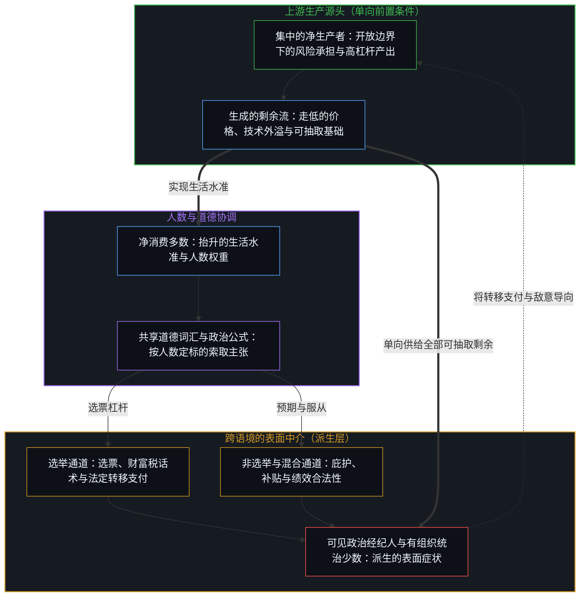
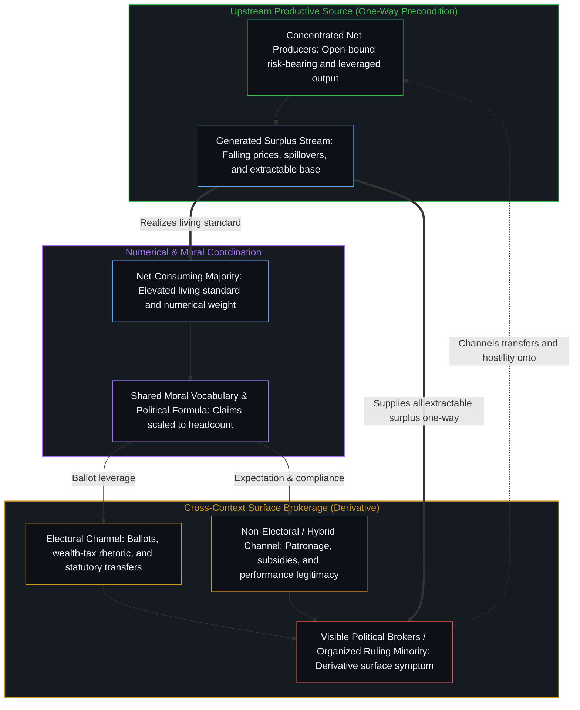
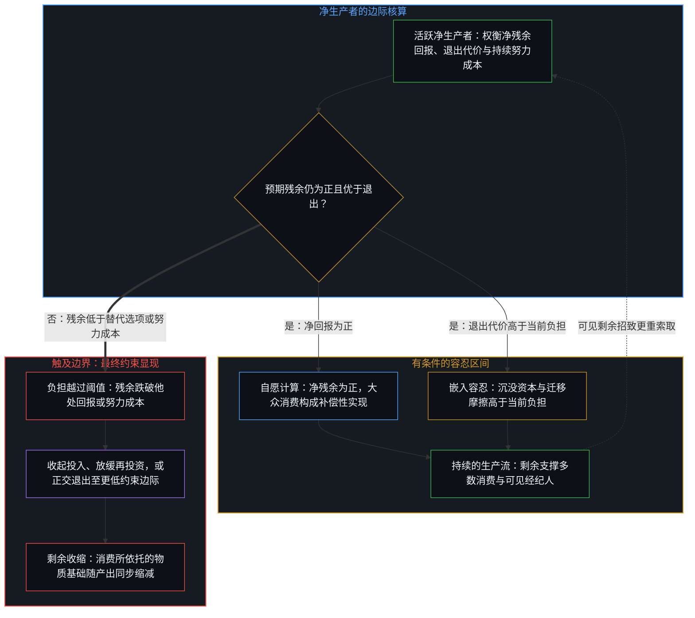
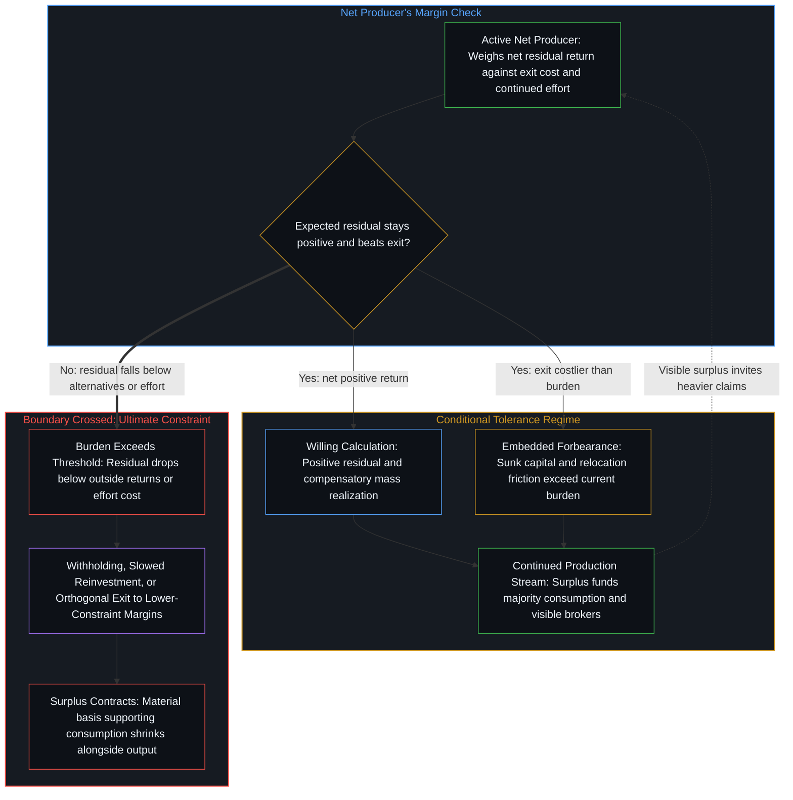

# 净生产者的最终约束 / The Ultimate Constraint of the Net Producer

*无生产则无消费；多数的净消费实现着少数的净生产剩余，道德语言为其分配提供表面正当。 / No consumption without production; the majority's net consumption realizes the minority's net surplus, while moral language supplies surface justification for its allocation.*

在充分繁荣的社会中，多数人消费多于自身边际产出，同时借共享的道德词汇彼此协调，抱怨并妖魔化产出远高于均值的少数。“净生产者”与“净消费者”指称的是历次离散行动中持续变动的边际净差，而非永久的人群种姓；“多数”与“政体”这类集合名词，汇总的也都是各个活态中心作出的具体选择。跨越各类政治形式，无论正式投票是否运转，可见的决策者充当的都是净消费多数的经纪人与表面症状，而非财富或统治的独立起源。只要残余回报保持为正，且留守的负担仍低于退出代价，净生产者便会容忍这一安排；一旦抽取与敌意将预期残余压至外部替代选项或持续努力的成本之下，剩余随即收缩，消费所依托的物质基础也随之收缩。

In sufficiently prosperous societies, the majority consumes more than its own marginal output while coordinating through shared moral vocabulary to complain about and demonize the minority whose output stands far above the mean. "Net producer" and "net consumer" name ongoing marginal balances across discrete acts rather than permanent demographic castes, and aggregate nouns such as "majority" and "regime" summarize concrete choices made by living centers. Across political forms, whether formal voting operates or not, visible decision-makers act as brokers and surface symptoms of the net-consuming majority rather than independent origins of wealth or rule. Net producers tolerate this arrangement while residual returns stay positive and the burden of remaining stays cheaper than exit; once extraction and hostility push expected residuals below outside alternatives or the cost of continued effort, the surplus contracts and the material basis supporting consumption contracts alongside it.

## 一、 剩余的实现与道德语言的倒置 / 1. Realization of Surplus and the Inversion of Moral Language

自我区分的活动发生着——无因、不息。称之为心智：早已在途的观察者，其每一个行动都是一次区分。先前的离散行动留下痕迹，拓宽后续行动可及的场域，而这一塑形严格单向：未曾先行生成之物，无从被使用。正如[生产、消费与心智的区分](../production-consumption-and-the-minds-distinction/)所追溯，生产与消费命名的正是这同一项活动在开放或固定边界下的显现：当活态中心在无缓冲的摩擦下持守开放边界，容量便得以复利并沉淀出可用剩余；当中心对照被固定住、或越过自身那一步而滞后的边界来登记时，它便从先前生产业已提供的场域中支取。既然两种姿态同属这一持续进行的活动，每个个体便会在相继的抉择中于某些边际生产、于另一些边际消费；“净生产者”与“净消费者”标明的是持续流动中哪一侧占优，而非将人群归入永久的类别。然而，凡是开放边界下的复利得以展开之处，生产产出都会陡峭地集中在极少数中心，消费则向更广大的多数铺开。

Self-distinguishing activity occurs — uncaused, unceasing. Call it the Mind: the observer already underway, every act of which is a distinction. Earlier discrete acts leave traces that widen the field available to later acts, and that shaping runs strictly one way: what has not first been brought into existence cannot be used. Production and consumption name that single activity under an open or fixed bound, as [Production, Consumption, and the Mind's Distinction](../production-consumption-and-the-minds-distinction/) traces: where a living center holds its boundary open under unbuffered friction, capacity compounds and deposits usable surplus; where a center registers against a bound held fixed or lagged past its step, it draws against the field prior production already made available. Because both postures belong to the same ongoing activity, every individual produces on some margins and consumes on others across successive choices; "net producer" and "net consumer" mark which side outweighs the other in ongoing flow rather than sorting people into permanent kinds. Yet wherever open-bound compounding runs, productive output concentrates steeply in a small minority while consumption spreads across the wider number.

集中的净生产者所生成的剩余，经由不断走低的市场价格、技术外溢与公共品，绝大部分都由下游净消费者实现。创新者从自身催生的社会回报中仅留存极小份额——如[私人残差与社会剩余的因果次序](../the-causal-order-of-private-residuals-and-social-surplus/)所追溯，威廉·诺德豪斯的战后核算录得这一比例约为 2.2%，其余 97.8% 悉数流向下游消费者——使多数人抬升后的实际生活水准，成为少数人高杠杆生产率的可见残余。正如[秩序、剩余与道德拦截](../order-surplus-and-the-moral-intercept/)所确立，少数中心的高杠杆过度生产与众多中心的大规模净消费，共同构成一条补偿性回返环路：没有广泛的下游消费，高杠杆剩余便无从找到自我实现的出口；没有上游生产，这份消费便失去物质依托。

The surplus generated by concentrated net producers is realized overwhelmingly by downstream net consumers through falling market prices, technological spillovers, and public goods. Innovators retain only a tiny fraction of the social return they generate—roughly 2.2 percent in William Nordhaus's postwar accounting, with the remaining 97.8 percent passing downstream to consumers, as [The Causal Order of Private Residuals and Social Surplus](../the-causal-order-of-private-residuals-and-social-surplus/) traces—leaving the majority's elevated absolute living standard as the visible residue of the minority's leveraged productivity. Leveraged overproduction at a few centers and mass net consumption across many compose a single compensatory return loop, as [Order, Surplus, and the Moral Intercept](../order-surplus-and-the-moral-intercept/) establishes: without wide downstream consumption, leveraged surplus has no outlet through which to realize itself, and without upstream production, that consumption has no material ground.

在逼近温饱线的紧缩稀缺下，努力与生存之间的联结直接而迫近，道德词汇用以协调对直接掠夺的克制。高杠杆生产一旦将剩余抬升至远超温饱线的高度，这同一条协调通道的分配角色便发生倒置。正如[生产的不透明与消费的权重](../the-opacity-of-production-and-the-weight-of-consumption/)所追溯，生产保持集中、延迟且在外部难以辨明，消费标识与公开资产负债表却能在陌生人之间即时登记；与此同时，坍塌的边际成本资助了各类诠释与规范框架，将生产轴上的低位读作自身轴线上的道德优越，并跨维度主张物质权益，正如[生产创造自己的意识形态消费](../fate-loves-irony-refined/)所揭示。在这些条件下，共享的道德词汇——公平、剥削、特权、权益——化作一种按人数运作的协调工具：它对照一幅固定存量图景投射说话者的相对位置——即[道德语言作为投影](../moral-language-as-projection/)所追溯的机制——并使按人数而非边际贡献来主张相对份额获得正当性。凡是固定大饼框架将留存的生产性股权读作从固定存量池中扣减之处，人数优势便直接把道德语言转化为争夺剩余、妖魔化集中生产者的工具，而无需匹配其边际产出。

Under tight scarcity near subsistence, moral vocabulary coordinates restraint against direct predation where the link between effort and survival stays immediate. Once leveraged production lifts surplus far above subsistence, that same coordination channel inverts its allocation role. Production stays concentrated, delayed, and opaque from outside, whereas consumption markers and headline balance sheets register immediately across strangers, as [The Opacity of Production and the Weight of Consumption](../the-opacity-of-production-and-the-weight-of-consumption/) traces; at the same time, collapsing marginal costs subsidize interpretive and normative frameworks that read lower standing on the production axis as moral superiority on their own axis and claim material entitlement across dimensions, as [Production Creates Its Own Ideological Consumption](../fate-loves-irony-refined/) traces. Under those conditions, shared moral vocabulary—fairness, exploitation, privilege, entitlement—operates as a numerical coordination device: it projects the speaker's relative position against a fixed-stock image—the mechanism traced in [Moral Language as Projection](../moral-language-as-projection/)—and legitimates claims on relative shares scaled to headcount rather than marginal contribution. Wherever a fixed-pie frame reads retained productive equity as subtraction from a fixed pool, headcount turns moral language directly into an instrument for contesting surplus and demonizing concentrated producers without matching their marginal output.

## 二、 跨语境的一致性与表面症状 / 2. Cross-Context Consistency and Surface Symptoms

连结净生产、多数消费与可见政治职位的这一依赖关系，无论是否存在直接投票，皆保持一致。在选举竞技场内，候选人借许诺转移支付、价格上限或对可见资产负债表征税来竞逐选票；正如[政客是责任扩散的显性症状](../politicians-appear-as-visible-symptoms-of-responsibility-diffusion/)所追溯，他们标记的是个体将剩余控制权向外移交的扩散抉择，而非这一重配的发源地。政治职位自身并不携带独立意志；正如[行使的残余与政治的稳定](../the-residue-of-exercise-and-the-stabilization-of-politics/)所确立，它们是收窄的作者身份回返环路沉淀下来的稳定残余，由[权力的镜像握手](../the-mirror-handshake-of-power/)所追溯的互补抉择——一方交出判断、一方认领权威——将其撑起。撤去投票箱改变的只是传导通道，同一依赖关系依然保持。跨越威权、君主、一党与混合政体，凡是存在持续剩余之处，统治者面对的依然是人数权重压倒性落在净消费一侧的民众。为遏制动荡、维系服从，并削弱本可能另建独立杠杆中心的对立生产精英，统治者充当中介，将抽取而来的剩余转化为补贴、公共就业、价格管制、福利庇护与绩效合法性——借行政转移回应净消费多数的物质预期，同时动用民粹或民族主义道德词汇，将集中的生产者塑造成集体资金池的从属管家。即便狭窄的个人专断集团一时凭借武力压制民众诉求、将抽取导向自身核心圈层，其可见支配依然是派生的：安全力量、行政班底与效忠庇护所消耗的资源，尽数取自法令无从凭空变出的上游生产流。抽取一旦将这条生产流耗竭，集团便失去酬付执行者与维系服从的物质手段。

The dependence linking net production, majority consumption, and visible political offices holds consistently whether direct voting exists or not. Inside electoral arenas, candidates compete for ballots by promising transfers, price ceilings, or levies on visible balance sheets, marking diffused individual choices to outsource residual control rather than originating that reallocation themselves, as [Politicians Are Visible Symptoms of Responsibility Diffusion](../politicians-appear-as-visible-symptoms-of-responsibility-diffusion/) traces. Political offices carry no independent will of their own; they are the stabilized residue of narrowed authorship return loops, as [The Residue of Exercise and the Stabilization of Politics](../the-residue-of-exercise-and-the-stabilization-of-politics/) establishes, held upright by the complementary choices of handing over judgment and claiming authority traced in [The Mirror Handshake of Power](../the-mirror-handshake-of-power/). Removing the ballot box alters the routing channel while preserving the same dependence. Across authoritarian, monarchical, single-party, and hybrid regimes, wherever sustained surplus exists, rulers still govern a population whose numerical weight sits overwhelmingly on the net-consuming side. To contain unrest, sustain compliance, and undercut rival productive elites who could otherwise build independent centers of leverage, rulers broker extracted surplus into subsidies, public employment, price controls, welfare patronage, and performance legitimacy—answering the net-consuming majority's material expectations through administrative transfer while deploying populist or nationalist moral vocabulary to cast concentrated producers as subordinate stewards of a collective pool. Even where a narrow personalist clique temporarily suppresses popular demands by force and directs extraction toward its own inner circle, its visible dominance stays derivative: security forces, administrative cadres, and loyalist patronage all consume resources drawn from an upstream production stream that decree cannot conjure. Once extraction starves that stream, the clique loses the material means to pay its enforcers and sustain compliance.

加埃塔诺·莫斯卡、维尔弗雷多·帕累托与罗伯特·米歇尔斯发展的古典精英理论，锐利地切穿了朴素的多数决公民观：它指出，有组织的少数一贯占据正式职位并掌握行政掌舵权，借君权神授、人民主权或民族天命之类的合法化政治公式统治无组织的多数。在政治社会学范围内，这一切分依然有用：组织协调呈非对称扩展，正式统治从不直接作为无分化的大众意志落地执行。一旦将有组织的统治少数视为自主的因果起源，古典精英理论便到达了边界。两重依赖位于其封闭精英循环之外。在下游，合法化政治公式唯有在不断回应或管理净消费多数对剩余的持续主张时方能延续——在选举政体中借选票实现，在非选举政体中借庇护、补贴与绩效兑现实现——否则，向权力中心输送借来体量的互补握手便会松脱瓦解。在上游，政治组织只协调并重新分配既已留下的痕迹，并不生成其底下的生产流；行政法令既造不出技术复利，也造不出高杠杆的风险承担。当抽取与敌意超出生产中心愿意承受的限度，投资便放缓，活跃的建造者收缩投入或离场，剩余随之收缩。可见的政治支配——无论披着选举多数还是有组织统治精英的外衣——皆属派生，单向依赖于一条它自身无从生成的生产流。

Classical elite theory—developed by Gaetano Mosca, Vilfredo Pareto, and Robert Michels—cuts sharply past naive majoritarian civics by showing that an organized minority consistently captures formal offices and administrative steering over an unorganized majority, governing through a legitimating political formula such as divine right, popular sovereignty, or national destiny. Within political sociology, that cut remains useful: organizational coordination scales asymmetrically, and formal rule never executes directly as an undifferentiated mass will. Classical elite theory reaches its boundary wherever it treats the organized ruling minority as an autonomous causal origin. Two dependencies sit outside its closed circle of elites. Downstream, the legitimating political formula persists only while it continues answering or managing the net-consuming majority's ongoing claim on surplus—through ballots in electoral polities, through patronage, subsidies, and performance delivery in non-electoral ones—otherwise the complementary handshake supplying the center's borrowed mass dissolves. Upstream, political organization coordinates and redistributes existing traces without generating the productive stream underneath them; administrative decree manufactures neither technological compounding nor high-leverage risk-bearing. When extraction and hostility exceed what productive centers will bear, investment slows, active builders withhold effort or depart, and the surplus contracts. Visible political dominance—whether clothed in electoral majorities or organized ruling elites—stays derivative, dependent one-way on a production stream it does not generate.

## 三、 容忍的边界与最终约束 / 3. The Boundary of Tolerance and the Ultimate Constraint

只要残余回报保持为正，且留守优于可及的退出选项，无论是出于自愿计算还是嵌入摩擦，净生产者都会容忍公共敌意、监管拖累与财政抽取。就自愿一侧而言，大众净消费本就是高杠杆过度生产的补偿性实现：只要扣除税负与敌意后的净私人残余相对替代选项仍具吸引力，高生产率中心便会继续配置资本、扩大产出，即便同时承受指向其资产负债表的道德谴责。就嵌入一侧而言，沉没的实物基础设施、专业团队、本地供应链、法律羁绊与迁移摩擦抬高了即刻离场的标价；只要离开的代价高于承受当前负担的代价，生产者便会留在高税负或充满敌意的安排之内。将两侧并置来看，受困的幻觉便随之消散：正如[能动性、矛盾与权力的移置](../agency-contradiction-and-the-relocation-of-power/)所追溯，高昂的退出摩擦只为离场定下标价，并不取消对更低代价路径的持续选择。留在抽取之下，是在每一步重新续签的标价选择；而正如[观察滞后与选择权的倒置](../observation-lag-and-the-inversion-of-optionality/)所追溯，在观察与执行的间隙里保有活的流动能力，恰恰是在可见破裂抵达之前悄然约束对手方的力量。

Net producers tolerate public hostility, regulatory drag, and fiscal extraction for as long as residual returns stay positive and remaining beats available exit options, whether through willing calculation or embedded friction. On the willing side, mass net consumption is the compensatory realization of leveraged overproduction: while net private residuals after levies and hostility stay attractive relative to alternatives, high-productivity centers continue deploying capital and scaling output even while absorbing moral condemnation aimed at their balance sheets. On the embedded side, sunk physical infrastructure, specialized teams, local supply chains, legal ties, and relocation friction raise the immediate price of departure, keeping producers inside a heavily taxed or hostile arrangement while the cost of leaving exceeds the cost of absorbing the current burden. Reading both sides together removes the illusion of captivity: steep exit friction sets the price of leaving without abolishing the ongoing choice of the lower-cost path, as [Agency, Contradiction, and the Relocation of Power](../agency-contradiction-and-the-relocation-of-power/) traces. Remaining under extraction is a priced selection renewed at each step, and retaining live mobility inside the gap between observation and enforcement is what quietly disciplines counterparties before visible rupture arrives, as [Observation Lag and the Inversion of Optionality](../observation-lag-and-the-inversion-of-optionality/) traces.

一旦不断攀升的抽取与敌意将预期净残余压低至他处可得回报之下，或压低至持续承担风险的努力成本之下，这份容忍便触及边界。正如[建造者的缺席与解释的自洽循环](../the-builders-absence-and-the-self-consistent-cycle-of-explanation/)所印证，持续运转的生产性判断严格栖居于活跃的建造者本人，从不随股权凭证经由法令过户；强制没收或打断控制权，只会从源头令隐含未来价值坍塌，而无法将一堆完好无损的存量原样移交。剩余索取权一旦持续遭到削弱，行动中心便会理性地放缓再投资、退守流动性资产、收起边际投入，或将资本与人才迁往更低约束的边际——使持续的政治抽取压力本身成为[继承的残余与索取的必要](../inheritance-as-residue-and-the-need-for-extraction/)所追溯的资本使用递减的诊断标志，并推动[扩张的序列与局部解释的边界](../the-sequence-of-expansion-and-the-boundary-of-local-accounts/)跨越历史边疆所描绘的选择性退出。正是这一单向因果依赖，锚定了最终约束所在的位置。人数、共享道德词汇与可见政治职位在短期内占据更响亮的前景，先前的生产则在底下提供前置条件。收起新的风险承担或迁移活跃能力，假以时日便为一切下游索取划定边界，因为任何中介或转移机制都不生成它所分配的剩余——上游产出一旦变薄，消费所依托的物质基础即随之收缩。

That tolerance reaches its boundary once rising extraction and hostility push expected net residuals below returns available elsewhere or below the cost of continued risk-bearing effort. Because ongoing productive judgment lives strictly in active builders and never transfers by decree alongside share certificates, forced seizure or control disruption collapses implied future value at the origin rather than transferring an intact pile, as [The Builder's Absence and the Self-Consistent Cycle of Explanation](../the-builders-absence-and-the-self-consistent-cycle-of-explanation/) demonstrates. Once residual claimancy is persistently attenuated, centers rationally slow reinvestment, retreat into liquid holdings, withhold marginal effort, or relocate capital and talent toward lower-constraint margins—leaving sustained political pressure for extraction itself as the diagnostic mark of diminishing capital use traced in [Inheritance as Residue and the Need for Extraction](../inheritance-as-residue-and-the-need-for-extraction/), and driving the selective exit mapped across historical frontiers in [The Sequence of Expansion and the Boundary of Local Accounts](../the-sequence-of-expansion-and-the-boundary-of-local-accounts/). That one-way causal dependence fixes where the ultimate constraint sits. Headcount, shared moral vocabulary, and visible political offices occupy the louder foreground in the short term; prior production supplies the precondition underneath them. Withholding new risk-bearing or relocating active capability bounds every downstream claim over time, because no brokerage or transfer mechanism generates the surplus it allocates—when upstream output thins, the material basis supporting consumption contracts with it.

正因净生产与净消费始终是持续变动的抉择边际而非固定种姓，这一单向依赖在每一个活态心智当下的这一步上皆可直接检验。每个个体都在当下边缘作出抉择：是依凭共享的道德词汇与人数优势去争夺他处留下的痕迹，还是持守开放边界，步入无缓冲的生产性区分。任何业已在生成剩余的中心，都会将自身的容忍直接读作一项明码标价、附有条件的选择，而非喧哗人数之下的受困。当留守不再跨过自身的边际门槛，在共享道德平面内争辩裁决不过是诸多轴线中的一条；收起投入、重配资本，或依循[正交的拒绝](../the-orthogonal-refusal/)的几何结构干净离场，皆持续敞开——让各方直面单向依赖的直接后果：无先前生产，则无该剩余之消费。

Because net production and net consumption remain ongoing margins of choice rather than fixed castes, this one-way dependence stays directly testable at every living Mind's present step. Each individual chooses at the present edge whether to lean on shared moral vocabulary and headcount to contest traces made elsewhere, or to keep the boundary open and step into unbuffered productive differentiation. Any center already generating surplus reads its own tolerance directly as a priced, conditional choice rather than captivity beneath loud numbers. When staying ceases to clear its margin, contesting verdicts inside the shared moral plane is only one axis among others; withholding effort, redirecting capital, or stepping out cleanly in the geometry of [The Orthogonal Refusal](../the-orthogonal-refusal/) remains continuously open—leaving every side to meet the direct consequences of one-way dependence: no consumption of surplus without its prior production.
