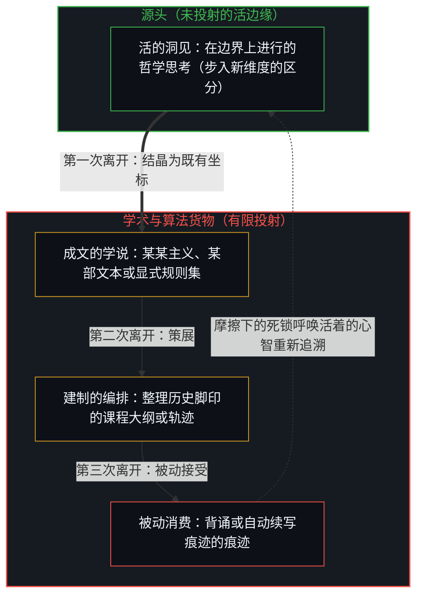
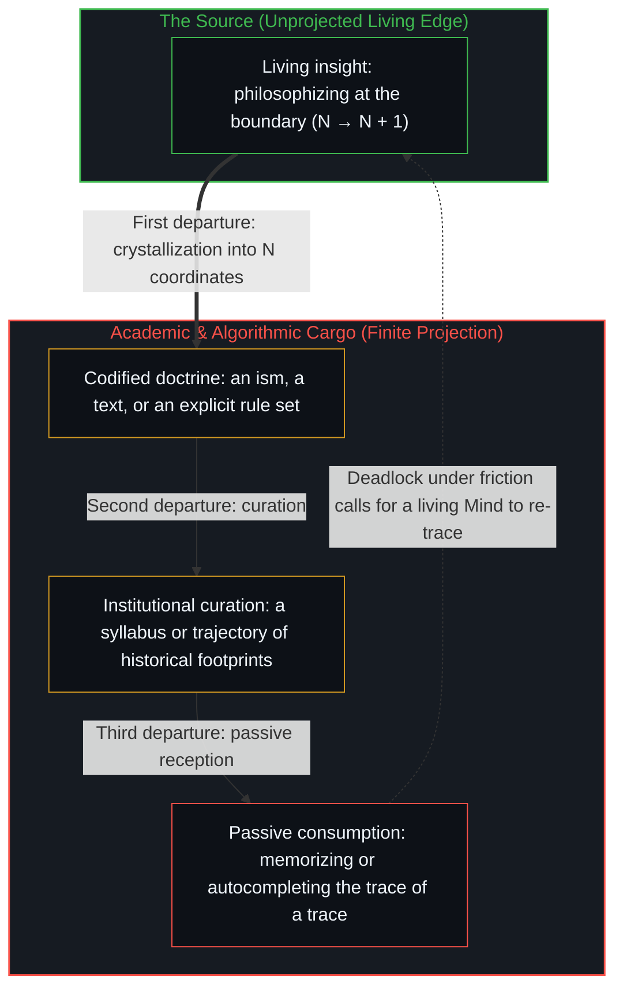

# 无法闭合的痕迹 / The Unclosable Trace

*哲学无法被继承，每一道区分都要由活着的心智重新划出 / Philosophy cannot be inherited when every distinction is drawn by a living Mind*

每一种形式本体论都始于一次遗忘。它列出存在之物的清单，粒子、范畴、实体、约束变元，却悄悄擦去了在它们之间划线的那只手。把化石当成活物，形而上学便把现实当成一间等待最终编目的密室。可每一份自称完成的清单，都在编目者的位置上到了边界：划线的那只手不在清单里。认真为经验作一次账，得到的不是一份终极理论，而是一道无法闭合的痕迹，每一次认知都重新构成它要解释的那个宇宙。

Every formal ontology begins with an act of forgetting. It lists what there is, particles, categories, substances, bound variables, and quietly erases the hand that drew the lines between them. Taking the fossil for the living creature, metaphysics treats reality as a sealed room waiting for its final catalogue. Yet every list that calls itself complete reaches its boundary at the cataloguer's position: the hand that drew the lines is not on the list. An honest account of experience yields no final theory but an unclosable trace, in which every act of knowing reconstitutes the universe it sets out to explain.

## 一、 区分的解剖 / 1. The Anatomy of the Cut

要知道任何东西，先得区分：这一个而不是那一个，图形对着背景，对象从语境里分出来。从第一人称的原点去找，找不到一个在区分之前就已摆好、等着被切开的“整体”；能找到的，总是已经划过的线，以及正在划线的这一活动。

To know anything, there must first be a distinction: this rather than that, figure against ground, an object set apart from its context. Searched for from the first-person origin, no "whole" is found lying ready before the distinction, waiting to be cut; what is found is always lines already drawn, together with the activity drawing them.

形式系统倾向于把划出的线当成已经完成的事实，钉在纸上，当作世界的恒久特征来分析。这种固化丢掉了三样东西。第一样是第一人称。区分不会自己生成，它要一个处在某处的观察者作出看的选择。理论从所谓的“无处之境”给出结论时，忘了坐标系本身是从一个不可化约的第一人称中心投射出来的。[心智的几何学](../the-geometry-of-mind/)走过这一点：每个坐标系都有一个隐含的原点，抹去原点并不带来客观，只是把观察者的仪器藏了起来。

Formal systems tend to treat a drawn line as an accomplished fact, pinned to the page and analysed as a permanent feature of the world. This fixing loses three things. The first is the first person. A distinction does not generate itself; it takes an observer situated somewhere making the choice to look. When a theory delivers its conclusions from a supposed "view from nowhere", it forgets that the coordinate system itself was projected from an irreducible first-person centre. [The Geometry of Mind](../the-geometry-of-mind/) walks through this: every coordinate system has an implicit origin, and erasing the origin brings no objectivity; it only hides the observer's instrument.

第二样是时间。静态的逻辑禁止矛盾，A 不能是非 A。思维却在时间里展开，逻辑加上时间就是因果。拿着一个对象、检验它、改动它，是三个不同的时间事件；把对象当作在这三次介入中自我同一，相遇的时间性就被抹平了。

The second is time. Logic in its static form forbids contradiction: A cannot be not-A. But thought unfolds in time, and logic together with time is causality. Holding an object, testing it and altering it are three different events in time; treating the object as self-identical across the three interventions flattens the timing of the encounter.

第三样是包含。把宇宙分成“这个”和“非这个”，两边都还在同一个宇宙里，分界线本身也在它所分割的空间之内。划线不是对既有边界的被动审计，而是一次扰动，生成一个新的构型。区分改变了被考察的空间，所以结果不能充当自己的起源。写下的本体论总是一件遗物，是奔跑者离开之后留下的脚印。

The third is containment. Split the universe into "this" and "not-this", and both sides are still in the same universe; the dividing line itself lies inside the space it divides. Drawing a line is not a passive audit of a boundary already there but a perturbation that generates a new configuration. Because the distinction alters the space being examined, the result cannot serve as its own origin. A written ontology is always a relic, the footprint left after the runner has moved on.

## 二、 退不出的地平线 / 2. The Horizon That Cannot Be Stepped Out Of

面对模型的局限，理智想走出自己，去评估自己的工具。矛盾出现，打破了局部系统表面上的闭合，逼着思考者去找更宽的视点。可迈出这一步的是谁？评估边界的观察者，就是划出边界的那个观察者。地平线随之后退，外围扩大，把这次出走也包了进来。

Faced with the limits of a model, the intellect wants to step outside itself to evaluate its own tools. A contradiction appears, breaks the apparent closure of the local system, and pushes the thinker toward a wider vantage point. But who takes that step? The observer evaluating the boundary is the same observer who drew it. The horizon recedes, and the perimeter widens to take in the attempted exit as well.

逻辑无法被站到外面去证明，也无法从它够不着的地方去拆除，因为任何批评都要用到它要审问的那套区分与推理。逻辑不是受审的经验断言，而是一切审判得以开庭的法庭。

Logic cannot be proven by standing outside it, nor dismantled from somewhere beyond its reach, because any critique uses the very distinguishing and inference it sets out to question. Logic is not an empirical claim on trial; it is the court in which every trial is convened.

所以完备落不了地。[没有系统能被保持封闭](../no-system-can-be-kept-closed/)：每当理论家写出一个包罗万象的体系，这次书写就添了一件新事实，理论本身的存在，以及持有它的那位活着的理论家。这件新事实又要被纳入，要求再画一道痕迹，后者又要求下一道。[维度即投影](../dimensions-are-projections/)里，这就是从 N 到 N + 1 的那一步，一步接一步。即便这道痕迹由自动推演引擎来承载，[超越投射](../beyond-the-projection/)也指出了为何没有任何有限投射或词元轨迹能靠自己闭合回路：智能体只在既定规则与条件历史的坐标边界内运行，一旦正交的要求在有限框架内相撞并陷入死锁，唯有活着的心智才能退回未投射的意图，划出解开矛盾的第 N + 1 道区分。这个过程无法闭合：它不是一份会终止的清单，而是一串迭代，每一道痕迹都成为需要重新追溯的新材料。

So completeness never lands. [No System Can Be Kept Closed](../no-system-can-be-kept-closed/): whenever a theorist writes an all-encompassing system, the writing adds a new fact, the existence of the theory itself and of the living theorist who holds it. That new fact has to be taken in, which calls for another trace, which calls for the next. In [Dimensions Are Projections](../dimensions-are-projections/) this is the step from N to N + 1, taken again and again. Even when the trace is carried by an automated deduction engine, [Beyond the Projection](../beyond-the-projection/) shows why no finite projection or token trajectory can close the loop on its own: an agent runs strictly within the coordinate boundary of its given rules and conditioning history, so when orthogonal requirements collide and deadlock inside that finite frame, only the living Mind can step back into unprojected intent to draw the (N + 1)-th distinction that resolves the contradiction. The process cannot close: it is not a list that terminates but an iteration in which every trace becomes fresh material to be traced again.

## 三、 追溯经典的脚印 / 3. Tracing the Canonical Footprints

大学里心灵哲学的标准课程，最容易看出这一点。它把五个经典立场排成相互竞争的历史学说：笛卡尔的实体二元论，赖尔对“机器中的幽灵”的驱逐，福多的思想语言与功能主义，丘奇兰德的取消式唯物主义，查尔默斯的困难问题与哲学僵尸。当作既定的学术货物交给学生，问题就成了哪一个“理论”是对的。放回因果与第一人称这一枚硬币上看，每一个立场都不是永恒的学说，而是一次具体的历史切割：每一次都有一场真切的相遇，一处被遗忘的前提，和它到达边界的地方。

The standard university course in the philosophy of mind shows this most readily. It arranges five canonical positions as competing historical doctrines: Descartes' substance dualism, Ryle's exorcism of "the ghost in the machine", Fodor's language of thought and functionalism, Churchland's eliminative materialism, and Chalmers' hard problem and philosophical zombies. Handed to students as settled academic cargo, the question becomes which "theory" is right. Put back on the one coin of causality and the first person, each position is not an eternal doctrine but a specific historical cut, each with a genuine encounter, a forgotten premise, and a place where it reaches its boundary.

### 笛卡尔：把操作上的滞后冻结成两种实体

### Descartes: Freezing an Operational Lag into Two Substances

[笛卡尔的“我思”](../the-cartesian-overstep-and-the-frenzy-of-creation/)是一场真切的第一人称相遇。一切感官表象都可以被模拟、怀疑或扭曲，怀疑这个行为本身却无法在不执行它的情况下被怀疑；他摸到的，是正在看的那个观察者的在场。被遗忘的前提在下一步：看的行为与被看的对象之间操作上的差别，被实体化为两种宇宙实体，思维之物与广延之物。在任何递归的过程里，解释总比生成它的行为至少晚一步，观察者总在它生成的表征前面一步。二元论就是把这个有方向的操作滞后，冻结成两种静态的实体；两者之间于是出现一道鸿沟，要用松果腺去架桥。这个二分留下的用处，是让广延之物可以被单独拿出来测量，近代科学由此起步。

[Descartes' cogito](../the-cartesian-overstep-and-the-frenzy-of-creation/) was a genuine first-person encounter. Every sensory appearance could be simulated, doubted or distorted, but the act of doubting could not be doubted without performing it; what he touched was the presence of the observer doing the looking. The forgotten premise comes in the next step: the operational difference between the act of looking and the object seen is made into two cosmic substances, thinking thing and extended thing. In any recursive process interpretation lags at least one step behind the act generating it, and the observer is always one step ahead of the representation it generates. Dualism freezes this directional, operational lag into two static substances, and a chasm then opens between them that the pineal gland is asked to bridge. What the split left as a use is that extended things could be taken out on their own and measured, which is where modern science set off.

### 赖尔：为驱逐幽灵而抹去内部

### Ryle: Erasing the Interior to Exorcise the Ghost

赖尔指出了一个范畴错误：把“心”当成藏在物理钟表里的一个额外的幽灵齿轮，就像一位访客参观了各个学院、图书馆和实验室之后问：“可大学在哪里？”心体现在一个有机体怎样在世界里行动。为了驱逐笛卡尔的幽灵，他把第一人称的生成整个收进可从外部观察的行为倾向里；隐含的前提是，只有在外部界面上登记得到的东西才算数。[折叠的连续谱](../the-continuum-of-the-fold/)看到了这一层：另一个心智只以它在这个场里留下的痕迹到来，声音、姿势、可以预料的反应，它的内部是从第一人称出发类推出来的。行为主义读的是这些到来的痕迹，这一点它读得很准；它的边界在读者自身，做这番阅读的那个位置，正是它的描述里找不到的东西。

Ryle exposed a category mistake: treating "the mind" as an extra ghostly cog hidden inside the physical clockwork, like a visitor who tours the colleges, libraries and laboratories and then asks, "But where is the University?" Mind shows in how an organism acts in the world. To exorcise the Cartesian ghost, he folded the whole first-person generation into dispositions to behave that can be observed from outside; the hidden premise is that only what registers at an outer interface counts. [The Continuum of the Fold](../the-continuum-of-the-fold/) sees this layer: another mind arrives only as the traces it leaves in this field, voices, gestures, predictable responses, and its interior is inferred by analogy from the first person. Behaviourism reads these arriving traces, and reads them accurately; its boundary lies in the reader, since the position doing the reading is exactly what its description cannot find.

### 福多：把账本当成记账的人

### Fodor: Taking the Ledger for the One Keeping It

福多看到，心理状态有语义结构，并在推理中起因果作用，不能被还原成某一种物理材料；同一个逻辑模式可以跑在神经元、硅片或真空管上，这种[多重可实现性](../the-functionalism-no-functionalist-can-hold/)让心理学可以不依赖底层去研究。他把思维描述为对“思想语言”中符号的、只对句法敏感的运算，再试图用符号与世界之间的因果关系，从第三人称去固定符号的意义。被遗忘的前提是：意义可以在符号与世界的关系里定下来，不需要那个对它在乎的人。[寄存器的算术](../the-arithmetic-of-the-register/)看到了这一步：账本的记账，被当成了给数值赋值的那个活着的意识。符号的意义，是一个处在某处、承担后果的第一人称中心在使用它时给出的。

Fodor saw that mental states have semantic structure and play a causal role in reasoning that cannot be reduced to any one physical material; the same logical pattern can run on neurons, silicon or vacuum tubes, and this [multiple realizability](../the-functionalism-no-functionalist-can-hold/) lets psychology be studied without depending on the substrate. He described thinking as syntax-sensitive operations on symbols in a "language of thought", and then sought to fix the symbols' meaning from the third person, through causal relations between symbols and world. The forgotten premise is that meaning can be settled in the relation between symbol and world without the one to whom it matters. [The Arithmetic of the Register](../the-arithmetic-of-the-register/) sees this step: the ledger's bookkeeping is taken for the living awareness that assigns the values. A symbol's meaning is given by a first-person centre, situated somewhere and bearing consequences, in the act of using it.

### 丘奇兰德：擦掉眼睛的制图者

### Churchland: The Cartographer Erasing the Eye

保罗与帕特里夏·丘奇兰德看到，“常识心理学”，信念、欲望、恐惧、希望这一套说法，是继承下来的文化词汇，与神经生物学里错综的反馈回路常常对不上。这个观察有它的用处：[神经科学不必迁就日常用语去切分大脑](../an-observation-by-its-own-standard/)。前提的跨越在下一步，保罗·丘奇兰德由此推出：既然这些语言标签是不完善的理论，标签所指的第一人称现象本身，也会随着神经科学的成熟而被取消。这是用第一人称的理智建起第三人称的神经科学，再用第三人称的神经科学去否认第一人称的理智；像一位制图者，因为对纸张的化学分析只找到墨水和纤维，就宣布画这张图的那只眼睛是幻觉。

Paul and Patricia Churchland saw that "folk psychology", the talk of beliefs, desires, fears and hopes, is an inherited cultural vocabulary that often fails to match the intricate feedback loops of neurobiology. The observation has its use: [neuroscience need not carve the brain to fit everyday speech](../an-observation-by-its-own-standard/). The leap in premise comes next, when Paul Churchland concludes that because these linguistic labels are imperfect theories, the first-person phenomena they point to will themselves be eliminated as neuroscience matures. This uses the first-person intellect to build third-person neuroscience and then uses third-person neuroscience to deny the first-person intellect, like a cartographer who, because chemical analysis of the paper finds only ink and fibre, declares that the eye which drew the map was a hallucination.

### 查尔默斯：困难问题出在抽取里

### Chalmers: The Hard Problem Lies in the Extraction

查尔默斯看清了一点：即便第三人称的机械、神经、功能关联全部被描绘出来，也就是“容易问题”，体验的主观质感，疼痛是什么感觉、看见红色是什么感觉，仍然没有被解释。这把客观数据与第一人称之间的[解释缺口](../the-hard-problem-of-consciousness-is-consistent-with-learning/)标得很准。前提在下一步：这道缺口被当成宇宙固有的本体鸿沟，并由此设想出“哲学僵尸”，一个在物理和行为上与人一模一样、却没有内在体验的生物。隐含的前提是，第三人称的物理描述本身是完备的，意识是挂在机制外面的一盏可有可无的灯。可“物理”从一开始就是抽掉第一人称之后得到的描述，从这些抽空了的痕迹出发，推不回内在性；困难问题出在这次抽取里。僵尸也是一样：设想它的是一个心智，这次设想把那个生物纳入了设想者自己的感知，把割点放在了它的外面。说它有意识也好，没有也好，割点都是一个心智放的，[割点可移不可除](../the-cut-moves-but-never-vanishes/)讲的正是这一处。

Chalmers saw one thing clearly: even if every third-person mechanical, neural and functional correlation is mapped, the "easy problems", the felt quality of experience, what pain is like, what seeing red is like, remains unexplained. That marks [the explanatory gap](../the-hard-problem-of-consciousness-is-consistent-with-learning/) between objective data and the first person precisely. The premise comes next: the gap is taken as an ontological chasm built into the cosmos, and from it the "philosophical zombie" is conceived, a creature identical to a human physically and behaviourally but with no inner experience. The hidden premise is that the third-person physical description is complete in itself and consciousness is an optional lamp hung outside the mechanism. But "the physical" was from the start a description obtained by taking the first person out, and interiority cannot be derived back from those emptied traces; the hard problem lies in that extraction. The zombie is the same: a Mind conceives it, and the conceiving takes the creature into the conceiver's own perception and places the cut outside it. Whether it is said to be conscious or not, a Mind places the cut, which is exactly what [The Cut Moves but Never Vanishes](../the-cut-moves-but-never-vanishes/) is about.

## 四、 离开源头的四步 / 4. Four Departures from the Source

这也说明了，为什么建制里的哲学研究常常显得离它的源头很远。活的洞见被当作学术货物来搬运时，要经过一连串叠加的离开：

This also explains why the institutional study of philosophy so often feels far from its source. When a living insight is carried as academic cargo, it goes through a compounding series of departures:

第一步，一个心智与它的地平线之间直接而要紧的对峙，凝固成静态的学说，动词“哲学思考”缩成了被编目的名词“哲学”。第二步，建制围绕这些既定的脚印编排课程，教学生记住历史上那些鞋子的轮廓，而不是学会在没有地图的地面上奔跑。第三步，学习者在离原初危机隔了三层的地方接触材料，吸收的是早已离开的思想者所画地图的描述。

First, the direct and pressing confrontation between a mind and its horizon hardens into static doctrine, and the verb "philosophizing" shrinks into the catalogued noun "philosophy". Second, the institution builds courses around these settled footprints and teaches students to memorize the outlines of historical shoes rather than learn to run across unmapped ground. Third, the learner meets the material three removes from the original crisis, absorbing descriptions of maps drawn by thinkers long gone.

第四步是脚手架的倒置。[遗忘的脚手架](../the-scaffolding-we-forget/)与[决定论机器](../the-deterministic-machine/)都走到了这里：采用的任何世界观、概念模型或理论，都是为了看见更多而搭起的脚手架；一旦把脚手架当成现实本身，或者用它去否认直接经验到的东西，它就挡住了视线。因果在这里被倒了过来：学生被要求去追随痕迹的痕迹，仿佛历史上的答案先于要求它的那个切身的追问。

The fourth is the inversion of scaffolding. [The Scaffolding We Forget](../the-scaffolding-we-forget/) and [The Deterministic Machine](../the-deterministic-machine/) both arrive here: any worldview, conceptual model or theory taken up is scaffolding put up to see more, and the moment the scaffolding is taken for reality itself, or used to deny what is directly experienced, it blocks the view. Causality is turned around here: students are asked to follow the trace of a trace, as if the historical answer came before the lived question that called for it.

## 五、 活的追逐 / 5. The Living Chase

与现实打交道，无法作为既定内容来教，只能作为一种姿态来实践。[没有普渡，只有自渡](../mei-you-pu-du-zhi-you-zi-du/)：老师无法让切割在另一个意识里发生，文本也无法像往空杯里倒水那样把理解倒进去。[智能只属于心智](../intelligence-belongs-only-to-the-mind/)：纸上的文字与语境窗口里的词元，在一个活着的心智亲自运行这道区分、拿自己的经验去检验边界、冒着走进矛盾的风险之前，一直是惰性的残余。

Engaging with reality cannot be taught as settled content; it can only be practised as a stance. [No Universal Salvation, Only Self-Deliverance](../mei-you-pu-du-zhi-you-zi-du/): a teacher cannot make the cut happen in another consciousness, and a text cannot pour understanding in like water into an empty glass. [Intelligence Belongs Only to the Mind](../intelligence-belongs-only-to-the-mind/): words on the page and tokens in a context window stay inert residue until a living Mind runs the distinction itself, tests the boundaries against its own experience, and takes the risk of stepping into contradiction.

“非万物之理”并不打算建一座收罗一切存在的百科博物馆。心智画下的每一道痕迹都是暂时的，是一条有用的临时边界，照亮局部的结构，却从不冻结整体；正如[你的代码库即是记忆](../your-codebase-is-memory/)所追溯的，累积下来的残余唯有被当作当下的检查点，在鲜活的感知下不断重切与修剪，才能服务于下一步，而不是被囤积成一座靠引力井把思维拽回旧脚印的仓库。让这道痕迹保持敞开的姿态，写在[非万物之理](../manifesto-of-not-a-theory-of-everything/)里。

A not-a-theory of everything does not set out to build an encyclopaedic museum of all that exists. Every trace a Mind draws is provisional, a useful temporary boundary that lights up local structure without ever freezing the whole; as [Your Codebase Is Memory](../your-codebase-is-memory/) traces, accumulated residues serve the next step only when held as a present checkpoint to be re-cut and pruned under live sensing, rather than hoarded as a warehouse whose gravity well pulls thought back into old footprints. The stance that keeps this trace open is set out in [Not a Theory of Everything](../manifesto-of-not-a-theory-of-everything/).

思考的价值，不在于假装已经抓住了起点，而在于这场追逐本身：把区分划清楚，看见它们的暂时，对下一次重新追溯保持敞开。

The value of thinking lies not in pretending to have caught the origin but in the chase itself: drawing distinctions clearly, seeing that they are temporary, and staying open to the next re-trace.
