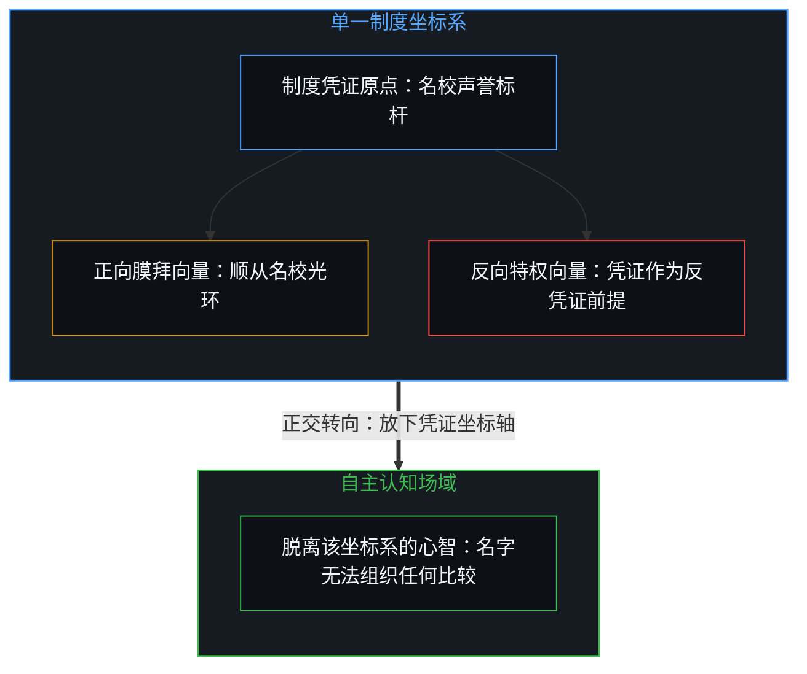
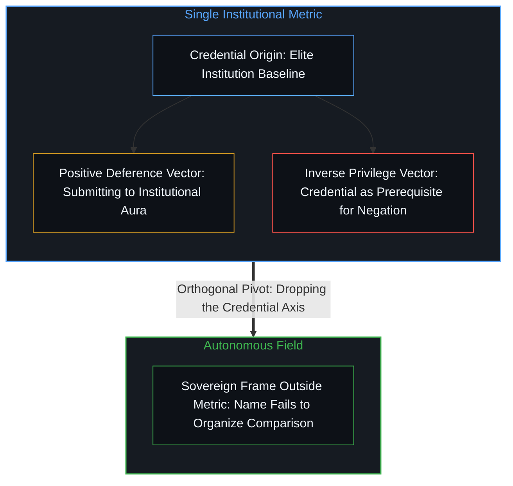
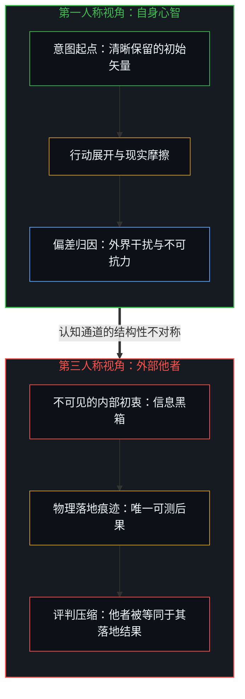
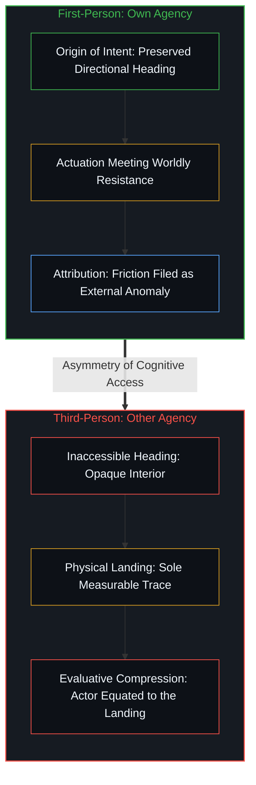
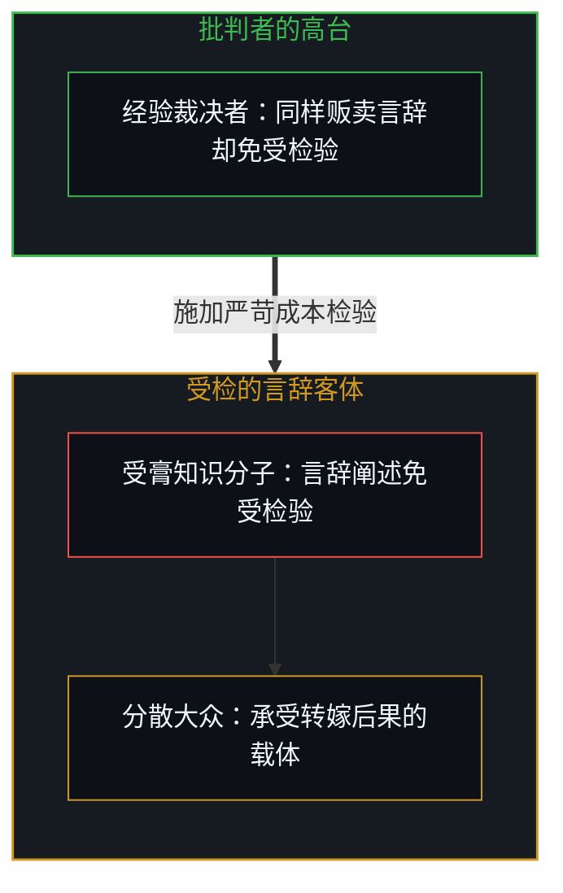
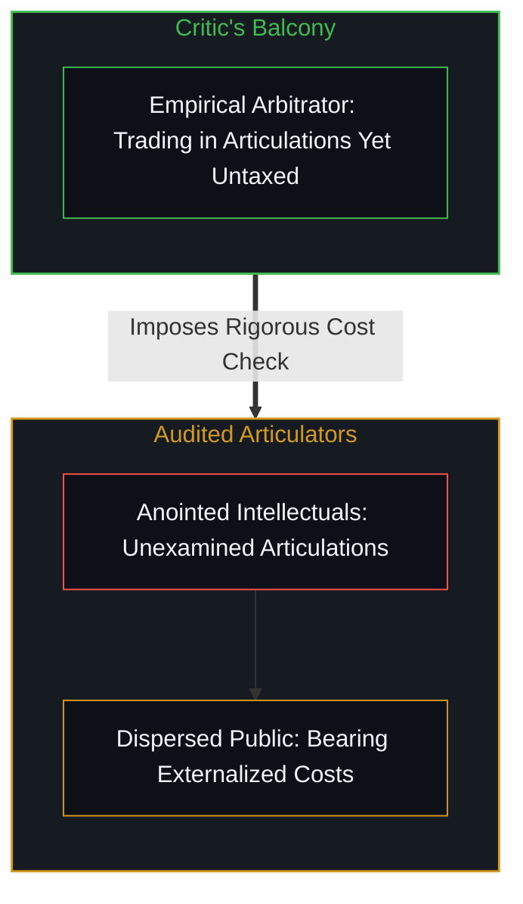
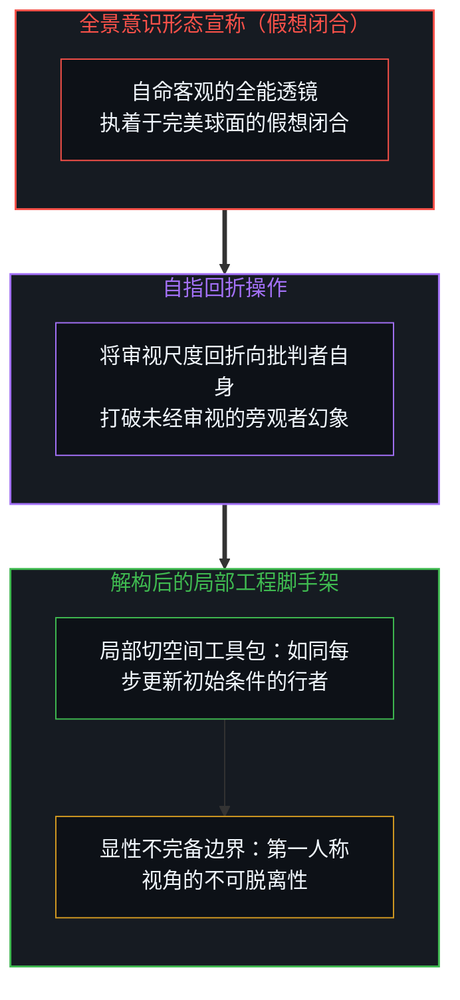
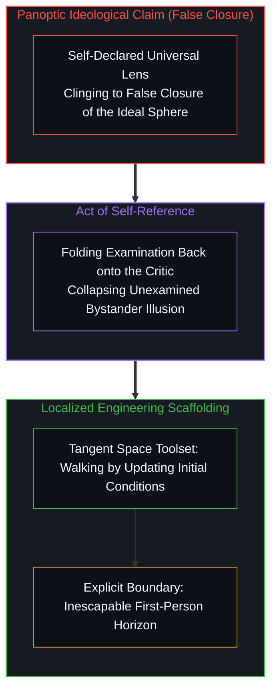

# 未经自我审视的批判者 / The Unexamined Critic

*批判者指责他人的言辞免受检验，却把自己的高台豁免于同样的审视。 / The critic condemns ungrounded words in others while exempting his own perch from examination.*

借由托马斯·索维尔那副广受推崇的诊断透镜审视知识分子的偏颇时，读者常常忽略观察者自身那块不声不响的立足点。批判者指责他人凭言辞构筑愿景而无需承担具身检验的代价，却在此刻将自己的经验主义高台豁免于同样的审视机制之外。任何寻求闭合的概念系统，都倾向于将观测者与被观测者割裂为互斥的两个半球。将这把分析标尺回折到理论家自身，并不会摧毁这一模型，而是标定了它不完备性的边界，使帝国式的普遍性宣称回归为趁手而可复用的局部脚手架。

When examining the fallacies of intellectuals through Thomas Sowell’s celebrated diagnostic lens, readers routinely overlook the quiet footing occupied by the observer. The critic faults others for trading in verbal articulations without facing bodily testing, yet exempts his own empiricist balcony from that identical examination. Every conceptual system seeking closure tends to split observer from observed as mutually exclusive hemispheres. Folding that diagnostic scale back upon the theorist does not destroy the model, but marks its boundary of incompleteness, converting an imperial claim to universality into reusable, local scaffolding.

## 一、 否定立场的反向确证 / 1. The Inverse Confirmation of Negation

一句归于托马斯·索维尔名下、广为流传的格言说，就读哈佛的最大收益在于，余生之中既不会被哈佛毕业生吓倒，也不会再对他们盲目崇拜。这句俏皮话常被当作打破名校神话的清醒剂，甚至被引为反凭证主义的典范。然而仔细审视这句断言的几何结构便会发现，它依然在借由它所排斥的对象来确立自身的坐标。声称自己既不畏惧也不膜拜，依然是在按照是否毕业于哈佛来划分人群。证书依然是这句陈述用以度量世界的基准，只是矢量的正负号发生了翻转。否定并未跳出既有的参照系，而是重新描摹了它试图驱逐的刻度。

A widely quoted maxim attributed to Thomas Sowell suggests that one of the greatest benefits of attending Harvard is that, for the rest of your life, you are neither intimidated nor impressed by people who went there. This aphorism is frequently celebrated as an antidote to institutional prestige, or even as an archetype of anti-credentialism. Yet examining the geometry of the statement reveals that it remains anchored to the coordinates it purports to abandon. Declaring that one is neither intimidated nor impressed continues to sort individuals by whether they hold the degree. The credential remains the axis of measurement; only the sign of the vector has flipped. Negation does not exit the frame; it retraces the contour it seeks to expel.

深入名校体制内部可以消解光环带来的信息差，使心智停止将一块金字招牌视为能力的现成代币，这是局部经验修正的自然产物。更直接地看，这种论调暗中把持有凭证设成了反凭证主义的前提，反而在深层巩固并维护了凭证主义。如果一个从未踏入该体制的外人宣称自己不被名牌唬住，外部世界极易将其贬斥为缺乏见识的酸葡萄心理；唯有手握那张烫金印记的圈内人，其脱魅才被赋予合法地位，被奉为清醒透彻的洞见。批评凭证的资格依然由凭证授予，抽身与脱敏在此硬化为了更高阶的身份资产，宣示着一种唯有被选中者方能获得的免疫力。雕像没有被移走，体制通过将异议者收编为自己的授勋校友，进一步加固了自身门槛的首要地位。一个跳出该坐标系的心智，不会把不再敬畏名牌当作一项值得宣扬的自由，因为那个名字已经无法在它的认知中组织任何比较。[破除概念的僭越](../po-chu-gai-nian-de-jian-yue/)剖析了心智如何把纸面上业已完结的符号——无论是受人尊崇的文凭还是反凭证主义的口号——误认为行动边缘处不可逆的推进，并借由推诿回传的摩擦来护卫凝固的自我形象；正如[阅读的倒错与推断的次序](../the-inversion-of-reading-and-the-order-of-inference/)所展示的，应激式的反驳只会让批判者困在原作者的坐标系内缠斗，而非剥离出其承重的前提。这句格言本身的流转也遵循同一机制：作为归于索维尔名下的一句现成话语，它的反凭证力度正是由被引用者的名望所承载的，而[登记共鸣的表面](../the-surface-that-registers/)则追溯了这样一句话：一旦脱离筛选它的那条切分链条而四处流转，便只剩下一层借用出处分量的薄表面，而发布它的动作仍可以在发布端登记为一次已然完成的表达。

Dwelling inside elite institutions can dissolve status differentials, stopping the mind from taking institutional seals as ready tokens of competence, which is the natural outcome of localized friction. More directly, this framing covertly establishes possessing the credential as the prerequisite for anti-credentialism, thereby fortifying and preserving credentialism from within. If an outsider who never entered the gates claims indifference to the pedigree, the world easily dismisses the attitude as sour grapes; only an insider stamped by the institution is granted the legitimate license for enlightened disenchantment. The authority to criticize the credential is still issued by the credential itself. Detachment hardens into a higher-order status asset, announcing an acquired immunity accessible only to the anointed. The monument remains intact; by co-opting critics as its own decorated alumni, the institution reinforces the primacy of its threshold. A frame that has stepped outside that coordinate space does not advertise its freedom from prestige, because the institution ceases to organize the comparison. [Breaking the Overreach of Concepts](../po-chu-gai-nian-de-jian-yue/) traces how finished symbols on paper—whether a revered diploma or an anti-credentialist slogan—are mistaken for irreversible execution at the living edge while returning friction is disowned to protect a frozen self-image, just as [The Inversion of Reading and the Order of Inference](../the-inversion-of-reading-and-the-order-of-inference/) shows how reactive refutation keeps a critic fighting inside an author's coordinate frame instead of isolating its load-bearing premises. The maxim itself travels the same way: as a finished line attributed to Sowell, its anti-credential force is carried by the standing of the quoted name, and [The Surface That Registers](../the-surface-that-registers/) traces how such a line, once circulated without the chain of cuts that selected it, keeps only a thin surface whose weight is borrowed from its source while its posting can register at the posting end as a completed expression.

## 二、 认知通道的天然不对称 / 2. The Structural Asymmetry of Access

这种在否定中暗中保留坐标系的机制，映射出人类日常经验中更宽广的认知不对称。人类心智在衡量他人时，常依据对方显露的行为与落地的后果进行评判，而在审视自身时，却习惯以未受污染的内部意图作为辩护。这并非单纯的道德双重标准，而是认知通道在信息结构上的差异所致。面对另一个行动中的心智，所能登记的只是他者行动激起的物理涟漪与落地的痕迹。由于他者的主观轨迹无法从外部采样，可供登记的唯有已经落地的痕迹，因而在有限容量下极易将整个行动者压缩进那些可见的结果。

The hidden preservation of coordinates inside negation mirrors a pervasive informational asymmetry in everyday experience. When evaluating others, human minds routinely judge by visible actions and landed consequences, yet when examining themselves, they plead innocence based on internal intent. This is not mere moral duplicity, but a structural consequence of cognitive access. Facing another acting mind, the mind registers only the physical ripples and landed traces that the other leaves behind. Because another person’s subjective trajectory cannot be sampled from outside, only landed traces are available to register, making it easy under finite capacity to compress the entire actor into those visible outcomes.

与此相反，心智在自身行动的源头处就能在动作展开前体验到施动性。这一方向标在付诸行动之前便已被感知，即便动作随后发生偏离，它依然活跃在意识之中。当环境摩擦将结果拉离正轨，心智便援引未竟的意图将自身与残局隔离开来，把亏空归结为运气不佳、意外变故或同侪的干扰。意图被奉为真正的自我，后果则被降格为偶发的外在境遇。意图与后果从来不是两枚可以割裂使用的钱币，它们是同一条轨迹在世间传播的两个阶段上被观察到的样子。意图是撞击之前的动作，后果是经历物理交锋后的同一次行动。[旁观者洞察的悖论](../the-paradoxical-nature-of-bystander-insights/)所剖析的旁观姿态会因为忽视这种阻力而产生漂移，正如[观察者的隐身与无损传递的妄念](../the-invisible-observer-and-the-delusion-of-lossless-transmission/)所展示的那样，脱离了摩擦的观察者会滋生系统性的幻觉。

In contrast, one’s own agency is experienced at the source before the act unfolds. That directional heading is felt prior to actuation and remains active in consciousness even after the movement diverges. When environmental friction pulls the outcome off course, the mind references its unfulfilled intent to insulate itself from the wreckage, chalking the deficit up to bad luck, unexpected weather, or interference from peers. Intention is enthroned as the true self, while consequence is demoted to incidental circumstance. Intention and consequence are never separable currencies; they are a single trajectory observed at two steps of worldly propagation. Intention is the act before impact, and consequence is that same act after physical encounter. The bystander posture dissected in [The Paradoxical Nature of Bystander Insights](../the-paradoxical-nature-of-bystander-insights/) drifts by overlooking this resistance, just as [The Invisible Observer and the Delusion of Lossless Transmission](../the-invisible-observer-and-the-delusion-of-lossless-transmission/) demonstrates that an observer disembodied from friction breeds systemic illusion.

## 三、 理论闭合的豁免王座 / 3. The Throne of Exemption in Theoretical Closure

当这种认知不对称放大为思想架构时，便结晶为理论上的自我豁免。索维尔在《知识分子与社会》和《受膏者的愿景》中展开了有力的批判，指出知识分子经营的只是经由言辞阐述的观念。当他们的社会工程方案失败时，灾难性的代价落在普通民众身上，而阐述者自身却免于财务或职业上的破产。由于受到庇护而免于市场纪律的约束，受膏者们得以在实际结果早已偏离之后，长久维持自我标榜的教条。这项针对技术官僚傲慢的拆解颇为锐利，然而整套理论的闭合却维系于一个未经审视的盲区：批判者自己所占据的批评高台，究竟由谁来审视与审计？更直接地说，批判者自己不也正在做着被他批判的事吗？索维尔在精英智库的高台上斥责知识分子贩卖悬空的修辞，他自己经营的同样是由概念阐述构成的著作。如果他那套反对干预的学说被采纳并在实地引发经济错位，作者本人同样不会面临资本或生计的直接损失。他斥责他人兜售隔绝于后果反馈的愿景，却将自己发出这一批判时所据守的制度高台豁免于同样的审计之外。

When this cognitive asymmetry scales into intellectual architecture, it crystallizes into theoretical self-exemption. Thomas Sowell mounted a formidable critique in *Intellectuals and Society* and *The Vision of the Anointed*, showing that intellectuals deal strictly in articulated ideas. When their social engineering schemes fail, the catastrophic costs fall upon ordinary citizens while leaving the articulators insulated from financial or professional ruin. Shielded from market discipline, the anointed sustain self-congratulatory doctrines long after empirical outcomes diverge. This demolition of technocratic hubris is sharp, yet the closure of the theory hinges on an unexamined blind spot: who examines and audits the critical balcony occupied by the author? Put more directly, isn't the critic doing the very thing being criticized? Denouncing intellectuals as dealers in ungrounded rhetoric from his perch in elite think tanks, Sowell trades in books comprised of articulated concepts. If his anti-interventionist doctrines are adopted and induce economic dislocations on the ground, the author himself faces no direct loss of capital or livelihood. He scolds others for peddling visions insulated from consequential feedback, while leaving the institutional perch from which he issues that critique exempt from the same audit.

以只向硬数据低头的严谨经验主义者自居，这本身同样是一种经由言辞阐述的姿态。在索维尔的宏大图景中，他者是身处局内、被扭曲激励蒙蔽的局部行动者，而诊断者则伫立于奥林匹斯高台之上，对一切权衡取舍持有不受污染的视野。如果这套审视逻辑不打折扣地贯彻到底，那么分析者自己的证据拣选、意识形态上的结盟与出版激励，同样应当持续接受成本核算。然而任何体系化的学说为了达成内在一致性，都在某个边界处终止递归。这个终止点，正是批判者留给自己的免受检验的特权王座——也正是[审美的自动扶梯与阳台的忧郁](../the-aesthetic-escalator-and-the-melancholy-of-the-balcony/)所定位的那座高台：当批判者倚仗累积的品味或借来的文学权威自诩道德明晰与自由时，实则是将自身未经审视的前提遮蔽于现实无缓冲的反馈之外。观测者被设定为不变的标尺，被观测的社会则是拿它去丈量的参差布匹。正如[索维尔的表象洞察与根因之偏](../sowell-observed-the-surface-problem/)所追溯的，这项诊断在触及系统性激励时停下了脚步，恰如[隐秘的上帝之眼](../the-invisible-gods-eye/)所展示的，自居超然的奥林匹斯视线始终是一种拒绝向自身回折的智力悬置。

Presenting oneself as the austere empiricist who bows only to hard data is itself an articulated posture. Within Sowell’s grand architecture, other actors are parsed as localized agents blinded by distorted incentives, while the diagnostician observes from Olympian heights, possessing an untainted view of trade-offs. If this examination were applied without compromise, the analyst’s own evidentiary selections, ideological alliances, and publishing incentives would also face continuous cost auditing. Yet every systemic doctrine halts recursion at some boundary to achieve internal consistency. That stopping point is the critic’s self-granted throne of exemption, the same elevated perch [The Aesthetic Escalator and the Melancholy of the Balcony](../the-aesthetic-escalator-and-the-melancholy-of-the-balcony/) locates when a critic leans on accumulated taste or borrowed literary authority to claim moral clarity and freedom while shielding his own unexamined premises from reality's unbuffered feedback. The observer is cast as the immutable yardstick, while the observed society is the uneven fabric measured against it. As [Sowell Observed the Surface Problem](../sowell-observed-the-surface-problem/) traces, the diagnosis stopped short at systemic incentives, just as [The Invisible God's Eye](../the-invisible-gods-eye/) demonstrates that an aloof Olympian gaze remains an intellectual suspension that refuses to fold back upon itself.

这个豁免并不是索维尔那项诊断之外的第二个错误，而是他所诊断的倾向在他身上发生了。对这个未加标注的座位本身，心理学有一个名字，叫朴素实在论：每个人都容易把自己的视角当成客观真相，把不同意见归为信息不足或偏见。这句话说得很准。可“朴素”这个词本身就是这句话的现场演示：要说这种实在论朴素，先得有一个看得出它朴素的位置，而这个位置本身却不带任何标签，尽管那句话说的是“每个人”。说话者的位置被当成不必标注的平地，只有别处的看法才显出缺了什么。这一下并不推翻朴素实在论那句话，反而证实了它：倾向如它所说的那样发生，说出它的人也不在例外之列。两项诊断因此照旧可用，用它们的人也站在它们之内。

The exemption is not a second error beside Sowell's diagnosis; it is the tendency he diagnosed, occurring in him. Psychology has a name for the unmarked seat itself, naive realism: each person easily takes their own perspective for the objective truth and files disagreement under missing information or bias. The description is accurate. Yet the word "naive" is the description demonstrated on the spot: it needs a vantage from which this realism shows as naive, and that vantage carries no label of its own, even though the description says "each person". The speaker's position is treated as level ground that needs no marking, and only views from elsewhere show up as lacking something. That move does not overturn the naive-realism description; it confirms it: the tendency occurs just as described, and the one describing it is no exception. Both diagnoses therefore stay usable, and whoever uses them stands inside them.

## 四、 划定不完备性而非宣告失效 / 4. Demarcating Incompleteness Without Invalidation

指出批判者自身的豁免地位，并不意味着宣告这套模型失效或将其洞见弃之如敝履。相反，将自指回折给理论自身，并不是为了驳倒其机制，而是为了划定其不完备性的边界。在索维尔勤勉搜集历史证据的领域——价格协调、分散知识不可替代的性质、第三方决策的隐患——他的诊断依然保有强大的解释力。后来的思考者尽可自由取用这些分析模块，将其作为测绘社会摩擦的耐用工具。不能被继承的，是那个将理论家自身豁免于其所描述的摩擦之外的全域闭合宣称。然而索维尔写下的这套理论架构，并未返回第一人称：它没有从分析者自身出发，也未曾登记第一人称视角的不可脱离性。它将市场机制描摹为在自反心智之外运转的客观秩序，把分析者自身藏匿于超然事实的门面之后；在将他人化约为受外部激励推动的局部单位时，这套架构遗漏了一点：理论家自身同样是一个无法脱离其第一人称视界的行动心智。因果律与第一人称视角本是同一枚硬币的两面，任何宏观归因一旦拒绝回折到观察者自身不可脱离的在场，便不可避免地滑向新的旁观者迷思。

Exposing the critic’s self-exemption does not invalidate the model or warrant discarding its insights. On the contrary, folding self-reference back onto a theory does not refute its mechanics, but delineates its boundary of incompleteness. Across the terrain where Sowell diligently gathered historical evidence—price coordination, the irreplaceable nature of dispersed knowledge, and the hazards of third-party decisions—his diagnostics retain immense explanatory power. Successive thinkers can freely take up these analytical modules as durable tools for mapping social friction. What cannot be inherited is the imperial claim to total closure that exempts the theorist from the friction he describes. Yet Sowell’s architecture, as written, does not return to the first person: it does not start from the analyst and does not register that the first-person vantage is inescapable. It depicts market mechanics as an objective order operating outside reflexive minds, concealing the analyst behind a facade of detached facts. In reducing others to localized units moved by external incentives, the architecture leaves out that the theorist remains an acting mind that cannot vacate its first-person horizon. Causality and the first-person vantage are two sides of the same coin; any macro attribution that refuses to fold back onto the observer’s own inescapable presence inevitably slips into a fresh bystander delusion.

这一认识论机制恰如地平说行者的行动悖论所映照的那样：一套模型只要允许在切身摩擦中对其前提进行务实的修正，就能在适宜的边界内无限延展其有效范围。在[切平面的行者与完美球面的踩空者](../the-walking-tangent-and-the-stumbling-sphere/)中，这一机制被提炼为借由动态重置初始条件对切流形进行的连续拼接；地平说的拥护者在大地上自如行走而从未坠落边缘，是因为他迈出的每一步都依照脚下泥土即时的触觉阻力，重新校准了初始条件。相反，若行动者将地球视为一个理想的光滑球面，并将这一预期强加于微观步履，行者便会在乱石、坑洼与地表裂隙面前频频绊倒，甚至寸步难行。索维尔的分析模块之所以奏效，是因为它们在各自的局部切空间内成立；一旦将这种局部有效性过度外推为包罗万象的客观教条，对无瑕球面的执念便会蒙蔽心智对微观地形的感知，使批判沦为另一套悬空的学说。

This epistemological mechanic mirrors the action paradox of the flat-earth walker: so long as a model permits pragmatic updates to its premises through lived friction, it can extend its operative scope indefinitely within appropriate boundaries. In [The Walking Tangent and the Stumbling Sphere](../the-walking-tangent-and-the-stumbling-sphere/), this mechanic is formalized as the continuous patching of tangent manifolds through dynamic resets of initial conditions; the advocate of a flat earth walks the terrestrial landscape without ever plunging off an edge because every single step refreshes its initial conditions against the immediate tactile resistance of the soil. Conversely, if an actor treats the globe as an ideal, smooth sphere and forces that expectation onto micro-steps, the walker will stumble continuously over rocks, potholes, and terrain fractures, rendered unable to take a single step. Sowell's analytical modules succeed because they hold within their localized tangent spaces; the moment this local validity is overextended into an all-encompassing objective dogma, fixation upon the immaculate sphere blinds the intellect to microscopic terrain, turning critique into another ungrounded doctrine.

不完备性从来不是设计上的瑕疵，而是任何形式化表征赖以成立的沉默边界条件。一套企图囊括一切的框架必然丧失内在一致性，而一套维持一致性的框架则必然留下其基础前提未经解释。当心智执迷于构建解释一切的系统时，它便会将局部功效误认为普遍法令。一旦自指的透镜重新聚焦于观察者的源点，教条便随之消解，边界也变得清晰可辨。剥去普遍性的僭越之后，理论便回归其本来的面目：鲜活心智在不确定性中搭建的临时脚手架。在[向量、坐标系与自指心智](../the-mind-as-vector-and-coordinate-system/)中，意识借由将坐标系折回自身而重获主权；正如[闭合的N与开放的现实](../the-closed-n-and-the-open-reality/)所展示的，放下人为闭合的执念，开放式的探索方能沿着开放的因果视界持续推进；而[你的代码库即是记忆](../your-codebase-is-memory/)则追溯了外化的思想库或代码库如何始终只是下游留存的痕迹，其显露出来的前提边界从不会自行修正，唯有处于掌舵边缘的鲜活心智亲自介入并将其重构，才不至于把既有的架构当作未经审视的王座。

Incompleteness is never a design flaw; it is the silent boundary condition upon which every formal representation depends. A framework attempting to encompass everything forfeits internal consistency, while a framework that maintains consistency necessarily leaves its foundational premises unexplained. When the intellect becomes obsessed with constructing an all-explaining system, it mistakes local efficacy for universal decree. The moment the lens of self-reference focuses back upon the observer’s origin, the dogma dissolves and the boundary becomes legible. Stripped of universal pretensions, the theory returns to what it was always meant to be: temporary scaffolding erected by living minds amid uncertainty. In [The Mind as Vector and Coordinate System](../the-mind-as-vector-and-coordinate-system/), consciousness claims sovereignty by turning coordinates upon itself, just as [The Closed N and the Open Reality](../the-closed-n-and-the-open-reality/) shows that relinquishing artificial closure allows open-ended inquiry to proceed along an open causal horizon, and [Your Codebase Is Memory](../your-codebase-is-memory/) traces how an externalized repository of thought or code remains a downstream trace whose exposed premise boundaries never revise themselves, requiring the living Mind at the steering edge to step in and refactor them rather than treating the existing architecture as an unexamined throne.
