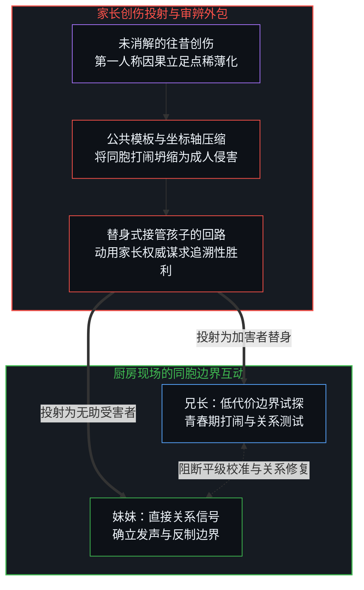
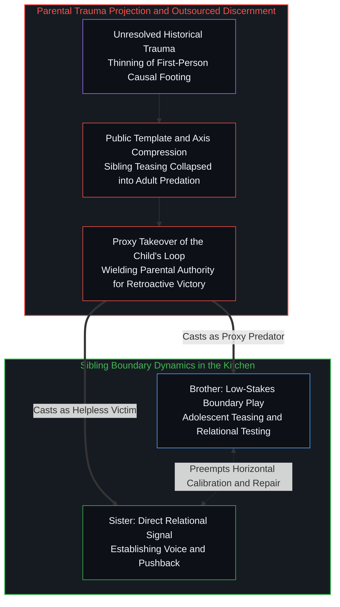
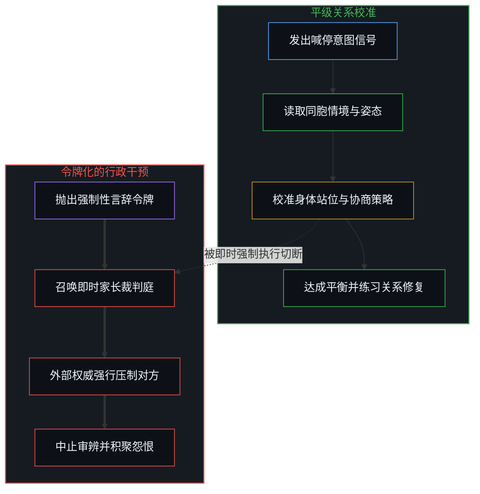
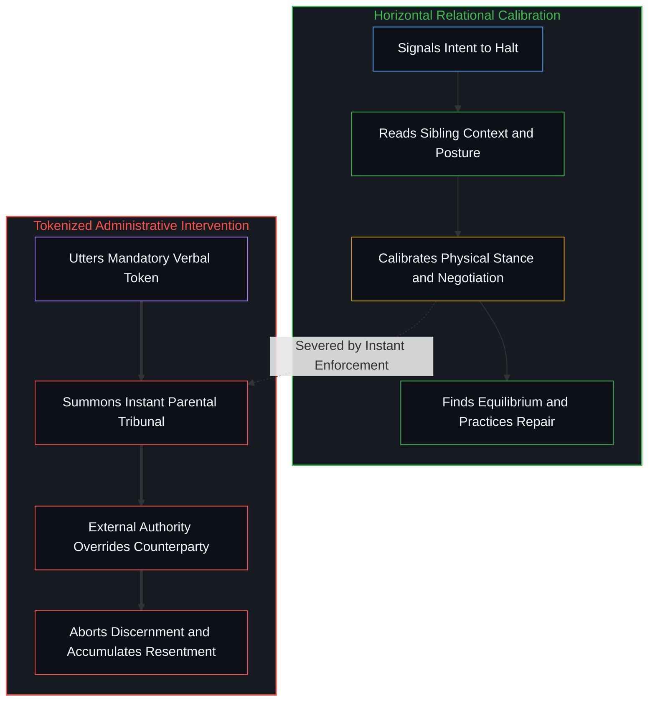
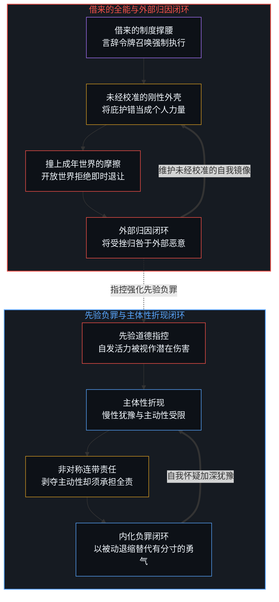
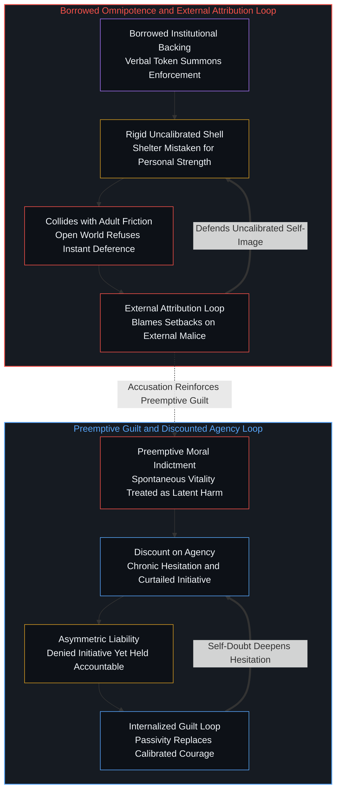

# 未历摩擦的心智与借来的全能 / The Unfrictioned Mind and Borrowed Omnipotence

*以创伤脚本消除成长摩擦，催生脆弱的傲慢与先验的负罪。 / Eliminating growth friction with trauma scripts manufactures fragile arrogance and preemptive guilt.*

当现代育儿试图通过道德巡查消除一切成长摩擦时，它在第一人称心智与直接因果之间筑起了一道无菌屏障。文化本身不具备独立的因果力；在公共领域占主导地位的流行育儿文化，不过是成百上千万个体在各自选择中放弃第一人称审辨所汇聚成的宏观统计结果。抚育者以为凭借家长权威与公共领域的创伤模板，就能自外而内雕刻出成熟的品格，却忽视了主体性与审辨力只能在低代价的边界试探、双向摩擦与自主修复中凝聚成型。用外部强制替代平级协商，既让一方将借来的制度撑腰错当成个人的无所不能，又将另一方的自发活力预设为潜在的侵害倾向。其结果并非心智成熟，而是一边制造出习惯向外推卸过错的脆弱自负，一边制造出背负先验负罪感、主体性被折现的退缩。

When modern parenting attempts to eliminate all developmental friction through moral policing, it erects a sterile barrier between the first-person Mind and direct causality. Culture itself possesses zero autonomous causal power; what dominates the public sphere as prevailing parenting culture is the macroscopic statistical aggregate of millions of individuals abdicating first-person discernment in their own choices. Caregivers assume that through parental authority and public-sphere trauma templates, they can sculpt mature character from the outside in, overlooking that agency and discernment crystallize only through low-stakes boundary testing, reciprocal friction, and self-directed repair. Substituting external enforcement for horizontal negotiation leads one party to mistake borrowed institutional backing for personal omnipotence, while treating the other party's spontaneous vitality as latent predation. The result is not maturity, but fragile overconfidence that reflexively externalizes blame alongside discounted agency burdened with preemptive guilt.

## 一、 厨房里的幽灵与预设的审判 / 1. The Ghost in the Kitchen and the Staged Trial

在数字平台上广泛流传的一幕家庭场景中，十四岁的妹妹被十六岁的哥哥堵在厨房门后，哥哥嬉笑着挡住去路，妹妹一连说了五遍“停下”。母亲推门而入，搬出自己十九岁遭遇性侵的经历，宣称一个在女孩喊停时不知停下的男孩，长大后就会变成无视拒绝的男人。这类走红网络的片段带有为收割流量而合成的情绪挑衅痕迹，评论区里的声援也多是零成本的道德表态，而非切身的家庭日常实践。然而，它所引发的广泛共鸣暴露了当代育儿中的结构性扭曲：掌握了大量心理学与创伤词汇的成年人，将本有应对能力的青少年视作易碎的瓷器，急于用工程化手段将寻常的人际摩擦悉数清除。厨房里上演的正是[投射中的自画像](../the-self-portrait-in-the-projection/)所追溯的模型外化：公共领域的宏观叙事不包含在场具体心智的任何遥测信息，观察者却将抽象模板强行叠加到眼前的场景上，把内部模型向外投射到他人身上。

In a domestic scene widely circulated across digital platforms, a fourteen-year-old girl is cornered behind the kitchen door by her sixteen-year-old brother, who blocks her path with teasing laughter as she repeats the word "stop" five times. The mother steps in, invokes her own sexual assault at nineteen, and declares that a boy who fails to halt when a girl says stop grows into a man who refuses to take no for an answer. Such viral vignettes carry the marks of synthetic provocations built to harvest engagement, and the comment sections defending them trade in costless moral posturing rather than lived household practice. Yet their wide resonance exposes a structural distortion in contemporary parenting: adults equipped with expansive psychological and trauma vocabularies treat capable adolescents as fragile porcelain, rushing to engineer ordinary interpersonal friction out of existence. What unfolds in that kitchen is the externalized model traced in [The Self-Portrait in the Projection](../the-self-portrait-in-the-projection/): a public-sphere macro-narrative contains zero telemetry about the specific living Minds in the room, yet the observer superimposes the abstract template onto the present scene, projecting an internal model outward onto others.

同胞间的冲突并非掠夺性病理的早期征兆。兄弟姐妹之所以发生摩擦，是因为他们共享着稳固的联结，得以在低代价的沙盒中试探肢体界限、应对嫉妒、学习退让并练习关系修复。寻常的打闹具有双向性，一旦一方退却或流露出并非作伪的痛苦，打闹便会平息。单向的持续针对、肢体暴力或将孩子困在无处可逃的境地属于另一范畴，需要成年人立即介入；而寻常的厨房争执并未越过这条界限。当家长将未消解的个人创伤叠加到青少年的恶作剧上时，同胞边界试探与成人掠夺侵害这两条原本独立的坐标轴被压缩成了同一条。她回应的已不再是房间里的两个具体个体，而是在与过去的幽灵交战。儿子成了往昔加害者的替身，让家长得以动用母亲的权威，使几十年前失效的那道指令终于获胜；女儿则被塑造成母亲当年无助的年少自我。两个年轻的心智就这样被征召进一场脱离他们当下关系的私人戏剧之中。

Sibling conflict is not an early indicator of predatory pathology. Brothers and sisters clash because they share a secure bond, testing physical limits, navigating envy, learning deference, and practicing repair within a low-stakes sandbox. Ordinary teasing is reciprocal and subsides when one party withdraws or signals unfeigned distress. Persistent one-sided targeting, physical violence, or trapping a child with no way out belong to a different category and warrant immediate adult intervention. An ordinary kitchen dispute does not cross that line. When a parent superimposes unresolved personal trauma onto an adolescent prank, two independent axes—sibling boundary play and adult predation—compress into one. She is no longer responding to the two individuals in the room; she is battling a ghost. The son becomes a proxy for a historical assailant, allowing the parent to wield maternal authority so that the command that failed decades earlier can finally prevail, while the daughter is cast as the mother's helpless younger self. Both young Minds are conscripted into a private drama detached from their present relationship.

## 二、 权力的外包与令牌化的律令 / 2. The Outsourcing of Power and the Tokenized Decree

这种代际投射最直接的后果，是语言功能的异化。在两个自主心智之间，“停下”原本是在具体语境中表达偏好、试探回应并校准关系边界的沟通信号。一旦权威人物将这个词变成自动触发成人强制执行的无条件律令，“停下”就被剥离了互动语境，转化为一枚召唤制度权力的行政令牌。启用这枚令牌的孩子不再需要观察兄长的姿态，不需要调整自己的语调或身体站位，也不需要学习如何谈判、反制或迂回绕开阻碍；她只需抛出这枚言辞令牌，家长的强制力便会降临，替她扫清道路。

The immediate consequence of this generational projection is the functional alienation of language. Between two autonomous Minds, the word "stop" is a communicative signal used to state preferences, test responsiveness, and calibrate relational boundaries in context. Once authority figures turn that word into an unconditional decree that automatically triggers adult enforcement, "stop" is severed from its interactive context and converted into an administrative token that summons institutional power. The child invoking the token no longer needs to read her brother's posture, adjust her vocal tone or physical stance, or learn how to negotiate, push back, or maneuver around an obstacle. She releases the verbal token, and parental enforcement descends to clear the path on her behalf.

这种权力外包瓦解了两个孩子各自需要建立的自主协商能力。喊出令牌的一方体验到了召唤借来的力量以压倒对手的杠杆效应，另一方则被剥夺了结合语境作出解释或进行双向边界试探的一切通道，在沉默中积聚怨恨。双方都被塞进加害者与受害者的二元剧本，失去了在实践中分辨玩笑打闹与蓄意伤害、评估肢体风险以及靠自身努力恢复平衡的历练。正如[帮助是问题的一半](../help-is-half-the-problem/)所追溯的，当外部权威预先代偿了本属于当事人的摩擦成本时，这种干预产生的净成长位移为零，反而扼杀了它声称要保护的关系能力。僵硬的强制抹平了性情、年龄与情境的差异，只是转移了摩擦，却未能培育出判断力。

This outsourcing of power dismantles the capacity for self-directed negotiation that both children need to build. The child who utters the token experiences the leverage of summoning borrowed force to flatten an opponent, while the other is denied any avenue for contextual explanation or reciprocal boundary testing, accumulating unspoken resentment. Both are funneled into a binary script of offender and victim, forfeiting the practice through which a Mind distinguishes playful banter from deliberate harm, gauges physical stakes, and restores equilibrium through its own effort. As traced in [Help Is Half the Problem](../help-is-half-the-problem/), when an external authority preemptively absorbs the friction costs that belong to the participants themselves, that intervention produces zero net developmental displacement and starves the relational capacity it claims to protect. Rigid enforcement flattens differences of temperament, age, and context, displacing friction rather than cultivating judgment.

## 三、 非对称分化与主体性的分岔 / 3. Asymmetric Divergence and the Bifurcation of Agency

用行政裁判庭替代平级校准，使两个位置上的心智发展走向截然不同的分岔。在女孩一侧，当抚育者反复介入以替她消除阻力时，孩子便内化了一种借来的全能感。只要在摩擦出现时宣告不适或声称受到冒犯，她就能召唤整个家庭的道德与行政撑腰。由于从未在直接反制中校准过自身预期，她形成了一种脆弱的自我镜像，误把制度庇护当成个人力量。当她步入成年环境时，世界并不会因她的口头律令而停转。由于缺乏在无剧本摩擦中锻造出的第一人称立足点与韧性，她会将寻常的职业竞争、人际边界或情感拒绝解读为充满敌意的迫害。正如[自尊的刚性外壳与隐性外部归因](../zi-zun-de-gang-xing-wai-ke-yu-yin-xing-wai-bu-gui-yin/)所追溯的，为了维护那个未经校准的自我镜像，她不得不将每一次受挫向外投射，把一切私人不适归咎于男性恶意或系统性敌意。

Replacing horizontal calibration with an administrative tribunal bifurcates development across the two positions. On the female side, when caregivers repeatedly step in to neutralize resistance, the child internalizes a borrowed sense of omnipotence. By declaring discomfort or claiming transgression whenever friction arises, she summons the moral and administrative backing of the household. Having never calibrated her expectations against direct pushback, she forms a brittle self-image that mistakes institutional shelter for personal strength. When she steps into adult environments, the world does not halt upon her verbal decree. Lacking the first-person footing and resilience forged through unscripted friction, she reads ordinary professional competition, interpersonal boundaries, or romantic rejection as hostile persecution. As traced in [The Rigid Shell of Self-Esteem and Hidden External Attribution](../zi-zun-de-gang-xing-wai-ke-yu-yin-xing-wai-bu-gui-yin/), defending that uncalibrated self-image requires projecting every setback outward, holding male malice or systemic hostility responsible for every private discomfort.

在男孩一侧，扭曲朝着相反的方向展开。自发的生命力表达——果敢主张、竞争博弈、肢体喧闹与推搡打闹——被预先视作潜在的病理苗头。在被反复告诫自身天性冲动暗藏危险、任何未经约束的主动作为都会威胁周围人安全的过程中，男孩内化了[主体性的折现](../the-discount-on-agency/)所追溯的机制：正如将孩子的未来归因于外部财务转移支付会在账本上折现其个人努力一样，将男孩的主动性视作需要行政管控的隐患，会训练他在迈出第一步之前就预先折现自身的主体性。被剥夺了在低代价场域中学习力量分寸与勇气的机会后，他被规训出慢性的犹豫与被动。与此同时，尽管他的主动性处处受限，他却被赋予了对在场所有人情绪舒适度的无限道德连带责任——既被禁止行使不加对冲的主体性，又必须单方面为维持环境的安宁买单。

On the male side, the distortion runs in the opposite direction. Spontaneous expressions of vitality—assertiveness, competitive play, physical boisterousness, and roughhousing—are treated in advance as latent pathology. Repeatedly warned that his natural impulses are hazardous and that any uncurbed initiative threatens the safety of those around him, the boy internalizes the mechanism traced in [The Discount on Agency](../the-discount-on-agency/): just as attributing a child's future to an external financial transfer discounts their own effort on the ledger, treating a boy's initiative as a hazard requiring administrative containment conditions him to discount his own agency before taking a single step. Denied the low-stakes arena where strength learns proportion and courage, he is trained into chronic hesitation and passivity. At the same time, even as his initiative is curtailed, he is assigned open-ended moral liability for the emotional comfort of everyone in the room—forbidden from exercising unhedged agency, yet held unilaterally responsible for keeping the environment pacified.

## 四、 医源性脆弱与第一人称因果的回归 / 4. Iatrogenic Fragility and the Return to First-Person Causality

将成长中的心智与直接摩擦隔绝开来，只会制造出医源性脆弱。正如[重新审视反脆弱](../a-new-deeper-look-at-antifragility/)所追溯的，自主心智并非可以从外部加固的惰性容器，它只能在摩擦中通过动态试错与承重反馈来建立结构稳定性。在无风密室中培育的树木无法生成抵御机械风荷载所需的木质化应力木，一旦暴露在寻常微风中便会折断。当现代育儿动用心理监控与微观管理，将青少年日常生活中的每一丝不适悉数剥离时，这套保护装置恰恰抽空了成长中心智发展内在结构完整性所必需的承重反馈。

Insulating growing Minds from direct friction produces iatrogenic fragility. As traced in [A New Deeper Look at Antifragility](../a-new-deeper-look-at-antifragility/), an autonomous Mind is not an inert vessel that can be reinforced from the outside; it builds structural stability only through dynamic trial, error, and load-bearing feedback under friction. A tree cultivated in a windless chamber fails to generate the lignified reaction wood needed to withstand mechanical wind load, snapping when exposed to an ordinary breeze. When modern parenting deploys psychological surveillance and micromanagement to strip every trace of discomfort from an adolescent's daily life, the protective apparatus starves the growing Mind of the load-bearing feedback required to develop internal structural integrity.

这种结构性悖论又因历史错位而进一步加剧。按照更早时代的尺度——生产劳动、公共参与和家庭贡献——当代青少年早已掌握了成熟成年人的信息摄取量，然而社会规范与家长焦虑却将童年无限期延长。家长投射出自身未消解的创伤或对未来的焦虑，将原本具备行动能力的年轻人当成需要持续监护的无助幼童来管理。不断扩张的创伤词汇催生出更严密的巡查；更严密的巡查消灭了允许犯错与修复的低代价场域；由此造成的实践能力稀薄，反过来又被家长解读为孩子无法离开监护独立应对的证据。正如[赋权确立权力的集中](../empowerment-establishes-the-centralization-of-power/)所追溯的，承诺提供保护与赋权的框架，最终会将权威收拢并巩固在负责执行这套框架的监管中心手中。

This structural paradox is compounded by a historical mismatch. By the metrics of earlier eras—productive labor, civic participation, and household contribution—contemporary adolescents already command the information diet of mature adults, yet social norms and parental anxiety prolong childhood indefinitely. Projecting their own unresolved wounds or future anxieties, parents manage capable young people as if they were helpless infants requiring continuous surveillance. Expanded trauma vocabularies breed tighter policing; tighter policing eliminates the low-stakes arenas where mistakes can be made and repaired; and the resulting thinness of practical competence is then read back by the parent as proof that the child cannot manage unchaperoned. As [Empowerment Establishes the Centralization of Power](../empowerment-establishes-the-centralization-of-power/) traces, frameworks that promise protection and empowerment consolidate authority at the supervisory center that administers them.

微观管理孩子因果回路的冲动，源于抚育者此前早已将自身的审辨力外包。当一个人把个人判断、情感修复与生活定向交由公共领域的疗愈模板与算法共识代管时，其自身的第一人称因果立足点便随之稀薄。正如[你的代码库即是记忆](../your-codebase-is-memory/)所追溯的，外化的规则与承袭的创伤脚本只是过往边界留下的记录痕迹，从不能替代活生生的心智在当下前沿作出区分。由于无法在自己的生活中完成因果闭环，抚育者便试图通过自上而下工程化改造孩子的回路来寻求代偿——一边顺从外部脚本，一边在后代面前扮演说一不二的宗主。被剥夺了试错与复原空间的受控孩子在现实中表现出迷茫失措，而焦虑的家长则将其当作世界充满掠夺性、孩子缺乏生存能力的佐证，进而筑起更紧密的围栏。

The drive to micromanage a child's causal loop stems from the caregiver's prior outsourcing of their own discernment. When an individual hands over personal judgment, emotional repair, and orientation to public-sphere therapeutic templates and algorithmic consensus, their own first-person causal footing thins out. As [Your Codebase Is Memory](../your-codebase-is-memory/) traces, externalized rules and inherited trauma scripts are only recorded traces of prior boundaries, never a substitute for the living Mind distinguishing at the present edge. Unable to close their own causal loops within their own lives, caregivers seek compensation by engineering the child's loop from above—deferring to external scripts while acting as an absolute sovereign over their offspring. Stripped of room to err and recover, the over-managed child displays a disorientation that anxious parents seize upon as confirmation that the world is predatory and the child incompetent, prompting an even tighter perimeter.

自主的心智无法按照第三人称的工程蓝图被制造出来。行为遗传学与收养研究一再表明，刻意的家庭工程化塑造对成年人格的解释力，远不及遗传禀赋与无剧本的非共享经验。要学会清晰而有分寸地守住边界，必须亲历言辞失效的时刻，感受抵抗与退让之间的肢体拉锯，并在破裂与修复的循环中找到自己的立足点。把受保护沙盒中的无摩擦顺遂错当成持久的能力，便犯下了[独见者的自反困境与必然性的后验投射](../the-reflexive-dilemma-of-unique-insight/)所追溯的倒置——将阻力的移除混淆为承重的能力。而正如[隐性自由变量与权力的事后幻相](../the-free-variable-and-the-retrospective-illusion-of-power/)所阐明的，主体性从来不是由外部赐予的预设庇护，而是在当下前沿承担不可逆后果、行使未被标绘的自由变量；如果年轻的心智从未在试错与承担后果中完成属于自己的闭环，借来的全能就始终只是纸糊的盔甲。家长的职责是守住防止灾难性伤害的底线围栏，同时把关系沙盒向直接摩擦敞开——放下抽象的公共模板与昨日的幽灵，让眼前的年轻心智用自己的双脚去迎受生活的重力与侧风。

A sovereign Mind cannot be manufactured from a third-person engineering blueprint. Behavioral genetics and adoption studies consistently show that deliberate household engineering accounts for far less of adult personality than genetic endowment and unscripted non-shared experiences. Learning to hold boundaries with clarity and proportion requires living through moments where speech falters, feeling the physical give-and-take of resistance and deference, and finding one's footing through cycles of rupture and repair. Mistaking frictionless ease inside a protected sandbox for durable competence commits the inversion traced in [The Reflexive Dilemma of Unique Insight and the Retrospective Projection of Necessity](../the-reflexive-dilemma-of-unique-insight/), confusing the removal of drag with the capacity to bear load. And as [The Invisible Free Variable and the Retrospective Illusion of Power](../the-free-variable-and-the-retrospective-illusion-of-power/) establishes, agency is never a pre-arranged shelter bestowed from outside, but the exercise of an unmapped free variable through bearing irreversible consequences at the living edge; if a young Mind never closes its own loops of trial and consequence, borrowed omnipotence remains paper armor. A parent's role is to hold a perimeter against catastrophic harm while leaving the relational sandbox open for direct friction—setting down abstract public templates and yesterday's ghosts so that the young Minds before them can meet the gravity and crosswinds of life on their own two feet.
