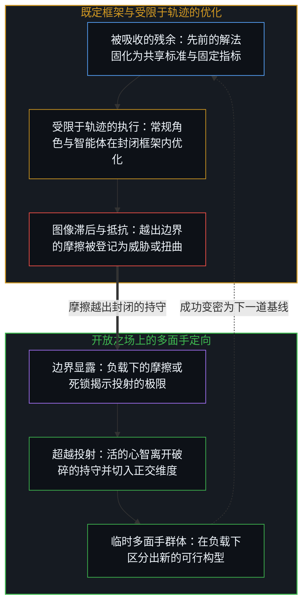
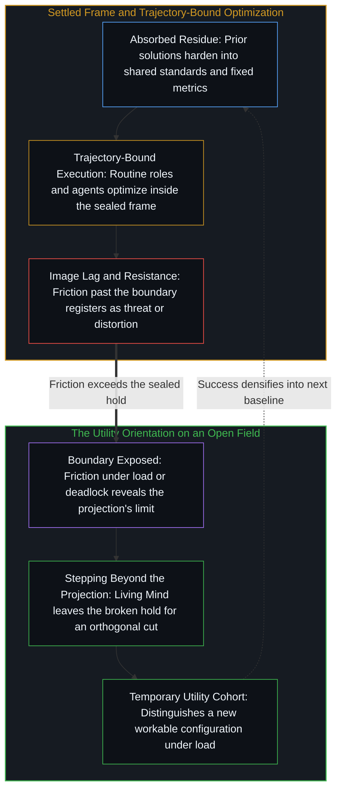

# 进步的多面手 / The Utility Men of Progress

*进步是临时解题者的工作，而承认与吸收则在身后滞后 / Progress is the work of temporary solvers while recognition and absorption lag*

一个口语里的形象说出了这份关系的起点：多面手，东西坏了才被叫来，运转起来便被忘掉。历史在更大的尺度上重复同一种几何：后来被登记为进步的东西，由一个个相继而又不断移位的中心发起，它们能解开现存秩序尚不能当作可解的问题，因必要而轮换进来，又因成功而轮换出去。在结果变密到无法否认之前，这些解题者被登记为临时的工具；成就一旦锁定，便被吸收、被计为集体的智慧，下一批人在一个新情形里，遇到同一种依赖与抵抗的混合。

A colloquial figure names where the relation starts: the utility man, called when something breaks and forgotten when it runs. History repeats the same geometry at a larger scale: what later registers as advance is initiated by successive, shifting loci that can resolve problems the existing order cannot yet hold as solvable, rotated in by necessity and rotated out by success. Until results densify past denial, these solvers register as temporary tools; once the achievement is locked in, it is absorbed and scored as collective wisdom, and the next wave meets the same mixture of dependence and resistance in a new case.

## 一、 功用是功能上的定向，不是封闭的阶层 / 1. Utility Is a Functional Orientation, Not a Sealed Class

自我区分的活动在发生，无因，不息。称它为心智：那个已经在进行中的观察者，它的每一个动作都是一次区分。进步在它成立的地方，是序列：一个个相继的离散动作，增加进一步分化的容量，由复杂到足以追踪序列的中心所登记。这个序列不起源于多数人的共识，不起源于受赞颂的领袖名单，也不起源于一时流行的理论。它由细薄的少数发起：个别的中心或小的群落，在周围的场仍把这份活动框定为多余、威胁或无关的时候，持续区分出可行的构型。

Self-distinguishing activity occurs, uncaused, unceasing. Call it the Mind: the observer already underway, every act of which is a distinction. Progress, where it holds, is sequence: successive discrete acts that increase capacity for further differentiation, as registered by centers complex enough to track sequence. That sequence does not originate in the consensus of the many, in the celebrated roster of leaders, or in the fashionable theory of the hour. It is initiated by thin minorities, individual centers or small clusters that keep distinguishing workable configurations while the surrounding field still frames the activity as excess, threat, or irrelevance.

这少数人不是一份名册，也不是一个种姓。不同的个人在不同的时候，依他们所做的选择而进入其中。把人排成进步的承载者，是把方向冻结成一张局部的记分牌；方向所指的是对序列的登记，在每一步都可修订。[个体抉择是唯一的因果杠杆](../individual-choices-as-the-only-causal-levers/)在世代与系统的情形里复原了这一点：因果只在个人所持续的离散动作中登记，每一个选择都是一根独立的杠杆，从来不是一块共享的底板。[进步叙事中的症候与原因](../symptom-and-cause-in-the-narratives-of-progress/)在经济情绪的情形里追溯了同一种拓扑：集体的信念，是对发起中心上已在进行之活动的迟到登记，而不是经济运动的引擎。[平均值是残余，不是引擎](../the-average-is-residue-not-the-engine/)在百分比的情形里追溯了它：百分比登记的是构成与筛选，决定性的边缘，在右尾稀少的实际人数那里。

The minority is not a roster and not a caste. Different individuals enter it at different times according to the choices they enact. Ranking persons as carriers of progress freezes Direction into a local scoreboard; what Direction names is the registration of sequence, revisable at every step. [Individual Choices as the Only Causal Levers](../individual-choices-as-the-only-causal-levers/) restores this in the case of generations and systems: causality registers only in the discrete acts individuals sustain, each choice an independent lever, never a shared floor. [Symptom and Cause in the Narratives of Progress](../symptom-and-cause-in-the-narratives-of-progress/) traces the same topology in the case of economic mood: collective belief is delayed registration of activity already under way at initiating centers, not the engine of economic motion. [The Average Is Residue, Not the Engine](../the-average-is-residue-not-the-engine/) traces it in the case of percentages: percentages register composition and selection, and the decisive edge sits with a thin number in the right tail.

多面手就是负载之下的这种定向：那个仍能解开当下共享框架尚不能当作可得之物的中心。让引水渠保持运转的工程师，把钢铁做到规模的冶金师，让复杂系统变得可靠的程序员，把火箭送入轨道的建造者，他们都没有结成一个永久的贵族阶层。他们是解题者的临时群体，因必要而聚起，又因成功而散去。每一批人离开时，留给后来中心的可得残余，都比他们到来时更多。下一批人以新的名字，面对同一种依赖与抵抗的混合。

The utility man is that orientation under load: the locus that can still solve what the present shared frame cannot yet treat as available. Engineers who kept aqueducts running, metallurgists who scaled steel, programmers who made complex systems reliable, builders who put rockets into orbit: none of them formed a permanent aristocracy. They were temporary cohorts of problem-solvers, gathered by necessity and dispersed by success. Each wave left more residue available to later centers than it found. The next wave met the same mixture of dependence and resistance under new names.

## 二、 被持守为参照的成功，把昨天的解题者变成阻力 / 2. Success Held as Reference Turns Yesterday's Solvers into Resistance

带来上一次跃迁的人，可能安顿进那次跃迁所造出的舒适里。他们使之可行的构型一旦被持守为偏好的参照，会重新打开这份舒适的进一步区分，便被登记为威胁，而不是延续。他们由此成了抵抗下一次跃迁的一部分：不是因为一个固定的种姓拥有发起，而是因为他们所完成的那个世界的一幅被保存的图像，冻结在了它的那一步之后。

The people who delivered the last leap can settle into the comfort that leap created. Once the configuration they made workable is held as the preferred reference, further distinction that would reopen that comfort registers as threat rather than continuation. They then become part of the resistance against the leap that follows: not because a fixed caste owns initiation, but because a preserved image of the world they completed freezes past its step.

观察握住的是效果；产生它的原因，始终在前面一步，而这一步的间隔，正是任何东西得以被登记的方式。图像作为器具，充当一个被保留的位置，边缘以它来衡量自己的移动，并在每一次更新时把它重新渲染；它可用的宽度是一步。滞后，是这个位置被豁免于重新渲染，而这次豁免就是冻结，是寻常的图像滞后。昨天的解法一旦被当作下一个问题的穷尽尺度，越过它的一切都被登记为外在，外在的宽度恰是缺口的宽度：下一批多面手到来时，像是对一个已完成秩序的扰乱，而不是对下一种可行方法的供给。[卓异、感知与自我设限的问题场域](../exceptionality-perception-and-the-self-limiting-field-of-problems/)在前沿的情形里追溯了这个不断更新的边缘：少数心智持续跨出当前的框架，解开一道前沿难题，照例会揭开下一道。

Observation holds effect; the cause that produced it remains one step ahead, and that one-step interval is how anything registers at all. The Image, as instrument, serves as a retained position against which the edge measures its own movement, re-rendered at every update; its usable width is one step. Lag is exempting that position from the re-render, and that exemption is the freeze, ordinary Image lag. Once yesterday's solution is held as the exhaustive measure of the next problem, everything past it registers as external, by the width of the gap: the next utility men arrive as disruption of a finished order rather than as supply of the next workable method. [Exceptionality, Perception, and the Self-Limiting Field of Problems](../exceptionality-perception-and-the-self-limiting-field-of-problems/) traces that self-renewing edge in the case of the frontier: a minority of minds keeps stepping beyond the current frame, and solving one frontier problem characteristically discloses the next.

## 三、 熟悉被变密为比胜任更安全 / 3. Familiarity Densifies as Safer than Competence

与此同时，多数人偏好熟悉的东西，哪怕熟悉的东西正在变坏。熟悉感觉比胜任更安全，而别人的胜任，可能被登记为对一幅偏好的自我形象的指控。对熟悉的偏好与这份指控，都不是第二种道德力量。它们是负载之下的容量，是共同尺度之下的排名。

The majority, meanwhile, prefers the familiar even when the familiar is deteriorating. Familiarity feels safer than competence, and competence in others can register as an accusation against a preferred self-image. Neither the preference nor the accusation is a second moral force. Both are capacity under load and ranking under a common measure.

差异是个体心智保持各自界限的方式。一套共同的计分方案一旦把独特的序列逼进有序的位置，层级便显现出来。当另一个中心的胜任，在这个中心仍当作与地位相关的维度上得分更高时，这个缺口便落在一个被保存的偏好位置上。原因被搬走了：尺度不公平，条件不平等，贡献者是临时的，因而可以不予理会。[来自个体差异的层级](../hierarchy-from-individual-difference/)是这有序的一面：排名是彼此不同的个体在一个共享尺度上被计分时出现的东西，异议集中在相对于被保留之图像的较低位置上，把缺口的原因搬到别处，自己选择的连续链条便退到了后面。[自我价值感与所有权](../ownership-and-self-worthiness/)是功能上的孪生：作为下一个动作的材料而重新进入的结果，让更新得以运行；作为异己而重新进入的结果，让更新变薄；在两种情形里，杠杆都留在这个边缘上。

Difference is how individual Minds stay bounded. Hierarchy is what shows up the moment a common scoring scheme forces unique sequences into ordered places. When another center's competence scores higher on dimensions this locus still treats as status-relevant, the gap lands against a preserved preferred place. Cause relocates: the measure is unfair, the conditions unequal, the contributor temporary and therefore dismissible. [Hierarchy from Individual Difference](../hierarchy-from-individual-difference/) is that ordered face: ranking is what appears when individuals who differ are scored on a shared measure, and objection concentrates on lower place relative to the retained image, relocating the cause of the gap so that the continuous chain of one's own choices recedes. [Ownership and Self-Worthiness](../ownership-and-self-worthiness/) is the functional twin: outcomes that re-enter as material for the next act let the update run; outcomes that re-enter as alien thin it; in both cases the lever stays at this edge.

于是，多面手被使用，被贬低，或干脆被忽略，直到他们产生的益处再也无法否认。多半时候，其余的人若只是不去打扰他们，而不必为了让一幅偏好的图像站得住而把他们重新计为较低的人，他们便算幸运。这一切都不需要恶意。图像一旦形成，保存就是它自己的指令；重新渲染，是它为之存在、要去筛掉的那一次微小死亡。

So the utility men are used, diminished, or simply ignored until the benefits they produce can no longer be denied. More often than not they are fortunate if the rest leave them alone, without needing to re-score them as lesser so that a preferred image can hold. None of that requires perversity. Preservation is the image's own directive once formed; re-rendering is the micro-death it exists to select against.

## 四、 吸收把成就冻结为集体的智慧 / 4. Absorption Freezes Achievement as Collective Wisdom

益处一旦变密到无法否认，发起的作者身份便退去，成就沉入照常运转的背景。仍可读的是变密的残余：如今“照常运转”的基础设施，感觉理所当然的方法，被当作人人一向知道的标准。迟来的故事，是成功情形里的反向归因：效果被重新追溯，好像场一直是引擎，残余便被计为共享的智慧。[不预测是没有觉察的预测](../not-predicting-is-predicting-without-awareness/)在方法的情形里追溯了同一次退场：拒绝预测仍是一次预测，落下的只是对选择仍在继续的觉察，清仓的小屋与通到路边的光纤被记作现成的条件，而不是有人愿意为之犯错的预测。

Once benefits densify past denial, the authorship of initiation recedes and the achievement settles into the background of what simply runs. What remains legible is the densified residue: infrastructures that now "just work," methods that feel obvious, standards treated as what everyone always knew. The late story is reverse attribution in the case of success: effect re-traced as if the field had been the engine all along, so that the residue is scored as shared wisdom. [Not Predicting Is Predicting Without Awareness](../not-predicting-is-predicting-without-awareness/) traces the same drop-out in the case of a method: refusing to predict is still a prediction, what drops is awareness that the choosing continues, and clearance cabins and fiber at the road register as given conditions, not as predictions someone was willing to be wrong about.

[伪装成远见的表演性后见](../performative-hindsight-that-pretends-to-be-foresight/)是更短周期上的同一次转换：被登记为远见的，是已经公开的成功，对照一幅被保存的、关于早先未曾留意的图像而被重新追溯。[成功学](../cheng-gong-xue/)在成功文学的情形里追溯了这次吸收：结果之后，幸存者变成可携带的规则并被当作引擎，产生它们的序列不在其中。[共同改变的本源](../the-source-of-shared-change/)在共同的地基被当作第二个创作了这场运动的内部时复原了这一刀：共同的改变只始于对被登记为既定之物的私人重做，残余可能落为共同的地基，也可能不会。在中心之间登记的，是可得之物的塑形；从另一个中心之外替它完成它的回返，是一个范畴错误。迟来的共鸣，并不把早先的区分转移到多数人身上。它让已经可得的东西变密，并塑形后来的动作容易重新追溯哪些对齐。

[Performative Hindsight That Pretends to Be Foresight](../performative-hindsight-that-pretends-to-be-foresight/) is the same conversion on a shorter cycle: what registers as foresight is already-public success re-traced against a preserved image of earlier non-attention. [Theories After Success](../cheng-gong-xue/) traces that absorption in the case of success literature: after the outcome, survivors become portable rules offered as the engine, and the sequence that produced them is left out. [The Source of Shared Change](../the-source-of-shared-change/) restores the cut when common ground is held as a second interior that authored the motion: shared change begins only as private reworking of what registers as given, and residue may land as common ground, or it may not. Between centers, what registers is availability-patterning; completing another center's return from outside it is a category error. Late resonance does not transfer early distinguishing into the majority. It densifies what is already available and patterns which alignments later acts find easy to re-trace.

## 五、 表观的速度是寿命对照复利的反馈 / 5. Apparent Speed Is Lifespan Measured Against Compounding Feedback

被登记为反馈速度之变化的东西，本身是测量尺度造成的假象。反馈是复利的：每一件变密的器具，都缩短下一次回返的路径，所以承认、抵抗与吸收，连同回报，到来的周期比残余较薄时更紧。人的寿命的变化，远小于这些周期的变化。以这只变化甚少的生物时钟来量，同一种机制被计为加速：几十年乃至几百年的滞后，被压缩到一生之内。抵抗并没有消失；对照一段稳定的寿命，它只是排得更紧。同样的关系仍在运作：对已知之物的偏好，在共享尺度之下对更高胜任的不适，对既有地位与偏好之自我形象的保护。缩短了的，不是一种关于进步的新心理学。它是复利回返与一个中心仍然占有的那段时间之间的比值。

What registers as a change in the speed of feedback is itself an artifact of the measuring scale. Feedback compounds: each densified instrument shortens the path for the next return, so recognition, resistance, and absorption, and reward with them, arrive on tighter cycles than they did when residue was thinner. Human lifespan has changed far less than those cycles have. Measured against that slowly changing biological clock, the same mechanism scores as acceleration: decades or centuries of lag compressing to within a single life. The resistance has not disappeared; against a stable span it simply packs more tightly. The same relations still operate: preference for the known, discomfort with superior competence under a shared measure, protection of existing status and a preferred self-image. What shortened is not a new psychology of progress. It is the ratio of compounding return to the interval a center still occupies.

回报在更密的回返之下仍是残余，不是发起被搬进了市场、信息流或多数人的情绪。实时的可见与所捕获价值中更大的份额，并不装上一个永久的解题者阶层。它们是复利的反馈落进一生之内时的样子：临时工具可以被否认的窗口，相对于那一生而缩小，承认与摩擦，都对照着同一个人的尺度，在更紧的周期上变密。[拥有更多从不是原因](../having-more-is-never-the-cause/)追溯了被冻结为进一步偏好之作者的拥有：优势的复利，是留下偏好之残余的持续区分，拥有命名的是当前的渲染，不是一股独立的力量。在这里，同一次冻结是被捕获的价值，被当作下一次定向的作者，而不是被当作下一次选择的场。

Reward is still residue under denser return, not relocation of initiation into the market, the feed, or the majority's mood. Real-time visibility and a larger share of captured value do not install a permanent class of solvers. They are what compounding feedback looks like when it lands inside one life: the window in which temporary tools can be denied shrinks relative to that life, and both recognition and friction densify on a tighter cycle against the same human scale. [Having More Is Never the Cause](../having-more-is-never-the-cause/) traces possession frozen as author of further preference: advantage compounding is continued distinguishing that leaves preferred residue, and possession names the current rendering, not an independent force. Here the same freeze is captured value held as if it authored the next orientation, rather than as field for the next choice.

## 六、 进步是断续的，因为场保持开放 / 6. Progress Is Discontinuous Because the Field Stays Open

所以进步始终是一件断续的事。它从来不是一份共享共识的平滑展开。它是那些在当下负载之下能做到其余的人做不到或不愿做之事的人一再的介入，随后是其余的人迟到而勉强的登记。群体在变。这个动态不变。

Progress therefore remains a discontinuous affair. It is never the smooth unfolding of a shared consensus. It is the repeated intervention of people who can do what the rest cannot or will not under present load, followed by the rest's late, reluctant registration. The groups change. The dynamic does not.

每一次看，都发现场是开放的，它的机会一再以新问题的样子出现。没有系统能达到完美，因为完美会预设一个封闭的现实，而一个封闭的现实无法说明它自己的存在或起源。任何有限的持守，都封不住越过它继续的活动。[没有系统能被保持封闭](../no-system-can-be-kept-closed/)从这份不封闭最直观的一面追溯了它：一个做加法的一位寄存器，运算在持守之内有效，真正的结果却在它之外；被当作封闭来持守的模型、制度、身份与计划，都遇到同一个余项。[对乌托邦的信念是通往反乌托邦之路](../the-belief-in-utopia-is-the-path-to-dystopia/)在善的情形里追溯了同一次冻结：一个具体的善的理想，一旦被抬升为每一个心智都须接受的尺度，对每一个目的与它不相符的心智，就是反乌托邦，残余的非同一被计为缺陷。[开放即一致](../openness-is-consistency/)命名了相邻的复原：不一致是对封闭的渴望或尝试，是一个有限的结构被迫去为只在继续的东西奠基。[封闭的假设把复利挤成 S 曲线](../closed-assumptions-squeeze-compounding-into-s-curves/)在产业曲线的情形里追溯了这同一个开放的场：逻辑斯蒂的形状是一个固定框架的束缚，不是开放现实中进步的轨迹。

Every look finds the field open, its opportunity presenting itself again and again as new problems. No system can reach perfection, for perfection would presume a closed reality, and a closed reality cannot account for its own existence or origin. No finite hold seals the activity that continues past it. [No System Can Be Kept Closed](../no-system-can-be-kept-closed/) traces that non-closure from its most intuitive face: a one-bit register under addition, where the operation is valid inside the hold and the true result lies outside it; models, institutions, identities, and plans held as closed meet the same remainder. [The Belief in Utopia Is the Path to Dystopia](../the-belief-in-utopia-is-the-path-to-dystopia/) traces the same freeze in the case of the good: a concrete ideal of the good, once elevated into the measure every Mind must accept, is dystopia for every Mind whose ends do not already match it, and residual non-identity scores as defect. [Openness Is Consistency](../openness-is-consistency/) names the adjacent restore: inconsistency is the desire, or attempt, for closure, a finite structure forced to ground what only continues. [Closed Assumptions Squeeze Compounding into S-Curves](../closed-assumptions-squeeze-compounding-into-s-curves/) traces the same open field in the case of industry curves: the logistic shape is the binding of a fixed frame, not the trajectory of progress under open reality.

当先前的成就固化为共享的标准、明文的规则手册或自动化管线时，常规的运转——无论是优化固定指标的机构，还是在上下文窗口内执行的受限于轨迹的智能体——都在一个有限的投射之内运行。正如[你的代码库即是记忆](../your-codebase-is-memory/)所追溯的，那些累积下来的工具、模型与制度脚手架，是作为一套外化的记忆代码库在运作：它们是先前区分层层堆叠而成的残余，保存着早先切口的形状，供后来的会话作为条件，却从不会自己重新开启或发起区分。而正如[超越投射](../beyond-the-projection/)与[开放即一致](../openness-is-consistency/)所一道追溯的，受限于轨迹的投射可以穷尽那个既定框架内的推演，却无法在相互竞争的要求于负载下相撞时跨出它自己的坐标空间。即便一项被吸收的解法附带了形式证明或自动化的验证通过，那道检验确立的也只是所继承规约与受信任基底之内的内部一致；把经过检验的基线当作信任的地基，便豁免了它的残余假设使其免于重新追溯——这正是[验证的倒置](../the-reversal-of-verification/)所追溯的倒置——并把经过验证的标准变成抵挡下一个解题者的封条。当负载下的摩擦或不可化约的死锁暴露出坍缩投射的边界时，多面手的定向正是活的心智在边缘行使自主的第一人称判断：认领回返的信号，向后退离破碎的持守，并在开放的场上重新切分前提，以发起下一个可行的构型。

When prior achievements harden into shared standards, explicit rulebooks, or automated pipelines, routine operation—whether by institutions optimizing a fixed metric or by trajectory-bound agents executing inside a context window—runs within a finite projection. As [Your Codebase Is Memory](../your-codebase-is-memory/) traces, those accumulated tools, models, and institutional scaffolds operate as an externalized codebase of memory: stacked residue of prior distinctions that holds the shape of earlier cuts for later sessions to condition on, yet never resumes or initiates distinguishing on its own. And as [Beyond the Projection](../beyond-the-projection/) traces alongside [Openness Is Consistency](../openness-is-consistency/), a trajectory-bound projection can exhaustively work out the deductions of that given frame, yet it cannot step outside its own coordinate space when competing requirements collide under load. Even when an absorbed solution arrives with a formal proof or an automated verification pass, that check establishes only internal consistency within the inherited specification and trusted base; taking the checked baseline as a ground of trust exempts its residual assumptions from re-tracing, the inversion [The Reversal of Verification](../the-reversal-of-verification/) traces, and turns the verified standard into a seal against the next solver. When friction under load or an irreducible deadlock exposes the boundary of that collapsed projection, the utility orientation is the living Mind exercising sovereign first-person judgment at the edge: claiming the returning signal, stepping backward out of the broken hold, and re-cutting the premise on an open field to initiate the next workable configuration.

新的多面手因此会不断出现，持续区分出可行的构型，并遇到那熟悉的依赖与抵抗的混合。其余的人会继续受益，把这次过渡计为威胁，后来又把那些临时解题者带入可行形式的世界，记作他们自己既定的地基。因果留在当下负载之下仍在区分的边缘上。多数是迟到的登记，不是发起的共同作者。被吸收的成就是残余，不是场一直是引擎的证明。[免费智能的幻觉](../the-illusion-of-free-intelligence/)在免费丰裕的情形里追溯了这份残余：流畅残余的丰裕，是智能仍在加速的反向信号，而不是心智的民主化。[现实扭曲力场颠倒了基线](../the-reality-distortion-field-inverts-the-baseline/)在共识基线的情形里追溯了这次吸收：被当作未受扰动之地基的大众内部一致，把被迫打开的口子记成那地基的暂时扭曲，直到平均再也无法否认它们。开放的场不会完结；它只是一再呈现下一个问题，而总有人，临时地，仍能解开它。

New utility men will therefore keep appearing, keep distinguishing workable configurations, and meet the familiar mixture of dependence and resistance. Others will continue to benefit, to score the transition as threat, and later to credit the world those temporary solvers brought into workable form as their own given ground. Causality stays at the edge that still distinguishes under present load. The majority is delayed registration, not a co-author of initiation. The absorbed achievement is residue, not proof that the field had been the engine. [The Illusion of Free Intelligence](../the-illusion-of-free-intelligence/) traces that residue in the case of free abundance: abundant fluent residue is the inverse signal of intelligence still accelerating, not Mind democratized. [The Reality Distortion Field Inverts the Baseline](../the-reality-distortion-field-inverts-the-baseline/) traces that absorption in the case of the consensus baseline: the mass's internal consistency held as undisturbed ground scores forced openings as temporary warp of that ground, until the average can no longer deny them. The open field does not finish; it only keeps presenting the next problem that someone, temporarily, can still solve.
