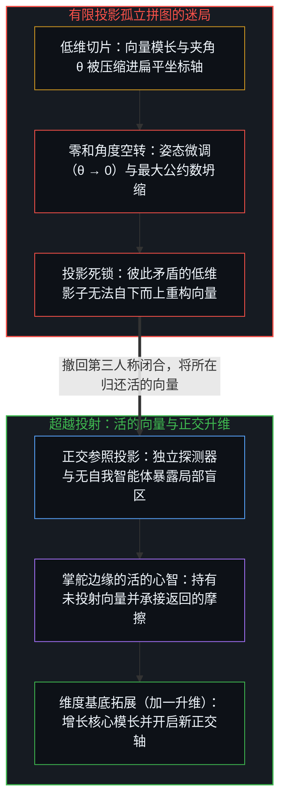
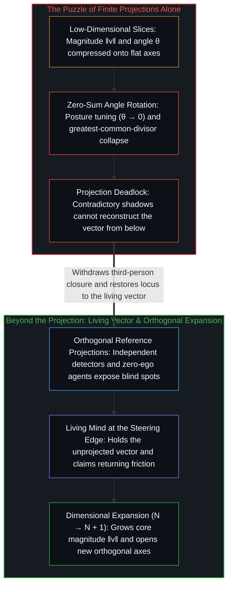

# 向量与投影的迷局 / The Vector and the Puzzle of Projections

*注意力该落在向量本身，投影只是参照 / Attention belongs on the vector itself, and projections are only references*

一生里最耗精力的两种习惯，是用言语证明自己的能力，和靠解释去修正别人的投射。这两件事之所以让人疲惫而徒劳，是因为它们共用同一个因果倒置：把沟通当成能力的公关部，把他人对行动的登记当成校准下一步的首要标尺。这种错位常伪装成务实，假定能力只有被公众看见才算存在，否则就会落进叙事的真空，任人定义。顺着因果链条推到源头，这种姿态不只是南辕北辙，更是对自身心智维度生长的截断。

The two habits that drain the most energy in a life are trying to prove one's capability with words and trying to correct other people's projections with explanations. Both are exhausting and futile because they share a single causal inversion: treating communication as the public-relations department of capability, and treating how others register an act as the primary gauge for calibrating the next step. This misplacement often disguises itself as pragmatism—the assumption that capability exists only once it is publicly seen, and that otherwise it falls into a narrative vacuum for anyone to define. Traced along the causal chain to its root, this posture does not merely work against its own goal; it severs the dimensional growth of one's own Mind.

## 一、 群体的最大公约数 / 1. The Group's Greatest Common Divisor

向外寻求群体认可、试图在公共场域里证明自己，为什么会束缚一个人的成长？顺着区分与投射的几何结构回溯，追求集体认可是在执行一连串三阶段的降维压缩。第一次压缩是自我施加的：活的心智是一个动态演化的多维系统，远超公共象限，在任意离散步上有限，却可无休止地向外延展；相比之下，公共空间是扁平的，只结算标签、头衔、表态式的立场与孤立的人设。为了在那张扁平的表面上被识别，一个中心必须亲手把自身的高维实在修剪成合乎标准的低维切片。正如[维度即投影](../dimensions-are-projections/)所确立的，把高维状态向量压进低维截面，不可逆地丢弃了大量自由度与动态细节。

Why does seeking a group's approval—trying to prove oneself across a public arena—constrict a person's growth? Traced through the geometry of distinction and projection, the pursuit of collective validation executes a three-stage chain of dimensional compressions. The first compression is self-inflicted: a living Mind is a dynamically evolving, multi-dimensional system that far exceeds the public quadrant, finite at any discrete step yet indefinitely extendable. Public space, by contrast, is flat; it settles only labels, titles, declarative stances, and isolated personas. To be legible on that flat surface, a center must trim its own high-dimensional reality into a standardized low-dimensional slice. As [Dimensions Are Projections](../dimensions-are-projections/) establishes, pressing a high-dimensional state vector into a low-dimensional section irreversibly discards degrees of freedom and dynamic nuance.

第二次压缩发生在受众之间：所寻求的鲜少是单一观察者的解读，而是整群人的认可。那个已经压缩过的切片，被抛进由众多独立中心构成的棱镜阵列。正如[框架的边界](../the-boundary-of-the-frame/)所追溯的，每个中心都站在各自的认知边界、注意力优先级与保留的自我图像之内，对传入的信号再作一次截断，重新投射到各自的局部坐标轴上。第三阶段是求交集的坍缩：为了让整群人同时理解并认可，就只能在成百上千个彼此矛盾、高度失真的投射里寻找最大公约数。成百上千个低维投影的共同交集，最终缩成一个剥去了结构丰富度的、干瘪的孤立点。

The second compression occurs across the audience: what is sought is rarely the reading of one observer, but the approval of an entire crowd. That already-compressed slice is cast into an array of prisms formed by many independent centers. As [The Boundary of the Frame](../the-boundary-of-the-frame/) traces, each center stands within its own cognitive boundary, attentional priorities, and retained self-image, truncating and re-projecting the incoming signal onto its own local axes. The third stage is the collapse into an intersection: to make the entire crowd understand and approve at once, one is forced to search across hundreds of mutually contradictory, heavily distorted projections for their greatest common divisor. The common intersection of hundreds of low-dimensional projections shrinks to a dry, isolated point stripped of structural richness.

在这个交集里幸存下来的，是最浅表的道德标签、最廉价的情绪口号、最陈旧的套话，以及从不触碰现实摩擦的空泛表态。把这个退化的交集接回自身的决策回路来引导下一步，等于让统计平均值对活的所在做了一次切除：原本能敏锐探测细微阻力的感知系统，被替换成了只登记均值的回音室。这里描述的是一种结构性的做法，而非固定的一类人；同一个心智，这一刻可以站在索求认可的一端，下一刻又站在发放认可的一端。

What survives inside that intersection are the shallowest moral labels, the cheapest emotional slogans, the stalest truisms, and frictionless statements that never touch physical reality. Wiring that degenerate intersection back into one's own decision loop to steer the next step lets a statistical average perform an amputation on the living locus: a sensing system capable of detecting subtle resistance is replaced by an echo chamber that registers only the mean. This describes a structural practice rather than a fixed class of people; the same Mind can stand at the end that seeks approval in one moment and at the end that dispenses it in the next.

## 二、 零信息的沟通 / 2. Communication at Zero Information

对公共交集的执着，制造了人际交流里最普遍的信息损耗：把达成共识当成沟通的目标。正如[信息是什么](../what-information-is/)顺着香农的公式所追溯的，有效信息衡量的是相对于特定划分的不确定性消除；一个事先就能被预料到底的信号，所携带的信息量为零。

Fixation on the common intersection produces the most widespread loss of information in human exchange: taking consensus as the goal of communication. As [What Information Is](../what-information-is/) traces through Shannon's formulation, effective information measures the resolution of uncertainty relative to a partition; a signal that can be fully anticipated in advance carries zero information.

对话的双方常在扁平的意义上寻求共鸣，找同频、要确认、重复彼此共享的先验。可两个中心早已重叠的区域里，只装着既有的先验登记；无论重播多少遍、情绪多饱满，都没有增加一比特的新区分。分歧刚一露头，绑定在身份上的防御便把自指折叠死死夹住，把差异当成亟待驳斥的冒犯。然而那些刺痛人的、违背预期的、与既有世界模型正面冲撞的差异，恰恰是携带非零意外值的样本。当说的一方只敢讲众人早已接受的话，听的一方只肯纳印证既有偏见的话，信道就被焊死在最大公约数上，穿过它的信号信息量趋近于零。

Both sides of a conversation routinely seek resonance in the flat sense—looking for the same wavelength, asking for confirmation, and repeating shared priors. Yet the region where two centers already overlap contains only prior registrations; no matter how many times it is replayed or how intensely it is felt, not a single bit of new distinction is added. At the first sign of divergence, identity-bound defense clamps the recursive fold shut, treating the discrepancy as an offense to be refuted. Yet the differences that sting, run counter to expectation, and collide with an existing world-model are the exact samples that carry non-zero surprise. When the speaker dares utter only what everyone already accepts and the listener admits only what confirms an existing bias, the channel is soldered shut at the greatest common divisor, and what passes through it approaches zero information.

有实质意义的沟通是一次贝叶斯更新。它的作用不是把现成的结论端上法庭去盖章认证，而是把未完成的内部模型暴露在预料之外的证据面前。有价值的交流对象不是一面只会赞同的镜子，而是一台独立的探测器，从当前视线之外带回异质信号。交流的生成性价值不在于确认彼此相同，而在于登记那些打破既有预测的差值：反直觉的阻力、被忽略的边界条件，以及暴露既有假定在何处把独立坐标轴压扁的证伪。正如[没有普渡，只有自渡](../mei-you-pu-du-zhi-you-zi-du/)所展示的，一旦放下强求整齐划一的执念，正是差异打破了闭环，迫使系统修正先验分布，推动下一步行动的迭代。

Genuine communication operates as a Bayesian update. Its function is not to bring finished conclusions to a tribunal to be stamped and certified, but to expose an unfinished internal model to unexpected evidence. A worthwhile partner in exchange is not an approving mirror, but an independent detector returning foreign signals from outside one's current line of sight. The generative value of exchange lies not in confirming sameness, but in registering the differentials that break existing predictions: counter-intuitive resistance, overlooked boundary conditions, and falsifications that expose where a held assumption has compressed distinct axes. As [No Universal Salvation, Only Boundless Possibilities of Self-Salvation](../mei-you-pu-du-zhi-you-zi-du/) shows, once the compulsion to enforce uniform alignment is set down, difference is what breaks the closed loop, forces a revision of prior distributions, and drives the next iteration of action.

## 三、 金句与因果的遮蔽 / 3. Maxims and the Eclipse of Causality

对零信息交集的依赖，同样支配着公共的智力消费。没有什么比包装成“底层逻辑”或“人生智慧”的紧凑金句更容易流通了。提炼出这类金句的讲者多半是真诚的：在讲者自己的第一人称场域里，那个压缩过的名词背后，挂载着几十年高维碰撞撞出来的边界条件与隐性参数调校。然而听者接到的，只是一个剥去了变量与摩擦的低维空壳。以为背熟几个抽象名词就掌握了现实，正好一步踏进[从形式迷思到逻辑闭环](../cong-xing-shi-mi-si-dao-luo-ji-bi-huan/)所剖析的陷阱。

Dependence on the zero-information intersection also governs public intellectual consumption. Nothing circulates more easily than compact maxims packaged as "underlying logic" or "life wisdom." The speaker who coins such a maxim is often sincere: in the speaker's own first-person field, behind that compressed noun hang decades of high-dimensional collisions, boundary conditions, and tacit parameter adjustments. What the listener receives, however, is a low-dimensional shell stripped of its variables and friction. Believing that memorizing a handful of abstract nouns confers mastery over reality steps straight into the trap dissected in [From the Myth of Form to the Closed Loop of Logic](../cong-xing-shi-mi-si-dao-luo-ji-bi-huan/).

生成的基底从来不是一份名词目录，而是通过离散行动持续运作的因果逻辑本身。背诵一个高深的概念，并不能免除物理做功那不可逆的能量代价（+1）。唯有顺着因果链条一环扣一环地推演，踏进具体的摩擦之中，对照返回的信号重新渲染自身模型，理解才会生长。跳过具体参数的做功，指望靠买卖或膜拜抽象公式直接跃迁，是试图拿一团低维影子去抵付因果。

The generative ground is never a catalog of nouns; the ground is causal logic itself operating through discrete acts. Reciting an elevated concept does not waive the irreversible energy cost (+1) of physical work. Understanding grows only by tracing causes link by link, stepping into concrete friction, and re-rendering one's model against the returning signal. Skipping the work of specific parameters and hoping to leap forward by trading or worshipping abstract formulas attempts to pay causality with a low-dimensional shadow.

## 四、 维度本无高低 / 4. Dimensions Have No Rank

这里所追溯的本体论，不是与其他理论并列竞争的又一个形而上学流派，而是所有理论、观察与模型得以运作的先决条件。自我区分的活动发生着，无因、不息。这一前提并非仰赖外在权威而被接受：否认它，就必须在真与假之间划出一次区分，而这已经在执行这一活动；任何被指向、被持有或被建构出来的东西，都已经是它的痕迹。任何假说、形式系统或社会标尺，都依赖于先行的离散区分行动；任何宣称某种世界观的观察者，都跨不出因果对自身行动的结算。

The ontology traced here is not one more metaphysical school competing beside other theories, but the prior condition through which every theory, observation, and model operates. Self-distinguishing activity occurs—uncaused, unceasing. This premise is not accepted on external authority: denying it requires drawing a distinction between true and false, which already performs the activity; anything pointed at, held, or constructed is already one of its traces. Every hypothesis, formal system, or social metric depends on a prior discrete act of distinguishing, and no observer declaring a worldview can step outside causality's settlement of their own acts.

在这一地基层面上，世俗对维度的等级排序随之瓦解：在本体意义上，由不同心智张成的正交坐标轴，并没有世俗的高低贵贱之分。每一个心智都是一个远超公共象限的独立多维系统，在任意时刻有限，却始终向进一步的区分敞开。一个中心可以在与公共标尺毫无交集的领域里，无论是数理直觉、精微的内向觉察，还是对某门复杂技艺的独到领悟，建立起深邃而自洽的结构。外部观察者无法测量甚至无法登记这些坐标轴，丝毫无损于它们的实在与完整。

At this foundational level, the conventional ranking of dimensions dissolves: ontologically, the orthogonal axes span-generated by different Minds carry no worldly hierarchy of higher and lower. Every Mind is an independent, multi-dimensional system extending far beyond the public quadrant, finite at any instant yet open to further differentiation. A center can build a deep, coherent structure in a domain that shares zero overlap with public metrics—whether in mathematical intuition, fine-grained inward awareness, or a singular grasp of a complex craft. That external observers cannot measure or even register those axes detracts nothing from their reality or completeness.

没有任何一根上帝视角的坐标轴凌驾于实在之上，给不同心智的维度打分。正如[开放即一致](../openness-is-consistency/)所论证的，开放不需要外在的许可，任何外部评判所能触及的，只是特定象限里投影重叠的低维交集。而正如[折叠的连续谱](../the-continuum-of-the-fold/)所追溯的，另一个心智只能作为跨过媒介的痕迹到来；中心之间不存在无中介的通道，唯有当异质信号倒逼出一次高代价的内部更新时，接触才真正发生。把公共象限当成衡量自我价值的最高法庭，把因果裁量权拱手交给外部看客，从一开始就掉进了[验证中因果权能的分配](../the-allocation-of-causal-power-in-validation/)所剖析的倒置。

No god's-eye coordinate axis stands above reality to score the dimensions of different Minds. As [Openness Is Consistency](../openness-is-consistency/) demonstrates, openness requires no outside license, and any external verdict touches only the low-dimensional intersection where projections overlap in a chosen quadrant. And as [The Continuum of the Fold](../the-continuum-of-the-fold/) traces, another Mind arrives only as traces across a medium; there is no unmediated channel between centers, and contact occurs only when a foreign signal forces a costly internal update. Treating the public quadrant as the supreme court of self-worth and surrendering causal judgment to external spectators falls from the outset into the inversion dissected in [The Allocation of Causal Power in Validation](../the-allocation-of-causal-power-in-validation/).

## 五、 原生价值与残留价值 / 5. Generative Value and Residual Value

那么，世俗的认可、信任与财富又是从何而来的？查理·芒格曾观察到，得到想要之物最可靠的办法是让自己配得上它；沃伦·巴菲特也点出，没有人愿意慢慢变富。拒绝慢慢积累，就是拒绝尊重因果的离散做功周期，妄图绕开过程、从真空里直接攫取结果。这里的混淆在于原生价值与残留价值之间。原生价值是直接作用于实在的因果杠杆：解决具体问题、吸纳不确定性、在熵增中建立自洽的秩序。残留价值则是结果在共享场域中反复迭代、碰撞、外溢之后，社会为了购买这份确定性而延迟回馈的沉淀，如货币、声誉、头衔与掌声。正如[价值、货币与财富的生成机制](../the-generative-mechanics-of-value-money-and-wealth/)所确立的，财富是活的生成能力结晶而成的残余，从来不是驱动因果的第一推动力。

How, then, do worldly recognition, trust, and wealth arise? Charlie Munger observed that the surest way to get what one wants is to deserve it; Warren Buffett remarked that nobody wants to get rich slowly. Refusing to build slowly is refusing to respect the discrete work cycle of causality—attempting to bypass the process and seize the outcome out of a vacuum. The confusion here lies between generative value and residual value. Generative value is direct causal leverage upon reality: solving concrete problems, absorbing uncertainty, and establishing coherent order amid entropy. Residual value is the delayed sediment returned by society to purchase that certainty after results have iterated, collided, and spilled over into the shared field—money, reputation, title, and applause. As [The Generative Mechanics of Value, Money, and Wealth](../the-generative-mechanics-of-value-money-and-wealth/) establishes, wealth is the crystallized residue of living generative capacity, never the prime mover of causality.

“被看见”本身，并未给做功的中心增加半分能力；它的信息价值属于观察者，即借此消除了自身信息不对称、定位到可靠确定性来源的一方。市场与制度之所以愿意让渡残留价值，是因为原生价值先一步得到了实现。正如[时间是因果的不可逆方向与离散步长](../time-is-causality-not-a-dimension/)所追溯的，每一次状态跃迁都要求一步不可逆的做功（+1），无法在纸面上讨价还价。把“被看见”或收取残留价值当成行动的前提，就是倒转了因果之箭，在真空里索要无因之果。

"Being seen" adds zero capability to the center doing the work; its informational value belongs to the observer who resolves their own asymmetry and locates a reliable source of certainty. Markets and institutions transfer residual value because generative value was actualized first. As [Time Is the Irreversible Direction and Discrete Step of Causality](../time-is-causality-not-a-dimension/) traces, every state transition requires an irreversible step of work (+1) that cannot be bargained away on paper. Making "being seen" or collecting residual value the precondition for action inverts the causal arrow, demanding an uncaused effect in a vacuum.

## 六、 调长度还是调角度 / 6. Adjusting Length or Adjusting Angle

认清投射的机制之后，一种更隐蔽的功利诱惑便会浮现：既然公共象限只登记投影，何不精密计算角度，把自己的向量刻意朝大众倾斜？这种盘算混淆了两种截然不同的操作。人人都把“自我迭代”挂在嘴边，真正的分水岭在于：你是在迭代向量的模长，还是仅仅在旋转向量的角度？

Once the mechanism of projection is recognized, a subtler utilitarian temptation arises: if the public quadrant registers only projections, why not calculate the angle and tilt one's vector deliberately toward the crowd? That calculation confuses two fundamentally different operations. Everyone speaks of "self-iteration," but the decisive watershed is whether one is iterating the vector's magnitude or merely rotating its angle.

向量 v 投射在给定坐标轴 û 上的标量读数取决于两个因子：向量自身的模长 ‖v‖，以及它与该轴夹角 θ 的余弦，即 ‖v‖ cos(θ)。只盯着少数几个低维投影，观察者无从分辨这两者。一个模长极小的向量，只要拼命旋转去贴紧某根功利坐标轴（θ → 0），迎合即时的情绪、追逐短期的流量、照搬权威的偏好，就能在那根轴上投出可观的长度；与此同时，一个模长巨大、在多个独立维度上保持自然倾角的向量，在那单单一根轴上投下的标量长度可能与前者毫无二致。在扁平的幕布上，增长真实能力与精明调整姿势看起来一模一样。同样，这里命名的是两种运作模式，而非固定的两类人；只要注意力从向量滑向计分板，同一个心智随时都会从前者滑入后者。

The scalar reading of a vector v projected onto a given axis û depends on two factors: the vector's own magnitude ‖v‖ and the cosine of the angle θ between them, ‖v‖ cos(θ). Watching only a few low-dimensional projections, an observer cannot tell the two apart. A vector with a tiny magnitude can produce an impressive projection on a utilitarian axis simply by rotating to hug that axis (θ → 0)—catering to immediate moods, chasing short-term traffic, or mirroring authority's preferences. Meanwhile, a vector of immense magnitude standing at a natural slant across many independent dimensions may cast the exact same scalar length on that single axis. On a flat screen, growing genuine capacity and shrewdly adjusting posture look identical. Again, these name two modes of operation rather than two fixed types of people; a single Mind can slip from one to the other whenever attention drifts from the vector to the scoreboard.

单靠旋转角度是一场封闭的零和博弈。当模长没有增长时，在外部坐标轴之间来回腾挪，只是把固定预算的精力从一根轴挪到另一根轴。更糟的是，迎合流变的外部标准需要持续的姿态管理、社交表演与人设修剪，把活的能量耗散在不产生任何原生能力的摩擦中，反而不断侵蚀核心的模长。由于高维空间提供了近乎无穷的旋转角度，频繁转向，追逐每一条新赛道、在不同圈子间切换人设、优化表面对齐，很容易伪装成高速成长，哪怕解决现实阻力的底层能力正在暗中萎缩。

Rotating angle alone is a closed zero-sum game. When magnitude does not grow, pivoting back and forth across external axes merely shifts a fixed budget of energy from one coordinate to another. Worse, conforming to shifting external standards requires continuous posture management, social performance, and persona trimming, dissipating live energy into friction that builds zero generative capacity and steadily erodes the core magnitude. Because a high-dimensional space offers countless angles of rotation, frantic pivoting—chasing each new track, switching personas across circles, and optimizing surface alignment—readily masquerades as growth, even as the underlying ability to resolve real friction quietly atrophies.

最深层的陷阱，是把投影坐标误当成向量本身。因为社会在财富、职级、制度权力与公众掌声这几根低维轴上画好了清晰的刻度，一个中心很容易把自己当成这些轨道上的一个标量，为了最大化单一读数而砍掉自身未被测量、自由生长的其余维度，活成一张扁平的剪影。反之，仅凭有限的投影也无法逆向拼回那个活的向量。每一道低维影子都丢弃了垂直于该轴的正交残差；试图从外部读数把整体重新拼凑起来，只会拼出一副彼此抵牾、无法调和的残局。正如[向量、坐标系与自指心智](../the-mind-as-vector-and-coordinate-system/)所追溯的，心智同时是有向的向量与自身坐标基底的生成器；而[超越投射](../beyond-the-projection/)则展示了这一几何结构如何在人类与智能体架构中运作：机器智能体作为无自我的投射引擎，能够通过平级辩论暴露局部盲区，并在正交的流线之间隔离出前提死锁，但任何有限投射的组合都无法自下而上合成出未被投射的意图。唯有处在掌舵边缘的活的心智，才持有那个未被投射的向量，在低维规则相撞之处接住返回的摩擦，并向后退一步，将维度基底从 N 拓展到 N + 1。

The deepest trap is mistaking the projected coordinates for the vector itself. Because society paints clear tick marks along a few low-dimensional axes—wealth, rank, institutional power, and public applause—a center easily comes to treat itself as a scalar on those tracks, lopping off its own unmeasured, freely growing dimensions to maximize a single reading and living as a flat silhouette. Nor can the living vector ever be reassembled from its finite projections alone. Every low-dimensional shadow drops the orthogonal residual perpendicular to its axis; trying to piece the whole back together from outside readings produces a puzzle of irreconcilable contradictions. As [The Mind as Vector and Coordinate System](../the-mind-as-vector-and-coordinate-system/) traces, the Mind is simultaneously the directed vector and the generator of its own coordinate basis, while [Beyond the Projection](../beyond-the-projection/) demonstrates how this geometry operates across human-agent architectures: machine agents function as ego-free projection engines that can expose local blind spots through peer debate and isolate premise deadlocks across orthogonal streamlines, yet no combination of finite projections can synthesize the unprojected intent from below. Only the living Mind at the steering edge holds the unprojected vector, claims the returning friction where low-dimensional rules collide, and steps backward to expand the dimensional basis from N to N + 1.

真正该用功的地方，是稳步增长向量自身的模长，把自身基底的维度从 N 拓展到 N + 1，而不是把精力耗在既定轨道上的角度微调里。不必刻意扭曲自己去迎合任何外部坐标轴：按照真实的需要与内在的意图校准向量的指向，让它在行动所需的维度上投下够用的投影就足够了。一切投影，无论是社会评价、形式化指标，还是智能体的正交流线，都只是参照坐标，而注意力始终锚定在生成它们的那个活的向量上。

The real work lies in steadily increasing the vector's own magnitude and extending the dimensionality of one's basis from N to N + 1, rather than burning energy on angular micro-adjustments along fixed tracks. There is no need to contort oneself toward any external axis: orienting the vector by genuine need and internal intention so that it casts a functional projection on the dimensions required for action is sufficient. Every projection—whether a social reading, a formal metric, or an agentic streamline—serves strictly as a reference coordinate, while attention stays anchored on the living vector that generates them.

## 七、 第一人称与归途 / 7. The First Person and the Way Back

透过投射这面镜子，一个中心可以间接估量自身行动在共享坐标上投下的大致轮廓；但有一项结构性事实不会改变：第一人称视角是跨不出去的。正如[翻袋球与魔术戏法](../the-bank-shot-and-the-magic-trick/)所展示的，旁观者只看到母球在台面上的两次折返与最后看似魔术般的落袋，唯有握杆击球的人，在第一人称的体感反馈里承接着这一杆背后数千小时的因果做功。外界的投射，无论是赞誉、误解还是漫画式的矮化，都发生在其他观察者的感知模型内部；公共幕布上的影子从来不是源头。

Through the mirror of projection, a center can indirectly gauge the rough outline its actions cast across shared coordinates; yet one structural fact never changes: the first-person perspective cannot be stepped out of. As [The Bank Shot and the Magic Trick](../the-bank-shot-and-the-magic-trick/) illustrates, the spectator sees only the ball's two rebounds on the table and the seemingly magical pot at the end, whereas only the player holding the cue registers, in first-person kinesthetic feedback, the thousands of hours of causal work behind the strike. External projections—praise, misunderstanding, or caricature—all occur inside other observers' perceptual models; the shadow on the public screen is never the source.

试图跳进第三人称视角去占据那个投影、替一张虚构的剪影当保镖，就是交出了自身的因果所在。正如[唯一自洽的无因之果](../the-only-coherent-uncaused-effect/)所追溯的，在已被登记的世界里找不到无因的奇迹；唯一可用的无因之果，是在移动边缘处由自身发起的抉择，它向实在注入活的自由变量，打破封闭的机械模拟。在一切投射之下，真正掌舵轨迹的，始终是[个体抉择是唯一的因果杠杆](../individual-choices-as-the-only-causal-levers/)所指明的自主行动。

Attempting to leap into a third-person vantage to inhabit that projection, acting as a bodyguard for a fictional silhouette, surrenders one's own causal locus. As [The Only Coherent Uncaused Effect](../the-only-coherent-uncaused-effect/) traces, no uncaused miracle appears in the already-registered world; the only uncaused effect available is one's own initiating choice at the moving edge, which injects a live free variable into reality and breaks closed mechanical simulation. Beneath every projection, what steers the trajectory remains the sovereign act named in [Individual Choices as the Only Causal Levers](../individual-choices-as-the-only-causal-levers/).

放下“证明自己”的执念，沟通就恢复了作为意外差值探测器的敏锐；松开对“被看见”的索求，能力就找回了作为直接因果杠杆的分量。扎根于[自我价值感与所有权](../ownership-and-self-worthiness/)，一个中心不再把自身的校准外包给流变的掌声；而[心智的几何学](../the-geometry-of-mind/)则描绘了局部感知如何在功能上与开放的生成场保持对齐。

When the compulsion to prove oneself is set down, communication regains its keenness as a detector of surprising differentials; when the demand to be seen is released, capability recovers its weight as a direct causal lever. Rooted in [Ownership and Self-Worthiness](../ownership-and-self-worthiness/), a center no longer outsources its calibration to shifting applause, while [The Geometry of Mind](../the-geometry-of-mind/) maps how local sensing stays functionally aligned with the open generative field.

不必去外面寻找标尺，也不必耗费一生去修补公共幕墙上扭曲的倒影。守住向量本身，在自己选择开启的维度上持续做功。正如[前因，后果](../qian-yin-hou-guo/)所追溯的，因果链条结算的是实际做出的行动，并不担保何种外在回报会在何时到来，落在生命里的也不全由算计挣得。把受限的局部地址窗口误当成整个宇宙，正是这种投射错位在算术上的形态，[寄存器的算术](../the-arithmetic-of-the-register/)对此作了进一步展开。

There is no need to hunt outside for a ruler, nor to spend a life patching distorted reflections on a public wall. Holding to the vector itself, a center continues its work across the dimensions it chooses to open. As [Cause Before, Effect After](../qian-yin-hou-guo/) traces, the causal chain settles what is actually done without guaranteeing what external reward will arrive or when, and not everything that lands in a life is earned by calculation. Mistaking a bounded local address window for the entire universe is the exact arithmetic form of this projection error, as [The Arithmetic of the Register](../the-arithmetic-of-the-register/) develops.
