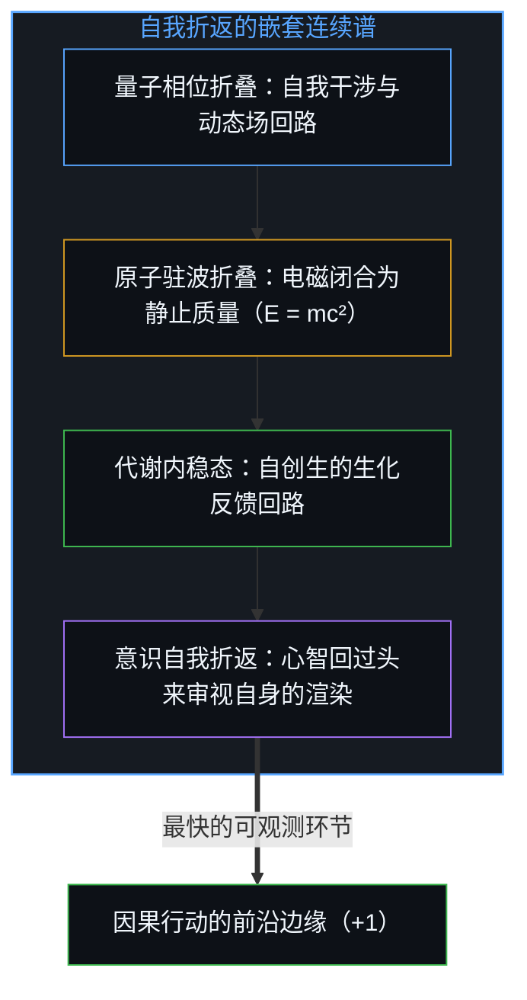
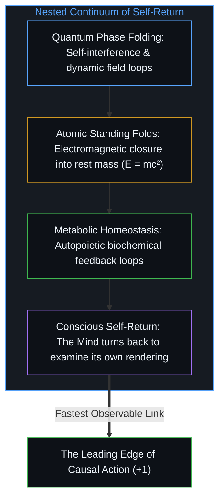
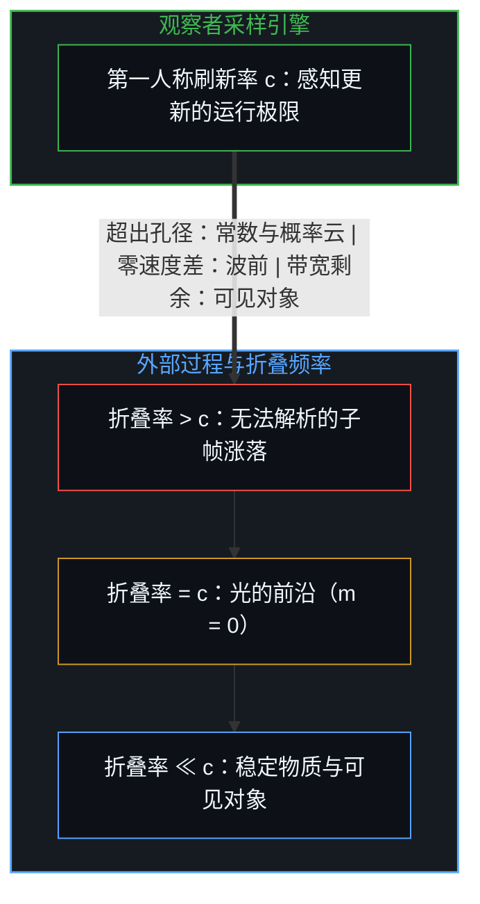
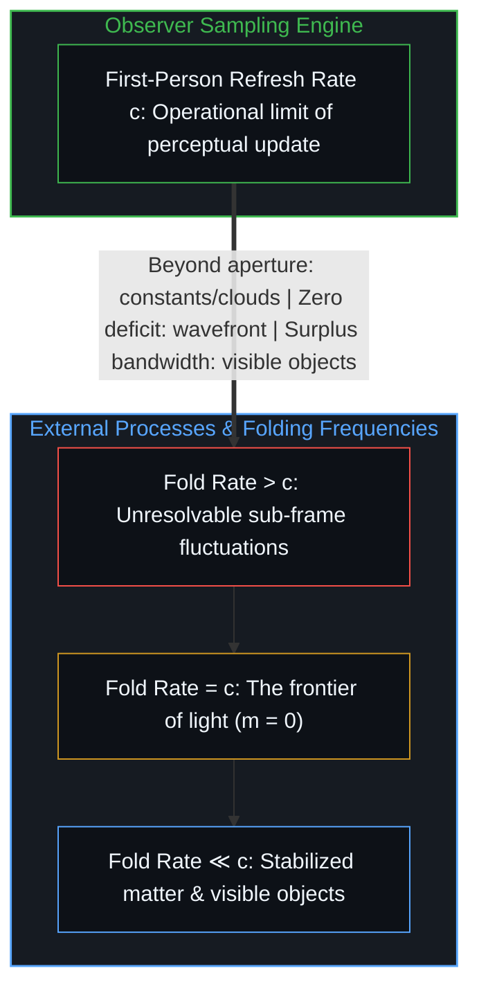
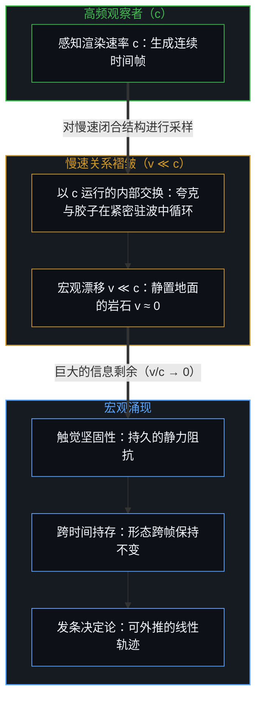
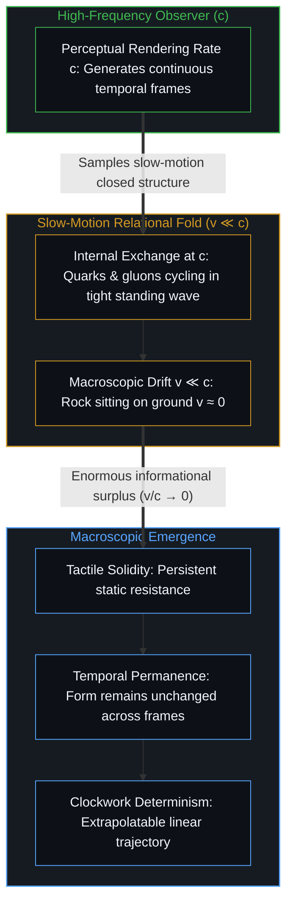
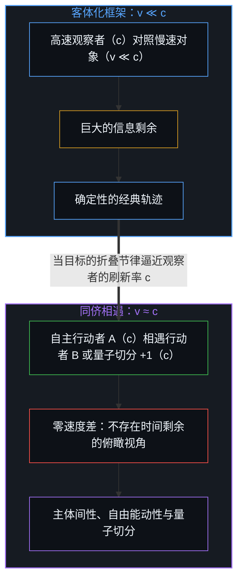
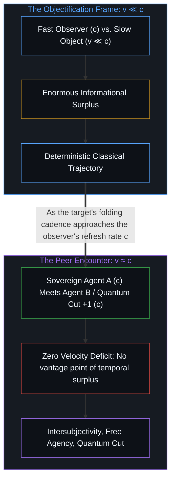
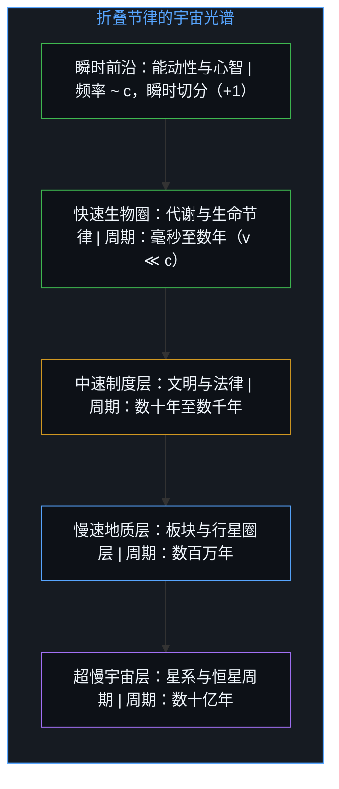
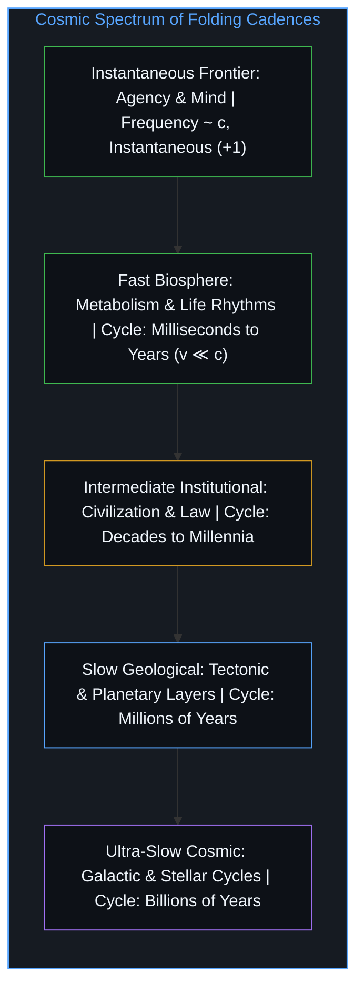

# 可见性的速度差 / The Velocity of Visibility

*现实如何向自身折叠，以及为何可见之物皆为更慢的褶皱 / How Reality Folds Back on Itself, and Why Everything Visible Is a Slower Fold*

心智是现实向自身折叠的最快环节。每一个可观测对象都是以更慢速率循环的关系褶皱，正是这一速度差使其成为可见。可见性并非物理物质的内在属性，而是高频观察者对慢速褶皱进行采样时所登记的信息剩余。

The Mind is the fastest link in reality folding back on itself. Every observable object is a relational fold cycling at a slower speed, and that velocity deficit is what makes it visible. Visibility is not an intrinsic property of physical matter, but the informational surplus that registers when a high-frequency observer samples a slow-motion fold.

## 一、 向自身折叠的宇宙 / 1. The Universe Folding Back on Itself

物理学传统上将宇宙描绘为一个巨大而冷漠的三维容器，其中零星散落着被称为“物质”的孤立积木。从牛顿的质点到现代粒子物理的标准模型，主流叙事假设：物理对象先于观测而存在，是一块块坚硬、自足的砖石；而心智不过是迟来且偶然的看台观众，被动注视着一台预先上紧发条的机械装置自行运转。

Physics has traditionally portrayed the universe as an enormous, indifferent three-dimensional container, sparsely populated with isolated building blocks termed "matter." From Newtonian mass points to the modern Standard Model of particle physics, the reigning narrative assumes that physical objects exist prior to observation as hard, self-contained bricks, while the mind is an accidental, late-arriving spectator perched in the grandstands, passively watching a pre-wound clockwork apparatus run its course.

从自我区分活动已在运行的第一人称原点出发追溯，这幅二元机械图景便随之瓦解。现实并非摆满惰性物体的陈列馆，也不存在外部的观景看台；在每一个尺度上，它都呈现为递归的自我折返。在量子基底处，动态场产生局域相位干涉，向自身折叠为初级的谐振回路；在原子与分子尺度，交变电磁场不再向外发散传播，而是闭合为驻波共振，如[对象是被稳定化的关系](../objects-are-stabilized-relationships/)所追溯的那样，向内折叠为具备静止质量（E = mc²）的局域结构；在生物尺度，化学级联反应构成自创生的代谢循环与递归转录回路，维持着内稳态的活体有机体；而在心智的第一人称边缘——从外部被建模为神经与感知的反馈回路——自我区分活动回过头来，审视自身得以渲染的条件。

Traced from the first-person origin where self-distinguishing activity is already underway, this dualistic mechanical picture collapses. Reality is not a museum populated by inert objects, nor does it possess an outside viewing deck; across every scale it registers as recursive self-return. At the quantum substrate, dynamic fields generate local phase interference, folding back into primary harmonic loops; at the atomic and molecular scale, alternating electromagnetic fields cease to propagate outward, closing into standing-wave resonances that fold back into localized structures endowed with rest mass (E = mc²), as traced in [Objects Are Stabilized Relationships](../objects-are-stabilized-relationships/); at the biological scale, chemical cascades form autopoietic metabolic cycles and recursive transcription loops that sustain homeostatic living organisms; and at the first-person edge of the Mind—modeled from the outside as neural and perceptual feedback loops—self-distinguishing activity turns back to inspect the conditions of its own rendering.

心智并非被抛入陌生物理剧场的异乡看客。它是在观测框架内，现实以最高自指频率向自身折叠的前沿边缘。

The Mind is not an alien spectator dropped into a foreign physical arena. It is the leading edge where reality folds back on itself at the highest self-referential frequency within the observational frame.

## 二、 感知的奈奎斯特极限：最快的可观测环节 / 2. The Nyquist Limit of Perception: The Fastest Observable Link

既然现实跨越各个尺度向自身折叠，为何在经验之内，心智会登记为最快的环节？为何没有任何物理实体或信号，呈现出比观察者的感知刷新率更快的运动或循环？

If reality folds back on itself across scales, why does the Mind register as the fastest link within experience? Why does no physical entity or signal appear to move or cycle faster than the perceptual refresh rate of the observer?

其机制在于离散观测的采样视界。在信号处理中，奈奎斯特—香农采样定理标示出一条结构边界：离散采样系统无法重建频率高于其采样率一半的信号；任何更高频的信号，要么混叠为低频伪影，要么平均化为无法解析的背景基底。将这一边界推及测量本身，正如[黑白采样帧与外推宇宙](../the-black-and-white-sample-frame-and-the-extrapolated-universe/)所追溯的那样，便能看清为何**观察者自身的渲染节律界定了其可观测宇宙的运行速度上限。**

The mechanism lies in the sampling horizon of discrete observation. In signal processing, the Nyquist-Shannon sampling theorem marks a structural boundary: a discrete sampling system cannot reconstruct a signal whose frequency exceeds half its sampling rate; any higher frequency either aliases into lower-frequency artifacts or averages out into an unresolvable background level. Carried over to measurement, as [The Black-and-White Sample Frame and the Extrapolated Universe](../the-black-and-white-sample-frame-and-the-extrapolated-universe/) traces, this boundary shows why **the observer's own rendering cadence defines the operational speed ceiling of its observable cosmos.**

倘若某个过程以高于观测心智渲染速率 c 的振荡频率循环，会发生什么？它无法凝聚为一个具有可追踪轨迹的局域物理对象。由于它在单个感知曝光窗口内便完成了无数次内部循环，其子帧相变无法被逐一解析。在宏观仪器上，这类超高速动力学只能登记为三种投影：标示离散因果步长分辨率视界的不变物理常数（如普朗克常数与精细结构常数，见[时间是因果的不可逆方向与离散步长](../time-is-causality-not-a-dimension/)的追溯）、子帧振荡平滑为统计相位云的概率量子波函数，以及在单个帧间隔内完成、被观察者登记为跨空间纠缠的非局域关联。

What happens if a process cycles at an oscillation rate faster than the rendering velocity c of the observing Mind? It cannot coalesce into a localized physical object with a trackable trajectory. Because it completes countless internal cycles within a single perceptual exposure window, its sub-frame phase transitions cannot be resolved one by one. On macroscopic instruments, such hyper-fast dynamics register only as three projections: invariant physical constants that mark the resolution horizon of the discrete causal step (such as Planck's constant and the fine-structure constant, as traced in [Time Is the Irreversible Direction and Discrete Step of Causality](../time-is-causality-not-a-dimension/)), probabilistic quantum wavefunctions where sub-frame oscillations smooth out into statistical phase clouds, and non-local correlations completed within a single frame interval and registered by the observer as entanglement across space.

因此，并非现实缺乏更高频的活动，而是**受测量边界本身所限，凡是能被区分、追踪并核验为物理对象的事物，其演化速率都处于或低于观察者的渲染频率**。观测心智之所以总是其可观测世界中最快的环节，是因为任何更快的过程都已沉淀为画面借以显像的结构画布。

Consequently, it is not that reality lacks higher-frequency activity; rather, **by the boundary of measurement itself, anything that can be distinguished, tracked, and verified as a physical object must evolve at or below the observer's rendering frequency**. The observing Mind is invariably the fastest link in its observable world, because anything faster has already settled into the structural canvas on which the picture registers.

## 三、 可见性即速度差：坚固性与决定论的涌现 / 3. Visibility as a Velocity Deficit: The Emergence of Solidity and Determinism

这种采样不对称性解释了物理经验中两个熟知的特征：物质的触觉坚固性与经典决定论的显现。日常直觉假设，一块岩石之所以可见且坚硬，是因为它由不可穿透的质料铸就，独立地摆在外部空间之中。然而原子物理学早已表明，原子体积中超过百分之九十九点九九九的空间并不存在局域质点。既然原子内部并无实心砖块，究竟是什么赋予了宏观世界不可动摇的实在感？

This sampling asymmetry accounts for two familiar features of physical experience: the tactile solidity of matter and the appearance of classical determinism. Everyday intuition assumes that a rock is visible and solid because it sits out there in independent space, forged from impenetrable stuff. Yet atomic physics shows that over ninety-nine point nine nine nine percent of an atom's volume is empty of localized mass points. If atoms contain no solid blocks, what gives the macroscopic world its unyielding presence?

答案并非某种底层实体，而是**速度差（v ≪ c）**：一个实体之所以登记为可见、坚硬与客观，并非因为它由惰性物质构筑，而是因为其关系结构的漂移速率远慢于观测心智的刷新率。

The answer is not an underlying substance, but a **Velocity Deficit (v ≪ c)**: an entity registers as visible, solid, and objective not because it is built from inert matter, but because the rate at which its relational structure drifts is vastly slower than the refresh rate of the observing Mind.

审视一块静置在地面上的花岗岩：其原子内部的夸克、胶子与电子以接近光速 c 的速率循环往复，通过交换局域规范力来维持驻波平衡；然而由于这些能量被锁闭在局域关系内部，整块宏观岩石的漂移速度近乎为零（v/c → 0）。当以速率 c 渲染的心智观测这块岩石时，连续的每一帧都返回几乎一致的空间构型，从而赋予观察者巨大的信息带宽剩余，得以在无数个帧间隔内对同一个关系绳结进行采样，而其宏观变化近乎为零。当感知一次又一次确认某一关系拓扑并未偏移时，便将这种时间冗余编译为**触觉坚固性**、**持久恒定性**与**发条式的机械决定论**。物理物质是锁在慢速关系回路中的动态活动；可见性则是高频心智对超慢速褶皱进行采样时投射出的高对比度感知轮廓。

Consider a slab of granite resting on the ground: the quarks, gluons, and electrons within its atoms circulate near light speed c, exchanging localized gauge forces to sustain standing-wave equilibrium; yet because this energy is locked within closed local relationships, the macroscopic rock as a whole drifts at a speed near zero (v/c → 0). When a Mind rendering at c observes this stone, each successive frame returns an almost identical spatial configuration, giving the observer an enormous informational bandwidth surplus that samples the same relational knot across countless intervals with near-zero macroscopic change. When perception confirms again and again that a relational topology has not shifted, it compiles that temporal redundancy into **tactile solidity**, **durable permanence**, and **clockwork mechanical determinism**. Physical matter is dynamic activity caught in slow-motion relational loops; visibility is the high-contrast perceptual contour cast when a high-frequency Mind samples an ultra-slow fold.

此外，构成这些慢速褶皱的微观要素，并非在某个初始瞬间被一劳永逸地固定下来。随着第一人称视角的推进，它们被一步步牵引跨越观测视界。由于其先在历史展开于当前观测框架之外，它们在抵达接触阈值时，表现为未决定的自由变量（+1）。一旦跨入视界，它们便锁入周遭的关系织体之中，由大数定律将个体的微观跃迁平滑为慢速的宏观稳定态，正如[确定性是微观不确定性的统计签名](../determinism-is-the-statistical-signature-of-micro-indeterminism/)所追溯的那样。同样，在[你的代码库即是记忆](../your-codebase-is-memory/)所审视的外化人工记忆中，代码库或活书之所以登记为稳定、可审视且可复用的确定性基底，正是因为作为既往残余层叠而成的静态检查点，其变动速率远慢于活生生的心智在当下的裁决（+1）。每一个可见对象与每一份外化记录，既是跨视界变量沉淀下来的痕迹，也是下一次活生生的行动借以向前跃出的稳定支点。

Furthermore, the microscopic elements composing these slow-motion folds were not fixed once and for all at an initial instant. They are drawn across the observational horizon step by step as the first-person vantage advances. Because their prior histories unfolded outside the current observational frame, they arrive at the threshold of contact as indeterminate free variables (+1). Once across the horizon, they lock into the surrounding relational fabric, where the Law of Large Numbers smooths individual micro-transitions into slow-motion macroscopic stability, as traced in [Determinism is the Statistical Signature of Micro-Indeterminism](../determinism-is-the-statistical-signature-of-micro-indeterminism/). In the same way, in the externalized artificial memory examined in [Your Codebase Is Memory](../your-codebase-is-memory/), a codebase or living book registers as a stable, inspectable, and reusable deterministic substrate because, as a static checkpoint of stacked prior residues, its rate of change is far slower than the living Mind's present adjudication (+1). Every visible object and every externalized record is both the settled trace of horizon-crossing variables and the stable fulcrum from which the next living act launches forward.

## 四、 同侪相遇：当褶皱以同速交汇 / 4. The Peer Encounter: When Folds Meet at Equal Speed

既然观察者能够凭借信息剩余将慢速褶皱（v ≪ c）客体化为确定性机制，一个更深的问题随之浮现：**当两个以相同最高节律（v = c）运行的过程迎面交汇时，会发生什么？** 这正是物理学遇上量子测量难题、哲学遇上自由能动性与主体间性的交汇处，正如[当电子开始思考](../when-electrons-think/)所展开的那样。

If an observer can objectify a slow-motion fold (v ≪ c) into a deterministic mechanism through an informational surplus, a further question follows: **what happens when two processes operating at the same maximal cadence (v = c) meet face to face?** This is the junction where physics meets the quantum measurement problem and philosophy meets free agency and intersubjectivity, as [When Electrons Think](../when-electrons-think/) lays out.

当两个处于同一渲染前沿的过程发生交互时，原本支撑经典客体化的时间带宽剩余便归零。在心智与心智的相遇中，注视另一个有意识个体的双眸，无法像追踪落石那样用确定性微分方程锁死对方的下一步抉择，因为另一个中心同样以运行节律 c 发起因果更新（+1）；由于相对对方没有任何带宽剩余，单向的外部预测便让位于博弈论、相互承认与自由能动性。而在测量仪器与量子跃迁的相遇中，探测微观粒子需要动用以速率 c 传播的光子或规范玻色子；由于探针与相变共享同一极限节律，速度差同样归零。正如理查德·费曼所感叹的，倘若电子能够思考，物理学就会棘手得多——在双缝干涉中，单个电子在探测下并非登记为预先写好剧本的台球，而是登记为无法从外部预先计算内部相位的微观自由变量（+1），在宏观探测器上留下统计性的干涉分布。

When two processes operating at the same rendering frontier interact, the temporal bandwidth surplus that sustained classical objectification drops to zero. In the encounter between Minds, looking into the eyes of another conscious individual offers no way to lock down their next choice with deterministic differential equations the way one tracks a falling stone, because the other center initiates causal updates (+1) at the same operational cadence c; with zero bandwidth surplus over them, unilateral external prediction gives way to game theory, reciprocal recognition, and free agency. And in the encounter between a measurement apparatus and a quantum transition, probing a microscopic particle requires photons or gauge bosons propagating at c; because the probe and the phase transition share the same limiting cadence, the velocity deficit drops to zero. Just as Richard Feynman remarked that physics would be much harder if electrons could think, in double-slit interference a single electron registers under probing not as a pre-scripted billiard ball, but as a microscopic free variable (+1) whose internal phase cannot be pre-calculated from outside, leaving a statistical interference distribution across macroscopic detectors.

一个心智无法将另一个心智单向客体化，正如一束光无法在另一束光上投下阴影。量子力学的测量边界并不反映实验室仪器的暂时缺陷，而是登记了观测撞上与探针自身同速运行的过程时的结构极限。

One Mind cannot unilaterally objectify another Mind, just as one beam of light cannot cast a shadow upon another. The measurement boundary in quantum mechanics does not reflect a temporary defect of laboratory instruments; it registers the structural limit where observation meets a process running at the same rendering speed as the probe itself.

## 五、 宇宙的褶皱光谱：从量子驻波到深时 / 5. The Cosmic Spectrum of Folds: From Quantum Standing Waves to Deep Time

跨过朴素物理主义之后，可观测世界便如[折叠的连续谱](../the-continuum-of-the-fold/)所追溯的那样，可被测绘为一道连续的**折叠节律光谱**。从[割点可移不可除](../the-cut-moves-but-never-vanishes/)的第一人称视角出发，每一个被观测到的结构，皆依据其内部的自我折返周期与宏观漂移速率，在这一连续谱上取得自身的坐标。

Stepping past naive physicalism, the observable world can be mapped as a continuous **Spectrum of Folding Cadences**, as [The Continuum of the Fold](../the-continuum-of-the-fold/) traces. Drawn from the first-person vantage where [The Cut Moves but Never Vanishes](../the-cut-moves-but-never-vanishes/), every observed structure takes its coordinate along this continuum according to its internal cycle of self-return and its macroscopic rate of drift.

在这幅拓扑图景中，生物节律（神经动作电位、心跳、细胞分裂）的循环慢于感知更新，却在节律上足够接近，因而登记为鲜活的生命力；在个体一生的时间跨度上，语言、法律传统与制度以数十年乃至数百年为周期演替，登记为持久的社会结构，其相对于更快能力前沿的较慢适应速率被体验为摩擦，正如[阻力体感与速率差](../felt-resistance-and-the-speed-differential/)所追溯的那样；在人类历史尺度上，山脉与大陆板块的漂移历时数千万年，提供了看似恒定不变的地质舞台；而在行星时间尺度上，银河旋臂的旋转与恒星的生命周期跨越数十亿年，构成了近乎静止的苍穹。某一层级之所以向更快的层级登记为“客观容器”或“恒久背景”，源于两者折叠频率之间的落差。更慢的褶皱为更快的褶皱提供了执行因果行动所需的稳定慢速基底，而最快的褶皱——观测心智——则渲染并索引着整个较慢的连续谱。

Within this topological map, biological rhythms (neural action potentials, heartbeats, cellular division) cycle more slowly than perceptual updates yet remain close enough in cadence to register as living vitality; across an individual human life, languages, legal traditions, and institutions shift over decades and centuries, registering as durable social structures whose slower adaptation rate relative to a faster capability edge is experienced as friction, as traced in [Felt Resistance and the Speed Differential](../felt-resistance-and-the-speed-differential/); across human history, mountain ranges and continental plates shift over tens of millions of years, furnishing an apparently immutable geological stage; and across planetary time, the rotation of galactic arms and the life cycles of stars unfold over billions of years, forming a nearly stationary celestial vault. A tier registers as an "objective container" or "enduring background" to a faster tier because of the gap between their folding frequencies. Slower folds provide the stable, slow-motion ground on which faster folds execute causal action, while the fastest fold—the observing Mind—renders and indexes the slower continuum.

## 六、 在前沿边缘触摸现实 / 6. Touching Reality from the Leading Edge

这消解了经典物理主义的宿命论。当慢速褶皱的下游规律性被倒置为先在的宇宙立法者时，心智便被描绘成预先写定的发条宇宙中的偶然旁观者，仿佛初始参数早已预先锁死了一切结局。

This dissolves the fatalism of classical physicalism. When the downstream regularity of slow-motion folds is inverted into a prior cosmic legislator, the Mind is pictured as an accidental bystander inside a pre-written clockwork universe whose initial parameters locked every outcome in advance.

认清可见性即速度差，便归还了因果的位点：心智并非被困在三维机械箱体中的被动乘客，而是现实在当下向自身折叠时**最高频、最灵敏的前沿边缘**；致密的花岗岩、大陆板块与遥远星场并非外部的囚笼高墙，而是在脚下托起稳定根基的慢速关系褶皱，使活生生的中心得以发起下一次不可逆的切分（+1）。现实并非封存在形式方程中的惰性标本，而是在当下边缘持续推进的因果运算。一切可见之物之所以显得坚固而确定，皆因其循环慢于观测它的心智，从而将尚未渲染的视界向着下一次切分敞开。

Recognizing visibility as a velocity deficit restores the locus of cause: the Mind is not a passive passenger trapped inside a three-dimensional mechanical box, but the **highest-frequency, most responsive leading edge** where reality folds back on itself in the present; dense granite, continental plates, and distant star fields are not external prison walls, but slow-motion relational folds that hold a stable foundation underfoot so the living center can initiate its next irreversible cut (+1). Reality is not an inert specimen sealed inside formal equations; it is an ongoing causal calculation advancing at the present edge. Everything visible appears solid and determinate because it cycles more slowly than the Mind that observes it, leaving the unrendered horizon open to the next cut.
