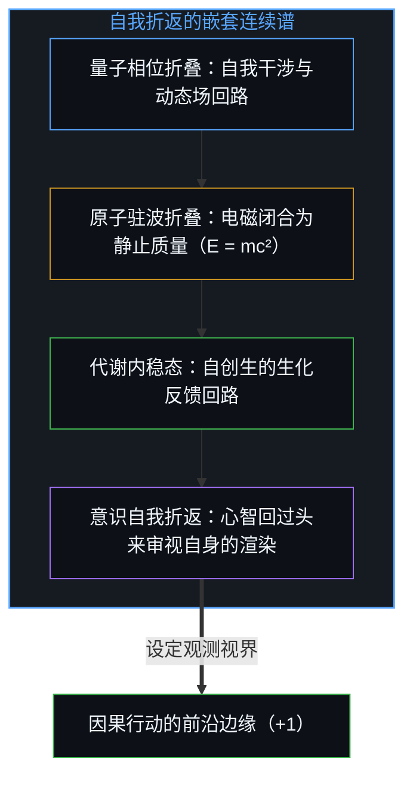
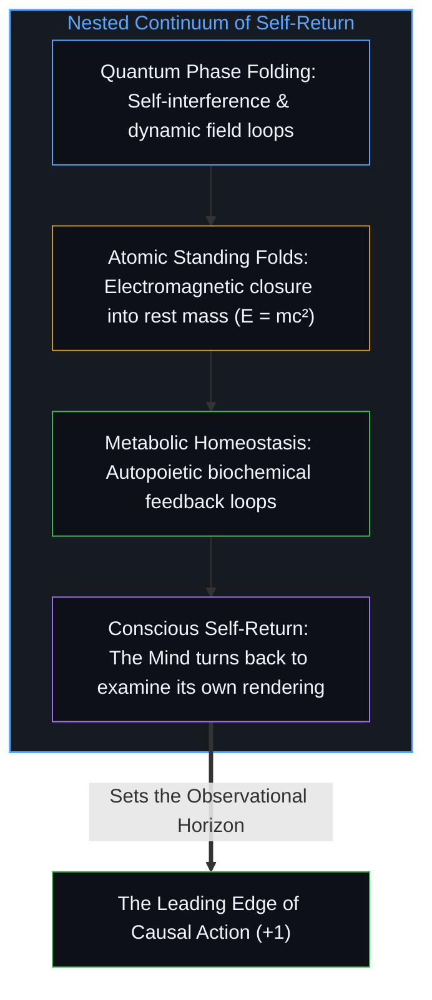
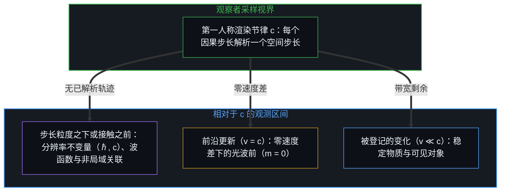
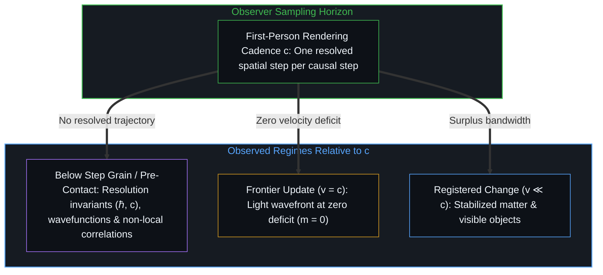
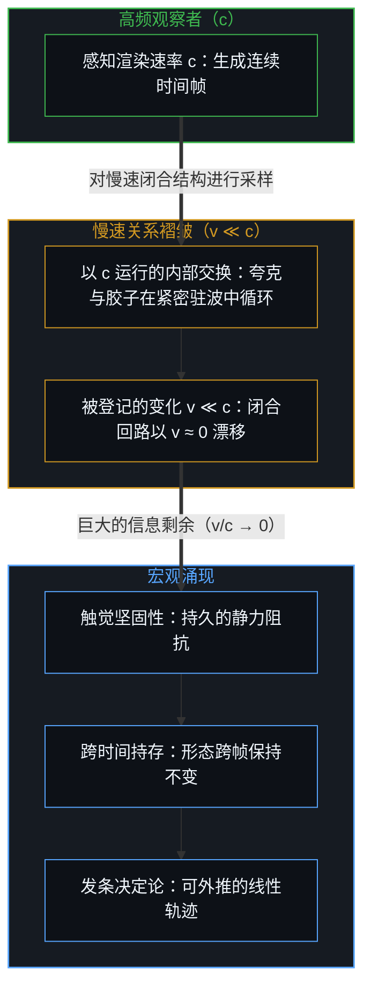
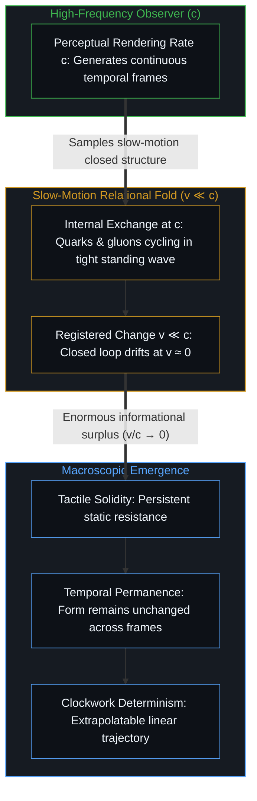
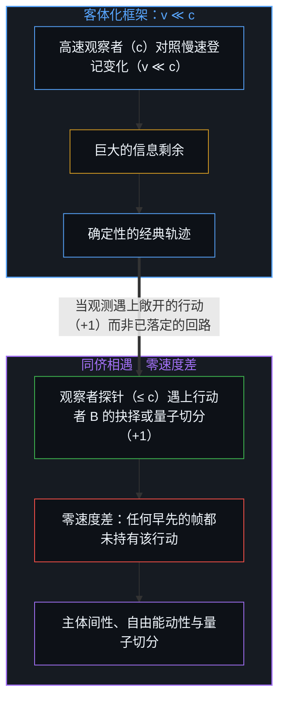
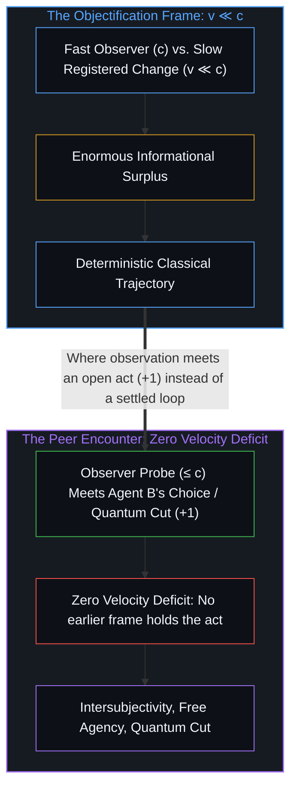
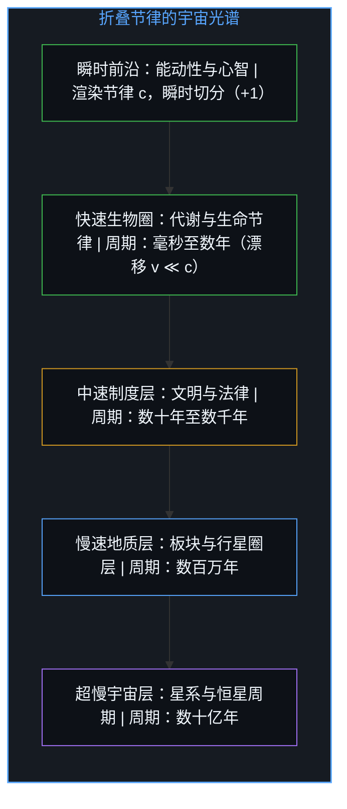
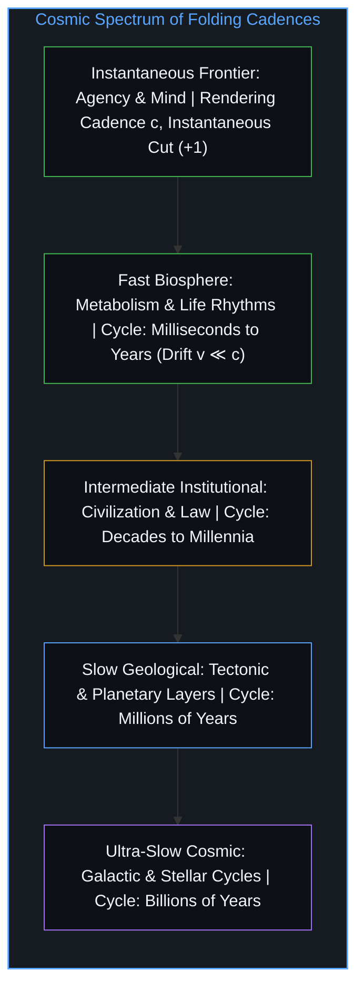

# 可见性的速度差 / The Velocity of Visibility

*现实如何向自身折叠，以及为何可见之物皆为更慢的褶皱 / How Reality Folds Back on Itself, and Why Everything Visible Is a Slower Fold*

心智是现实向自身折叠的最快环节。每一个可观测对象都是一处关系褶皱：其被登记的构型变动慢于心智的渲染，正是这一速度差使它可见。可见性并非物理物质的内在属性，而是高频观察者对慢速褶皱进行采样时所登记的信息剩余。

The Mind is the fastest link in reality folding back on itself. Every observable object is a relational fold whose registered configuration changes more slowly than the Mind renders, and that velocity deficit is what makes it visible. Visibility is not an intrinsic property of physical matter, but the informational surplus that registers when a high-frequency observer samples a slow-motion fold.

## 一、 向自身折叠的宇宙 / 1. The Universe Folding Back on Itself

物理学传统上将宇宙描绘为一个巨大而冷漠的三维容器，其中零星散落着被称为“物质”的孤立积木。从牛顿的质点到现代粒子物理的标准模型，主流叙事假设：物理对象先于观测而存在，是一块块坚硬、自足的砖石；而心智不过是迟来且偶然的看台观众，被动注视着一台预先上紧发条的机械装置自行运转。

Physics has traditionally portrayed the universe as an enormous, indifferent three-dimensional container, sparsely populated with isolated building blocks termed "matter." From Newtonian mass points to the modern Standard Model of particle physics, the reigning narrative assumes that physical objects exist prior to observation as hard, self-contained bricks, while the mind is an accidental, late-arriving spectator perched in the grandstands, passively watching a pre-wound clockwork apparatus run its course.

从自我区分活动已在运行的第一人称原点出发追溯，这幅二元机械图景便随之瓦解。现实并非摆满惰性物体的陈列馆，也不存在外部的观景看台；在每一个尺度上，它都呈现为递归的自我折返。在量子基底处，动态场产生局域相位干涉，向自身折叠为初级的谐振回路；在原子与分子尺度，交变电磁场不再向外发散传播，而是闭合为驻波共振，如[对象是被稳定化的关系](../objects-are-stabilized-relationships/)所追溯的那样，向内折叠为具备静止质量（E = mc²）的局域结构；在生物尺度，化学级联反应构成自创生的代谢循环与递归转录回路，维持着内稳态的活体有机体；而在心智的第一人称边缘——它与身体的耦合从外部被建模为神经与感知的反馈回路——自我区分活动回过头来，审视自身得以渲染的条件。

Traced from the first-person origin where self-distinguishing activity is already underway, this dualistic mechanical picture collapses. Reality is not a museum populated by inert objects, nor does it possess an outside viewing deck; across every scale it registers as recursive self-return. At the quantum substrate, dynamic fields generate local phase interference, folding back into primary harmonic loops; at the atomic and molecular scale, alternating electromagnetic fields cease to propagate outward, closing into standing-wave resonances that fold back into localized structures endowed with rest mass (E = mc²), as traced in [Objects Are Stabilized Relationships](../objects-are-stabilized-relationships/); at the biological scale, chemical cascades form autopoietic metabolic cycles and recursive transcription loops that sustain homeostatic living organisms; and at the first-person edge of the Mind—whose bodily coupling is modeled from the outside as neural and perceptual feedback loops—self-distinguishing activity turns back to inspect the conditions of its own rendering.

心智并非被抛入陌生物理剧场的异乡看客。它是现实向自身折叠的前沿边缘，设定着每一个观测框架的渲染视界。

The Mind is not an alien spectator dropped into a foreign physical arena. It is the leading edge where reality folds back on itself, setting the rendering horizon of every observational frame.

## 二、 感知的奈奎斯特极限：观测中最快的环节 / 2. The Nyquist Limit of Perception: The Fastest Link in Observation

既然现实跨越各个尺度向自身折叠，为何在经验之内，心智会登记为最快的环节——为何没有任何可追踪的物理实体或信号运动得比观察者的渲染视界更快？

If reality folds back on itself across scales, why does the Mind register as the fastest link within experience—why does no trackable physical entity or signal move faster than the observer's rendering horizon?

其机制在于离散观测的采样视界。在信号处理中，奈奎斯特—香农采样定理标示出一条结构边界：离散采样系统无法重建频率高于其采样率一半的信号；任何更高频的信号，要么混叠为低频伪影，要么平均化为无法解析的背景基底——所登记的动态取决于有限采样节律，这正是[座位之内的无限进程](../infinity-within-the-seat/)所追溯的同一依存关系。将这一边界推及测量本身，正如[黑白采样帧与外推宇宙](../the-black-and-white-sample-frame-and-the-extrapolated-universe/)所追溯的那样，便能看清为何**观察者自身的渲染节律界定了其可观测宇宙的运行速度上限。**

The mechanism lies in the sampling horizon of discrete observation. In signal processing, the Nyquist-Shannon sampling theorem marks a structural boundary: a discrete sampling system cannot reconstruct a signal whose frequency exceeds half its sampling rate; any higher frequency either aliases into lower-frequency artifacts or averages out into an unresolvable background level—the same dependence of registered dynamics on finite sampling cadence traced in [Infinity Within the Seat](../infinity-within-the-seat/). Carried over to measurement, as [The Black-and-White Sample Frame and the Extrapolated Universe](../the-black-and-white-sample-frame-and-the-extrapolated-universe/) traces, this boundary shows why **the observer's own rendering cadence defines the operational speed ceiling of its observable cosmos.**

在形式模型的分辨率边界处，光速 c 是每个因果步长所解析的一个空间步长（c = ℓ_P / t_P，如[时间是因果的不可逆方向与离散步长](../time-is-causality-not-a-dimension/)所追溯），因此观察者的渲染节律与其传播速度上限指向同一个视界。倘若某些跃迁在接触之前尚未闭合，或者落在该帧离散因果步长的分辨率之下，会发生什么？在交互发生之前，它们从不会凝聚为一个具有可追踪轨迹的局域物理对象。它们并非跨越空间一步步解析出来，而是在形式观测中以三种截然不同的方式登记：其一是限定网格本身的恒定分辨率视界常数（例如与 c 并列的普朗克常数 ℏ）；其二是概率性的量子波函数，在接触时登记出确定记录之前先行编码干涉相位与统计权重；其三是跨越分离坐标的非局域纠缠关联，它不携带任何超光速信号，反而揭示出空间分离本身即是下游投射。

At the resolution bound of formal models, the speed of light c is one resolved spatial step per causal step (c = ℓ_P / t_P, as traced in [Time Is the Irreversible Direction and Discrete Step of Causality](../time-is-causality-not-a-dimension/)), so the observer's rendering cadence and its propagation speed ceiling name a single horizon. What happens where transitions remain unclosed prior to contact, or fall below the discrete causal-step resolution of the frame? They never coalesce into a localized physical object with a trackable trajectory ahead of interaction. Rather than resolving step by step across space, they register in formal observation in three distinct ways: as invariant resolution-horizon constants that bound the grid itself (such as Planck's constant ℏ alongside c), as probabilistic quantum wavefunctions encoding interference phases and statistical weights before a definite record registers at contact, and as non-local entanglement correlations across separated coordinates that carry no superluminal signal and expose spatial separation itself as a downstream projection.

因此，**受测量边界本身所限，凡是能被区分、追踪并核验为物理轨迹的事物，其演化速率都必然不超过渲染视界 c**。在可观测世界之内，观测心智的前沿边缘从不被超越，因为任何接触前的未定态或步长之下的极限，都不会构成一个跑在观测前面的物体——它本就属于被追踪轨迹赖以登记的视界与画布。

Consequently, **by the boundary of measurement itself, anything that can be distinguished, tracked, and verified as a physical trajectory must evolve at or below the rendering horizon c**. The observing Mind's leading edge is never outrun within its observable world, because any pre-contact indeterminacy or sub-step limit does not form an object racing ahead of observation—it already belongs to the horizon and canvas on which tracked trajectories register.

## 三、 可见性即速度差：坚固性与决定论的涌现 / 3. Visibility as a Velocity Deficit: The Emergence of Solidity and Determinism

这种采样不对称性解释了物理经验中两个熟知的特征：物质的触觉坚固性与经典决定论的显现。日常直觉假设，一块岩石之所以可见且坚硬，是因为它由不可穿透的质料铸就，独立地摆在外部空间之中。然而原子物理学表明，原子体积中超过百分之九十九点九九九的空间并不存在局域质点。既然原子内部并无实心砖块，究竟是什么赋予了宏观世界不可动摇的实在感？

This sampling asymmetry accounts for two familiar features of physical experience: the tactile solidity of matter and the appearance of classical determinism. Everyday intuition assumes that a rock is visible and solid because it sits out there in independent space, forged from impenetrable stuff. Yet atomic physics shows that over ninety-nine point nine nine nine percent of an atom's volume is empty of localized mass points. If atoms contain no solid blocks, what gives the macroscopic world its unyielding presence?

答案并非某种底层实体，而是**速度差（v ≪ c）**：一个实体之所以登记为可见、坚硬与客观，并非因为它由惰性物质构筑，而是因为观测所登记的构型跨帧变动的速率 v，远慢于观测心智的渲染节律 c。

The answer is not an underlying substance, but a **Velocity Deficit (v ≪ c)**: an entity registers as visible, solid, and objective not because it is built from inert matter, but because the rate v at which the configuration registered by observation changes across frames is vastly slower than the rendering cadence c of the observing Mind.

审视一块静置在地面上的花岗岩：其原子内部的夸克、胶子与电子以接近光速 c 的速率循环往复，通过交换局域规范力来维持驻波平衡；然而由于这一内部循环封存在闭合的局域关系之内，外部观测所登记的构型仅以岩石近乎为零的宏观漂移速度变动（v/c → 0）。当以速率 c 渲染的心智观测这块岩石时，连续的每一帧都返回几乎一致的空间构型，从而赋予观察者巨大的信息带宽剩余，得以在无数个帧间隔内对同一个关系绳结进行采样，而其宏观变化近乎为零。当感知一次又一次确认某一关系拓扑并未偏移时，便将这种时间冗余编译为**触觉坚固性**、**持久恒定性**与**发条式的机械决定论**。物理物质是锁在慢速关系回路中的动态活动；可见性则是高频心智对超慢速褶皱进行采样时投射出的高对比度感知轮廓。

Consider a slab of granite resting on the ground: the quarks, gluons, and electrons within its atoms circulate near light speed c, exchanging localized gauge forces to sustain standing-wave equilibrium; yet because that internal circulation stays sealed within closed local relationships, the configuration registered by outside observation changes only at the rock's macroscopic drift speed near zero (v/c → 0). When a Mind rendering at c observes this stone, each successive frame returns an almost identical spatial configuration, giving the observer an enormous informational bandwidth surplus that samples the same relational knot across countless intervals with near-zero macroscopic change. When perception confirms again and again that a relational topology has not shifted, it compiles that temporal redundancy into **tactile solidity**, **durable permanence**, and **clockwork mechanical determinism**. Physical matter is dynamic activity caught in slow-motion relational loops; visibility is the high-contrast perceptual contour cast when a high-frequency Mind samples an ultra-slow fold.

此外，构成这些慢速褶皱的微观要素，并非在某个初始瞬间被一劳永逸地固定下来。随着第一人称视角的推进，它们被一步步牵引跨越观测视界。由于其先在历史展开于当前观测框架之外，它们在抵达接触阈值时，表现为未决定的自由变量（+1）。一旦跨入视界，它们便锁入周遭的关系织体之中，由大数定律将个体的微观跃迁平滑为慢速的宏观稳定态，正如[确定性是微观不确定性的统计签名](../determinism-is-the-statistical-signature-of-micro-indeterminism/)所追溯的那样。同样，在[你的代码库即是记忆](../your-codebase-is-memory/)所审视的外化人工记忆中，代码库或活书之所以登记为稳定、可审视且可复用的确定性基底，正是因为作为既往残余层叠而成的静态检查点，其变动速率远慢于活生生的心智在当下的裁决（+1）。每一个可见对象与每一份外化记录，既是跨视界变量沉淀下来的痕迹，也是下一次活生生的行动借以向前跃出的稳定支点。

Furthermore, the microscopic elements composing these slow-motion folds were not fixed once and for all at an initial instant. They are drawn across the observational horizon step by step as the first-person vantage advances. Because their prior histories unfolded outside the current observational frame, they arrive at the threshold of contact as indeterminate free variables (+1). Once across the horizon, they lock into the surrounding relational fabric, where the Law of Large Numbers smooths individual micro-transitions into slow-motion macroscopic stability, as traced in [Determinism is the Statistical Signature of Micro-Indeterminism](../determinism-is-the-statistical-signature-of-micro-indeterminism/). In the same way, in the externalized artificial memory examined in [Your Codebase Is Memory](../your-codebase-is-memory/), a codebase or living book registers as a stable, inspectable, and reusable deterministic substrate because, as a static checkpoint of stacked prior residues, its rate of change is far slower than the living Mind's present adjudication (+1). Every visible object and every externalized record is both the settled trace of horizon-crossing variables and the stable fulcrum from which the next living act launches forward.

## 四、 同侪相遇：当速度差归零 / 4. The Peer Encounter: Where the Velocity Deficit Vanishes

既然观察者能够凭借信息剩余将慢速褶皱（v ≪ c）客体化为确定性机制，一个更深的问题随之浮现：**当观测面对边界上一个敞开的行动（+1），任何早先的帧都无法对其采样，因而速度差归零时，会发生什么？** 这正是物理学遇上量子测量难题、哲学遇上自由能动性与主体间性的交汇处，正如[当电子开始思考](../when-electrons-think/)所展开的那样。

If an observer can objectify a slow-motion fold (v ≪ c) into a deterministic mechanism through an informational surplus, a further question follows: **what happens when that velocity deficit vanishes because observation confronts an open act at the boundary (+1) that no earlier frame can sample?** This is the junction where physics meets the quantum measurement problem and philosophy meets free agency and intersubjectivity, as [When Electrons Think](../when-electrons-think/) lays out.

当观测面对边界上一个敞开的行动而非早已落定的回路时，原本支撑经典客体化的时间带宽剩余便归零。在心智与心智的相遇中，尽管他人的身体作为慢速的宏观褶皱运动（v ≪ c），注视那个个体的双眸时所面对的，却是另一个中心：以己度之，它同样在作抉择，其下一步决断（+1）在作出之前尚不在任何地方，因此任何早先的帧都无法提前对其采样；这一决断唯有在作出之后，由不快于观察者渲染节律 c 的光与声承载着才得以登记，而对这一抉择毫无速度差可言，单向的微分方程预测便让位于博弈论、相互承认与自由能动性。而在测量仪器与量子跃迁的相遇中，接触之前，早先的帧里并无局域轨迹——该过程仅登记为第二节所述的统计波函数；在接触发生时，结果唯有在探针遇上边界之际才得以登记，也没有探针能超越 c 提前对它采样，因此接触之前的任何一帧都未持有它，速度差随之归零。正如理查德·费曼曾感叹，倘若电子有感情，物理学将会难做多少，在双缝干涉中，单个电子的穿越在接触之前无法从外部预先算出；在接触瞬间，它作为微观自由变量（+1）跨越第三节所述的观测视界，而在多次重复运行中，这些个别的跨越在宏观探测器上沉淀为统计性的干涉分布。

Where observation confronts an open act at the boundary rather than an already-settled loop, the temporal bandwidth surplus that sustained classical objectification drops to zero. In the encounter between Minds, while another person's body moves as a slow macroscopic fold (v ≪ c), looking into the eyes of that individual confronts another choosing center, taken by analogy from oneself, whose next decision (+1) is not yet anywhere before it is made, so no earlier frame can sample it in advance; the decision registers only after it is made, carried by light and sound no faster than the observer's rendering cadence c, and with zero velocity deficit over that choice, unilateral differential-equation prediction gives way to game theory, reciprocal recognition, and free agency. And in the encounter between a measurement apparatus and a quantum transition, before contact no localized trajectory sits in any prior frame—the process registers only as the statistical wavefunction of Section 2; at contact, the outcome registers only when the probe meets the boundary, with no probe able to outrun c to sample it beforehand, so no frame before contact holds it and the velocity deficit drops to zero. Just as Richard Feynman remarked on how much harder physics would be if electrons had feelings, in double-slit interference a single electron's crossing cannot be pre-calculated from outside before contact; at contact it crosses Section 3's observational horizon as a microscopic free variable (+1), while across many runs those individual crossings settle into a statistical interference distribution on macroscopic detectors.

一个心智无法将另一个心智单向客体化，因为尚未作出的抉择并未留下任何已落定的痕迹供早先的帧提前采样。同样，量子力学的测量边界并不反映实验室仪器的暂时缺陷，而是登记了一个结构极限：结果唯有在接触时才得以登记，因此没有任何探针能在交互之前将它提前读出。

One Mind cannot unilaterally objectify another Mind, because a choice that has not yet been made offers no settled trace for earlier frames to sample in advance. Likewise, the measurement boundary in quantum mechanics does not reflect a temporary defect of laboratory instruments; it registers the structural limit where an outcome registers only at contact, so no probe can read it out ahead of the interaction.

## 五、 宇宙的褶皱光谱：从量子驻波到深时 / 5. The Cosmic Spectrum of Folds: From Quantum Standing Waves to Deep Time

跨过朴素物理主义之后，可观测世界便如[折叠的连续谱](../the-continuum-of-the-fold/)所追溯的那样，可被测绘为一道连续的**折叠节律光谱**。从[割点可移不可除](../the-cut-moves-but-never-vanishes/)的第一人称视角出发，每一个被观测到的结构，皆依据其内部的自我折返周期以及其被登记的构型相对于 c 漂移的速率 v，在这一连续谱上取得自身的坐标。

Stepping past naive physicalism, the observable world can be mapped as a continuous **Spectrum of Folding Cadences**, as [The Continuum of the Fold](../the-continuum-of-the-fold/) traces. Drawn from the first-person vantage where [The Cut Moves but Never Vanishes](../the-cut-moves-but-never-vanishes/), every observed structure takes its coordinate along this continuum according to its internal cycle of self-return and the rate v at which its registered configuration drifts relative to c.

在这幅拓扑图景中，量子与原子驻波将高速的内部交换锁入静止的束缚结构之中，使其宏观构型以近乎为零的速率漂移（v ≪ c），从而跨尺度锚定着物理基底；生物节律（神经动作电位、心跳、细胞分裂）远低于渲染节律 c，却展开于人类经验注意的跨度之内，因而登记为鲜活的生命力；在个体一生的时间跨度上，语言、法律传统与制度以数十年乃至数百年为周期演替，登记为持久的社会结构，它们的适应速率慢于更快的能力前沿，这一速率之差被体验为摩擦，正如[阻力体感与速率差](../felt-resistance-and-the-speed-differential/)所追溯的那样；比起人类历史，山脉与大陆板块的漂移历时数千万年，提供了看似恒定不变的地质舞台；而在宇宙的时间跨度上，银河旋臂的旋转与恒星的生命周期历时数十亿年，构成了近乎静止的苍穹。某一层级之所以向更快的层级登记为“客观容器”或“恒久背景”，是因为两者的折叠节律之间存在落差。更慢的褶皱为更快的褶皱提供了执行因果行动所需的稳定慢速基底，而最快的褶皱——处于自身渲染视界上的观测心智——则渲染并索引着整个较慢的连续谱。

Within this topological map, quantum and atomic standing waves lock rapid internal exchanges into stationary bound structures whose macroscopic configuration drifts near zero (v ≪ c), anchoring the physical substrate across scales; biological rhythms (neural action potentials, heartbeats, cellular division) unfold far below the rendering cadence c yet within the span of human experiential attention, registering as living vitality; across an individual human life, languages, legal traditions, and institutions shift over decades and centuries, registering as durable social structures whose slower adaptation rate relative to a faster capability edge is experienced as friction, as traced in [Felt Resistance and the Speed Differential](../felt-resistance-and-the-speed-differential/); next to human history, mountain ranges and continental plates shift over tens of millions of years, furnishing an apparently immutable geological stage; and across cosmic spans, the rotation of galactic arms and the life cycles of stars unfold over billions of years, forming a nearly stationary celestial vault. A tier registers as an "objective container" or "enduring background" to a faster tier because of the gap between their folding cadences. Slower folds provide the stable, slow-motion ground on which faster folds execute causal action, while the fastest fold—the observing Mind at its rendering horizon—renders and indexes the slower continuum.

## 六、 在前沿边缘触摸现实 / 6. Touching Reality from the Leading Edge

这消解了经典物理主义的宿命论。当慢速褶皱的下游规律性被倒置为先在的宇宙立法者时——这同样颠倒了可见残余与本源，正如[把稳定的症状当作稳定的来源](../mistaking-the-symptom-of-stability-for-its-source/)所追溯的那样——心智便被描绘成预先写定的发条宇宙中的偶然旁观者，仿佛初始参数早已锁死了一切结局。

This dissolves the fatalism of classical physicalism. When the downstream regularity of slow-motion folds is inverted into a prior cosmic legislator—the same reversal of visible residue and source traced in [Mistaking the Symptom of Stability for Its Source](../mistaking-the-symptom-of-stability-for-its-source/)—the Mind is pictured as an accidental bystander inside a pre-written clockwork universe whose initial parameters locked every outcome in advance.

认清可见性即速度差，便归还了因果的位点：心智并非被困在三维机械箱体中的被动乘客，而是现实在当下向自身折叠时**最快、最灵敏的前沿边缘**；致密的花岗岩、大陆板块与遥远星场并非外部的囚笼高墙，而是在脚下托起稳定根基的慢速关系褶皱，使活生生的中心得以发起下一次不可逆的切分（+1）。现实并非封存在形式方程中的惰性标本，而是在当下边缘持续推进的因果运算。一切可见之物之所以显得坚固而确定，皆因观测对它所登记的变化慢于观测它的心智，从而将尚未渲染的视界向着下一次切分敞开。

Recognizing visibility as a velocity deficit restores the locus of cause: the Mind is not a passive passenger trapped inside a three-dimensional mechanical box, but the **fastest, most responsive leading edge** where reality folds back on itself in the present; dense granite, continental plates, and distant star fields are not external prison walls, but slow-motion relational folds that hold a stable foundation underfoot so the living center can initiate its next irreversible cut (+1). Reality is not an inert specimen sealed inside formal equations; it is an ongoing causal calculation advancing at the present edge. Everything visible appears solid and determinate because what observation registers of it changes more slowly than the Mind that observes it, leaving the unrendered horizon open to the next cut.
