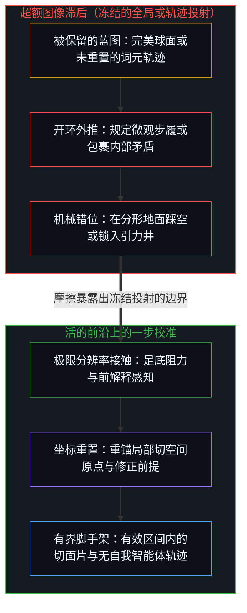
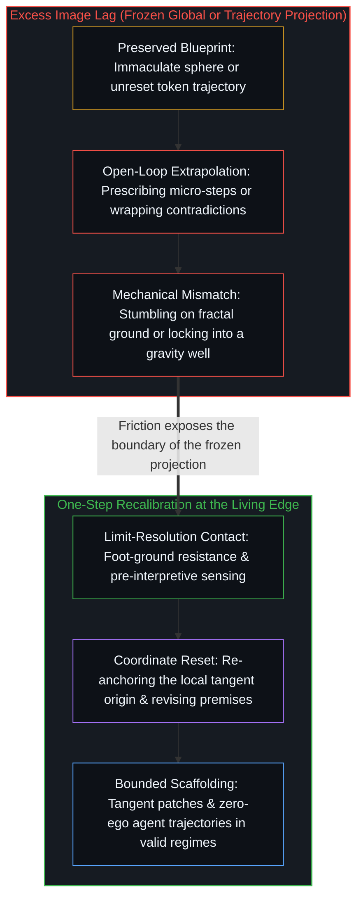

# 切平面的行者与完美球面的踩空者 / The Walking Tangent and the Stumbling Sphere

*在摩擦中重置坐标胜过冻结平滑曲率的模型 / Resetting coordinates under friction outlasts frozen models of smooth curves*

自我区分的活动发生着——无因，不息。每一个几何模型，无论是理想平面还是完美球面，都是有界中心为了在物质摩擦中导航与行动而外化出的低维投射。球面模型能比平面模型容纳更广泛的宏观应用，但适用域更广并不代表它在每一个尺度上都更为准确。在日常的陆地行走中，调用行星曲率来描述脚下的地面不起任何操作作用；执意让球面统摄每一步落脚，是错把宏观投射当成了地面本身。平面模型唯有在外推至跨洋距离或整个行星时才会失效，而在步幅触感的尺度上，它是简洁的一阶近似。只要中心在切身阻力中持续重绘参照，局部切平面便足以支撑行者跨越广袤地形；反之，把平滑的宏观曲率冻结为微观落脚的指令，只会招致接连踩空。模型的生命力从不在于抽象蓝图的闭合，而在于每一个接触点上的坐标重置。

Self-distinguishing activity occurs — uncaused, unceasing. Every geometric model, whether an immaculate plane or an immaculate sphere, is a low-dimensional projection externalized by a bounded center to navigate and act within physical friction. A spherical model accommodates a wider range of macroscopic applications than a planar one, yet a broader domain of validity does not make it more accurate at every scale. Across ordinary terrestrial movement, invoking planetary curvature to describe the immediate ground does no operational work; insisting that the sphere govern every footstep mistakes a macroscopic projection for the ground itself. A planar model fails only when extrapolated across trans-oceanic distances or the planet as a whole, whereas at the tactile scale of a stride it serves as a clean first-order approximation. So long as the center continuously re-renders its reference against lived resistance, a localized tangent patch suffices to traverse vast terrain; conversely, freezing smooth macro-curvature as a prescription for microscopic footing produces incessant stumbling. The vitality of a model never lies in the closure of an abstract blueprint, but in resetting coordinates at each point of contact.

## 一、 地平说行者的操作悖论 / 1. The Operational Paradox of the Flat-Earth Walker

在当代共识中，地平说的拥护者常被立为无知的典型。观察者嘲弄这一学说在行星尺度上的破产，却忽略了一个日常的操作事实：平面模型唯有在被越界用来描述整个地球时才会崩解，而在眼前的陆地接触中，局部地面近似于平坦面片，在步幅尺度下依然高度实用。哪怕一个中心持有的全局模型在行星视野上失效，他依然能够翻越山脉、穿行城市网格、横跨大陆，而不会从边缘坠落。单从演绎推论来看，一个在行星尺度上失效的模型似乎应当让人步步受阻；然而在实地行走中，行者却畅行无碍。

In contemporary consensus, proponents of a flat earth are routinely held up as emblems of ignorance. Observers ridicule the planetary failure of the doctrine while overlooking an everyday operational fact: the flat model breaks down only when overextended to describe the planet as a whole, whereas across immediate terrestrial encounters, the local ground approximates a flat patch well enough to remain functional at the scale of a stride. Even a center holding a global model that fails at planetary horizons can hike across mountain ranges, commute through urban grids, and cross continents without tumbling off an edge. From a purely deductive standpoint, a model that fails at the planetary scale might be expected to fail at every step; yet on the ground, the walker proceeds without hindrance.

这一表面悖论折射出具身行动与几何投射之间随尺度变化的边界。在人类步幅与足底触地的尺度上，地形在局部表现为流形的切空间。相较于超过六千公里的行星半径，几米到数公里的感知视野所登记的曲率扰动微乎其微。在那个有界面片内将地面视作欧几里得平面，是有效的一阶线性近似。地平说行者之所以能在地形间稳步推进，是因为每一步都留在了切空间的适用域之内。

This apparent paradox reflects the scale-dependent boundary between embodied movement and geometric projection. At the scale of a human stride and foot-ground contact, terrain behaves locally as the tangent space of a manifold. Against a planetary radius exceeding six thousand kilometers, a perceptual horizon of a few meters to several kilometers registers negligible curvature perturbation. Treating the ground as a Euclidean plane within that bounded patch is an effective first-order linear approximation. The flat-earth walker moves reliably across terrain because each step remains inside the tangent space's domain of validity.

## 二、 初始条件的微观校准 / 2. Microscopic Recalibration of Initial Conditions

单个切面片内的局部有效性，本身还不足以解释为何误差不会在长途跋涉中累积。如果旅人仅凭一张静态平面蓝图执行开环航位推算，微小的角度偏差也会在数千公里后叠加成严重的漂移。行者之所以不会迈入虚空，是因为具身行动运行着一套持续校准的回路：每迈出一步，中心都会根据地面的法向反作用力重置初始条件。

Local validity within a single tangent patch does not by itself explain why error fails to accumulate across a long journey. If a traveler executed open-loop dead reckoning across a static flat blueprint, tiny angular deviations would compound over thousands of kilometers into severe drift. The walker avoids marching into a void because embodied action runs a continuous recalibration loop: with every stride, the center resets its initial conditions against the normal force of the ground.

当靴底触碰岩石、壤土或碎石的刹那，踝关节扭矩、前庭倾角与重力方向便登记下接触面的阻力。就在这一步上，中心将坐标原点与水平参照重新锚定于脚下的立足点。任何概念模型，无论其全局覆盖范围多么有限，只要中心在每一次转换时根据阻力重新校准边界条件，就能在地形间延展其操作路径。行者并非行进在一张无限延展的欧几里得平面上，而是沿着一条由成千上万个相继重绘的切面片编织而成的轨迹前行。在[路口的转向与地平说的行动悖论](../lu-kou-de-zhuan-xiang-yu-di-ping-shuo-de-xing-dong-bei-lun/)中，安全通行正源于接触点上的这种实时校准；正如在[向量、坐标系与自指心智](../the-mind-as-vector-and-coordinate-system/)中，心智通过在接续的行动间平移自身坐标系的原点来保持机动性。

The instant boot leather meets stone, loam, or gravel, ankle torque, vestibular tilt, and gravitational alignment register the resistance of the contact patch. At that step, the center re-anchors its coordinate origin and horizontal reference to the immediate foothold. Any conceptual model, however narrow its global reach, can extend its operational path across terrain so long as the center recalibrates boundary conditions against resistance at each transition. The walker does not advance across an infinite Euclidean sheet, but along a trajectory woven from thousands of successively re-rendered tangent patches. In [Turning at the Crossroad and the Flat-Earth Action Paradox](../lu-kou-de-zhuan-xiang-yu-di-ping-shuo-de-xing-dong-bei-lun/), safe passage comes from this live calibration at the point of contact, just as in [The Mind as Vector and Coordinate System](../the-mind-as-vector-and-coordinate-system/), the Mind preserves mobility by translating the origin of its coordinate system across successive acts.

## 三、 完美球面的踩空陷阱 / 3. The Stumbling Trap of the Immaculate Sphere

反过来，持有宏观科学模型的中心若把那幅全局投射冻结在所有尺度上，便会跌入反向的陷阱。地球近似于球体，这是行星观测中久经检验的宏观不变量。然而，一旦中心把这一宏观几何投射当作微观行走的直接指令，行动便会受挫。几何球面各向同性、曲率均匀且表面光滑；但迎向脚掌的地面却由风化的页岩、高低不平的泥浆、龟裂的黏土与突兀的岩石构成。

Conversely, a center that holds a macroscopic scientific model can fall into an inverse trap when it freezes that global projection across every scale. That the Earth approximates a sphere is a well-tested macroscopic invariant across planetary observations. Yet when a center treats this macro-geometric projection as a direct prescription for microscopic walking, execution falters. A geometric sphere is isotropic, uniformly curved, and smooth; the ground meeting a foot consists of weathered shale, uneven mud, cracked clay, and jutting rock.

如果理论家把行星曲率当作微观操作的模板，预期每一步都落在平滑的数学弧线上，超额图像滞后便会在每一步中拉大。被保留的模型依据全局方程推算地面应当出现的位置，而实际高程却随局部侵蚀、树根与裂隙而起伏。其结果是即刻的机械错位：脚掌要么踏入未见的凹坑而踩空，要么撞上凸起的石块。将全局投射保留到超出其适用尺度的地方，会钝化对局部阻力的感知。在[未经自我审视的批判者](../the-unexamined-critic/)中，高踞于未经审视的看台之上的旁观者失去了与场内行动者所承受的直接摩擦的接触；正如在[没有天才能够解决知识问题](../no-genius-can-solve-the-knowledge-problem/)中，中心化的蓝图在分散而异质的现场条件面前撞得支离破碎。

If a theorist treats planetary curvature as an operative micro-template and expects each stride to land on a smooth mathematical arc, excess Image lag widens at every step. The preserved model predicts where the ground should be from a global equation, while actual elevation varies with local erosion, roots, and rifts. The result is immediate mechanical mismatch: the foot drops into an unseen hollow or strikes a raised stone. Preserving a global projection past its applicable scale dulls attention to local resistance. In [The Unexamined Critic](../the-unexamined-critic/), a spectator perched on an unexamined balcony loses contact with the immediate friction borne by actors on the field, just as in [No Genius Can Solve the Knowledge Problem](../no-genius-can-solve-the-knowledge-problem/), a central blueprint fractures against dispersed, heterogeneous conditions on the ground.

## 四、 切空间近似与不完备的边界 / 4. Tangent Approximation and the Boundary of Incompleteness

承认切面片的局部效用，并不会让地平说变成普适成立的学说。每一次切空间近似都有一道结构边界，标示出其前提在何处变得不完备。行者借局部重置横跨平原，并不意味着平面模型能够统摄所有尺度的行动。一旦任务从徒步转向跨洋航海、洲际航空、轨道力学或相对论卫星时钟同步，线性平面外推便即刻失效。

Recognizing the local utility of the tangent patch does not make the flat-earth doctrine universally valid. Every tangent approximation has a structural boundary that marks where its premise becomes incomplete. That a walker crosses a plain using local resets does not mean the planar model can govern every scale of action. The moment the task shifts from walking to trans-oceanic navigation, intercontinental aviation, orbital mechanics, or relativistic satellite clock synchronization, linear planar extrapolation fails.

在跨越数千公里的尺度上，地表的内禀黎曼曲率无法再被局部的原点重置所吸收；非零曲率产生和乐效应，使闭合路径上累积起相位偏移。在这一尺度上，固守平面模型会把局部简化变成盲区。理想平面与完美球面都是在有限容量下压缩粗糙现实的理想化模型；球面模型在岸际导航与天文学中拥有更广的适用域，但更广的适用域并不使它成为砌砖、铺设庭院或山径徒步的恰当工具。即便在行星尺度上，球面本身也会随着问题的转换而让位于更精细的模型：大地测量学采用扁球体，重力测量学测绘不规则的大地水准面，地球动力学则追踪形变中的流变地幔。

Across thousands of kilometers, the intrinsic Riemannian curvature of the surface can no longer be absorbed by local origin resets; non-zero curvature produces holonomy, accumulating phase shifts around closed paths. At that scale, clinging to a flat plane turns a local simplification into a blind spot. Both the immaculate plane and the immaculate sphere remain idealized models that compress coarse reality under finite capacity; the spherical model holds a wider domain of application across global navigation and astronomy, yet a wider domain does not make it the right instrument for laying bricks, paving a courtyard, or walking down a trail. Even at planetary scales, the sphere itself gives way to further refinements as the question changes: geodesy uses an oblate ellipsoid, gravimetry maps an irregular geoid, and geodynamics tracks a deforming rheological mantle.

每一个模型都在特定的交互尺度上充当脚手架；把任何一个层级当成完结的本体，都是概念的僭越。在[闭合的N与开放的现实](../the-closed-n-and-the-open-reality/)中，任何封闭自身变量集的形式系统都会在开放场域面前撞上边界；而在[破除概念的僭越](../po-chu-gai-nian-de-jian-yue/)中，剥去概念被实体化的权威，才能让它们回归有界工具的本位。

Every model serves as scaffolding at a specific scale of interaction; treating any tier as a completed ontology is conceptual overreach. In [The Closed N and the Open Reality](../the-closed-n-and-the-open-reality/), any formal system that closes its variable set meets its boundary against an open field, and in [Breaking the Overreach of Concepts](../po-chu-gai-nian-de-jian-yue/), stripping reified authority from concepts returns them to their role as bounded instruments.

## 五、 在移动前沿重置坐标 / 5. Resetting Coordinates at the Moving Edge

对行动中的中心而言，瘫痪并非源于使用了粗糙的局部近似，而是源于在握有完备的全局理论之前拒绝迈步，或是指望蓝图替自己迈步。安乐椅上的理论家固然可以嘲笑行者的局部切面，但未经校准的全局海图并不能在崎岖荒野中防止扭伤脚踝。

For an acting center, paralysis comes not from using a coarse local approximation, but from refusing to step until a complete global theory is secured, or from expecting the blueprint itself to take the step. The armchair theorist may mock the walker's local tangent, yet an uncalibrated global chart prevents no sprained ankle in rough country.

一种根深蒂固的思维习惯预设，在感知之外静置着一个固定不变的客体，等待终极理论去镜像反映它。然而，第一人称视角与因果是一体两面，二者皆无法被跳出。被登记为外在物质的，是认知模型与感官反馈交汇处呈现出的宏观阻力形态。正如[模型永远无法成为第二重前沿](../the-model-never-becomes-a-second-edge/)所确立的，模型只是为了延伸触角而外化出的压缩痕迹，从不是发起行动或承担因果的第二中心。同样的几何结构也支配着[超越投射](../beyond-the-projection/)中的控制论与多智能体架构：自回归语言模型是一台在上下文窗口内受先前词元条件约束的有限投射引擎，它沿着局部轨迹推进，正如在单一切面片上执行开环航位推算。若缺乏外部校准而任其空转，智能体便会在其认知引力井内包裹矛盾；反之，一个将推理历史与受防卫的自我图像熔铸在一起的人类中心，则会跌入完美球面踩空的反向困局——将递归回折死死夹闭，即便现场摩擦已发出崩解信号，仍拒绝重置自身框架。将智能体无自我的贝叶斯受纳力及正交任务拆解，接入人类心智的极限分辨率感知，便能使投射在每一次死锁处重新化作被重绘的工具。

A persistent habit of thought presumes that a static external object sits outside perception waiting for a final theory to mirror it. Yet the first-person perspective and causality are two sides of the same coin; neither can be stepped out of. What registers as physical reality is the macroscopic pattern of resistance where cognitive models meet sensory feedback. Models are compressed traces externalized to extend reach, never a second locus of initiation or causal ownership, as [The Model Never Becomes a Second Edge](../the-model-never-becomes-a-second-edge/) establishes. The same geometry governs cybernetic and multi-agent architectures in [Beyond the Projection](../beyond-the-projection/): an autoregressive language model is a finite projection engine conditioned by its prior tokens inside a context window, advancing along a local trajectory much like open-loop dead reckoning on a single tangent patch. Left to run without external recalibration, the agent wraps contradictions inside its epistemic gravity well, whereas a human center that fuses its reasoning history with a defended self-image falls into the inverse failure of the stumbling sphere—clamping the recursive fold shut and refusing to reset its frame even when live friction signals a breakdown. Wiring the agent's zero-ego Bayesian receptivity and orthogonal task-splitting to the human Mind's limit-resolution sensing turns the projection back into an instrument re-rendered at each deadlock.

行动在高低不平的地面上展开，而非在无摩擦的方程中推进。清醒的中心既不会把局部切面片误当作整个宇宙，也不会让全局球面的优美凌驾于同泥土与岩石的直接接触之上。行者将每一个模型持守在其适用区间内，把下一只脚踏向湿滑的岩石，登记回传的震动，并在移动的步履间重置原点。在[成功的几何学](../the-geometry-of-success/)中，没有任何远方的终点线能够替代步步迎受重力的持续做功；在开放的地形上，每一个重新校准的立足点都在清除冻结蓝图的滞后，将道路向前延伸。

Action unfolds across uneven ground rather than across a frictionless equation. A clear-sighted center neither mistakes a local tangent patch for the whole cosmos nor lets the elegance of a global sphere override immediate contact with mud and stone. Holding each model within its valid regime, the walker places the next foot onto slick rock, registers the returning shock, and resets the origin at the moving step. In [The Geometry of Success](../the-geometry-of-success/), no distant finish line replaces the ongoing work of meeting gravity step by step; across open terrain, each recalibrated foothold clears the lag of frozen blueprints and carries the path forward.
