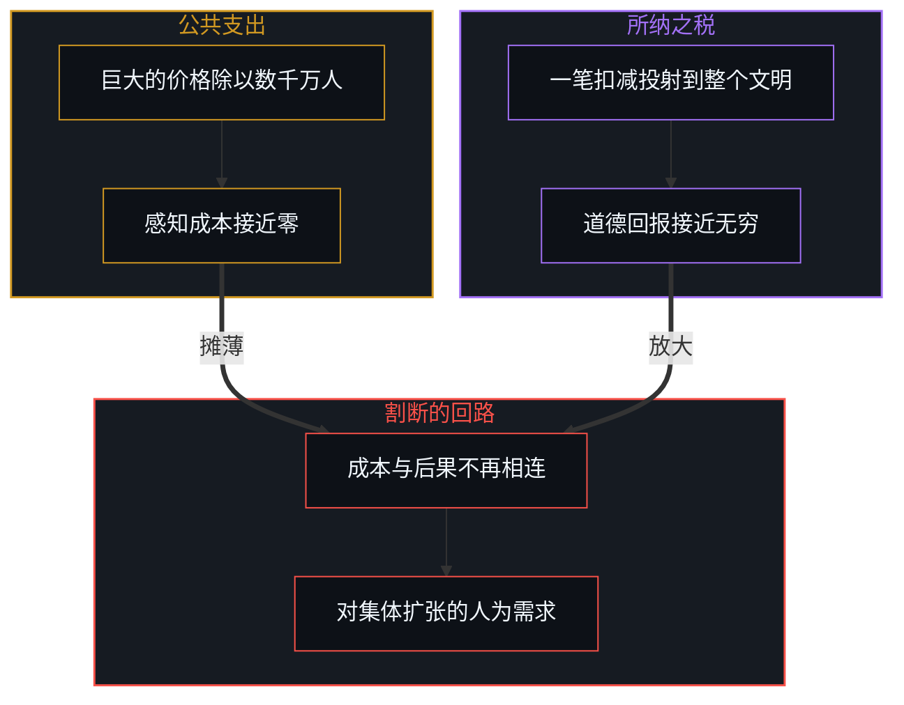
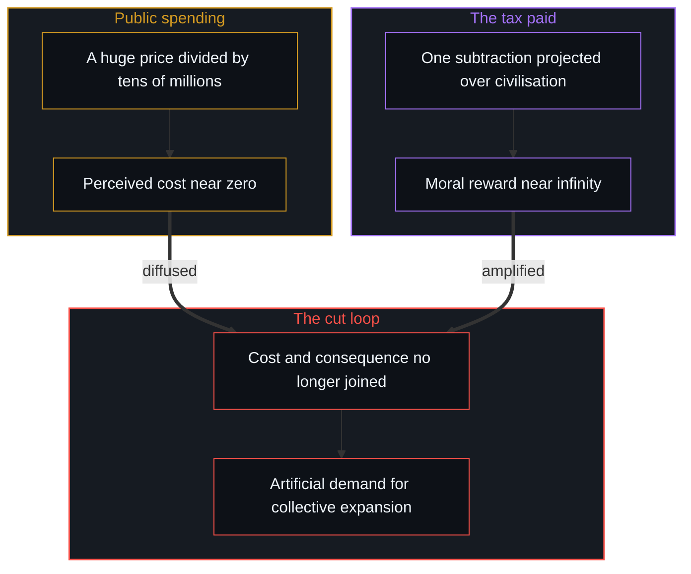

# 福利国家的幻象 / The Welfare State Illusion

*公共成本被摊薄到感觉不到，纳税被放大成牺牲，个人成长所需的反馈回路就被割断 / Public cost diffused until weightless and tax amplified into sacrifice cut the loop personal growth needs.*

生活在现代福利国家里的人，常说服自己高税收是一个文明而互助的社会必要而高尚的代价。这个说法立在两个相扣的错误上：一个是能动性的错配，把国家当作独立的财富生成者；另一个是不对称的认知记账，公共支出被摊薄成可以忽略的个人成本，而交出的税被主观放大成英雄式的道德牺牲。

People living in modern welfare states often persuade themselves that high taxation is the necessary, noble price of a civilised and supportive society. The account rests on two interlocking errors: a misplacement of agency that treats the state as an independent generator of wealth, and an asymmetric cognitive bookkeeping in which public spending is diffused into negligible personal cost while the tax paid is subjectively magnified into a heroic moral sacrifice.

集体机构动用的每一块钱，都先从一个个具体的劳动中取出，经过行政摩擦的损耗；用来长期资助消费超出产出的部分时，它关掉了推动个人能力的那个控制论损失函数。福利国家给受助者带来即时的经济缓解，这是它的用处；它的边界在长期：一个社会潜在财富的压抑，以及自主能动性的逐步萎缩。

Every unit of money the collective apparatus deploys is first taken from particular labour and worn down by administrative friction; when it is used to fund, over the long run, consumption beyond production, it switches off the cybernetic loss function that drives personal competence. The welfare state gives recipients immediate financial relief, which is its use; its boundary lies in the long run: the suppression of a society's potential wealth and the gradual atrophy of self-directed agency.

## 一、 能动性的错配 / 1. The Misplacement of Agency

福利国家心态的基础是一个范畴错误：把国家与它的政治阶层当作社会福祉、安全与能动性的生成之源。日常的公共讨论里，人们说得好像“政府”有一池独立的财富，从中慷慨地发放医疗、教育、养老与保障。从第一人称的原点追溯，集体不是一个活着的心智，它不能做创造性的区分、观察现实或从事生产；集体的价值，就是个体价值的总和，国家管理的每一份资源、服务与资产，都是一个个具体的人行使局部能动性的产物；国家是一个滞后的行政外壳，它不生产自己的财富，只是取出、消耗并转移活跃生产者所生成的剩余。

The basis of the welfare-state mindset is a category error: treating the state and its political class as the generating source of social well-being, security and agency. In everyday public discussion, people speak as though "the government" held an independent pool of wealth from which it generously dispenses healthcare, education, pensions and safety nets. Traced from the first-person origin, a collective is not a living Mind and cannot make creative distinctions, observe reality or do productive work; the value of a collective is the sum of individual values, every resource, service and asset the state manages being the product of particular people exercising local agency; the state is a lagging administrative shell that produces no wealth of its own but takes, dissipates and redirects the surplus active producers generate.

把国家看作自己安全的作者，就做了[剩余个人主义](../residual-individualism/)与[自由的心智被声称保护它的东西取代](../the-free-mind-is-displaced-by-what-claims-to-protect-it/)所详述的那次能动性错配：把能动性的源头外移，让自己的生存与发展取决于一个抽象的集体代理。正如[你的代码库即是记忆](../your-codebase-is-memory/)所揭示的，软件仓库只是过往人类切分的外化记忆，本身生不出半行新代码；国家的财政与法律账本同样只是既往汲取的被动库房，从不是财富或关怀的活态源泉。

To look to the state as the author of one's security is to make the misplacement of agency detailed in [Residual Individualism](../residual-individualism/) and [The Free Mind Is Displaced by What Claims to Protect It](../the-free-mind-is-displaced-by-what-claims-to-protect-it/): moving the source of agency outward and making one's own survival and development depend on an abstract collective proxy. Just as [Your Codebase Is Memory](../your-codebase-is-memory/) shows that a software repository is an externalized memory of prior human cuts that cannot originate a single line on its own, the fiscal and legal ledger of the state is a passive storehouse of past extractions rather than a living source of wealth or care.

## 二、 不对称的记账 / 2. The Asymmetric Bookkeeping

这个幻象为什么带着这样强的情感依附？它靠认知处理公共支出与私人纳税时的一种系统性不对称维持。一方面是公共成本与责任的摊薄：国家宣布一项大规模的新支出，昂贵的基础设施、扩展的社会福利或对外援助，巨大的价格在认知上被除以数千万纳税人；对单个公民来说，任何一项具体计划的边际成本看起来都可以忽略，“每人每天只要几分钱”。经济后果摊在一个匿名的集体身上，个人在成本与后果之间的直接反馈回路就被割断，支出感觉几乎是免费的，生出对集体无限扩张的人为需求。

Why does this illusion carry such strong emotional attachment? It is maintained by a systemic asymmetry in how cognition processes public spending and private taxation. On one side is the diffusion of public cost and responsibility: when the state announces a large new spending programme, costly infrastructure, an expanded entitlement or foreign aid, the huge price is cognitively divided across tens of millions of taxpayers; to the single citizen the marginal cost of any particular programme looks negligible, "only a few pennies each a day". With the financial consequence spread over an anonymous collective, the individual's direct feedback loop between cost and consequence is cut, the spending feels almost free, and an artificial demand arises for endless collective expansion.

另一方面是所纳之税在主观上的道德放大。公民交自己那笔不小的税时，一种反向的心理机制起了作用：纳税人不把这笔钱看作每个项目都没经过自己挑选的例行支出，而是把它投射到整个文明上，“我的税在建最先进的医院，在照顾穷人，在资助公立学校，在把社会维系在一起”。所纳之税的道德效用在心里被成倍放大，一次非自愿的财务扣减，变成了公民美德与高尚自我牺牲的徽章。于是有了一个政治上的反馈陷阱：每一项集体计划被感知到的成本被摊薄到接近零，纳税带来的主观道德回报被放大到接近无穷；在这种扭曲的记账下，高税收被登记的不是生成能力的流失，而是一笔正义的交易。

On the other side is the subjective moral amplification of the tax paid. When citizens pay their own substantial tax bill, a reverse psychological mechanism takes hold: the taxpayer does not see the payment as a routine outlay whose programmes were never chosen one by one, but projects it across all of civilisation, "my taxes are building advanced hospitals, caring for the poor, funding public schools, holding society together". The moral utility of the tax paid is multiplied in the mind, and an involuntary financial subtraction becomes a badge of civic virtue and noble self-sacrifice. So there is a political feedback trap: the perceived cost of every collective programme is diffused toward zero while the subjective moral reward of paying tax is amplified toward infinity; under this distorted bookkeeping, high taxation registers not as a drain on generative capacity but as a righteous bargain.

## 三、 行政的损耗与被资助的损失函数 / 3. Administrative Dissipation and the Subsidised Loss Function

在这个认知扭曲背后，实际发生的是减法。国家花的每一块钱，都先要从一个在真实约束下生成价值的人手里取出，而从取出到部署的路上有结构性的损耗：庞大的行政机构、合规执行与政治中介，在任何一份福利送达之前就消耗掉取出资本中的一大块；资源按政治游说、选举激励与意识形态的风尚分配，而不是按预期回报与市场的现实。

What actually happens behind this cognitive distortion is subtraction. Every unit the state spends must first be taken from someone who generated value under real constraints, and the way from taking to deployment carries structural losses: large administrative bodies, compliance enforcement and political intermediaries consume a sizeable share of the capital taken before any benefit is delivered; resources are allocated by political lobbying, electoral incentives and ideological fashion rather than by expected return and market reality.

比金钱上的损耗更深的，是控制论损失函数被拆掉。[价值、货币与财富的生成机制](../the-generative-mechanics-of-value-money-and-wealth/)探讨过，一个人消费与生产之间的差距，是迫使能力更新的首要信号。当福利国家无条件地长期资助超出产出的消费，产出不足的一方就被挡在低产出的现实后果之外，内部的纠错回路被关掉，去学难的技能、练出纪律、扩展感知地平线的必要被消了音，暂时的安全网硬化成一种长期的发展停滞。这里说的是一个回路所处的状态，不是一类人；同一个人在不同的处境里，回路可以开着，也可以被缓冲住。

Deeper than the monetary loss is the dismantling of the cybernetic loss function. As [The Generative Mechanics of Value, Money, and Wealth](../the-generative-mechanics-of-value-money-and-wealth/) explores, the gap between what a person consumes and what they produce is the first signal that forces competence to update. When the welfare state funds consumption beyond production unconditionally and over the long run, the under-producing side is shielded from the real consequences of low output, the inner error-correction loop is switched off, the need to learn hard skills, build discipline and widen the perceptual horizon is silenced, and the temporary safety net hardens into a lasting developmental stall. What is named here is a state a loop is in, not a kind of person; the same person, in different circumstances, can have the loop open or buffered.

## 四、 被压抑的潜能 / 4. The Suppressed Potential

福利国家真正的经济成本，不是政府账本上列出的钱，而是被阻止了没能生成的财富。问一个高税负的人：如果把那四成或五成的税留在自己手里，能不能把它分配得更有效、更有生成力？这个问题指向的选项一目了然：直接投进扩张自己的业务、升级工具、雇用有生产力的人；投在孩子的教育、专门手艺的学徒期与前沿技能的发展上；投进官僚委员会永远不会批准的高风险、高确信的事业；对身边社区里的人给出有针对性的直接帮助，在那里，问责与反馈回路仍然完整。

The real economic cost of the welfare state is not the money listed on the government ledger but the wealth that was prevented from being generated. Ask a heavily taxed person: if that four or five tenths of income in tax stayed in your hands, could you allocate it more effectively and generatively? The options the question points to are plain: invest directly in expanding one's business, upgrading tools and hiring productive people; invest in children's education, apprenticeships in a specialised craft and the development of frontier skills; put capital into high-risk, high-conviction ventures a bureaucratic committee would never approve; give targeted, direct help to people in one's own community, where accountability and feedback loops stay intact.

国家先占了私人的资本分配，就用一个集中的、低信息的官僚垄断，替换了千百万分散的、高信息的、承担后果的选择。正如[公共支出不创造资本](../public-spending-does-not-create-capital/)所详述的，结果是社会总的潜在财富与创新速度大幅降低：表面上舒适而有序，底下能力增长的轨迹却慢了下来。

When the state pre-empts private capital allocation, it replaces millions of decentralised, high-information, consequence-bearing choices with a centralised, low-information bureaucratic monopoly. The result is a sharp reduction in a society's total potential wealth and pace of innovation: comfortable and orderly on the surface, while the trajectory of capability growth beneath it slows, as detailed in [Public Spending Does Not Create Capital](../public-spending-does-not-create-capital/).

## 五、 短期的回报与长期的萎缩 / 5. Short-Term Payoffs and Long-Term Atrophy

福利国家能维持政治上的稳定，是因为它造出一种即时的、短期的激励对齐。受助者得到即时的经济缓解与消费的延续，免去学习技能的痛苦摩擦；纳税人得到即时的道德确认与公民的自豪；政治人物得到行政权力、预算与依赖型选民的即时扩张。系统里每一方都得到一份即时的心理或经济回报。长期的系统后果却是另一回事：生产性的剩余逐步被非生成性的支出消耗；被缓冲的回路失去在不加缓冲的现实中生存所需的自主反射；整个社会离全球能力的移动前沿越来越远。当外部冲击、人口变化或财政枯竭穿透国家的人为缓冲，人们会发现自己既缺累积的私人资本，也缺适应所需的个人韧性。

The welfare state achieves political stability because it creates an immediate, short-term alignment of incentives. Recipients get immediate financial relief and continuity of consumption without the painful friction of learning skills; taxpayers get immediate moral confirmation and civic pride; politicians get an immediate expansion of administrative authority, budgets and dependent constituencies. Every party in the system receives an immediate psychological or financial payoff. The long-run systemic consequence is another matter: productive surplus is gradually consumed by non-generative spending; buffered loops lose the self-directed reflexes needed in an unbuffered reality; and the society as a whole drifts further from the moving frontier of global competence. When outside shocks, demographic shifts or fiscal exhaustion break through the state's artificial buffer, people find they lack both accumulated private capital and the personal resilience to adapt.

## 六、 回到不经中介的后果 / 6. Returning to the Unmediated Consequence

这个诊断不是一份要求国家废除福利或反向立法的政治宣言。到政治改革那里去找拯救，仍然困在同一个外推的范式里。国家不是一个可以被“修好”的独立行动者；正如[政客是责任扩散的显性症状](../politicians-appear-as-visible-symptoms-of-responsibility-diffusion/)所表明的，政治结构是个体选择聚合之后滞后的宏观症状，而[能动性、复利与 AI 封建之争](../agency-compounding-and-the-argument-over-ai-feudalism/)所剖析的 AI 封建之争，也重复了这种以为初始分配而非持续能动性决定结局的同一个假设。

This diagnosis is not a political manifesto demanding that the state abolish welfare or legislate in reverse. Looking to political reform for rescue stays inside the same outward paradigm. The state is not an independent actor that can be "fixed"; as [Politicians Are Visible Symptoms of Responsibility Diffusion](../politicians-appear-as-visible-symptoms-of-responsibility-diffusion/) shows, political structures are lagging macroscopic symptoms of aggregated individual choices, and the same assumption that initial allocation rather than ongoing agency decides the outcome recurs in the AI feudalism debate dissected in [Agency, Compounding, and the Argument Over AI Feudalism](../agency-compounding-and-the-argument-over-ai-feudalism/).

能落到实处的，是第一人称回到自己的责任：认出没有哪个集体能生成价值、授予自我价值或书写个人的能动性；不把纳税当作主动的、有后果的生活的替代品；迎着现实直接、不经中介的碰撞，承担自己的成本、债务与产出的全部分量。人的能力，在选择撞上不加缓冲的后果的那条边界上复利，而正如[自我价值、反向财富转移与过去成功的陷阱](../self-worthiness-reverse-wealth-transfer-and-the-trap-of-past-success/)所追溯的，绕开自我价值的转移只会让财富反向流动；不接受集体缓冲那层舒适麻醉的心智，才能生成真实的财富、扩展自己的地平线，在因果连续体之内自己作主。

What can actually be done is a first-person return to one's own responsibility: recognising that no collective can generate value, confer self-worth or write personal agency; not treating tax paid as a substitute for an active, consequential life; meeting reality's direct, unmediated collision and carrying the full weight of one's own costs, debts and output. Human capability compounds at the boundary where choices meet unbuffered consequences, whereas transfers that bypass self-worth reverse the flow of wealth, as [Self-Worthiness, Reverse Wealth Transfer, and the Trap of Past Success](../self-worthiness-reverse-wealth-transfer-and-the-trap-of-past-success/) traces; a Mind that declines the comfortable anaesthesia of the collective buffer can generate real wealth, widen its horizon and stay self-directed within the causal continuum.
