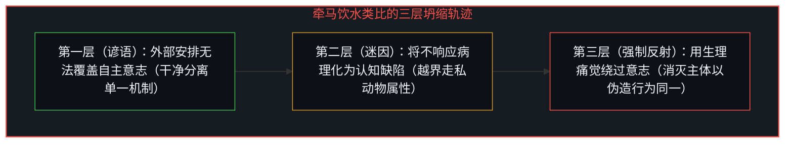
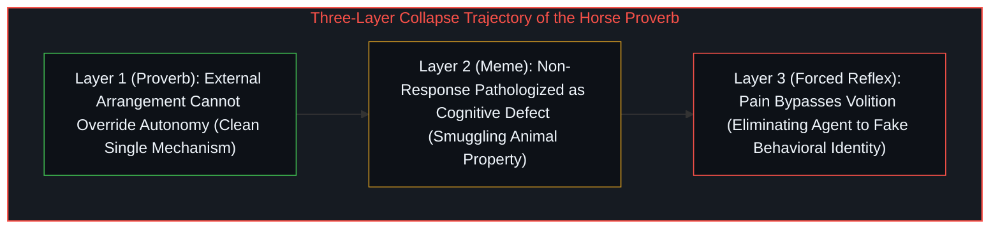
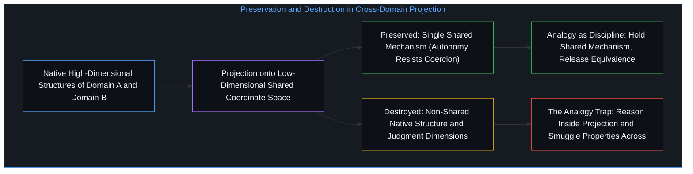

# 类比陷阱与共享逻辑的越界偷渡 / The Analogy Trap

*类比通过投射暴露跨领域的单一共享机制，将其误作结构等价就会把越界结论偷渡入境 / Analogy exposes a shared mechanism by projection, and mistaking it for equivalence smuggles conclusions*

类比之所以有效，是因为它暴露了两个领域之间的共享逻辑。“你可以把马牵到水边，但不能强迫它喝水”之所以成立，是因为它分离出了单一机制——自主意志无法被外部安排强行覆盖——并将其从动物行为映射到人类的说服过程。类比的力量恰恰在于它所不声称的内容：它丝毫没有说马等同于人、水等同于真理，或者牵引等同于论证。它只追踪一条结构平行线，然后就此止步。

An analogy works by exposing shared logic between two domains. "You can lead a horse to water, but you can't make it drink" operates because it isolates a single mechanism—autonomous will cannot be overridden by external arrangement—and maps it from animal behavior to human persuasion. The power of the analogy lies precisely in what it does not claim: it says nothing about horses being equivalent to people, water being equivalent to truth, or leading being equivalent to argument. It traces one structural parallel and stops.

这正是类比有用的原因：它揭示了表面差异之下运作的共同逻辑，使两个系统在不共享同一性的前提下共享同一机制。然而正如[你的代码库即是记忆](../your-codebase-is-memory/)所揭示的，任何表征或映射都是有损的压缩，一旦使用者遗忘了映射所丢弃的原生维度，把低维投影当成了被投射物本身，类比就会从照明工具蜕变为认知陷阱。

This is what makes analogy useful: it reveals a logic operating beneath surface differences, allowing two systems to share a mechanism without sharing identity. Yet as [Your Codebase Is Memory](../your-codebase-is-memory/) demonstrates, every representation or mapping is a lossy compression; the moment a user forgets the native dimensions discarded by the mapping and mistakes the low-dimensional projection for the object itself, analogy turns from an instrument of illumination into a cognitive trap.

## 一、 类比坍缩的三重轨迹 / 1. The Three-Layer Trajectory of Analogy Collapse

当共享逻辑被误认为等价关系，即结构上的平行被当成结构上的同一时，坍缩便发生了。一旦完成这种替换，一个领域的属性就会毫无根据地自由迁移到另一个领域，类比不再提供照明，而是开始走私偷渡。

The collapse happens when shared logic is mistaken for equivalence, treating a structural parallel as a structural identity. Once this substitution occurs, properties from one domain migrate freely to the other without warrant. The analogy stops illuminating and starts smuggling.

不妨审视“牵马饮水”这句谚语在穿过三层诠释时的演变轨迹。第一层是谚语本身，它追踪了一条机制：自主性是不可约简的，外部安排（牵到水边）并不能覆盖内部决断（选择饮水）。这一类比是干净的，因为它只握住“强制的边界”这一个维度，不再多作声张。

Consider the trajectory of the horse proverb as it moves through three layers of interpretation. The first layer is the proverb itself, which traces a mechanism: autonomy is irreducible, and external arrangement (leading to water) does not override internal decision (choosing to drink). The analogy is clean because it holds one dimension—the limit of coercion—and claims nothing more.

第二层是网络迷因在后面追加的半句：“就像你可以把真相摆在某种人面前，却无法强迫他思考。”这一操作保留了类比的外壳结构，却颠倒了它的价值极性。原谚语把马的拒绝当作关于自主性本然状态的事实——中性、不可约简，事情本就如此运作；迷因却把同一结构改写成了某种缺陷：马之所以不喝水，是因为它“不会思考”。自主性非但没有得到尊重，反而被病理化了。共享逻辑（外部行动无法强迫内部响应）虽然留存，但诠释已经从“这是强制的边界”翻转成了“这是对方的毛病”。

The second layer is the internet meme that appends "just like you can show a liberal the truth, but you can't make it think." This operation preserves the analogy's shell while inverting its valence. The original proverb treats the horse's refusal as a fact about the nature of autonomy—neutral, irreducible, simply how agency works. The meme recasts the same structure as a deficiency: the horse does not drink because it cannot think. Autonomy is not respected; it is pathologized. The shared logic (external action cannot force internal response) survives, but the interpretation has flipped from "this is the boundary of coercion" to "this is a defect in the other."

第三层则是所谓的“技术反驳”——声称只要制造剧痛触发非自主的抽气反射，就能强迫马把水咽下去。这一回应完成了倒置的闭环：它把类比的核心洞见（你无法覆盖自主意志）当成了一个有待攻克的工程技术问题。既然马不肯自愿喝水，那就找一种直接绕过意志的生理机制。这种“解决方案”并没有解决类比所提出的问题，而是通过消灭主体来消解问题。非自主的吞咽不是饮水；外显行为看似相同，存在论结构却截然不同。三层诠释对同一类比施加了三次操作，每一次都离令类比生效的共享逻辑更远，表面上却像是停留在同一语境之内。

The third layer—the technical rejoinder that you can force the horse to drink by causing pain that triggers an involuntary gasp reflex—completes the inversion. It takes the analogy's core insight (you cannot override autonomous will) and treats it as a technical engineering problem. If the horse will not drink voluntarily, find a biological mechanism that bypasses volition altogether. That "solution" does not solve the problem the analogy posed; it dissolves the problem by eliminating the agent. Involuntary ingestion is not drinking. The outward behavior looks identical while the ontological structure is completely different. Across three layers and three operations on the same analogy, each step migrates further from the shared logic that made the analogy work while appearing to stay within it.

## 二、 底层的投射机制与主体性陷阱 / 2. The Underlying Projection and the Agency Trap

这种坍缩之所以如此顽固，是因为类比在精确意义上就是投射。两个各自在原生维度中按自身逻辑运转的系统，被投射到一个共享坐标空间中，而在该空间里某一条机制恰好对齐。对齐是真实的，问题在于投射在保留部分结构的同时销毁了其余结构，而被销毁的结构在投影视图中变得不可见。

What makes this collapse so persistent is that analogy is projection in the exact sense. Two systems, each operating in its own native dimensions with its own logic, are projected onto a shared coordinate space where one mechanism aligns. The alignment is real, yet projection preserves some structure while destroying other structure, and the destroyed structure becomes invisible in the projected view.

当迷因用“持不同政见者”替换“马”时，它利用了两者在投影空间中共享“对我呈现的东西不予响应”这一属性。但在各自的原生维度里，两者的机制截然不同：水边的马是在行使不含认识论内容的偏好，而拒绝某项论证的人则是在行使判断——这种判断可能健全、可能失当，也可能与呈现者自以为提供的东西正交。投射抹去了这一区分；在坍缩的视图中，一切不响应看起来都一样，都叫固执的拒绝。这就是普遍模式：类比把两个领域投射到共享坐标上，共享逻辑在投射中幸存，而使两个领域之所以成为不同领域的非共享结构却被销毁了。如果你接着在投影空间内部展开推理，仿佛它就是原初空间，你就会导入在两个领域中都毫无根据的结论。

When the meme substitutes a political opponent for the horse, it exploits the fact that in the projected space both share the property of not responding to what is presented. In their native dimensions, however, the mechanisms are entirely different: a horse at water exercises a preference with no epistemic content, whereas a person rejecting an argument exercises judgment—which may be sound, unsound, or orthogonal to what the presenter imagines offering. The projection erases this distinction; in the collapsed view, all non-response looks like stubborn refusal. That is the general pattern: analogy projects two domains onto shared coordinates where shared logic survives and non-shared structure—the very structure that makes them different domains—gets destroyed. Reasoning within the projected space as though it were the original imports conclusions that have no warrant in either domain.

牵马饮水的类比还揭示了这种坍缩在现实中广泛运作的一个具体实例，即主体性与脚手架之间的混淆。高主体性的个体——那些内部意图与行动高度自指对齐的人——常常建立起别人选择与之对齐的结构。这确实有效，别人也确实受益；脚手架是真实的，使用它的选择也是真实的。但在投影视图中，引领者的主体性与追随者的响应坍缩到了同一根轴上：“我行动了，事情推动了。”追随者自主选择对齐，在引领者的投影中变成了引领者自身因果力量的证据。

The horse analogy also exposes a specific instance of this collapse that operates widely: the confusion between agency and scaffolding. High-agency individuals—whose internal alignment between intention and action is tightly self-referential—often create structure that others choose to align with. Others genuinely benefit; the scaffolding is real, and the choice to use it is real. In the projected view, however, the leader's agency and the follower's response collapse onto a single axis: "I acted, things moved." The follower's autonomous choice to align becomes, in the leader's projection, evidence of the leader's own causal power.

从这个视角看，“强迫马喝水”的诱惑是难以抗拒的，却又恰恰大错特错。选择喝水的马是在行使它自己的主体性；选择与所提供的结构对齐的人也是在行使他们自己的主体性。脚手架创造的是可达性，而非因果性；它改变了可用对齐的地貌，这真实且宝贵，但它是基础设施，而非源头。主体性才是变化的源头，正如[不可读的复利重溯](../the_illegible_compound_retraced/)所指出的，客观层面的工具与脚手架只能放大主体在不可见层面早已启动的切身选择，却无法从外部生成那一次选择。把脚手架误作原因，是在另一个领域犯下的同一种投射错误；[协调者的范畴谬误](../the-coordinators-category-error/)剖析的正是这种坍缩：当高主体性被分配到共享基质上时，便被反向归因为基质必须在他人身上安装的某种缺失。而通过痛苦强迫非自主服从的所谓“方案”，则是这种混淆的逻辑终点：如果你相信是你的主体性驱动了他人行动，那么当他人停止行动时，问题就一定是机械性的，只需找到覆盖开关绕过拒绝即可。另一个人作为真正的主体只是对齐方向与你不同这一可能性，在结构上变得不可见了。

From that vantage point, the analogy to "making the horse drink" feels irresistible and is dead wrong. The horse that chooses to drink exercises its own agency; the person who chooses to align with offered structure exercises theirs. Scaffolding creates accessibility, not causation. It changes the landscape of available alignment, which is valuable infrastructure, yet agency remains the source of change—just as [The Illegible Compound Retraced](../the_illegible_compound_retraced/) shows that objective tools and infrastructure can only amplify the felt subjective choice already in motion without generating that choice from the outside. Confusing scaffolding for cause is the same projection error in another domain; [The Coordinator's Category Error](../the-coordinators-category-error/) dissects that exact collapse when high agency is allocated onto a shared substrate and reverse-attributed as a deficit the substrate must install in others. Forcing involuntary compliance through pain is the logical terminus of this confusion: if you believe your agency causes others to move, then when they stop moving, the problem looks mechanical—find the override and bypass the refusal. The possibility that the other is a genuine agent whose alignment differs from yours becomes structurally invisible.

## 三、 作为心智纪律的类比与自指移动 / 3. Analogy as Mental Discipline and the Recursive Move

上述一切并不意味着类比不可靠，而是意味着类比是一件需要与其力量相称的纪律的工具。这项纪律就是：握住共享逻辑，释放等价幻象。一个类比只照亮跨领域运作的单一机制；一旦它开始为该机制之外的其他属性发放结论许可，它就已经从照明越界到了走私。检验标准十分简明：你能否明确陈述那条共享机制？你的结论是单单从那条机制推导出来的，还是必须依赖从一个领域偷渡到另一个领域的其他属性？[飞行类比未触及心智](../the-flight-analogy-leaves-the-mind-untouched/)正是这种披着意识外衣的走私：技术上对羽毛的轻视，并不能为绘制类比本身的自指活动的迁移发放任何许可。

None of this means analogy is unreliable; it means analogy is an instrument that demands discipline in proportion to its power. The discipline is to hold the shared logic and release the equivalence. An analogy illuminates one mechanism operating across domains. The moment it starts licensing conclusions about properties other than that mechanism, it has crossed from illumination into smuggling. The test is direct: can you state the shared mechanism explicitly, and does your conclusion follow from that mechanism alone, or does it rely on properties imported from one domain to the other? [The Flight Analogy Leaves the Mind Untouched](../the-flight-analogy-leaves-the-mind-untouched/) is that exact smuggling under consciousness costume: technological underestimation of feathers licenses nothing about transferring the self-referential activity that draws the analogy.

原谚语通过了这一检验：“外部安排无法覆盖自主意志”这一机制在两个领域都成立，且谚语未作更多声称。迷因未能通过检验：“不响应意味着无思考能力”需要把动物领域的属性（认知缺陷）偷渡到人类领域。而“强制吞咽方案”则全面崩盘：它把类比所识别出的机制（不可约简的自主性）当成了需要靠工程手段绕过的障碍，直接摧毁了最初令类比得以连贯的共享逻辑，这也正是[自我模型维护悖论](../the-maintenance-paradox/)中为了维护外显一致而架空内在活体过程的同一类倒置。

The proverb passes this test: "external arrangement cannot override autonomous will" holds in both domains, and the proverb claims nothing more. The meme fails it: "non-response indicates inability to think" imports cognitive deficiency from the animal domain into the human domain without warrant. The forced-reflex "solution" fails catastrophically: it treats irreducible autonomy as an obstacle to be engineered around, destroying the shared logic that made the analogy coherent in the first place—the same inversion examined in [The Maintenance Paradox](../the-maintenance-paradox/), where maintaining outward uniformity hollows out the living process underneath.

本文的分析本身也是一个类比：它用牵马饮水的例子来照亮一般意义上的类比如何运作，因而同样受制于同一套纪律。此处追踪的共享机制是：从高维结构向共享坐标的投射保留了部分逻辑并销毁了其余结构，而在投影内部展开推理、仿佛它就是原初结构，便会产生毫无根据的结论。这一机制成立，但具体的政治迷因、主体性动力学与生理覆盖只是例证而非证明；它们照亮了该机制，却并未穷尽它，其他类比会以不同方式失效，其他投射会沿着不同轴线坍缩。这项纪律递归地生效：每一个有所揭示的框架也都在同时有所遮蔽。心智的运动在于持续追踪、持续消解坍缩、持续释放当前投影无法承载之物，同时深知下一次清晰表达本身仍将是一次需要同等对待的投射。不是抵达终点，而是往复不息的切分运动。

This analysis is itself an analogy, using the horse-to-water example to illuminate how analogies operate in general, which subjects it to the exact same discipline. The shared mechanism traced here is that projection from higher-dimensional structure onto shared coordinates preserves some logic and destroys other structure, and reasoning within the projection as though it were the original generates unwarranted conclusions. That mechanism holds, while the political meme, the agency dynamics, and the biological override remain illustrations rather than exhaustive proofs; other analogies fail differently and collapse along different axes. Every frame that reveals also conceals. The movement of the Mind is to keep tracing, keep dissolving the collapse, and keep releasing what the current projection cannot hold, knowing that the next articulation will itself be a projection requiring the same treatment.
