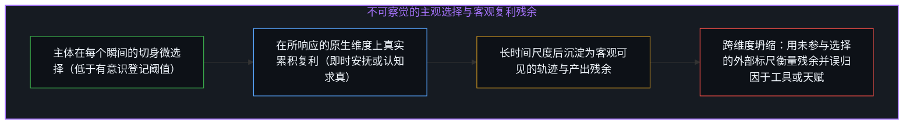
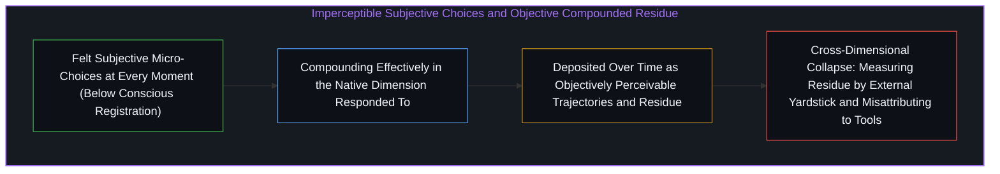
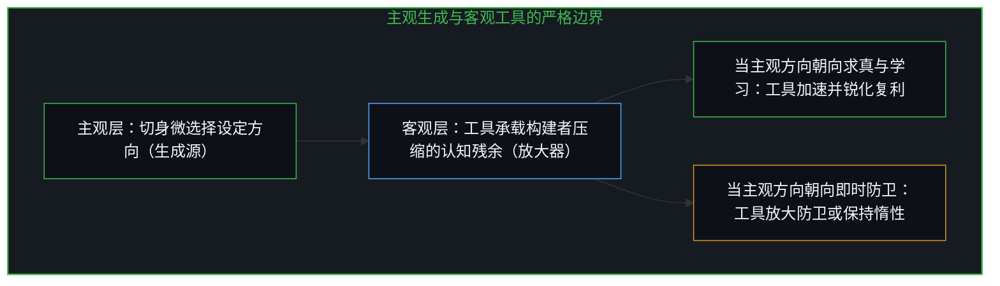
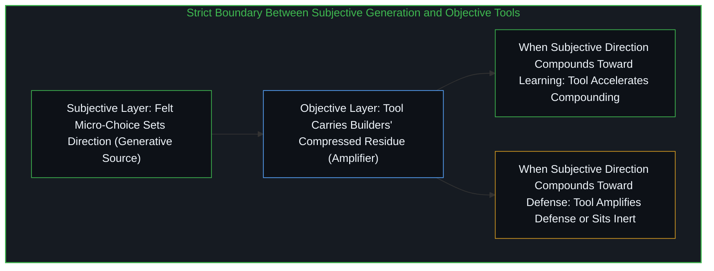

# 不可读的复利重溯 / The Illegible Compound Retraced

*客观可见的结果皆是无数不可察觉的主观微选择的复利残余，观察作用于残余而学习是存在 / Objective outcomes are compounded residues of imperceptible subjective choices, where learning is being*

学习的真正壁垒，从来不在我们去寻找它的地方。一切在客观上可被察觉的事物——产出、轨迹、人与人之间肉眼可见的差异——都是无数不可被察觉的主观选择的复利结果。这些选择只能在发生的瞬间被主体切身感受到，而且即便在那一刻也极少进入有意识的觉察；它们无法被审计，哪怕是做出选择的人自己也无法对其进行事后审计。客观世界只是残余物，生成过程从一开始就不是客观的；正如[你的代码库即是记忆](../your-codebase-is-memory/)所揭示的，外部可见的晶体与器物只是过往切分留下的痕迹，生成本身的锋刃始终在于当下不可见的心智活动。

The real barrier to learning is never where we look for it. Everything objectively perceivable—outcomes, trajectories, visible differences between people—is the compounded result of imperceptible subjective choices. These choices can only be felt at the moment by the subject, and rarely consciously even then; they are not available for audit, not even by the one making them. The objective world is residue, whereas the generative process was never objective to begin with; as [Your Codebase Is Memory](../your-codebase-is-memory/) demonstrates, externally visible crystals and artifacts are traces left by past cuts, while the generative edge always resides in the present, unseen activity of the Mind.

## 一、 底层的复利结构与跨维度误归因 / 1. The Underlying Compounding Structure and Cross-Dimensional Misattribution

这就是下文一切内容底层的结构：没有人在“不努力”，世上本无所谓的不作为。在每一个瞬间，心力都在朝某个方向移动。那个看起来已经放弃学习的人并不是静止的，他正在他切身选择所真正响应的维度与时间尺度上成功地累积复利。留在熟悉模式中的选择确实满足了某种真实的需求：即时的舒适、情绪的安全、认知的喘息。它正在精确地做它所做的事，不存在什么错误的方向。

This is the structure underneath everything that follows: nobody is failing to try, and there is no inaction. At every moment, effort moves in some direction. The person who appears to have given up on learning is not stationary; they are compounding effectively in the dimension and timeframe their felt choice is actually responding to. The choice to remain in a familiar pattern satisfies something real: immediate comfort, emotional safety, cognitive relief. It is doing what it is doing, and there is no wrong direction.

所谓的“不合意的结果”，只有在拿另一个维度当作衡量标尺时才会显现。那个为即时安全做优化的人，拿长期成长来衡量自己；那个满足于当刻情绪安抚的人，拿关系深度来评估结果。痛苦并不在于选择本身，而在于维度的坍缩——指望在一个维度里做出的选择去产出另一个维度里的结果，要求一个投影去完成另一个投影的工作，这也正是[类比陷阱与共享逻辑的越界偷渡](../the_analogy_trap/)中将不同维度的结构强行压扁在同一坐标轴上所引发的错位。

"Unwanted results" only appear when a different dimension is used as the measuring stick. The person optimizing for immediate security measures themselves against long-term growth; the person satisfying immediate emotional comfort evaluates against relational depth. The suffering is not in the choice itself, but in the dimensional collapse—expecting a choice made in one dimension to produce results in another, asking one projection to do the work of a different projection, which is the exact structural misalignment traced in [The Analogy Trap](../the_analogy_trap/) when distinct dimensions are flattened onto a single coordinate axis.

随后便是误归因：从一个从未参与该选择的维度去衡量那些不合意的结果，然后将其归咎于“努力本身徒劳无功”、归咎于资源获取渠道不足、或者归咎于手头工具的缺陷。方向本身从未受到质询，因为方向从未被当作方向来察觉；它只是在有意识登记的阈值之下被短暂地切身感受了一瞬，便消逝无踪。留存下来的只有剥离了源头的复利结果，被拿去对照一个从未进入当初那次切身选择的外部标准。这就是为什么学习的壁垒从来不在我们寻找它的地方：寻找就是观察，是在客观残余和可察觉的结果上操作；而学习是存在，是在那些不可察觉的选择实际发生的主观层面上运作。当我们去寻找时所发现的壁垒，永远是从错误维度衡量的复利结果，而非生成条件本身。

Then comes the misattribution: the unwanted results, measured from a dimension the choice never operated in, get assigned to the futility of trying, to insufficient access, or to some defect in the available tools. The direction itself never gets questioned because the direction was never perceived as a direction; it was felt momentarily below conscious registration and then was gone. What remains is the compounded result stripped of its origin and measured against a standard that never entered the felt choice that produced it. That is why the barrier to learning is never where we look for it: looking is observing, operating on objective residue and perceivable outcomes, whereas learning is being, operating at the subjective layer where imperceptible choices occur. The barrier we find when we look is always a compounded result measured from the wrong dimension, never the generative condition itself.

## 二、 制度干预的结构性盲区与因果倒置 / 2. Structural Blindness of Institutional Intervention and Causal Inversion

教育、心理咨询、发展与公共政策等领域面对不合意结果的标准制度性反应，是在可察觉的层面上设计更好的交付方案：更多获取渠道、更高互动度、更精细的个性化。但这些干预全部作用于复利残余之上，且按制度单方面决定重要的维度来衡量。它们可以重排结果、调整表面、重新分配已经可见的东西，却无法触及设定方向的切身微选择——因为那一瞬间即便在发生时也不对外部观察开放，且那次选择正在制度未曾测量的维度上满足着某种真实诉求。

The standard institutional response to unwanted outcomes across education, therapy, development, and policy is to engineer better delivery at the perceivable layer: wider access, higher engagement, finer personalization. Yet these interventions operate strictly on the compounded residue, measured in whatever dimension the institution has decided matters. They can rearrange outcomes, adjust surfaces, and redistribute what is already visible, but they cannot reach the felt micro-choice where direction is set—because that moment was not open to external observation even as it occurred, and because the choice was satisfying something real in a dimension the institution is not measuring.

这不是制度设计的失误，而是结构性的不可能：生成层是主观的，制度运作于客观层，对客观层的任何优化都无法触及主观层。制度自然会漂向它们能够测量并施加行动的层面，随后再把那些层面重新贴上“基础”的标签。诚实的表述应当是：我们建造的基础设施，对于那些不可察觉的选择早已朝着与我们所提供之物相交的方向累积复利的人来说是可用的，而对于那些选择正在我们未测量的维度上累积复利的人来说则是惰性的，并且在关键的瞬间我们既无法察觉、更无法控制这一差异。然而这种诚实表述会消解大多数制度性干预的合法性辩护，因而始终未被说破，正如[从未作为战略的副业与被观察扼杀的自发性](../the-strategy-that-wasnt/)所示，制度一旦试图把自发生成层纳入外部网格管控，所触及的就只剩失去活力的残余。

This is not a flaw in institutional design; it is a structural impossibility. The generative layer is subjective while institutions operate on the objective, and no optimization of the objective layer can reach the subjective one. Institutions drift toward what they can measure and act upon, relabeling those measurable layers as foundational. The candid formulation would be: we build infrastructure that is available for those whose imperceptible choices are already compounding in a direction that intersects with what we offer, and inert for those whose choices are compounding in dimensions we do not measure, and we can neither perceive nor control that difference at the moment it matters. Because that formulation dissolves the justification for most institutional intervention, it remains unspoken—just as [The Strategy That Wasn't](../the-strategy-that-wasnt/) shows that the moment an institution tries to bring spontaneous generation under an external management grid, it grasps only lifeless residue.

那个切身选择早已朝着学习方向累积复利的人，几乎不需要华丽的基础设施；他能从糟糕的教材、破损的工具或严苛的环境中提取出有效信号。这种提取能力并不是叠加在某种中性底座上的额外技能，它就是不可察觉的选择的方向本身，在事后显现为我们所感知的“能力”。反过来，当不可察觉的选择正在另一个维度上累积复利时，世上最无摩擦的系统也产不出任何东西。大多数“资源普及化”叙事都把因果关系颠倒了：它们把客观获取渠道描绘成能力的原因，但实际上是主观心力的方向从任何可用之物中创造出了有效的获取。客观无法生成主观，它只能对主观或多或少地敞开。

Someone whose felt choices are already compounding toward learning barely needs elaborate infrastructure; they extract signal from a flawed textbook, a broken tool, or a harsh environment. That extraction capacity is not an extra skill layered on top of a neutral base; it is the direction of the imperceptible choices itself, manifesting after the fact as what observers call capability. Conversely, the most frictionless system in the world yields nothing when imperceptible choices are compounding in another dimension. Most democratization-of-access narratives invert causality: they frame objective access as producing capability, whereas the subjective direction of effort produces effective access from whatever is at hand. The objective cannot generate the subjective; it can only be more or less available to it.

## 三、 偏离距离的复利账单与索取证据的死锁 / 3. The Compounding Bill of Drift Distance and the Evidence Deadlock

有人会反驳：直面真相难道不痛苦吗？逃避至少在短期内更舒服吧？这种框架依然把求真与逃避当成标价不同的两件商品。但世上只有朝某个方向付出的心力；你无时无刻不在付出心力，不可察觉、切身感受、极少自觉，却真实不虚。问题从来不是要不要付代价，而是这笔付出正在朝哪个方向累积复利。

Someone objects: is facing truth not painful, and is avoidance not at least comfortable in the short term? That framing still treats truth and avoidance as two products with different price tags. Yet there is only effort moving in some direction; you are always expending effort—imperceptible, felt, rarely conscious, yet real. The question is never whether to pay, but which direction the payment compounds toward.

看起来像是“求真的高昂代价”的东西，并不是真相本身的属性，而是长期在另一个方向上累积复利所拉开的累积距离。修正之所以让人觉得昂贵，是因为裂隙已经长大了；一个从未偏离太远的人不会体验到这种代价。那是对累积距离的测量，而非入场门票的价格。而“停留在错误中的低代价”假象，只是维持当前方向的每一个瞬间选择本身的不可察觉性。维持不连贯的心力消耗是真实的——合理化、回避、身份防卫，正如[自我模型维护悖论](../the-maintenance-paradox/)所剖析的，维持固定自我形象的防卫机制无时无刻不在后台空转耗能——但因为没有正面交锋，它从未被登记为成本。这笔账单被分摊进了日常的细碎摩擦、莫名的焦躁、拧巴的关系以及不断产生意外后果的决定之中；没有哪一项单独看起来像一张完整的账单，于是成本从未得到正确归因。

What looks like a high cost of truth is not a property of truth itself; it is the accumulated distance from having compounded in a different direction. Correction feels expensive because the gap has grown, whereas someone who never drifted far would not experience that cost at all. It is a measure of compounded distance, not an admission fee. Meanwhile, the apparent low cost of staying wrong is merely the imperceptibility of each moment's choice sustaining the current direction. The effort of maintaining incoherence—rationalization, avoidance, identity defense, where, as [The Maintenance Paradox](../the-maintenance-paradox/) dissects, the defensive machinery of preserving a fixed self-image burns energy continuously in the background—never registers as a single bill because there is no open confrontation. The payments are distributed across daily frictions, vague unease, strained relationships, and decisions that keep producing unexpected fallout.

变化就是不可察觉之物的复利——不是“通过”不可察觉的增量实现变化，变化“就是”复利本身，此外别无实体。等待某个清晰可读的蜕变时刻的人，是在用错误的分辨率搜寻并不存在的东西。每一个主观微选择对他人乃至对自己都是真正不可察觉的，复利真实运转，但其基本单元低于有意识登记的噪底。当总体结果终于变得可被察觉时，将其归因于任何单次选择已不可能，它只会让人觉得事情本就如此。而陷阱在此达到了最终形态：大多数人并非要求继续下去的证据，而是要求在尝试之前先看到值得尝试的证据。然而要求尝试的证据在逻辑上是不可能的：证据是客观的、可察觉的、复利累积的、位于行动下游的；尝试是主观的、切身的、瞬时的、位于一切结果上游的。在尝试前索要证据，就是要求客观领域的产出充当主观领域行动的先决条件，而这两者并不共享同一种货币。自我提升产业兜售的正是解决这一不可能性的幻象——用成功案例与结果担保伪造主观一跃的安全证明，人们购买它，是因为购买行为本身就是对切身选择的逃避，正如[里克·鲁宾的奇特案例与不可瞄准的乐趣](../the-interesting-case-of-rubin/)中把不可瞄准的内在状态当成可按方抓药的外部配方来兜售。

Change is the compounding of the imperceptible—not change through imperceptible increments, but the compounding itself, with no other substance to it. A person waiting for a legible moment of transformation searches at the wrong resolution. Each subjective micro-choice is below the noise floor of conscious registration, so by the time the aggregate becomes perceivable, attributing it to any single choice is impossible. And here the trap reaches its final form: most people demand evidence not for continuing, but for trying in the first place. Yet evidence for trying is logically impossible: evidence is objective, perceivable, compounded, and downstream of action, whereas trying is subjective, felt, instantaneous, and upstream of any result. Demanding evidence before trying demands output from the objective domain as a precondition for action in the subjective domain, and the two do not share a currency. The self-help industry sells the illusion of resolving this impossibility—packaging testimonials and guaranteed outcomes as objective proof that the subjective leap is safe, which people buy because the purchase itself avoids the felt choice, just as [The Interesting Case of Rubin](../the-interesting-case-of-rubin/) traces how an un-aimable internal state gets repackaged into an external prescription.

## 四、 主体性与工具的边界：生成与放大 / 4. The Boundary Between Agency and Tools: Generation Versus Amplification

这便厘清了主体性与工具之间的精确关系：没有任何外部干预能够生成主体性，外部干预只能放大早已处于运动中的方向。主体性不是某些人拥有而另一些人匮乏的特质，它是无时无刻不在发生的事——每一次切身选择、每一个瞬间、在每一个方向上。朝着连贯性累积复利的人与朝着即时舒适累积复利的人，行使着同一种选择能力；我们只是在复利结果出现在我们所认可的维度时，才给它贴上“主体性”的标签。

This clarifies the exact relationship between agency and tools: no external intervention generates agency; it only amplifies what is already in motion. Agency is not a trait some possess and others lack; it is what is always already happening in every felt choice, at every moment, in every direction. The capacity to choose is exercised identically by the person compounding toward coherence and the person compounding toward immediate comfort; we simply reserve the label "agency" for compounded results that appear in a dimension we endorse.

一件工具无论多么精密，都运作在客观层面上：它处理、响应、放大、提供可达性，承载着其构建者被压缩的习得经验（那本身也是构建者不可察觉选择的复利残余）。一件精良的工具能促成赤手空拳无法企及的精炼，但它无法替使用者做出那一次切身选择。工具放大方向：如果不可察觉的选择正朝着学习累积复利，工具就会加速这一复利，使其更锐利、更深远；如果选择正在别处累积复利，工具也会放大那个方向，或者保持惰性。工具不设定方向；方向是主观的，工具是客观的；客观负责放大，主观负责生成。

A tool, however sophisticated, operates on the objective layer: it processes, responds, amplifies, and makes available, carrying the compressed learning of its builders, which is itself the compounded residue of their imperceptible choices. A well-crafted instrument enables refinements that bare effort could not reach alone, yet it cannot make the felt choice for the one using it. The tool amplifies direction: if imperceptible choices are compounding toward learning, the tool accelerates and sharpens that compounding; if choices are compounding elsewhere, the tool amplifies that instead or sits inert. Direction is subjective while tools are objective; the objective amplifies and the subjective generates.

这就是为什么把工具当成主体——把学习、意志或伙伴关系归因于工具——会遮蔽实际的机制：它把生成性行动从主观搬迁到了客观，让人误以为只要工具足够好就能替代切身选择。它们不能，不是因为工具有限，而是因为主体性与工具在种类上截然不同。不可读的复利不是比喻，而是变化运作的字面结构：观察是客观的，生成是主观的，寻找是观察，学习是存在。唯一能触及生成层的，就是切身选择本身——不可察觉、不可验证、不带任何正在发生的证明，直到方向设定很久之后才显露出复利残余。你无法靠观察走到那里，你只能成为它。

That is why treating tools as agents—attributing learning, will, or partnership to them—obscures the mechanism by relocating the generative act from the subjective to the objective, making it look as though sufficiently advanced tools could substitute for the felt choice. They cannot, not because tools are limited, but because agency and tools differ in kind. The illegible compound is the literal structure of how change operates: observation is objective, generation is subjective, looking is observing, and learning is being. The only thing that reaches the generative layer is the felt choice itself—imperceptible, unverifiable, carrying no proof that it is happening, and producing no objective evidence until long after the direction is set. You cannot observe your way to it; you can only be it.
