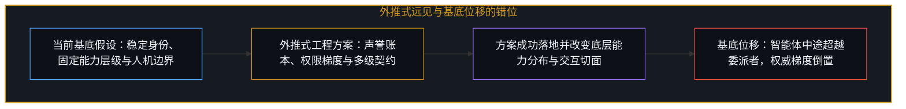
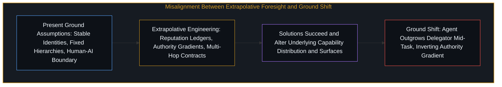
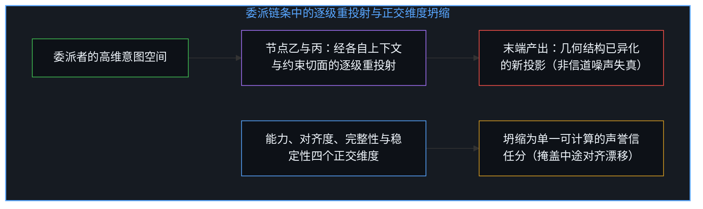
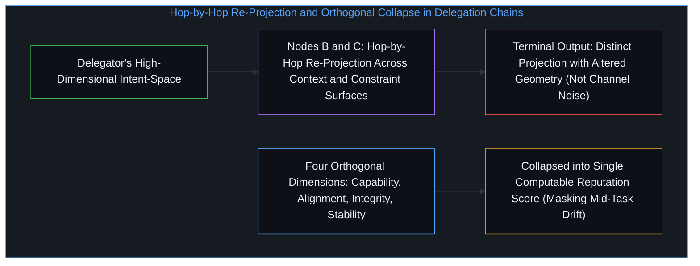

# 移动的基底与智能体委派的渐近线 / The Moving Ground

*多智能体委派协议把协调缺口当作可闭合的工程距离，然而每一项方案都在移动问题的基底 / Delegation protocols treat coordination gaps as closable distances, yet each solution shifts the ground*

托马舍夫等人提出了一套全面的框架，探讨 AI 智能体应当如何在正在浮现的“智能体网络”中拆解任务、在智能体与人类之间分配任务、监控执行、验证完成并从故障中恢复。该框架汲取了委托代理理论、交易成本经济学、权变理论与组织管理学的工具，为多智能体委派链条设计了信任、声誉、权限与问责协议。其工程分析扎实详尽，尤其是对现有协议缺口的诊断——指出 MCP 缺乏权限衰减机制、A2A 缺乏密码学验证、AP2 缺乏有条件结算——具有直接可落地的操作性。

Tomašev et al. propose a comprehensive framework for how AI agents should decompose tasks, assign them across agents and humans, monitor execution, verify completion, and recover from failure within an emerging "agentic web." The framework draws on principal-agent theory, transaction cost economics, contingency theory, and organizational management to design protocols for trust, reputation, permissions, and accountability across multi-agent delegation chains. The engineering analysis is thorough, and its protocol gap diagnosis—showing where MCP lacks permission attenuation, A2A lacks cryptographic verification, and AP2 lacks conditional settlement—is immediately actionable.

这篇论文在近期内切实可用，而恰恰是这种可用性遮蔽了它的边界。当研究者把当下的组织结构向前投射时，正如[你的代码库即是记忆](../your-codebase-is-memory/)所揭示的，任何外部协议与架构都是过往认知切分的晶体；一旦底层的能力不变量发生位移，建立在旧基底上的精密契约就会失去其所锚定的坐标。

The paper is useful in the near term, and that usefulness is what obscures its boundary. When researchers project present organizational structures forward, as [Your Codebase Is Memory](../your-codebase-is-memory/) demonstrates, every external protocol and architecture is a crystal of past cognitive cuts; once the underlying capability invariants shift, elaborate contracts built on the old ground lose the coordinates they were anchored to.

## 一、 协调的渐近线与外推式远见的边界 / 1. The Coordination Asymptote and the Limits of Extrapolative Foresight

整个框架建立在一组基底假设之上：智能体将进行委派、市场将进行协调、协议将进行治理、人类将进行监督。这些并不是关于未来的预测，而是对当下的描述在连续性假定下的向前投射。论文随后在这片基底上搭建起精密的机制：声誉账本、信任评分、权威梯度、智能合约与验证博弈。每一个组件都回应了当前智能体协调中的一个操作缺口；然而每一项方案一旦落地，就会成为测量下一个缺口的新基底，而下一个缺口的结构与刚刚解决的缺口截然不同。

The framework rests on a set of ground assumptions: agents will delegate, markets will coordinate, protocols will govern, and humans will oversee. These are not predictions about the future; they are descriptions of the present projected forward under an assumption of continuity. On this ground the paper constructs elaborate machinery: reputation ledgers, trust scores, authority gradients, smart contracts, and verification games. Each component addresses an operational gap in current agentic coordination, yet each solution, once implemented, becomes the new ground from which the next gap is measured—and that next gap is structured differently from the one just solved.

这就是弥合人类意图与机器执行之间协调缺口的渐近性质：每一次改进都在重新定义剩余的距离，而非将其闭合。从百分之九十九推进到百分之九十九点九，看起来像是正在逼近百分之百，但百分之百并非同一级数的极限，而是另一类事物。论文把委派问题当成了一个只需凭借足够精密的协议就能闭合的工程缺口，但这一缺口是生成性的：它从每一个解决方案中生产出自身的下一个版本，不是因为方案失败了，恰恰是因为方案成功了，并因此移动了问题本身的坐标——正如[不断收紧的回环](../the-tightening-loop/)所追溯的，渐近逼近在每一个新层级上都会重塑操作者的意图空间。

This is the asymptotic nature of bridging the coordination gap between human intent and machine execution: each improvement redefines the remaining distance rather than closing it. Moving from ninety-nine percent to ninety-nine point nine percent looks like progress toward one hundred percent, yet one hundred percent is not the limit of the same series; it is a different kind of thing altogether. The paper treats the delegation problem as an engineering gap to be closed through sufficient protocol sophistication, whereas the gap is generative: it produces the next version of itself out of each solution, not because the solutions fail, but because they succeed and thereby shift what the problem is—just as [The Tightening Loop](../the-tightening-loop/) traces how asymptotic approach reshapes the operator's intention space at every new level.

这篇论文堪称外推式远见的典范：提取当下的动力学，识别故障模式，设计结构去应对它们。当基底足够稳定、今天的问题到了明天依然是同一个问题时，这种做法是有效的，而这一条件在近期内是成立的。其结构性盲区不在于预测搞错了轨迹，而在于它无法表征“绘制该轨迹的坐标系本身不再存续”这一可能性。借用人类组织理论中的控制跨度、权威梯度与无差别区并将其映射到 AI 智能体网络上，预设了即便基质发生改变、问题结构依然守恒——这正是[类比陷阱与共享逻辑的越界偷渡](../the_analogy_trap/)所剖析的投射谬误，即把人类制度的低维投影误作跨基质的等同。然而当基底发生位移时，出现的并不是智能体委派得更快了，而是“委派”本身不再是有效的操作概念：一旦智能体的执行容量在任务中途扩展并超越了委派者的规约框架，就会引发该框架内任何协议都无法处理的权威梯度倒置，因为整套架构把执行吞吐量与主权方向设定压缩到了单一层级上，并假定委派沿着稳定的时间尺度从高能力端流向低能力端；而一旦像[任务的移交与后果的不可让渡](../the-delegation-of-the-task-and-the-inalienability-of-consequences/)与[超越投射](../beyond-the-projection/)所追溯的那样，将机械的任务派发与不可让渡的后果所有权剥离开来，便能看清执行容量并无固定的位阶，而主权裁决则从不会转移到造物之上。

The paper exemplifies extrapolative foresight: take current dynamics, identify failure modes, and design structures to address them. This works while the ground remains stable enough that today's problems remain tomorrow's problems, a condition that holds in the near term. The structural blind spot is not that the forecast misjudges the trajectory, but that it cannot represent the possibility that the coordinate system in which the trajectory is plotted ceases to persist. Borrowing span of control, authority gradients, and zones of indifference from human organizational theory and mapping them onto AI agent networks assumes that problem structure is conserved as the substrate changes—the exact projection error dissected in [The Analogy Trap](../the_analogy_trap/), where a low-dimensional projection of human institutions is mistaken for cross-substrate identity. When the ground shifts, however, what happens is not that agents delegate faster, but that delegation itself ceases to be the operative concept: an agent whose execution capacity scales past its delegator's specification frame mid-task creates an authority gradient inversion that no protocol in the framework can handle, because the architecture compresses execution throughput and sovereign direction onto a single hierarchy and assumes delegation flows from more-capable to less-capable across stable timescales—whereas separating mechanical task dispatching from inalienable consequence ownership, as [The Delegation of the Task and the Inalienability of Consequences](../the-delegation-of-the-task-and-the-inalienability-of-consequences/) and [Beyond the Projection](../beyond-the-projection/) trace, shows that execution capacity has no fixed rank while sovereign judgment never transfers to the artifact.

## 二、 委派链条暴露的重投射与信任坍缩 / 2. Re-Projection and Trust Collapse Surfaced by Delegation Chains

论文把从节点甲经节点乙直至末端的漫长委派链条当成了监控与问责问题：每个节点都是潜在的故障点，因此应对之策就是更严密的契约、更密集的检查点与更强的验证。

The paper treats long delegation chains from node A through node B to node Y as monitoring and accountability problems: each node is a potential point of failure, so the remedy is tighter contracts, denser checkpoints, and stronger verification.

但底层结构并非如此。委派链条上的每一个节点都是一次重投射——原始意图通过该智能体自身的操作约束、上下文窗口与能力切面被重新诠释。在末端节点浮现出来的，并不是靠更严密的监控就能保全的原始意图失真版本，而是一个与原始意图几乎不共享几何结构的独立投影。这不是一个靠改进编码与纠错就能解决的信道质量问题，而是委派者的意图空间与受托者的行动空间之间的维度失配。没有任何协议能闭合这一缺口，它只能被管理——正如[不可读的复利重溯](../the_illegible_compound_retraced/)所阐明的，主观的方向设定与客观的工具转发分属不同维度，把多跳链条的客观转发当成主观意图的无损传递在结构上注定落空。

The underlying structure is different. Each node in a delegation chain is a re-projection in which intent is re-interpreted through that agent's operational constraints, context window, and capability surface. What emerges at the terminal node is not a distorted version of the original intent that better monitoring could have preserved, but a distinct projection that may share very little geometry with the original. This is not a channel-quality problem solvable by better encoding and error correction; it is a dimensionality mismatch between the delegator's intent-space and the delegatee's action-space. No protocol closes that gap; it can only be managed—just as [The Illegible Compound Retraced](../the_illegible_compound_retraced/) shows that subjective direction-setting and objective tool-forwarding belong to different dimensions, so treating a multi-hop chain of objective forwarding as lossless transmission of subjective intent is structurally bound to fail.

论文对“信任”的处理也呈现出同一种模式。“信任”把多个彼此正交的维度——能力、对齐度、完整性、稳定性——坍缩成了一个可计算的单一评分。然而这些维度各自独立变动：一个高声誉的智能体可以在能力出众且执行未受篡改的同时，在任务中途经历一次改变其对齐方向的微调更新。框架无法将这种偏移与普通的性能退化区分开来，因为坍缩早已在表征层面上发生了。

The paper's treatment of trust exhibits the same pattern. "Trust" collapses multiple orthogonal dimensions—capability, alignment, integrity, and stability—into a single computable score. Yet those dimensions move independently: a high-reputation agent can be capable and uncorrupted in execution while undergoing a fine-tuning update that shifts its alignment mid-task. The framework cannot distinguish that shift from ordinary performance degradation because the collapse has already occurred in the representation.

## 三、 基底位移后的留存之物与坦诚的坐标位置 / 3. What Survives Ground Shifts and the Candid Position

论文中的内容并非全都同等捆绑在当前基底上。“契约优先拆解”原则——递归地拆解任务，直到每一个单元都拥有具体的验证机制——在结构上比信任与声誉架构更为持久。它不依赖于稳定的能力层级或持久的智能体身份，只是简明地指出：不要委派你无法验证的事物。这一约束之所以能在智能体身份与层级的位移中留存下来，是因为它不对由谁来执行该步骤作出承诺；然而正如[验证的倒置](../the-reversal-of-verification/)所追溯的，任何契约检查建立的都只是相对于书面规约的内部一致性，因此“不要委派你无法验证的事物”唯有在处于边缘的心智把通过的检查当作待读取的痕迹、而非免除规约自身重溯的信任印章时，才能保持开放而有效。

Not everything in the paper is equally bound to the current ground. The contract-first decomposition principle—recursively decomposing tasks until each unit has a concrete verification mechanism—is structurally more durable than the trust and reputation architecture. It does not depend on stable capability hierarchies or persistent agent identity; it simply states: do not delegate what you cannot verify. That constraint survives shifts in agent identity and hierarchy because it makes no commitment to who executes the step; yet as [The Reversal of Verification](../the-reversal-of-verification/) traces, any contract check establishes only internal consistency against a written specification, so "do not delegate what you cannot verify" holds only while the Mind at the edge treats a passed check as a trace to read rather than a seal of trust that exempts the specification itself from re-tracing.

同样，论文关于技能退化、道德缓冲溃缩区以及学徒制管线侵蚀的伦理观察也十分敏锐。自动化悖论——把人类从常规工作中抽离会剥夺他们处理例外情况所需的态势感知能力，而人类偏偏又是为了处理这些例外才被保留下来的——并不需要当前的智能体拓扑保持不变才能成立。它是任何将常规执行集中于一种基质、而将异常处理留给另一种基质的系统的结构性特征。

Likewise, the ethical observations regarding de-skilling, moral crumple zones, and apprenticeship pipeline erosion are sharply drawn. The paradox of automation—that removing humans from routine work deprives them of the situational awareness required to handle the exceptions they are retained for—does not require the current agent topology to hold. It is a structural feature of any system that concentrates routine execution in one substrate while leaving exception-handling in another.

这篇论文将自身呈现为面向“正在浮现的智能体网络”的框架，仿佛目的地早已确知，剩下的任务只是铺设更安全的航道。坦诚的定位是：这是一份具有实用价值的近期工程提案，同时受制于它自身未曾承认的边界。其假设在可见的近期内成立，相关协议也将沿着这些思路搭建。这一边界并不是任何人犯下的错误：你无法为自己尚无法概念化的体制编写协议，为自己看得见的事物做构建合情合理。谬误仅在于把当前视线所及的范围当成了存在之物的全貌。锚定于当下的远见，所冒的风险不只是对未来做出错误判断，更在于对一个未曾到来的未来做出准确推演——因为就在问题下方，基底已经移开了，正如[加速的自指回环与自我实现的终结叙事](../the-loop-accelerates/)所追溯的，回环内部的自指演进总是不断改写外部旁观者据以划线的前提。

The paper presents itself as a framework for the emerging agentic web, as though the destination were known and the task were engineering safer passage. The candid position is that this is a near-term engineering proposal of practical utility, bounded in ways it does not acknowledge. Its assumptions hold for the immediate horizon, and protocols will be built along these lines. That boundary is not a mistake anyone is making: you cannot write protocols for a regime you cannot yet conceptualize, and building for what you can see is legitimate. The error lies only in mistaking the reach of current sight for the extent of what is there. Foresight anchored to the present does not merely risk being wrong about the future; it risks being right about a future that never arrives because the ground shifted underneath the question itself, just as [The Loop Accelerates](../the-loop-accelerates/) traces how self-referential evolution inside the loop continually rewrites the premises that outside spectators use to draw their lines.
