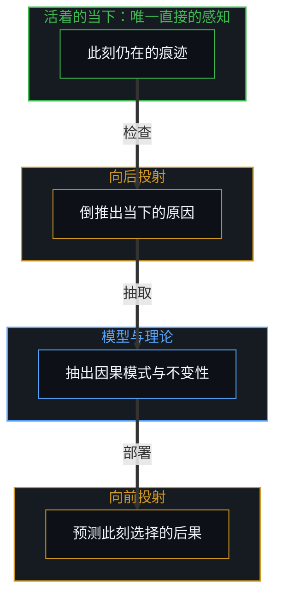
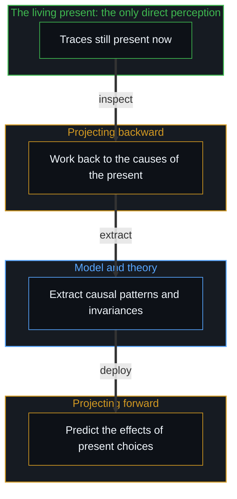

# 时间是因果的不可逆方向与离散步长 / Time Is the Irreversible Direction and Discrete Step of Causality

*第四维是心智内部的坐标，向后投射以理解当下，向前投射以预测后果 / The fourth dimension is a coordinate in the Mind, projected back to understand the present and forward to predict effects.*

物理学与哲学长久以来把时间当作第四维：一根与长、宽、高同一数学形式的坐标轴，事物沿着它行进。日常语言也这样说话，“回顾”过去，“走向”未来，量一段时长就像沿着一条走廊铺开卷尺。到了闵可夫斯基的时空流形与相对论的“块状宇宙”，这种空间化走到了头：过去、现在与未来像一片不变的四维地形上的静止地标，同时并存。

Physics and philosophy have long treated time as a fourth dimension: a coordinate axis with the same mathematical form as length, width and depth, along which things travel. Everyday speech talks the same way, "looking back" at the past, "moving forward" into the future, measuring a duration as if laying a tape along a corridor. In Minkowski's spacetime manifold and the "block universe" of relativity this spatializing reaches its end: past, present and future coexist like still landmarks across an unchanging four-dimensional landscape.

时间可以被建模成一个维度，这一点不必否认。要分开的是两样东西：模型里的第四维，和活着时所遇到的时间。模型把时间当作第四维，是一件造出来的导航工具，向后投射到过去去找当下的原因，向前投射到未来去预测行动的后果。活着时遇到的时间，是因果状态转换的不可逆方向与离散步长。把模型里的第四维当作工具来用，用处很大；把它当成活着所遇到的时间本身，才出了范畴错误，这一层投影在[维度即投影](../dimensions-are-projections/)里有完整的追溯。

There is no need to deny that time can be modelled as a dimension. What needs separating is two things: the fourth dimension in a model, and time as it is met in living. A model that treats time as a fourth dimension is an engineered tool for navigation, projecting back into the past to find the causes of the present and forward into the future to predict the effects of action. Time as it is met in living is the irreversible direction and discrete step of causal state transitions. Using the fourth dimension of the model as a tool is of great use; the category error comes only when it is taken for lived time itself, a projection traced in full in [Dimensions Are Projections](../dimensions-are-projections/).

## 一、 只在当下 / 1. Only the Present

在空间的维度里，可以向左看、向右看，向前走三步，再向后走三步，回到起点的坐标；走过的整片地形一直都在。时间不给出这种几何上的对称。没有人侧过头去看五分钟前发生的事，也没有人探身去看明天早上。感知始终锚定在此刻，不可分割，也从不离开。

In the dimensions of space it is possible to look left and right, take three steps forward and three steps back, and return to the starting coordinate; the whole terrain crossed stays present. Time offers no such geometric symmetry. No one turns sideways to look at something that happened five minutes ago, or leans ahead to see tomorrow morning. Perception stays anchored at this moment, indivisible, and never leaves it.

每一个念头、每一次测量、每一次对轨道的计算、每一段童年的记忆，都发生在当下这一瞬之中。把时间当作第四维的模型，让心智能向后投射去理解当下、向前预测接下来的事；而被直接登记到的，只有此刻的状态，正从一个离散的步长转到下一个。

Every thought, every measurement, every calculation of an orbit and every memory of childhood takes place within this instant. A model that treats time as a fourth dimension lets the Mind project backward to make sense of the present and forecast what comes next; what is directly registered is only the present state, passing from one discrete step to the next.

## 二、 方向与间隔 / 2. Direction and Separation

那么，模型中的坐标之外，活着时遇到的时间是什么？从第一人称的原点看，遇到的是一个接一个的转换：这一个状态让位给下一个。只要有因果，就要有方向，也要有因与果之间的间隔。方向给出时间之箭：前因先于后果，次序只朝一边走，因与果若可以互换，因果也就不再成其为因果。间隔给出最小步长：原因不能与它的结果同时，转换若是瞬时的、步长为零，因与果就塌缩成彼此，中间没有任何区分，没有什么可被登记。区间可以越缩越小，却从不到零。时间到这里就说完了，方向与步长，再没有别的。

What then is lived time, apart from the coordinate in a model? From the first-person origin what is met is one transition after another: this state giving way to the next. Wherever there is causality there must be a direction, and a separation between cause and effect. Direction gives the arrow of time: the antecedent comes before the consequent, the order runs one way, and if cause and effect could trade places causality would no longer be causality. Separation gives the minimum step: a cause cannot be simultaneous with its effect, and if the transition were instantaneous, a step of zero, cause and effect would collapse into each other with no distinction between them and nothing to register. The interval can shrink without end but never reaches zero. That is all there is to time here, a direction and a step, nothing more.

步长不能为零，于是在测量上就有一个下限。物理学的普朗克时间 t_P，约为 5.4 × 10⁻⁴⁴ 秒，与普朗克长度 ℓ_P，标出了现有理论预期自身不再成立的尺度；光速 c 与二者的关系是 c = ℓ_P / t_P，c 在这里读作因果传播的速率上限，一个离散的步长把它的约束传到空间别处、去规定下一步的最快速度。物理学并没有确立普朗克时间就是最短的时长，它是现有模型失去分辨力的地方。这些常数不是刻在一个外部宇宙容器上的、先于观察的事实，而是对感知边界的数学描述：观察、仪器与认知登记的分辨率，受同一种因果步长约束，常数标出的是可观察地平线的周长，是感知光圈的分辨率。忘了这一点，把常数当作独立于观察而自存的定律，就是框架的遗忘：每一个常数都由一个观察者测出，而观察者自己的仪器，就织自被测量的那些因果步长。

Because the step cannot be zero, measurement meets a lower bound. Physics's Planck time t_P, about 5.4 × 10⁻⁴⁴ seconds, and Planck length ℓ_P mark the scale at which current theories expect themselves to stop holding; the speed of light c relates to them as c = ℓ_P / t_P, and c reads here as the ceiling on how fast causality propagates, the fastest a discrete step can carry its constraints across space to condition the next one. Physics has not established that the Planck time is the shortest duration; it is where present models lose resolution. These constants are not facts engraved on an external cosmic container prior to observation but the mathematical description of the edge of perception: the resolution of observation, instruments and cognitive registration is bounded by the same causal step, and the constants mark the perimeter of the observable horizon, the resolution of the perceptual aperture. Forgetting this, and treating the constants as laws standing on their own apart from observation, is the amnesia of the frame: every constant is measured by an observer whose own apparatus is woven from the causal steps being measured.

## 三、 刷新的帧与选择 / 3. The Refreshed Frame and Choice

最小的离散步长，用一幅图来说，是帧率的分辨率：现实在量子地平线上被渲染时的刷新速度。现实不像一卷早已录好、搁在永恒架子上的电影胶片，那是静态块状宇宙的图景；它在一刻接一刻地被渲染。普朗克尺度在这幅图里是渲染的最高分辨率与刷新率，敞开的潜能以这个离散的节拍越过量子边界，落成已实现的状态。

The minimal discrete step, put as a picture, is the resolution of a frame rate: the refresh speed at which reality is rendered at the quantum horizon. Reality is not a film reel already recorded and resting on an eternal shelf, which is the picture of the static block universe; it is rendered moment by moment. The Planck scale in this picture is the highest resolution and refresh rate of the rendering, the discrete cadence at which open potential crosses the quantum boundary and settles into realized states.

这个不为零的步长，正是选择所在之处。步长从不为零，就没有什么冻结：累积的过去给出结构上的约束与留存的痕迹，下一帧如何落定，在前沿处仍是敞开的。从第三人称的外部看，这一步被记作量子层面的落定，一次状态的转换；从第一人称的内部经历，同一次越过就是有意识的选择与活着的意向。量子的间隙与选择是同一件事的两面，哪一面在先，这里不作裁定，只说心智把选择注入这一步，[涌现的几何学](../the-geometry-of-emergence/)与[个体抉择是唯一的因果杠杆](../individual-choices-as-the-only-causal-levers/)都从这里展开。

This non-zero step is exactly where choice resides. Because the step is never zero, nothing freezes: the accumulated past supplies structural constraint and residual trace, and how the next frame settles stays open at the leading edge. Seen from the third-person outside, the step is recorded as quantum resolution, a transition of state; undergone from the first-person inside, the same crossing is conscious choice and living intention. The quantum gap and choice are two faces of one thing, and which comes first is not settled here, only that the Mind injects choice into the step, as [The Geometry of Emergence](../the-geometry-of-emergence/) and [Individual Choices as the Only Causal Levers](../individual-choices-as-the-only-causal-levers/) both unfold.

选择不悬在物理定律之外的某个虚空里，它就在因与果之间那段不为零的余地中。每一次有意识的行动，都参与渲染下一帧。把这卷影片冻成一帧、再把这一帧叫作整个宇宙，是[黑白采样帧与外推宇宙](../the-black-and-white-sample-frame-and-the-extrapolated-universe/)追溯的那一步。没有一座地下金库把“过去”保存下来，也没有一间仓库里存着等待发生的“未来”；登记到的只有此刻的状态，带着之前每一个离散因果步长累积下来的结构痕迹。

Choice does not hang in some void outside the laws of physics; it lives in the non-zero room between cause and effect. Every conscious act takes part in rendering the next frame. Freezing the film into one frame and then calling that frame the whole universe is the step traced in [The Black-and-White Sample Frame and the Extrapolated Universe](../the-black-and-white-sample-frame-and-the-extrapolated-universe/). There is no vault underground where "the past" is kept, and no warehouse where "the future" waits to happen; what registers is only the present state, carrying the structural residue accumulated from every discrete causal step before it.

## 四、 向后找因，向前测果 / 4. Back for Causes, Forward for Effects

时间的“第四维”从哪里来？它是活着的心智造出来的操作工具。直接感知到的只有当下，而要活下去、要行动，心智就得理解此刻的处境，并决定下一步做什么。为此它走一个三段的回路。先是向后投射去找原因：检查此刻仍在的痕迹，河床里的沉积、落在探测器上的光子、档案里的墨迹、大脑里的突触连接，倒推出当下的原因。接着在倒推中抽出重复的模式、因果的规律与关系上的不变性，模型与理论都这样建成。最后带着这个从过去倒推出的模型向前投射，预测此刻的选择会带来什么后果。

Where does the "fourth dimension" of time come from? It is an operating tool built by the living Mind. Only the present is directly perceived, and to survive and to act the Mind must make sense of where it stands and decide what to do next. For this it runs a three-part loop. First it projects backward to find causes: it inspects the traces still present now, sediment in a riverbed, photons striking a detector, ink in an archive, synaptic connections in a brain, and works back to the causes of the present. Next, in that working back, it extracts repeating patterns, causal regularities and relational invariances, which is how models and theories are built. Last, carrying the model drawn from the past, it projects forward to predict what effects present choices will have.

所以第四维 t 是一张内部的制图网格，整张都在当下的光圈之内搭起来：把当下向后投射以解释它的原因，经由模型向前投射以预测后果。[翻袋球与魔术戏法](../the-bank-shot-and-the-magic-trick/)走的正是这一步，向前的模拟让球杆对准唯一被渲染的地方，就在此刻。

So the fourth dimension t is an inner drafting grid, built entirely within the aperture of the present: the present projected backward to explain its causes, and forward through a model to forecast effects. [The Bank Shot and the Magic Trick](../the-bank-shot-and-the-magic-trick/) takes exactly this step, the forward simulation aiming the cue at the only place where anything is rendered, right now.

## 五、 把坐标当成地形 / 5. Taking the Coordinate for the Terrain

把时间当作第四维的模型，是在现实里导航时少不了的工具：向后投射以理解当下，再循着理论或模型向前投射以预测后果。也正是把时间当成一根轴，万物理论才能把它冻结成一份清单，[索求万物理论是在将当下冻结为清单](../demanding-a-toe-freezes-time-into-a-catalog/)追溯的是这一步。混淆发生在操作用的坐标网格被当成了地形的时候，这正是[框架的边界](../the-boundary-of-the-frame/)所分析的那一处。数学物理能把时间写成一个代数坐标 t，与空间坐标 x、y、z 并列，于是推论滑了一步：既然时间在模型里能像空间一样被画出来，活着所遇到的时间就是空间。

A model that treats time as a fourth dimension is a tool that navigation through reality cannot do without: projecting backward to make sense of the present, then forward along a theory or model to predict effects. It is also because time is treated as an axis that a theory of everything can freeze it into a catalog, the step traced in [Demanding a Theory of Everything Freezes Time into a Catalog](../demanding-a-toe-freezes-time-into-a-catalog/). The confusion comes when the operating grid is taken for the terrain, the very place analysed in [The Boundary of the Frame](../the-boundary-of-the-frame/). Mathematical physics can write time as an algebraic coordinate t beside the spatial coordinates x, y, z, and the inference slips one step: since time can be plotted like space in a model, lived time is space.

这一步滑出去，接连带出几样东西。第一样是块状宇宙：时空是一块四维几何体，一切时刻同样真实，爱因斯坦晚年在给贝索家人的信里写，过去、现在与未来的区分只是一个顽固的幻觉。这幅图在相对论的计算里很有用，它的边界在于把一张造出来的数学地图当成了活着的根基，[双生子佯谬与隐秘观察者](../the-twin-paradox-and-the-hidden-observer/)拆开的那个表面上的不对称，就是这样造出来的。第二样是时间旅行的悖论：哥德尔在 1949 年给出带闭合类时曲线的解，此后关于能否回到过去、阻止自己出生的争论持续了几十年。这类悖论是把一条坐标线当成一条公路的数学产物；“昨天”不是空间里的一个地点，它是整个宇宙之前的一个状态，已经被之后的因果相互作用不可逆地改写了。

That slipped step brings several things with it. The first is the block universe: spacetime is a four-dimensional geometric block in which every moment is equally real, and late in life Einstein wrote in a letter to Besso's family that the distinction between past, present and future is only a stubborn illusion. The picture is of great use in the calculations of relativity; its boundary is that it takes an engineered mathematical map for the ground of living, and the apparent asymmetry taken apart in [The Twin Paradox and the Hidden Observer](../the-twin-paradox-and-the-hidden-observer/) is made exactly this way. The second is the paradoxes of time travel: Gödel in 1949 gave a solution with closed timelike curves, and decades of debate followed over whether one could go back and prevent one's own birth. Such paradoxes are mathematical products of treating a coordinate line as a highway; "yesterday" is not a place in space but an earlier state of the whole universe, already irreversibly rewritten by the causal interactions since.

第三样是时间反演的对称。力学与电磁学的方程在 t → −t 下形式不变，时间之箭从何而来，于是成了物理学一个世纪的难题。方程的对称在其适用范围内是有用的，它让一段运动能被倒着算出来；它到了边界，是在把纸上的坐标当成了状态的转换。纸上的方程两个方向都能跑，因果的状态转换只朝一边走，不可逆是因果能够运作的前提，而不是有待解释的例外。正如[因果贯穿始终](../causality-all-the-way/)所说，地图可以把方程倒着跑，被登记到的转换只向前。

The third is time-reversal symmetry. The equations of mechanics and electromagnetism keep their form under t → −t, and where the arrow of time comes from became a century-long puzzle for physics. The symmetry of the equations is of use within its range, letting a motion be computed backward; it reaches its boundary in taking the coordinate on paper for the transition of states. Equations on paper run both ways, causal state transitions run only one way, and irreversibility is the condition for causality to work at all, not an exception awaiting explanation. As [Causality All the Way](../causality-all-the-way/) puts it, the map can run its equations backward, while the transitions that register only go forward.

## 六、 当下的支点 / 6. The Fulcrum of the Present

时间维度的神话一旦拆开，宿命论也就散了，行动重新落回它的支点上。过去是此刻对活着的心智仍可取用的累积痕迹，用来理解；未来是下一个因果步长的敞开潜能，由当下建立的边界条件塑形。过去与未来都是当下这个向量的投影，[向量与投影的迷局](../the-vector-and-the-puzzle-of-projections/)正是这样追溯的。

Once the myth of the time dimension is taken apart, fatalism falls away with it, and action comes back to rest on its fulcrum. The past is the accumulated trace still available to the living Mind now, for understanding; the future is the open potential of the next causal step, shaped by the boundary conditions set in the present. Past and future are both projections of the present vector, as [The Vector and the Puzzle of Projections](../the-vector-and-the-puzzle-of-projections/) traces.

理论中的时间维度是一件少不了的工具，一座活着的心智为在存在中导航而搭起的桥。只是桥不是河。推动的是因果以离散、不可逆的步长从一个状态走向下一个，而它唯一的场地是此刻，不可重复的当下。向后与向前的投射，是心智延展自己地平线的方式，[心智的几何学](../the-geometry-of-mind/)描述的正是这一延展。

The dimension of time in theory is a tool that cannot be done without, a bridge the living Mind builds to navigate existence. Only the bridge is not the river. What moves is causality going from one state to the next in discrete, irreversible steps, and its only stage is this moment, the unrepeatable present. Projecting backward and forward is how the Mind extends its own horizon, the extension described in [The Geometry of Mind](../the-geometry-of-mind/).
