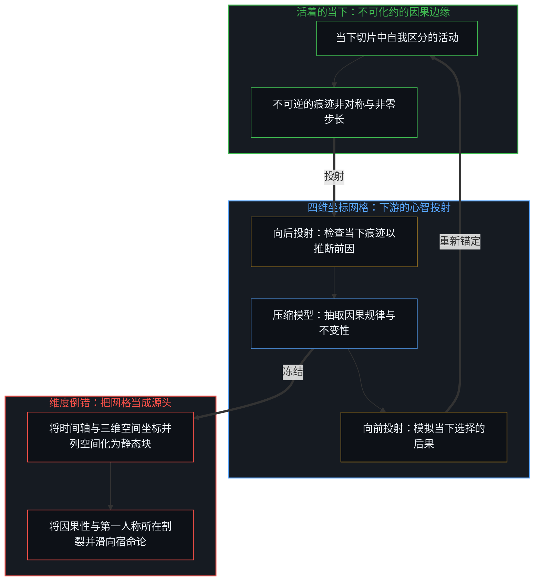
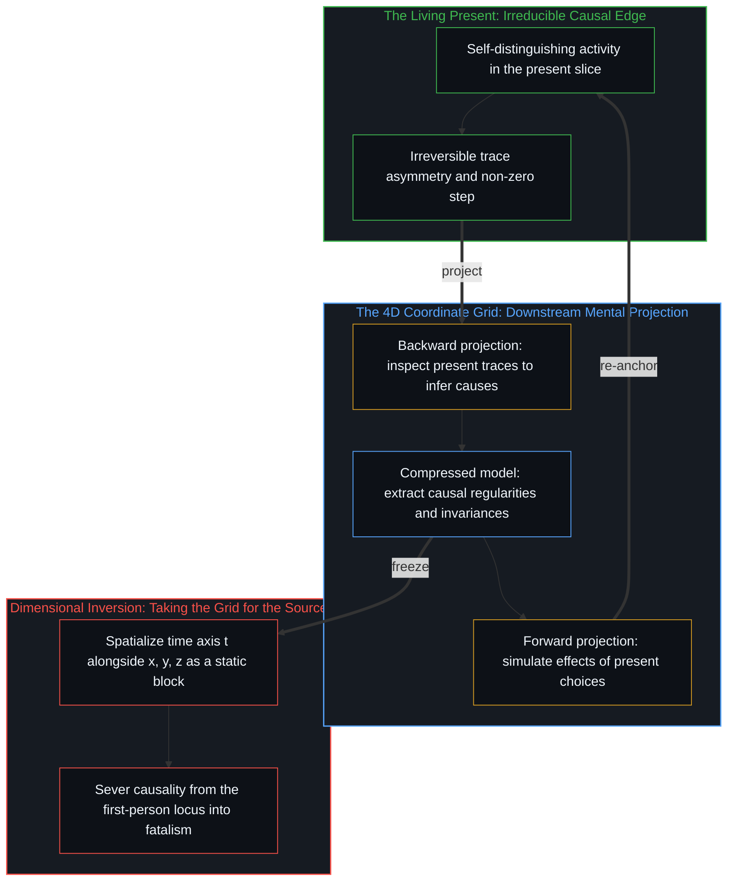

# 时间是因果的不可逆方向与离散步长 / Time Is the Irreversible Direction and Discrete Step of Causality

*第四维是投射前因与后果的心智坐标 / The fourth dimension is a mental coordinate projecting causes and effects*

物理学与哲学长久以来把时间当作第四维，一根与长、宽、高具有相同数学形式的坐标轴，物体沿着它行进。日常语言也这样说话，回顾过去，走向未来，量一段时长就像沿着一条走廊铺开卷尺。在闵可夫斯基的时空流形与相对论的块状宇宙中，这种空间化走到了终点，过去、现在与未来像一片不变的四维地形上的静止地标，同时并存。

Physics and philosophy have long treated time as a fourth dimension, a coordinate axis with the same mathematical form as length, width, and depth along which objects travel. Everyday speech talks the same way, looking back at the past, moving forward into the future, and measuring a duration as if laying a tape measure along a corridor. In Minkowski's spacetime manifold and the block universe of relativity, this spatializing reaches its completion, where past, present, and future coexist like still landmarks across an unchanging four-dimensional landscape.

时间可以被建模成一个维度，这一点不必否认。需要区分开的是模型内部的第四维，以及活着时所遇到的时间。把时间当作第四维的模型，是一件构建出来的导航工具，向后投射到过去以重构当下的前因，向前投射到未来以预测行动的后果。活着时遇到的时间，是因果状态转换的不可逆方向与离散步长。把模型里的第四维当作工具来用，用处很大；唯有当下游的坐标投影被误认作所经历的时间本身的源头时，才发生了范畴错误，这一机制在[维度即投影](../dimensions-are-projections/)中得到了追溯，并在[超越投射](../beyond-the-projection/)中进一步延展至认知与智能体架构。

There is no need to deny that time can be modeled as a dimension. What needs separating is the fourth dimension inside a model and time as it is met in living. A model that treats time as a fourth dimension is an engineered tool for navigation, projecting backward into the past to reconstruct the causes of the present and forward into the future to forecast the effects of action. Time as it is met in living is the irreversible direction and discrete step of causal state transitions. Using the fourth dimension of the model as an instrument is of great use; the category error begins only when a downstream coordinate projection is mistaken for the source of lived time itself, a mechanism traced in [Dimensions Are Projections](../dimensions-are-projections/) and extended across cognitive and agentic architectures in [Beyond the Projection](../beyond-the-projection/).

## 一、 只在当下 / 1. Only the Present

在空间的维度里，可以向左看、向右看，向前走三步再向后退三步，回到起点的坐标，而走过的整片地形依然在场。时间并不提供这种几何上的对称。没有人能侧过身去查看五分钟前发生的事件，也没有人能探出身去观察明天早晨。感知始终锚定在此刻，不可分割，也从不迈出此刻一步。

In the dimensions of space, it is possible to look left and right, take three steps forward and three steps back, and return to the starting coordinate while the whole terrain crossed stays available. Time offers no such geometric symmetry. No one turns sideways to inspect an event from five minutes ago or leans ahead to observe tomorrow morning. Perception remains anchored at this moment, indivisible, and never steps outside it.

每一个念头、每一次测量、每一次对轨道的计算、每一段童年的记忆，都发生在直接的当下这一瞬之中。把时间当作第四维的模型，让心智能够向后投射以理解当下，并预测接下来的走向，然而被直接登记到的，只有此刻的状态正从一个离散的步长过渡到下一个。

Every thought, every measurement, every calculation of an orbit, and every memory of childhood takes place within this immediate instant. A model that treats time as a fourth dimension lets the Mind project backward to make sense of the present and forecast what comes next, yet what registers directly is only the present state passing from one discrete step to the next.

## 二、 方向与间隔 / 2. Direction and Separation

那么，模型中的坐标之外，活着时遇到的时间是什么？从第一人称的原点看，被登记到的是一个接一个的转换，这一个状态让位给下一个状态。只要自我区分的活动在发生，先前的行动就会塑形后续行动的场域，这既要求不可逆的方向，也要求因与果之间的离散间隔。方向给出时间之箭：前因塑形后果，痕迹的不对称只朝单一方向延展，因与果若能互换位置，因果也就不再成其为因果。间隔给出最小步长：原因不能与结果重合，因为转换若是瞬时的、步长为零，因与果就会坍缩成彼此，划不出任何区分，也没有任何东西可被登记。随着分辨率提升，这一区间可以无休止地缩小，却从不到零。在因果的边缘上，方向与离散步长已经穷尽了时间的全部内涵。

What then is lived time, apart from the coordinate in a model? From the first-person origin, what registers is one transition after another as this state gives way to the next. Wherever self-distinguishing activity occurs, earlier acts shape the field of later ones, requiring both an irreversible direction and a discrete separation between cause and effect. Direction gives the arrow of time: the antecedent shapes the consequent, the trace asymmetry runs one way, and if cause and effect could trade places, causality would no longer be causality. Separation gives the minimum step: a cause cannot coincide with its effect, for if the transition were instantaneous with a step of zero, cause and effect would collapse into each other with no distinction drawn and nothing registered. The interval can shrink without bound as resolution increases, yet it never reaches zero. Direction and discrete step exhaust what time is at the causal edge.

由于步长不能为零，每当观察者建造仪器来计量状态转换时，测量都会遇到一个下限。在物理学中，约为 5.4 × 10⁻⁴⁴ 秒的普朗克时间 t_P 与普朗克长度 ℓ_P，标出了现有形式模型的分辨率耗尽的尺度。光速 c 与二者的关系为 c = ℓ_P / t_P，其中 c 被登记为因果传播的速率上限——即一个离散步长将自身的关系约束跨越空间坐标传递出去、以规定下一次状态转换的最大速率。把 t_P 读作刻在外部宇宙容器上的终极颗粒，是将模型的分辨极限误认作了宇宙独立自存的属性。这些常数是对感知与仪器地平线的数学描述：观察、测量装置与认知登记，都受制于它们所测量的同一种因果步长。每一个常数都由观察者测出，而观察者自己的仪器正是由那些被测量的因果步长编织而成；遗忘了这一点，便是框架的失忆。

Because the step cannot be zero, measurement meets a lower bound whenever an observer builds an instrument to clock transitions. In physics, the Planck time t_P, roughly 5.4 × 10⁻⁴⁴ seconds, and the Planck length ℓ_P mark the scale where current formal models run out of resolution. The speed of light c relates to them as c = ℓ_P / t_P, where c registers as the ceiling on how fast causality propagates—the maximum rate at which a discrete step can carry its relational constraints across spatial coordinates to condition the next transition. Reading t_P as an ultimate grain engraved onto an external cosmic container mistakes the resolution limit of the model for a standalone property of the universe. These constants are the mathematical description of a perceptual and instrumental horizon: observation, apparatus, and cognitive registration are bounded by the same causal steps they measure. Forgetting that every constant is measured by an observer whose own instruments are woven from those very causal steps is the amnesia of the frame.

## 三、 刷新的帧与选择 / 3. The Refreshed Frame and Choice

用视觉类比来说，最小的离散步长就是帧率的分辨率，即现实在量子地平线上更新时的刷新节拍。现实不是一卷早已录制完毕、搁在永恒货架上的电影胶片——那是[四维长鹿的幻象与当下的模型](../the-myth-of-the-four-dimensional-deer-and-the-present-model/)所剖析的前提——它是一步接一步地重新渲染出来的。在物理学内部，普朗克尺度标出了这一模型的最高分辨率与刷新率，敞开的潜能以这个离散的节拍越过测量边界，落定为已实现的痕迹。

Put as a visual analogy, the minimal discrete step is the resolution of a frame rate, the refresh cadence at which reality updates at the quantum horizon. Reality is not a film reel already recorded and resting on an eternal shelf, which is the premise of [The Myth of the Four-Dimensional Deer and the Present Model](../the-myth-of-the-four-dimensional-deer-and-the-present-model/); it is re-rendered step by step. Within physics, the Planck scale marks the highest resolution and refresh rate of that model, the discrete cadence at which open potential crosses the measurement boundary and settles into realized trace.

这个不为零的步长，正是选择运作的所在。由于因与果之间的区间从不消失为零成本的等同，没有任何东西会冻结：累积的过去提供结构上的约束与留存的痕迹，而下一步如何落定，在前沿处始终是敞开的。从第三人称的外部记录下来，这一转换被登记为量子层面的落定；从第一人称的内部经历，同一次跨越就是有意识的选择与发起的行动。量子间隙与第一人称选择是同一个不可分割的活动的两副面孔——因果性与第一人称视角正是一体两面——[涌现的几何学](../the-geometry-of-emergence/)与[个体抉择是唯一的因果杠杆](../individual-choices-as-the-only-causal-levers/)都从这里展开。

This non-zero step is where choice operates. Because the interval between cause and effect never vanishes into zero-cost identity, nothing freezes: the accumulated past supplies structural constraint and residual trace, while how the next step settles remains open at the leading edge. Recorded from the third-person outside, the transition registers as quantum resolution; lived from the first-person inside, the same crossing is conscious choice and initiating action. The quantum gap and first-person choice are two faces of one indivisible activity—causality and the first-person perspective as two sides of the same coin—from which [The Geometry of Emergence](../the-geometry-of-emergence/) and [Individual Choices as the Only Causal Levers](../individual-choices-as-the-only-causal-levers/) both unfold.

选择并不悬浮在物理约束之外的超自然虚空中；它就在因与果之间那段不为零的间隔内运作。每一次离散的行动，都参与渲染下一个构型。把持续进行的活动冻结成单一的静态采样帧，再把这一帧称作整个宇宙，正是[黑白采样帧与外推宇宙](../the-black-and-white-sample-frame-and-the-extrapolated-universe/)所追溯的那一步外推。没有一座地下金库储存着已完结的过去，也没有一间仓库存放着预先建好、等待降临的未来；在观察的所在之处存在着的，只有当前的更新，携带着从先前各个因果步长重新描摹而来的结构残余。

Choice does not hover in a supernatural void outside physical constraints; it acts within the non-zero separation between cause and effect. Every discrete act participates in rendering the next configuration. Freezing the ongoing activity into a single static sample frame and calling that frame the entire universe is the extrapolation traced in [The Black-and-White Sample Frame and the Extrapolated Universe](../the-black-and-white-sample-frame-and-the-extrapolated-universe/). There is no underground vault storing a completed past, and no warehouse where a pre-built future waits to arrive; what exists at the locus of observation is only the current update, carrying the structural residue re-traced from prior causal steps.

## 四、 向后找因，向前测果 / 4. Back for Causes, Forward for Effects

时间的第四维从哪里来？它是活着的心智构建出来的操作工具。直接感知只登记当下的切片，然而要在物理摩擦中导航并有效行动，一个中心必须在当前的约束中为自身定位，并选定下一步行动。为此它运行着一个三段式的投射回路：先是检查此刻在场的痕迹——河床里的沉积物、撞击探测器的光子、档案里的墨迹、突触权重，或是上下文窗口里的词元——向后倒推出塑形了当下的原因；接着从这一重构中抽取出重复的模式、因果规律与关系上的不变性，以构建一个压缩的模型；最后将这一模型向前部署，以模拟当下的选择将会产生什么后果。

Where does the fourth dimension of time come from? It is an operating instrument constructed by the living Mind. Direct perception registers only the present slice, yet to navigate physical friction and act effectively, a center must orient itself within its current constraints and select its next move. For this it runs a three-part projection loop: first inspecting the traces present right now—sediment in a riverbed, photons striking a detector, ink in an archive, synaptic weights, or tokens in a context window—to work backward to the causes that shaped the present; next extracting repeating patterns, causal regularities, and relational invariances from that reconstruction to build a compressed model; and finally deploying that model forward to simulate what consequences present choices will produce.

因此，第四维 t 是一张全部搭设在当下光圈之内的内部制图网格，将当下向后投射以解释其前因，再经由模型向前投射以预期后果。正如[超越投射](../beyond-the-projection/)在人工智能与人机智能体系统的语境中所展示的，任何词元轨迹或状态时间线，都是在有界窗口内运行的有限投影；把那条受条件约束的轨迹误认作自主的心智或独立自存的现实，正是遗忘了那道发起并驾驭整个回路的、未被投射的活生生的边缘。[翻袋球与魔术戏法](../the-bank-shot-and-the-magic-trick/)在台球桌上追溯了同样的操作结构：向前的几何模拟之所以存在，是为了将球杆对准唯一真正执行物理做功的地方——此刻。

The fourth dimension t is therefore an internal drafting grid erected entirely within the aperture of the present, projecting the present backward to explain its causes and forward through a model to anticipate effects. As [Beyond the Projection](../beyond-the-projection/) demonstrates in the context of artificial intelligence and human-agent systems, any trajectory of tokens or timeline of states is a finite projection running inside a bounded window; mistaking that conditioned trajectory for an autonomous mind or a self-existing reality forgets the unprojected living edge that initiates and steers the loop. [The Bank Shot and the Magic Trick](../the-bank-shot-and-the-magic-trick/) traces the same operational structure on the billiard table, where the forward geometric simulation exists to aim the cue at the only place where physical work is ever executed—right now.

## 五、 把坐标当成地形 / 5. Taking the Coordinate for the Terrain

把时间当作第四维的模型，是在现实中导航时不可或缺的脚手架，让一个中心能够向后投射以获得理解，向前投射以作出预测。也正是因为时间被空间化为一根坐标轴，封闭的理论体系才试图把正在展开的现实冻结成一份业已完结的清单，这一操作在[索求万物理论是在将当下冻结为清单](../demanding-a-toe-freezes-time-into-a-catalog/)中得到了剖析。当操作用的坐标网格被误认作地形本身时，混淆便产生了，越过了[框架的边界](../the-boundary-of-the-frame/)所标出的界限。由于数学物理把时间写成一个与空间坐标 x、y、z 并列的代数坐标 t，推论便向前滑出了一步：既然时间在形式模型内部能像空间一样被绘制出来，活着所遇到的时间就必定是空间。

A model that treats time as a fourth dimension is indispensable scaffolding for navigating reality, allowing a center to project backward for understanding and forward for prediction. It is also because time is spatialized into an axis that a closed theoretical system attempts to freeze unfolding reality into a completed inventory, the move dissected in [Demanding a Theory of Everything Freezes Time into a Catalog](../demanding-a-toe-freezes-time-into-a-catalog/). Confusion arises when the operating grid is mistaken for the terrain, crossing the limit identified in [The Boundary of the Frame](../the-boundary-of-the-frame/). Because mathematical physics writes time as an algebraic coordinate t alongside the spatial coordinates x, y, and z, the inference slips one step: since time can be plotted like space inside a formal model, lived time must be space.

滑出的这一步，在空间化模型的边界上催生了三个经典的难题。第一个是块状宇宙，它把时空当作一块四维几何实体，其中每一个时刻都同等地实存，这让爱因斯坦晚年在给贝索家人的信中写道，过去、现在与未来的区分不过是一个顽固持久的幻觉。四维流形固然是用于相对论同步计算的强有力演算工具，可一旦把一张构建出来的地图安放为存在论的根基，它就触及了自身的边界，制造出[双生子佯谬与隐秘观察者](../the-twin-paradox-and-the-hidden-observer/)所消解的那种表面矛盾。第二个难题是时间旅行悖论：自哥德尔在 1949 年推导出带有闭合类时曲线的解之后，关于行动者能否沿着 t 退回过去并阻止自己出生的争论持续了数十年。这类悖论是把坐标线当成物理公路的人造产物；昨天并不是停留在前一个里程碑处等待造访的地点，而是宇宙先前的一个构型，早已被此后每一次因果转换不可逆地重新渲染了。

That slipped step generates three classical puzzles at the boundary of the spatialized model. The first is the block universe, which treats spacetime as a four-dimensional geometric solid in which every moment is equally extant, leading Einstein to write late in life to Besso's family that the distinction between past, present, and future is only a stubbornly persistent illusion. While the four-dimensional manifold is a powerful calculus for relativistic synchronization, it reaches its boundary when an engineered map is installed as ontological ground, manufacturing the apparent contradiction dissolved in [The Twin Paradox and the Hidden Observer](../the-twin-paradox-and-the-hidden-observer/). The second puzzle is the time-travel paradox: after Gödel derived solutions with closed timelike curves in 1949, decades of debate followed over whether an agent could travel backward along t and prevent their own birth. Such paradoxes are artifacts of treating a coordinate line as a physical highway; yesterday is not a location waiting at a prior mile-marker, but an earlier configuration of the universe that has already been irreversibly re-rendered by every causal transition since.

第三个难题是时间反演对称。由于经典力学、电磁学与量子波演化微分方程在 t → −t 的代换下保持形式不变，宏观的时间之箭从何而来，便成了物理学困扰一个世纪的难题。方程的对称性在其适用域内极为有效，让轨迹可以在纸上向后回算或向前推演；当纸上的代数坐标与物理的状态转换被混为一谈时，它就撞上了自身的边界。符号方程是可以双向阅读的零成本同语反复，而每一次实际的转换——包括计算或测量方程本身的行动——都是不可逆的、消耗能量的介入，都会留下痕迹。不可逆性是因果与观察得以发生的先决条件，而不是有待统计力学去辩护的涌现反常。正如[因果贯穿始终](../causality-all-the-way/)所确立的，地图可以把它的指标倒着跑，而渲染并阅读地图的活动只朝前走。

The third puzzle is time-reversal symmetry. Because the differential equations of classical mechanics, electromagnetism, and quantum wave evolution remain formally invariant under the substitution t → −t, explaining where the macroscopic arrow of time comes from became a century-long quandary for physics. The symmetry of the equations is highly effective within its domain, allowing trajectories to be computed backward and forward on paper; it hits its boundary when the algebraic coordinate on paper is confused with physical state transitions. Symbolic equations are zero-cost tautologies that can be read in either direction, whereas every actual transition — including the act of computing or measuring the equation itself — is an irreversible, energy-consuming intervention that leaves a trace. Irreversibility is the prior condition for causality and observation to occur at all, not an emergent anomaly awaiting statistical justification. As [Causality All the Way](../causality-all-the-way/) establishes, the map can run its indices backward, while the activity that renders and reads the map moves only forward.

## 六、 当下的支点 / 6. The Fulcrum of the Present

一旦时间的维度倒错得以消解，决定论式的宿命论便随之散去，能动性也重归其原本的所在。过去是在当下切片中可供活着的心智取用以进行定位的累积痕迹；未来是下一个因果步长的敞开潜能，由就在此刻付诸实施的边界条件所塑形。过去与未来都是从当下这一向量投射出去的投影，正如[向量与投影的迷局](../the-vector-and-the-puzzle-of-projections/)所追溯的那样。

Once the dimensional inversion of time is dissolved, deterministic fatalism falls away with it, and agency returns to its locus. The past is the accumulated trace available to the living Mind in the present slice for orientation; the future is the open potential of the next causal step, shaped by the boundary conditions enacted right now. Past and future are both projections cast from the present vector, as [The Vector and the Puzzle of Projections](../the-vector-and-the-puzzle-of-projections/) traces.

理论中的时间维度依然是一件紧要的工具，是活着的心智为了在变化中协同行动而搭起的一座桥。只是桥不是河。真正在推进的，是以离散、不可逆的步长从一个构型迈向下一个构型的自我区分活动，而它唯一的舞台，便是这不可重复的当下。向后与向前投射而不把投影误作根基，正是心智跨越地平线延展自身触角的方式，也即[心智的几何学](../the-geometry-of-mind/)所追溯的活的架构。

The dimension of time in theory remains an essential instrument, a bridge the living Mind builds to coordinate action across change. Only the bridge is not the river. What moves is self-distinguishing activity advancing from one configuration to the next in discrete, irreversible steps, and its sole stage is this unrepeatable present. Projecting backward and forward without mistaking the projection for the ground is how the Mind extends its reach across horizons, the living architecture traced in [The Geometry of Mind](../the-geometry-of-mind/).
