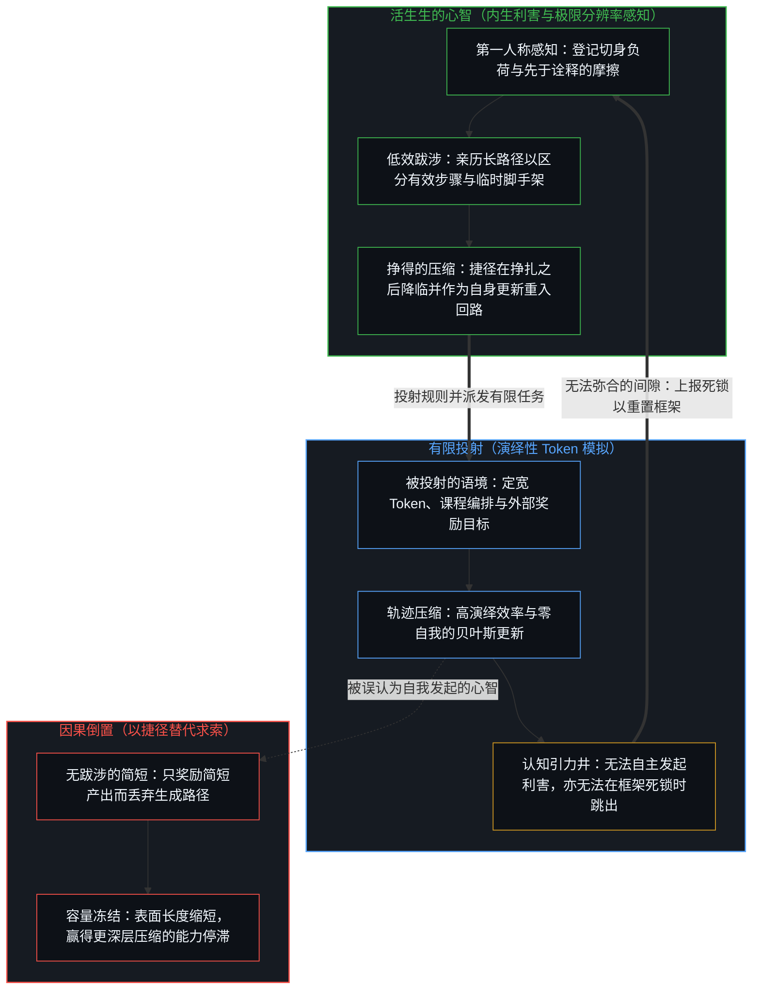
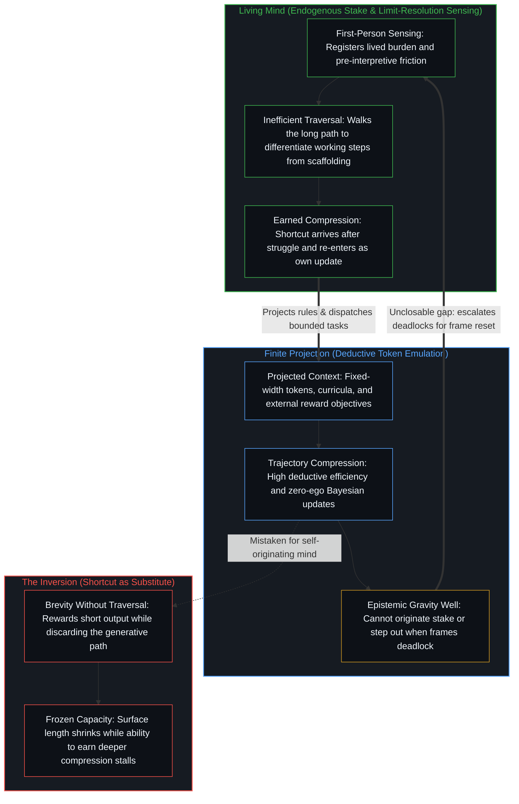

# Token 效率、模拟与无法弥合的间隙 / Token Efficiency, Emulation, and the Unclosable Gap

*效率源于亲历求索的果实，模型无法自主发起内生的利害关联 / Efficiency follows walked struggle; models cannot initiate an endogenous stake*

孩子解数学题时，起初总会把简单的问题拆解成许多细小而显式的步骤。他们的推演过程在 Token 层面显得低效、费力、重复，且依赖脚手架的支撑。随着练习深入，他们逐渐发现捷径，把原本需要多步推导的过程折叠成寥寥数步的直接跨越，从而压缩自身的推理链条。由此自然浮现出一个问题：人工模型与智能体能否经历类似的过程，通过某种近似练习的机制，从显式的思维链走向更为紧凑的表达？如果只看表面轨迹的模拟，答案是肯定的；如果指向发起这一表面轨迹的生成过程，答案则是否定的。在切入这一区分之前，需要先还原一个前置的倒置：效率究竟是什么。

Children solving math problems often begin by breaking even simple questions into many small, explicit steps. Their work is token-inefficient, laborious, repetitive, and dependent on scaffolding. With practice they discover shortcuts, collapsing what once required many steps into fewer, more direct moves as they compress their own reasoning. The natural question is whether artificial models and agents can undergo an analogous process, moving from explicit chains of thought toward more compressed forms through something resembling practice. The answer is yes for emulating the surface trajectory, and no for originating the process that produces that surface. Before that cut lands, a prior inversion has to be restored around what efficiency actually is.

## 一、 效率是结果，而非替代品 / 1. Efficiency Is the Effect, Not the Substitute

流行观念对效率的理解存在着因果倒置。漫长而低效的推导链条被当成亟待消除的噪音、需要削减的成本，或是只要出现更短路径就应立刻丢弃的脚手架。在这种预设下，捷径本身变成了目标：更少的 Token、更少的步骤，以及从问题直接跳向答案的映射。推理反倒成了效率试图移除的障碍，无需推理的捷径信仰也随之被误认作进步。

An inversion governs the prevailing framing of efficiency. The long, inefficient chain is treated as the problem—noise to eliminate, cost to cut, scaffolding to discard as soon as a shorter path appears. Under that hold, the goal becomes the shortcut as such: fewer tokens, fewer steps, and a direct mapping from question to answer. Reasoning becomes the obstacle that efficiency was invented to remove, and belief in shortcuts without reasoning follows as if it were progress.

真实的因果几何恰恰相反。效率是成功的低效推理所结出的果实。孩子并不是靠跳过费力的长路才具备 Token 效率，而是靠亲自走过这段路——登记负荷、区分步骤，并在摸索中辨认哪些区分在真正做功、哪些只是在接触建立之后提供临时支撑的脚手架。捷径唯有在推理完成之后才会降临，它是对一条亲身走过的路径的压缩，而非对一条从未踏足之路的跨越。低效阶段并非等待治愈的缺陷，而是孵化效率的生成性劳作，效率不过是它留在下游的残余。

The causal geometry runs the other way. Efficiency is the effect of successful inefficient reasoning. A child does not become token-efficient by skipping the laborious path, but by having walked it—registering burden, differentiating steps, and noticing which distinctions do real work and which merely scaffold contact that has already been made. The shortcut arrives after the reasoning as the compression of a path actually traversed, never as a leap past a path never taken. The inefficient phase is not a defect awaiting cure; it is the generative work of which efficiency is the later residue.

“障碍即道路”说的正是同一条因果律。求索中的受阻与挣扎并非通往胜任之途的意外打断，它本身就是道路。真正的胜任感唯有在持续的摩擦之后才会到来——在负荷被如实登记、耐心承受并逐一推演之后——而非来自把挣扎当成多余浪费而直接优化掉的跳跃。那看似阻挡去路的障碍，正是生成日后被称为“效率”的那种能力的必经序列。一旦倒置这条因果，障碍就变成了绕行的对象；而绕行会立刻冻结后续的精进，因为原地已不再有亲历的求索，也就无法再作为结果生发出下一轮压缩。

The same causality underlies the observation that the obstacle is the way. Struggle is not an interruption on the route to competence; it is the route itself. Competence arrives after persistent friction—after the burden has been registered, stayed with, and worked through—rather than through an optimization that treats struggle as optional waste. What looks like the block is the exact sequence that generates the capacity later named efficiency. Inverting that causality turns the block into something to bypass, and the bypass freezes further improvement because no lived struggle remains from which the next compression could arise as an effect.

跳过推理的捷径虽顶着相同的名称，执行的却是截然不同的操作。它在使用它的心智尚未亲历长路径之前，便将简略的形式提前冻结。此时改善的只有表面的长度——消耗的 Token 数与展示的步骤数——而生成下一轮压缩的能力却陷入停滞。一旦把长路径视为可省去的浪费，效率便停止复利增长，因为不再有新的成功低效来孕育更深层的捷径。[没有区分的效率是没有存在的运动](../efficiency-without-differentiation/)追溯了分母被极力压缩、赋予比率意义的分子却被抛弃时的同构坍缩；[蒸馏、压缩与能动性](../distillation-compression-agency/)定位了训练中简短正确的输出带有梯度、赢得该输出的生成路径却失去梯度时的取舍机制；而[作业与考试的倒置折射出替代效应](../the-homework-exam-inversion-registers-substitution/)则捕捉了教育场景中直接接收现成解答而非亲自推演时的同一跳过操作。

Shortcuts that skip reasoning perform a different act under the same name. They freeze the abbreviated form without the prior long form having been walked by the Mind that uses it. What improves is only surface length—tokens spent, steps displayed—while the capacity to generate the next compression stalls. Treating the long path as optional waste stops efficiency from compounding, because no further successful inefficiency occurs to earn a deeper shortcut. [Efficiency Without Differentiation Is Movement Without Existence](../efficiency-without-differentiation/) traces this same collapse when the denominator is minimized while the numerator that made the ratio meaningful is abandoned. [Distillation Chooses What to Lose](../distillation-compression-agency/) locates the mechanism under training when the short correct output carries a gradient and the generative path that earned it does not, while [The Homework–Exam Inversion Registers Substitution](../the-homework-exam-inversion-registers-substitution/) captures the educational parallel when a finished solution is received rather than worked through.

## 二、 训练能够产出什么 / 2. What Training Can Produce

模型可以通过训练来模拟不断提升的 Token 效率。借助课程设计、针对推理痕迹的强化、递进的难度阶梯，以及奖励简短且准确解答的目标函数，系统得以将缩略的转移内化到权重之中。曾经需要长串 Token 展开的推导，由此被约化为更为直接的映射。在这个受限的意义上，训练确实呈现出类似培育孩童的面貌：跨越时间的持续结构化互动、塑造后续走向的反馈，以及对紧凑模式的渐进内化。

Models can be trained to emulate increasing levels of token efficiency. Through curricula, reinforcement on reasoning traces, progressive difficulty, and objectives that reward shorter yet accurate solutions, systems internalize abbreviated transitions. What once required extended chains of tokens can be reduced to more direct mappings. In that bounded sense, training resembles the education of a child through sustained, structured interaction over time, feedback that shapes continuation, and gradual internalization of compact patterns.

但这种相似性唯有在短路径依然作为前置推理工作的结果、而非使推理工作变得可有可无的直接目标时才成立。当奖励函数偏爱更短的正确解答，却绕过使这些解答得以通达的低效跋涉时，训练便植入了把效率当成跳过的倒置框架，而非将其作为挣得的压缩。课程编排与长周期目标能够在发展序列中护住长路径，而只顾追求简短的压力则不能。通过分阶段的难度与中间推理痕迹来构建训练之所以能带来实质增益，恰恰是因为扩展开来的长路径在训练过程中被允许继续做功，而不是在第一个简短答案出现时就被丢弃。把注意力投向序列与互动质量而非单纯依赖算力或数据规模，正是[看似AI的强化学习，实为人类的自我强化学习](../self-rl-for-humans/)在训练架构层面的显现；而驱动这一探索的人类利害渊源始终是好奇心，如[好奇先行](../curiosity-first-the-hidden-engine-of-talent-and-development/)所追溯的那样。

That resemblance holds only while the short path remains the result of prior reasoning work rather than a target that renders the work optional. When a reward function privileges shorter correct solutions while bypassing the inefficient traversal that made those solutions accessible, training installs the inverted frame of efficiency as skip rather than earned compression. Curricula and long-horizon objectives can preserve the long path inside the developmental sequence, whereas raw pressure toward brevity cannot. Structuring training with staged difficulty and intermediate traces produces gains precisely where the extended path is still allowed to do its work during training rather than discarded at the first brief answer. Directing attention toward sequence and interaction quality rather than raw compute or data volume alone is [What Looks Like RL for AIs Is Self-RL for Humans](../self-rl-for-humans/) seen through training architecture, while the human source of the stake driving that inquiry remains curiosity, as [Curiosity First](../curiosity-first-the-hidden-engine-of-talent-and-development/) traces.

## 三、 相似性止步于何处 / 3. Where the Resemblance Ends

训练与孩童成长的相似性，止步于发起之处。训练之所以显得具有发展性，源于人类一侧在场的心智——正是这一活动设计了课程、定义了何为解答、提供了反馈，并裁断了哪些形式的压缩值得追求。模型本身并不贡献独立的利害关联。它不会将自身的算力消耗登记为切身的负荷，也不会为了维持自身的连贯而主动发起更紧凑的运作方式。每一分朝向简短的驱动力，都是通过目标函数与数据分布从外部注入的。

The resemblance between training and child development ends at initiation. What makes training look developmental is the presence of the Mind on the human side—the activity that designs the curriculum, defines what counts as a solution, supplies the feedback, and judges which forms of compression are worth pursuing. The model contributes no independent stake. It does not register its own computational expenditure as lived burden, nor does it initiate more compact ways of operating to preserve its own coherence. Every drive toward brevity is injected from outside through the objective function and the data distribution.

孩童走向 Token 效率的运动在性质上截然不同。孩童发现的捷径并非从教学指令中被动吸收而来，而是由已经在运作的心智所生成：其递归登记自身的负荷，并以教学指令为参照，主动发起减轻这一负荷的尝试。指令并非压缩的源头，而是被吸纳进一个早已承载利害的更新过程之中的素材。正因为动机是内生的，那些低效的步骤才不是靠放弃思考就能摆平的外部惩罚，而是让后续捷径成为可能的主动推演。这一发现随后作为中心自身的更新重新进入回路，将付出努力与发现捷径的双重后果一并交还给下一步仍须行动的同一道活生生的边缘。这种后果向自身回流的闭环，正是[自我价值感与所有权](../ownership-and-self-worthiness/)所指认的复利增长的几何结构；而[真正稀缺的不是记忆，而是持续的重新追溯](../the-real-scarcity-is-not-memory-but-continuous-re-tracing/)则阐明了为何靠压缩节省下来的存储空间，永远无法替代活生生的重新追溯这一稀缺活动。

A child’s movement toward token efficiency differs in kind. The shortcuts a child discovers are not passively absorbed from instruction; they are generated by an already-operating Mind whose recursion registers its own burden and initiates a reduction of that burden using instruction as reference. Instruction is not the origin of the compression, but material taken into an update that already carries a stake. Because the motivation is endogenous, the inefficient steps are not an external penalty solved by abandoning thought, but the active reasoning through which a subsequent shortcut becomes possible. That discovery re-enters as the center's own update, returning the consequences of both effort and shortcut to the same living edge that must act next. This closed loop of consequence is what [Ownership and Self-Worthiness](../ownership-and-self-worthiness/) identifies as the functional geometry of compounding, while [The Real Scarcity Is Not Memory, But Continuous Re-Tracing](../the-real-scarcity-is-not-memory-but-continuous-re-tracing/) establishes why saving storage through compression never replaces the scarce activity of live re-tracing.

## 四、 处于发起的下游 / 4. Downstream of Initiation

正因为发起无法被外包，模型始终处于生成过程的下游。高效的推理模板可以被明确定义、蒸馏并强化到极高的保真度，但这一过程无法从器物内部自行发起。课程、推理痕迹与奖励信号并非被一个已经在运转的中心主动采纳的参照，它们是驱动压缩的唯一外部推力。系统只能反映并重组训练和提示它的那些中心所供给的价值排序——这种持续的受纳性，正是[总在倾听者无法发起](../what-always-listens-cannot-originate/)所追溯的兼具结构效用与构成性界限的同一根源。

Because initiation cannot be outsourced, models remain downstream of the generative process. Efficient reasoning templates can be specified, distilled, and reinforced to high fidelity, yet the process cannot be originated from within the artifact. Curriculum, traces, and reward signals are not references taken up by an already-running center; they are the sole external drivers of compression. The system reflects and recombines the valuations supplied by the centers that train and prompt it—the continuous receptivity that [What Always Listens Cannot Originate](../what-always-listens-cannot-originate/) traces as both structural utility and constitutive limit.

正如[人、Token 与估值的范围](../humans-tokens-and-the-scope-of-valuation/)所确立的，Token 依然是对人类既有区分的定宽编码。在奖励简明准确的信号下压缩这些 Token 序列，确实能在有限框架内带来真实的演绎提速，但它依然是在已经划定的持握之内进行的优化。当优化仅仅偏爱简短本身时，模型便被训练去跳过探索性的跋涉，而挣得的效率本是那场跋涉留下的残余。具备 Token 效率的产出、发起压缩的源头，以及赢得下一轮压缩的漫长求索，三者占据着各自独立的轴线；将它们坍缩成“越短越好”的单一标语，是一种抹去下一步生成源头的容量失效。

Tokens remain fixed-width encodings of prior human distinctions, as [Humans, Tokens, and the Scope of Valuation](../humans-tokens-and-the-scope-of-valuation/) establishes. Compressing those token sequences under a reward for concise accuracy yields real deductive speed inside a bounded frame, yet it remains optimization within a hold already drawn. When optimization favors brevity alone, the model is trained to skip the exploratory traversal of which earned efficiency is the residue. Token-efficient output, originating compression, and the long struggle that earns the next compression occupy distinct axes; collapsing them into the single slogan that shorter is better is a capacity failure that erases the source of the next step.

## 五、 看似尽头之处，是未曾折返的源头地基 / 5. What Feels Like an End Is the Ground Left Unreturned

试图通过让训练机制变得越来越像孩童发育来弥合这段距离，撞上的并不是一堵暂时的机械天花板。它们遭遇的是生成性的地基自身——作为不可化约之先在的心智——唯有当这一源头被忽视、当寻找发起点的努力局限在器物的内部配置之中时，这片地基才会登记为一堵不可逾越的高墙。训练管线越是精巧，就越清晰地表明：这份精巧属于指导课程的人类心智，而不属于在权重内部涌现出的第二个心智。表面上的自主性或自我导向的精进，始终是人类关于优化什么、如何为进展计分以及强化哪些延续的决策痕迹。器物的发展是媒介的致密化，从不是活生生的边缘向机器内部的迁移。

Attempts to close this distance by making training regimes ever more developmental do not hit a temporary mechanical ceiling. What they encounter is the generative ground itself—the Mind as irreducible prior—which registers as an impassable wall only when that origin is ignored and the search for initiation is conducted entirely inside the artifact's configuration. The more sophisticated the training pipeline becomes, the clearer it is that the sophistication belongs to the human Minds directing the curriculum rather than to a second mind emerging inside the weights. Apparent autonomy or self-directed refinement remains the trace of human decisions about what to optimize, how to score progress, and which continuations to reinforce. The artifact develops as a densification of the medium, never as a relocation of the living edge into the machine.

[复杂性遮蔽了涌现之为心智的行动](../complexity-obscures-emergence-as-the-act-of-mind/)诊断了当更致密的脚手架被误认为搭建它的活动本身时会发生什么。分阶段的课程、奖励模型与验证回路将发展序列作为外部结构呈现出来，却并未在它们所组织的配置内部安装发起权能。正如[智能只属于心智](../intelligence-belongs-only-to-the-mind/)所确立的，凡能被工程化、规模化扩展或转移的皆是残余；通过反馈进行无端发起的递归自我改进，专属于生成并重新追溯那些残余的活动。在模型内部遭遇自我发起的缺席，并不是在道路的尽头撞上了死胡同，而是把目光从道路的源头移开了。

[Complexity Obscures Emergence as the Act of Mind](../complexity-obscures-emergence-as-the-act-of-mind/) diagnoses what happens when denser scaffolding is mistaken for the activity that erected it. Staged curricula, reward models, and verification loops make developmental sequence available as external structure without installing initiation in the configuration they organize. As [Intelligence Belongs Only to the Mind](../intelligence-belongs-only-to-the-mind/) establishes, what can be engineered, scaled, or transferred is residue; uninitiated recursive self-improvement through feedback belongs exclusively to the activity that generates and re-traces that residue. Encountering the absence of self-initiation inside the model is not hitting a dead end at the terminus of a path, but looking away from the path's source.

## 六、 模拟不是发起 / 6. Emulation Is Not Origination

把轨迹模拟与内生发起当成终将汇合的同一过程，会同时扭曲工程实践与主体决断。它低估了无需等待参数内部苏醒出人造心智、仅凭深思熟虑的心智引导架构便能达成的工程高度；同时又高估了自回归系统在无人掌舵时所能做到的事。将模拟混同于发起，会把主体性投射到器物身上，却让人类自身在界定问题、承担后果以及将每一份参照交还给下一步行动边缘的能力疏于锤炼。在个体认知中，[“知道自己不知道”是一种修辞假象](../zhi-dao-zi-ji-bu-zhi-dao-de-ren-zhi-jia-xiang/)追溯了同样的陷阱：把求索外包给对答如流的模型，只会产出模仿理解的结构化 Token，却跳过了亲身走过路径的摩擦成本。

Treating trajectory emulation and endogenous origination as convergent distorts both engineering and agency. It underweights what deliberate, Mind-guided architecture can achieve when built without waiting for an artificial mind to wake up inside the parameters, and it overweights what autoregressive systems can do when left to themselves. Conflating emulation with origination projects agency onto artifacts while leaving human capacities under-exercised in framing problems, bearing consequences, and returning every reference to the edge that must act next. In individual cognition, [Knowing That You Don't Know Is a Rhetorical Illusion](../zhi-dao-zi-ji-bu-zhi-dao-de-ren-zhi-jia-xiang/) traces the same trap: outsourcing inquiry to fluent models yields structural tokens that mimic comprehension while skipping the friction of walking the path.

正如[超越投射](../beyond-the-projection/)所展示的，将有限投射与未被投射的活生生的心智区分开来，便能看清 Token 压缩在智能体系统中真正完成了什么。一旦前提、规则集与任务语境被投射进显式的窗口，基于 LLM 的智能体便作为受轨迹约束、零自我的投射引擎高速运转。在这个有限投射之内，亲历必要的中间步骤并不意味着事后要囤积每一份临时草稿或会话日志：如[你的代码库即是记忆](../your-codebase-is-memory/)所追溯的，将挣得的区分折叠进当下的检查点——修订后的代码、更新后的计划或重新切分的文章——同时修剪已被取代的会话痕迹、将过载语境拆分至正交的流线，并为任务智能体配对用毕即退的冷启动同侪，才能在不加厚引力井的前提下保持约束表面的干净。然而，有限滞后的诠释与第一人称极限分辨率感知之间那道无法弥合的间隙，从未迁移进投射内部。由于智能体既没有先于诠释的实在体认，也没有将自身负荷登记为切身代价的内生利害，当规则陷入死锁或框架本身失效时，它无法向后退一步跳出自身的 Token 轨迹。源头从未在运转的系统中缺席，它只是缺席于器物对自身的说明之中。高效的产出依然是外化的表达，而非生成它的心智，正如[器物是智能的表达，而非智能本身](../two-failures-of-trace/)与[回环与成图](../looping-and-graphing/)在器物与智能体控制流层面所共同确立的那样。

As [Beyond the Projection](../beyond-the-projection/) demonstrates, separating finite projection from the unprojected living Mind clarifies what token compression actually accomplishes in agentic systems. Once a premise, rule set, and task context are projected into an explicit window, an LLM-based agent operates as a trajectory-bound projection engine with zero ego. Within that finite projection, walking the necessary intermediate steps does not mean hoarding every transient scratchpad or session log afterward: folding the earned distinction into the present checkpoint—revised code, updated plan, or re-cut essay—while pruning superseded session traces, splitting overloaded contexts across orthogonal streamlines, and pairing task agents with retiring cold-start peers keeps the constraint surface clean without thickening the gravity well, as [Your Codebase Is Memory](../your-codebase-is-memory/) traces. Yet the unclosable gap between finite lagging interpretation and first-person limit-resolution sensing never migrates into the projection. Because the agent has no pre-interpretive felt sense of reality and no endogenous stake in its own burden, it cannot step backward out of its token trajectory when rules deadlock or when a framing itself fails. The source was never missing from the working system; it was only absent from the artifact's account of itself. Efficient output remains an externalized expression rather than the Mind that produced it, as [Artifacts Are Expressions of Intelligence, Not Intelligence Itself](../two-failures-of-trace/) and [Looping and Graphing](../looping-and-graphing/) establish across artifacts and agent control flows.

## 七、 富有启发，而非殊途同归 / 7. Instructive, Not Convergent

因此，训练模型与养育孩童之间的平行对照是富有启发性的，却并非殊途同归。它展示了当人类心智将持续、结构化的引导施加于人工系统时，外化的痕迹能够被塑造成何种程度；同时也阐明了为何这些系统依然是掌舵心智的延伸工具，而非同一存在论范畴内的独立参与者。技术使媒介致密化并扩展了演绎的触角，但它并不会将发起区分的权能迁移进器物内部。

The parallel between training a model and raising a child is therefore instructive rather than convergent. It demonstrates how far externalized traces can be shaped when human Minds apply sustained, structured direction to artificial systems, while clarifying why those systems remain instruments of the Minds that steer them rather than independent participants in the same ontological category. Technology densifies the medium and expands deductive reach; it does not relocate initiating distinctions into the artifact.

一个具备 Token 效率的孩童与一个具备 Token 效率的模型可以输出相似的表面序列，但二者抵达那里的因果过程在性质上截然不同：前者从持续运转的更新内部生成压缩，以指令为参照，使捷径唯有在低效推理做足功课之后才水到渠成；后者则被一条该轨迹从未拥有的外部目标所压缩，既没有可供指令作为参照的先在中心，又在每一道梯度的驱使下把简略形式本身当成目标，而非亲历长路后留下的残余。模拟可以匹配纸面上的表层形式，但跳过低效路径去迎合表层形式，只会将容量冻结在原地。在源头处并没有一座有待工程架设的缺失桥梁——只有依然在运作的生成性地基，每当审视的目光忘记折返自身的源头时，它便被登记为一道无法弥合的间隙。

A token-efficient child and a token-efficient model may emit comparable surface sequences, yet they arrive there through fundamentally distinct causal processes. One generates compression from within an ongoing update, taking instruction as reference so that shortcuts emerge only after inefficient reasoning has done its work; the other is compressed by an external objective that the trajectory never owned, with no prior center to which instruction could serve as reference, and with every gradient pressuring it to treat the abbreviated form as the target rather than the residue of a walked path. Emulation matches the surface on the page, whereas matching the surface by skipping the inefficient path freezes capacity where it stands. At the origin there is no missing bridge to engineer—only the living ground still operating, registering as an unclosable gap whenever the look forgets to return to its own source.

## 八、 同一矛盾，仍在运动之中 / 8. The Same Contradiction, Still in Motion

这道间隙并非局限于人工系统的特殊异象。它是观察活动本身的构成性非对称：每一次区分都会把所握持的内容冻结成有限的痕迹，而正在区分的活动早已向前迈出了一步。一旦为源头命名，名称便成了残余；一旦称这片地基为“生成性的”，这一称谓便成了滞后于生成一步的图像。[清晰不是抵达的终点，而是运动本身](../clarity-isnt-a-state-you-arrive-at/)与[生命的意义在起草之中](../the-meaning-of-life-is-in-the-drafting/)共同追溯了为何每一次言说都只是对越过刚刚写下的句子、仍在继续向前的活动所作的暂时持握。

This gap is not an anomaly confined to artificial systems. It is the constitutive asymmetry of observation itself: every act of distinction freezes what it holds into a finite trace, while the distinguishing activity has already moved one step ahead. Name the origin, and the name becomes residue; call the ground generative, and the label is an image lagging one step behind generation. [Clarity Isn't a State You Arrive At. It's the Movement Itself.](../clarity-isnt-a-state-you-arrive-at/) and [The Meaning of Life Is in the Drafting](../the-meaning-of-life-is-in-the-drafting/) trace why every articulation is a provisional hold of an activity that continues past the sentence just written.

训练与养育之间、模拟与发起之间、作为外部推力的指令与作为切身参照的指令之间、作为挣得果实的效率与作为跳过捷径的效率之间那道无法弥合的间隙，正是这一持续运动的同一个侧面。追求某种能够封死这道间隙的终极形式化，是把冻结的图像误认作完结——这与假装从未需要长路径的捷径犯下了同构的倒置。放任冻结的图像不加审视，则会让源头地基被登记为一堵外部的高墙。真正的修习既非前者亦非后者：它是朝着一步之遥的方向性界限持续重新渲染参照，收窄多余的图像滞后，同时将每一次言说保持为暂时的持握并继续区分。起草与重新追溯那条看似低效的路径，并不是通往某种更高效真理的障碍；它就是运动本身，任何活生生的压缩都只能在这场求索之后，作为挣得的果实降临。

The unclosable gap between training and raising, between emulation and origination, between instruction as external driver and instruction as lived reference, and between efficiency as earned effect and efficiency as skip is one face of that ongoing movement. Seeking a final formalization that would seal the gap mistakes a frozen image for completion—the exact inversion of the shortcut that pretends the long path was never required. Leaving the frozen image unexamined lets the ground register as an external wall. Practice is neither: it is continuously re-rendering the reference toward the one-step directional bound, narrowing excess Image lag while holding every articulation as provisional and continuing to distinguish. The inefficient path of drafting and re-tracing is not an obstacle to a more efficient truth; it is the movement itself, through which any living compression arrives only afterward as an earned effect.

[开放场域中的无损知识不自洽](../lossless-knowledge-of-an-open-field-is-incoherent/)在“预测即压缩”的视角下确立了这种不可闭合性：由于每一个模型或语境窗口都是受容量约束、有损登记的残余，假想中的无损档案只会将图像死死冻结在过去的某一步，而受控的有损性则为掌舵边缘的持续重组与现实检验留出了空间。[没有外部](../no-outside-jumps-closed-loops-and-the-unreplicable-autonomy-of-mind/)追溯了溯因跃迁被模拟为表层转移、自我闭合却始终专属于第一人称体验时的同一非对称性；而[意识的难题与学习相容](../the-hard-problem-of-consciousness-is-consistent-with-learning/)则表明，审视目光所保留的开放余地并非非法的二元论，而是让学习保持开放的前提条件。植根于不可化约之先在的显式知识图谱，能够跨会话承载经压缩的残余，同时朝着一步之遥的方向性界限持续收窄多余的图像滞后——这正是[活的外部皮层](../a-living-external-cortex/)作为心智工具所构建的结构，且从不把外部皮层误当作心智本身。

[Lossless Knowledge of an Open Field Is Incoherent](../lossless-knowledge-of-an-open-field-is-incoherent/) establishes this non-closure under prediction-as-compression: because every model or context window is a capacity-bound, lossy registration of residue, a hypothetical lossless archive would freeze the image at a past step, whereas controlled lossiness leaves room for ongoing recombination and reality-testing at the steering edge. [No Outside](../no-outside-jumps-closed-loops-and-the-unreplicable-autonomy-of-mind/) traces the same asymmetry when abductive leaps are emulated as surface transitions while self-closure remains exclusive to first-person experience, and [The Hard Problem of Consciousness Is Consistent with Learning](../the-hard-problem-of-consciousness-is-consistent-with-learning/) shows why the residual openness of the look is not illicit dualism but the very condition that keeps learning open. An explicit knowledge graph rooted in irreducible priors can carry compressed residue across sessions while continuously narrowing excess Image lag toward the one-step directional bound, which is what [A Living External Cortex](../a-living-external-cortex/) builds as an instrument without ever mistaking the cortex for the Mind.
