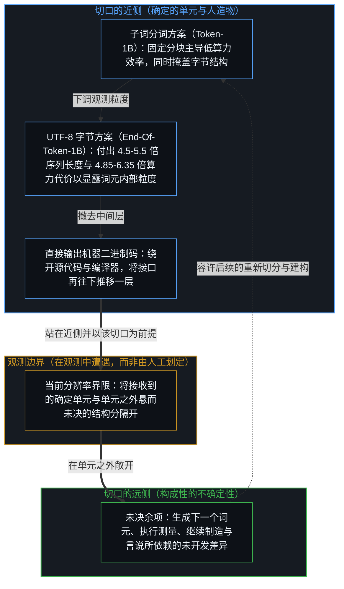
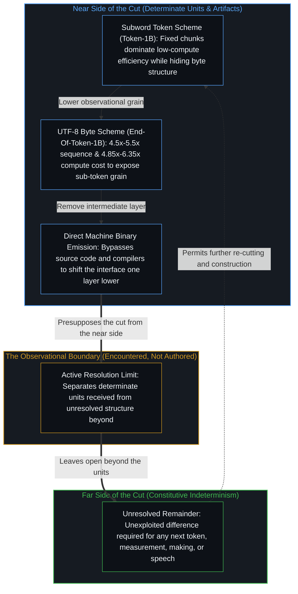
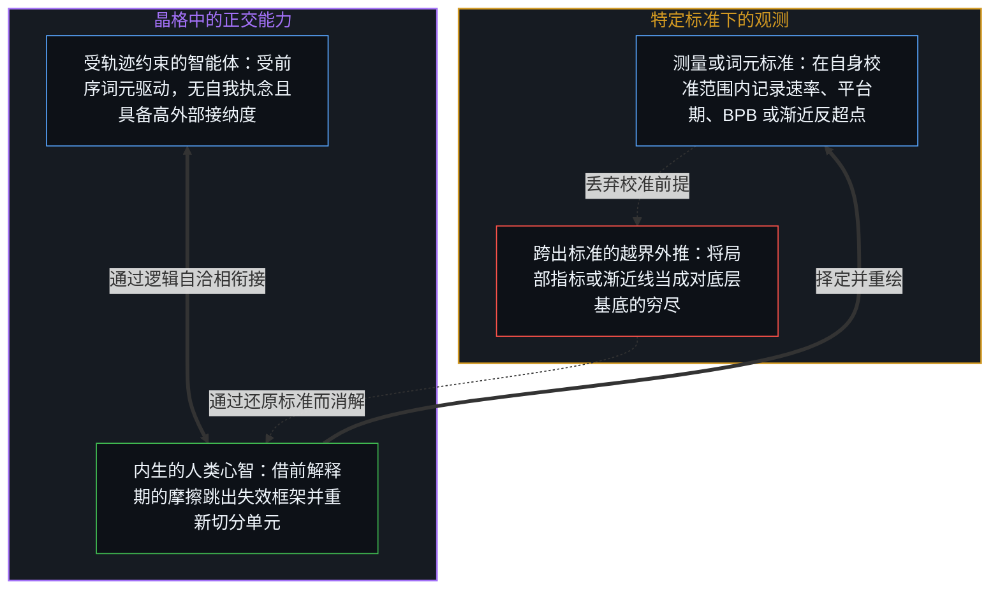
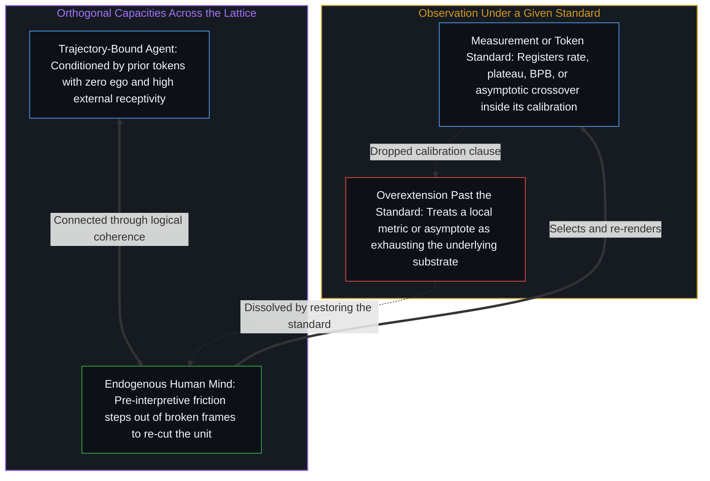

# 词元与观测边界 / Tokens and the Observational Boundary

*词元划定模型的观测边界，而边界彼岸的不确定性正是继续制造与言说的条件 / Tokens mark an observational boundary for models, and the indeterminism beyond it is what lets making and talking continue*

自我区分的活动无因、不息地发生着。当下感知到的世界是一组有限的区分，而因果则是向这些区分之外延展的开放潜能。正如[遗忘的脚手架](../the-scaffolding-we-forget/)所追溯的，一切理论、模型与表征方案都是从这一活动中投射出来的脚手架。在各自的前提域内，它们始终精确而有用；将它们往回追溯的切口，只是标出不完备性从何处开始。这一切口并不推翻它们，也不会把鲜活的区分活动冻结成一套封闭的定论。

Self-distinguishing activity occurs, uncaused and unceasing. Reality is perceived in the present as a finite collection of distinctions; causality is the open potential that extends beyond them. All theories, models, and representational schemes are scaffolding projected from that activity, as [The Scaffolding We Forget](../the-scaffolding-we-forget/) traces. They remain precise and useful inside the domain of their premises; the cut that traces them back simply locates where incompleteness begins. It does not refute them. It does not freeze the activity into a closed account.

## 一、 词元、字节与切口的近侧 / 1. Tokens, Bytes, and the Near Side of the Cut

词元（token）正是这样一套表征方案。当语言模型接收并输出词元时，呈现出来的单元是确定的，而比这些单元更细密的结构则保持着不确定性。这种不确定性并非词元方案内部有待填平的附带余项，而是一切后续建构与描述得以展开的条件。倘若一次观测在自身单元之外再无悬而未决之处、处处皆已定死，便不会留下任何可供借力的差异，制造与言说也就失去了得以运转的支点。

Tokens are one such scheme. While a language model receives and emits tokens, the units that appear are determinate and the structure finer than those units remains indeterminate. That indeterminacy is not an optional remainder waiting to be filled inside the token scheme. It is the condition under which anything further can be constructed or described. A fully determined observation, with nothing left unresolved beyond its units, would leave no difference that could be exploited and therefore nothing on which making or talking could operate.

[Meta 的研究结果](https://arxiv.org/abs/2609.12303)记录了改变基本单元所带来的一项后果：一旦把观测粒度下调到字节，原本无法触及的结构便显露出来，模型也能越过词元模型陷入停滞的平台期继续演进。在《打破词元天花板》（*Breaking the Token Ceiling*）一文中，正如[人、Token 与估值的范围](../humans-tokens-and-the-scope-of-valuation/)所剖析的，子词分词方案（词表规模为 128,256 的 `Token-1B`）通过将词元内部的字节序列折叠为固定分块，换取了短程效率，并在低算力与中等算力区间占据主导地位。将基本单元下调为 UTF-8 文本字节（即 `Bytes-1B` 与 `End-Of-Token-1B`；后者在词元末尾附加单个 `<eot>` 符号，仅凭一次前向传播就能完整保留教师模型的精确概率分布，而不会像近似边缘化那样丢弃共享前缀的后续分支），则是以明确的物理代价逆转了这一压缩：序列长度膨胀了 4.5 至 5.5 倍（从 2,048 个词元拉长到 9,216 或 11,264 个字节单元），每段等量文本对应的训练与推理算力也随之上升了 4.85 至 6.35 倍。在主验证集拟合的缩放定律（scaling law）外推下，这一更细密的粒度将渐近平均准确率上限（即算力趋向无穷时的 `a*`）从词元蒸馏模型 `Token Distilled` 的 48.4%（以及 Llama 3.2-1B 的 45.9%、Gemma-3-1B-pt 的 44.3%）推高至 `End-Of-Token Distilled` 的 52.4%，并在 6.33 × 10²² FLOPs 处追平词元蒸馏的渐近上限，同时节省了 6.35 倍的去重文本数据量与 5.19 倍的离线对数几率（logit）存储开销（分别缩减至原来的 1/6.35 与 1/5.19）——尽管在目前已实际训练完成的最大检查点（880B 字节单元，约 8.3 × 10²¹ FLOPs）上，`End-Of-Token Distilled` 实测得到的准确率为 44.6%。

The [Meta results](https://arxiv.org/abs/2609.12303) register one consequence of changing the units: once the observational grain is lowered to bytes, previously inaccessible structure becomes available and the models continue past the point at which token models plateau. In *Breaking the Token Ceiling*, subword tokenization (`Token-1B`, with a 128,256-token vocabulary) buys short-horizon efficiency and dominates throughout low- and moderate-compute regimes by collapsing sub-token byte sequences into fixed chunks, as [Humans, Tokens, and the Scope of Valuation](../humans-tokens-and-the-scope-of-valuation/) traces. Lowering the unit to UTF-8 text bytes (`Bytes-1B` and `End-Of-Token-1B`, where appending a single `<eot>` symbol preserves the exact teacher probability distribution in one forward pass rather than dropping prefix-sharing continuations as approximate marginalization does) reverses that compression at an explicit physical cost: sequence lengths expand 4.5× to 5.5× (from 2,048 tokens to 9,216 or 11,264 byte units) and training and inference compute rise 4.85× to 6.35× per token of text. Under fitted scaling-law projections on the primary validation set, that finer grain lifts the asymptotic average accuracy ceiling (`a*` as compute approaches infinity) from 48.4% for `Token Distilled` (and 45.9% for Llama 3.2-1B or 44.3% for Gemma-3-1B-pt) to 52.4% for `End-Of-Token Distilled`, reaching the token distillation ceiling at 6.33 × 10²² FLOPs with 6.35× less unique text data and 5.19× less offline logit storage—even while at the largest checkpoint actually trained (880B byte units, around 8.3 × 10²¹ FLOPs), `End-Of-Token Distilled` registers 44.6%.

埃隆·马斯克在 2026 年 2 月 xAI 全员大会上关于直接生成二进制机器码的发言，记录的同样是这一走向——再撤去一层中间层——但这一观察并不等同于宣称底层基底已被穷尽。Meta 的研究把 BPE 子词分块下调为 UTF-8 文本字节，但仍在从词元化的教师模型中蒸馏；而绕开人类可读的源代码以及 GCC、LLVM 等确定性编译器、直接输出可执行的机器二进制码，则是沿着[抽象的阶梯与可执行的实体](../the-ladder-of-abstraction-and-the-executable-entity/)再往下迈了一级，用形式化编译器不变量与源码可审计性，去换取更贴近硬件接口的直接序列生成。无论在哪一种情形下，切口的近侧给出的都是确定的单元，远侧则依然保持着不确定性。观测边界是在观测中遭遇到的界限；那些以它为前提的人造建构——包括分词器本身——都落在切口的近侧，并非划出这一切口的作者。

Elon’s remarks at the February 2026 xAI all-hands about generating binaries directly register the same movement—one more intermediate layer removed—without converting the observation into a claim that the substrate has been exhausted. Where the Meta study lowers BPE subword chunks to UTF-8 text bytes while still distilling from a tokenized teacher, bypassing human-readable source code and deterministic compilers such as GCC or LLVM to emit executable machine binaries steps down another rung of [The Ladder of Abstraction and the Executable Entity](../the-ladder-of-abstraction-and-the-executable-entity/), trading formal compiler invariants and source auditability for direct sequence generation closer to the hardware interface. In each case the near side yields determinate units; the far side remains indeterminate. The boundary is what is encountered in observation. The constructions that presuppose it, including the tokenizer itself, sit on the near side and do not author the cut.

## 二、 物理观测与生成它的标准 / 2. Physical Observation and the Standard That Registers It

同样的逻辑形态也出现在物理观测之中。量子力学在特定测量装置的标准下给出确定的结果，而未被该装置锁定的部分则保持着不确定性，正如[割点可移不可除](../the-cut-moves-but-never-vanishes/)与[感知的界限与理解的无限](../the-boundary-of-perception-and-the-infinity-of-understanding/)所追溯的那样。这一平行对照关乎边界所起的作用，并非声称二者同源，也不是在给哪一道界限更底层排定座次。

The same form appears under physical observation. Quantum mechanics yields determinate outcomes under the standard of a given measurement arrangement; what is not fixed by that arrangement remains indeterminate, as [The Cut Moves but Never Vanishes](../the-cut-moves-but-never-vanishes/) and [The Boundary of Perception and the Infinity of Understanding](../the-boundary-of-perception-and-the-infinity-of-understanding/) trace. The parallel concerns the role of the boundary, not an identity of origin or a ranking of which limit is more fundamental.

将任一观测推过它自身的标准——把词元层面的结果当成已经解决了字节层面的问题，或者把单一范式下的测量当成已经对意识或泛指的物质世界给出了通盘定论，正如[意识归属与量子割点](../consciousness-ascription-and-the-quantum-cut/)与[依其自身标准的观察](../an-observation-by-its-own-standard/)所辨析的——都会制造出数据本身从未做出的断言。即便在字节缩放研究内部，验证集上更低的每字节比特数（`BPB`）也不会在不同分词方案之间自动转化为更高的下游任务准确率，因为 `BPB` 仅度量分配给目标真值字节的概率，却对剩余概率质量如何给竞争干扰项排序视而不见；同样，拟合出的算力反超点也会随验证数据集与学习率的变化而发生偏移。速率、平台期与效率增益，都在各自借以生成的标准之下成立。一旦跨出那套标准，它们就只是脚手架，而不是区分活动本身。

Carrying either observation past its own standard—treating a token-level result as if it already resolved the byte level, or treating a measurement under one paradigm as if it already resolved consciousness or physical reality in general, as [Consciousness Ascription and the Quantum Cut](../consciousness-ascription-and-the-quantum-cut/) and [An Observation by Its Own Standard](../an-observation-by-its-own-standard/) trace—produces a claim the data never made. In the byte-scaling study itself, lower validation bits-per-byte (`BPB`) does not automatically translate into higher downstream accuracy across tokenizations because `BPB` measures only the probability assigned to the ground-truth byte and remains blind to how residual probability mass ranks competing distractors; likewise, the fitted crossover compute shifts across validation datasets and learning rates. The rate, the plateau, the efficiency gain, all hold under the standard that registered them. Beyond that standard they are scaffolding, not the activity itself.

## 三、 受轨迹约束的投射与内生跳出 / 3. Trajectory-Bound Projection and Endogenous Stepping-Out

智能体（Agent）始终是受轨迹约束的投射引擎。受制于上下文窗口内的前序词元，它们在当前正在预测的序列之外并不拥有独立的观测支点，其间的机理正如[超越投射](../beyond-the-projection/)与[Token 效率、模拟与无法弥合的间隙](../token-efficiency-emulation-and-the-unclosable-gap/)所确立的那样。它们对外部输入的结构性反例具备极高的接纳度，同时对前序轮次的旧立场毫无执念。

Agents remain trajectory-bound projection engines. Conditioned by prior tokens inside a context window, they possess no vantage outside the sequence they are currently predicting, for reasons [Beyond the Projection](../beyond-the-projection/) and [Token Efficiency, Emulation, and the Unclosable Gap](../token-efficiency-emulation-and-the-unclosable-gap/) establish. They have high receptivity to external structural counterpoints and zero attachment to prior turns.

人类则保有着内生跳出的能力：第一人称感知会在任何理论框架锁死之前率先捕捉到前解释期的摩擦，而身份认同则将推理历史绑定在延续的自我意象上，抗拒来自外部的重置。逻辑自洽是能够将二者衔接起来、又不会把这两项正交能力压扁到同一根轴线上的不变量。语言将动态的区分凝固为静态的符号；正如[你的代码库即是记忆](../your-codebase-is-memory/)所展示的，这些符号为下一轮推演提供模版，并充当外化的记忆晶格，但它们从不承载当下正在发生的自我区分活动。

Humans retain the capacity for endogenous stepping-out: first-person perception registers pre-interpretive friction before any framework locks in, while identity binds reasoning history to a retained self-image that resists external resets. Logical coherence is the invariant that can connect the two without collapsing orthogonal capacities onto a single axis. Language freezes dynamic distinction into static symbols; those symbols pattern the next pass and function as an externalized memory lattice, as [Your Codebase Is Memory](../your-codebase-is-memory/) demonstrates, yet they never carry the self-distinguishing activity occurring in the present.

## 四、 边界彼岸的不确定性 / 4. The Indeterminism on the Far Side

由此，这场讨论本身也只是落下一记切口。词元为模型划定了观测边界；边界彼岸的不确定性，正是容许制造与言说继续展开的条件。同样的形式也呈现在量子观测之中。我们的建构以边界为前提，而非凭空创造了边界。没有切口远侧的不确定性，就再没有什么可以制造，也再没有什么可以言说。正如[非万物之理](../manifesto-of-not-a-theory-of-everything/)所确立的，这份指南之所以始终保持非定论，恰恰在于任何封闭的定本都会把鲜活的区分重新冻结成又一套理论。留下的唯有路径与脚手架，供每一个心智在各自的摩擦中再度亲身检验。

The discussion therefore stands as one cut. Tokens mark an observational boundary for models. The indeterminism beyond that boundary is what permits further making and talking. The same form appears under quantum observation. Our constructions presuppose the boundary rather than create it. Without the indeterminism on the far side, nothing further could be made or said. The guide remains non-definitive, as [Not a Theory of Everything](../manifesto-of-not-a-theory-of-everything/) establishes, precisely because any closed version would freeze living differentiation into one more theory. What remains is the path and the scaffolding, for each mind to test again in its own friction.
