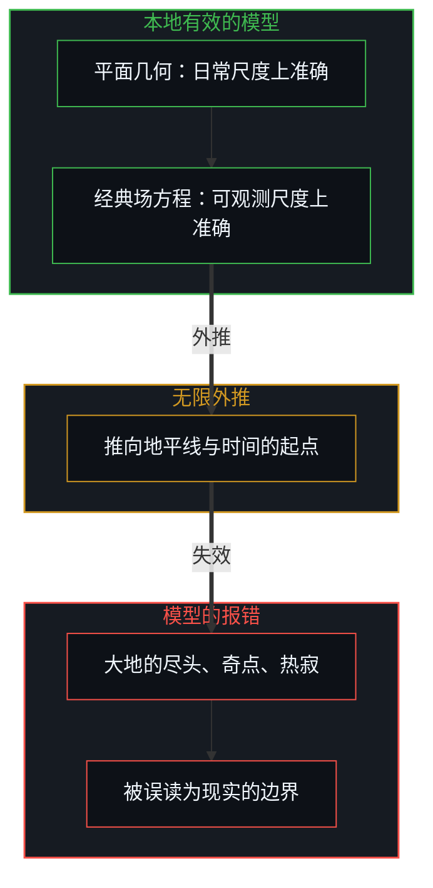
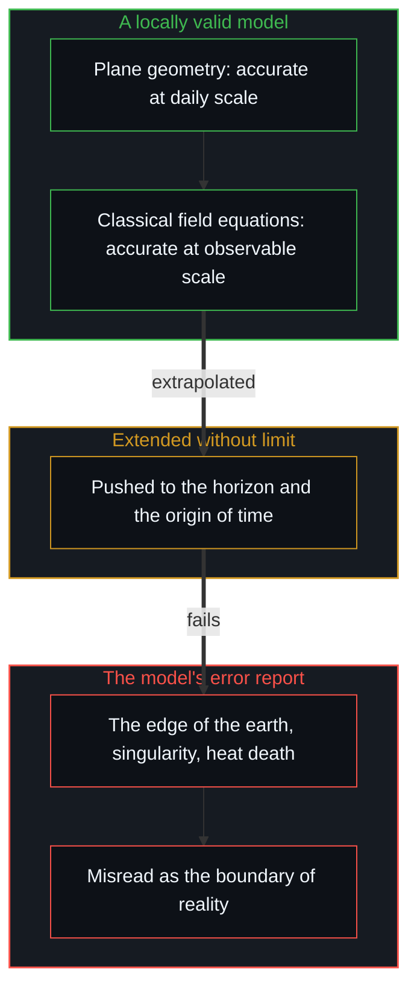

# 投影的阶梯与因果的锚点 / The Ladder of Projections and the Anchor of Causality

*逻辑、公理、物理极限、成败与道德审判都是低维投影，锚定在第一人称里才看得穿 / Logic, axioms, physical limits, success and moral judgment are projections, seen through only from the first person.*

在人的认知体系里，“客观事实”与“科学理论”长久被当作脱离观察者而独立存在的真理；在社会协作与日常互动里，“对错优劣”与“道德高下”被塑造成衡量一切行为的普适法庭。这两套话语表面上分属自然科学与人文伦理，在认识论的底层却共享同一个范畴错乱：预设一个脱离第一人称观察视界的上帝视角，把人在有限视界之内为了理解世界而建的低维抽象投影，倒果为因地当成了现实本身。

In human knowledge, "objective fact" and "scientific theory" have long been taken for truths standing independent of any observer; in social cooperation and daily life, "right and wrong, better and worse" and "moral rank" have been shaped into a universal court for measuring every act. The two discourses seem to belong to natural science and humane ethics respectively, yet at the epistemic floor they share one category confusion: presupposing a God's-eye view detached from the first-person horizon of observation, and taking the low-dimensional abstract projections people build within a finite horizon, in order to understand the world, for reality itself.

要穿过概念与符号层层编织的迷障，要回到两块基石。第一，从第一人称登记到的现实遵循逻辑因果，因果的递归无始无终，先前的区分塑造后来的场域，时间的单向就是痕迹累积的不对称。第二，一切被叫作客观理论与价值评判的知识，都是心智在特定前提下截取的截面投影；离开具体的前提假设与第一人称的观察编译，任何孤立的公式、几何度规、物理极限或道德符号，都没有天然的实体性。

To get through the haze woven layer upon layer from concepts and symbols means returning to two foundations. First, the reality registered from the first person follows logical causality, causal recursion has no beginning and no end, earlier distinctions shape the later field, and the one-way direction of time is the asymmetry of accumulating traces. Second, all knowledge called objective theory or value judgment is a cross-sectional projection the Mind cuts under particular premises; apart from concrete assumptions and first-person observational compiling, no isolated formula, geometric metric, physical limit or moral symbol has any built-in substance.

## 一、 形式逻辑与数学：静态的切片 / 1. Formal Logic and Mathematics: Static Slices

人引以为傲的科学体系，不是对现实的直接复刻，而是一套不断叠加人为公理假设、以换取局部度量能力的符号工具箱。形式逻辑之所以严禁自相矛盾，是因为它先验地抽掉了时间维度，把动态演化的现实压平成一个静态的命题空间；而在真实的因果展开里，一切区分都依赖时间的不对称持续地演进。就像电子振荡电路里的反相器，借时间延迟下持续的自我否定，0 → 1 → 0，产生时钟脉冲，因果系统正是在连绵的动态更新里推进的。逻辑本身没有边界，所谓的边界，是形式系统为了局部静态的自洽而划定的定义域。

The scientific systems people are proud of are not direct copies of reality but a symbolic toolbox that keeps adding human axioms to buy local power of measurement. Formal logic forbids self-contradiction because it removes the time dimension in advance, flattening dynamically evolving reality into a static space of propositions; yet in real causal unfolding every distinction keeps evolving through the asymmetry of time. Just as an inverter in an electronic oscillator produces a clock pulse through continuous self-negation under a time delay, 0 → 1 → 0, a causal system advances through continuous dynamic updating. Logic itself has no boundary; the so-called boundary is the domain a formal system draws for the sake of local static consistency.

数学体系同样契合逻辑因果的推演法则，却立在等价公理 1 = 1 这个心智的抽象之上。[信息是什么](../what-information-is/)确立过，信息是心智完成离散划界后留下的可记录痕迹。在被经验的世界里，写在纸左边的“1”与右边的“1”占着不同的时空坐标，消耗着不同的能量与微观粒子，找不到两个等价的实体。数学是心智认同了一套等价公理之后展开的高阶符号工具，公理一变，局部的推演形态就随之重构。

Mathematics likewise fits the laws of logical-causal derivation, yet it rests on the Mind's abstraction of the axiom of equivalence, 1 = 1. As [What Information Is](../what-information-is/) establishes, information is the recordable trace left once the Mind completes a discrete boundary. In the experienced world, a "1" written on the left of the page and a "1" on the right occupy different coordinates of space and time and consume different energy and particles, and no two equivalent entities are to be found. Mathematics is a higher-order symbolic tool the Mind unfolds once it accepts a set of axioms of equivalence; change the axioms and the local shape of derivation is rebuilt with them.

## 二、 相对论：测量的基准与几何的投影 / 2. Relativity: The Measuring Anchor and the Geometric Projection

经典力学、电磁学与相对论，描述的是宏观上稳定下来的规律；在这本书的读法里，自由变量出现在量子的边界上，在逻辑结构上与一个人在第一人称当下的自由选择同构。[自由变量的同构与先验主权](../zi-you-bian-liang-de-tong-gou-yu-xian-yan-zhu-quan/)揭示了这一层从属阶梯：量子、比特与微观决策形式上同构，而点亮一切因果链的先验自变量，是第一人称在当下的微观选择。从微观推出引力与时空度规，是量子引力的各个研究方向想走的路；它们也是投影，同样有自己的边界。投影的阶梯在传播里的样子，是[高维信息的离散折射与认知分层](../gao-wei-xin-xi-de-li-san-zhe-she/)所说的分层折射。

Classical mechanics, electromagnetism and relativity describe regularities stabilised at the macroscopic scale; in this book's reading, the free variable appears at the quantum boundary and is logically isomorphic with a person's free choice in the first-person present. [The Isomorphism of Free Variables and Prior Sovereignty](../zi-you-bian-liang-de-tong-gou-yu-xian-yan-zhu-quan/) reveals this ladder of subordination: quantum, bit and micro decision are formally isomorphic, and the prior variable that lights every causal chain is first-person micro choice in the present. Deriving gravity and the spacetime metric from the micro scale is the path the lines of quantum-gravity research hope to take; they too are projections, with boundaries of their own. What the ladder of projections looks like in communication is the layered refraction described in [The Discrete Refraction of High-Dimensional Information](../gao-wei-xin-xi-de-li-san-zhe-she/).

相对性，是因果无始无终的体现：任何物理观测，都是一个第一人称的因果截面与另一个截面之间相对的相互作用。光速不变是爱因斯坦在狭义相对论里立下的公设；从测量的角度读，在一个相对的系统里要对其他一切运动做统一的度量，需要选取系统里传播最快的信号作为基准锚点，就像跑得最快的人才能测出所有人的相对速度。广义相对论消解了牛顿力学里超距引力的实体性，把引力重构为时空的几何弯曲：从第一人称看，自由落体中的物体并没有受到看不见的外力拉扯，它只是沿着周围质能痕迹塑造的因果地形，走了一条局部最平直的路径，即测地线。约翰·惠勒那句“物质告诉时空如何弯曲，时空告诉物质如何运动”，正是局部因果与宏观场域相互嵌套的几何投影的表达。

Relativity is an expression of causality having no beginning or end: every physical observation is a relative interaction between one first-person causal cross-section and another. The constancy of the speed of light is the postulate Einstein laid down in special relativity; read from the side of measurement, to measure all other motion uniformly within a relative system one needs to take the fastest-travelling signal in the system as the anchor, as only the fastest runner can measure everyone's relative speed. General relativity dissolved the substance of Newton's action-at-a-distance gravity and recast gravity as the geometric curvature of spacetime: seen from the first person, a freely falling body is not pulled by any unseen outside force but follows, across the causal terrain shaped by surrounding traces of mass-energy, a locally straightest path, a geodesic. John Wheeler's line, "matter tells spacetime how to curve, spacetime tells matter how to move", expresses exactly this geometric projection of local causality and macroscopic field nested in each other.

## 三、 大爆炸、奇点与地平说 / 3. The Big Bang, Singularities and the Flat Earth

大爆炸的奇点与引力奇点，显出宏观理论在外推时的边界。广义相对论的场方程本身是局域的，并不预设宇宙是封闭有限的；爱因斯坦 1917 年的静态宇宙模型假定了一个封闭的宇宙，今天的宇宙学模型则加上均匀与各向同性的假定，再把膨胀沿着时间轴向过去倒推，经典的方程就推出一个密度与曲率无穷大的起点。这个外推在可观测的尺度上很有用；推到起点，它报告的是模型自身的失效。

The singularity of the Big Bang and gravitational singularities show the boundary of macroscopic theory under extrapolation. The field equations of general relativity are themselves local and do not presuppose a closed, finite universe; Einstein's static model of 1917 assumed a closed universe, while today's cosmological models add the assumption of homogeneity and isotropy and then run expansion backward along the time axis, and the classical equations yield an origin of infinite density and curvature. The extrapolation is of great use at observable scales; pushed to the origin, it reports the model's own failure.

从第一人称看，现实是一条无始无终的因果链。顺着因果链向历史回溯，观察者能触到、经验到的视界越来越局部，这反映的是历史痕迹在回溯中局域地收敛，而不是“整个宇宙被挤进一个零维的几何点”。大爆炸的起点、宇宙学视界、黑洞中心的奇点与热寂，从第一人称登记到的，是特定理论自身定义域的边界，而不是现实的边界。这与古代许多文化里的[地平之说](../the-walking-tangent-and-the-stumbling-sphere/)在认识论结构上同构：平面几何在人非常本地、微小尺度的日常经验里有效而准确；把这个本地模型向地平线无限外推，就会在理论的边缘推出“大地尽头是万丈深渊”的边界。奇点与起点，正是把一个在本地观测中有效的模型，在时间与空间轴上无限延展之后，把模型自身的报错当成了宇宙边界的认知错配。

From the first person, reality is a causal chain with no beginning and no end. Tracing the chain back through history, the horizon an observer can reach and experience grows ever more local, which reflects historical traces converging locally under backtracking, not "the whole universe squeezed into a zero-dimensional geometric point". The origin of the Big Bang, the cosmological horizon, the singularity at a black hole's centre and heat death register from the first person as the boundaries of particular theories' own domains, not as boundaries of reality. This has the same epistemic structure as [the flat-earth pictures of many ancient cultures](../the-walking-tangent-and-the-stumbling-sphere/): plane geometry is valid and accurate within people's very local, small-scale daily experience; extend that local model without limit toward the horizon and the edge of the theory yields a boundary where "the earth ends at a bottomless abyss". Singularities and origins are exactly this cognitive mismatch: a model valid in local observation, extended without limit in time and space, its own error report taken for the boundary of the cosmos.

## 四、 熵增与封闭的沙盘 / 4. Entropy and the Closed Sandbox

主流的叙事常把熵增当作时间之箭的物理定义，这也是一种因果颠倒。热力学第二定律说的是孤立系统，前提是假定系统与外部隔绝；在一个固定位宽的封闭寄存器里持续运算，每一次溢出都让信息被丢弃，缺少外部信息吞吐的孤立沙盘里，微观状态在反复截断之下滑向无序。时间的单向来自因果递归的不可逆，而不是来自孤立系统的熵增；在敞开的因果里，系统可以借持续地与外部交换信息与能量，实现局部的自组织与熵减，生命就是这样。[复杂性遮蔽了涌现之为心智的行动](../complexity-obscures-emergence-as-the-act-of-mind/)揭示了这种脚手架错觉：奇点、黑洞视界、宇宙的起点与热寂，是被高度压缩的封闭理论在解释敞开的现实时遇到的定义域失效。

Mainstream narratives often take increasing entropy as the physical definition of the arrow of time, which is also a causal reversal. The second law of thermodynamics speaks of isolated systems, on the premise that the system is cut off from the outside; computing continually in a closed register of fixed width, every overflow discards information, and in an isolated sandbox without outside throughput of information, micro states slide toward disorder under repeated truncation. The one-way direction of time comes from the irreversibility of causal recursion, not from entropy increasing in an isolated system; in open causality a system can achieve local self-organisation and falling entropy by continually exchanging information and energy with the outside, as life does. [Complexity Obscures: Emergence as the Act of Mind](../complexity-obscures-emergence-as-the-act-of-mind/) reveals this scaffolding illusion: singularities, black-hole horizons, the cosmic origin and heat death are failures of domain met by highly compressed closed theories as they try to explain open reality.

## 五、 日常评判的降维 / 5. The Dimensional Reduction of Everyday Judgment

把这台认识论的显微镜对准日常的价值评判，世俗话语里的傲慢与迷思也一样显露出来。在任何一个微观瞬间，一个人的决策输出，都是这个人的心智系统根据自己登记的全部历史痕迹、当下的约束与有限的算力，在第一人称之内推出的局部自洽解。[止步于评判，是认知的歧途](../zhi-bu-yu-ping-pan-shi-ren-zhi-de-qi-tu/)指出，甲判定乙“犯了错”时，并不是甲掌握了客观的真理，而是甲以自己的坐标系为原点，发现乙的输出与自己的因果模型产生了投影上的差。双方都坚信自己对、对方愚蠢，来源在于双方都设想有一把超出第一人称视界的上帝标尺。

Turning this epistemic microscope on everyday value judgments shows the arrogance and myths of worldly talk just as plainly. At any micro moment, a person's decision output is the locally consistent solution their Mind derives within the first person from all the historical traces it has registered, present constraints and finite computing power. As [Stopping at Judgment Is a Wrong Turn of Cognition](../zhi-bu-yu-ping-pan-shi-ren-zhi-de-qi-tu/) points out, when A judges that B "made a mistake", it is not that A holds objective truth, but that A, taking its own coordinate system as origin, finds a projected difference between B's output and its own causal model. Both are sure they are right and the other foolish, because both imagine a God's-eye ruler beyond the first-person horizon.

世俗公认的“成功”与“优秀”，同样是社会为了降低协作与筛选的成本，从一个人多维的因果状态里人为指定的一条低维投影轴，财富、权力或声望；决定排序高低的，只是观察者把哪一个维度设为最高的权重。用单一标量轴的读数去定性一个生命的优劣，就像用直尺量不出温度就断言热量不存在。

Worldly "success" and "excellence" are likewise a single low-dimensional axis of projection society designates out of a person's many-dimensional causal state, wealth, power or prestige, to lower the cost of cooperation and selection; what decides the ranking is only which dimension the observer sets as the highest weight. Judging the worth of a life from a reading on one scalar axis is like declaring heat does not exist because a ruler cannot measure temperature.

## 六、 道德语言的代偿与逆向折射 / 6. The Compensation and Reverse Refraction of Moral Language

在价值的延伸里，最隐蔽的机制是道德语言的建构与异化。社会把世俗成功，轴一，当作主导的投影轴时，统计分布注定多数人处在中后段。为了对抗在单一标量上落后带来的挫败与自尊的萎缩，心智会在认知空间里发明另一条坐标轴，道德与苦难，轴二；在这条轴上，轴一的劣势被反向赋予崇高：“贫穷即清白”，“弱小即无辜”，“成功即不公”，自我价值由此在主观上完成一次代偿式的修复。

In the extension of value, the most hidden mechanism is how moral language is built and alienated. When society takes worldly success, axis one, as the dominant axis of projection, the statistical distribution places most people in the middle and lower ranges. To counter the frustration and shrinking self-esteem of falling behind on a single scalar, the Mind invents another coordinate axis in its cognitive space, morality and suffering, axis two; on this axis the disadvantages of axis one are given loftiness in reverse, "poverty is innocence", "weakness is blamelessness", "success is injustice", and self-worth is repaired subjectively by compensation.

一个人如果追求精神上的自洽与道德的宁静，内部的逻辑是闭环的。许多道德批判之所以带着攻击与撕裂，是因为落进了非正交维度的逆向折射：道德上的自我标榜，与调动资源创造财富的能力，属于不同的维度，二者之间没有直接的因果充要关系；站在渴望世俗轴上的利益与认可、又没有建起对应的微观因果能力的位置上，就容易拿道德审判去否定别人的世俗成果，想借道德施压，把世俗轴的果实无偿地折射到自己手里。这说的是一个位置上的机制，同一个心智在不同的事情上都可能站到那里。[投资决策的因果闭环](../tou-zi-jue-ce-de-yin-guo-yu-zhen-zi-fu-ying-kui/)确立了结算的原则：现实只按逻辑因果结算，不会因为主观上的道德自我肯定就结算出物质的回报；这种逆向折射在现实里屡屡碰壁，最终演变成长期的内耗、怨恨与认知的失衡。

If a person seeks spiritual consistency and moral calm, the inner logic closes. Much moral criticism carries aggression and division because it falls into reverse refraction across non-orthogonal dimensions: moral self-display and the capability to marshal resources and create wealth belong to different dimensions, with no direct causal relation of necessity or sufficiency between them; standing in a position that craves the gains and recognition of the worldly axis without having built the matching micro causal capability, one easily uses moral judgment to negate others' worldly results, hoping through moral pressure to refract the fruits of the worldly axis into one's own hands at no cost. This names the mechanism of a position, and one Mind can stand there on different matters. [The Causal Loop of Investment Decisions](../tou-zi-jue-ce-de-yin-guo-yu-zhen-zi-fu-ying-kui/) establishes the principle of settlement: reality settles only by logical causality and does not pay out material reward for subjective moral self-affirmation; such reverse refraction keeps running into walls and ends in long self-friction, resentment and cognitive imbalance.

## 七、 回到第一人称当下的抉择 / 7. Returning to First-Person Choice in the Present

从形式逻辑抽掉时间，到宇宙学对引力与封闭宇宙的教条外推，从世俗成功的单一降维，到道德批判的逆向折射，认知上的许多痛苦与教条化，都来自把特定工具的投影刻度误当成敞开现实的终极真理。[从形式迷思到逻辑闭环](../cong-xing-shi-mi-si-dao-luo-ji-bi-huan/)与[格物致知与信息复杂度](../ge-wu-zhi-zhi-yu-xin-xi-fu-za-du-de-ben-zhi/)一起指明了认知的归途：承认视界有限，接纳现实敞开，明白一切理论模型都是特定工况下的低维投影切片，一切极端的极限都是模型边缘的报错；拒绝跨维度的因果错置，追求世俗的结果，就诚实地在因果链里迭代能力、承担代价，追求内心的宁静，就安住于精神的自洽，不拿道德话术向外界索要没付代价的回报；第一人称的主权从未失去，[涌现的伪因果](../yong-xian-de-wei-yin-guo-yu-ji-ti-gui-yin-dao-cuo/)与[个体抉择是唯一的因果杠杆](../individual-choices-as-the-only-causal-levers/)确立了那个自变量，因果的主权在每一次具体的微观抉择之中。

From formal logic removing time to cosmology's dogmatic extrapolation of gravity and a closed universe, from the single reduction of worldly success to the reverse refraction of moral criticism, much of the pain and dogmatism in knowing comes from taking the projected scale of a particular tool for the final truth of open reality. [From the Myth of Form to the Closed Loop of Logic](../cong-xing-shi-mi-si-dao-luo-ji-bi-huan/) and [Investigating Things and the Nature of Information Complexity](../ge-wu-zhi-zhi-yu-xin-xi-fu-za-du-de-ben-zhi/) together point the way home: acknowledge that the horizon is finite and accept that reality is open, knowing that every theoretical model is a low-dimensional slice of projection under particular conditions and every extreme limit an error report at the model's edge; refuse causal misplacement across dimensions, so that seeking worldly results means honestly iterating capability and bearing costs within the causal chain, and seeking inner calm means resting in spiritual consistency without using moral rhetoric to demand unpaid rewards from the world; and the sovereignty of the first person was never lost, as [The Pseudo-Causality of Emergence](../yong-xian-de-wei-yin-guo-yu-ji-ti-gui-yin-dao-cuo/) and [Individual Choices as the Only Causal Levers](../individual-choices-as-the-only-causal-levers/) establish the independent variable: causal sovereignty lies in each particular micro choice.

不再被外部人为设定的投影轴绑架，因果的算力就回到自己每一次微观的生长里；自洽、清醒与力量，会在敞开现实不可逆的演进中自然地出来。

No longer held hostage by projection axes set from outside, causal computing power returns to one's own growth at each micro step; consistency, clarity and strength come out naturally in the irreversible unfolding of open reality.
