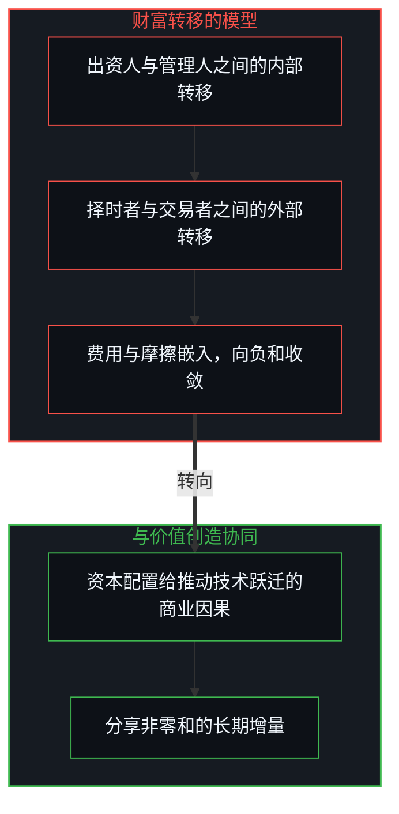
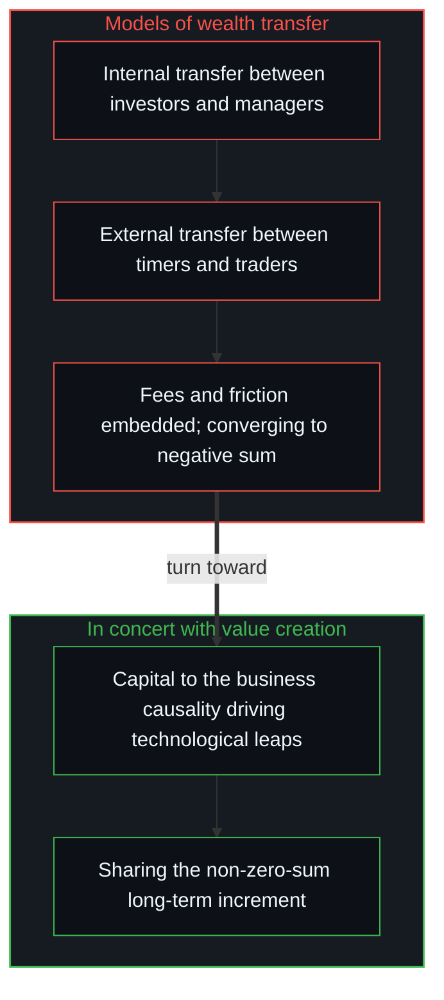

# 投资决策的因果闭环 / The Causal Loop of Investment Decisions

*投资不是在封闭沙盘里猜噪声，而是顺着不可逆的因果，在第一人称之内为误差买单 / Investing is not guessing noise in a closed sandbox but following causality and paying for one's own errors.*

在投资与资本配置的领域里，许多从业者与个人投资者长期陷在周期性的亏损、焦虑与心智内耗里，来源多半不在宏观信息的不对称或计算算力的匮乏，而在底层的决策模型从一开始就有因果上的断裂。这种断裂集中在三个维度：在结构上，代理人机制人为地切断了决策权与最终损失之间的闭环，诱使机构去博短期的高波动，把不可逆的尾部风险转给外部的出资人；在认识上，投资者把开放发散的复杂现实误判为参数封闭的静态沙盘，想凭短期择时去预测全市场即时博弈的随机噪声；在边界的认知上，交易者容易把特定周期或局部环境下的顺风贝塔，误当成永恒普适的预测能力，在宏观结构漂移时遭遇毁灭性的均值回归。

In investment and capital allocation, many professionals and individual investors stay caught in cyclical losses, anxiety and inner friction, and the source mostly lies not in asymmetric macro information or a lack of computing power but in a causal break in their underlying decision models from the start. The break shows along three dimensions: structurally, the agency arrangement artificially cuts the loop between decision rights and final losses, tempting institutions to gamble on short-term volatility and pass irreversible tail risk to outside investors; epistemically, investors misjudge an open, divergent, complex reality as a static sandbox with closed parameters and try to predict the random noise of the whole market's instant game by short-term timing; and at the level of boundaries, traders easily take the tailwind beta of a particular cycle or local environment for permanent, universal predictive ability, and meet devastating mean reversion when the macro structure drifts.

正如[没有系统能被保持封闭](../no-system-can-be-kept-closed/)与[个体抉择是唯一的因果杠杆](../individual-choices-as-the-only-causal-levers/)所揭示的，资本配置是一项身处开放因果网络中的动态决策实践；拆开常见投资模型成立的工况与失效的边界，把决策与后果的因果链收回第一人称的当下，才能在微观的截面上建立起自洽的投资闭环。

As [No System Can Be Kept Closed](../no-system-can-be-kept-closed/) and [Individual Choices as the Only Causal Levers](../individual-choices-as-the-only-causal-levers/) reveal, capital allocation is a dynamic practice of decision within an open causal network; only by taking apart the conditions under which common investment models hold and the boundaries where they fail, and drawing the causal chain of decision and consequence back into the first-person present, can a consistent investment loop be built at the micro cross-section.

## 一、 代理人模型 / 1. The Agency Model

任何投资模型与策略，都是特定约束下的局部抽象，脱离严格的成立工况去盲目外推，模型就从盈利的工具变成自我毁灭的陷阱。现代金融分工催生了庞大的代客理财产业：委托人借专业机构的投研精力与执行通道降低管理摩擦，这是代理人模型在理论上成立的工况。可在实际的运行里，这个模型不但在结构上切断了决策与最终损失的因果闭环，也对管理人自己的认知进化构成一种隐蔽的反噬。

Every investment model and strategy is a local abstraction under particular constraints, and extrapolated blindly beyond its strict conditions it turns from a tool of profit into a trap of self-destruction. Modern financial specialisation has produced a vast industry of managing money for others: principals use professional institutions' research effort and execution channels to lower the friction of management, which is the condition under which the agency model holds in theory. Yet in actual operation the model not only cuts the causal loop between decision and final loss structurally but also turns quietly against the manager's own cognitive evolution.

代理人机制是一种资本与认知的放大杠杆。基金经理管理大量外部资金，以固定管理费与业绩提成的形式放大了自己短期的收益；这种收益的暴增并不是投资判断力提升的产物，而是借制度杠杆，把本属于出资人的潜在资产收益转成了管理人没有风险的现金流。这里包含出资人与管理人之间一个隐蔽的嵌套零和博弈：管理人能赚取巨额收益，是在把“说服出资人把钱交给自己管理”的募资与公关能力变现，却容易把这种变现能力误认为自己“洞察市场价值”的投资能力。这个因果错位，让最宝贵的心智算力系统性地挪了位置，从深耕底层的商业因果与技术演进，转到迎合出资人心理、维持公关叙事与追求资产管理规模的膨胀上。

The agency arrangement is a lever amplifying capital and cognition. A fund manager running large outside money amplifies short-term income through fixed management fees and performance fees; this surge of income is not the product of improved investment judgment but the conversion, through an institutional lever, of asset returns that belong potentially to the investors into a riskless cash flow for the manager. Inside it is a hidden, nested zero-sum game between investors and manager: the manager's large income cashes in the fundraising and public-relations ability of "persuading investors to hand over their money", yet that ability is easily mistaken for an investment ability to "see market value". This causal misplacement systematically shifts the most valuable mental computation away from working deep in underlying business causality and technological change toward pleasing investors' psychology, maintaining a public narrative and swelling assets under management.

更隐蔽的风险在于，一旦选择管理别人的资金，就要受投资管理协议、定期的净值回撤指标、强制的分散配置与严苛的流动性条款约束。这些制度约束剥夺了管理人践行卓越投资的可能：在资本的演化里，期望值最高的非对称机会集中在少数核心标的上，卓越的资产多半是“买入之后不想轻易卖出”的复利引擎；可代客理财的机制要求管理人维持过度的分散，在赎回压力或季度业绩排名面前被迫砍仓、频繁择时。管理人自己的投资能力就被机构的枷锁压住，心智模型进化的上限被人为封死。表面上，管理人借杠杆在短期内放大了管理费收入；在长期的复利展开里，被压住的投资能力与无法重仓顶尖资产的约束，系统性地压低了管理人自己资本在一生维度上的最终收益。用短期的管理费杠杆透支长期的认知复利，是代理人机制对从业者自己最隐蔽的惩罚。

A subtler risk is that once one chooses to manage others' money, one is bound by investment management agreements, periodic drawdown limits, forced diversification and strict liquidity terms. These institutional constraints take away the manager's possibility of practising outstanding investment: in the evolution of capital, the asymmetric opportunities with the highest expected value concentrate in a few core holdings, and outstanding assets are mostly compounding engines one "never wants to sell once bought"; yet managing money for others requires the manager to keep excessive diversification and, under redemption pressure or quarterly rankings, to cut positions and time the market again and again. The manager's own investment ability is held down by institutional shackles, and the ceiling on the evolution of their mental model is artificially sealed. On the surface the manager amplifies fee income in the short run by leverage; over long compounding, the suppressed investment ability and the inability to concentrate in the best assets systematically lower the final lifetime return on the manager's own capital. Overdrawing long-term cognitive compounding with short-term fee leverage is the agency arrangement's most hidden penalty on its own practitioners.

整个二级市场里交织着多层嵌套的零和博弈：出资人与管理人之间，是基于管理费与业绩提成的内部财富转移；短期高频的择时者与普通交易者之间，是基于微观信息差与情绪博弈的外部财富转移。所有基于“财富转移”的投资模型，在逻辑上都是零和的；固定的管理费、交易佣金、印花税与摩擦成本作为不可逆的阻尼嵌进系统之后，所有寄生在财富转移上的投机体系，最终都向负和收敛。长期可靠的投资方式，必须与现实世界里真实价值的产生机制正向协同：投资不是在封闭的存量里博弈再分配，而是把资本配置给推动技术跃迁、提升全要素生产率的底层商业因果，在实体价值创造的指数扩展中分享非零和的长期增量。

The whole secondary market is woven with layers of nested zero-sum games: between investors and managers, an internal transfer of wealth through fees and performance pay; between short-term high-frequency timers and ordinary traders, an external transfer of wealth through micro information gaps and emotional contests. Every investment model based on "transferring wealth" is zero-sum in logic; once fixed fees, commissions, stamp duty and frictional costs are embedded in the system as irreversible damping, every speculative system living on wealth transfer converges in the end to a negative sum. The investment that stays reliable over the long run has to move in positive concert with the mechanism by which real value arises in the world: investing is not a contest of redistribution within a closed stock but allocating capital to the underlying business causality that drives technological leaps and raises total factor productivity, sharing the non-zero-sum long-term increment within the exponential expansion of real value creation.

## 二、 短期择时模型 / 2. The Short-Term Timing Model

短期择时的模型，在很窄的工况下确实可以短暂成立，但前提很苛刻：只存在于毫秒级的高频交易场景，依赖顶尖的算法与硬件算力，并且严格锁死资金容量、不盲目扩容，例如早期的大奖章基金凭大数定律反复捕捉 50.75% 对 49.25% 的微弱统计优势。普通投资者想在日线或周线的级别上择时，模型就落进封闭预测的幻觉：现实是无限维度的开放系统，短期的资产价格是全市场数以亿计独立主体的认知、情绪、流动性与突发事件即时博弈的混沌汇总；在先验的逻辑上，对未来短期价格波动的精准预测，数学上的概率为零。把长期有生产力与现金流增值潜力的核心资产卖掉，换回会贬值的法币，去博短期的回调，这个动作的前提假设从一开始就是错的。

The short-term timing model can hold briefly under very narrow conditions, but the preconditions are harsh: it exists only in millisecond-scale high-frequency trading, depends on top-tier algorithms and hardware, and strictly caps capacity without blind expansion, as the early Medallion Fund repeatedly captured a slim 50.75% versus 49.25% statistical edge through the law of large numbers. When ordinary investors try to time the market at daily or weekly scales, the model falls into the illusion of closed prediction: reality is an open system of endless dimensions, and short-term asset prices are the chaotic sum of the instant game among hundreds of millions of independent actors' cognition, emotion, liquidity and sudden events; in prior logic, the probability of precisely predicting future short-term price moves is mathematically zero. Selling core assets with long-term productive and cash-flow growth potential for fiat money that will lose value, in order to gamble on a short-term pullback, rests on an assumption wrong from the start.

更伤的是交易心理上的反向操作。一个基于优质基本面因果建立的组合，可能有九成的长期胜率；可笃信短期可预测的交易者，一旦在局部遇到那无法预知的一成短期扰动，就会信念崩溃，甚至反手做空，亲手把一个赢面九倍的正期望系统，在反复的两头挨打中扭成胜率很低的自伤策略。即使在量化领域，也没有一劳永逸的静态印钞公式；不把前沿的架构与高阶的因果推演持续注入系统，静态模型在全市场算力的进化面前，也会很快被过拟合淘汰。

More damaging is the reverse move in trading psychology. A portfolio built on sound fundamental causality may have a ninety per cent long-term win rate; yet a trader convinced that the short term is predictable, meeting locally the unforeseeable ten per cent of short-term disturbance, loses faith and may even turn around and go short, personally twisting a positive-expectation system with nine-to-one odds into a self-harming strategy with a low win rate through repeated whipsaws. Even in quantitative investing there is no permanent static money-printing formula; without continually injecting frontier architectures and higher-order causal reasoning into the system, a static model is soon overfitted and eliminated by the evolving computation of the whole market.

## 三、 局部线性外推 / 3. Local Linear Extrapolation

在宏观经济与流动性维持稳态、系统没有结构性漂移的单一顺周期里，局部的线性外推多半赚钱效应很好。许多交易员正是在这样的周期里顺着某条赛道的宏观贝塔赚到了快钱，却把它归因于自己“有战胜市场的预测能力”。[专家经验作为参考而非替代](../expertise-as-reference-not-replacement/)强调了区分因果源头的重要：顺风期的收益并非来自个人的全知，而是来自宏观周期的局部红利。交易员把局部的微观经验无限地线性外推到未来，而宏观的底层变量，利率环境、技术范式或地缘政治，发生实质漂移时，心智模型因为长期缺乏微观的校准而丧失调头的能力，最后在一次没预见到的极端扰动里，赔掉过去所有周期积累的全部收益。

In a single pro-cyclical stretch where the macro economy and liquidity hold steady and the system undergoes no structural drift, local linear extrapolation tends to make money well. Many traders earned quick money in exactly such a cycle by riding a sector's macro beta, yet credited it to their own "ability to predict and beat the market". [Expertise as Reference, Not Replacement](../expertise-as-reference-not-replacement/) stresses the importance of telling apart causal sources: tailwind returns come not from personal omniscience but from the local dividend of a macro cycle. When a trader extrapolates local micro experience linearly and without limit into the future while underlying macro variables, the interest-rate environment, the technological paradigm or geopolitics, drift in substance, a mental model long deprived of micro calibration loses the ability to turn, and in the end gives back, in one unforeseen extreme disturbance, all the gains accumulated over past cycles.

## 四、 为什么会在三百块纠结 / 4. Why People Hesitate at 300

在资产交易的微观截面上，最典型的心理内耗是“三百块的买回纠结”：一个人在一百块卖掉了长期看好的核心资产，实际上是在赌短期的回调；资产价格一路冲到三百块，经过理性评估，底层的增长因果依然有巨大空间，许多人在心理上却很难重新建仓，甚至感叹这“太反人性”。这不是无法克服的人性顽疾，而是心智模型不自洽的直接投射。一个资本相同的理性观察者，如果此前从没在一百块买过这个资产，只基于三百块当下的确定性、成长空间与未来期望值去计算，会毫不犹豫地建仓。阻碍原来的卖出者重新买入的，从来不是当下的资产质量，而是他不愿在第一人称之内承认自己此前择时的误判，拒绝为这个微观错误支付纠错的成本。

At the micro cross-section of trading, the most typical inner friction is "the buy-back hesitation at 300": someone sold a core asset they believed in long-term at 100, in effect betting on a short-term pullback; the price then runs all the way to 300, and although a sober assessment shows the underlying growth causality still has great room, many find it psychologically hard to buy back in, even sighing that it is "against human nature". This is not an incurable flaw of human nature but the direct projection of an inconsistent mental model. A rational observer with the same capital who had never bought the asset at 100, calculating only from the certainty, room for growth and future expected value at 300, would buy without hesitation. What holds the earlier seller back is never the present quality of the asset but an unwillingness to admit, within the first person, the earlier mistake of timing, refusing to pay the cost of correcting that micro error.

为了在虚荣与自我认知的防御里逃开一次性的微观认错成本，[自尊的刚性外壳与隐性外部归因](../zi-zun-de-gang-xing-wai-ke-yu-yin-xing-wai-bu-gui-yin/)拆解过这种防御，系统就固执地拒绝在微观的当下纠错，结果是被迫在宏观上为这个错误持续买单，眼看核心资产涨到再也够不着的高度，承受永久的踏空。把亏损归咎于市场情绪，是[涌现的伪因果](../yong-xian-de-wei-yin-guo-yu-ji-ti-gui-yin-dao-cuo/)所剖析的那种伪因果。逻辑自洽的卖出，从不是为了持有现金去博短期的跌幅，而是在认知单向提升的过程里捕获到新的变量，发现底层因果更优、确定性更高、期望值更大的新标的而做的资产置换；置换一完成，新资产就开启独立的因果运转，旧标的后来的涨跌与当前的系统解耦，从源头上就没有事后的纠结与伪复盘。

To escape the one-time micro cost of admitting an error inside the defences of vanity and self-image, a defence taken apart in [The Rigid Shell of Self-Esteem and Hidden External Attribution](../zi-zun-de-gang-xing-wai-ke-yu-yin-xing-wai-bu-gui-yin/), the system stubbornly refuses to correct in the micro present, and the result is being forced to keep paying for the error at the macro level, watching the core asset rise to heights forever out of reach and bearing a permanent missed opportunity. Blaming losses on market sentiment is the pseudo-causality dissected in [The Pseudo-Causality of Emergence](../yong-xian-de-wei-yin-guo-yu-ji-ti-gui-yin-dao-cuo/). A logically consistent sale is never made to hold cash and gamble on a short-term fall but is an exchange of assets, made when understanding has risen and caught a new variable, revealing a new holding with better underlying causality, higher certainty and greater expected value; once the exchange is done, the new asset begins its own causal run, the old holding's later rises and falls are decoupled from the present system, and there is from the source no after-the-fact hesitation or false review.

## 五、 个人投资者的自负盈亏闭环 / 5. The Self-Accountable Loop of the Individual Investor

要摆脱系统性的负和博弈与认知内耗，个人投资者要把所有决策的因果链收回第一人称的视界，建立四条闭环的纪律。评判别人的交易、却不回到自己的决策，是[止步于评判，是认知的歧途](../zhi-bu-yu-ping-pan-shi-ren-zhi-de-qi-tu/)所说的歧途。第一条，穿过因果的假象，确立第一人称的负责：具体的投研搜集与交易执行可以借助工具或委托别人，可出资人要清楚，“把资本配置给谁、放进什么样的风险暴露里”是自己发起的最顶层的元决策；亏损与波动发生时，没有任何机构、合同或外部叙事能替代承受购买力真实的丧失，最终的后果由自己的资本承担；放下“把钱交给明星机构就能保证持续暴利”的甩手掌柜幻想，以自己长期资本的生存与繁衍为底线，对每一笔配置的底层因果负全部的责任。

To leave systemic negative-sum games and cognitive self-friction behind, an individual investor draws the causal chain of every decision back into the first-person horizon and builds four disciplines of the loop. Judging others' trades without returning to one's own decisions is the wrong turn named in [Stopping at Judgment Is a Wrong Turn of Cognition](../zhi-bu-yu-ping-pan-shi-ren-zhi-de-qi-tu/). The first is to see through causal illusion and establish first-person responsibility: research and execution can be done with tools or delegated, but the investor must be clear that "to whom capital is allocated and into what risk exposure" is the topmost meta-decision one makes oneself; when losses and volatility come, no institution, contract or outside narrative can bear the real loss of purchasing power in one's place, and the final consequence is borne by one's own capital; dropping the hands-off fantasy that "handing money to a star institution guarantees lasting outsized profit", one takes the survival and growth of one's own long-term capital as the floor and full responsibility for the underlying causality of every allocation.

第二条，守住卖出的纪律：杜绝只为持有现金、博短期回调的卖出；卖出在逻辑上只有一种合理的场景，随着认知视界的扩展，在更高的分辨率下捕获到此前没看见的新变量，找到在底层商业模式、技术壁垒与期望回报上明显超过现有标的的新资产。置换发生的那一刻，因果链就闭合了，原资产后来的波动与当前的系统无关；以此为准绳，就能斩断“卖了又涨”的反刍。第三条，建立即时的微观纠错与买单机制：[学习中不可观测的驱动力](../the-unobservable-driver-of-learning/)表明，系统进化的核心在于对微观误差的高频纠正；一旦发现当下的持仓逻辑与最新显出的事实背离，或者确认此前有择时的误判，就在第一人称的当下立刻支付微观纠错的成本，包括以更高的价格买回，或坚决止损；不让过去的买入成本或卖出价格这些沉没成本参与当下的期望值运算，每一个决策截面只回答一个因果问题：“立足于当下看清的全部因果事实，这笔资本配置是不是全局最优？”

The second is to keep the discipline of selling: no sale made only to hold cash and gamble on a short-term pullback; logically a sale has one reasonable occasion, when, as the horizon of understanding widens, a new variable not seen before is caught at higher resolution and a new asset is found that clearly surpasses the current holding in underlying business model, technological moat and expected return. The moment the exchange happens, the causal chain closes, and the old asset's later moves have nothing to do with the present system; holding to this cuts off the rumination of "sold it and it went up". The third is to set up immediate micro correction and paying for errors: [The Unobservable Driver of Learning](../the-unobservable-driver-of-learning/) shows that the core of a system's evolution is high-frequency correction of micro error; once the logic of a present position diverges from newly appeared facts, or an earlier mistake of timing is confirmed, one pays the micro cost of correction at once in the first-person present, including buying back at a higher price or cutting a loss decisively; sunk costs such as past purchase prices or sale prices are kept out of the present calculation of expected value, and each cross-section of decision answers one causal question: "standing on all the causal facts seen clearly now, is this allocation of capital the best overall?"

第四条，拥抱高阶的因果工具与动态迭代的复利：正如[错置的因果与心智编译器](../cuo-zhi-de-yin-guo-yu-xin-zhi-bian-yi-qi/)所论述的，先进的 AI 与分析工具是心智的高倍显微镜与逻辑压力测试的编译器，投资者可以借高带宽的工具，对自己的投资因果链做高密度的对抗性检验，排查肉身工作记忆难以察觉的前提漏洞与逻辑偏差。在开放演进的资本市场里，没有一劳永逸的静态护城河；保持对新变量的敏锐捕捉与快速迭代，迭代速率的复利差异最终会击穿任何靠存量资金或静态经验筑起的初始壁垒。

The fourth is to take up higher-order causal tools and the compounding of dynamic iteration: as [Misplaced Causality and the Mind's Compiler](../cuo-zhi-de-yin-guo-yu-xin-zhi-bian-yi-qi/) argues, advanced AI and analytical tools are high-powered microscopes for the Mind and compilers for logical stress tests, and an investor can use high-bandwidth tools to put their own causal chain of investment through dense adversarial checks, finding gaps in premises and logical biases that bodily working memory hardly notices. In an openly evolving capital market there is no permanent static moat; keeping a sharp eye for new variables and iterating fast, the compounding difference in the rate of iteration eventually breaks through any initial barrier built on a stock of money or static experience.

## 六、 结语 / 6. Closing

投资不是在封闭沙盘里猜随机波动的短期噪声，而是在开放的世界里顺着不可逆的底层因果。穿过代理人机制的负和算术，放下短期全知预测的幻觉，在每一次微观决策里诚实地校准模型、为误差买单，心智就与资本完成了因果的闭环；内心的从容与资本的长期复合增长，会在自洽的因果里自然地出来。投资模型同样是一级投影，[投影的阶梯与因果的锚点](../tou-ying-de-jie-ti-yu-yin-guo-de-mao-dian/)说明了怎样把它锚回因果。

Investing is not guessing the short-term noise of random fluctuation in a closed sandbox but following irreversible underlying causality in an open world. Seeing through the negative-sum arithmetic of the agency arrangement, setting down the illusion of short-term omniscient prediction, and honestly calibrating the model and paying for errors in every micro decision, the Mind closes the causal loop with capital; inner composure and the long-term compound growth of capital come out naturally within consistent causality. An investment model is one more projection, and [The Ladder of Projections and the Anchor of Causality](../tou-ying-de-jie-ti-yu-yin-guo-de-mao-dian/) shows how to anchor it back in causality.
