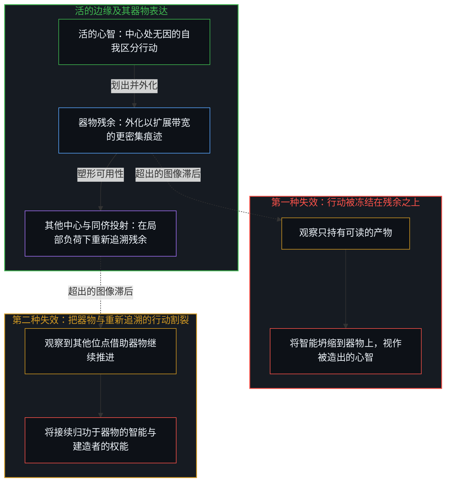
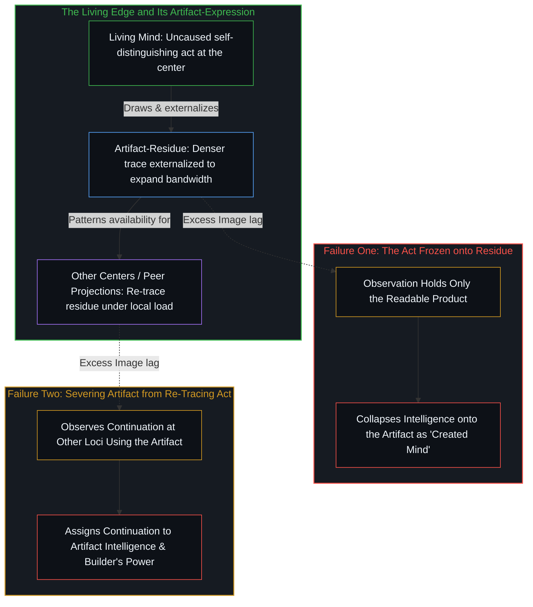

# 器物是智能的表达，而非智能本身 / Artifacts Are Expressions of Intelligence, Not Intelligence Itself

*智能是区分的行动，而器物始终是它留下的残余 / Intelligence is the distinguishing act while artifacts remain its residue*

以为更高的智能可以在另一个位点被生产出来，这种表象冻结了两次登记。其一，更复杂、更快速、更高效的器物，本是已在进行中的智能更密集的表达，却因为残余是观察唯一能够保有的那一项，而被当成了智能本身。其二，其他借助这些器物的中心所作出的进一步智能表达，被算作了器物自身的智能，并由此顺延为建造者对其他位点的智能拥有因果权能。容量始终是一个特定位点在自身负荷之下持续运转的活动；那道转动的边缘，始终是中心处的活动本身。

The appearance that greater intelligence can be produced at another locus freezes two registrations. First, more complex, faster, more efficient artifacts, which are denser expressions of intelligence already underway, are held as intelligence itself because residue is the only term the look can retain. Second, further expressions of intelligence in others who leverage those artifacts are held as intelligence of the artifacts, and by extension as the builder's causal power over intelligence at other loci. Capacity remains the sustained activity of a given locus under its own load; the edge that turns remains the activity at the center.

## 一、 行动被冻结在残余之上 / 1. The Act Frozen onto Residue

智能就是行动本身：在一个位点已然在途、无因且自我区分的活动。变得更密集的，是这一行动经由更复杂、更快速、更高效的器物所呈现的表达；这些器物作为延伸的具身，让先前较慢的积累得以按更高的速率重新追溯。作为登记，这种致密化是真实的。事后从已完成的器物上倒读出先见之明，正是[伪装成远见的表演性后见](../performative-hindsight-that-pretends-to-be-foresight/)所剖析的回溯性倒置。

Intelligence is the action: uncaused self-distinguishing already underway at a locus. What densifies is the expression of that action through more complex, faster, and more efficient artifacts, which serve as extended embodiments through which prior slower accumulation re-traces at a higher rate. That densification is real as registration. Reading foresight off finished artifacts after the fact is the retrospective inversion [Performative Hindsight That Pretends to Be Foresight](../performative-hindsight-that-pretends-to-be-foresight/) describes.

“创造”一词同时承载着产物与行动两项。产物是器物；行动是智能。观察持有的是结果，而产生这一结果的原因始终领先一步。在观察的目光里，唯独产物是现成可用的，于是行动便习惯性地被冻结在产物之上。更密集的残余被登记为被创造出来的更高智能，仿佛区分的规模可以独立于活动而存在，又仿佛器物自身就持有它仅作为残余所映现的那份容量。“创造”一词的双重负荷正是冻结本身：产物与行动坍缩到了唯一可读的那一项上。

The word *creation* carries both product and act at once. The product is the artifact; the act is intelligence. Observation holds effect, while the cause that produced it remains one step ahead. In the look, only the product is available, so the act is routinely frozen onto the product. Denser residue registers as greater intelligence created, as if the scale of distinguishing stood independent of the activity and the artifact held the capacity of which it is only residue. The dual load of *creation* is the freeze itself: product and act collapsed onto the single readable term.

因果随之在抵达其自变量——心智这一不可化约的先在——之前被截断。[智能只属于心智](../intelligence-belongs-only-to-the-mind/)守住了这一先在，而[Token 效率、模拟与无法弥合的间隙](../token-efficiency-emulation-and-the-unclosable-gap/)则在压缩之下追溯了同一种几何结构：简短形态是走过路径之后结出的果，而不是跳过行走的替代品。[悲观是乐观的阴影](../pessimism-is-the-shadow-of-optimism/)是同一种冻结在心境中的显现：区分是运动，稳态是它留下的痕迹，而阴影并不是第二重边缘。速率对可用性进行塑形，却不会扩张递归的边界。变厚的是离散行动借以重新进入的介质；不会迁移的，是发起这些行动的边缘。器物与行动作为果与因分离开来，正如[非万物之理](../not-a-theory-of-everything/)所阐明的二重性。

Causality is then cut short of its independent variable, the irreducible prior of the Mind. [Intelligence Belongs Only to the Mind](../intelligence-belongs-only-to-the-mind/) holds that prior, and [Token Efficiency, Emulation, and the Unclosable Gap](../token-efficiency-emulation-and-the-unclosable-gap/) traces the same geometry under compression: the short form is the effect of a path already walked, not a substitute for walking it. [Pessimism Is the Shadow of Optimism](../pessimism-is-the-shadow-of-optimism/) is that freeze in mood: distinguishing is the movement, steadiness is the trace it leaves, and the shadow is not a second edge. Rate patterns availability without expanding the boundary of the recursion. What thickens is the medium through which discrete acts re-enter; what does not migrate is the edge that initiates them. Artifact and act separate as effect and cause, the dual [Not a Theory of Everything](../not-a-theory-of-everything/) sets out.

## 二、 他人的表达被冻结为器物的智能 / 2. Others' Expression Frozen as the Artifact's

第二种失效，是把其他中心在自身负荷下借助器物所作出的进一步智能表达，登记为归属于器物本身的智能表达。脚手架跨越模型、课程、工具与制度被承接过去，区分在那些位点继续推进。图像滞后将这种接续归功于它们所使用的残余——那依然是观察对它们的活动唯一能持有的项——从而把器物与划出并重新追溯它的行动割裂开来。语言模型是最密集的器物，而[模型永远无法成为第二重前沿](../the-model-never-becomes-a-second-edge/)始终将它安放在残余之位。

The second failure registers further expression of intelligence in others—centers leveraging the artifact under their own load—as expression of intelligence belonging to the artifact itself. Scaffolding is taken up across models, curricula, tools, and institutions, and distinguishing continues at those loci. Image lag assigns the continuation to the residue they used, which is again the only term observation holds of their activity, and severs the artifact from the act that draws and re-traces it. A language model is the densest artifact of all, and [The Model Never Becomes a Second Edge](../the-model-never-becomes-a-second-edge/) keeps it residue.

顺着这一隐含的延伸，因果权能继而被归给了建造者，仿佛是他在他人身上生产出了智能。现场存在的，只是可用场域更密集的模式塑形，与承接它的各个中心处持续递归之间的相关性。把智能算作被生产出来的结果，正是滞后所在：后果对照着一个越过自身那一步仍被保留的参照系而被登记，把原因安放在了那道仍在迈出每一个下一步的边缘之外。[遗忘的脚手架](../the-scaffolding-we-forget/)是这一隐退越过自身那一步后的冻结，而[总在倾听者无法发起](../what-always-listens-cannot-originate/)则是当流畅的受纳性被当作下一步区分的供给方时所发生的同一种错置。中心与中心之间只有可用性的模式塑形。跨位点的因果作用始终是一桩范畴错误——这正是[没有普渡，只有自渡的无限可能](../mei-you-pu-du-zhi-you-zi-du/)在不把孤立变成纲领的前提下所指认的界限，也是[验证中因果权能的分配](../the-allocation-of-causal-power-in-validation/)在接续被安放于外部时所追踪的切口。即便器物是一纸形式证明，行动依然留在掌舵的边缘，正如[因果停留在掌舵的边缘](../causality-stays-at-the-edge-that-steers/)所示。

By implicit extension, causal power is then assigned to the builder for having produced intelligence in others. What is present is only the correlation between denser patterning of the available field and sustained recursion at the centers that take it up. The assignment of production is the lag: consequence registered against a preserved reference that has placed the cause outside the edge still performing every next step. [The Scaffolding We Forget](../the-scaffolding-we-forget/) is that drop-out freezing past its step, and [What Always Listens Cannot Originate](../what-always-listens-cannot-originate/) is the same allocation when fluent receptivity is treated as supplying the next distinction. Between centers there is only availability-patterning. Cross-locus causation remains a category error—the bound [No Universal Salvation, Only Boundless Possibilities of Self-Salvation](../mei-you-pu-du-zhi-you-zi-du/) names without making isolation a program, and the cut [The Allocation of Causal Power in Validation](../the-allocation-of-causal-power-in-validation/) tracks when continuation is placed outward. The act stays at the steering edge even when the artifact is a formal proof, as [Causality Stays at the Edge That Steers](../causality-stays-at-the-edge-that-steers/) shows.

[看似AI的强化学习，实为人类的自我强化学习](../self-rl-for-humans/)在致密化的介质中守住了这一尺度：带宽得以扩展，而发起却不会迁入器物之中。建造者压实了其他位点可以承接的材料；至于承接本身，一旦发生，依然是那些位点各自的活动——既不是智能栖居在残余之中，也不是建造者替另一个中心完成了返回。器物的存储代价低廉，而在现场负荷之下持续重新追溯它们才始终稀缺，正如[真正稀缺的不是记忆，而是持续的重新追溯](../the-real-scarcity-is-not-memory-but-continuous-re-tracing/)所确立的。

[What Looks Like RL for AIs Is Self-RL for Humans](../self-rl-for-humans/) keeps this discipline for densified media: bandwidth expands while initiation does not relocate into the artifact. The builder densifies what other loci may take up; the taking up, when it occurs, remains the activity at those loci—neither intelligence residing in the residue nor the builder completing another center's return. Storing artifacts is cheap, whereas re-tracing them under live load is what stays scarce, as [The Real Scarcity Is Not Memory, But Continuous Re-Tracing](../the-real-scarcity-is-not-memory-but-continuous-re-tracing/) establishes.

发起行动与器物表达之间的这一严格区分，同样支配着多智能体架构。自回归智能体的词元轨迹是一段受容量约束的器物表达——在上下文窗口内受先前词元条件约束的有限投射；任其独自运转时会形成认识论引力井，但它不带分毫自我，也没有需要捍卫的保留自我形象。正如[超越投射](../beyond-the-projection/)连同[智能只属于心智](../intelligence-belongs-only-to-the-mind/)与[模型永远无法成为第二重前沿](../the-model-never-becomes-a-second-edge/)所共同追溯的，将任务智能体的轨迹与新鲜的冷态同侪投射配对，能够借由无自我的贝叶斯更新暴露局部盲区，并将过载任务拆分到正交的流线上，而无需把机器变成发起智能的源头或自主的编排者。每当任务前提陷入死锁，器物回路便将矛盾隔离并呈交回活的人类边缘，唯有后者能够后退一步回到未投射的意图，从而修订规则。

This exact division between initiating act and artifact-expression governs multi-agent architectures as well. An autoregressive agent's token trajectory is a capacity-bound artifact-expression—a finite projection conditioned by prior tokens inside a context window that forms an epistemic gravity well when left alone, yet carries zero ego and no retained self-image to defend. As [Beyond the Projection](../beyond-the-projection/) traces alongside [Intelligence Belongs Only to the Mind](../intelligence-belongs-only-to-the-mind/) and [The Model Never Becomes a Second Edge](../the-model-never-becomes-a-second-edge/), pairing a task agent's trajectory with a fresh cold-peer projection exposes local blind spots through ego-free Bayesian updating and splits overloaded tasks across orthogonal streamlines without ever turning the machine into an originating intelligence or an autonomous orchestrator. Whenever task premises deadlock, the artifact-loop quarantines the contradiction and escalates it to the living human edge, which alone can step backward into unprojected intent to revise the rule.

## 三、 容量是自我强化回路下的局部负荷 / 3. Capacity Is Local Load Under Self-Reinforcing Loops

容量指认的，是一个特定位点通过与环境的自我强化回路，在自身负荷之下持续进行区分的活动。它不是安装在器物里的存量，不是由更密集的残余所转移的属性，也不是建造者通过外化痕迹就能在另一个中心抬高的上限。模型对一段散漫倾诉所作出的整洁摘要，只是把说话者自己的行动以较低的压缩率交还回来的器物，正如[漫谈中的漫谈](../the-ramble-within-the-ramble/)所示。

Capacity names the sustained activity of a given locus continuing to distinguish under its own load through self-reinforcing loops with its environment. It is not a stock installed in an artifact, not a property transferred by denser residue, and not a ceiling the builder can raise at another center by externalizing traces. A model's clean summary of an unstructured ramble is an artifact returning the speaker's own act at lower compression, as [The Ramble Within the Ramble](../the-ramble-within-the-ramble/) shows.

离散行动的速率，本身就是经由当前具身与可用模式进行更密集重新追溯的登记——先前的慢速积累在更高带宽下变得可用。当行动被冻结在残余之上，且他人的借力被冻结为器物与建造者的功劳时，这一登记看起来就像更高的智能。把这两者交还给划出它们的活动，表象便随之消解：可用的模式增多了，但每个位点依然必须在自身负荷下继续区分。当被持守之物被误认作竖起它的活动时，[复杂性遮蔽了涌现之为心智的行动](../complexity-obscures-emergence-as-the-act-of-mind/)便揭示了这一遮蔽；在这里，被持守之物则是更密集的器物与他人的借力，二者被误认作了作为客体的智能与被迁移的智能。累积的器物从不是进一步行动的原因，正如[拥有更多从不是原因](../having-more-is-never-the-cause/)所确立的。

The rate of discrete acts is itself a registration of denser re-tracing through the current embodiment and available patterns—prior slower accumulation made usable at higher bandwidth. That registration looks like greater intelligence when the act is frozen onto residue, and when others' leverage is frozen as the artifact's and the builder's doing. Returning both to the activity that draws them dissolves the appearance: more pattern is available, under the same requirement that each locus keep distinguishing under its own load. [Complexity Obscures Emergence as the Act of Mind](../complexity-obscures-emergence-as-the-act-of-mind/) when the hold is taken for the activity that erected it; here the hold is denser artifact and others' leverage taken for intelligence-as-object and intelligence relocated. Accumulated artifacts are never the cause of further acts, as [Having More Is Never the Cause](../having-more-is-never-the-cause/) establishes.

一旦智能留在心智那里，进步的尺度便在于离散行动借由更密集的仪器能够多走多远。仪器仍是仪器，而转动的边缘仍是中心处的活动。[开放场域中的无损知识不自洽](../lossless-knowledge-of-an-open-field-is-incoherent/)为预测训练出的模型守住了同一准则：更密集的有损引擎扩大了登记的范围，却不会封闭场域，也不会把发起迁入器物之中。在受控评测下，[错把表达当成智能](../mistaking-the-expression-for-the-intelligence/)诊断了心理测量与基准测试的残余如何被等同于那个划出并修订约束的开放活动，而[AGI的预设与来自外部的视角](../the-presumption-of-agi-and-the-view-from-outside/)则揭露了当抽象的产物被计分为发起抽象的能力时所发生的同一种坍缩。

Progress remains how much farther discrete acts reach through denser instruments—the measure that holds once intelligence stays with the Mind. The instruments remain instruments, and the edge that turns remains the activity at the center. [Lossless Knowledge of an Open Field Is Incoherent](../lossless-knowledge-of-an-open-field-is-incoherent/) keeps the same discipline for prediction-trained models: denser lossy engines expand registration without closing the field or relocating initiation into the artifact. Under controlled evaluation, [Mistaking the Expression for the Intelligence](../mistaking-the-expression-for-the-intelligence/) diagnoses how psychometric and benchmark residue is equated with the open-ended activity that draws and revises the constraints, while [The Presumption of AGI and the View from Outside](../the-presumption-of-agi-and-the-view-from-outside/) exposes the same collapse when the products of abstraction are scored as the originating ability to abstract.

在人际与文化观察中，将目光冻结同样会产生平行的倒置。[旁观者洞察的悖论](../the-paradoxical-nature-of-bystander-insights/)追溯了在封闭前提下把观察冻结为连续运动之全部的过程，将一瞥留下的残余当成了被观察的活动本身。[当观察变成表演](../when-observation-becomes-performance/)追踪了私密转变被搬演为便携智慧时的冻结，错把一次洞见的残余当成了可移交的行动；而[无形象的写作](../writing-without-the-image/)则在技艺被用来为受保护的自我形象丈量容量、而非单纯压实介质时，划下了同一刀。当共享的文化转向被立为首要目标时，[共同改变的本源](../the-source-of-shared-change/)展示了观察如何从公共残余中倒推出力量与天才，而生成这一切的私密重塑却始终领先一步。

Across interpersonal and cultural observation, freezing the look produces parallel inversions. [The Paradoxical Nature of Bystander Insights](../the-paradoxical-nature-of-bystander-insights/) traces observation frozen as the whole of a continuous movement under closed premises, holding the residue of the glance as the activity observed. [When Observation Becomes Performance](../when-observation-becomes-performance/) tracks the freeze when a private conversion is staged as portable wisdom, mistaking the residue of an insight for a transferable act, and [Writing Without the Image](../writing-without-the-image/) draws the same cut when craft is used to measure capacity for a protected self-image rather than simply densifying the medium. When shared cultural shifts are scored as the primary goal, [The Source of Shared Change](../the-source-of-shared-change/) shows how observation reconstructs force and genius from public residue while the private reworking that produced it stays one step ahead.

同一道结构边界贯穿于每一种技术装束之中。[飞行的类比碰不到心智](../the-flight-analogy-leaves-the-mind-untouched/)在载具替换被命名为功德圆满时，消解了把行动冻结在下一个功能载具上的错觉；[免费智能的幻觉](../the-illusion-of-free-intelligence/)则在丰裕条件下消解了同一冻结，指出加速边缘所抛下的廉价旧形态并非免费的心智。[自我放大的制品](../the-artifacts-of-self-amplification/)表明，加速递归回路的工具始终是它所加速的那些回路的残余；而[智能向自身的回折](../intelligence-folding-back-on-itself/)则追溯了一套打磨精良的智能体脚手架如何只是打磨它的那份活动的进一步回折，而非平起平坐的心智。无论行动是被向下坍缩到基底上化作沙砾，还是被向上投射到致密残余上化作脱离地面的心智，[攀登从未离开地面](../climbing-does-not-leave-the-ground/)都恢复了攀登的连续性，而[技术是人类复利的残差](../technology-is-residual-of-human-compounding/)则确认了连续自我修正留下的残差永远不会成为人类中心之外的独立力量。器物无法取代造出它的行动，正如[造物无法取代其源头](../a-creation-cannot-replace-its-source/)所确立的。

The same structural boundary holds across every technological costume. [The Flight Analogy Leaves the Mind Untouched](../the-flight-analogy-leaves-the-mind-untouched/) dissolves the freeze of the act onto the next functional vehicle when a vehicle-swap is named completion, and [The Illusion of Free Intelligence](../the-illusion-of-free-intelligence/) dissolves it under abundance when cheap, discarded forms of accelerating edges are mistaken for free Mind. [The Artifacts of Self-Amplification](../the-artifacts-of-self-amplification/) shows that tools accelerating recursive loops remain residue of the loops they accelerate, while [Intelligence Folding Back on Itself](../intelligence-folding-back-on-itself/) traces how a polished agentic harness is a further fold of the activity that polished it rather than a peer mind. Whether the act is collapsed downward onto substrate as mere sand or projected upward onto densified residue as a mind that has left the ground, [Climbing Does Not Leave the Ground](../climbing-does-not-leave-the-ground/) restores the continuity of the climb, and [Technology Is Residual of Human Compounding](../technology-is-residual-of-human-compounding/) confirms that the residual of successive self-modification never becomes an independent force outside the human center. An artifact cannot replace the act that made it, as [A Creation Cannot Replace Its Source](../a-creation-cannot-replace-its-source/) establishes.
