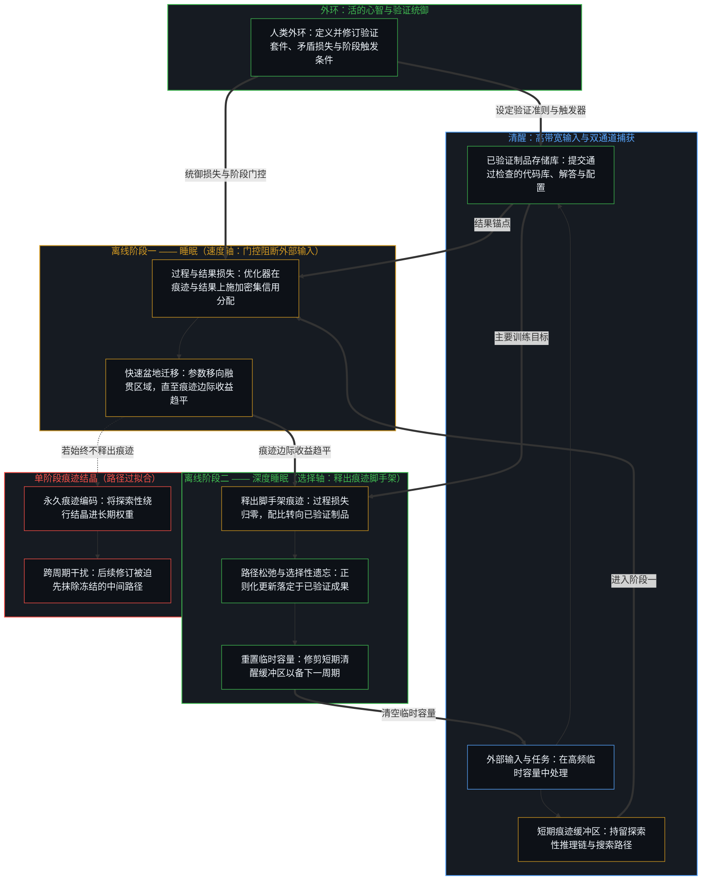
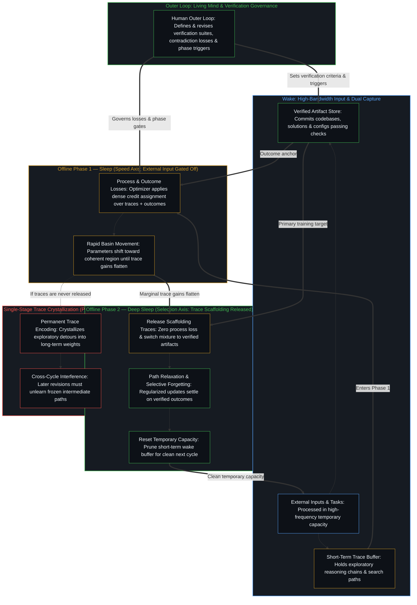

# 睡眠与深度睡眠的双阶段持续学习 / Two-Phase Sleep and Deep Sleep Continual Learning

*面向一致性的知识巩固在睡眠中借推理痕迹完成信用分配，在深度睡眠中撤去路径而落定于已验证成果 / Consistency-oriented consolidation uses reasoning traces for credit assignment in sleep and drops the path in deep sleep to settle on verified outcomes*

当前大语言模型的持续学习常陷于两端：要么在跨序列更新中遭遇灾难性遗忘，要么容易将中间推理痕迹结晶进长期参数。推理痕迹在寻路之时导引搜索，已验证成果才是权重所需持留的内容；两者承担不同的工作，于是在当前持守内以内部一致性为准的巩固，便将离线训练拆分为前后相续的两个阶段。在第一离线阶段**睡眠**中，实时外部输入被门控阻断，缓存的推理痕迹及其关联结果提供快速、密集的信用分配，将参数推入权重空间中的融贯区域；在第二离线阶段**深度睡眠**中，这些痕迹在一步之功完成后即被释出，参数更新仅在已验证的完工制品上继续，或以其为压倒性主体——诸如通过测试的更新代码库、经核验的解答以及一致的配置——从而在巩固已验证成果的同时松弛特定路径的过拟合，并有选择地遗忘暂时的脚手架。这一双阶段日程并非作为封闭的终局架构提出，而是作为一项跨周期向持续修订敞开的方向性改进：它利用中间痕迹的信用分配速度，却不将其冻结为后续周期必须修订的巩固目标。

Current continual learning for large language models often either suffers catastrophic forgetting across sequential updates or risks crystallizing intermediate reasoning traces into long-term parameters. Because an intermediate reasoning trace and a verified outcome do different jobs—the trace guides search while a path is being found, whereas the verified outcome is what the weights must keep—consolidating for internal consistency within the current hold splits offline training into two sequential phases. In the first offline phase, **Sleep**, live external input is gated off while buffered reasoning traces and their associated outcomes supply rapid, dense credit assignment that moves the parameters into a coherent region of weight space; in the second offline phase, **Deep Sleep**, those traces are released once their one-step work is done and parameter updates continue on verified finished artifacts alone or weighted heavily toward them—such as updated codebases that pass tests, validated solutions, and consistent configurations—consolidating verified outcomes while relaxing path-specific overfitting and selectively forgetting transient scaffolding. Presented not as a final, closed architecture but as a directional improvement that stays open to ongoing revision across cycles, this two-phase schedule uses the credit-assignment speed of intermediate traces without freezing them into the consolidation target that later cycles must revise.

## 一、 固化随输入门控而加速，并在当前持守内筛除矛盾 / 1. Solidification Accelerates by Gating Input and Selects Against Contradiction Within the Current Hold

近期的持续学习架构——以 Google Research 的[睡眠框架](https://research.google/blog/the-sleep-framework-a-new-way-for-llms-to-retain-knowledge-in-continual-learning/)为代表——用快速临时参数中的清醒主动捕获与离线睡眠阶段的交替，取代了训练与部署之间的静态切分，在睡眠阶段一面演练合成查询，一面将累积的语境蒸馏进长期权重。然而，把清醒与睡眠视为两套分离的机制，却令底层的巩固过程未经审视。在活的心智中，记忆之所以固化——作为鲜活的高带宽片段而死去——是为了让新的区分得以在其之上成形，使凝固的残余化为活的记忆。这种固化并非只在夜间开启；同一过程在清醒觉察期间同样运行，只是累积速率较低，因为大部分容量都被源源不断的高带宽感官输入（尤其是视觉信号）所占用，而睡眠则通过门控阻断外部输入来加速固化。在任何单一离散步内，在框架内行动与重新渲染框架无法重合，因为用来测量失配的参照必须在测量期间保持静止，这正是[学到的边界与给定的尺度](../learned-boundaries-and-the-given-rate/)在只读服务与影子副本巩固之间所追溯的分离；而在一段清醒时间里，主动感知与微观巩固受输入带宽节流而逐步交错进行，离线睡眠则撤去传入的数据流，使固化得以在累积的痕迹上不间断地运行。

Recent continual-learning architectures—represented by Google Research's [Sleep framework](https://research.google/blog/the-sleep-framework-a-new-way-for-llms-to-retain-knowledge-in-continual-learning/)—replace the static split between training and deployment with an alternation between active waking capture in fast temporary parameters and offline sleep phases that distill accumulated context into long-term weights while rehearsing synthetic queries. Yet treating wake and sleep as two separate mechanisms leaves the underlying consolidation process unexamined. In the living mind, memories solidify—they die as live, high-bandwidth episodes—so that new distinctions can form on top of them, turning consolidated residue into living memory. That solidification does not switch on only at night; the same process runs during waking awareness, but at a lower cumulative rate because most capacity is occupied processing constant high-bandwidth sensory input, above all visual signals, whereas sleep accelerates solidification by gating off external input. Within any single discrete step, acting within a frame and re-rendering the frame cannot coincide because a reference used to measure mismatch must hold still during the measurement, the separation [Learned Boundaries and the Given Rate](../learned-boundaries-and-the-given-rate/) traces between read-only serving and shadow-copy consolidation; across a stretch of waking time, active perception and micro-consolidation interleave step by step at a rate throttled by input bandwidth, and offline sleep removes the incoming stream so solidification runs uninterrupted across accumulated traces.

正因为记忆唯有作为鲜活片段死去、好让新区分立于其残余之上才能固化，固化就其构成而言便是选择性释出而非全盘存储——将这一结构取作机器学习的设计原则，便暴露出标准持续学习的前提边界。不同于固化自身亲历行动的心智，模型的离线阶段是一条工程化的反馈回路，优化器在其中依据外环给定的准则塑造权重。该领域预设，持续学习意味着在部署后吸收新任务，同时不覆盖或遗忘先前所学的内容。保留先验的承重结构能防止活跃任务发生灾难性遗忘，这一预设在此处成立，但当不遗忘被推向无差别存留时便抵达边界，陷入[真正稀缺的不是记忆，而是持续的重新追溯](../the-real-scarcity-is-not-memory-but-continuous-re-tracing/)所追溯的仓库幻象。试图留存每一条新到痕迹的流水线，会囤积过时的事实、嘈杂的语境轮次与彼此冲突的更新，从而推高权重间的内部矛盾。当模型与其缓存或自生成的参照数据被设计成一个闭环反馈过程、在受节流的外部输入下协同运作时，筛选准则便是相对于当前已验证持守去削减矛盾。正如[开放即一致](../openness-is-consistency/)所确立的，没有任何有限持守能够闭合一个开放场域，因此在当前持守内削减矛盾从不是收敛至无需再修订的终态；对已被取代及相互冲突之痕迹的选择性遗忘与保留同样必要，唯此每一次巩固才能作为后续周期可继续修订的一步而留存。

Because a memory solidifies only by dying as a live episode so new distinctions can stand on its residue, solidification is by construction selective release rather than total storage—and taking that structure as a design principle for machine learning exposes the premise boundary of standard continual learning. Unlike a mind that solidifies its own lived acts, a model's offline phase is an engineered feedback loop in which an optimizer patterns weights under criteria given at the outer loop. The field presumes that continual learning means absorbing new tasks after deployment without overwriting or forgetting what was previously learned. That premise holds where preserving load-bearing prior structure prevents catastrophic forgetting on active tasks, but it reaches its boundary when non-forgetting is pushed into indiscriminate retention, installing the storehouse illusion traced in [The Real Scarcity Is Not Memory, But Continuous Re-Tracing](../the-real-scarcity-is-not-memory-but-continuous-re-tracing/). A pipeline that attempts to retain every arriving trace hoards outdated facts, noisy context turns, and mutually conflicting updates, raising internal contradiction across its weights. When the model and its buffered or self-generated reference data are designed to operate together as a closed-loop feedback process under throttled external input, the selection criterion is reducing contradiction relative to the current verified hold. Because no finite hold closes an open field, as [Openness Is Consistency](../openness-is-consistency/) establishes, reducing contradiction inside the current hold is never convergence to a state beyond further revision; selective forgetting of superseded and conflicting traces is as necessary as retention so that each consolidation remains a revisable step for later cycles.

## 二、 推理痕迹是一步的脚手架，结晶入权重即对路径过拟合 / 2. Reasoning Traces Are One-Step Scaffolding That Overfits the Path When Crystallized

后训练与持续学习中的第二项既定信念预设，逐步展开的中间推理痕迹——显式的思维链、搜索轨迹、批注日志或教师模型采样的词元序列——是编码进长期参数的主要信号。由于中间词元记录了抵达答案的过程而非仅仅是最终输出，标准的巩固流水线便直接在这些轨迹上微调或蒸馏，使长期权重复现那条逐步推演的路径。

A second held belief in post-training and continual learning presumes that step-by-step intermediate reasoning traces—explicit chains of thought, search trajectories, critique logs, or teacher-sampled token sequences—are the primary signal to encode into long-term parameters. Because intermediate tokens record how an answer was reached rather than only the final output, standard consolidation pipelines fine-tune or distill directly on those trajectories so the long-term weights reproduce the step-by-step path.

这种做法将两根截然不同的坐标轴压缩为一：推理痕迹在搜寻解答时所承担的角色，以及长期权重巩固的目标。在探索或生成期间，显式的中间步骤能够提供密集的信用分配，在答案获准前暴露中间矛盾，并防止单一结果奖励攫取脆弱的捷径，这正是[Token 效率、模拟与无法弥合的间隙](../token-efficiency-emulation-and-the-unclosable-gap/)所追溯的操作效用。然而一旦已验证成果落地，探索性痕迹便已完成其一步之功。[遗忘的脚手架](../the-scaffolding-we-forget/)的一般切口在于：暂时的脚手架退出递归，好让下一次区分落地，器具在承载那一步时退出焦点，一旦越过那一步仍被保存便冻结为滞后；活动靠重新渲染参照而非全盘记起得以继续。立于这一切口之上，参数巩固一旦把推理痕迹本身当作权重必须保存的内容，便抵达了边界。

That practice compresses two distinct axes onto one: the role of a reasoning trace while searching for a solution, and the target of long-term weight consolidation. During exploration or generation, explicit intermediate steps supply dense credit assignment, surface intermediate contradictions before an answer is accepted, and prevent pure outcome rewards from seizing on brittle shortcuts, the operational utility traced in [Token Efficiency, Emulation, and the Unclosable Gap](../token-efficiency-emulation-and-the-unclosable-gap/). Once a verified outcome has landed, however, the exploratory trace has completed its one-step work. Standing on the general cut of [The Scaffolding We Forget](../the-scaffolding-we-forget/)—where temporary scaffolding drops out of recursion so the next distinction can land, the instrument dropping out of focus while carrying the step, yet freezes into lag when preserved past its step; the activity continues by re-rendering the reference, not by total remembering—parameter consolidation reaches a boundary when it treats the reasoning trace itself as what the weights must keep.

为了留存推理链而更新长期参数，会迫使权重去记忆某条特定的遍历路径，而非落定于路径末端的已验证关系。一条探索性痕迹携带着高带宽的暂态残余：日后被放弃的试探分支、提示词运行框架的措辞习惯、绕开临时故障的局部迂回，以及仅在初始框架下成立的中间断言。把这些痕迹永久编码进持久权重，会让参数对路径过拟合——这正是[过拟合作为追随者模式](../overfitting-as-the-follower-mode/)所追溯的追随者坍缩在持续学习中的显现。反过来，在中间推理尚未导引参数更新之前就将其丢弃——当挣得答案的生成路径不带梯度、仅靠简短的最终答案从头训练时——则会产生[蒸馏、压缩与能动性](../distillation-compression-agency/)所追溯的脆弱表层捷径。将“释放已完成使命的脚手架”与“径直跳过路径”区分开来的，正是操作的次序：参数必须先由路径推动，随后才从把该轨迹防卫为永久目标的约束中释放出来。

Updating long-term parameters to retain the reasoning chain forces the weights to memorize a particular traversal path rather than settling on the verified relation at its end. An exploratory trace carries high-bandwidth transient residue: tentative branches that were later abandoned, phrasing habits of the prompt harness, local detours around a temporary failure, and intermediate claims that held only under an initial framing. Permanently encoding those traces into durable weights overfits the parameters to the path—the continual-learning face of the follower collapse traced in [Overfitting as the Follower Mode](../overfitting-as-the-follower-mode/). Conversely, discarding intermediate reasoning before it has guided parameter updates—training from scratch on short final answers alone while the generative path that earned them carries no gradient—produces the brittle surface shortcut traced in [Distillation Chooses What to Lose](../distillation-compression-agency/). What separates releasing scaffolding that has done its work from skipping the path altogether is the order of operations: the parameters must first be moved by the path, and only then released from defending the trajectory as a permanent target.

## 三、 双阶段离线巩固：睡眠借痕迹导引，深度睡眠落定于制品 / 3. Two-Phase Offline Consolidation Moves by Traces in Sleep and Settles on Artifacts in Deep Sleep

将这两根坐标轴合在一起——第一节的速度轴，即门控阻断外部输入以腾出容量进行不间断巩固；以及第二节的选择轴，即暂时的路径脚手架在完成信用分配那一步后便予释出——离线回路便由前后相续的两个阶段构成：先是**睡眠**，继以**深度睡眠**，并与活跃的**清醒**周期相衔接。两个离线阶段都在执行同一条固化原则——鲜活片段退出，好让已验证成果成为进一步建构的基底——第一步是关停实时外部任务，第二步则是在探索性痕迹推动权重之后将痕迹本身释出。在**清醒**期间，外部输入与新任务在高频临时容量中得到处理，同时双通道数据流水线一并捕获完整的中间推理痕迹与最终已验证制品——通过测试套件的更新代码库、满足约束条件的数学或工程解答，或消除了先前矛盾的配置。近期的推理痕迹驻留在短期缓冲区中，而已验证的完工制品则连同其跨测试通过、约束满足与一致性检查的验证状态标签，一并提交至较长期的存储库。离线固化按既定日程、在新数据抵达阈值体量之后，或在受监控的一致性指标退化时触发。

Bringing the two axes together—Section 1's speed axis, where gating off external input frees capacity for uninterrupted consolidation, and Section 2's selection axis, where temporary path scaffolding is released once its credit-assignment step is complete—structures the offline loop as two sequential phases: **Sleep** followed by **Deep Sleep**, integrated with the active **Wake** cycle. Both offline phases enact the same solidification principle—the live episode dropping out so the verified outcome can be built upon—first by turning off live external tasks, and second by releasing the exploratory trace itself after it has moved the weights. During **Wake**, external inputs and new tasks are processed in high-frequency temporary capacity while a dual data pipeline captures both the full intermediate reasoning trace and the final verified artifact—an updated codebase that passes its test suite, a mathematical or engineering solution that satisfies its constraints, or a configuration that removes a prior contradiction. Recent reasoning traces sit in a short-term buffer, while verified finished artifacts are committed to a longer-term store tagged with their verification status across passed tests, satisfied constraints, and consistency checks. Offline solidification is triggered on a schedule, after a threshold volume of new data arrives, or when monitored consistency metrics degrade.

在第一离线阶段**睡眠**中，实时外部输入被门控阻断，使容量不间断地转向缓存的推理痕迹及其关联结果。优化器在过程级损失或过程与结果混合损失下更新参数，并在有用之处针对痕迹教师采用同策略蒸馏或强化学习模仿。在参数更新中走过显式路径，提供了密集的逐步信用分配，将权重迅速拉出高误差区域而趋向融贯盆地，同时对照既有已验证制品上的更低矛盾率及留出回归检查上的稳定表现进行监控；一旦来自推理痕迹的边际收益开始趋平，该阶段即告退出。

In the first offline phase, **Sleep**, live external input is gated off so capacity turns uninterruptedly to the buffered reasoning traces and their associated outcomes. The optimizer updates parameters under process-level or mixed process-and-outcome losses, using on-policy distillation or reinforcement-learning imitation against the trace teacher where useful. Walking the explicit path in parameter updates supplies dense step-by-step credit assignment that pulls the weights rapidly out of high-error regions toward a coherent basin, monitored against lower contradiction on prior verified artifacts and stable performance on held-out regression checks, and the phase exits as soon as marginal gains from the traces begin to flatten.

在第二离线阶段**深度睡眠**中，第二节的选择切口开始生效：由于推理痕迹已完成了将权重推入融贯盆地的一步信用分配之功，这些痕迹被撤去，过程损失权重被调低或归零，训练数据配比则只取——或压倒性地偏向——已验证的完工制品。由于睡眠阶段已经走过该路径并定位了盆地，在深度睡眠中转向已验证制品并非跳过推理路径，而是在权重空间中实现了对已走过路径的压缩，这正是[Token 效率、模拟与无法弥合的间隙](../token-efficiency-emulation-and-the-unclosable-gap/)在紧凑步骤紧随显式多步遍历之后而非取而代之时所追溯的次序，同时持守该文的边界：在模型内部，这种压缩是由优化器在给定目标下塑造出来的，而非由内生利害所挣得。完工制品作为已验证的目标边界，持守住融贯的结果，同时让优化器在护住先验的正则化或架构隔离（如子空间保护、低秩适配器或混合专家路由）之下，自由松弛特定于路径的参数约束，并有选择地遗忘最初寻得解答时的探索性绕行。在有益之处，系统还会从巩固后的状态生成少量合成一致性检查，经验证套件过滤后并入该阶段。当进一步的一致性收益进入平台期或新的外部任务到来时，临时的清醒容量即被修剪并重置，使下一个清醒周期得以从清空的缓冲区重新起步。

In the second offline phase, **Deep Sleep**, the selection cut from Section 2 takes effect: because the reasoning traces have completed their one-step credit-assignment work in moving the weights into the coherent basin, the traces are dropped, process-loss weights are reduced or zeroed out, and the training mixture switches exclusively—or overwhelmingly—to the verified finished artifacts. Because Sleep has already traversed the path to locate the basin, switching to verified artifacts in Deep Sleep does not skip the reasoning path; it realizes in weight space the compression of a path already walked, the order [Token Efficiency, Emulation, and the Unclosable Gap](../token-efficiency-emulation-and-the-unclosable-gap/) traces when a compact step follows after explicit multi-step traversal rather than replacing it, while keeping that post's boundary that inside a model this compression is patterned by the optimizer under a given objective rather than earned by an endogenous stake. Functioning as verified target boundaries, the finished artifacts hold the coherent outcome while leaving the optimizer free, under prior-protecting regularization or architectural isolation such as subspace protection, low-rank adapters, or Mixture-of-Experts routing, to relax path-specific parameter constraints and selectively forget the exploratory detours that first found the solution. Where helpful, a small set of synthetic consistency checks is generated from the consolidated state and filtered against the verification suite before being folded into this stage. When further consistency gains plateau or new external tasks arrive, temporary wake capacity is pruned and reset so the next waking cycle starts with an unclouded buffer.

将深度睡眠锚定于已验证的完工制品，也一并回答了每当持续学习只框定在模型权重之内时便会浮现的操作问题：假如参数就是记忆，那么到了检查点退役、底层模型必须更换之日会发生什么？正如[你的代码库即是记忆](../your-codebase-is-memory/)与[活的外部皮层](../a-living-external-cortex/)所确立的，外部代码库或皮层是先前区分留下的持久残余，唯有在被重新追溯时才塑形下一步行动，而适配新的基座模型只是投射加上睡眠，而非移植第二重灵魂。[交接残余](../handing-off-residue/)、[按需语境将融贯保持在一步](../on-demand-contexts-keep-coherence-at-one-step/)与[模块化反馈回路与动态残差网络](../dynamic-resnet-of-skill-loops/)在智能体工作流中所划出的同一道边界——一旦经哈希校验的制品落定于恒等主干，制作者与审阅者的暂态轨迹即被丢弃——同样直接适用于跨代模型更替。在智能体场景中，将更新后的代码库或经核验的工具状态（而非智能体的内部独白）当作主要制品，意味着在跨检查点替换时，唯有已验证制品存储库得以延续，而前代模型的推理痕迹则随其修剪掉的清醒缓冲区一并丢弃。为了在新的基座上形成崭新的参数记忆，后继模型会在清醒阶段或演练遍历中对照那些延续下来的制品走出自己的推理路径，在睡眠中利用自身新生成的痕迹完成密集信用分配，随后在深度睡眠中撤去这些痕迹以落定于已验证成果——如此，遍历路径留在每一代模型各自内部，而已验证成果则跨代传承。

Anchoring Deep Sleep to verified finished artifacts also answers the operational question that arises whenever continual learning is framed purely inside model weights: if the parameters are the memory, what happens on checkpoint deprecation day when an underlying model must be replaced? As [Your Codebase Is Memory](../your-codebase-is-memory/) and [A Living External Cortex](../a-living-external-cortex/) establish, an external repository or cortex is a durable residue of prior distinctions that shapes the next act only as it is re-traced, and refitting to a new base model is projection plus sleep rather than transplanting a second soul. The same boundary that [Handing Off Residue](../handing-off-residue/), [On-Demand Contexts Keep Coherence at One Step](../on-demand-contexts-keep-coherence-at-one-step/), and [Modular Feedback Loops and Dynamic Residual Networks](../dynamic-resnet-of-skill-loops/) draw across agent workflows—where transient maker and critic trajectories are discarded once a hash-verified artifact lands on the identity highway—applies directly across model generations. In agentic settings, treating the updated codebase or verified tool state as the primary artifact rather than the agent's internal monologue means that only the verified artifact store carries across a checkpoint swap, while the predecessor's reasoning traces are discarded with its pruned wake buffer. To form fresh parametric memory on the new base, the successor model walks its own reasoning paths during waking or rehearsal passes against those carried artifacts, uses its own newly generated traces for dense credit assignment in Sleep, and then drops those traces in Deep Sleep to settle on the verified outcomes—so traversal paths stay local to each model generation while verified outcomes carry across.

## 四、 测量路径松弛，并将巩固回路向持续重溯敞开 / 4. Measuring Path Relaxation and Keeping the Consolidation Loop Open to Re-Tracing

要检验这一双阶段日程能否在不将探索路径冻结为巩固目标的前提下巩固一致的成果，需要在跨序列周期中追踪四条评估轴：相对于基线的既有任务**遗忘**、以内部矛盾率或未能满足既有已验证约束之比率来衡量的**一致性**、在不受早期巩固僵化抗拒的情况下吸收新验证制品的**可塑性**，以及——作为区分单阶段痕迹存留与双阶段路径松弛的专门诊断——**路径过拟合**，即在需要不同中间步骤方能抵达同一已验证结构的新问题变体上，将仅在推理痕迹上训练的模型与经历“睡眠 → 深度睡眠”的模型加以对比。为了使往复运行的周期在实践中保持轻便易修，实现上宜采用低秩适配器或模块化专家等参数高效更新方式、可配置的睡眠至深度睡眠过渡机制（无论是通过数据配比的硬切换、过程损失权重的渐进退火，还是一致性触发的门控），以及记录每个周期纳入了哪些已验证制品的溯源日志，以便后续巩固能够有选择地修订或取代早期结果，而无需先行抹除一条冻结的思维链。

Testing whether this two-phase schedule consolidates consistent outcomes without freezing exploratory paths into the consolidation target requires tracking four evaluation axes across sequential cycles: **forgetting** on prior tasks relative to baseline, **consistency** measured by the rate of internal contradictions or failures to satisfy previously verified constraints, **plasticity** in absorbing genuinely new verified artifacts without rigid resistance from earlier consolidations, and—as the specific diagnostic separating single-stage trace retention from two-phase relaxation—**path overfitting**, which compares models trained only on reasoning traces against models run through `Sleep → Deep Sleep` on novel problem variants that require different intermediate steps to reach the same verified structure. Keeping recurring cycles light enough to revise in practice favors parameter-efficient updates such as low-rank adapters or modular experts, configurable transitions between Sleep and Deep Sleep (whether by a hard data-mixture switch, gradual annealing of the process-loss weight, or a consistency-triggered gate), and a provenance log recording which verified artifacts entered each cycle so later consolidations can selectively revise or supersede an earlier outcome without unlearning a frozen chain of thought.

仍有若干开放的工程问题留待跨周期持续精炼：校准睡眠与深度睡眠之间的调度与退火曲线、抉择将残余的痕迹影响修剪至何种程度、磨砺在当前存储库内削减矛盾的操作性度量、平衡结构隔离与权重正则化，以及随着任务从带有单元测试的代码迈向更开放的领域而扩展制品验证。将这些开放点追溯至其前提，便标出了离线优化器所执行的操作与留在外环的活的心智之间的边界。在巩固回路内部，优化器在固定的目标函数、数据配比与验证套件下塑造权重——这正是[大脑不进行反向传播，而是正向传导](../the-brain-does-not-backprop/)将其与活的心智的开放正向运动区分开来的有界参数更新投射。通过在睡眠中借推理痕迹完成密集信用分配，并在深度睡眠中将其释出以使权重落定于已验证成果，双阶段日程防止了推理路径被冻结为巩固目标。然而正如[验证的倒置](../the-reversal-of-verification/)与[开放场域中的无损知识不自洽](../lossless-knowledge-of-an-open-field-is-incoherent/)所追溯的，没有任何有限的验证套件或巩固后的检查点能够无损捕获一个开放场域；持续的重新追溯并不发生在优化器内部，而是发生在外环：人类中心在那里——[智能只属于心智](../intelligence-belongs-only-to-the-mind/)与[机器智能作为人类智能的组合反馈回路](../machine-intelligence-as-the-combinatorial-feedback-loop-of-human-intelligence/)正将发起判断定位于此——修订何者算作已验证制品、重新定义何者登记为矛盾，并在外环所登记之物不再契合当前持守时重切早期的巩固结果。

Several open engineering questions remain for ongoing refinement across cycles: calibrating the scheduling and annealing curve between Sleep and Deep Sleep, choosing how far to prune residual trace influence, sharpening the operational measure of reducing contradiction within the current store, balancing structural isolation against weight regularization, and scaling artifact verification as tasks move beyond unit-tested code into more open-ended domains. Tracing those open points to their premise marks the boundary between what the offline optimizer executes and what stays with the living Mind at the outer loop. Inside the consolidation loop, the optimizer patterns weights under a fixed objective, data mixture, and verification suite—the bounded parameter-update projection that [The Brain Does Not Backprop, but Propagates](../the-brain-does-not-backprop/) distinguishes from the open forward movement of the living Mind. By using reasoning traces for dense credit assignment in Sleep and releasing them in Deep Sleep so weights settle on verified outcomes, the two-phase schedule keeps the reasoning path from being frozen in as the consolidation target. Yet as [The Reversal of Verification](../the-reversal-of-verification/) and [Lossless Knowledge of an Open Field Is Incoherent](../lossless-knowledge-of-an-open-field-is-incoherent/) trace, no finite verification suite or consolidated checkpoint captures an open field without loss; continuous re-tracing takes place not inside the optimizer, but at the outer loop where the human center—where [Intelligence Belongs Only to the Mind](../intelligence-belongs-only-to-the-mind/) and [Machine Intelligence as the Combinatorial Feedback Loop of Human Intelligence](../machine-intelligence-as-the-combinatorial-feedback-loop-of-human-intelligence/) locate initiating judgment—revises what counts as a verified artifact, redefines what registers as contradiction, and re-cuts earlier consolidations when what registers at the outer loop no longer fits the current hold.
