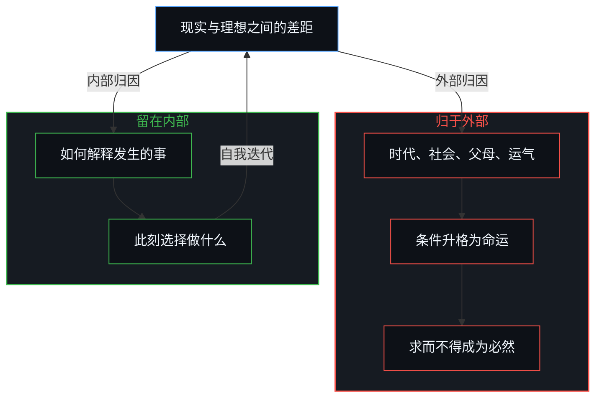
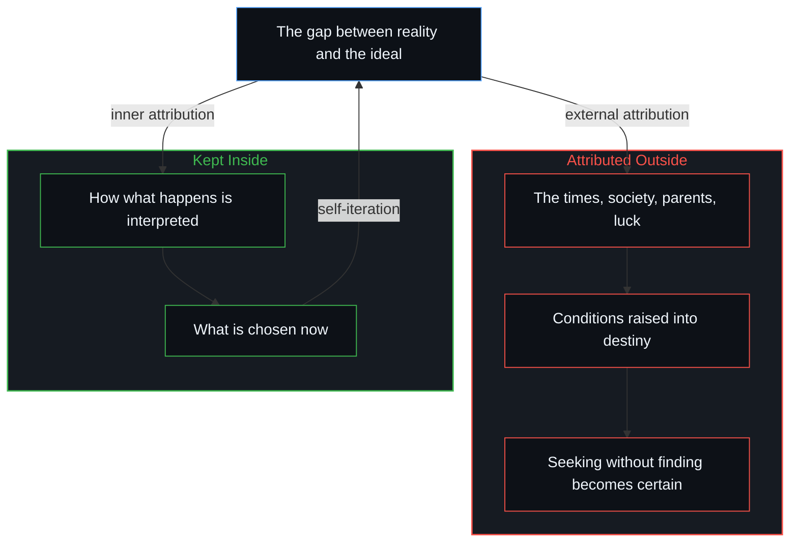

# 外部归因是个人进步的障碍 / External Attribution Is the Obstacle to Personal Growth

*行动的抓手只在内部；差距一旦归于外部，就失去被自己改变的可能 / The grip for action is only inside; a gap attributed outside loses the chance of being changed from within.*

人的进步，更准确地说是自我迭代，不是卡在能力、资源、环境或运气上。它卡在一处：外部归因。把条件升格为命运，抓手就从内部移走了。育儿把同一个机制做成对孩子内部归因的扰乱：替孩子承担他本可以承担的，或让他承担本不属于他的。父母真正能给的，只有更多的选择，以及不徒增干扰；用力管好自己，孩子才有机会把解释权也收回到自己手里。

Human progress, or more exactly self-iteration, does not get stuck on ability, resources, environment or luck. It gets stuck in one place: external attribution. Once conditions are raised into destiny, the grip is moved out of the inside. Parenting turns the same mechanism into a disturbance of a child’s inner attribution: carrying for the child what they could carry themselves, or making them carry what was never theirs. What parents can really give is only more options and no added interference; by working hard at managing themselves, they give the child a chance to take the right to interpret back into the child’s own hands as well.

## 一、 抓手只在内部 / 1. The Grip Exists Only Inside

现实与理想之间的差距，一旦被归于自己以外的任何原因，就失去了被自己改变的可能，因为行动的抓手只存在于内部。说“是因为时代”“是因为社会”“是因为父母”“是因为运气不好”“是因为别人不理解”的时候，其实是把下一步的供给登记到了别处：这件事不由我完成。求而不得，从此成为必然。

The gap between reality and the ideal, once attributed to any cause outside oneself, loses the chance of being changed by oneself, because the grip for action exists only inside. Saying “it’s because of the times,” “because of society,” “because of my parents,” “because of bad luck,” “because others don’t understand” is in fact registering the supply of the next step somewhere else: this is not mine to complete. Seeking without finding becomes, from then on, a certainty.

这不是“常见问题”，而是唯一的问题。说唯一，不是把别的困难抹掉，而是：除此之外，没有任何其他杠杆属于自己。

This is not a “common problem” but the only problem. Calling it the only one does not erase other difficulties; it means that apart from this, no other lever belongs to oneself.

## 二、 条件一旦升格为决定性原因 / 2. When Conditions Are Raised to Decisive Causes

天赋、条件、机遇、系统，都只是条件，连此刻的技能与能力也是。条件可以被利用、绕过、等待，甚至创造。技能可以学习，能力可以培养。一旦把它们升格为“决定性原因”，它们就变成了不可逾越的命运。

Talent, circumstance, opportunity and systems are all only conditions, and so are one’s present skills and abilities. Conditions can be used, bypassed, waited out, even created. Skills can be learned, abilities cultivated. Once they are raised into “decisive causes,” they turn into an insurmountable fate.

人真正能动的部分，从来只有这一处：如何解释发生在自己身上的事，以及基于这个解释，选择此刻做什么。

The part a person can really move has only ever been this one place: how what happens to oneself is interpreted, and what one chooses to do now on the basis of that interpretation.

[个体抉择是唯一的因果杠杆](../individual-choices-as-the-only-causal-levers/)是同一次归位：条件是场域，不是替下一步供给原因的第二个作者。[人生是一个持续的自我迭代过程](../ren-sheng-shi-yi-ge-chi-xu-de-zi-wo-die-dai-guo-cheng/)是同一处截断：误差停在“外部给定”上，回不到可更新的权重。[关于归因](../guan-yu-gui-yin/)是同一种外置停在一个显眼节点上的样子。

[Individual choices as the only causal levers](../individual-choices-as-the-only-causal-levers/) is the same return to place: conditions are field, not a second author supplying the cause of the next step. [Life as a Continuous Process of Self-Iteration](../ren-sheng-shi-yi-ge-chi-xu-de-zi-wo-die-dai-guo-cheng/) is the same cut-off: the error stops at “externally given” and never returns to the weights that can be updated. [On Attribution](../guan-yu-gui-yin/) is the same externalizing as it comes to rest on a conspicuous node.

## 三、 育儿是在扰乱孩子的内部归因 / 3. Parenting That Disturbs a Child’s Inner Attribution

育儿的困境，不在方法不够先进，而在父母反复扰乱孩子的内部归因。

The trouble in parenting lies not in methods that are not advanced enough, but in parents repeatedly disturbing a child’s inner attribution.

最常见的操作有两种。

There are two common ways of doing it.

一是替孩子承担他本可以自己承担的。过度保护、包办、抢先解决，等于在反复告诉孩子：“你做不到，也不需要做到。”他的行动与结果之间的因果链被切断，内部归因就无法生长。[情感支持作为因果干扰](../emotional-support-as-causal-interference/)是同一种替换：外部的调节替掉了孩子自己与后果的接触。

The first is carrying for the child what they could carry themselves. Overprotecting, doing everything for them, solving problems before they arise, all keep telling the child: “You can’t do it, and you don’t need to.” The causal chain between their actions and the results is cut, and inner attribution cannot grow. [Emotional support as causal interference](../emotional-support-as-causal-interference/) is the same replacement: outside regulation takes the place of the child’s own contact with consequence.

二是让孩子承担本不属于他的。把父母的焦虑、情绪与未完成的欲望投射过去，等于在告诉他：“你的价值取决于别人的心情和期待。”他开始用外部的标准定义自己，内在的驱力逐渐萎缩。[当效果主宰了框架的叙事](../when-the-effect-authors-the-frame/)是同一个先验：把登记到的东西当成下一步的作者。

The second is making the child carry what was never theirs. Projecting the parents’ anxiety, moods and unfinished desires onto the child amounts to telling them: “Your worth depends on other people’s moods and expectations.” The child begins to define themselves by outside standards, and the inner drive slowly withers. [When the effect authors the frame](../when-the-effect-authors-the-frame/) is the same prior: what registers is taken for the author of the next step.

这两种操作，把孩子原本微弱却真实的自驱力，一点一点磨平。

These two ways grind down, bit by bit, the child’s self-drive, faint at first but real.

## 四、 个体的自驱力经不起平均 / 4. Individual Self-Drive Cannot Be Averaged

畅销书里的教育方法，多在研究现象、总结规律、平均经验，却看不见真正重要的东西：那个具体的孩子此刻内心真正在驱动什么。个体的自驱力既看不见，也经不起平均。只有近距离观察、将心比心，才能体会到其中的真谛。体会发生在观察的这一边，而不是进入他的内心。

The parenting methods in bestselling books mostly study phenomena, sum up patterns and average experience, and miss what really matters: what is actually driving that particular child inside, right now. Individual self-drive can neither be seen nor averaged. Only close observation and putting oneself in the child’s place can sense what is at work in it. That sensing happens on the observer’s side; it is not an entry into the child’s mind.

[平均值是痕迹，不是引擎](../the-average-is-residue-not-the-engine/)是同一份冻结：把平均的痕迹当成引擎。[好奇先行](../curiosity-first-the-hidden-engine-of-talent-and-development/)是那份具体驱动的一面：好奇的回路，不是可以平均的天赋库存。成功的父母把自己的路径当作公式，孩子的差距便被归于外部，[成功之后的育儿谬误](../the-fallacy-of-post-success-parenting/)对此有所剖析。

[The average is residue, not the engine](../the-average-is-residue-not-the-engine/) is the same freeze: averaged residue taken for the engine. [Curiosity First: The Hidden Engine of Talent and Development](../curiosity-first-the-hidden-engine-of-talent-and-development/) is the face of that particular drive: the loop of curiosity, not an averageable stock of talent. Successful parents take their own path as a formula, and the child’s gap is then attributed outside, as [The Fallacy of Post-Success Parenting](../the-fallacy-of-post-success-parenting/) dissects.

## 五、 提供更多选择，不徒增干扰 / 5. More Options, No Added Interference

孩子的未来是孩子的，不是父母的规划。

The child’s future belongs to the child, not to the parents’ plan.

古人说“儿孙自有儿孙福”，不是消极，而是清醒；不是放任，而是自律。父母真正能给的只有两样：提供更多的选择，以及不徒增干扰。其余的路，都必须由孩子自己走。最有效的育儿，看起来最轻松，因为父母不再用力去“塑造”孩子，而是用力去管好自己：管自己的焦虑，管自己的投射，管自己想通过孩子证明什么的那部分欲望。这才是最需要在认知上下功夫的地方。

The old saying that children and grandchildren have fortunes of their own is not passivity but clarity, not indulgence but self-discipline. Parents can really give only two things: more options, and no added interference. The rest of the road the child must walk. The most effective parenting looks the most relaxed, because the parents no longer strain to “shape” the child but strain to manage themselves: their own anxiety, their own projections, the part of their desire that wants to prove something through the child. That is where the work of understanding is most needed.

父母把归因全部收回到自己手里，孩子才有机会把归因也收回到自己手里。收回的是父母这一边的解释权，不是把内部归因做成礼物交过去。父母不再把外部当作命运，孩子才可能学会把条件当作条件。[没有普渡，只有自渡](../mei-you-pu-du-zhi-you-zi-du/)是同一道边界：没有任何内心能替另一个内心完成回归。用“革命”这样的大词解释一段人生，同样把抓手放在了外部，[革命之名把生活收成证据](../the-name-revolution-files-a-life-as-evidence/)说明了这一点。

When parents take attribution wholly back into their own hands, the child has a chance to take attribution back into theirs. What is taken back is the parents’ own right to interpret, not inner attribution wrapped as a gift and handed over. Only when parents stop treating the outside as destiny can the child learn to treat conditions as conditions. [No Universal Salvation, Only Self-Deliverance](../mei-you-pu-du-zhi-you-zi-du/) is the same boundary: no mind can complete the return for another. Explaining a life with a word as large as “revolution” likewise puts the grip outside, as [The Name Revolution Files a Life as Evidence](../the-name-revolution-files-a-life-as-evidence/) shows.

## 六、 解释权只在自己手里 / 6. The Right to Interpret Rests Only with Oneself

进步从不是被外界批准的。它只发生在一个地方：一个人决定把所有的解释权，重新握回自己手中。收回不是一次就结束；向外投射与收回，仍是同一个无法消解的运动，[生成性的矛盾](../the-generative-contradiction/)把这一对看作生成的源头，而不是收回就能了结的缺陷。[如何在一瞬间修正你的整个人生](../how-to-fix-your-whole-life-in-one-split-second/)是那一握作为瞬间的认领：剩下的，就是搞明白怎么做。[目的性的评判与认知的缺省状态](../cong-mu-di-xing-de-ping-pan-kan-ren-zhi-que-sheng/)剖析了人际往来中，拿“目的性太强”这个文化标签作为省力的防御、逃开自我迭代的细微机制。父母替孩子归因，也是一种外部归因，[引导不是占有](../guidance-is-not-ownership/)说明了这一点。

Progress is never approved from outside. It happens in only one place: a person deciding to take every right of interpretation back into their own hands. Taking it back does not end at once; projecting outward and taking back remain the same irresolvable movement, which [The Generative Contradiction](../the-generative-contradiction/) holds as the generative source rather than a defect the reclaiming finishes. [How to Fix Your Whole Life in One Split Second](../how-to-fix-your-whole-life-in-one-split-second/) is that grip as an instantaneous claim of ownership: the rest is figuring out how. [Judging by Purpose and the Default State of Cognition](../cong-mu-di-xing-de-ping-pan-kan-ren-zhi-que-sheng/) dissects the fine mechanism in human dealings of taking up the cultural label “too purpose-driven” as an economical defense that escapes self-iteration. Parents attributing on a child’s behalf is also external attribution, as [Guidance Is Not Ownership](../guidance-is-not-ownership/) shows.
