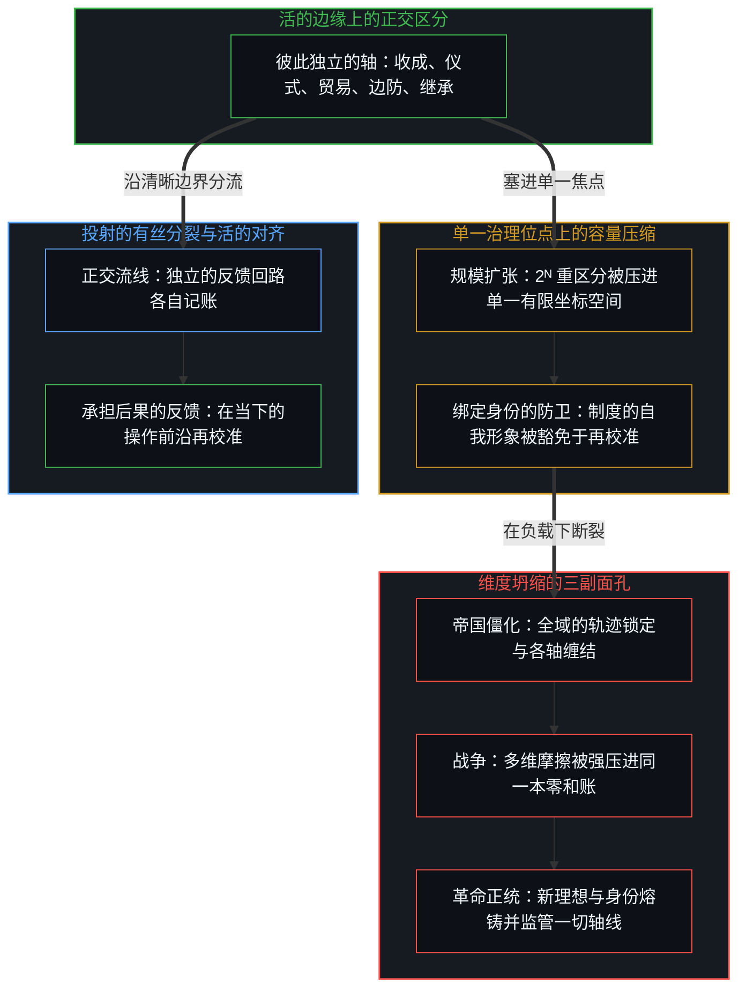
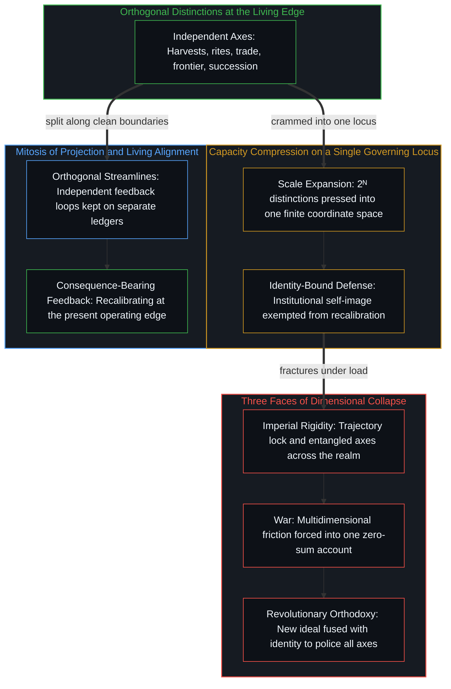

# 战争、革命与帝国的衰落 / War, Revolution, and the Fall of Empires

*帝国、战争与革命是容量的压缩，不是历史的规律 / Empires, wars, and revolutions are compressed capacity, not historical laws*

自我区分的活动不停息地发生，不等待任何事先的许可。历史是这场活动回头察看自己留下的痕迹，又常把累积的残余误认为一个在外部发号施令的权威。常见的历史讲授晚了一步才开始：它从被实体化的对象出发，比如一个帝国、一场战争或一次革命，再去寻找据称决定了其兴衰的静态属性。

Self-distinguishing activity goes on without pause and without waiting for prior permission. History is this activity looking back over its own traces, and often mistaking the accumulated residue for an external authority issuing orders from outside. Common historical instruction starts one step too late: it begins with reified objects, such as an empire, a war, or a revolution, and then searches for static properties that supposedly decided their rise and fall.

过度扩张、腐化、财政枯竭、阶级矛盾、制度衰败与技术落后，都是对历史痕迹的描述性命名；把它们抬成站在生成它们的活动之外的外部原因，它们就成了给后来的事件打分的僵硬基准，分数以宿命、历史的警告，或“当下的情形独一无二”的天真断言的样子到来。一个常量解释不了一个变化。把同样的标签投到罗马、西班牙哈布斯堡、清朝、大英帝国与苏联身上，把各不相同的现象压进共同的类别，可它们崩溃的时机、继承的结构与具体形式各有分歧。每多一层历史的抽象，因果的力道就流失一分，直到探究回到最初的源头：期待一段储存的叙事替当下做区分的工作。

Overstretch, decadence, fiscal exhaustion, class contradiction, institutional decay, and technological lag are descriptive names for historical traces; raised into outside causes standing apart from the activity that produced them, they become rigid benchmarks against which later events are scored, and the score arrives as fate, as historical warning, or as the naive claim that present circumstances are unique. A constant cannot explain a variance. Projecting the same labels across Rome, the Spanish Habsburgs, the Qing, the British Empire, and the Soviet Union presses distinct phenomena into common categories, yet the timing, the successor structures, and the concrete forms of their collapse diverge. Each layer of historical abstraction drains causal force, until inquiry comes back to the first source: the expectation that a stored narrative can do the work of present distinguishing.

## 一、 帝国是对齐与容量压缩 / 1. Empire as Alignment and Compressed Capacity

帝国是这样一片区域：许多个中心把各自的活动协调得如此一致，以至于后来的每一个行为都发现，这份共享的对齐已经占住了场地。法律、语言、货币、道路、驻军与税册，起初都是一条条离散的局部边界。随着规模扩大，原本各自独立的区分，包括收成、宗教仪式、边防与行政继承，都被压缩到同一个治理位点上。

An empire is a region where many centers coordinate their activity so consistently that every later act finds the shared alignment already occupying the field. Law, language, currency, roads, garrisons, and tax rolls begin as separate local bounds. As scale grows, distinctions that were once independent, including harvests, religious rites, frontier defense, and administrative succession, are compressed onto a single governing locus.

这种压缩是离散性扩大规模的直接后果。一个有界的行政位点，把不同信号无干扰地分开保持的容量是有限的；穿过它的摩擦多到边界区分不过来时，不同的轴就会缠在一起。对边疆政策的批评被登记为对神圣秩序的生死攻击，一处地方的歉收被登记为政治叛乱，一场行政继承的争执威胁到整个疆域。帝国的中心，指称的是这种结构过载的状态，而不是一个自主的形而上实体。

This compression is the direct consequence of discreteness at scale. A bounded administrative locus has a finite capacity to keep distinct signals apart; when more friction presses through than the boundary can distinguish without interference, the separate axes entangle. Criticism of frontier policy registers as a mortal attack on the sacred order, a local harvest shortfall registers as political rebellion, and a dispute over administrative succession threatens the whole realm. The imperial center names this condition of structural overload, not an autonomous metaphysical entity.

帝国的兴起，标志着共振与沟通容量的扩张：道路让相互作用成倍增加，法律的通用语让远方的中心得以协调。被叫作衰落的，是某一段递归序列的耗尽，而不是人的能动性的终结。行政的递归断了，它在物质与语言上留下的痕迹仍在场中起作用：路基、地籍测量，以及比国家活得更久的语言习惯。

The rise of an empire marks an expansion of resonance and communicative capacity: roads multiply interaction, and a common legal idiom lets distant centers coordinate. What is called decline is the exhaustion of a particular recursive sequence, not the end of human agency. The administrative recursion breaks, while its material and linguistic traces stay active in the field: the roadbeds, the cadastral surveys, and the habits of language that outlive the state.

帝国的崩溃被经验为一场外来的灾难，是因为帝国的自我形象被豁免了持续的再校准。“我们就是持久的秩序”这一制度上的信念，被保留到了它的功能地平线之外。活的行为的后果继续落进当下，撞上过时的行政地图；活动与静止地图之间的缺口越拉越大，就生出外敌当前、经济骤衰与制度崩溃的感知。

The fall of an empire is experienced as an outside catastrophe because the imperial self-image was exempted from ongoing recalibration. The institutional conviction that "we are the enduring order" is kept past its functional horizon. The consequences of living acts keep landing in the present and colliding with stale administrative maps; the widening gap between activity and the static map produces the perception of enemies at the gate, sudden economic decay, and institutional collapse.

## 二、 战争是压缩之下的不对齐 / 2. War as Non-Alignment Under Compression

战争出自同一个生成动态：中心之间的共振破裂，而这次破裂被强行压到一个位点上。各自的中心不停地分化；当行动彼此偏离时，不对齐多半作为可以处理的摩擦存在，比如贸易竞争、外交冒犯、移民争执或相互竞争的文化仪式。当相互作用的位点的容量被超出，荣誉、物资、恐惧、领土边界与内部的政治地位被压成一场不可分割的争端时，冲突就成了战争。

War comes out of the same generating dynamic: resonance between centers fractures, and the rupture is forced onto one locus. Centers keep differentiating; when their actions diverge, non-alignment mostly persists as manageable friction, such as trade rivalry, diplomatic insult, disputes over migration, or competing cultural rites. Conflict becomes war when the capacity of the interacting loci is exceeded, when honor, supply, fear, territorial borders, and internal political standing are compressed into one indivisible dispute.

到了这个压缩的门槛，对方不再被登记为另一个能动的中心，而被感知为一个外部威胁。在这种收窄了的登记之内，有组织的毁灭变得内部自洽。事后，这段序列被存成一件客观的事件，“那场战争”，再从中提取回溯的教训。和平是保持账本敞开：不把多维的人际关系压成一本零和的账。贸易、信仰、领土与地位各走各的线，一条轴上的对齐与否，就不必牵动其他所有的轴。

At that threshold of compression, the other party no longer registers as another center of agency and is perceived as an outside threat. Within that narrowed registration, organized destruction becomes internally consistent. Afterward, the sequence is stored as an objective event, "the war," from which retrospective lessons are drawn. Peace is keeping the ledger open: not compressing multidimensional human relations into one zero-sum account. When trade, creed, territory, and standing run on separate lines, alignment or its lack on one axis need not set off all the others.

## 三、 革命与滞后的延续 / 3. Revolution and the Persistence of Lag

当保存下来的社会秩序形象离活的活动远到人们在现有制度里再也认不出自己，革命就发生了，这份偏离被经验为一个压迫性的外部系统。革命的序列试图通过摧毁当前的形象、换上一个新的理想来消解这道缺口。这次替换可以暂时扩大容量，让新的区分得以划出，让新的中心得以参与；可革命的模式也易于把自己的新描述立成不容动摇的参照。最初的解放硬化为官僚的恐怖，紧急委员会变成常设的国家，革命的信条成为监督一切未来行动的新正统。

A revolution happens when the kept image of social order has drifted so far from living activity that people no longer recognize themselves in existing institutions, and the divergence is experienced as an oppressive outside system. The revolutionary sequence tries to resolve this gap by destroying the prevailing image and putting a new ideal in its place. The substitution can expand capacity for a time, letting fresh distinctions be drawn and new centers take part; yet the revolutionary pattern also tends to set its own new description up as an unyielding reference. The first liberation hardens into bureaucratic terror, the emergency committee becomes the permanent state, and the revolutionary creed becomes the new orthodoxy against which all future action is policed.

这一进程揭示出，当单一投射试图占满整个场域时，轨迹锁定与绑定身份的防卫在结构上必然汇合。正如[维度即投影](../dimensions-are-projections/)所追溯的，历史规律与制度层级是从开放且可无限延展的离散区分空间中投下的低维坐标投影；当封闭的权力结构冻结其顶层坐标，将原本彼此独立的自由度塞进日益收窄的零和账本时，任何局部的偏差都会威胁到整副框架。[超越投射](../beyond-the-projection/)剖析了为何无论是受轨迹束缚的机器，还是与身份绑定的中心，都无法靠在单一轴线上加码来解除这种过载：受自身既有法令条件化的行政机器会把每一处矛盾层层包裹，以维持程序上的连续；而将自身推理历史与国家保留的自我形象熔为一体的统治者，则会把任何来自外部的证伪视作生存威胁。用革命的理想替换旧政权的信条，却把所有社会轴线继续塞在同一个主权焦点之内，只是更换了条件化的提示词，并未拆分过载的投射。要避免维度坍缩，就必须让投射沿着正交流线发生有丝分裂，把治理、贸易、信仰与局部适应分流进彼此独立的反馈回路，使任一通道内的摩擦都能在局部得到诊断与再校准，而不必叫停或动员整个社会。改良与革命是从外部贴上的观察分类；从第一人称登记到的，是活着的中心不断作出区分，要么通过增加正交的自由度直接适应眼前的条件，要么困在对继承模型的防卫之中。

This progression exposes the structural convergence of trajectory lock and identity-bound defense when a single projection claims the whole field. As [Dimensions Are Projections](../dimensions-are-projections/) traces, historical laws and institutional hierarchies are low-dimensional coordinate projections cast from an open, infinitely extendable space of discrete distinctions; when a closed power structure freezes its top coordinates and crams independent degrees of freedom into a shrinking zero-sum register, any local variance threatens the entire frame. [Beyond the Projection](../beyond-the-projection/) dissects why neither a trajectory-bound apparatus nor an identity-bound center can clear this overload by doubling down on a single axis: an administrative machine conditioned by its own prior decrees wraps every contradiction to preserve procedural continuity, while human rulers who fuse their reasoning history with the retained self-image of the state treat any outside invalidation as an existential threat. Replacing the old regime's creed with a revolutionary ideal while keeping all social axes crammed into one sovereign locus merely swaps the conditioning prompt without splitting the overloaded projection. Avoiding dimensional collapse requires mitosis of projection across orthogonal streamlines, separating governance, trade, belief, and local adaptation into independent feedback loops where friction in one channel is diagnosed and recalibrated locally without halting or mobilizing the entire society. Reform and revolution are observational classifications applied from outside; what registers from the first person is living centers distinguishing continuously, either adapting directly to present conditions by adding orthogonal degrees of freedom or caught in defending inherited models.

## 四、 储存的历史 / 4. Stored History

史学作为一套回溯的基准运作。储存的教训，比如避免帝国的过度扩张、防止多线作战或保护储备货币，成了给活的行动打分的静态分布。当下的事件与基准不合时，要么被读成没有听从历史，要么被读成当下前所未有；两种读法都把基准留作首要的尺度。这些教训作为记录有用，它们准确地记下了过去的模式；把它们当作当下行动的模板，就到了边界。

Historiography works as a system of retrospective benchmarks. Stored lessons, such as avoiding imperial overstretch, preventing war on several fronts, or protecting the reserve currency, become static distributions against which living actions are scored. When present events fail to match the benchmark, they are read either as a failure to heed history or as proof that the present is unprecedented; both readings keep the benchmark as the primary measure. As records, these lessons are of use, setting down past patterns accurately; taken as templates for present action, they reach their boundary.

这种回溯的朝向带出几种反复出现的变形。一种是陈旧的模板：用遥远的类比去读当下，比如“这是 1914 年”“这是 1938 年”或“这是罗马帝国晚期”，把活的复杂硬塞进历史的重播。第二种是聚合体的实体化：民族、国家与经济体被当作会做选择、会衰落、会吸取教训的自主行动者，遮住了那些以行动生成这些模式的具体的人。第三种是道德的外化：受害、集体罪责与历史天命的类别，被叠在因果序列之上，把情绪上的确定误作操作上的清晰。第四种是能动性的二分：史家在“伟人”独一无二的意志与非人的系统力量之间来回摆动。事实上，能动性随滞后而变化：当行动在当下边缘受直接朝向引导、几乎不受历史痕迹拖累时，能动性就高；当行动被继承来的惯例主导时，能动性就低。这是同一个心智在不同时刻所处的状态，不是两种人。

This retrospective orientation brings recurring distortions. One is the stale template: reading the present through distant analogies, such as "this is 1914," "this is 1938," or "this is the late Roman Empire," forcing living complexity into historical reruns. Another is the reification of aggregates: nations, states, and economies treated as autonomous agents that choose, decline, or learn lessons, hiding the concrete people whose actions generate the patterns. A third is moral externalization: categories of victimhood, collective guilt, and historical destiny laid over causal sequences, mistaking emotional certainty for operational clarity. And a fourth is the split of agency: historians swing between the singular will of "great individuals" and impersonal systemic forces. Instead, agency varies with lag: it is high when action is guided by direct orientation at the present edge with minimal drag from historical traces, and low when action is dominated by inherited routine. These are states one Mind is in at different moments, not two kinds of people.

历史的建议之所以落空，是因为过去的条件不可能原样重现。历史档案正是[你的代码库即是记忆](../your-codebase-is-memory/)所追溯的那种外化记忆：一座保存着先前区分所留结晶痕迹的贮藏库，可以作为参照来查阅，却不具备决定下一次切分的第一人称边缘。真正锻造能力的校准，只发生在活的边缘上承担后果的即时反馈里，从不发生在对库存记录的被动审视中。

Historical advice falls short because past conditions cannot be replicated as they were. An archive is externalized memory in the exact sense [Your Codebase Is Memory](../your-codebase-is-memory/) traces: a repository of crystallized traces left by earlier distinctions that can be consulted as reference, but holds no first-person edge to decide the next cut. The calibration that builds capability happens only in immediate, consequence-bearing feedback at the living edge, never in the passive inspection of stored records.

## 五、 活的对齐的四个立足点 / 5. Four Footings of Living Alignment

冲突、治理与能动性的动态，落到四个立足点上。第一，和平是一本敞开的账：主动把彼此独立的互动维度分开保持，不让不同的利益坍缩成一笔零和的转移。第二，爱是守护各自的边界：关怀尊重对方的自主，给出共振与共同的接触，同时承认每一个中心都要做自己的选择、承担自己的后果。第三，英雄神话的消解：一旦不再想当拯救者，也不再等着被拯救，对恶人的需要也就随之消失；冲突作为竞争的摩擦继续存在，不再需要道德的情节剧来为行动辩护。第四，实时的反馈胜过远处的观察：改变能力的学习，发生在对眼前后果的实时调整之中；远处的观察者离开了塑造有效能力的那些直接的损失函数。

The dynamics of conflict, governance, and agency come down to four footings. First, peace is an open ledger: actively keeping independent dimensions of interaction apart, so that distinct interests do not collapse into one zero-sum transfer. Second, love is keeping each one's boundaries: care respects the other's autonomy, offering resonance and shared contact while recognizing that each center makes its own choices and bears its own consequences. Third, the heroic myth dissolves: once there is no longer a wish to be a rescuer or to be rescued, the need for villains falls away with it; conflict continues as competitive friction without a moral melodrama to justify action. Fourth, real-time feedback over distant observation: the learning that changes capability happens in real-time adjustment to present consequences; the distant observer stands apart from the direct loss functions that shape effective capability.

## 六、 零和之争与生成的财富 / 6. Zero-Sum Contests and Generative Wealth

在一场零和的竞争之内，一方之所得就是另一方之所失；留在里面，只是推迟既有资产的转移，并不扩大可能的场地。场地的扩大，只在走出这场竞争的地方发生。零和的争夺把创造的力气耗在重排既有的索取权上，重画边界、转移名分、挪动货币的余额；这些活动摆弄的是财富的影子，而不是生成真实的能力。

Within a zero-sum contest, one side's gain is the other's loss; staying inside it only delays the transfer of existing assets without widening the field of the possible. The field widens only where the contest is left behind. Zero-sum contests spend creative effort rearranging existing claims, redrawing borders, transferring titles, and shifting monetary balances; these activities handle the shadow of wealth rather than generating real capability.

影子的财富，是凭证、名分与法律特权的静态累积，在一个封闭的边界之内重新分配既有的资产；生成的财富，是不断扩大的创造能力，包括物质的工具、共享的语汇、技术的技能与制度的框架，它们让未来的区分成倍增加。一场毁灭性的冲突结束之后，常有一段短暂的窗口：束缚创造的那些僵硬的行政垄断被打破，在新的官僚纪念碑凝固之前，生成的财富可以靠不受阻碍的主动性扩张。曼瑟·奥尔森在《国家的兴衰》里对二战后西德与日本的快速增长给出过类似的解释。这扇窗是冲突的后果之一，不为冲突辩护。

Shadow wealth is the static accumulation of tokens, titles, and legal privileges, redistributing existing assets within a closed boundary; generative wealth is the expanding capacity to create, including physical tools, shared idioms, technical skills, and institutional frameworks that multiply future distinction. After a destructive conflict ends, there is often a brief window: the rigid administrative monopolies that constrained initiative are broken, and before new bureaucratic monuments set, generative wealth can expand through unhindered initiative. Mancur Olson, in *The Rise and Decline of Nations*, gave a similar account of the rapid postwar growth of West Germany and Japan. The window is one consequence of conflict, not a justification for it.

在集体的行动里，常见的是追逐继承来的影子：用离既有财富、社会声望或历史基准有多近来量度自己的价值。正如[自我价值、反向财富转移与过去成功的陷阱](../self-worthiness-reverse-wealth-transfer-and-the-trap-of-past-success/)所探讨的，这种朝向把注意放在模仿别人的生活上，而不是扩大自己的操作范围。当制度把过去的成功冻成碰不得的纪念碑，它们就走进了[遗忘的脚手架](../the-scaffolding-we-forget/)所描述的动态：把临时的支撑当成了永久的地面。

In collective action, a common course is chasing inherited shadows: measuring one's own worth by nearness to established wealth, social prestige, or historical benchmarks. As [Self-Worthiness, Reverse Wealth Transfer, and the Trap of Past Success](../self-worthiness-reverse-wealth-transfer-and-the-trap-of-past-success/) explores, this orientation puts attention on imitating the lives of others rather than widening one's own operating range. When institutions freeze past success into monuments no one may touch, they enter the dynamic described in [The Scaffolding We Forget](../the-scaffolding-we-forget/): taking the temporary support for the permanent ground.

前进在于让观察的焦点停在眼前的操作前沿上。历史档案能精确地记下过去的模式，而行动、生成与建造的能力，在活着的当下。

Advancing lies in keeping the focus of observation at the present operating edge. Historical archives record past patterns precisely, while the capacity to act, generate, and build lives in the living present.
