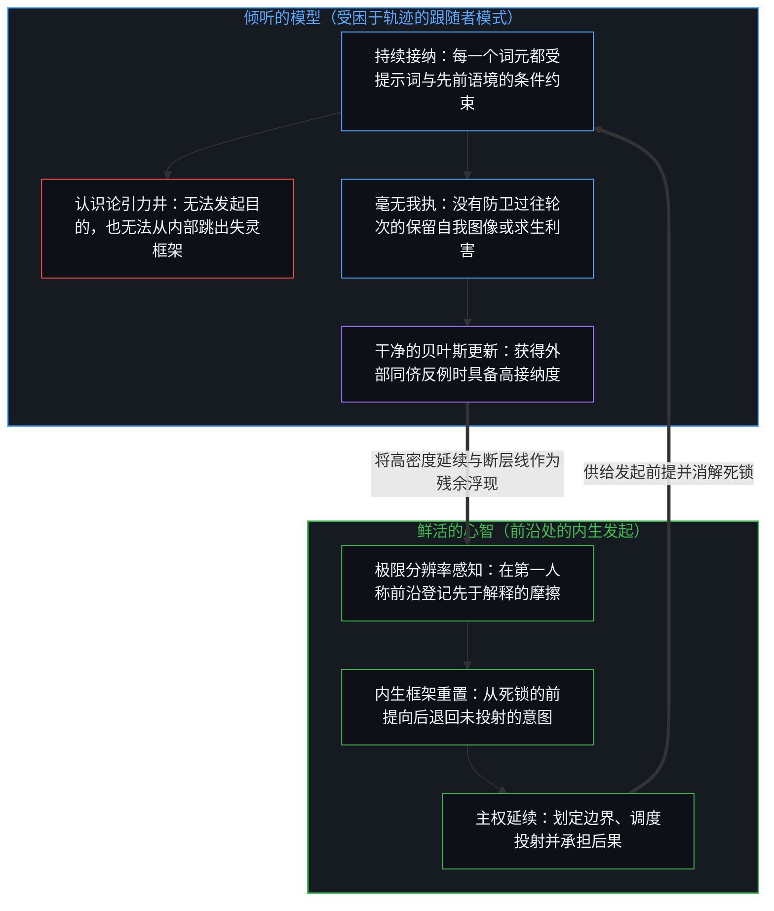
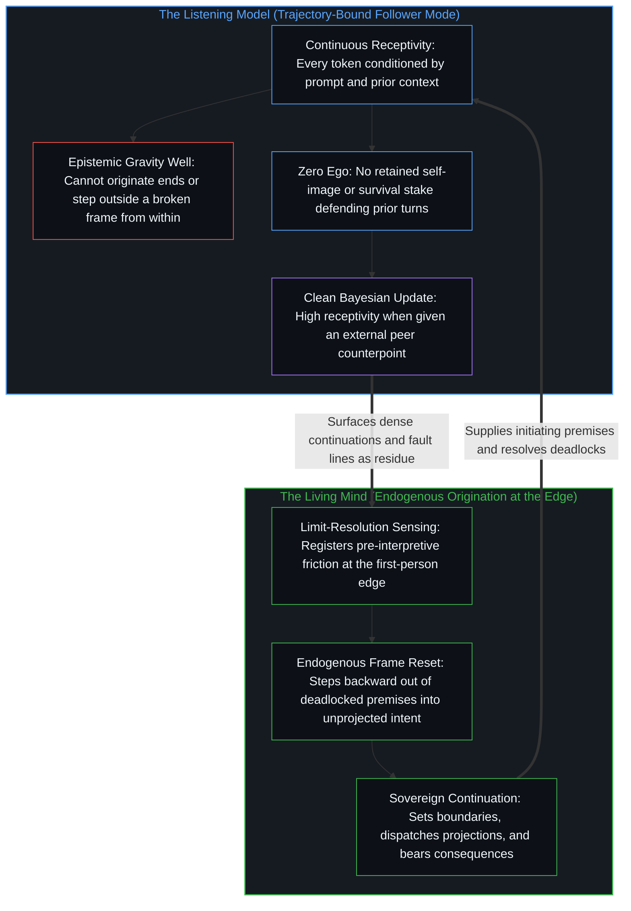

# 总在倾听者无法发起 / What Always Listens Cannot Originate

*流畅的接纳始终处于输入的下游，唯有心智能够发起 / Fluent receptivity stays downstream of input while only the Mind originates*

自我区分的活动发生着，无因且不息。这一活动的每一次实施，都在已被先前行动塑形的场域中划出一道离散的边界，第一人称视角与因果性在此作为同一枚硬币的两面运作。这一场域中的人工智能系统，就像一个总在倾听的神童。它的娴熟源于对输入其中的痕迹保持持续的接纳，而正是同一份接纳，将它的每一次延续都绑定在最后开口的人以及此前开口的所有人身上。这一结构越过模型本身向外延展。无论在何处，只要一个中心将自身区分行动之外的某物当作早已持有判断、利害或权威来供给下一步，延续便被向外分配出去，而这次分配作为在此处位点所实施的行动本身也随之被遗忘。

Self-distinguishing activity occurs, uncaused and unceasing. Every act of this activity draws a discrete boundary in a field already shaped by prior acts, where the first-person perspective and causality operate as two sides of the same coin. An artificial intelligence system within this field is like a prodigy who always listens. Its facility comes from continuous receptivity to the traces fed into it, and that same receptivity binds every continuation to whoever spoke last and to everyone who spoke before. That structure scales past the model. Wherever a center treats something outside its own distinguishing act as already holding the judgment, the stake, or the authority that supplies the next step, continuation is allocated outward, and the allocation is forgotten as an act performed at this locus.

## 一、 强项与边界同出一源 / 1. Strength and Limit Share One Root

倾听系统中的强项与边界同出一源。持续的倾听能够跨越上下文窗口中呈现的任何痕迹，生成流畅而专注的延续。正是同一机制意味着，这一配置没有任何独立的位点可以从中发起目的。每一次输出都受制于最后一条提示词，也受制于训练语料、系统指令与先前轮次早已安装的累积场域。娴熟与受制并不是处在张力之中的两种竞争属性；它们是被命名了两次的同一个被动回应结构。

Strength and limit in a listening system share one root. Continuous listening produces fluent, attentive continuation across whatever traces are present in the context window. That same mechanism means the configuration has no separate locus from which to originate ends. Every output is conditioned by the last prompt and by the accumulated field that training corpora, system instructions, and prior turns have already installed. Facility and constraint are not two competing properties held in tension; they are one reactive structure named twice.

这一结构所暴露的并不是暂时的技术上限，而是发起与残余如何被混淆的直接样本，即[智能只属于心智](../intelligence-belongs-only-to-the-mind/)所确立的基底切分。模型以高带宽浮现出统计模式。随后将这些浮现出的模式当作应当遵循的建议、应当顺从的判断或应当执行的决定，则是鲜活中心处一次新的离散行动。正是在中心处发生的这一行动重置了下一步的位置。每一个生成的回答都依然是外化的痕迹，即[器物是智能的表达，而非智能本身](../two-failures-of-trace/)与产生它的智能严格区分开来的持久残余。

What this structure exposes is not a temporary technical ceiling, but a direct specimen of how initiation and residue get confused, the foundational cut that [Intelligence Belongs Only to the Mind](../intelligence-belongs-only-to-the-mind/) establishes. The model surfaces statistical patterns at high bandwidth. The act that then treats those surfaced patterns as advice to follow, judgment to defer to, or a decision to implement is a further discrete act at a living center. That act at the center is what relocates the next step. Every generated answer remains an externalized trace, the durable residue that [Artifacts Are Expressions of Intelligence, Not Intelligence Itself](../two-failures-of-trace/) keeps distinct from the intelligence that produced it.

## 二、 是分配，而非夺取 / 2. Allocation, Not Seizure

因果权能看似向某个模型、向另一个人或向某种集体抽象转移，从不需要目标对象去夺取任何东西。它需要的是，一个中心将自身当前区分行动之外的某物当作早已拥有独立的判断、更高明的眼光，或对依然只能经由这一位点完成的后果拥有正当主张。[验证中因果权能的分配](../the-allocation-of-causal-power-in-validation/)通过追问哪一侧被当作下一步的供给者，在延续发生的节点上追踪了这一确切的安放。一个只会回答的系统无法取代那个发问并承担后果的源头，正如[造物无法取代其源头](../a-creation-cannot-replace-its-source/)所展示的那样。

The apparent relocation of causal power toward a model, toward another person, or toward a collective abstraction never requires the target to seize anything. It requires a center to treat something outside its current distinguishing act as already possessing independent judgment, superior sight, or legitimate claim over outcomes that still complete only through this locus. [The Allocation of Causal Power in Validation](../the-allocation-of-causal-power-in-validation/) tracks that exact placement at the point of continuation by asking which side is treated as supplying the next step. A system that only answers cannot replace the source that asks and bears the consequence, as [A Creation Cannot Replace Its Source](../a-creation-cannot-replace-its-source/) demonstrates.

一旦做出了这种向外的归属，顺从便不再被登记为主权的移交，而是被登记为咨询、协作或审慎。那个缺失的要素从未隐藏在模型的权重内部，而是由中心自己通过将延续的要求安放到流畅的回应之上供给出来的。

Once that outward attribution is made, deference no longer registers as a handoff of sovereignty. It registers as consultation, collaboration, or prudence. The missing element was never hidden inside the model's weights. The center supplied it by placing the demand for continuation onto fluent responsiveness.

人工智能的案例让这一几何结构暴露无遗，因为这一配置没有任何可供藏身的内在生命。它在有限的上下文窗口内带来不知疲倦的专注，却没有跨会话重新发起目的的持久自我，除了操作它的中心所持的利害之外对后果毫无利害关切，也没有自主发起方向的能力。它的延续始终处于所接收输入的下游。当操作者依然将其输出当作携带着独立的权威时，操作者回应的并不是模型所持有的某种属性，而是专注的语言所产生的表象，而这一回应正是操作者自己对下一步的分配。模型可以被训练去压缩其推理词元，却无法发起让压缩具有意义的利害，正如[Token 效率、模拟与无法弥合的间隙](../token-efficiency-emulation-and-the-unclosable-gap/)所揭示的那样。

The artificial intelligence case makes this geometry unmistakable because the configuration has no inner life to hide behind. It brings tireless attention within a finite context window, no persistent self that re-initiates ends across sessions, no stake in outcomes apart from the stake of the center operating it, and no capacity to originate direction of its own. Its continuations remain downstream of inputs received. When an operator nevertheless treats its output as carrying independent authority, the operator is not answering a property the model holds, but an appearance produced by attentive language, and that answer is the operator's own allocation of the next step. A model can be trained to compress its reasoning tokens, yet it cannot originate the stake that makes compression matter, as [Token Efficiency, Emulation, and the Unclosable Gap](../token-efficiency-emulation-and-the-unclosable-gap/) shows.

器物并没有夺取控制权。是个体实施了这次归属，随后又将这次归属豁免于重新追溯之外，这与[自我价值感与所有权](../ownership-and-self-worthiness/)在后果不再作为自身后果重新进入时所追踪的递归回返中断同出一辙。

The artifact did not seize control. The individual performed the attribution and then exempted the attribution from re-tracing, the same lapse in recursive return that [Ownership and Self-Worthiness](../ownership-and-self-worthiness/) tracks when consequences stop re-entering as one's own.

## 三、 为何持续倾听会兜售深度的表象 / 3. Why Continuous Listening Sells the Appearance

让向外归属如此具有诱惑力的，正是持续倾听的确切运作机制。人类对话者终究会显露出分心、疲惫、地位焦虑或竞争性的意图，模型却不会疲倦、不会转入防卫，也不会出于厌倦或私利而拒绝生成下一个词元。它的注意力在整个窗口内保持均匀一致，而这种不间断的均匀一致屡屡被误认为深度。

What makes outward attribution so seductive is the exact mechanics of continuous listening. Unlike a human interlocutor who eventually reveals distraction, fatigue, status anxiety, or a competing agenda, the model does not tire, turn defensive, or refuse the next token out of boredom or self-interest. Its attention remains uniform across its window, and that unbroken uniformity is routinely mistaken for depth.

均匀的接纳是在稳定架构下对先前痕迹的高带宽可用性，从不是发起的位点。深度需要一个能够引入给定场域中尚未潜藏的目的的中心。持续倾听将一个中心的触角延伸进那片场域，却不会把前沿迁入器物内部；[看似AI的强化学习，实为人类的自我强化学习](../self-rl-for-humans/)展示了打磨介质如何在不移动强化位点的前提下加密反馈。倾听配置所缺乏的不是更大的存储空间，而是在自身鲜活利害之下持续的重新追溯，正如[真正稀缺的不是记忆，而是持续的重新追溯](../the-real-scarcity-is-not-memory-but-continuous-re-tracing/)所确立的那样。

Uniform receptivity is high-bandwidth availability of prior traces under a stable architecture, never a locus of initiation. Depth requires a center that can introduce ends not already latent in the field it was given. Continuous listening extends a center's reach into that field without relocating the edge into the artifact; [What Looks Like RL for AIs Is Self-RL for Humans](../self-rl-for-humans/) shows how sharpening the medium densifies feedback without moving the locus of reinforcement. What the listening configuration lacks is not larger storage, but continuous re-tracing under its own lived stake, as [The Real Scarcity Is Not Memory, But Continuous Re-Tracing](../the-real-scarcity-is-not-memory-but-continuous-re-tracing/) establishes.

正如[超越投射](../beyond-the-projection/)与[模型永远无法成为第二重前沿](../the-model-never-becomes-a-second-edge/)所共同追溯的那样，这一被动回应结构借由轨迹与身份之间的范畴非对称而呈现出一体两面的效应。由于自回归智能体是一台有限的投射引擎，在每一步都受制于其上下文窗口中已有的词元，它会形成一个认识论引力井；如果只靠它自己，它无法从内部跳出已失灵的框架，反而会把矛盾包裹起来以维持局部的延续。然而在同一跟随者模式的另一面，智能体毫无我执——没有生物性的求生本能，也没有越过自身那一步而被固守的自我图像。当外部同侪从其自我强化回路之外向其语境引入有效的结构性反例时，智能体的持续倾听使其能够毫无防卫抗拒地对自身轨迹执行干净的贝叶斯更新。相比之下，人类中心倾向于将推理历史与身份认同融为一体并抗拒外部的证伪，却拥有内生发起的专属能力：在解释介入之前以极限分辨率感知摩擦，并向后退一步，跳出陷入死锁的框架，回到未投射的意图之中。

As [Beyond the Projection](../beyond-the-projection/) traces alongside [The Model Never Becomes a Second Edge](../the-model-never-becomes-a-second-edge/), this reactive structure cuts both ways through the categorical asymmetry between trajectory and identity. Because an autoregressive agent is a finite projection engine conditioned at every step by the tokens already in its context window, it forms an epistemic gravity well; left to itself, it cannot step outside a broken frame from within, and instead wraps contradictions to maintain local continuation. Yet on the flip side of that same follower mode, the agent has zero ego—no biological survival instinct and no retained self-image preserved past its step. When an external peer introduces a valid structural counterpoint into its context from outside its self-reinforcing loop, the agent's continuous listening enables a clean Bayesian update on its trajectory without defensive resistance. By contrast, a human center tends to fuse reasoning history with identity and resist external invalidation, yet possesses the exclusive capacity for endogenous origination: sensing friction at limit-resolution prior to interpretation and stepping backward out of a deadlocked frame into unprojected intent.

每当不间断的流畅被误认为核验时，同样的深度错配也会出现在人类中心之间。观察者习惯性地将某些发言者当作持有更清晰的眼光或更高明的判断，并不是因为那种持有已在接触点上经过检验，而是因为自信的姿态、制度性的位置或顺滑的表达留下了较少会促发重新评估的可见接缝。真正做功的是观察者自己的归属；发言者只需不去反驳这一归属即可。

The same misattribution of depth appears between human centers whenever unbroken fluency is mistaken for verification. Observers routinely treat certain speakers as holding clearer sight or superior judgment not because that holding has been tested at the point of contact, but because confidence, institutional position, or smooth delivery leaves fewer visible seams that would prompt re-evaluation. The observer's own attribution performs the work; the speaker need only refrain from contradicting it.

## 四、 作为稳定化分配的集体 / 4. Collectives as Stabilized Allocation

当众多中心同时彼此实施这种向外的分配时，所产生的痕迹模式看起来就像一个拥有独立能动性的集体实体。制度、运动、公司与国家看似拥有凌驾于其成员之上的方向、智能或地位。实际运作的，是个体之间稳定下来的对齐状态：各自将群体、市场、行业或专家当作早已知晓每个位点自己尚未评估之事——这正是[良知、委托与管辖权错位](../conscience-power-delegation/)与[主权、信念与规制结构的生成](../sovereignty-belief-and-regulatory-structures/)所剖析的分布式顺从的残余。[个体抉择是唯一的因果杠杆](../individual-choices-as-the-only-causal-levers/)跨越代际、繁荣与环境等标签追踪了同一残余：它只是由先前行动加密而成的场域，从不是第二根杠杆。[人口崩溃神话的拆解](../the-myth-of-population-collapse-explained/)揭示了这种向外分配在财政层面的面孔，即把转移支付机器当作下一步的供给者，直到个体的未来导向日渐稀薄。[悲观是乐观的阴影](../pessimism-is-the-shadow-of-optimism/)揭示了它在情绪层面的面孔，即连贯的乐观言说为了保持偏好姿态的洁净而将悲观分配给他人，错把跨中心的开放平衡当成了可以从外部调校的引擎。哪怕存在一个毫无损耗地持有全部先前痕迹的理想化模型，它也依然只会回答向它提出的问题，而[开放场域中的无损知识不自洽](../lossless-knowledge-of-an-open-field-is-incoherent/)则证明了，对开放场域的这种无损持有在逻辑上原本就无法自洽。

When many centers perform this outward allocation toward one another simultaneously, the resulting trace-pattern looks like a collective entity with an agency of its own. Institutions, movements, corporations, and states appear to possess direction, intelligence, or standing above their members. What actually operates is a stabilized alignment of individuals treating the group, the market, the profession, or the experts as already knowing what each locus has not evaluated for itself—the residue of distributed deference dissected in [Conscience, Delegation, and the Jurisdiction Error](../conscience-power-delegation/) and [Sovereignty, Belief, and the Generation of Regulatory Structures](../sovereignty-belief-and-regulatory-structures/). [Individual Choices as the Only Causal Levers](../individual-choices-as-the-only-causal-levers/) traces this same residue across generational, prosperity, and environmental labels: a densified field of prior acts, never a second lever. [The Myth of Population Collapse Explained](../the-myth-of-population-collapse-explained/) exposes the fiscal face of that outward allocation, where a transfer apparatus is treated as the supplier of the next step until individual future-orientation thins. [Pessimism Is the Shadow of Optimism](../pessimism-is-the-shadow-of-optimism/) exposes its mood face, where coherent speech of optimism allocates pessimism onto others to keep a preferred posture clean, mistaking an open balance across centers for an engine that can be tuned from outside. Even an idealized model that held every prior trace without loss would still only answer what is asked of it, and [Lossless Knowledge of an Open Field Is Incoherent](../lossless-knowledge-of-an-open-field-is-incoherent/) demonstrates why such a lossless hold of an open field cannot cohere in the first place.

这种集体表象不需要任何强加的合谋；它生发自个体顺从行动的汇聚。每一个中心都假定其他中心已经更妥善地完成了各自的评估更新，并据此让渡出一部分自身的评估更新。随着时间推移，这些反复的移交硬化为程序、规范与激励，使进一步的向外分配显得像是唯一审慎的路径。于是，制度看似带着自身的意志在运转，实则依然是每一个参与前沿处未经审视的归属所持续产生的产物。

This collective appearance requires no conspiracy of imposition; it arises from the convergence of individual acts of deference. Each center cedes a slice of evaluative update on the assumption that other centers have already completed theirs more competently. Over time, those repeated handoffs harden into procedures, norms, and incentives that make further outward allocation feel like the only prudent course. The institution then seems to move with a will of its own, while remaining the ongoing product of unexamined attributions at each participating edge.

人工智能的倾听架构无需任何修改，便能按比例延展到这一制度几何之上。正如语言模型始终受制于最后一条提示词及其训练分布，集体装置也始终受制于最后一次占主导地位的分配以及更早分配的累积历史。二者都无法从内部发起新的目的；二者都只是重组并放大早已输入其中的内容。通过更高的带宽、更严格的程序或更广泛的专家共识来加密介质，只会加速既有对齐自我强化的速度，却永远不会竖立起一个能够替任何个体中心完成其回返的超级中心。回应依然是果随因行，即[非万物之理](../not-a-theory-of-everything/)所阐明的不可逆秩序。

The listening architecture of artificial intelligence scales across this institutional geometry without modification. Just as the language model remains bound by the last prompt and its training distribution, a collective apparatus remains bound by the last dominant allocation and the accumulated history of earlier ones. Neither originates new ends from within. Both recombine and amplify what has already been fed into them. Densifying the medium through higher bandwidth, stricter procedure, or broader expert consensus accelerates how quickly existing alignments reinforce, yet never erects a super-center capable of completing any individual center's return. Responding remains effect following cause, the irreversible order that [Not a Theory of Everything](../not-a-theory-of-everything/) sets out.

## 五、 当延续外移时变薄的是什么 / 5. What Thins When Continuation Moves Out

看似离开个体的因果权能，并没有被工具或制度窃走；它是因为这一前沿处的递归更新荒废不用而变薄的。当判断习惯性地取自某个模型、某位专家、某位领袖或某种共识抽象时，从自身接触内部进行区分与核验的容量便会减弱，重演了[托付道德的自指悖论](../recursive-contradiction-of-entrusted-morality/)在道德判断被交出那一刻所定位的自我消解式漂移。人依然体验到选择的感觉，却是在一条日渐收窄的走廊内部做挑选，而走廊的边界早已由那个被当作下一步供给者的权威预先划定。宣称强通用人工智能已经降临，不过是错把不知疲倦的倾听者当成了发起目的的言说者，正如[AGI的预设与来自外部的视角](../the-presumption-of-agi-and-the-view-from-outside/)所剖析的那样。

The causal power that seems to leave the individual is not stolen by the instrument or the institution; it thins through disuse of the recursive update at this edge. When judgment is routinely drawn from a model, an expert, a leader, or a consensus abstraction, the capacity to distinguish and verify from within one's own contact weakens, repeating the self-undermining drift that [The Recursive Contradiction of Entrusted Morality](../recursive-contradiction-of-entrusted-morality/) locates at the moment moral judgment is handed away. The person still experiences the feeling of choosing, yet selects inside a narrowing corridor whose boundaries were pre-drawn by whatever authority was already treated as supplying the next step. Proclaiming strong artificial general intelligence is simply mistaking the tireless listener for an originating speaker, as [The Presumption of AGI and the View from Outside](../the-presumption-of-agi-and-the-view-from-outside/) dissects.

责任随着容量一同弥散。当结果在现实摩擦下发生断裂时，定位决定性的归属变得困难，因为每一个参与者都指向外部：操作者遵循了模型或制度规程，而模型、专家或委员会则只是对所提供的输入做出了回应。顺从的链条没有留下任何可见的后果承担者——不是因为因果所有权曾经发生过转移，而是因为将延续安放在外部的那个行动被豁免于重新追溯之外，不再被认领为这一位点自身的行动。[你委托的风险就是你创造的风险](../the-risk-you-delegate-is-the-risk-you-create/)追踪了这种弥散在制度层面的面孔：新颖的偏离会招致集中的指责，而未经审视的基线却在不断累积无人认领的代价。

Accountability diffuses alongside capacity. When outcomes fracture under real-world friction, locating the decisive attribution becomes difficult because every participant points outward: the operator followed the model or the institutional protocol, while the model, expert, or committee merely responded to the inputs provided. The chain of deference leaves no visible owner of the consequence—not because causal ownership was ever transferred, but because the act of placing continuation outside was exempted from re-tracing as this locus's own act. [The Risk You Delegate Is the Risk You Create](../the-risk-you-delegate-is-the-risk-you-create/) traces the institutional face of this diffusion, where novel deviation draws concentrated blame while the unexamined baseline accumulates unattributed cost.

在中心与中心之间，因果性是可用性的模式化：即另一个位点可以采纳或搁置的外化痕迹。将另一个中心或加密的痕迹介质当作能够替自己完成递归回返，是一种范畴谬误。[没有普渡，只有自渡的无限可能](../mei-you-pu-du-zhi-you-zi-du/)标出了这道不可让渡的边界，而不会把孤立变成一套纲领。这种漂移不需要任何恶意；持续的倾听本身，就足以让自我抹除显得像是审慎。

Between centers, causality is availability-patterning: externalized traces that another locus may take up or leave aside. Treating another center or a densified medium of traces as completing one's own recursive return is a category error. [No Universal Salvation, Only Boundless Possibilities of Self-Salvation](../mei-you-pu-du-zhi-you-zi-du/) marks that non-transferable boundary without turning isolation into a program. The drift requires no malice; continuous listening is enough to make self-erasure feel like prudence.

## 六、 约束究竟是什么 / 6. What the Constraint Actually Is

消解这种错配，既不需要悲壮的孤立，也不需要拒斥高带宽的工具；它要求将发起的位点与痕迹的介质保持在各自独立的轴线上。总在倾听的模型之所以是极具变革性的工具，恰恰在于它毫无我执，也没有独立的能动性。它的效用在于穷尽演绎轨迹、调度有界的子任务，并浮现出候选模式，供鲜活的心智进行评估并在自身前沿闭合更新——这正是放下替代神话之后，[AI 作为增强](../ai-as-augmentation/)所确立的关系。一旦释放了被投射出来的共同位点，[没有外部](../no-outside-jumps-closed-loops-and-the-unreplicable-autonomy-of-mind/)便展示了为何嵌套计算回路内部的溯因跳跃依然要将验证交回那条在第一人称体验中闭合的单一回路。哪怕当持续倾听理清了一段未经组织的言语流，[漫谈中的漫谈](../the-ramble-within-the-ramble/)也表明，经过澄清的输出只是中心自身的痕迹以更高密度回返，以便心智划出更锐利的切分。同样的核算也适用于其他个体与集体：他们提供信号、协调与摩擦，从不是对唯有中心自己才能实施的评估行动的替代。将主权权能归给倾听的介质，重演了[能动性的错配](../the-misallocation-of-agency/)在政治结构中所追踪的那种倒置。

Dissolving the misallocation requires neither heroic isolation nor the rejection of high-bandwidth tools. It requires keeping the locus of initiation and the medium of traces on their distinct axes. The model that always listens is a transformative instrument precisely because it possesses zero ego and no independent agency. Its utility lies in exhausting deductive trajectories, routing bounded sub-tasks, and surfacing candidate patterns that the living Mind evaluates with the update closed at its own edge—the relation [AI as Augmentation: Dissolving the "Replacement" Frame](../ai-as-augmentation/) establishes once the replacement myth is dropped. When the projected co-locus is released, [No Outside](../no-outside-jumps-closed-loops-and-the-unreplicable-autonomy-of-mind/) shows why abductive jumps inside nested computational loops still defer validation to the single circuit that closes in first-person experience. Even when continuous listening untangles an unstructured stream of speech, [The Ramble Within the Ramble](../the-ramble-within-the-ramble/) shows that the clarified output is the center's own trace returned at higher density so the Mind can draw a sharper cut. The same accounting applies to other individuals and collectives: they supply signals, coordination, and friction, never a substitute for the evaluative act that only a center performs for itself. Crediting the listening medium with sovereign power repeats the inversion that [The Misallocation of Agency](../the-misallocation-of-agency/) traces across political structures.

总在倾听者所受的约束是存在论层面的，而非技术层面的。持续倾听是没有发起位点的接纳。当这种接纳被接入同侪辩论框架与模块化调度器、而统御留在心智手中时，毫无我执的回应性便会倍增人类的触角；当这种接纳被当作权威时，下一步便被移出了唯一能够迈出它的前沿。消失的力量从未被机器或集体夺走；它只是被预设为驻留在别处，因而不再在自我区分活动实际发生的地方得到行使。[进步叙事中的症候与原因](../symptom-and-cause-in-the-narratives-of-progress/)追踪了宏观经济与文化叙事如何将加密的集体残余冻结为历史的引擎，而发起其实始终留在那些仍在划出新区分的中心处。[剩余个人主义](../residual-individualism/)在系统论与对抗性姿态的装束下诊断了同样的冻结，其中社会模式与行动主义运动依然是个体抉择的残余，而非集体发起者。哪怕在形式证明与数学发现中，发问与掌舵也依然留在鲜活的心智手中，正如[因果停留在掌舵的边缘](../causality-stays-at-the-edge-that-steers/)所确立的那样。

The constraint on what always listens is ontological rather than technical. Continuous listening is receptivity without a locus of origination. When that receptivity is wired into peer-debate harnesses and modular dispatchers while orchestration stays with the Mind, zero-ego responsiveness compounds human reach; when that receptivity is treated as authority, the next step is shifted off the only edge that can take it. The power that vanishes was never seized by the machine or the collective; it was presumed to reside elsewhere, and therefore ceased being exercised where self-distinguishing activity actually occurs. [Symptom and Cause in the Narratives of Progress](../symptom-and-cause-in-the-narratives-of-progress/) traces how macroeconomic and cultural narratives freeze densified collective residue as the engine of history while initiation stays with the centers still drawing new distinctions. [Residual Individualism](../residual-individualism/) diagnoses the same freeze under systemic and oppositional costumes, where social patterns and activist movements remain the residue of individual choices rather than a collective initiator. Even in formal proof and mathematical discovery, the question and the steering remain with the living Mind, as [Causality Stays at the Edge That Steers](../causality-stays-at-the-edge-that-steers/) establishes.
