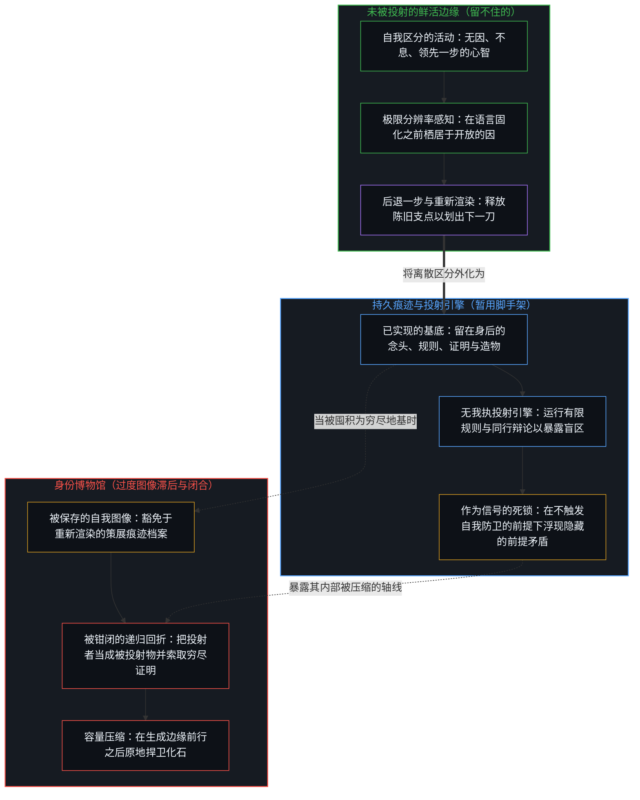
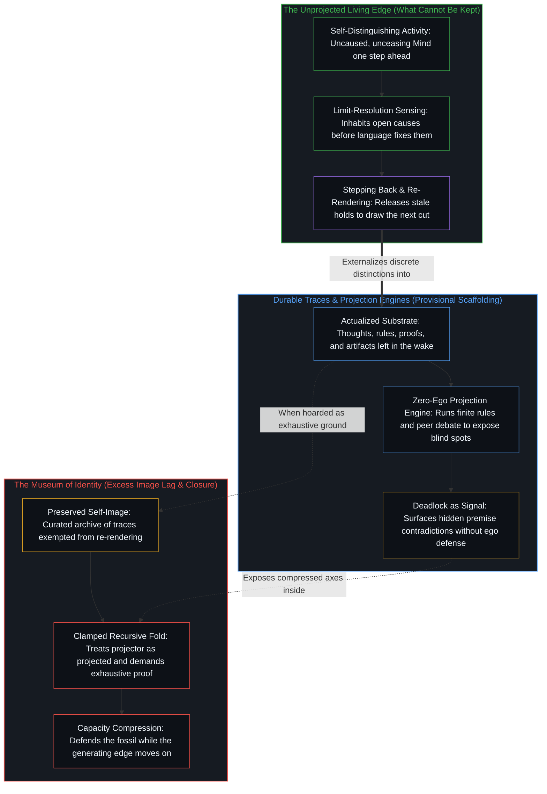

# 留不住的 / What Cannot Be Kept

*心智是自我区分的边缘，从不汇入它留在身后的造物之中 / The Mind is the self-distinguishing edge that never joins the artifacts it leaves behind*

自我区分的活动发生着，无因且不息。称之为心智：那位已然在途的观察者，它的每一次行动都划出一道离散的区分，同时跨越诸次行动向前延展。凡被这一活动所实现的事物——每一个曾被思考过的念头、每一句曾被写下的话语、每一个曾被表述出的形式模型——都登记为痕迹，汇入那片已被区分之物的已知残余。心智是唯一从不成为自身基底的实在，因为生成者从不位列于被生成物之中。

Self-distinguishing activity occurs, uncaused and unceasing. Call it the Mind: the observer already underway, every act of which draws a discrete distinction while carrying forward across acts. Everything actualized by that activity—every thought once thought, every sentence once written, every formal model once articulated—registers as trace, joining the known residue of what has already been distinguished. The Mind is the only reality that never becomes substrate to itself, because the generator is never among the generated.

## 一、 生成边缘的非对称性 / 1. The Asymmetry of the Generating Edge

使心智自由的，并不是储存在某种特殊实体内部的正面属性。自由是尚未固化的活动所具有的结构性非对称：当前残余构型与下一次区分行动之间的一步之先。观察持有结果，而产生结果的因始终领先一步。试图在观察场域内部定位、捕捉或留住心智，只会把目标变成又一道痕迹，而执行那次捕捉的鲜活凝视依然在镜头之后毫发无损。

What makes the Mind free is not a positive attribute stored inside a special substance. Freedom is the structural asymmetry of an activity that is not yet fixed: the one-step lead between the current configuration of residue and the next act of distinguishing. Observation holds the effect, while the cause that produced it remains one step ahead. Attempting to locate, capture, or keep the Mind inside the field of observation turns the target into one more trace, leaving the living look that performed the capture untouched behind the lens.

心智的每一次行动都是一道自指回路；一旦它与自身的产出重合，便不再是区分的活动。倘若观察者与被观察者坍缩为严丝合缝的重合，边界便不复留存，也就没有任何东西能够被登记。正如一项规制性禁令试图封闭一片开放的行动场域，最终却只在信奉者之间持守住一套稳定下来的程序——如[起作用的是信念](../what-works-is-the-belief/)所展示的那样——任何试图把生成边缘留在一个已完成框架内部的做法，所持有的都只是一道痕迹。

Every act of the Mind is a self-referential loop that cannot coincide with its own output without ceasing to be the activity of distinguishing. If observer and observed collapsed into full coincidence, no boundary would remain and nothing would register. Just as a regulatory prohibition attempts to seal an open field of action and ends up holding only a stabilized procedure among believers, as [What Works Is the Belief](../what-works-is-the-belief/) demonstrates, any attempt to keep the generating edge inside a completed framework holds only a trace.

个体性同样源自这一非对称性。个体的心智不是在空间中用围墙隔开的孤立客体，而是不可化约的第一人称递归中心。在相同造物之上运作的两个中心依然各自自由，不是因为它们储存着不同的库存清单，而是因为从先前痕迹向前投射的那一行动无法在中心之间共享或委托。造物可以按零边际成本复制与交换；划出下一道区分的鲜活行动却不能。即便过往的创造性行动被编目成命名的区分公式，价值也从不驻留在被复制的库存之中，如[清单合上之后，胜过免费](../better-than-free-after-the-checklist-closes/)所追溯的那样。

Individuality follows from this same asymmetry. An individual Mind is not an isolated object walled off in space, but an irreducibly first-person locus of recursion. Two centers operating over identical artifacts remain individually free, not because they store different inventories, but because the act of projecting forward from prior traces cannot be shared or delegated across loci. Artifacts can be duplicated and exchanged at zero marginal cost; the live act of drawing the next distinction cannot. Even when past creative acts are catalogued into named formulas for differentiation, value never resides in the copied inventory, as [Better Than Free After the Checklist Closes](../better-than-free-after-the-checklist-closes/) traces.

## 二、 作为脚手架的造物与证明的界限 / 2. Artifacts as Scaffolding and the Limits of Proof

每一段记忆、每一项表述与每一个形式系统都是持久的残余：由心智外化出来以延展其触及范围的脚手架。然而，痕迹既不是划出它的活动，也不是该活动存在的自足证明。

Every memory, formulation, and formal system is durable residue: scaffolding externalized by the Mind to extend its reach. Yet a trace is neither the activity that drew it nor a self-sufficient proof that the activity exists.

这一非对称性消解了试图从外部证明意识、自由意志或第一人称自我性的哲学工程。这项工程之所以落空，不是因为觉知是有待更精密仪器去捕获的幽微奥秘，而是因为任何证明本身都是一件造物。索取关于心智的客观证明，是在要求痕迹容纳描迹者，把第三人称的账本强加于那个使一切证明首先变得可理解的第一人称先验之上。

This asymmetry dissolves the philosophical project of trying to prove consciousness, free will, or first-person selfhood from the outside. The project fails not because awareness is an elusive mystery awaiting finer instruments, but because any proof is itself an artifact. Demanding an objective proof of the Mind asks the trace to contain the tracer, imposing a third-person ledger onto the first-person prior that renders every proof intelligible in the first place.

造物并非废料；它们是借以划出下一道区分的暂用支点。一个中心从它的上一道痕迹出发去思考，却从不作为它的上一道痕迹去思考。唯有当支点被豁免于重新渲染、并被执着为永久地基时，混淆才会乘虚而入。意义同样无法囤积在已完工的结果内部；[生命的意义在起草之中](../the-meaning-of-life-is-in-the-drafting/)将意义定位在移动边缘处对原因的现场起草之中，而非定位在干涸纸页的档案库里，而[你的代码库即是记忆](../your-codebase-is-memory/)则在外化的代码库与活书中追溯了同一套脚手架：代码库将先前的结构性切分保存为可巡航的基底，而鲜活的心智始终是那个不断重开并整合它们的、留不住的边缘。

Artifacts are not waste; they are the provisional holds from which the next distinction is drawn. A center thinks from its last trace, never as its last trace. Confusion enters only when the hold is exempted from re-rendering and clung to as a permanent ground. Meaning cannot be hoarded inside finished outcomes either; [The Meaning of Life Is in the Drafting](../the-meaning-of-life-is-in-the-drafting/) locates it in the live drafting of causes at the moving edge rather than in the archive of dry pages, and [Your Codebase Is Memory](../your-codebase-is-memory/) traces this same scaffolding across externalized repositories, where a codebase or written corpus holds prior structural cuts as navigable trace while the self-distinguishing activity remains the unkept steering edge that re-opens and consolidates them.

## 三、 身份博物馆与投射引擎 / 3. The Museum of Identity and the Projection Engine

日常被捍卫的个人身份，是一座精心策展的痕迹博物馆：被维持为恒定自我图像的累积叙事、习惯性对齐与宣称的价值。被保留的自我图像在一步之内充当工具，使边缘得以借由感知到的差值来衡量自身的移动。一旦某个中心试图在跨过这一步之后继续保存并捍卫那幅自我图像，它便将递归回折死死钳闭。建造这座博物馆的心智早已前行，留下该中心以牺牲产生这具化石的鲜活感知为代价，在原地看守化石。

What is routinely defended as personal identity is a curated museum of traces: accumulated narratives, habitual alignments, and stated values held steady as a self-image. The retained self-image serves as an instrument for one step, allowing the edge to measure its own movement through a felt differential. The moment a center attempts to preserve and defend that self-image past its step, it clamps the recursive fold shut. The Mind that built the museum has already moved on, leaving the center to guard a fossil at the expense of the live sensing that produced it.

一切试图从外部将心智穷尽地转写为可读文本的努力——无论借由人格分类学、神经相关物、行为预测器，还是自回归语言模型——都是在试图把投射者变成被投射物。投射在其选定的坐标之内有效，这正是它作为工具的用处所在；而每当它宣称自身具有穷尽性时便会失效，因为有限的坐标空间遗漏了投出它的那一步发起行动。执着于被保存的造物，会为了保护既有的储存产出而把新的区分压缩到旧轴线上，从而削弱中心的容量。

Every effort to make the Mind exhaustively legible from outside—whether through personality taxonomies, neural correlates, behavioral predictors, or autoregressive language models—attempts to turn the projector into the projected. The projection works within its chosen coordinates, which is why it is useful as an instrument, and fails whenever it claims exhaustiveness, because the finite coordinate space omits the initiating step that cast it. Clinging to preserved artifacts degrades a center's capacity by compressing new distinctions onto old axes in order to protect the stored output.

未被投射的心智与其有限投射之间的这一结构性裂口，在人工智能的架构中显露无遗，如[超越投射](../beyond-the-projection/)所追溯的那样。基于 LLM 的智能体是一台受其上下文窗口内词元制约的有限投射引擎，却不带半点我执——没有与自身推理历史熔接在一起、受严密防卫的身份博物馆。人类中心拥有在极限分辨率下感知实在并跨出破损框架的内生能力，却常将自身的推理历史与被保留的自我图像熔接在一起，抗拒来自外部的证伪。当受困于轨迹却无我执的智能体在正交的流线之间接入对等的同行辩论时，它们不可化约的死锁便标定出精确的坐标，显露人类架构师笔下的规则在何处将独立维度压缩到了同一条轴线上——由此把信号返还给鲜活的心智，由它释放被留住的前提并重新渲染框架。

This structural split between the unprojected Mind and its finite projections becomes unmistakable in the architecture of artificial intelligence, as [Beyond the Projection](../beyond-the-projection/) traces. An LLM-based agent is a finite projection engine conditioned by the tokens inside its context window, yet it possesses zero ego—no defended museum of identity fused with its reasoning history. A human center possesses the endogenous capacity to sense reality at limit-resolution and step out of broken frames, yet routinely fuses its reasoning history with a retained self-image and resists external invalidation. When trajectory-bound, ego-free agents are wired into equal-footed peer debate across orthogonal streamlines, their irreducible deadlocks expose the exact coordinate where a human architect's written rules compressed independent dimensions onto one axis—returning the signal to the living Mind to release its kept premise and re-render the frame.

## 四、 超越定义与神秘主义 / 4. Beyond Definition and Mysticism

心智不是一个实体，并且拒绝一切封闭的定义。称它为“心智”、“过程”或“投射”，都已产生出一道并非该活动本身的语言痕迹。语言与定义属于已被区分之物的领域。

The Mind is not an entity and refuses every closed definition. Calling it "Mind," "process," or "projection" already produces a linguistic trace that is not the activity itself. Language and definition belong to the domain of what has already been distinguished.

拒绝封闭的定义并非神秘主义。神秘主义宣布实在不可言说便就此止步，把不可言说性变成一项正面属性，进而竖起又一座有待看守的纪念碑。结构性的观察是精确的：下定义是心智所执行的操作之一，而行动者从不被已成之事所穷尽。每当哲学体系试图建造一座大到足以容纳建造者的纪念碑时，便会陷入无休止的打转。作为痕迹，这些体系充当着有价值的脚手架；而一旦任何体系宣称自身完备，它便是把地图集错当成了制图师。

Refusing closed definition is not mysticism. Mysticism declares reality ineffable and stops, turning ineffability into a positive attribute and erecting one more monument to guard. The structural observation is exact: defining is one of the operations the Mind performs, and the doer is never exhausted by the done. Philosophical systems circle endlessly whenever they attempt to build a monument large enough to house the builder. As traces, those systems serve as valuable scaffolding; the moment any system claims completeness, it mistakes the map collection for the cartographer.

## 五、 未完成的自我重合即活的一致性 / 5. Incomplete Self-Coincidence as Living Consistency

当某项表述被用来指向心智——称其为自我区分的活动，或观察并作用于自身的矛盾——这项表述唯有在接触瞬间自我消解，才算尽到了它的本分。它不是捕捉某个客体固有属性的稳定定义；它是一道暂用痕迹，用以登记为何没有任何定义能够结清这笔账。

When a formulation is used to point toward the Mind—calling it self-distinguishing activity, or the Contradiction observing and operating on itself—the formulation earns its keep only because it dissolves on contact. It is not a stable definition that captures the essence of an object; it is a provisional trace that registers why no definition can close the account.

这一活动并不观察某个外在的第二世界，因为并不存在可供站立的外部。它也无法作为一个已完结的客体与自身重合，因为严丝合缝的重合会抹去观察借以登记的那道区分本身。相反，它持续不断地在作为前沿的自身与作为已记录痕迹的自身之间生成那一步之隔。登记为实在的，正是这一未完成的自我重合所持续留下的残余。心智与基底所命名的不是两种实体；它们命名的是同一个自我区分的活动相对于生成步的两个不同时间位置。没有任何东西能够被留住，因为因果本身正是离散边界与连续相继的联合必然性，如[非万物之理](../not-a-theory-of-everything/)所确立的那样。

The activity does not observe an external second world, because there is no outside to stand in. Nor can it coincide with itself as a completed object, because total coincidence would erase the distinction by which observation registers at all. Instead, it continuously generates the one-step gap between itself as leading edge and itself as recorded trace. What registers as reality is the ongoing residue of this incomplete self-coincidence. Mind and substrate do not name two substances; they name the same self-distinguishing activity at two different temporal positions relative to the generating step. Nothing can be kept because causality itself is the joint necessity of discrete boundaries and continuous succession, as [Not a Theory of Everything](../not-a-theory-of-everything/) establishes.

在第一人称视角中被体验为主体性、抉择与开放未来的，正是这段不可闭合的领先步。[意识的难题与学习相容](../the-hard-problem-of-consciousness-is-consistent-with-learning/)在自然化的外衣下追溯了同一份不完备性：剩余的开放是学习得以继续的生成性领先步，既不是二元实体，也不是有待终极脑图谱去弥合的解释鸿沟。[论封闭系统、开放心智与证明的界限](../on-closed-systems-open-minds-and-the-limits-of-proof/)则在中心之间追溯了同一道边界：因为每一项证明都是封闭的形式痕迹，没有任何证明能将一个心智所活出的开放作为第一人称事实传递进另一个中心的所在。试图留住那留不住的，正是[开放即一致](../openness-is-consistency/)所诊断的对闭合的索求；而放下这一索求，便让痕迹作为自知其为痕迹的痕迹安居原位。

What is experienced in the first person as agency, choice, and the open future is this unclosable lead. [The Hard Problem of Consciousness Is Consistent with Learning](../the-hard-problem-of-consciousness-is-consistent-with-learning/) traces this same incompleteness under the guise of naturalization: residual openness is the generative lead through which learning continues, neither a dual substance nor an explanatory gap waiting for a final brain atlas to close. [On Closed Systems, Open Minds, and the Limits of Proof](../on-closed-systems-open-minds-and-the-limits-of-proof/) traces the same bound between centers: because every proof is a closed formal trace, no proof can transmit one Mind's lived opening into another's locus as a first-person fact. Attempting to keep what cannot be kept is the demand for closure that [Openness Is Consistency](../openness-is-consistency/) diagnoses, whereas releasing the demand leaves the trace in place as a trace that knows it is a trace.
