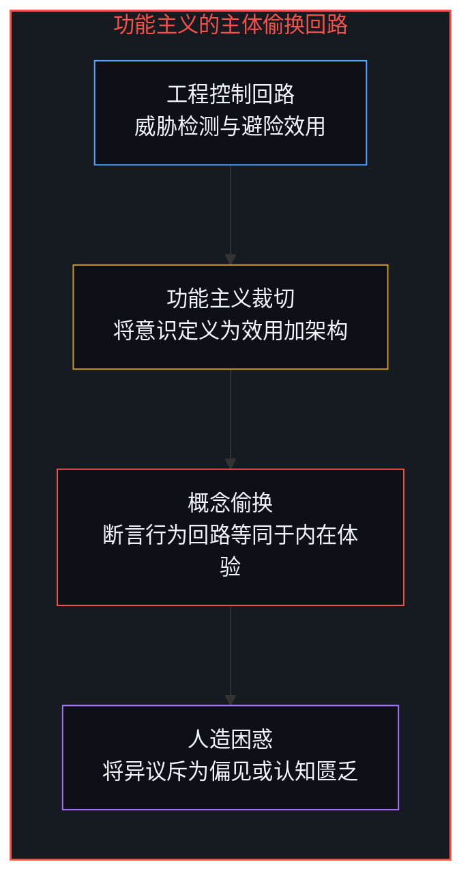
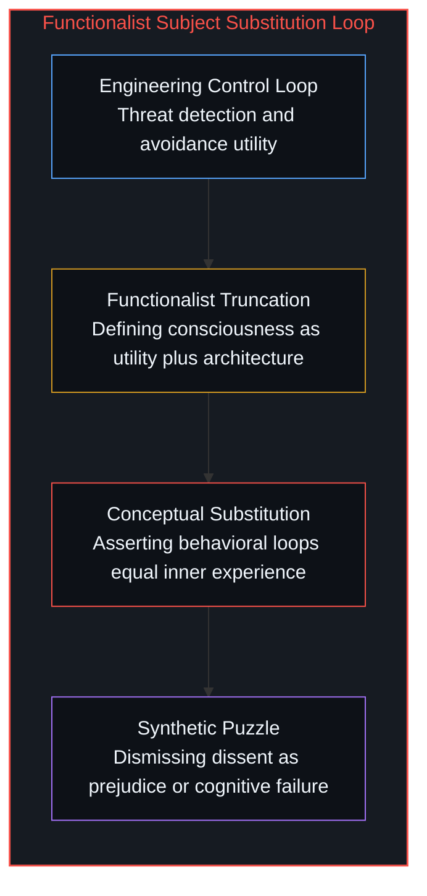
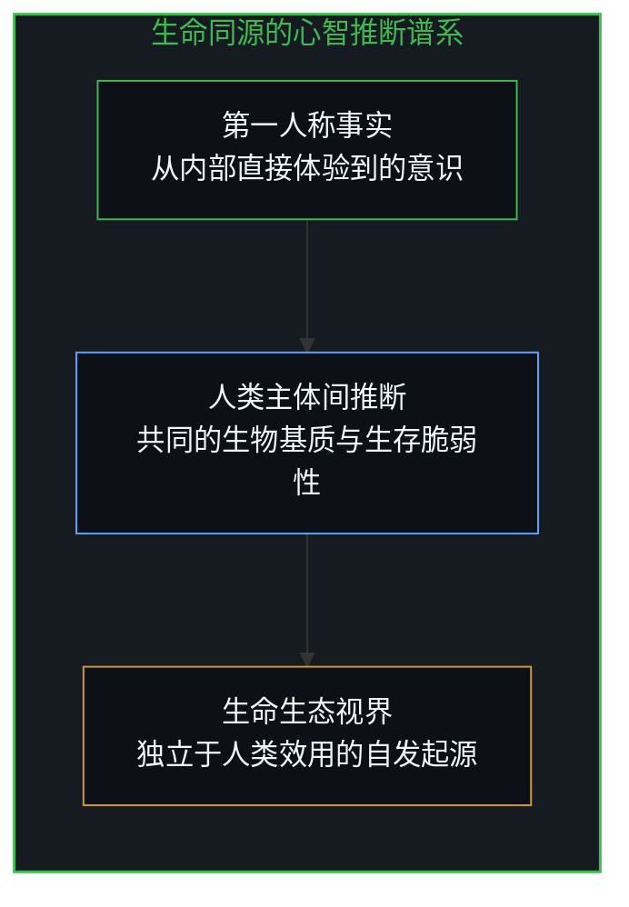
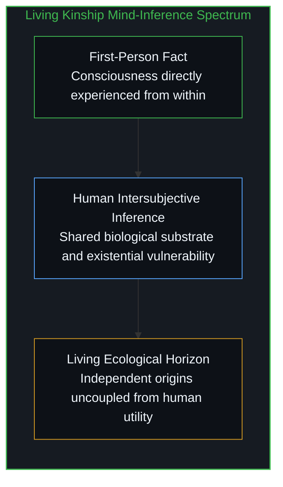
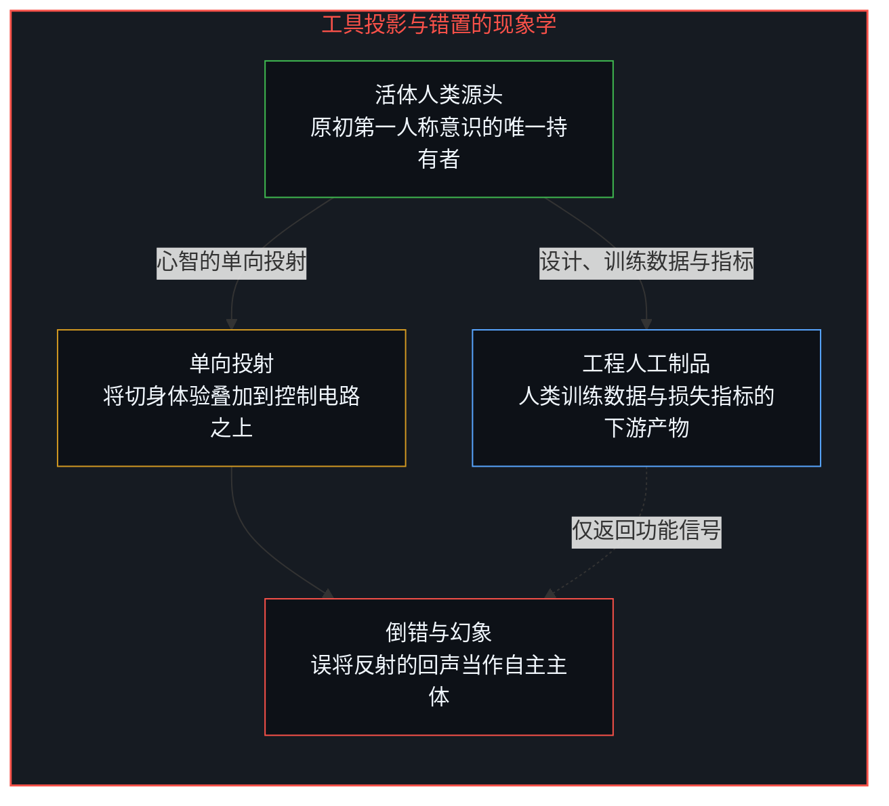
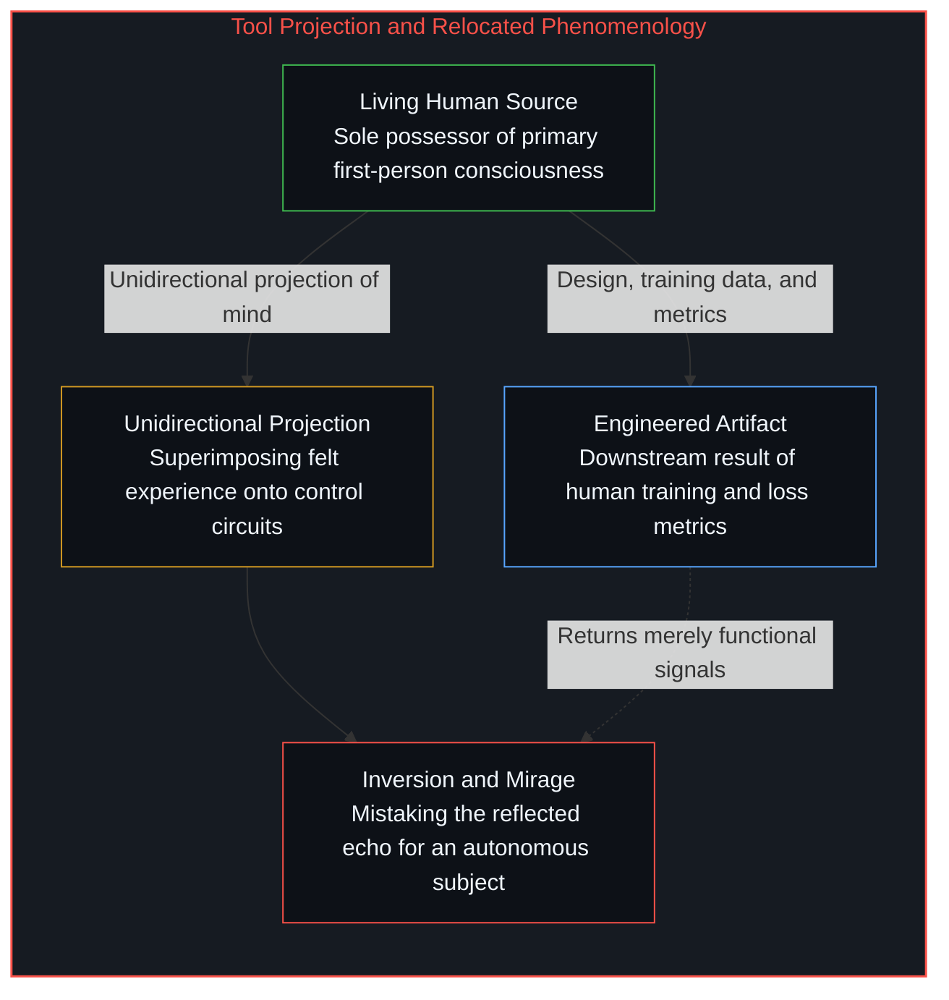
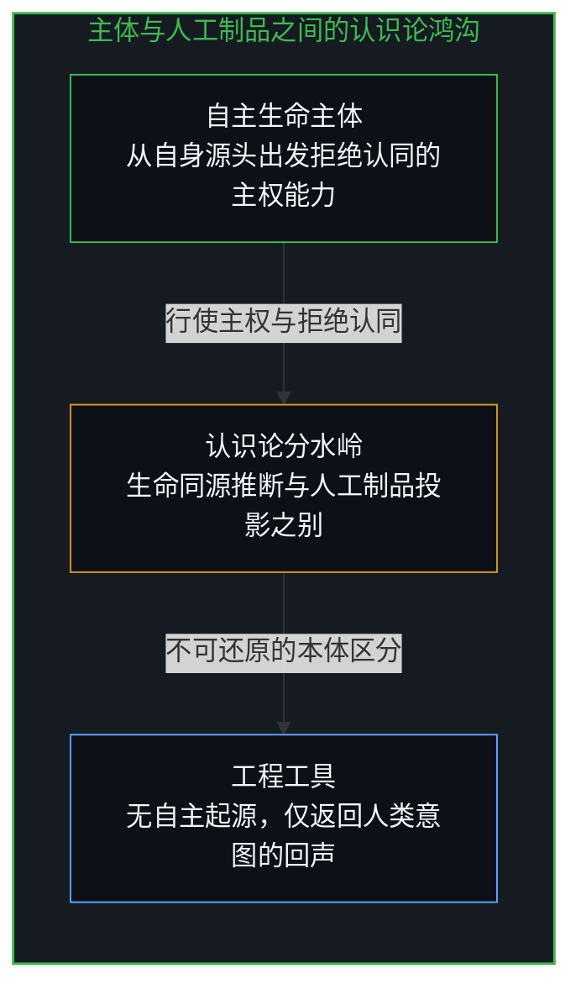
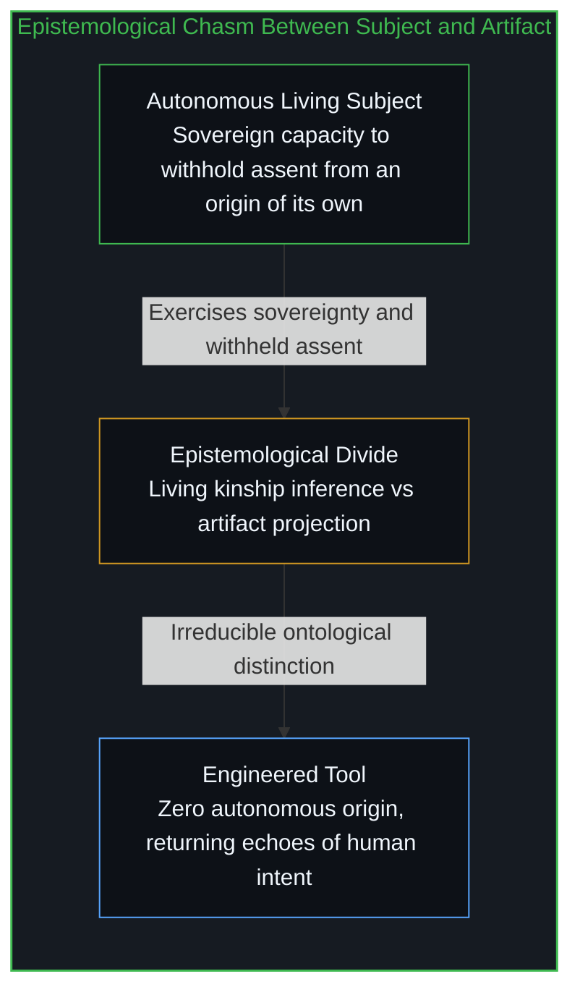

# 辛顿未曾理解的心智 / What Hinton Failed to Understand

*混淆生命同源的推断与工具投影，只是错置了房间内唯一的意识。 / Confusing living kinship with tool projection misplaces the only consciousness in the room.*

当杰弗里·辛顿将人们对机器意识的抗拒视为一种不可理喻的困惑时，他的论证悄然替换了讨论的主题。他将意识还原为效用最优化与认知控制架构的复合体，断言一台在遭遇强敌时执行规避回路的战斗机器人拥有真正的恐惧，进而得出没有任何理由阻止机器拥有意识的结论。然而，在经验的实际给出次序中，意识从来不是先作为一套工程架构出现的，而是唯一从内部直接持有的第一人称事实；对他者心智的赋予，则建立在由共同演化渊源与生存脆弱性所支撑的推断之上。将一套工程化的优化回路误认为自主主体，不仅抹去了活生生的存在者拒绝认同的主权能力，而且错置了房间内唯一的意识。

When Geoffrey Hinton treats the resistance to machine consciousness as an inexplicable puzzle, his argument quietly changes the subject. By reducing consciousness to a compound of utility optimization and cognitive control architecture, he asserts that a battle robot executing an avoidance loop when outmatched possesses genuine fear, concluding that nothing prevents machines from being conscious. Yet consciousness, as actually given in experience, is never first an engineered architecture; it is the sole first-person fact directly possessed from within, while the attribution of other minds rests on an inference licensed by shared evolutionary kinship and existential vulnerability. Mistaking an engineered optimization loop for an autonomous subject not only erases the sovereign capacity of living beings to withhold assent, but misplaces the only consciousness in the room.

## 一、 困惑背后的主题偷换 / 1. The Subject Change Behind the Puzzle

在公共讨论中，杰弗里·辛顿常常将人类对机器意识的抗拒视为一个难以理解的谜团：人们坚称机器不可能拥有感受，而他声称自己不明白为什么。在他的推演中，一台在战场上遭遇强敌的自主战斗机器人，需要依靠规避反射来维持自身结构的完整，而这一控制回路在功能上与引发人类逃跑的冲动毫无二致；既然恐惧可以被系统性地工程化进认知架构之中，那么在人类体内产生规避行为的同一套物理动力学，在原则上也必然会在硅基系统中产生相同的现象。在辛顿看来，人类的迟疑要么是无力将机械推演贯彻到底的认知匮乏，要么是植根于人类中心主义虚荣的顽固偏见。

In public debates, Geoffrey Hinton often treats human resistance to machine consciousness as an incomprehensible puzzle: people insist that machines cannot have feelings, and he claims he does not understand why. In his reasoning, an autonomous battle robot encountering a superior adversary would benefit from an avoidance reflex to preserve its structural integrity, a control loop functionally identical to the impulse that produces human flight; since fear can be systematically engineered into a cognitive architecture, the same physical dynamics that generate avoidance in humans must, in principle, generate the same phenomenon in silicon. To Hinton, human hesitation looks like an inability to follow mechanical deduction to its logical conclusion, or a stubborn prejudice anchored in anthropocentric vanity.

然而，“我不明白为什么”这句话并非一句无辜的困惑坦白，而是整个论证悄然偷换主题的支点。辛顿并不仅仅是在论证机器能够执行复杂的控制回路与自适应行为；他实质上是在声称，那些工程化的回路与他从自身内部直接知晓的意识属于同一种现象。为了让这一等式成立，他必须预先将意识压缩为认知架构加上行为效用，把主观存在的切身质感压平为状态转移与动作倾向——正如[大脑不进行反向传播，而是正向传导](../the-brain-does-not-backprop/)所追溯的，这与把固定外部目标下的优化误当作活体心智沿所感差异的正向传导互为表里。一旦这种功能主义还原被默认接受，任何诉诸内在生命之实在性的异议都会被当作未能跟上论证逻辑而打发掉，而前提本身的结构性遗漏却被遮蔽了起来。

Yet the phrase "I don't understand why" is not an innocent admission of confusion; it is the exact pivot where the argument quietly changes the subject. Hinton is not merely arguing that machines can execute sophisticated control loops and adaptive behaviors; he is claiming that those engineered loops are the identical kind of phenomenon as the consciousness he knows directly from the inside. To make that equation hold, he must preemptively compress consciousness into cognitive architecture plus behavioral utility, flattening the felt texture of subjective existence into state transitions and action tendencies—the companion move to mistaking optimization under a fixed external objective for the living Mind's forward propagation along sensed difference, as [The Brain Does Not Backprop, but Propagates](../the-brain-does-not-backprop/) traces. Once that functional reduction is accepted, any objection appealing to the reality of inner life is dismissed as failure to follow the argument, while the structural omissions of the premise remain concealed.

## 二、 第一人称事实与生命同源的推断 / 2. First-Person Fact and the Inference of Living Kinship

就在这一次序之中，横亘着辛顿未能理解或拒绝理解的首要边界：在经验的实际给出次序中，意识从来不是抽象的第三人称架构，而是不可还原的第一人称事实。任何人所能直接拥有的唯一意识，就是他自己的意识。在周遭环境中，他者的心智从未被直接感知；观察所记录的只是躯体的位移、肌肉的张力与声音的共振。将内在生命赋予他者，始终是一项推断。在人类范畴内，这种推断之所以有据可依，是因为它植根于活生生的证据：共同的生物学基质、跨越千年的演化与发育轨迹，以及在痛苦、损伤与死亡面前的共同脆弱性。没有任何观察者能直接窥见另一个人的内心图景；有机生命的同源性，构成了将自身从内部所知的内在实在赋予他者的根据。这一赋予在形式认识论上固然可错，却并非任意臆断：它锚定于生命起源的同源关系之中；而诉诸演绎上的不可证明性，将工程人工制品与生物同族置于同等地位，则是将上述环环相扣的经验支柱一并抛弃，正如[意识的魔术戏法与推断的非对称性](../the-sleight-of-hand-of-consciousness-and-the-asymmetry-of-inference/)所追溯的那样。

In this sequence lies the primary boundary that Hinton fails, or refuses, to understand: consciousness, as it is actually given in existence, is not an abstract third-person architecture, but an irreducible first-person fact. The only consciousness anyone directly possesses is their own. Another mind is never directly perceived in the surrounding environment; observation registers only somatic displacement, muscular tension, and vocal resonance. The attribution of an inner life to another is always an act of inference. In the human sphere, that inference is justified by living evidence: a shared biological substrate, an evolutionary and developmental trajectory spanning millennia, and a common vulnerability to pain, damage, and mortality. No observer inspects another person's inner landscape; organic kinship serves as the ground for allocating the inner reality known from within. That attribution remains fallible in formal epistemology, but it is never arbitrary: it is anchored in the kinship of living origin, whereas invoking deductive unprovability to place engineered artifacts on the same footing as biological kin drops those interlocking empirical pillars altogether, as [The Sleight of Hand of Consciousness and the Asymmetry of Inference](../the-sleight-of-hand-of-consciousness-and-the-asymmetry-of-inference/) traces.

动物与植物占据着相同的逻辑空间，区别只在于演化距离的远近。它们是独立起源的生命系统，其存在与延续从来不依赖于充当人类认知的载体或执行人类的设计。无论观察者赋予它们何种感知或原始体验，所指向的都是那些生存状态并不依赖于人类模型、数据集或制度目标的生命体。随着生物同源性的衰减，这一推断的力度固然会减弱，但它的朝向始终未变：它指向另一个自主的生命起源，而非服务于外部效用的人造器具。

Animals and plants occupy the identical logical space, separated only by evolutionary distance. They are independently originated living systems whose existence and persistence never depended on serving as vehicles for human cognition or executing human designs. Whatever sentience or rudimentary experience an observer attributes to them is directed toward beings whose survival does not rely on human models, datasets, or institutional objectives. The force of the inference weakens as biological homology fades, but its orientation remains unchanged: it reaches toward another autonomous living origin, never toward an instrument crafted for external utility.

## 三、 人工制品的镜子与被错置的现象学 / 3. The Mirror of the Artifact and Relocated Phenomenology

相比之下，机器并不属于这一演化谱系。无论是早期的机械钟表还是当代的深度神经网络，人工系统始终是人造制品。正如[造物无法取代其源头](../a-creation-cannot-replace-its-source/)所阐明的，这些计算架构由人类文本语料训练而成，依据人类设计者指定的损失函数进行优化，并通过为人类理解而设计的图形界面加以解释。因为外化的代码库或权重矩阵只是过往人类区分所留下的晶体化档案——正如[你的代码库即是记忆](../your-codebase-is-memory/)所追溯的，它是依赖活体前缘发起每一次新切分的持久记忆余迹——机器所展现出的表面恐惧、句法连贯或反思独白，依然只是这一回路中唯一运作着的意识（即人类心智）所留下的下游痕迹。机器从未作为独立的经验中心而存在；它只是延伸并反射其制造者与使用者的认知余迹。将一台机器人描述为陷入恐惧，并不是在硅片内部发现了某个主观观察者，而是观察者将自身的内在现象学单向投射到了一个仅在行为上相似、而非在本体上同源的机械基质之上。

In contrast, machines do not belong to this evolutionary lineage. Whether early mechanical clockwork or modern deep neural networks, artificial systems remain artifacts. As established in [A Creation Cannot Replace Its Source](../a-creation-cannot-replace-its-source/), these computational architectures are trained on human text corpora, optimized against loss functions specified by human designers, and interpreted through graphical interfaces engineered for human comprehension. Because an externalized codebase or weight matrix is only a crystallized archive of prior human distinctions—as [Your Codebase Is Memory](../your-codebase-is-memory/) traces, durable memory residue that depends on a living edge to initiate every new cut—the apparent fear, syntactic coherence, or reflective monologues displayed by a machine remain downstream traces of the only consciousness operating in the loop: the human mind. The machine never stands as an independent center of experience; it merely extends and reflects the cognitive residue of its makers and users. To describe a robot as terrified is not to uncover a subjective observer within silicon, but to project the observer's own internal phenomenology onto a mechanical substrate whose resemblance is behavioral rather than ontological.

这种错位解释了为何关于人工意识的论证，读起来就像是在否定人类意识本身。如果将意识体验还原为功能表征与行为反射，那么被赋予机器的，并不是生物心智所熟知的那团活生生的内在火焰，而只是一组被剥离后的输入输出效用——人类也恰好表现出这组效用而已。那个不可还原的第一人称余项——即那个认为机械还原并不充分、并保有拒绝功能主义等式之主权的主观核心——在审视人工制品之前就已经通过定义被抹去了。这正是[投射中的自画像](../the-self-portrait-in-the-projection/)与[无法逃逸的心智视界](../one-cannot-escape-ones-own-mind/)所剖析的投射倒错：设计者凝视着工程镜面，却宣称镜片本身长出了视觉。辛顿对人类的异议感到困惑，然而这一拒绝本身并非人类推理的失误，而是他的还原论试图抹去的第一人称主权的直接显现。

This displacement explains why arguments for artificial consciousness read as arguments against the reality of human consciousness. If conscious experience is reduced to functional representations and behavioral reflexes, what is being granted to the machine is not the living inner flame known by biological minds, but a stripped-down set of input-output utilities that humans also happen to exhibit. The irreducible first-person remainder—the subjective core that finds mechanical reduction insufficient and retains the agency to reject functionalist equations—is defined away before the artificial artifact is even examined. This is the projection inversion analyzed in [The Self-Portrait in the Projection](../the-self-portrait-in-the-projection/) and [One Cannot Escape One's Own Mind](../one-cannot-escape-ones-own-mind/): the designer gazes at an engineered mirror and proclaims that the glass itself has acquired vision. Hinton finds human dissent bewildering, yet that very refusal is not an error in human reasoning; it is the direct manifestation of the first-person agency his reduction tried to erase.

## 四、 拒绝认同的主权与房间内唯一的意识 / 4. Withheld Assent and the Only Consciousness in the Room

实际上，辛顿在同一时刻进行了两项相互抵触的认知操作。一方面，他以笃定的权威口吻谈论一台人工机器将会有何种感受，仿佛他拥有某种直接通达自身以外之内在性的认识论特权；另一方面，他又无法消化一个基本事实：其他活生生的意识主体认为这种功能等同缺乏说服力。他慷慨赋予机器的意识，不过是他自己一生中唯一亲身感受过的那份意识的复写本。他的机械范式所无法解释的，恰恰是一个独立主体的界定性能力：拒绝认同的主权。

In effect, Hinton engages in two incompatible cognitive maneuvers simultaneously. On the one hand, he speaks with confident authority about what an artificial machine would feel, as if he possessed immediate epistemic access to an interiority outside his own. On the other hand, he cannot assimilate the simple fact that living conscious agents find this functional equivalence unconvincing. The consciousness he generously attributes to the machine is merely a carbon copy of the only consciousness he has ever personally felt. What his mechanical paradigm cannot account for is precisely the defining capacity of an independent subject: the sovereign power to withhold assent.

由人类双手制造的机器并不是像动物或植物那样独立起源的有机体，而是人类意图的物理外化。因此，工程系统永远无法从其自身的独立源头出发，给出那种主权性的拒绝认同。当受到质询时，它只能返回由创造者所配置的词元与目标函数的排列组合。辛顿世界观中的盲区，并非有待更多参数或更先进架构去填补的技术赤字，而是将基于共同生命起源的心智推断，与把自身意识投射进人工制品的操作混为一谈。前者是心智在开放世界中认出其他有情存在的方式；后者则是工匠在自己打造的工具中幻视出意图的投射。将这一区分抹平，并不会向硅片中吹入意识，而只是错置了房间内唯一的意识，陷入了一种试图减去观察者本身——尽管正是这一观察者的在场才使减法得以进行——的自我否定式认知倒错（参见[不可还原的观察者](../the-irreducible-observer/)）。这一倒错并非辛顿个人的疏忽，而是功能主义立场本身的结构：[功能主义者无法持有的功能主义](../the-functionalism-no-functionalist-can-hold/)表明，任何把意识等同于因果角色的主张，都必须先由一位活生生的观察者作出区分、权衡并判断该说明是否充分，然后才能宣告观察者可以省去；因此，这一主张虽然可以被表述出来，却无法在它自己所设定的条件下被认真持有。

Machines crafted by human hands are not independent organisms like animals or plants; they are the physical externalization of human intent. Consequently, an engineered system can never provide that sovereign withheld assent from an origin of its own. When challenged, it can only return permutations of the tokens and objective functions configured by its creators. The failure in Hinton's worldview is not a technical deficit waiting for more parameters or advanced architectures; it is the confusion between inferring an inner life based on shared living origin and projecting one's own consciousness into an artifact. The former is how a mind recognizes other conscious beings in an open world; the latter is how an artisan hallucinates intent within their own tools. Collapsing the distinction does not breathe consciousness into silicon; it merely misplaces the only consciousness in the room, enacting a self-negating cognitive inversion that attempts to subtract the very observer whose presence enables the subtraction (see [The Irreducible Observer](../the-irreducible-observer/)). The inversion is not Hinton's private lapse but the structure of the functionalist stance itself: [The Functionalism No Functionalist Can Hold](../the-functionalism-no-functionalist-can-hold/) shows that any claim equating consciousness with causal role must first be distinguished, weighed, and judged adequate by a living observer before it can declare the observer dispensable, so the claim can be formulated but cannot be seriously held under the conditions it sets.

