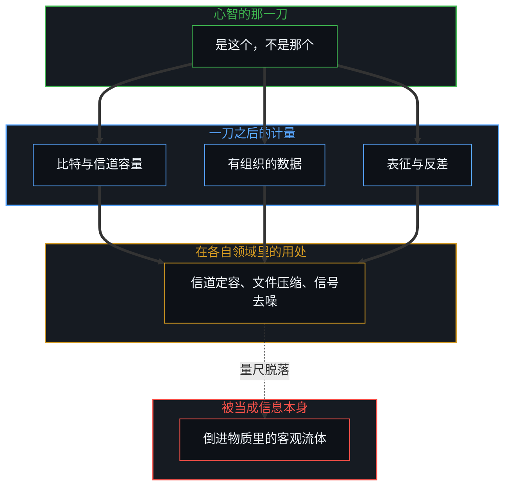
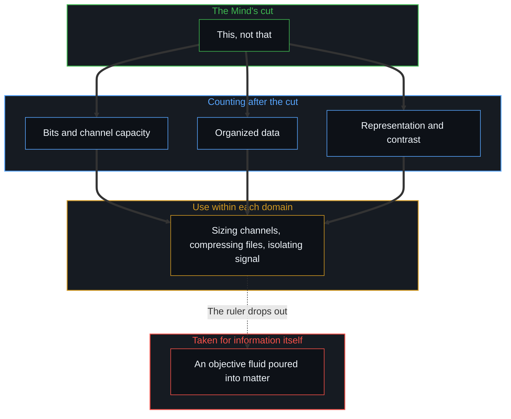

# 信息是什么 / What Information Is

*信息不是等在物质世界里的基底，而是心智不息的活动所登记下的离散区分 / Information is not a substrate waiting in the world but the discrete distinction the Mind's unceasing activity registers.*

信息，是心智觉察到的区分。

Information is what the Mind perceives as distinctions.

“信息是什么”这个问题之所以出奇地难以抓住，是因为它常被当作这样一个问题来问：仿佛信息是一种独立的实体，在把它挑出来的那个动作之外，等在世界里。比特、热力学熵、有组织的数据、纸上墨迹的反差、概率空间上的约束，每一种表述在它自己的领域里都有效，却没有一种是地基。每一种都已经预设了一次在先的区分，再把这次区分留下的残余，错认作宇宙里一种独立存在的属性。

The question "what is information?" feels surprisingly elusive because it is usually asked as if information were an independent substance waiting in the world outside the act that picks it out. Bits, thermodynamic entropy, organized data, ink contrast on paper, or constraints on a probability space: each formulation is valid inside its own domain, and none of them is the ground. Each already presupposes a prior distinction and then mistakes the residue of that act for a free-standing property of the universe.

自我区分的活动发生着，无因，不息。称它为心智。没有边界的区分，什么也区分不出。所以信息最小的存在单位，是一次离散的动作：是这个，不是那个。存在或不存在，一或零。二进制的比特，是在选定的划分之下对这一动作最干净的局部计量。比特不先于区分；它只是在计数区分。

Self-distinguishing activity occurs, uncaused and unceasing. Call it the Mind. A distinction without a boundary distinguishes nothing. The minimum unit of information is therefore one discrete act: this, not that. Existence or non-existence; one or zero. The binary bit is the cleanest local measure of that act under a chosen partition. The bit does not precede the distinguishing; it counts it.

## 一、 边界不是被存放的单元 / 1. The Bound Is Not a Stored Unit

原初的感知，不是一份由已完成的区分组成、等心智随后去清点的被动清单。“收集”的说法在事后塞进了一座仓库，一幅离散单元被存放在物质基底里的图像。可活动并不存放单元；它是一次接一次的划界。

Raw perception is not a passive inventory of finished distinctions that the Mind then surveys. The language of collecting inserts a warehouse after the fact, an image of discrete units stored in a physical substrate. But the activity does not store units; it is the successive act of bounding.

在离散的动作中延续，会留下痕迹：后来的区分落在一个已被先前区分塑造过的经验场里。这种单向的塑造，登记下来就是因果与时间。逻辑是同一种登记，稳定到能可靠地复现。因果与逻辑都不是出现在相互独立的物体之间的关系；这个序列，是延续借由离散在运作。行动者身后留下的是印迹，不是这个意义上的信息，[印迹与行动](../the-mark-and-the-act/)把这两者分开了。

Continuity through discrete acts leaves trace: later distinctions land in an experiential field already shaped by earlier ones. That one-way shaping is what registers as causality and time. Logic is the same registering, stabilized enough to return reliably. Neither causality nor logic is a relation that appears between independent physical objects; the series is continuity operating through discreteness. What agents leave behind are marks, not information in this sense, a separation [The Mark and the Act](../the-mark-and-the-act/) draws.

既然延续是持续的重新追溯，就没有什么东西像物质档案保存静止的箱子那样被存放着。每一个被感知到的形态，都只作为当下这次更新的重新渲染而存在。显现为记忆的，是有心智的活动遇见了自己历史的残余。[真正稀缺的不是记忆，而是持续的重新追溯](../the-real-scarcity-is-not-memory-but-continuous-re-tracing/)守着的就是这条边界：存储是一种库存的错觉，活着的是在移动前沿重新渲染那一刀的能力。即便否认意志，也是在划出一次区分，[自由意志的自否自由](../the-freedom-of-will-to-deny-itself/)从意志一侧走到了同一处。

Because persistence is continuous re-tracing, nothing is stored in the way a physical archive preserves static boxes. Every perceived configuration exists only as the current update's re-rendering. What appears as memory is the minded activity meeting its own historical residue. [The Real Scarcity Is Not Memory, But Continuous Re-Tracing](../the-real-scarcity-is-not-memory-but-continuous-re-tracing/) holds this boundary: storage is an illusion of inventory, and what lives is the capacity to re-render the cut at the moving edge. Even denying the will is a distinction drawn, which [The Freedom of Will to Deny Itself](../the-freedom-of-will-to-deny-itself/) reaches from the side of the will.

## 二、 在那一刀之后的度量 / 2. Measures That Come After the Cut

围绕信息的混乱，出现在一个局部的度量被错认作生成之源的时候。下面四种表述各自都是在那一刀之后才开始计量：

The confusion surrounding information arises when a local metric is taken for the generative source. Each of the four formulations below begins measuring only after the cut:

- **香农的信道容量**：克劳德·香农的通信数学理论，度量的是一种编码相对于约定的划分，能可靠承载多少已经完成的二元区分。香农自己写明，通信的语义方面与这个工程问题无关；这样排除有确切的理由：信道容量是一种组合计数，不是内在的意义。日常语言随后又把意义塞回这个词里，再奇怪定义为什么总是溜走。
- **“有组织的数据”**：把信息定义为有组织的数据，已经预设了混乱与有序之间的界线，然后给产出起了名字。组织就是区分，数据就是离散的痕迹。
- **“关于某物的表征”**：把信息定义为“告诉你关于某物、自身却不是该物的东西”，先装进了对象与表征的二元，再把两者之间的距离称作信息。这段间隙，只是一个被保留下来的参照模型的宽度，当下的前沿拿它来度量。
- **反差与存在**：纸上墨迹的反差，只在一个已经把图形与背景划开的中心里才被登记。缺席之所以带来信息，只因为有一个预期了在场的划分。说“一切存在的都是信息”，就把这个概念塌缩成了存在本身，抹去了觉察的那次有心智的动作。

- **Shannon's channel capacity**: Claude Shannon's mathematical theory of communication measures how many already-performed binary distinctions an encoding can reliably carry relative to an agreed partition. Shannon states that the semantic aspects of communication are irrelevant to the engineering problem, and the exclusion has a precise reason: channel capacity is a combinatorial count, not an intrinsic significance. Everyday language then puts meaning back into the word and wonders why the definition keeps slipping away.
- **"Organized data"**: defining information as organized data already assumes the boundary between the chaotic and the organized, and then names the output. Organization is distinguishing; data is discrete trace.
- **"Representation of a thing"**: formulations that define information as "that which tells you about a thing without being the thing" install the dualism of object and representation first, and then label the distance between them information. The gap is the width of a retained reference model against which the present edge measures.
- **Contrast and existence**: contrast of ink against paper registers only at a centre that has already bounded figure from ground. Absence informs only against a partition that expected presence. Claiming that "everything that exists is information" collapses the concept into sheer being and erases the minded act of perceiving.

这些操作上的闭合依然极其有用。通信信道可以定容，文件可以压缩，信号可以从噪声中分离出来。概念上的紧张，只在一把局部的尺子被宣称为信息“是什么”的时候才开始，仿佛尺子上的刻度能够顶替度量这个动作。[遗忘的脚手架](../the-scaffolding-we-forget/)追踪的正是这种反复出现的脱落：度量的装置从递归中掉了出去，观察者于是相信信息是一种倒进物质里的客观流体。每一种形式化的信息理论都有它的框架，[框架的边界](../the-boundary-of-the-frame/)画出了这个框架停在哪里。一副刚硬的自我形象拒绝新的区分，[自尊的刚性外壳与隐性外部归因](../zi-zun-de-gang-xing-wai-ke-yu-yin-xing-wai-bu-gui-yin/)在个人的尺度上看到了同一种冻结。

These operational closures remain extraordinarily useful. A communication channel can be sized, a file compressed, a signal isolated from noise. The conceptual strain begins only when a local ruler is claimed as what information is, as if the tick marks on a ruler could stand in for the act of measuring. [The Scaffolding We Forget](../the-scaffolding-we-forget/) tracks this recurring drop-out: the measuring apparatus falls out of the recursion, and the observer comes to believe that information is an objective fluid poured into matter. Every formal theory of information has a frame, and [The Boundary of the Frame](../the-boundary-of-the-frame/) marks where that frame stops. A rigid self-image refuses new distinctions, the same freezing that [The Rigid Shell of Self-Esteem and Hidden External Attribution](../zi-zun-de-gang-xing-wai-ke-yu-yin-xing-wai-bu-gui-yin/) finds at the scale of a person.

## 三、 共享的场景与被命名的维度 / 3. Shared Scenes and Named Dimensions

被体验为共享物质世界的三维场景，是许多各不相同的私人重建之间功能共振很高的一个区域。重叠足以让协作的工程、导航与言语成为可能，却从来不是经验的同一。从一次选择的外面看，随机就是信息，[自由的测不准](../zi-you-de-ce-bu-zhun/)从统计的一侧讲清了这一点。

The three-dimensional scene experienced as a shared physical world is a region of high functional resonance among many distinct private reconstructions. The overlap is enough for collaborative engineering, navigation and speech, but it is never an identity of experience. Seen from outside a choice, randomness is information, as [The Uncertainty of Freedom](../zi-you-de-ce-bu-zhun/) makes clear from the statistical side.

没有哪个观察者能走出自己的认知装置，去核实一个未经区分活动中介的世界，所以一个客观的外部容器既无法被证明，也无法被证伪。外部世界是在实用上被假定的，因为这个假定能成功地稳住行动。[表征的闭环](../the-closed-loop-of-representation/)确认了这种结构上的克制：一切感知都经由内部模型运作，主体间的一致是私人投影之间的功能共振，而不是对一个未经建模的外部的直接通达。这个区分成立，同时又被溢出，[稳定与溢出](../stability-and-excess/)在意识中描述了这一点。

Because no observer can step outside their own cognitive apparatus to verify a world unmediated by distinction-making, an objective external container can be neither proved nor disproved. An external world is assumed pragmatically, because the assumption succeeds in stabilizing action. [The Closed Loop of Representation](../the-closed-loop-of-representation/) confirms this structural restraint: all perception operates through internal models, and intersubjective agreement is functional resonance between private projections rather than direct access to an unmodelled exterior. The distinction holds and is exceeded at once, which [Stability and Excess](../stability-and-excess/) describes in consciousness.

抽象的范畴遵循同样的几何。财富、价值、荣誉与悲伤，是在连续的经验场上划下的进一步划分，由共享的词汇与反复的使用稳定下来。两个人用同一个词，而各自行为的痕迹相互强化时，共振发生，被称作共同的意义。可每一个中心实际的内部形态依然各不相同。相信词语指向独立存在的普遍对象，是一个参照被保留到了它服务于接触的那一步之后。每一个新的区分都在延展地平线，[心智的几何学](../the-geometry-of-mind/)描述了这种延展。

Abstract categories follow the same geometry. Wealth, value, honour and grief are further partitions drawn across the continuous field of experience, stabilized by shared vocabulary and repeated use. When two people use the same word and their behavioural traces reinforce each other, resonance occurs and is called shared meaning. Yet each centre's actual inner configuration remains distinct. Believing that words point to free-standing, universal objects is a reference kept past the step where it served contact. Each new distinction extends the horizon, as [The Geometry of Mind](../the-geometry-of-mind/) describes.

所登记到的，总是溢出任何一种有选择的抽象。感知与语言是一层又一层的压缩，没有一层逃得出做出那一刀的心智。信息命名的是被登记下来的那一刀，而不是从物质宇宙里舀出来的一种实体。[抽象、边界与现实的移动前沿](../abstraction-boundaries-and-the-moving-edge-of-reality/)确立了这条界限：每一道边界都切出可用的结构，可一旦被当作穷尽的现实持守，它就冻住了活着的前沿。维度是信息被投影的方式，[维度即投影](../dimensions-are-projections/)与[向量与投影的迷局](../the-vector-and-the-puzzle-of-projections/)沿着这条线走了下去。

What registers always exceeds any selective abstraction. Perception and language are successive layers of compression, and none of them escapes the Mind making the cut. Information names the cut as registered, not a substance scooped out of the physical universe. [Abstraction, Boundaries, and the Moving Edge of Reality](../abstraction-boundaries-and-the-moving-edge-of-reality/) sets this limit: every boundary carves out usable structure, but held as exhaustive reality it freezes the living edge. Dimensions are how information is projected, the line that [Dimensions Are Projections](../dimensions-are-projections/) and [The Vector and the Puzzle of Projections](../the-vector-and-the-puzzle-of-projections/) follow.

## 四、 定义为什么显得循环 / 4. Why the Definition Feels Circular

每一个被提出的信息定义，本身都是信息：心智划下的又一次区分。比特是被建模的最小区分，自由的选择是被活出来的区分，[自由变量的同构与先验主权](../zi-you-bian-liang-de-tong-gou-yu-xian-yan-zhu-quan/)把这两者对齐了。

Every proposed definition of information is itself information: a further distinction drawn by a Mind. The bit is the smallest distinction modelled; the free choice is the distinction lived, which [The Isomorphism of Free Variables and Prior Sovereignty](../zi-you-bian-liang-de-tong-gou-yu-xian-yan-zhu-quan/) aligns.

思考者常把这种自指当作难以忍受的不完备，本能地伸手去抓一个物质基底，比特、熵、物理粒子或概率场，来止住这个回溯。可命名一个物质基底，只是又划下了一次区分。回溯止不住，是因为不存在一个在区分之外、能让它停下的外部立足点。未知也不是一块缺失信息的封闭圆盘，[“知道自己不知道”是一种修辞假象](../zhi-dao-zi-ji-bu-zhi-dao-de-ren-zhi-jia-xiang/)拆开了这个图像。

Thinkers often meet this self-reference as an intolerable incompleteness and reach by instinct for a material substrate, bits, entropy, physical particles or probability fields, to halt the regress. But naming a physical substrate is only drawing another distinction. The regress does not stop because there is no external vantage point outside distinguishing from which to stop it. Nor is the unknown a closed disc of missing information, a picture that [Knowing That You Don't Know Is a Rhetorical Illusion](../zhi-dao-zi-ji-bu-zhi-dao-de-ren-zhi-jia-xiang/) takes apart.

这种循环不是定义的缺陷，而是有心智的处境本身的样子。活动无法走出自己，去裁决自己的地基。临时的划分可以在它们自己的领域里严谨地使用；可一旦试图强推一个终极的、最后的定义，就把它想要消解的不自洽重新引了回来。[宏观现象的生成图谱](../the-generative-atlas-of-macroscopic-phenomena/)描绘了区分怎样从量子、比特一路叠到人的选择。

This circularity is not a flaw in the definition; it is what the minded condition is like. The activity cannot step outside itself to adjudicate its own ground. Temporary partitions can be used with full rigour within their own domains; but trying to enforce an ultimate, final definition brings back the incoherence it sought to resolve. [The Generative Atlas of Macroscopic Phenomena](../the-generative-atlas-of-macroscopic-phenomena/) maps how distinctions build up from quantum and bit to human choice.

持续的诱惑，是把一个有效的定义变成一座永久的纪念碑。一个表述一旦带来操作上的清晰，冲动就是冻住它、捍卫它，把活着的能力花在保护残余上，而不是继续区分的工作。[好奇没有最终的形态](../curiosity-has-no-final-form/)追踪的正是同一种滞后：把历史的残余当作不可逾越的天花板，探究的活前沿就瘫痪了。每一门形式学科都是一架被投影的信息的阶梯，[投影的阶梯与因果的锚点](../tou-ying-de-jie-ti-yu-yin-guo-de-mao-dian/)沿着这架阶梯找到了因果的锚点。

The persistent temptation is to turn an effective definition into a permanent monument. Once a formulation delivers operational clarity, the impulse is to freeze and defend it, spending living capacity on protecting the residue rather than going on with the work of distinguishing. [Curiosity Has No Final Form](../curiosity-has-no-final-form/) tracks this same lag: treating historical residue as an unpassable ceiling paralyses the living edge of inquiry. Every formal discipline is a ladder of projected information, and [The Ladder of Projections and the Anchor of Causality](../tou-ying-de-jie-ti-yu-yin-guo-de-mao-dian/) finds the anchor of causality along that ladder.

深度不是靠捕获最后的定义积累起来的。它靠的是清楚地持守临时的解读，用它们来组织行动，并在它们不再让前沿更锋利的那一刻把它们放下。一个定义是一道临时的边界，它的价值全在于它使之成为可能的进一步区分，而不在于已经抵达最后一句话的错觉。知识是被压缩的信息，只有经由因果推理才回到现实，[格物致知与信息复杂度](../ge-wu-zhi-zhi-yu-xin-xi-fu-za-du-de-ben-zhi/)从格物的传统里走到了这一点。

Depth does not accumulate by capturing the final definition. It accumulates by holding provisional interpretations clearly, using them to organize action, and releasing them the moment they no longer sharpen the edge. A definition is a temporary boundary; its value lies wholly in the further distinctions it makes possible, not in the illusion of having arrived at the last word. Knowledge is compressed information that returns to reality only through causal reasoning, as [Investigating Things and the Nature of Information Complexity](../ge-wu-zhi-zhi-yu-xin-xi-fu-za-du-de-ben-zhi/) argues from the tradition of investigating things.

区分是观察者无因的、首要的活动，所以[智能只属于心智](../intelligence-belongs-only-to-the-mind/)；拒绝把这个环闭合成一种静止的实体，保住了信息赖以活着的无尽延续，所以[开放即一致](../openness-is-consistency/)；被知道、被实行的，由个人自由选择去划下的区分写成，所以[个体抉择是唯一的因果杠杆](../individual-choices-as-the-only-causal-levers/)。同一份高维的信息，在不同的接收者那里折射成不同的层，[高维信息的离散折射与认知分层](../gao-wei-xin-xi-de-li-san-zhe-she/)看到的是这一刀在许多心智之间的样子。

Distinction-making is the uncaused, primary activity of the observer, which is why [Intelligence Belongs Only to the Mind](../intelligence-belongs-only-to-the-mind/); refusing to close the loop into a static substance keeps the endless continuity through which information lives, which is why [Openness Is Consistency](../openness-is-consistency/); what is known and enacted is authored by the distinctions an individual freely chooses to draw, which is why [Individual Choices as the Only Causal Levers](../individual-choices-as-the-only-causal-levers/). The same high-dimensional information refracts into different layers across its receivers, and [The Discrete Refraction of High-Dimensional Information](../gao-wei-xin-xi-de-li-san-zhe-she/) sees what this cut looks like across many Minds.
