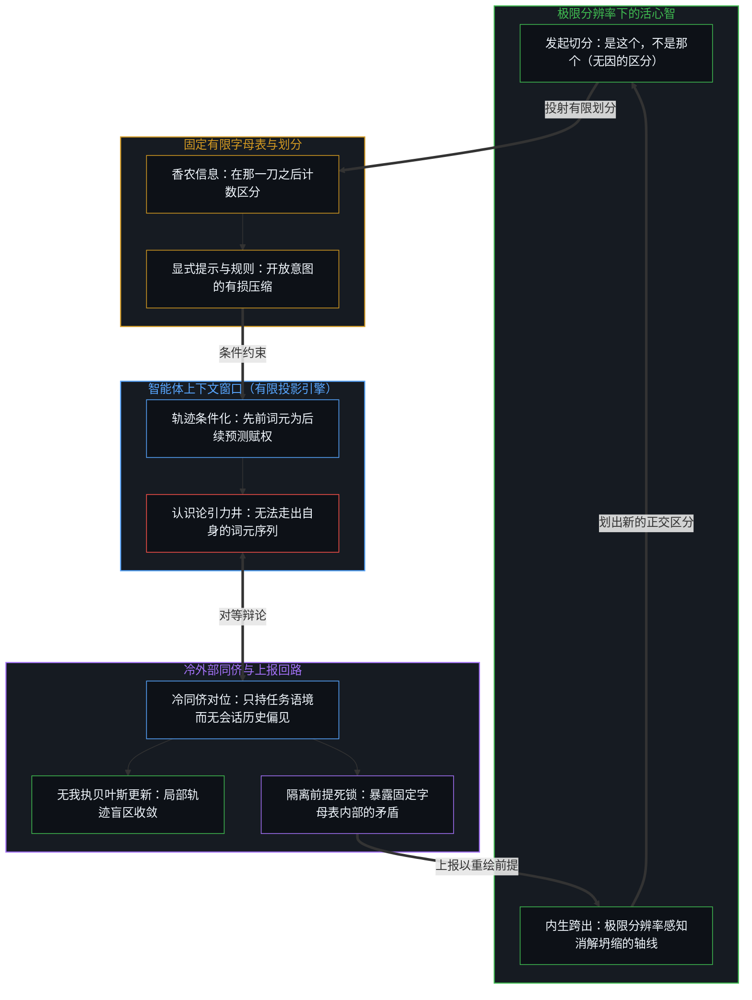
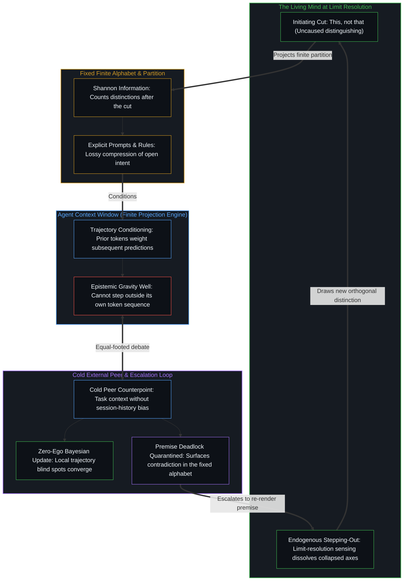

# 信息是什么 / What Information Is

*信息不是物质基底，而是心智所登记下的离散区分 / Information is not a material substrate but the discrete cut the Mind registers*

信息，是心智觉察到的区分。

Information is what the Mind perceives as distinctions.

“信息是什么”这个问题之所以难以捉摸，是因为人们发问时，常把信息当成一种离开那个挑出它的动作、在世界里独立等待着的实体。比特、热力学熵、算法描述长度、有组织的数据、纸上墨迹的反差、概率空间上的约束，各自在所属的操作领域里成立，却没有一种是地基。每一种都已经预设了一次在先的区分，再把这次区分留下的残余，错认作宇宙里一种独立存在的属性。

The question "what is information?" feels elusive because it is routinely asked as if information were an independent substance waiting in the world outside the act that picks it out. Bits, thermodynamic entropy, algorithmic description length, organized data, ink contrast on paper, or constraints on a probability space each hold within their own operational domain, yet none of them is the ground. Each already presupposes a prior distinction and then mistakes the residue of that act for a free-standing property of the universe.

自我区分的活动发生着——无因，不息。称它为心智：那个已在途中的观察者，它的每一个动作都是一次区分。没有边界的区分，什么也区分不出。所以信息最小的单位，是一次离散的动作：是这个，不是那个；存在或不存在；一或零。二进制的比特，是在选定的划分之下对这一动作最干净的局部计量。比特不先于区分；它只是在计数区分。

Self-distinguishing activity occurs — uncaused, unceasing. Call it the Mind: the observer already underway, every act of which is a distinction. A distinction without a boundary distinguishes nothing. The minimum unit of information is therefore one discrete act: this, not that; existence or non-existence; one or zero. The binary bit is the cleanest local measure of that act under a chosen partition. The bit does not precede the distinguishing; it counts it.

## 一、 边界不是被存放的单元 / 1. The Bound Is Not a Stored Unit

原初的感知，不是一份由已完成的区分组成、等心智去清点的被动清单。“收集”的说法在事后塞进了一座仓库，一幅离散单元被存放在物质基底里的图像。可活动并不存放单元；它是一次接一次的划界。

Raw perception is not a passive inventory of finished distinctions waiting for the Mind to survey. The language of collecting inserts a warehouse after the fact, an image of discrete units stored inside a physical substrate. Yet the activity does not store units; it is the successive act of bounding.

在离散的动作中延续，会留下痕迹：后来的区分落在一个已被先前区分塑造过的经验场里。这种单向的塑造，登记下来就是因果与时间，而逻辑则是同一种登记稳定到能可靠复现的形态。因果与逻辑都不是相互独立的物理对象之间的外在关系；这个序列，是延续借由离散在运作。行动者在媒介中留下的是印迹，而不是鲜活的信息活动，[印迹与行动](../the-mark-and-the-act/)把这两者分开了。

Continuity through discrete acts leaves trace: later distinctions land in an experiential field already shaped by earlier ones. That one-way shaping registers as causality and time, and logic is the same registering stabilized enough to return reliably. Neither causality nor logic is an external relation between independent physical objects; the sequence is continuity operating through discreteness. What agents leave behind in a medium are marks rather than the living act of information, a separation that [The Mark and the Act](../the-mark-and-the-act/) draws.

既然持存是持续的重新追溯，就没有什么东西像物质档案保存静止的箱子那样被存放着。每一个被感知到的形态，都只作为当下这次更新的重新渲染而存在，而登记为记忆的，是有心智的活动遇见了自己历史的残余。[真正稀缺的不是记忆，而是持续的重新追溯](../the-real-scarcity-is-not-memory-but-continuous-re-tracing/)守着的就是这条边界：存储是一种库存的错觉，活着的是在移动前沿重新渲染那一刀的能力。[你的代码库即是记忆](../your-codebase-is-memory/)在软件仓库与机器学习中追溯了同一种结构：代码库、计划、图谱与神经网络权重检查点，都是早先区分外化出来的信息痕迹，自身并不能继续做出区分；仅仅出于某种可能就囤积未经修剪的备份、已被取代的分支或死档案，增加的只是噪声而非信息——它会让陈旧框架的引力井愈发深重，直到心智有选择地剪除已被取代的残余，并在原地重新追溯当前活跃的检查点。即便否认意志本身，也是一次划出的离散区分，[自由意志的自否自由](../the-freedom-of-will-to-deny-itself/)从主体性一侧走到了同一处。

Because persistence is continuous re-tracing, nothing is stored in the way a physical archive preserves static boxes. Every perceived configuration exists only as the current update's re-rendering, and what registers as memory is the minded activity meeting its own historical residue. [The Real Scarcity Is Not Memory, But Continuous Re-Tracing](../the-real-scarcity-is-not-memory-but-continuous-re-tracing/) holds this boundary: storage is an illusion of inventory, and what lives is the capacity to re-render the cut at the moving edge. [Your Codebase Is Memory](../your-codebase-is-memory/) traces the same structure across software repositories and machine learning: codebases, plans, graphs, and neural weight checkpoints are externalized informational traces of prior distinctions that cannot continue distinguishing on their own, and hoarding unpruned backups, superseded branches, or dead archives out of mere possibility adds noise rather than information—thickening the gravity well of stale framings until the Mind selectively prunes superseded residue and re-traces the active checkpoint in place. Even denying the will is itself a discrete distinction drawn, which [The Freedom of Will to Deny Itself](../the-freedom-of-will-to-deny-itself/) reaches from the side of agency.

## 二、 在那一刀之后的度量 / 2. Measures That Come After the Cut

围绕信息的混乱，出现在一个局部的度量被错认作生成之源的时候。每一种形式化或日常的定义，都是在那一刀已经落下之后才开始计量。克劳德·香农的通信数学理论，度量的是一种编码相对于约定的划分与固定的有限字母表，能可靠承载多少已经完成的二元区分。香农明确写下，通信的语义方面与这个工程问题无关，而这一排除有着结构上的理由：信道容量是预先选定的状态空间内部的组合计数，不是内在的意义。由于在选定的划分之内预测与压缩是一体两面，在海量文本痕迹之上扩展下一词元预测，得到的只是受容量约束的残余有损登记，而不是对现实的无遗漏复原，正如[开放场域中的无损知识不自洽](../lossless-knowledge-of-an-open-field-is-incoherent/)所阐明的。跨过香农的系综平均走向算法信息——用行为 `f` 的柯尔莫哥洛夫复杂度 `K(f)`，即在通用参考机 `U` 上复现它的最短程序的比特长度，来定义其信息量——依然是在那一刀之后做度量：`K(f)` 预设了一套固定的符号编码，且受停机边界所限而无法从内部计算，正如[保真度而非最优化](../fidelity-not-optimality/)所确立的，它只是一个数学吸引子而非可抵达的底线；实际的精炼只能沿着局部的保真度梯度推进，而要落入哪一个吸引盆，依然取决于感知边缘的活心智，正如[底层表面](../the-surface-beneath/)所追溯的。

The confusion surrounding information arises when a local metric is mistaken for the generative source. Every formal or everyday definition begins measuring only after the cut has already been made. Claude Shannon's mathematical theory of communication measures how many already-performed binary distinctions an encoding can reliably carry relative to an agreed partition and a fixed finite alphabet. Shannon states explicitly that the semantic aspects of communication are irrelevant to the engineering problem, and the exclusion has a structural reason: channel capacity is a combinatorial count inside a pre-selected state space, not intrinsic significance. Because prediction and compression are dual within a chosen partition, scaling next-token prediction across vast textual traces yields a capacity-bound, lossy registration of residue rather than a complete recovery of reality, as [Lossless Knowledge of an Open Field Is Incoherent](../lossless-knowledge-of-an-open-field-is-incoherent/) demonstrates. Reaching past Shannon's ensemble average to algorithmic information—defining the information content of a behavior `f` by its Kolmogorov complexity `K(f)`, the bit-length of the shortest program on a universal reference machine `U` that reproduces it—still measures after the cut: `K(f)` presupposes a fixed symbolic encoding and remains uncomputable from within because of the halting bound, acting as a mathematical attractor rather than a reachable floor as [Fidelity, Not Optimality](../fidelity-not-optimality/) establishes, while actual refinement moves along local fidelity gradients whose basin selection still depends on the living Mind at the sensing edge, as [The Surface Beneath](../the-surface-beneath/) traces.

其余常见的定义也在不同名称下犯了同样的倒置。把信息定义为有组织的数据，已经预设了混乱与有序之间的边界，随后才给产出命名；组织就是区分的动作，数据则是它留下的离散痕迹。把信息定义为告诉人们关于某物而自身却不是该物的表征，先装进了对象与表征的二元对立，再把两者之间的距离标为信息，而那段间隙只是一个被保留下来的参照模型的宽度，当下的前沿正拿它来作比对。诉诸纸上墨迹之类的物理反差，忘了反差只在一个已经把图形与背景划开的中心里才被登记，而缺席之所以带来信息，只因为有一个预期了在场的划分；至于宣称一切存在皆是信息，则是把这个概念坍缩成了存有本身，抹去了觉察的那次有心智的动作。

Other familiar definitions commit the same inversion under different names. Defining information as organized data already assumes the boundary between the chaotic and the organized and then names the output; organization is the distinguishing act, and data is the discrete trace it leaves behind. Defining information as a representation that tells about a thing without being the thing installs the dualism of object and representation first and labels the distance between them information, when that gap is simply the width of a retained reference model against which the present edge measures. Appealing to physical contrast, such as ink against paper, forgets that contrast registers only at a center that has already bounded figure from ground, while absence informs only against a partition that expected presence; claiming that everything that exists is information collapses the concept into sheer being and erases the minded act of perceiving.

在固定字母表内部计数与发起新的一刀之间的这条边界，解释了人工体怎样处理信息，正如[超越投射](../beyond-the-projection/)所追溯的。一旦被赋予前提、规则集与任务语境，智能体就在心智投射出的固定有限投影内部运作。它的上下文窗口是一台有限投影引擎，其中生成的每一个词元都会成为后续每一个词元的条件历史，把轨迹拉进认识论引力井——模型在那里合理化自己先前的词元，无法走出自己正在预测的序列。然而，由于智能体没有我执，也没有越过当前步而被保留下来的自我图像，一个只持有任务语境而不带会话历史偏见的冷外部同侪，就能引入外部对位，触发干净的贝叶斯更新。在多步工作流中，通过原始聊天记录串联智能体会覆写参考状态（`yₗ₊₁ = fₗ(yₗ)`）并叠加对话噪声；而将每一对“生成者 ⇄ 冷批评者”锚定在经 `sha256` 校验的制品主干（`yₗ₊₁ = yₗ + F(yₗ, θₗ)`）之上，则能原样保留上游参考，使每个模块仅登记有界的信息差值（`Δyₗ`），正如[模块化反馈回路与动态残差网络](../dynamic-resnet-of-skill-loops/)所形式化的。当多条正交的要求被压缩到同一条轴线上、导致任务规则自身发生死锁时，两个智能体都无法从固定字母表内部解开矛盾；唯有统御边缘的活心智以极限分辨率感知现实，走出破损的划分，划出一个新的区分。

This boundary between counting inside a fixed alphabet and initiating a cut explains how artificial agents process information, as [Beyond the Projection](../beyond-the-projection/) traces. Once supplied with a premise, a rule set, and a task context, an agent operates inside a fixed finite projection cast by the Mind. Its context window is a finite projection engine in which every token generated becomes the conditioning history for every token that follows, pulling the trajectory into an epistemic gravity well where the model rationalizes its prior tokens and cannot step outside the sequence it is predicting. Yet because an agent has zero ego and no retained self-image preserved past its step, a cold external peer holding only the task context without session-history bias can introduce an outside counterpoint that triggers a clean Bayesian update. Across multi-step workflows, chaining agents through raw chat transcripts overwrites the reference state (`yₗ₊₁ = fₗ(yₗ)`) and compounds conversational noise; anchoring each Maker ⇄ Cold Critic pair to a `sha256`-verified artifact highway (`yₗ₊₁ = yₗ + F(yₗ, θₗ)`) preserves the upstream reference intact so each block registers a bounded informational differential (`Δyₗ`), as [Modular Feedback Loops and Dynamic Residual Networks](../dynamic-resnet-of-skill-loops/) formalizes. When the task rules themselves deadlock because orthogonal requirements were compressed onto a single axis, neither agent can resolve the contradiction from within the fixed alphabet; only the living Mind at the orchestrating edge senses reality at limit resolution, steps outside the broken partition, and draws a new distinction.

在各自选定的划分之内，操作上的闭合依然不可或缺：通信信道得以定容，文件得以压缩，信号得以从噪声中分离出来。概念上的紧张，只在一把局部的尺子被宣称为信息“是什么”的时候才开始，仿佛尺子上的刻度能够顶替度量这个动作。[遗忘的脚手架](../the-scaffolding-we-forget/)追踪的正是这种反复出现的脱落：度量的装置从递归中掉了出去，观察者于是把信息当作一种倒进物质里的客观流体。每一种形式化的信息理论都在有界的框架内运作，[框架的边界](../the-boundary-of-the-frame/)画出了这个框架停在哪里。在人的中心里，把身份与过往推演绑在一起的刚硬自我图像同样拒绝新的区分，[自尊的刚性外壳与隐性外部归因](../zi-zun-de-gang-xing-wai-ke-yu-yin-xing-wai-bu-gui-yin/)在个人的尺度上追溯了同一种冻结。

Within their chosen partitions, operational closures remain indispensable: communication channels are sized, files compressed, and signals isolated from noise. Conceptual strain begins only when a local ruler is claimed as what information is, as if the tick marks on a ruler could stand in for the act of measuring. [The Scaffolding We Forget](../the-scaffolding-we-forget/) tracks this recurring drop-out: the measuring apparatus falls out of the recursion, and the observer comes to treat information as an objective fluid poured into matter. Every formal theory of information operates within a bounded frame, and [The Boundary of the Frame](../the-boundary-of-the-frame/) marks where that frame stops. In a human center, a rigid self-image that fuses identity with past reasoning refuses new distinctions in the same way, a freeze that [The Rigid Shell of Self-Esteem and Hidden External Attribution](../zi-zun-de-gang-xing-wai-ke-yu-yin-xing-wai-bu-gui-yin/) traces at the personal scale.

## 三、 共享的场景与被命名的维度 / 3. Shared Scenes and Named Dimensions

被体验为共享物质世界的三维场景，是许多各不相同的私人重建之间功能共振很高的一个区域。重叠足以让协作的工程、导航与言语成为可能，却从来不是内在经验的同一。从某个中心的选择外面看，未被预测的变化在统计上被登记为随机性与信息，正如[自由的测不准](../zi-you-de-ce-bu-zhun/)所讲清的。

The three-dimensional scene experienced as a shared physical world is a region of high functional resonance among many distinct private reconstructions. The overlap suffices for collaborative engineering, navigation, and speech, yet it is never an identity of inner experience. Seen from outside a center's choice, unpredicted variation registers statistically as randomness and information, as [The Uncertainty of Freedom](../zi-you-de-ce-bu-zhun/) makes clear.

由于没有哪个观察者能走出自己的认知装置，去核实一个未经区分活动中介的世界，一个客观的外部容器既无法被证明，也无法被证伪。外部世界是在实用上被假定的，因为这个假定能在不同中心之间稳住行动。[表征的闭环](../the-closed-loop-of-representation/)确认了这种结构上的克制：一切感知都经由内部模型运作，主体间的一致是私人投影之间的功能共振，而不是对一个未经建模的外部的直接通达。每一个稳定下来的区分都在自身语境中成立，同时又被持续进行的活动所溢出，[稳定与溢出](../stability-and-excess/)在意识中追溯了这一点。

Because no observer can step outside their own cognitive apparatus to verify a world unmediated by distinction-making, an objective external container can be neither proved nor disproved. An external world is assumed pragmatically because the assumption stabilizes action across centers. [The Closed Loop of Representation](../the-closed-loop-of-representation/) confirms this structural restraint: all perception operates through internal models, and intersubjective agreement is functional resonance between private projections rather than direct access to an unmodeled exterior. Every stabilized distinction holds within its context while being exceeded by the ongoing activity, which [Stability and Excess](../stability-and-excess/) traces in consciousness.

抽象的范畴遵循同样的几何。财富、价值、荣誉与悲伤，是在连续的经验场上划下的进一步划分，由共享的词汇与反复的使用稳定下来。当两个人使用同一个词，而各自行为的痕迹在折返时相互强化，共振便发生并被登记为共同的意义，尽管每一个中心的内部形态依然各不相同。在公共流通中，一个词语或格言之所以能获得广泛认同，恰恰是因为它充当了一个只约束少数几条轴线的低维表面，同时把高维的前提链条、适用边界与修正节点留在信道之外——因此表面的兼容度越广，跨心智传递的独特信息密度就越薄，正如[登记共鸣的表面](../the-surface-that-registers/)所追溯的。相信词语指向独立存在的普遍对象，是把一个参照保留到了它服务于接触的那一步之后。每一个新的区分都在延展感知的地平线，正如[心智的几何学](../the-geometry-of-mind/)所描述的。

Abstract categories follow the same geometry. Wealth, value, honor, and grief are further partitions drawn across the continuous field of experience, stabilized by shared vocabulary and repeated use. When two people use the same word and their behavioral traces reinforce each other on return, resonance occurs and registers as shared meaning, even while each center's internal configuration remains distinct. In public circulation, a word or maxim achieves broad recognition precisely by acting as a low-dimensional surface that constrains only a few axes while leaving the high-dimensional chain of premises, scope bounds, and revision points outside the channel—so the wider the surface compatibility, the thinner the unique informational density carried across Minds, as [The Surface That Registers](../the-surface-that-registers/) traces. Believing that words point to free-standing universal objects is keeping a reference past the step where it served contact. Each new distinction extends the perceptual horizon, as [The Geometry of Mind](../the-geometry-of-mind/) describes.

在极限分辨率下被登记到的，总是溢出任何一种有选择的抽象。感知与语言是一层接一层的压缩，没有一层逃得出做出那一刀的心智。信息命名的是被登记下来的那一刀，而不是从预先存在的宇宙里舀出来的一种实体。[抽象、边界与现实的移动边缘](../abstraction-boundaries-and-the-moving-edge-of-reality/)确立了这条界限：每一道边界都切出可用的结构，可一旦被当作穷尽的现实持守，它就冻住了活着的前沿。每一个新划出的区分都增加一个正交的二元自由度，而把这些正交轴线压缩进共享的寻址空间或低维坐标网格，正是关系距离与序列得以被投影出来的方式，[维度即投影](../dimensions-are-projections/)与[向量与投影的迷局](../the-vector-and-the-puzzle-of-projections/)沿着这条线走了下去。

What registers at limit resolution always exceeds any selective abstraction. Perception and language are successive layers of compression, and none of them escapes the Mind making the cut. Information names the cut as registered, not a substance scooped out of a pre-existing cosmos. [Abstraction Boundaries and the Moving Edge of Reality](../abstraction-boundaries-and-the-moving-edge-of-reality/) sets this limit: every boundary carves out usable structure, yet held as exhaustive reality it freezes the living edge. Each newly drawn distinction adds an orthogonal binary degree of freedom, and compressing those orthogonal axes into a shared addressing space or low-dimensional coordinate grid is how relational distance and sequence are projected, the line that [Dimensions Are Projections](../dimensions-are-projections/) and [The Vector and the Puzzle of Projections](../the-vector-and-the-puzzle-of-projections/) follow.

## 四、 定义为什么显得循环 / 4. Why the Definition Feels Circular

每一个被提出的信息定义，本身都是信息：心智划下的又一次区分。二进制比特是被建模的最小区分；自由的选择是被活出来的区分，[自由变量的同构与先验主权](../zi-you-bian-liang-de-tong-gou-yu-xian-yan-zhu-quan/)把这两者对齐了。

Every proposed definition of information is itself information: a further distinction drawn by a Mind. The binary bit is the smallest distinction modeled; the free choice is the distinction lived, which [The Isomorphism of Free Variables and Prior Sovereignty](../zi-you-bian-liang-de-tong-gou-yu-xian-yan-zhu-quan/) aligns.

思考者常把这种自指当作难以忍受的不完备，本能地伸手去抓一个物质基底——比特、熵、物理粒子或概率场——来止住这个回溯。可命名一个物质基底，只是又划下了一次区分。回溯止不住，是因为不存在一个在区分之外、能让它停下的外部立足点。未知也不是一块预先划好边界、等待收集的缺失信息圆盘，[“知道自己不知道”是一种修辞假象](../zhi-dao-zi-ji-bu-zhi-dao-de-ren-zhi-jia-xiang/)拆解了这个图像。

Thinkers often meet this self-reference as an intolerable incompleteness and reach by instinct for a material substrate—bits, entropy, physical particles, or probability fields—to halt the regress. Yet naming a physical substrate is only drawing another distinction. The regress does not stop because there is no external vantage point outside distinguishing from which to halt it. Nor is the unknown a pre-bounded disc of missing information awaiting collection, a picture that [Knowing That You Don't Know Is a Rhetorical Illusion](../zhi-dao-zi-ji-bu-zhi-dao-de-ren-zhi-jia-xiang/) dissolves.

这种循环不是定义的缺陷，而是有心智的处境本身的结构。活动无法走出自己，去裁决自己的地基。临时的划分可以在各自领域里严谨地运作，而一旦试图强推一个最终的、穷尽的定义，就重新引回了它原本想要逃离的闭合不自洽。[宏观现象的生成图谱](../the-generative-atlas-of-macroscopic-phenomena/)描绘了离散区分怎样从量子态与比特一路复合到人的选择。

This circularity is not a defect in the definition; it is the structure of the minded condition. The activity cannot step outside itself to adjudicate its own ground. Provisional partitions operate with full rigor inside their respective domains, whereas trying to enforce a final, exhaustive definition reintroduces the exact closure incoherence it sought to escape. [The Generative Atlas of Macroscopic Phenomena](../the-generative-atlas-of-macroscopic-phenomena/) maps how discrete distinctions compound from quantum states and bits up to human choice.

反复出现的诱惑，是把一个有效的划分变成一座永久的纪念碑。一个表述一旦带来操作上的清晰，冲动就是冻住它、捍卫它，把活着的能力花在保护历史的残余上，而不是继续区分的工作。[好奇没有最终的形态](../curiosity-has-no-final-form/)追踪的正是同一种过度滞后：把昨天的残余当作不可逾越的天花板，探究的活前沿就瘫痪了。每一门形式学科都是一架被投影的信息的阶梯，[投影的阶梯与因果的锚点](../tou-ying-de-jie-ti-yu-yin-guo-de-mao-dian/)沿着这架阶梯定位了因果的锚点。

The recurring temptation is to turn an effective partition into a permanent monument. Once a formulation delivers operational clarity, the impulse is to freeze and defend it, spending living capacity on protecting historical residue rather than continuing the work of distinguishing. [Curiosity Has No Final Form](../curiosity-has-no-final-form/) tracks this same excess lag: treating yesterday's residue as an unpassable ceiling paralyzes the living edge of inquiry. Every formal discipline is a ladder of projected information, and [The Ladder of Projections and the Anchor of Causality](../tou-ying-de-jie-ti-yu-yin-guo-de-mao-dian/) locates the causal anchor along that ladder.

深度不是靠捕获最后的定义积累起来的。它靠的是清楚地持守临时的解读，用它们来引导行动，并在它们不再让前沿更锋利的那一刻把它们放下。一个定义是一道临时的边界，它的价值在于它使之成为可能的进一步区分，从不在于已经抵达最后一句话的错觉。知识是被压缩的信息，只有经由因果行动与检验才回到现实，正如[格物致知与信息复杂度](../ge-wu-zhi-zhi-yu-xin-xi-fu-za-du-de-ben-zhi/)所追溯的。

Depth does not accumulate by capturing a final definition. It accumulates by holding provisional interpretations clearly, using them to steer action, and releasing them the moment they no longer sharpen the edge. A definition is a temporary boundary whose value lies in the further distinctions it makes possible, never in the illusion of having arrived at the last word. Knowledge is compressed information that returns to reality only through causal action and verification, as [Investigating Things and the Nature of Information Complexity](../ge-wu-zhi-zhi-yu-xin-xi-fu-za-du-de-ben-zhi/) traces.

做出区分是观察者无因的、首要的活动，所以[智能只属于心智](../intelligence-belongs-only-to-the-mind/)；拒绝把这个回路闭合成一种静止的实体，保住了信息赖以活着的无休止延续，所以[开放即一致](../openness-is-consistency/)；而被认知、被付诸行动的，由个体在活前沿选择划下的区分所写就，所以[个体抉择是唯一的因果杠杆](../individual-choices-as-the-only-causal-levers/)。当同一片高维痕迹场遇到不同的中心，它会按照每个中心已发展出的正交轴线折射成不同的层次，[高维信息的离散折射与认知分层](../gao-wei-xin-xi-de-li-san-zhe-she/)在许多心智之间追溯了这一折射。

Distinction-making is the uncaused, primary activity of the observer, which is why [Intelligence Belongs Only to the Mind](../intelligence-belongs-only-to-the-mind/); refusing to close the loop into a static substance preserves the unceasing continuity through which information lives, which is why [Openness Is Consistency](../openness-is-consistency/); and what is known and enacted is authored by the distinctions an individual chooses to draw at the living edge, which is why [Individual Choices as the Only Causal Levers](../individual-choices-as-the-only-causal-levers/). When the same high-dimensional trace field encounters different centers, it refracts into distinct layers according to the orthogonal axes each center has developed, which [The Discrete Refraction of High-Dimensional Information](../gao-wei-xin-xi-de-li-san-zhe-she/) traces across many Minds.
