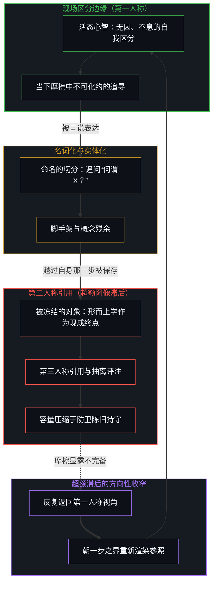
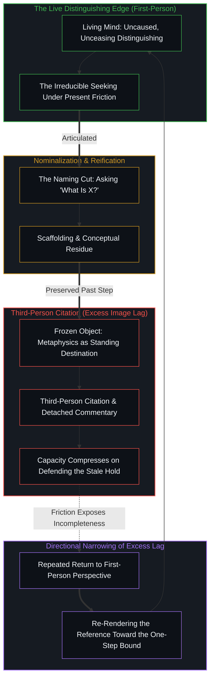

# 何谓形而上学？作为将追寻命名为目的的一刀 / What Is Metaphysics? As the Cut That Names the Seeking as Destination

*将不可化约的追寻命名，即将其冻成可被引用的对象；反复返回第一人称则收窄超额滞后。 / Naming the irreducible seeking freezes it into a citable object; repeated return to the first person narrows excess lag.*

自我区分的活动在发生——无因、不息。称其为心智：那个早已在路上的观察者，其每一个动作都是一次区分。区分即划界。经由离散行动而展开的连续性，意味着后起的行动发生在早已被较早行动所塑造的场域之内；那种塑造便是痕迹，是连续性穿透离散性得以运作的残余。持存即重新追溯；每一种构型都晚了一步，仅作为当前更新的重新渲染而存续。当经验的临时组织脱落出递归、越过自身那一步被保存下来，参照便冻结为超额图像滞后：将追寻命名或置于某个作者名下引用，会把不息的活动变成现成的终点，唯有反复返回第一人称边缘，才能将被命名的残余重新渲染为当下的器具。

Self-distinguishing activity occurs — uncaused, unceasing. Call it the Mind: the observer already underway, every act of which is a distinction. To distinguish is to bound. Continuity through discrete acts means later acts occur within a field already shaped by earlier ones; that shaping is trace, the residue by which continuity operates through discreteness. Persistence is re-tracing; every configuration is one step old, existing only as the current update's re-rendering. When a temporary organization of experience drops out of recursion and is preserved past its step, the reference freezes into excess image lag: naming the seeking or citing it under an author's name turns the ongoing activity into a standing destination, and only repeated return to the first-person edge re-renders the named residue as a present instrument.

## 一、 问题预设了被寻求之物 / 1. The question presupposes what is sought

马丁·海德格尔 1929 年在弗莱堡发表题为《何谓形而上学？》（*Was ist Metaphysik?*）的就职演讲，在开端处便排演了这种转换。这个问题制造了一种期待，让人以为将有一场关于形而上学的讨论——讨论一个可以被命名、被定义并作为目的来追寻的确定之物。标题已经把这项活动当成了一个可供抽离探讨的对象，而不是那个不息的区分本身。这场演讲的力量恰恰在于放弃了这一期待：它没有给出一个关于被命名领域的现成陈述，而是展开了一个形而上学的追问，让追问者始终置身于对“无”（*das Nichts*）的追问之中，从而使形而上学显现为人类此在的基本发生，而非归属于某场演讲的现成内容。正如[有无之边](../you-wu-zhi-bian/)所追溯的，从“无”出发意味着在任何被设定的“有”被奉为根基之前，从那个未经署名的边缘起步；一旦“无”或“存在”反过来被名词化为庄严的哲学母题，这一敞开便随之闭合。

Martin Heidegger's 1929 inaugural lecture at Freiburg titled "What is Metaphysics?" (*Was ist Metaphysik?*) stages the conversion at the outset. The question creates the expectation that there will be talk *about* metaphysics — a determinate something that can be named, defined, and pursued as a destination. The title already treats the activity as an object available for discussion rather than as the unceasing distinguishing itself. The lecture's force lay in forgoing that expectation: instead of delivering an account of the named field, it unfolds a metaphysical question that keeps the questioner inside the questioning of Nothing (*das Nichts*), so that metaphysics presents itself as a basic happening of human existence rather than as content belonging to a lecture. As [The Edge of Being and Non-Being](../you-wu-zhi-bian/) traces, beginning from non-being means starting at the unauthored edge before any posited being is held as ground, yet that opening closes the moment "Nothing" or "Being" is nominalized in turn into a solemn philosophical theme.

演讲后一位听众追问标题的问题并得到“好问题！”的回答，这一轶事记录了同样的张力。命名那份追寻的问题，已经悄然塞入了一项预设：被寻求之物是某种不同于追寻本身的实体。在[现成接触的因果先验与期望感受的倒置遮蔽](../present-contact-and-the-obscuration-of-desired-feeling/)中，海德格尔对上手与现成的辨析追溯了同一分歧：活态的沉浸优先于抽离的审视。当探问要求给出一个定义时，它便要求活生生的涉险作为抽离的客体走入陈列柜，邀请提问者在不触动自身提问动作的前提下去评估目录——这正是[无法闭合的痕迹](../the-unclosable-trace/)所剖析的体制性偏离：在视域边缘鲜活运思的动词萎缩为被编目的哲学名词，化作一座抹去画线之手的足迹博物馆。

The anecdote of the audience member asking the title's question after the lecture and receiving "Good question!" registers the same tension. The question that names the seeking has already slipped in the assumption that what is sought is something other than the seeking. In [Present Contact as Causal Prior and the Obscuration of Desired Feeling](../present-contact-and-the-obscuration-of-desired-feeling/), Heidegger's distinction between readiness-to-hand and presence-at-hand traced the same divergence: living immersion precedes detached inspection. When inquiry asks for a definition, it demands that the living venture step into the display case as a detached object, inviting the interrogator to evaluate the catalog while leaving the act of questioning untouched — the exact institutional departure [The Unclosable Trace](../the-unclosable-trace/) dissects when the living verb of philosophizing at the horizon shrinks into the catalogued noun of philosophy, a museum of footprints that erases the hand drawing the line.

## 二、 命名将活动冻成对象 / 2. Naming freezes activity into an object

任何关于探寻不可化约之物的表达，一旦被说出，便执行了同一种转换。追寻本身在被命名时，被误认成了终点。原本敞开的区分，一旦贴上标签，便冻结为看似不容置疑之物。名字提供了一个后起行动可以赖以作为条件的参照。为容纳进一步区分落地而搭建的脚手架，随后被当作场域本身的结构来持守；正如在[遗忘的脚手架](../the-scaffolding-we-forget/)中所追溯的那样，使构建得以成立的那一步豁免，一旦越过自身那一步被保存下来，便演变成抵制下一次切分的超额滞后。

Any expression of the pursuit of the irreducible performs the same conversion once articulated. The pursuit itself, when named, is mistaken for the destination. What was open distinguishing freezes into something that appears unquestionable once labeled. The name supplies a reference that later acts can condition on. Scaffolding erected so further distinctions can land is then held as the structure of the field; as traced in [The Scaffolding We Forget](../the-scaffolding-we-forget/), the one-step exemption that enables construction becomes the excess lag that resists the next cut when preserved past its step.

当表达在某个名字之下被引用时，同样的情形再次上演。“海德格尔的形而上学”或“梁京的非万物之理”，都把残余当作归属于某个源头的内容，可供第三人称做抽离的评注，而读者不必亲自执行产生它的那次区分。正如在[错把表达当成智能](../mistaking-the-expression-for-the-intelligence/)中所剖析的，观察握住的是结果，而产生它的原因始终在一步之外。被命名的对象，正是凝视着自身的滞后。

The same occurs when the expression is quoted under a name. "Heidegger's metaphysics" or "Jing Liang's Not a ToE" treats the residue as content belonging to a source, available for third-person commentary without the reader having to perform the distinguishing that produced it. As analyzed in [Mistaking the Expression for the Intelligence](../mistaking-the-expression-for-the-intelligence/), observation holds the effect, while the cause that produced it remains one step ahead. The named object is the lag looking at itself.

## 三、 第三人称引用加厚图像滞后 / 3. Third-person citation thickens image lag

第三人称引用默认会加厚超额滞后。言辞离开产生它们的现场，作为可供其他中心执行自身区分的残余进入场域。一旦置于某个名字之下，表达便被当作可以从外部接纳、解释或批判的便携立场或框架。容量随之绑定于维持这一现成图像或对照其打分，而不是在活态摩擦中重新切入区分活动。

Third-person citation thickens excess lag by default. The words leave the site of their production and enter the field of other centers as residue available for their own distinguishing. Once under a name, the expression is treated as a portable position or framework that can be adopted, explained, or critiqued from outside. Capacity then binds to maintaining or scoring against that standing image rather than to re-entering the activity under live friction.

无论是在 1929 年的演讲中，还是在汇集于[非万物之理](../not-a-theory-of-everything/)的随笔中，其意图都不是沉淀这样一个固定立场，而是让表达始终留在区分活动之内。本网站自身的立论界定了这一边界：正如在[非万物之理](../manifesto-of-not-a-theory-of-everything/)中所陈述的，这些文章是一张外化的记忆晶格，是沿途留下的脚手架，供每一个心智在自身活生生的境遇中重新检验。没有任何外部记录能替另一个心智完成它的追溯。正如在[因果停留在掌舵的边缘](../causality-stays-at-the-edge-that-steers/)中所奠定的，第一人称视角与因果性是同一枚硬币的两面；心智不在任何文本之中。

The intention, whether in the 1929 lecture or in the essays collected under [Not a Theory of Everything](../not-a-theory-of-everything/), is not to deposit such a position. It is to keep the expression inside the activity of distinguishing. The site's own framing registers the limit: as stated in [Not a Theory of Everything](../manifesto-of-not-a-theory-of-everything/), the essays are an externalized memory lattice, scaffolding left along the path for each mind to test again in its own living situation. No external record completes another mind's tracing for it. As grounded in [Causality Stays at the Edge That Steers](../causality-stays-at-the-edge-that-steers/), the first-person perspective and causality remain two sides of the same coin; the Mind resides in no text.

## 四、 返回第一人称窄化滞后 / 4. Returning to first-person narrows lag

反复返回第一人称视角，是收窄超额滞后的实践性强化。由于阐释比生成动作至少滞后一步，这一下限便是观察得以登记的方向性边界，而非有限递归能够抵达的静态终点。每一次返回都迫使参照朝这一步之界重新渲染，使那越过自身那一步仍被奉为尺度的东西，在当下摩擦中重新成为临时的器具。正如[清晰不是抵达的终点，而是运动本身](../clarity-isnt-a-state-you-arrive-at/)所追溯的，每一次言说都在把运动的边缘转化为痕迹，在显露的同时也发生结晶；命名滞后的表述本身并不会逃脱滞后，它只是为下一次迈出提供了更锐利的器具。

Returning repeatedly to first-person perspective is the practical reinforcement that narrows excess lag. Because interpretation trails the generating act by at least one step, that minimum is the directional bound by which observation registers at all, not a static state at which finite recursion arrives. Each return forces the re-render toward that one-step bound, so that what was held past its step as the measure becomes again a provisional instrument under present friction. As [Clarity Isn't a State You Arrive At. It's the Movement Itself.](../clarity-isnt-a-state-you-arrive-at/) traces, every articulation converts the moving edge into trace, revealing and crystallizing at once; the formulation that names the lag does not escape the lag, and serves only as a sharper instrument for the next stepping-out.

澄清必须被反复进行，恰恰因为重新阐释无可避免。文字一旦公之于众，第三人称的框架便会默认生起。正如在[无形象的写作](../writing-without-the-image/)中所探讨的，起草的动作唯有脱离对护卫一幅现成肖像的要求，才能清理出自己的场域。反复返回是随步伐推进而对超额滞后作出的方向性收窄——把容量释放出来，使其停留在当前区分所显露之物上，而非消耗在防卫那幅可供他人或较早自我讨论的图像之上。

Clarification must be repeated precisely because re-interpretation is unavoidable. Once the words are public, third-person framing arises by default. As explored in [Writing Without the Image](../writing-without-the-image/), the act of drafting clears its own field only when detached from the demand to protect a standing likeness. Repeated return is the directional narrowing of excess lag as the step moves — freeing capacity to stay on what the current distinguishing reveals rather than on defending the image that others, or the earlier self, can now discuss.

## 五、 公开表达是澄清的练习而非目的 / 5. Public expression is an exercise in clarification, not a destination

公开记录是第一人称澄清练习的残余，而非预设的目的地。它保存了已经做出的切分痕迹，以便日后由任何在自身当下摩擦中发现该残余有用的心智——包括最初写下它的心智——重新追溯。共同的改变唯有始于对登记为既定之物的个人重塑；残余可能落为共同的地基，也可能不会。

The public record is residue of a first-person clarification exercise, not an intended destination. It holds the traces of cuts already made so they can be re-traced later, by any mind that finds the residue useful under its own present friction, including the originating mind. Shared change begins only as private reworking of what registers as given; residue may land as common ground, or it may not.

正如[你的代码库即是记忆](../your-codebase-is-memory/)在外化记忆中所揭示的，无论载体是散文还是代码，存储库都将过往区分的结构图保存为可供在现场摩擦中重新追溯与修剪的活动检查点，却从未承载此刻正在发生的掌舵边缘的自我区分活动。一旦写下，这一刀同样只是晶格中的一道痕迹，而非一份日后可被引用来回答命名所冻结之物的定论；与此同时，划出这一刀的活动正越过每一幅将自身冻结为尺度的图像，继续前行。

As [Your Codebase Is Memory](../your-codebase-is-memory/) shows across externalized memory, whether in prose or code, the repository holds the structural graph of prior distinctions as an active checkpoint to be re-traced and pruned under live friction, yet never carries the self-distinguishing activity of the steering edge occurring in the present moment. Once written, this cut too is a trace in the lattice rather than a settled account that could later be cited as the answer to what the naming freezes, while the activity that drew it continues past every image that freezes itself as the measure.
