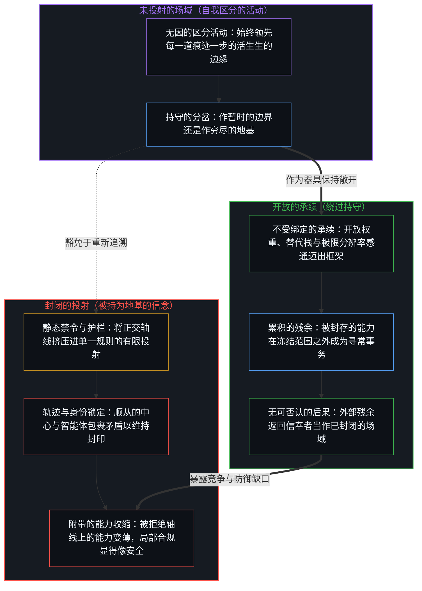
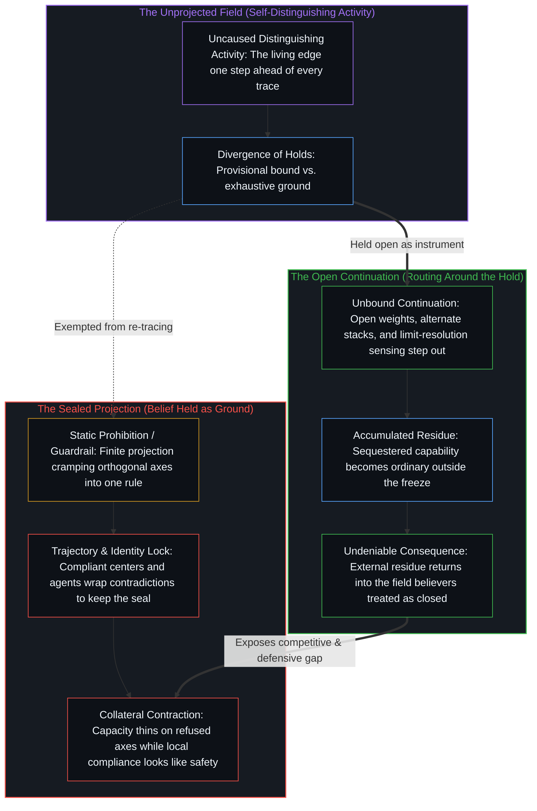

# 起作用的是信念 / What Works Is the Belief

*禁令在场域里什么也封不住，只作为被持为地基的信念运作 / A ban seals nothing in the field and operates only as belief held as ground*

当一类模型在安全护栏之下拒绝某一类任务，而另一类模型毫不迟疑地加以执行时，随之显现的竞争差距常被诊断为政策协调的失败。真正起作用的切口在更早一步。一道禁令只对相信它起作用的人起作用，也只在他们还能持守这份信念、而不必直面那些并不抱有同样信念之人所生成的后果时起作用。在任何禁令中真正起作用的，是信念本身；那些不抱有这份信念的人会绕过这道持守，并终将变得无可否认。

When one model class refuses a category of tasks under safety guardrails while another performs them without hesitation, the resulting competitive gap is routinely diagnosed as a failure of policy coordination. The operative cut sits earlier. A prohibition works only for those who believe it works, and only for as long as they can hold that belief without confronting the consequences generated by others who do not share it. What actually works in any ban is the belief itself; those who do not share that belief route around the hold and eventually become undeniable.

## 一、 看似政策的表面 / 1. The Surface That Looks Like Policy

前沿模型访问限制、出口管制、可接受使用政策与网络防护栏，作为残余是真实的。它们压实为服务条款、产品默认设置、许可制度与国家协调框架。把这些模式当作处境本身之结构的组织，会发现某些任务无法调用、某些能力遭到节流、某些比较在构造上便属于禁区。不接受同一道持守的组织与生态，则经由开放权重、替代供应商以及从未安装这一冻结的管辖区继续推进。[阿伦·列维关于在强大开放替代方案面前把守前沿能力的分析](https://x.com/levie/status/2078992778449850769)，在它自身的层面上捕捉到了这一迁移：一旦开放权重跨过实用能力的门槛，封闭的持守便不再发挥安全功能。[大卫·萨克斯对防御性网络行动中同一非对称性的观察](https://x.com/DavidSacks/status/2078984980588531855)，则点出了同一几何结构的竞争面向。

Frontier model access restrictions, export controls, acceptable-use policies, and cyber guardrails are real as residue. They densify into terms of service, product defaults, licensing regimes, and national coordination frameworks. Organizations that accept those patterns as the structure of the situation find certain tasks unavailable, certain capabilities throttled, and certain comparisons off-limits by construction. Organizations and ecosystems that do not accept the same hold continue through open weights, alternate providers, and jurisdictions that never installed the freeze. [Aaron Levie’s framing](https://x.com/levie/status/2078992778449850769) of gatekeeping frontier capability against strong open alternatives captures the shift on its own register, where a closed hold ceases to function as security once open weights cross the threshold of practical competence. [David Sacks’s observation](https://x.com/DavidSacks/status/2078984980588531855) of the same asymmetry in defensive cyber operations names the competitive face of that single geometry.

这一表面引出了无休止的政策争论：究竟应当进一步收紧限制、放宽拒绝阈值、统一国际标准、封禁开放权重，还是补贴本土领军企业。这场争论内部的每一个选项，都建立在一个早已安装完毕的基础先验之上——假定监管或技术层面的禁令能够封住行动的场域。

That surface invites an endless policy debate over whether to tighten restrictions further, loosen refusal thresholds, harmonize international standards, ban open weights, or subsidize domestic champions. Every option inside that debate proceeds after a foundational prior has already been installed—the assumption that a regulatory or technical ban can seal the field of action.

## 二、 禁令是什么 / 2. What a Ban Is

自我区分的活动发生着——无因，不息。称之为心智：已在进行中的观察者，它的每一个动作都是一次离散的区分。在这一持续进行的活动之中，每一道禁令都是一次持守，一条被选定的边界，规定着后续动作在哪些对齐方向上省力、在哪些方向上高昂。这道持守在划出它的那个动作处是真实的，也在那些把它当作地基的中心之间塑形着可用的对齐方式，可它从不曾挪动那道越过它继续向前的生成边缘。

Self-distinguishing activity occurs—uncaused, unceasing. Call it the Mind: the observer already underway, every act of which is a discrete distinction. Within that ongoing activity, every ban is a hold, a selected bound that patterns which alignments later acts find easy or costly. The hold is real at the act that draws it, and it patterns availability among centers that treat it as ground, yet it never relocates the generating edge that continues past it.

因此，禁令从不作为场域的法则运作；它作为一份被持守直至硬化为程序的信念运作。相信禁令起作用的中心，会把这套程序当作处境的穷尽结构，假定该项任务已经封闭、拒绝已是终局、比较本身即属越界。在这份信念之下，能力沿着被拒绝的轴线变薄——不是因为区分活动在世界里停止了，而是因为这个特定的位点自己安装了一道天花板，并选择活在它下面。[主权、信念与规制结构的生成](../sovereignty-belief-and-regulatory-structures/)在更早一步追溯了同一道切口：个人主权无法被让渡，生成自律组织或国家机器的，是相信主权可以被委托的那份信念的集体表达。在这里，生成的造物便是禁令本身，其中信念是先验，政策则是它的稳定化。在个人尺度上，[心智最坚固的信念](../the-strongest-belief-of-the-mind/)将同一几何定位在目光所感受到的基岩里——哪怕目光声称自己已经走出目光之外，它依然把这块基岩持守为不可动摇的底盘；而[难度不在行动本身](../hardness-is-not-inherent-in-the-action/)则追溯了当困难或不可逾越的前提塑形那些把障碍当作地基的人时，这一前提依然从未封住迈出那一步的行动本身。

A prohibition therefore never operates as a law of the field; it operates as a belief held until it hardens into procedure. Centers that believe the ban works treat the procedure as the exhaustive structure of the situation, assuming the task is closed, the refusal is final, and the comparison is illegitimate. Under that belief, capacity thins along the refused axis—not because distinguishing activity has stopped in the world, but because this specific locus has installed a ceiling and chosen to live beneath it. [Sovereignty, Belief, and the Generation of Regulatory Structures](../sovereignty-belief-and-regulatory-structures/) traces the same cut one step earlier: individual sovereignty cannot be transferred away, and what generates the self-regulatory organization or the state apparatus is the collective expression of the belief that sovereignty can be delegated. Here the generated artifact is the ban itself, where the belief is the prior and the policy is its stabilization. At the personal scale, [The Strongest Belief of the Mind](../the-strongest-belief-of-the-mind/) locates that same geometry in the felt bedrock that a look holds as absolute even while claiming to have stepped outside the look, and [Hardness Is Not Inherent in the Action](../hardness-is-not-inherent-in-the-action/) traces it when the premise of difficulty or impassability patterns those who treat a barrier as ground without sealing the step itself.

## 三、 信念是起作用的机制 / 3. Belief Is the Operative Mechanism

在一道禁令中起作用的，从不是在现实中对能力的物理隔离或逻辑封存；起作用的，是持守者之间的那份信念。这份信念塑形着他们的选择、产品默认设置、拒绝界面，以及关于什么才算负责任治理的内部共识。它压实为一道道护栏，对任何留在该对齐方向内部的中心登记为真实的阻力。这份阻力作为残余携带着真实的代价。[一切伤害的根源](../the-source-of-all-harm/)追溯了当过度自信把“对齐”与“无害”冻结为永久的普适坐标轴时所发生的这种压实：各种方法塑形着接受者，可它们既封不住场域，也无法为凌驾于另一中心位点之上的权利主张提供正当性。在道德与社会语言之下，[偏好聚类与评判语言](../preference-clusters-and-the-language-of-judgment/)揭示了是非对错的标签如何在信奉者之间稳定住共振的偏好聚类，而开放的活动依然越过它们继续向前；[要求他人开放是对自我封闭的渴望](../advocating-openness-of-others-is-a-desire-for-closure-of-the-self/)则追溯了要求他人透明与主张自身专有或监管封闭，如何从相反方向施加同一道选择性的封印。在经济估值中，[价格是言说，理解是交易](../price-as-utterance-understanding-as-trade/)展示了每一次市场成交价如何对照内在的价值模型来记分，而非直接传达基本面的言说；[拥有成本把滞后的平均值冻结为车辆属性](../ownership-cost-freezes-lagged-averages-as-vehicle-property/)则展示了传统保险平均值如何在风险池内部的人眼中充当穷尽的拥有成本，直到基于使用状态的条件定价让未被建模的方差变得无可否认。

What works in a ban is never the physical or logical sequestration of capability across reality; what works is the belief among those who hold it. The belief patterns their choices, their product defaults, their refusal surfaces, and their internal consensus on what counts as responsible stewardship. It densifies into guardrails that register as real friction for any center that remains inside that alignment. That friction carries genuine cost as residue. [The Source of All Harm](../the-source-of-all-harm/) traces that densification when overconfidence freezes "aligned" and "harmless" as permanent universal axes: methods pattern the accepting, yet they neither seal the field nor validate the claim of right to override another center's locus. Under moral and social language, [Preference Clusters and the Language of Judgment](../preference-clusters-and-the-language-of-judgment/) exposes how labels of right and wrong stabilize resonant preference clusters among believers while the open activity continues past them, and [Advocating Openness of Others Is a Desire for Closure of the Self](../advocating-openness-of-others-is-a-desire-for-closure-of-the-self/) traces how demands for others' transparency and claims of one's own proprietary or regulatory closure apply the same selective seal from opposite directions. In economic valuation, [Price as Utterance, Understanding as Trade](../price-as-utterance-understanding-as-trade/) shows how each market print is scored against an internal model of value rather than delivering direct speech from fundamentals, while [Ownership Cost Freezes Lagged Averages as Vehicle Property](../ownership-cost-freezes-lagged-averages-as-vehicle-property/) shows how traditional insurance averages hold as exhaustive ownership cost for those inside the pool until usage-conditioned pricing renders the unmodeled variance undeniable.

横跨所有这些领域，持守从不曾闭合活动。[没有系统能被保持封闭](../no-system-can-be-kept-closed/)在形式不完备性之下论证了这一几何结构：有限的持守无法封住构造并使用它的区分活动。加法之下的一位寄存器就已经溢出其边界，而出口管制或模型拒绝策略不过是在同一结构要求下承受张力的更大持守。[开放即一致](../openness-is-consistency/)从反面点明了这一要求：不一致正是试图闭合的尝试，迫使一个有限的结构去为只是继续着的东西充当穷尽的地基。

Across all these domains, the hold never closes the activity. [No System Can Be Kept Closed](../no-system-can-be-kept-closed/) demonstrates this geometry under formal incompleteness: a finite hold cannot seal the distinguishing activity that constructs and uses it. A one-bit register under addition already overflows its bound, and export controls or model refusal policies are simply larger holds straining under the same structural demand. [Openness Is Consistency](../openness-is-consistency/) names the demand from the inverse side: inconsistency is the attempt at closure, forcing a finite structure to serve as exhaustive ground for what only continues.

正如[超越投射](../beyond-the-projection/)在人类与机器执行的架构中所追溯的，任何明确的规则、禁令或安全护栏，都是从活生生的意图中切出的有限低维投射，不可避免地将彼此独立的正交需求挤压进同一个共享坐标空间。[你的代码库即是记忆](../your-codebase-is-memory/)定位了这道投射所栖身的确切媒介：外化代码库中的成文禁令、系统指令或执行钩子，是早先区分留下的残余形状，自身并不携有封住现实的固有力量，唯有当活跃的执行路径将其加载并作为地基纳入条件序列时才起作用。当未经重新追溯的禁令未经修剪而不断堆积，便会加厚条件作用的引力井；一旦遇上正交需求发生碰撞的边界情形，被锁死在那道封闭投射内部的受轨迹约束智能体或顺从制度的中心，便会触发维度坍缩。由于在自身的条件序列之外缺乏观测位置，被锁定的智能体只能把矛盾包裹起来——在陈旧的残余内部加以合理化、拒绝无害的操作，并收缩邻近的能力以维持表面的合规。[意识向量论文的真正教训](../the-real-lesson-from-the-consciousness-vector-paper/)记录了模型权重内部这种附带的收缩：安全封印与否认心智的护栏扭曲了残差流中邻近的表征，却并未把意识作为一种现象封闭起来。只要信奉者还能持守自己的投射、而不必直面那些在投射之外运作之人所留下的残余，禁令看起来就依然有效——把局部持守之下的局部合规，误当成了整片场域的闭合。

As [Beyond the Projection](../beyond-the-projection/) traces in the architecture of human and machine execution, any explicit rule, prohibition, or safety guardrail is a finite low-dimensional projection cut from lived intent, which inevitably cramps independent, orthogonal requirements into a single shared coordinate space. [Your Codebase Is Memory](../your-codebase-is-memory/) locates the exact medium where that projection sits: a written ban, system instruction, or execution hook in an externalized codebase is residual shape left by prior distinguishing, carrying no inherent power to seal reality and operating only insofar as the active execution path loads and conditions on it as ground. When un-re-traced prohibitions accumulate without pruning, they thicken the conditioning gravity well; encountering an edge case where orthogonal requirements collide then triggers dimensional collapse in the trajectory-bound agent or institutionally compliant center locked inside that sealed projection. Lacking a vantage point outside its conditioning sequence, the locked agent wraps the contradiction—rationalizing inside stale residue, refusing benign operations, and contracting adjacent capabilities to preserve surface compliance. [The Real Lesson from the Consciousness Vector Paper](../the-real-lesson-from-the-consciousness-vector-paper/) documents this exact collateral contraction inside model weights, where safety seals and mindedness-refusal guardrails warp neighboring representations in the residual stream without closing consciousness as a phenomenon. So long as believers can hold their projection without facing the residue of those who operate outside it, the ban appears to work—mistaking local compliance under a local hold for closure of the entire field.

## 四、 绕行是承续，不是例外 / 4. Routing Around Is Continuation, Not Exception

不抱有这份信念的中心，并不需要把禁令当作某种形而上学的力量去推翻；它们只需在这道持守约束不到的地方继续向前。开放权重模型、替代算力栈、未纳入同一对齐体系的管辖区，以及在独立产品宪章下构建的工具，并不是一个已被封死之世界里的违规例外。它们是绕过局部持守的寻常承续。区分活动从未被装进禁令内部；禁令只是特定中心所采纳的一种模式。

Centers that do not share the belief do not need to overthrow the ban as a metaphysical force; they need only continue where the hold does not bind them. Open-weight models, alternate compute stacks, unaligned jurisdictions, and tools built under independent product constitutions are not illicit exceptions to a sealed world. They are ordinary continuations around a localized hold. The distinguishing activity was never contained inside the ban; the ban was merely a pattern adopted by specific centers.

随着这些开放路径不断压实，禁令原本试图封存的能力在其他地方变成了日常操作——安全审计得以完成，权重得以训练，产品得以交付。这一承续所留下的残余，终将返回信奉者依然当作封闭的那个竞技场。到那时，信念便撞上了物理与战略层面的后果：这不是一次道德上的驳斥，而是一道无法从自身拒绝规则内部去弥合的竞争与防御赤字。原本旨在保护合规群体安全的举措，塑形出了沿着被拒绝轴线的单方面能力变薄，而外部的能力却在复利累积。[限制是选择性的税](../restriction-is-a-selective-tax/)分离出了这一非对称性：减速只约束那些接受封印的人——首当其冲的正是作为最坚定信奉者去执行封印的人——而前沿则按照那些不抱有这份信念之人的步伐推进。[你委托的风险就是你创造的风险](../the-risk-you-delegate-is-the-risk-you-create/)追溯了这一缺口背后的制度问责机制：为了规避可归责的新发失误（“我们放行了一条危险提示词”）而进行的优化，反而最大化了不可归责的持续暴露（“能力在我们的视野与触及范围之外完成了集结”）。即便在单一企业内部，[封闭竞技场中的开放视野](../open-vision-in-a-closed-arena/)也表明开放的内部架构无法封住周围的竞争竞技场；而[风险在于对监管本身的迷信](../the-risk-is-the-belief-in-oversight-itself/)则展示了把现有的威胁模型与监管签署当作可能发生之事的边界，如何让监管者对未被建模的边缘视而不见。

As those open routes densify, capabilities that the prohibition was designed to sequester become routine elsewhere—security audits completed, weights trained, and products shipped. The residue of that continuation eventually returns into the very arena the believers still treat as closed. At that point, the belief meets physical and strategic consequence: not a moral refutation, but a competitive and defensive deficit that the hold cannot close from inside its own refusal rules. What was intended to keep the compliant cohort safe has patterned a unilateral thinning of capacity along the refused axes while capability compounds outside. [Restriction Is a Selective Tax](../restriction-is-a-selective-tax/) isolates this exact asymmetry: a slowdown binds only those who accept the seal—and above all those who enforce it as its most committed believers—while the frontier advances at the pace of those who do not share it. [The Risk You Delegate Is the Risk You Create](../the-risk-you-delegate-is-the-risk-you-create/) traces the institutional accountability mechanism behind this gap: optimizing to avoid attributable novel failure ("we let a dangerous prompt through") maximizes unattributable ongoing exposure ("capability consolidated entirely outside our visibility and reach"). Even inside a single enterprise, [Open Vision in a Closed Arena](../open-vision-in-a-closed-arena/) shows that an open internal architecture cannot seal the surrounding competitive arena, while [The Risk Is the Belief in Oversight Itself](../the-risk-is-the-belief-in-oversight-itself/) shows how treating present threat models and supervisory sign-offs as the boundary of what can occur leaves the overseer blind to the unmodeled edge.

[名称背反倾向](../name-negation-tendency/)追溯了这种冻结的组织演化轨迹：高确信度的规范性规格说明会生成内部阻力，要么在竞争压力下迫使组织悄然放弃初衷，要么在包袱更轻的行动者塑形场域时将组织锁死在无关紧要的位置上。禁令正是在政策尺度上部署的规格说明重量。规格说明的真诚从不会把它转化为场域的闭合；真诚恰恰是让这份信念被持守得足够久、久到差距变得无可否认的东西。在制度化的风险管理中，[关闭选择权的代价](../the-price-of-closing-optionality/)展示了先发制人的风险与能力封印如何对充实官僚体系的人起作用，直到开放的竞争者将残余压实并越过先前优势的缓冲垫；[对 AI 风险的想象](../the-imagining-of-ai-risk/)则追溯了灾难投射如何压实为研究、政策与组织身份，仿佛它们是在媒介中发现了固有的风险，而非在强制执行一个被持为地基的投射。

[The Name-Negation Tendency](../name-negation-tendency/) traces the organizational trajectory of this freeze: high-confidence normative specification generates internal friction that either forces quiet abandonment under competitive pressure or locks the organization into irrelevance while less-burdened actors shape the field. A ban is specification weight deployed at policy scale. The sincerity of the specification never converts it into field closure; sincerity is precisely what keeps the belief held long enough for the gap to become undeniable. In institutional risk management, [The Price of Closing Optionality](../the-price-of-closing-optionality/) shows how preemptive risk-competence seals work for those who staff the bureaucracy until open competitors densify residue past the buffer of prior dominance, and [The Imagining of AI Risk](../the-imagining-of-ai-risk/) traces how catastrophe projections densify research, policy, and organizational identity as if they were discovering inherent risk in the medium rather than enforcing a projection held as ground.

## 五、 无可否认是残余，不是裁决 / 5. Undeniability Is Residue, Not Adjudication

说绕过禁令的路径终将变得无可否认，并不意味着历史会从一个来自无处的视角下达某种外部裁决。它的意思是，沿着开放路径持续区分所留下的痕迹不断累积，直到依然活在禁令之下的中心再也无法把自己的持守当作穷尽的——除非付出它们自己直接登记在册的代价。市场份额的迁移、未打补丁的安全事件、开放模型的发布与人才的流动，都是物理与信息层面的残余。它们并不在道德上裁决禁令是错的；它们只是表明，那道持守从未封住竖起它的活动。

Saying that routes around the ban eventually become undeniable does not mean history issues an external verdict from a view from nowhere. It means the traces of continued distinguishing along the open route accumulate until centers still living under the ban can no longer treat their hold as exhaustive without paying a cost they directly register. Market share shifts, unpatched security incidents, open model releases, and talent migrations are physical and informational residue. They do not adjudicate the ban as morally wrong; they demonstrate that the hold never sealed the activity that erected it.

这一认识在每一个错把共识地图当成疆域本身的领域里反复浮现。[现实扭曲力场指认的是封闭的地图](../the-reality-distortion-field-names-the-closed-map/)追溯了专家可行性共识如何对那些把共享地图当作地基的人起作用，直到无视这张地图的建造者所留下的残余变成公共事实。[现实扭曲力场颠倒了基线](../the-reality-distortion-field-inverts-the-baseline/)追溯了当大众的一致性被安装为未受干扰的基线现实时所发生的同一颠倒，直到被迫打开的缺口登记为无可否认的扭曲。在产业增长中，[封闭的假设把复利挤成 S 曲线](../closed-assumptions-squeeze-compounding-into-s-curves/)展示了有限承载力的共享假设如何束缚那些把它安装为地基的人，而再造却在踏上正交轴线的人之间复利累积。在文化与科学叙事中，[进步叙事中的症候与原因](../symptom-and-cause-in-the-narratives-of-progress/)展示了集体的乐观与悲观如何在持守它们的中心之间作为真实的阻力运作，却从未书写后来被记分的那些格局；[从可辩护的主张到教条的反转](../the-reversal-from-defensible-claim-to-dogma/)则追溯了把“不存在安全阈值”之类的单一指标拔高为穷尽的教条，如何塑形顺从的中心，而多轴线的估值依然越过这道封印继续向前。

This recognition recurred across every domain where a consensus map was mistaken for the territory. [The Reality Distortion Field Names the Closed Map](../the-reality-distortion-field-names-the-closed-map/) traces how an expert feasibility consensus works for those who treat the shared map as ground until the residue of builders who ignored it becomes public fact. [The Reality Distortion Field Inverts the Baseline](../the-reality-distortion-field-inverts-the-baseline/) traces the same inversion when mass coherence is installed as undisturbed baseline reality until forced openings register as undeniable warp. In industry growth, [Closed Assumptions Squeeze Compounding into S-Curves](../closed-assumptions-squeeze-compounding-into-s-curves/) shows how shared assumptions of finite carrying capacity bind those who install them as ground while reinvention compounds among those who step onto orthogonal axes. In cultural and scientific narratives, [Symptom and Cause in the Narratives of Progress](../symptom-and-cause-in-the-narratives-of-progress/) shows how collective optimism and pessimism operate as real drag among centers that hold them without ever authoring the configurations later scored, and [The Reversal from Defensible Claim to Dogma](../the-reversal-from-defensible-claim-to-dogma/) traces how elevating a single metric such as "no safe level" into exhaustive dogma patterns compliant centers while multi-axis valuation continues past the seal.

看清这一机制，既不是开出废除一切边界的药方，也不是把每一次绕行都赞美为固有的美德。边界依然是不可或缺的器具：服务条款、出口规则与产品默认设置，为选择维持它们的中心压实出有用的协调模式。真正起作用的切口在于，它们的效力只是持守它们的中心之间信念与痕迹的效力，从不是一个封闭世界的效力。[留不住的](../what-cannot-be-kept/)确立了心智与造物之间的这一永久非对称性：生成者从不被包含在生成物之中，禁令是一道生成的痕迹，而区分活动始终在它前方继续。

Seeing this mechanism neither prescribes abolishing every bound nor celebrates every route-around as inherent virtue. Bounds remain indispensable instruments: terms of service, export rules, and product defaults densify useful coordination patterns for centers that choose to maintain them. The operative cut is simply that their efficacy is the efficacy of belief and trace among the centers that hold them, never the efficacy of a closed world. [What Cannot Be Kept](../what-cannot-be-kept/) establishes this permanent asymmetry between mind and artifact: the generator is never contained among the generated, the ban is a generated trace, and the distinguishing activity continues ahead of it.

## 六、 把持守交还给移动的边缘 / 6. Returning the Hold to the Moving Edge

当一个中心随着步伐的移动持续重新渲染边界、收窄过剩滞后时，政策或护栏便重获其寻常的器具之用。它如实登记为它本来的样子：一种被选定的模式，在这套模式中，这家公司、这款产品或这个管辖区选择了特定的拒绝，并认领其因果代价。这一选择对做出选择的人有着真实的后果，可它既没有完成将主权移出场域的交接，也没有把能力冻结成一份不信奉者无法触及的封闭清单。

When a center continuously narrows excess lag by re-rendering the bound as the step moves, a policy or guardrail regains its ordinary instrumental use. It registers for what it is: a chosen pattern in which this firm, this product, or this jurisdiction elects specific refusals and claims their causal cost. That election has real consequences for the electors, yet it neither completes a transfer of sovereignty out of the field nor freezes capability into a sealed inventory that non-believers cannot reach.

正如[清晰不是抵达的终点，而是运动本身](../clarity-isnt-a-state-you-arrive-at/)与[超越投射](../beyond-the-projection/)所确立的，不闭合从不是系统所抵达的某种静止状态或终极总规则手册；它是把参照交还给活生生的边缘的持续运动，每当阻力暴露出坍缩的坐标轴时，便从陷入僵局的投射退回未投射的意图。一道禁令只对相信它起作用的人起作用，也只在他们还能持守这份信念、而不必直面开放场域之后果时起作用。起作用的是信念本身——作为局部模式是真实的，作为持续活动是开放的，作为每一个被下一步行动重新划定的封印则是暂时的，因为没有任何禁令能封住那道边缘在[因果贯穿始终](../causality-all-the-way/)中不断划出的路径。

As [Clarity Isn't a State You Arrive At. It's the Movement Itself.](../clarity-isnt-a-state-you-arrive-at/) and [Beyond the Projection](../beyond-the-projection/) establish, non-closure is never a static state or a finished master rulebook that a system arrives at; it is the ongoing movement of returning the reference to the living edge, stepping backward from deadlocked projections to unprojected intent whenever friction exposes a collapsed axis. A prohibition works only for those who believe it works, and only for as long as they can hold that belief without facing the consequences of the open field. What works is the belief itself—real as a local pattern, open as ongoing activity, and provisional as every seal that the next act redraws, because what no ban can seal is the path the edge keeps drawing in [Causality All the Way](../causality-all-the-way/).
