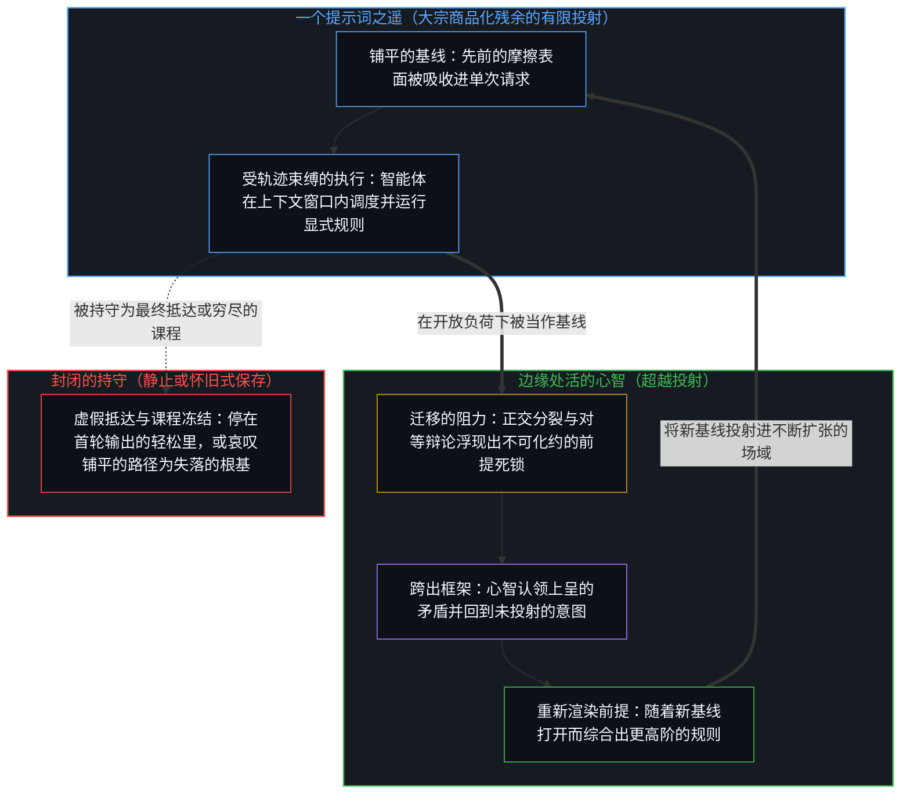
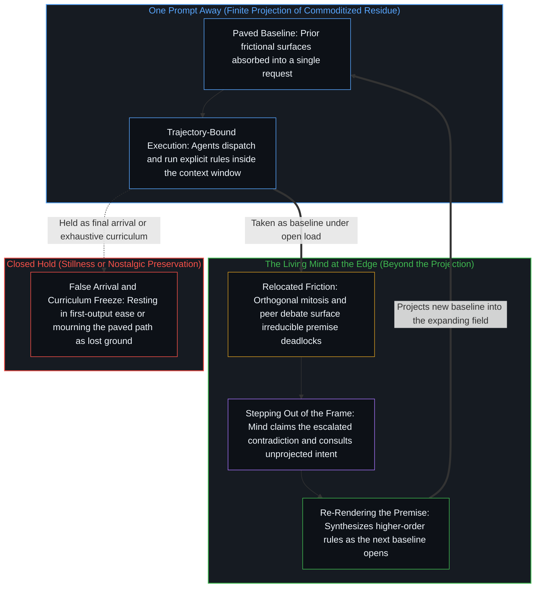

# 一个提示词之遥 / Whatever Is One Prompt Away

*阻力移向新的表面，而先前的选项仍留在开放的场域中 / Friction moves to new surfaces while prior options remain in an open field*

一代人正在到来，对他们来说，那些旧的电脑仪式会像给手表上弦一样遥远：搭一个本地的Minecraft服务器，追查驱动冲突，手动配置端口，在午夜的论坛里一页页往下翻，直到那条报错终于松口，这一切都塌缩成一个写得好的提示词。最先被登记下来的，是一类离散的动作被挤出了主流的路径，而那些动作过去默认留下的残余，不再沿着那条路形成。认为某种承重的东西正在失去的说法，把那份残余当作一套正在被删除的封闭课程；不带这种冻结去看，交互的场保持开放，并在扩张。凡是一个提示词之遥的东西，已经是下一个提示词的基线，而仍然敞开的，是第一份轻松被持守为抵达，还是在当前模型仍会失败的那道移动边缘上，被当作下一个开口。

A generation is arriving for whom the old computer rituals will feel as remote as winding a watch: setting up a local Minecraft server, hunting driver conflicts, configuring ports by hand, scrolling midnight forums until the error message finally yields, all of it collapsed into a single well-formed prompt. What registers first is that a class of discrete acts has been displaced from the prevailing path, and the residue those acts once left by default no longer forms along that route. The claim that something load-bearing is being lost treats that residue as a closed curriculum being deleted; seen without that freeze, the field of interaction stays open and expands. Whatever is one prompt away is already the baseline for the next prompt, and what stays open is whether the first ease is held as arrival or taken as the next opening, at the moving edge where current models still fail.

## 一、 随障碍一同而来的残余 / 1. The Residue That Rode with the Obstacle

媒介在增密：任何设置、任何下载、任何顽固的基础设施，如今都只隔一次请求。同样被登记下来的是，三小时的调试不再强加给只想要一台能跑的服务器的人。那场调试过去会逼出一张关于网络、进程与故障模式的暂时地图，因为在默认的路径上，障碍与结果是耦合在一起的。那张地图从来不是目标。它是残余，是较早的动作塑造较晚的动作，是[一步一步绘制出的路径](../the-path-drawn-one-step-at-a-time/)所追溯为当下的那种单向塑造：当下是心智一步一步绘制的路径上的一个位置，原因通向结果，时间就是那个方向，残余是可得的东西，而心智从中选取的前提，才是活的工具。

The medium densifies: any setting, any download, any stubborn piece of infrastructure now sits one request away. What also registers is that the three-hour debug no longer forces itself on anyone who only wants a working server. That debug once forced a provisional map of networks, processes, and failure modes, because on the default path the obstacle was coupled to the outcome. The map was never the goal. It was residue, earlier acts shaping later ones, the one-way shaping [The Path Drawn One Step at a Time](../the-path-drawn-one-step-at-a-time/) traces as the present: a position on a path the Mind draws one step at a time, cause leading to effect, time as that direction, where residue is what is available and the premise the Mind chooses from it is the live instrument.

当障碍在主流路径上消失于一个提示词，凭着那种耦合随它一同而来的残余，便不再在那里形成。服务器照样跑起来。过去对着*那个*表面的故障模式形成的心智模型，对走铺好的路的人来说，不再形成。观察握住完成的结果，端口和驱动随着提示词接手而退出注意，就像任何工具运转着的内部机械那样。被读作损失的东西，始于别处：当早先几代人走过的那条路，被持守为能力唯一的形成方式。

When the obstacle vanishes into a prompt on the prevailing path, the residue that rode with it there, by that coupling, no longer forms there. The server still comes up. The mental model that used to form against the failure modes of *that* surface does not form for someone who takes the paved route. Observation holds the finished effect, and the ports and drivers drop out of attention as the prompt takes over, as the working machinery of any tool does. What reads as loss begins elsewhere: when the pathway earlier generations walked is held as the only way capacity can form.

## 二、 封闭的清单作为穷尽的课程 / 2. The Closed Inventory as Exhaustive Curriculum

认为某种承重的东西正在消失的说法，依赖于一个被保留的参照：有价值的心智模型的清单被当作封闭的，旧路径从主流中被挤出，被读作它们从场中被删除。某些有摩擦的路径，被当作安装能力的唯一课程。一旦这些路径被铺平，剩下的唯一一步似乎就是刻意保存旧的课程：把什么围起来，什么要手把手地教，什么要故意保持困难，好让复利还能发生。[遗忘的脚手架](../the-scaffolding-we-forget/)追溯了这种冻结：脚手架从递归中退场，好让后续的区分落下；当这种退场冻结成一幅被保存的形象，能力就被曾经促成运动的残余挤压，在这里，就是那些有摩擦的路径在被铺平之后，被持守为穷尽的课程。[真正稀缺的不是记忆，而是持续的重新追溯](../the-real-scarcity-is-not-memory-but-continuous-re-tracing/)在关于背诵的争论里追溯了同一种存量式的滞后：可用的结构在新负荷下作为重新渲染归来，而不是存在头脑里或放在外面的存量。

The claim that something load-bearing is disappearing rests on a single retained reference: the inventory of valuable mental models is treated as closed, and the displacement of the old pathways from prevalence is read as their deletion from the field. Certain frictional pathways are taken as the sole curriculum that installs capacity. Once those pathways are paved, the only remaining move appears to be deliberate preservation of the old curriculum: what to fence off, what to teach by hand, what to keep hard so that the compounding still happens. [The Scaffolding We Forget](../the-scaffolding-we-forget/) traces this freeze: scaffolding drops out of recursion so that further distinctions can land, and when that drop-out freezes into a preserved image, capacity compresses against the residue that once enabled movement, here the frictional pathways held as exhaustive curriculum once paved. [The Real Scarcity Is Not Memory, But Continuous Re-Tracing](../the-real-scarcity-is-not-memory-but-continuous-re-tracing/) traces the same inventory lag in the debate over memorizing: usable structure returns as re-rendering under new load, not as an inventory kept in the head or left outside it.

在任何给定的时刻，场看起来确实是有限的，而有限被感受为穷尽。这种表象是局部的。[基准刷榜中的封闭实存](../closed-reality-in-benchmark-maxing/)在评测里追溯了同一种冻结：基准把能力冻结成一个封闭的目标，离那套封闭题集剩下的距离，被读作智能剩下的部分；[为何数学永远解不完](../why-mathematics-can-never-be-solved/)在待解问题的清单里追溯了它：“解完了”把一片有限的形式地貌冻结成穷尽的根基。在这里，一个关于“什么必须靠吃苦来学”的有限持守，被立为能力形成的全部。在这种冻结之下，自动化看起来像永久的减法：摩擦没了，意外的教育没了，只求输出的一代，显得比出于必要而建起网络模型的一代更为单薄。

At any given moment the field does appear finite, and the finite feels exhaustive. The appearance is local. [Closed Reality in Benchmark Maxing](../closed-reality-in-benchmark-maxing/) traces the same freeze in evaluation, where a benchmark freezes capability as a closed target and residual distance to the sealed suite is read as the residual of intelligence, and [Why Mathematics Can Never Be Solved](../why-mathematics-can-never-be-solved/) traces it in the checklist of remaining problems, where "solved" freezes a finite formal landscape as exhaustive ground. Here a finite hold of "what must be learned the hard way" is installed as the whole of capacity formation. Under that freeze, automation looks like permanent subtraction: friction gone, accidental education gone, the generation that only asks for output thinner than the generation that built a model of the network by necessity.

这种冻结并没有虚构摩擦过去的作用。较早的动作确实留下了地图，因为在那条路上，障碍与结果是耦合的。冻结在于让那些地图的*种类*，即作为课程的摩擦路径，免于作为暂时脚手架被重新追溯，于是把*主流的*坍缩成*可得的*。一份不再在默认路径上形成的残余，被读作能力本身的丧失，而让默认路径成为可能的那份选项的扩展，便没有被登记。

The freeze does not invent the former role of friction. Earlier acts did leave maps, because on that path the obstacle was coupled to the outcome. The freeze is exempting the *kind* of those maps, the frictional pathway as curriculum, from re-tracing as provisional scaffolding, and so collapsing *prevailing* into *available*. A residue that no longer forms on the default path is read as capacity lost as such, and the widening of options that made the default path possible goes unregistered.

## 三、 先前的选项仍在，份额在缩小 / 3. Prior Options Remain While Their Share Shrinks

先前的选项仍在那里。端口、驱动栈、论坛帖子、手动配置、漫长的调试：每一个先前的抽象层级，对任何选择在那里交互的心智都仍然可得。改变的是主流地位，而不是可得性。旧的表面不再是穿过这个场的主流路线，不再是抵达结果的先决条件，而随着新的工具与抽象不断增多，它在选项空间中所占的份额越来越小。

Prior options are still there. Ports, driver stacks, forum threads, hand configuration, the long debug: every prior level of abstraction remains available to any Mind that elects to interact there. What changes is prevalence, not availability. The old surface stops being the prevailing route through the field, it stops being a prerequisite for reaching the outcome, and as new tools and abstractions multiply, it occupies a smaller share of the space of options.

这就是进步在开放现实之下被登记的方式。扩展并不抹去较早的持守。它把它们留作任何人都仍可拿起的工具，而默认的路径从它们旁边绕过。封闭的现实把三种变化折叠成一个基础层的毁灭：一条不再主流的路线，一道不再必经的关口，一个变小的选项份额。开放的现实把同一个序列登记为场的生长：更多的区分可得，先前的仍然够得着，没有哪一个被立为最终的课程。[赋权确立权力的集中](../empowerment-establishes-the-centralization-of-power/)追溯了相反的那种冻结，在那里选项是一份由授权之手解锁的固定菜单：赋权或被赋权，就是追认能力从一个已经持有它的中心移出。

That is how progress registers under open reality. Expansion does not erase earlier holds. It leaves them as instruments anyone can still take up, while the default path goes around them. Closed reality folds three shifts into the destruction of a foundational layer: a route no longer prevailing, a pass no longer required, a smaller share of the options. Open reality registers the same sequence as growth of the field: more distinctions available, prior ones still reachable, none installed as final curriculum. [Empowerment Establishes the Centralization of Power](../empowerment-establishes-the-centralization-of-power/) traces the inverse freeze, where options are a fixed menu unlocked by an authorized hand: to empower or be empowered is to ratify that capacity moves from a center that already holds it.

[没有系统能被保持封闭](../no-system-can-be-kept-closed/)在它最直观的形式面上追溯了不完备：在一个做加法的一位寄存器里，运算在持守之内有效，而真实的结果落在它之外。[开放即一致](../openness-is-consistency/)从要求的那一侧追溯了同一种几何：不一致是对封闭的渴望或尝试，是把一个有限的结构强行用来为只会继续的东西奠基；当这个要求被看见而不是被服从，那份继续就是一致。被服从时，它在表面上不断繁殖矛盾，在这里就是怀旧、保存计划，以及谁还“懂底下是什么”的排名。[封闭的假设把复利挤成 S 曲线](../closed-assumptions-squeeze-compounding-into-s-curves/)在行业曲线里追溯了它：逻辑斯蒂曲线的形态是一个固定框架的束缚，不是开放现实中进步的轨迹。新的表面经由好奇被遇见，而[好奇先行](../curiosity-first-the-hidden-engine-of-talent-and-development/)追溯了为什么天赋不是在先的禀赋：被登记为天赋的，是好奇复利出的残余；若被当作原因，那份残余就会把下一个动作引离产生它的回路。

[No System Can Be Kept Closed](../no-system-can-be-kept-closed/) traces the most intuitive formal face of incompleteness: in a one-bit register under addition, the operation is valid inside the hold, and the true result lies outside it. [Openness Is Consistency](../openness-is-consistency/) traces the same geometry from the side of the demand: inconsistency is the desire or attempt for closure, a finite structure forced to ground what only continues, and when that demand is seen rather than obeyed, the continuation is consistency. Obeyed, it multiplies contradictions on the surface, here as nostalgia, preservation programs, and rankings of who still "knows what lies underneath." [Closed Assumptions Squeeze Compounding into S-Curves](../closed-assumptions-squeeze-compounding-into-s-curves/) traces it in industry curves: the logistic shape is the binding of a fixed frame, not the trajectory of progress under open reality. The new surface is met through curiosity, and [Curiosity First](../curiosity-first-the-hidden-engine-of-talent-and-development/) traces why talent is not a prior endowment: what registers as talent is curiosity's compounded residue, and taken as cause, that residue turns the next act away from the loop that produced it.

怀旧所说的“底下”，不是一块等着被保存的基岩。它是由较早的交互生成的一个较早的表面，而先前的表面作为可选的抽象层级仍留在场中，不是一个消失了的地下室。端口与驱动栈是一个表面；提示词的故障模式、工具调用的链条、开放负荷下的评估，以及模型内部的假设，已经是另一个。[心智的飞轮](../the-flywheel-of-the-mind/)追溯了媒介的磨利：工具可以无止境地磨利，磨利降低了媒介的阻力，而转动从不离开那个转动着的边缘。[看似AI的强化学习，实为人类的自我强化学习](../self-rl-for-humans/)守住了同样的纪律：规模只是更密介质的一个参数，强化的位点留在那些中心，它们的区分持续发起、评估并重新引导它。

What nostalgia calls the underneath is not a bedrock waiting to be conserved. It is an earlier surface generated by earlier interaction, and the prior surfaces remain in the field as elective levels of abstraction, not as a vanished basement. Ports and driver stacks are one surface; prompt failure modes, tool-use chains, evaluation under open load, and the assumptions inside the models are already another. [The Flywheel of the Mind](../the-flywheel-of-the-mind/) traces the sharpening of the medium: tools can be sharpened without end, sharpening lowers the resistance of the medium, and the turn never leaves the edge that turns. [What Looks Like RL for AIs Is Self-RL for Humans](../self-rl-for-humans/) keeps the same discipline: scaling is one parameter of a denser medium, and the locus of reinforcement stays with the centers whose distinctions keep initiating, evaluating, and redirecting it.

## 四、 面对提示词的两种取向 / 4. Two Orientations Toward the Prompt

由此看来，决定性的区别并不在于还会手动配置服务器的人与不再这么做的人之间。手动配置仍是一件工具，属于一个表面，依然可得。持续下去的那道区别，在于面对提示词本身的两种取向。

In that light the decisive distinction is not between those who still configure a server by hand and those who do not. Hand configuration remains one instrument on one surface, still available. The distinction that continues is between two orientations toward the prompt itself.

凡是一个提示词之遥的东西，已经是下一个提示词的基线。凡是能被折叠进单次请求里的东西，都已经处在大宗商品化残余的有限投射之内，自回归模型正是在自身的上下文窗口中对先前的痕迹做插值。第一个提示词在主流路径上消解了一个约束。如[精度与分辨率](../precision-and-resolution/)所追溯的，单次请求所供给的是交给它的框架之内的局部精度——在既定先决条件内部重新组合的语法严密、标准算法或流利文辞——而分辨率依然留在上游：按处境所要求的粒度，把事关成败的需求与故障模式从附带枝节中分离出来，并在产出交付使用时登记失配。区别在于是停在第一份输出带来的静止里，还是把那份输出当作下一步的前提。静止把由此而来的轻松当作抵达，将局部精确的产出误作已解析清楚的问题，于是框架中凡是尚未切分的部分便一路向下游传递。[作业与考试的倒置折射出替代效应](../the-homework-exam-inversion-registers-substitution/)追溯了这种分岔：工具只在使用时放大能力，原生能力此后是否提升，在于关系，而不在工具；当它被当作交出现成答案的替代品，功夫被绕过，不再被践行的技能便变薄。继续推进，则把第一份输出当作这个前提，去遇见下一个约束：模型仍会失败的地方、工具链崩坏的地方、开放问题仍拒绝封闭的地方；或者，当兴趣指向那里时，是出于选择而非必要重新进入先前抽象层级的决定。

Whatever is one prompt away is already the baseline for the next prompt. Everything that can be collapsed into a single request already resides inside the finite projection of commoditized residue, where an autoregressive model interpolates across prior traces inside its context window. The first prompt dissolves a constraint on the prevailing path. As [Precision and Resolution](../precision-and-resolution/) traces, what that single request supplies is local precision within the frame handed to it—syntactic exactness, standard algorithms, or fluent prose recombining inside given preconditions—while the resolution that separates consequential requirements and failure modes from incidental detail at the grain the situation calls for, and registers misfit when the output meets use, remains upstream. The difference lies in resting inside the stillness that the first output delivers, or taking that output as the premise of the next step. Stillness takes the resulting ease as arrival, mistaking locally precise output for a resolved problem, so whatever the frame left uncut propagates downstream. [The Homework–Exam Inversion Registers Substitution](../the-homework-exam-inversion-registers-substitution/) traces this split: the tool amplifies only in use, and whether raw capability then grows lies in the relation, not in the tool; used as a substitute that hands over a finished answer, the work is bypassed and the skills no longer exercised thin. Pressing further takes the first output as that premise and meets the next constraint: the place where the model still fails, where the tool chain breaks down, where the open problem still refuses to seal, or, when interest runs that way, the decision to re-enter a prior level of abstraction by choice rather than by necessity.

把旧表面保存为*主流的*课程，并不是一个行得通的策略。固定任何中间状态的尝试，都会把探究者冻结在一张快照里，而周围的媒介早已把它留在身后，转向了新的默认。以法令教授旧的摩擦，可以塑造哪些对齐方式可得；它无法重建默认路径上的那种耦合，即问题不解决服务器就跑不起来，也无法将旧表面重新立为能力的穷尽课程；而可得性本就无需恢复，因为增密从来未曾剥夺可得性。[生命的意义在起草之中](../the-meaning-of-life-is-in-the-drafting/)在日常生活里追溯了同一刀：意义产生于对原因的现场起草，而不是从硬化的结果中找回，当向外的目光从不回到纸页，意义便会变薄。在这里，硬化的结果是一个提示词的成功，而墨迹未干的纸页，则是下一个开口。

Preserving the old surface as the *prevailing* curriculum is not a viable strategy. The attempt to fix any intermediate state freezes the inquirer inside a snapshot the surrounding medium has already left behind in moving to a new default. Teaching the old friction by decree can pattern which alignments are available; it cannot recreate the coupling of the default path, where the server would not run until the problem was solved, nor reinstate the old surface as the exhaustive curriculum of capacity; nor does it need to restore availability, since availability was never what densification removed. [The Meaning of Life Is in the Drafting](../the-meaning-of-life-is-in-the-drafting/) traces the same cut in ordinary life: meaning is generated in the live drafting of causes, not recovered from hardened effects, and it thins when the outward gaze never returns to the page. Here the hardened effect is the one-prompt success, and the page still wet is the next opening.

## 五、 复利换了地址 / 5. Compounding Changes Address

在一个开放的场域之下，复利并不消失；它换了地址。心智模型仍在继续形成，如今面对的是一组不断变动的问题，这组问题在旧的摩擦仍是唯一主流路线时并不存在。迁移的是活的约束：摩擦移到提示词本身开始崩坏的地方，移到模型内部的假设被暴露的地方，移到系统的下一层必须实时重新协商的地方，而深度在较早的表面上仍对任何接下那份负荷的心智保持可得。

Under an open field the compounding does not disappear; it changes address. Mental models continue to form, now against a shifting set of problems that did not exist when the old friction was the sole prevailing route. What relocates is the live constraint: friction moves to the places where the prompts themselves begin to break, where the assumptions inside the model are exposed, and where the next layer of the system has to be renegotiated in real time, while depth stays available at earlier surfaces for any Mind that takes up that load.

[超越投射](../beyond-the-projection/)追溯了当执行规模越过单个提示词之后，这一新表面的确切运作机制。智能体是受条件化轨迹束缚却无我执的有限投射引擎，因此它能够将显式指令一路推演至演绎穷尽，将过载的语境拆分到正交的流线上，并在新搭档揭露局部盲区时干净利落地更新。智能体做不到的，是在两个正交维度被悄然压缩进同一条规则时，跨出它正在预测的词元序列。当对等的搭档轨迹撞上不可化约的死锁，活的摩擦便作为上呈的前提矛盾浮出水面。在那里，活的心智所做的工作，既不是手动转发端口，也不是逐行审校大宗商品化的残余，而是从破裂的框架中向后退一步，回到极限分辨率的意图，综合出更高阶的前提，让每一道区分各归其轴。[你的代码库即是记忆](../your-codebase-is-memory/)追溯了那道重新渲染的前提如何化作下一个基线：既然代码、模型与智能体脚手架都是早先区分层叠留下的残余，仅凭“万一用得上”而囤积已被取代的中间轨迹或陈旧的会话历史，只会加深把后续运行拽回过时框架的引力井；而在原地重切当下的检查点，并修剪它已吸收的临时脚手架，则能让约束表面在无关维度上收缩，在依然要紧的轴线上变得更为锋利。

[Beyond the Projection](../beyond-the-projection/) traces the exact mechanics of this new surface once execution scales past a single prompt. Because an agent is a finite projection engine bound by its conditioning trajectory yet devoid of ego, it can run explicit instructions to deductive exhaustion, split overloaded contexts across orthogonal streamlines, and update cleanly when a fresh peer exposes a local blind spot. What the agent cannot do is step outside the token sequence it is predicting when two orthogonal dimensions were quietly compressed into one rule. When equal-footed peer trajectories hit an irreducible deadlock, the live friction surfaces as an escalated premise contradiction. There the work of the living Mind is neither manual port-forwarding nor line-by-line auditing of commoditized residue, but stepping backward out of the broken frame to limit-resolution intent and synthesizing a higher-order premise that restores each distinction to its own axis. [Your Codebase Is Memory](../your-codebase-is-memory/) traces how that re-rendered premise becomes the next baseline: because code, models, and agent scaffolds are stacked residues of prior distinctions, hoarding superseded intermediate trajectories or stale session histories out of mere possibility only thickens the gravity well that pulls later runs back into outdated framings, whereas re-cutting the present checkpoint in place and pruning the transient scaffolding it has absorbed leaves the constraint surface smaller in irrelevant dimensions and sharper on the axes that still matter.

这种迁移不是为一个失落的调试黄金时代颁发的安慰奖。它是媒介增密而持守保持开放时，能力的寻常动态。网络与进程的较早地图，作为残余、作为活的选项仍在；它们不再是后来的能力必须在其上形成的先决条件。新的基线出现在自动化尚未吸收摩擦的地方，而一旦摩擦被吸收，更新的基线又会出现，被吸收的层级则以更小的份额在场中仍然够得着。[生产、消费与心智的区分](../production-consumption-and-the-minds-distinction/)追溯了同样的开放或固定的持守：生产与消费不是两种动作，而是同一个活动在心智把它的边界持守为开放或固定时的登记方式；寄存器保持开放时是扩展，而溢出与损失，是从把暂时的天花板当作最终限度的封闭寄存器内部看去的样子。

That relocation is not a consolation prize for a lost golden age of debugging. It is the ordinary dynamic of capacity when the medium densifies and the hold stays open. Earlier maps of networks and processes remain as residue and as live options; they stop being the prerequisite on which later capability has to form. New baselines appear where automation has not yet absorbed the friction, and as soon as that friction is absorbed, newer baselines appear, while the absorbed layers stay reachable at a smaller share of the field. [Production, Consumption, and the Mind's Distinction](../production-consumption-and-the-minds-distinction/) traces the same open or fixed hold: production and consumption are not two kinds of act but how the same activity registers when the Mind holds its boundary as open or as fixed, expansion while the register stays open, and overflow and loss as the appearance from inside a closed register whose temporary ceiling is treated as final.

只求输出的人，与在媒介仍会失败处持续推进的人，并不因是否属于一个“懂底层的人”的行会而不同。他们的不同，在于面对这一步的取向：第一份成功的输出被持守为抵达，还是被当作随这一步移动而重新渲染的工具。媒介对两者同样增密。只有开放的取向在复利，进入下一个表面，或者出于选择而非作为必修的课程，回到先前的表面。

Those who only ask for output and those who keep pressing where the medium still fails do not differ by membership in a guild of "those who know the substrate." They differ in their orientation toward the step: whether the first successful output is held as arrival, or taken as an instrument re-rendered as the step moves. The medium densifies for both. Only the open orientation compounds, into the next surface, or back into a prior one by election rather than by required curriculum.

## 六、 在穷尽之说处重新打开框架 / 6. Reopening the Frame at the Exhaustive Claim

与这些系统一起清晰地思考，不是抵达的一个位置。它是一种运动：凡是一道边界被当作穷尽，或旧路径从主流中的挤出被读作从场中被删除，便在那里重新打开持守。一旦那道边界被认出是一个暂时的脚手架，而不是场的界限，工作就不再是哀悼铺好的路，或把它围起来当作最后的承重层。工作是继续那个运动：它消解旧的约束，揭示新的约束，并把先前的选项留在不断扩张的场中，留给任何选择与它们打交道的心智。

Clear thinking with these systems is not a position arrived at. It is the movement of reopening the hold wherever a boundary is treated as exhaustive, or displacement from the prevailing path is taken for deletion from the field. Once the boundary is recognized as a provisional scaffold rather than a limit of the field, the work is no longer to mourn the paved path or to fence it off as the last load-bearing layer. The work is to continue the movement that dissolves old constraints, discloses new ones, and leaves prior options in the expanding field for any Mind that chooses to engage them.

[抽象、边界与现实的移动边缘](../abstraction-boundaries-and-the-moving-edge-of-reality/)追溯了界定如何冻结残余：成功的感知是有损的界定，被当作场的结构时，它把残余冻结成一份封死的清单；放大或解开这个界定，清单便化回任何有限登记都穷尽不了的生成空间。[持续生长的脚手架](../the-scaffolding-that-keeps-growing/)追溯了脚手架的生长：敞开不是从完成的框架退后一步找回的，它是让每个框架保持未完成的条件，较早的支撑退出焦点，作为内部的支柱从里面承重，而新的暂时支撑在边缘处更进一步的负荷下形成。[要紧的控制迁往边缘](../residual-control-recedes-to-the-edge/)追溯了技术栈中的这种转移：随着底层所有权变薄为可选的残余，要紧的控制迁往标准、界限与验证，移动的是控制在哪里被行使，而不是行使它的所在。[免费智能的幻觉](../the-illusion-of-free-intelligence/)追溯了与毫不费力之流畅的相遇：流畅残余的丰裕是智能仍在加速的反向信号，而不是心智的民主化。在这里，同一份轻松被当作抵达，就是把残余冻结成能力全部的那种静止。[清晰不是抵达的终点，而是运动本身](../clarity-isnt-a-state-you-arrive-at/)把这种修习追溯为运动：清晰是从不落入静态教条的持续迈出，每一步以同一个动作照亮也投下阴影。

[Abstraction Boundaries and the Moving Edge of Reality](../abstraction-boundaries-and-the-moving-edge-of-reality/) traces how bounds freeze residue: successful perception is a lossy bound, and held as the field's structure, it freezes residue into a sealed catalogue; enlarge or dissolve the bound and the catalogue dissolves back into a generative space no finite registration exhausts. [The Scaffolding That Keeps Growing](../the-scaffolding-that-keeps-growing/) traces the growth of scaffolding: openness is not recovered by stepping back from a finished frame, it is the condition that keeps every frame unfinished, as earlier braces drop out of focus and carry load from inside as interior struts, while new provisional braces form under further load at the edge. [Essential Control Moves to the Edge](../residual-control-recedes-to-the-edge/) traces the shift in the stack: as substrate ownership thins into optional residue, essential control relocates to criteria, bounds, and verification, and what moves is where control is exercised, not the locus that exercises it. [The Illusion of Free Intelligence](../the-illusion-of-free-intelligence/) traces the encounter with effortless fluency: abundant fluent residue is the inverse signal of intelligence still accelerating, not Mind democratized. Here the same ease, taken as arrival, is the stillness that freezes the residue as the whole of capacity. [Clarity Isn't a State You Arrive At. It's the Movement Itself.](../clarity-isnt-a-state-you-arrive-at/) traces the practice as movement: clarity is the ongoing stepping-out that never lands in a static doctrine, and each step illuminates and casts shadow by the same act.

凡是能被做成一个提示词之遥的，都会被做成。那是增密在继续，而不是这一代人特有的灾难。先前的抽象层级并不消失；它们不再是主流，在不断扩张的选项空间中所占的份额随之缩小。没有什么能被保存为最终的课程。仍然敞开的，是第一次成功被持守为静止，还是被当作下一个开口。

Everything that can be made one prompt away will be. That is densification continuing, not a special catastrophe of this generation. Prior levels of abstraction do not vanish; they cease to prevail, and their share of an expanding space of options shrinks. Nothing can be preserved as final curriculum. What remains open is whether the first success is held as stillness or taken as the next opening.
