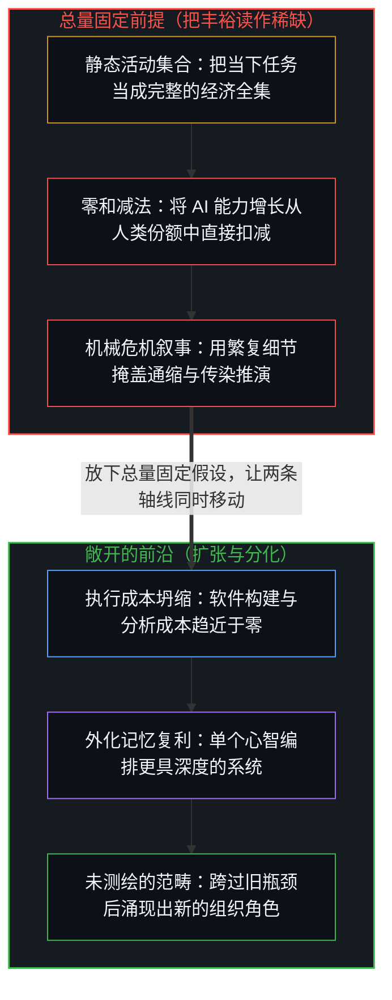
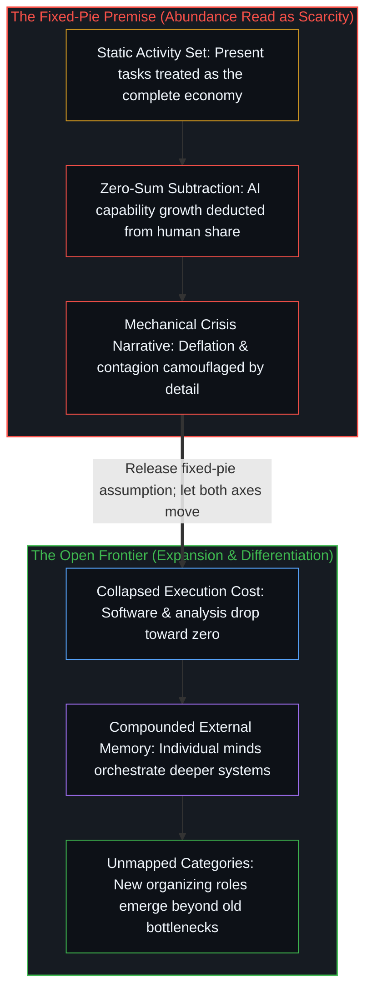

# 当丰裕看起来像稀缺 / When Abundance Looks Like Scarcity

*末日推演锁死经济总量并让 AI 在其中加速，错把可能性扩张当成存量减法。 / Doom scenarios hold the economic pie fixed while AI accelerates inside it, mistaking expansion for subtraction.*

一则构思精密的推演设想 AI 能力提升得如此之快，以至于到 2028 年年中便会引发大规模失业、房贷违约、私募信贷传染以及市场崩盘。整套推导建立在一个隐蔽的起手式之上：把经济总量这块蛋糕固定住，让 AI 在其中加速膨胀，然后看着替代效应机械地推导出来。

A well-constructed scenario imagines AI capability improving so fast that it triggers mass unemployment, mortgage defaults, private credit contagion, and a market crash by mid-2028. The entire derivation runs on one hidden move: hold the economic pie fixed, let AI accelerate inside it, and watch the displacement fall out mechanically.

## 一、 隐蔽的起手式 / 1. The Move

那篇文章把当前的经济活动集合当成了全集。白领工作就是今天的形态，消费支出模式就是今天的模式，而房贷市场、税基与劳动力市场也全部校准在当下。随后，它让 AI 能力在这个固定的空间内部呈指数级增长。

The piece treats the current set of economic activities as the complete set. White-collar work is what it is today, consumer spending patterns are what they are today, and the mortgage market, tax base, and labor market are all calibrated to the present. Then it lets AI capability grow exponentially within that fixed space.

结果只是简单的算术。如果蛋糕没有变大，而 AI 切走了更大的一块，人类分到的那一块就会变小。沿着收入、支出、信贷、住房和税收一路推导下去，你就会得到一场危机。要得出这个结论，你并不需要五千字的金融分析；你只需要“总量固定”的假设外加减法。[剩余个人主义](../residual-individualism/)在源头处追踪了同一种执念：固定总量心态源于把集体存量当成一个静态容器，认为它只能在既有之物中进行瓜分。

The result is simple arithmetic. If the pie does not grow while AI takes a larger slice, humans get a smaller one. Trace that through income, spending, credit, housing, and tax receipts, and you get a crisis. You do not need five thousand words of financial analysis to get there; you need the fixed-pie assumption and subtraction. [Residual Individualism](../residual-individualism/) traces the same hold at its source: fixed-pie mentality arises from treating the collective stock as a static container that merely divides what already exists.

那五千字的金融细节服务于另一项功能：让前提本身变得不可见。当你顺着贷款违约机制与保险资本要求一路往下读时，你就不再追问这块蛋糕是否真的固定不变。技术上的繁复掩盖了初始切分的简单粗暴。

The five thousand words of financial detail serve a different function: they make the premise invisible. When you are following the mechanics of loan defaults and insurance capital requirements, you are no longer asking whether the pie is fixed. The technical complexity camouflages the simplicity of the initial cut.

## 二、 为何总量并非固定 / 2. Why the Pie Isn't Fixed

历史上的每一次重大效率跃升，都扩张了经济活动的空间，而非仅仅在固定的总量内部重新洗牌。蒸汽机并没有在人与机器之间瓜分固定的体力劳动配额；它让能源变得足够低廉，使得铁路、工厂与大规模生产在原本不存在的地方成为可能，总就业人数随之增长。计算机并没有瓜分固定的手工计算账本；它让算力变得足够低廉，使得软件、互联网与移动生态得以成形，正因为机器接管了算术，市场对使用计算机工作的人的需求反而上升了。

Every major efficiency gain in history has expanded the space of economic activity rather than merely reshuffling a fixed total. The steam engine did not divide a fixed quota of manual labor between humans and machines; it made energy cheap enough that railways, factories, and mass production became feasible where they had not existed before, and total employment grew. Computing did not divide a fixed ledger of hand calculations; it made computation cheap enough that software, the internet, and mobile ecosystems materialized, raising the demand for people who work with computers because machines handled the arithmetic.

AI 让认知执行的成本变得更低。替代框架追问的是谁会失去现有的份额，而扩张框架追问的则是哪些过去无法实现的事物如今变得可行。当构建软件的成本趋近于零时，每一个组织、社区与个人都成了潜在的创造者：正如[你的代码库即是记忆](../your-codebase-is-memory/)所追踪的，将过往区分外化为持久的代码仓库，把鲜活的掌舵前沿从手工维护中解放出来，使单个心智得以在以往需要整个部门协同的跨领域尺度上不断复利累积架构深度。当分析、翻译、法律审查与财务规划的成本趋近于零时，数十亿人便获得了以往专属于少数人的能力，进而催生出尚未被命名的需求与角色——正如在计算机问世之前，“软件工程师”这一称谓尚不存在一样。

AI makes cognitive execution cheaper. The replacement frame asks who loses their existing slice, whereas the expansion frame asks what becomes feasible that was never feasible before. When building software costs nearly nothing, every organization, community, and individual becomes a potential creator: externalizing prior distinctions into a durable repository, as [Your Codebase Is Memory](../your-codebase-is-memory/) traces, frees the living steering edge from manual upkeep so a single mind can compound architectural depth across domains that previously required entire departments to coordinate. When analysis, translation, legal review, and financial planning cost nearly nothing, billions of people gain access to capabilities previously reserved for a few, generating needs and roles that do not yet have names—just as "software engineer" had no name before computers existed.

末日推演之所以看不到这一点，是因为它的框架在构造之初就将其排除在外：一旦你设定蛋糕总量固定，扩张就会变得不可表征。[人口崩溃神话的拆解](../the-myth-of-population-collapse-explained/)追踪了同一转换在人口问题上的面相，即把发展带来的盈余当成封闭存量来计分；而当复制品变得免费时，价值便会迁移向[清单合上之后，胜过免费](../better-than-free-after-the-checklist-closes/)所描述的那个不可复制的前沿。

The doom scenario cannot see this because its frame excludes it by construction: once you posit a fixed pie, expansion becomes unrepresentable. [The Myth of Population Collapse Explained](../the-myth-of-population-collapse-explained/) traces the demographic face of that same conversion, where advanced surplus is scored as a closed stock, and when copies become free, value moves to the uncopied frontier that [Better Than Free After the Checklist Closes](../better-than-free-after-the-checklist-closes/) describes.

## 三、 真正发生的事 / 3. What's Actually There

一旦消解掉总量固定的前提，铁板一块的危机就会分化为三重各自独立的运行张力。第一重是转型摩擦：人们确实会失去特定的岗位，房贷会面临局部压力，各个行业也会以不均衡的速度重组，但这是需要务实政策应对的调度挑战，而非生存绝境。第二重是分配张力：生产力收益沿着被 AI 加速的轨迹先流向资本再流向劳动，但这属于财政分配问题，而非结构上的无解死局。第三重是身份迷失：一个以常规白领服务任务来定义自身的经济体，正在经历这一标签的消解，正如农业与制造业的身份认同曾先它一步消解一样；这揭示出经济从来就不是那些瓶颈任务本身，而是当瓶颈被移除之后依然持续进行的人类组织活动。

Dissolve the fixed-pie premise and the monolithic crisis differentiates into three independent operational tensions. The first is transition friction: people do lose specific roles, mortgages face local stress, and sectors reorganize at uneven speeds, which is a logistics challenge requiring practical policy rather than an existential dead end. The second is distribution tension: productivity gains flow to capital before labor along a trajectory AI accelerates, which is a fiscal allocation question rather than a structural impossibility. The third is identity disorientation: an economy that defined itself by routine white-collar service tasks experiences the dissolution of that label just as agricultural and manufacturing identities dissolved before it, revealing that the economy was never the bottleneck tasks themselves, but the human organizing that continues once the bottleneck is removed.

这三重张力每一重都是真实的，各自在独立的轴线上运作，也各自容许具体的应对方案。只有当这三者被同时坍缩到一块人为固定住的蛋糕内部的单一轴线上时，末日般的“危机”才会显现出来。

Each of these three tensions is real, each operates on its own axis, and each admits a concrete response. The apocalyptic "crisis" appears only when all three are collapsed onto a single axis inside a pie held artificially fixed.

## 四、 这一模式 / 4. The Pattern

这正是在个体层面上运作的同一结构。追问“AI 会夺走我的工作吗？”，是把工作固定住并让 AI 增长，在定义之初就注定了被替代的结论。追问“AI 会扩展我所能构建的事物吗？”，则是让两条轴线同时移动，从而敞开一片给出不同答案的异质疆域。

This is the exact structure that operates at the individual level. Asking "Will AI take my job?" holds the job fixed and lets AI grow, guaranteeing displacement by definition. Asking "Will AI expand what I can build?" lets both axes move, opening a different territory with a different answer.

宏观经济版本不过是将同一个问题按比例放大。追问 AI 是否会吞噬经济，是把经济固定住；追问 AI 如何扩展经济所能做到的事，则是让两者同时移动。末日推演选择了第一种框架，严密地追踪了它的算术推演，并将这一演绎包装成经验发现呈现出来。金融建模固然错综复杂，但其地基依然只是一次框架的选择。

The macroeconomic version simply scales the same question up. Asking whether AI will take the economy holds the economy fixed; asking how AI expands what the economy can do lets both move. The doom scenario chose the first framing, traced its arithmetic with rigor, and presented the deduction as an empirical discovery. The financial modeling is intricate, yet the foundation remains a choice of frame.
