# 当电子开始思考 / When Electrons Think

*光速是现实被渲染的速率，确定性是自由变量在慢速中沉淀的统计 / The speed of light as the rate at which reality is rendered, and determinism as free variables settled into slowness*

质量可以读作稳定下来的闭合关系，光是没有闭合的动态交织，光速于是读作现实在第一人称中被渲染的速率。微观的不确定与第一人称的自由变量是同一件事的两面，一面留在描述里，一面在抉择中。宏观的确定是数量极大的自由变量在慢速中沉淀出的统计秩序，物质与心智的分别因此是节律上的分别。

Mass can be read as a closed relationship that has stabilized, light as an open dynamic weave that never closes, and the speed of light then reads as the rate at which reality is rendered in the first person. Microscopic indeterminacy and the first-person free variable are two faces of one thing, one left in the description and one lived in choosing. Macroscopic determinacy is the statistical order that an enormous number of free variables settle into at slow speed, so the difference between matter and mind is a difference of cadence.

## 一、 无质量的波与渲染的前沿 / 1. The Massless Wave and the Rendering Front

在物理学的常数里，光速 c 的位置最为特殊。狭义相对论把光速立为不变的基准：没有信号快过它，于是一切较慢的现象都可以拿它作标尺来度量。这个设定极为有效，从粒子加速器到卫星定位都靠它运转。

Among the constants of physics, the speed of light c holds the most particular place. Special relativity sets it up as the invariant benchmark: no signal outruns it, so every slower phenomenon can be measured against it. The posit is extremely effective, and everything from particle accelerators to satellite positioning runs on it.

它的边界在于，光速在这个模型里是公设，模型不回答为什么是光、为什么恰好是这个上限。一种读法从“质量”的含义入手。在麦克斯韦方程组的图景里，变化的电场激发磁场，变化的磁场又激发电场，这种互生是开放的，没有结成一个局域闭合的循环。按[对象是被稳定化的关系](../objects-are-stabilized-relationships/)的读法，对象是因果交握在时间中稳定下来的关系，静止质量是这种闭合关系带来的惯性。

Its boundary is that the speed of light is a postulate in this model, which does not answer why light, or why exactly this ceiling. One reading starts from what "mass" means. In the picture given by Maxwell's equations, a changing electric field induces a magnetic field and a changing magnetic field induces an electric one; this mutual generation is open and never ties into a locally closed loop. On the reading of [Objects Are Stabilized Relationships](../objects-are-stabilized-relationships/), an object is a relationship of causal handshakes that has stabilized over time, and rest mass is the inertia such a closed relationship brings.

光没有结成闭合的稳定关系，所以没有静止质量，也就没有任何东西把它拖在后面。每当新的一帧被登记出来，光已经在这一帧的前沿。它也到不了更前面，因为在尚未被登记的下一帧里，连坐标都还没有。照这样读，光速不是一束光在既成的虚空里穿行的时速，它是现实在第一人称的观测中被渲染出来的速率。

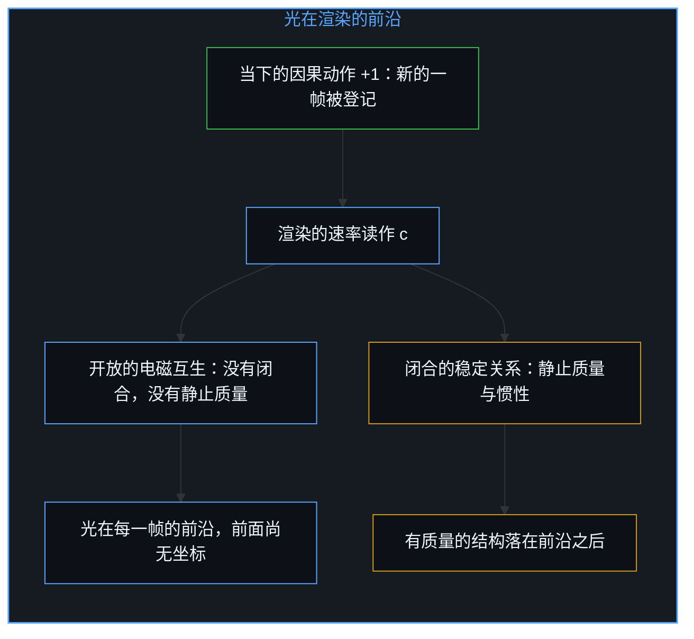

Light has not tied into a closed, stable relationship, so it has no rest mass, and nothing holds it back. Whenever a new frame is registered, light is already at the front of that frame. It cannot get further ahead either, because in the next frame, not yet registered, there are not even coordinates. Read this way, the speed of light is not the pace of a beam crossing a ready-made void; it is the rate at which reality is rendered in first-person observation.

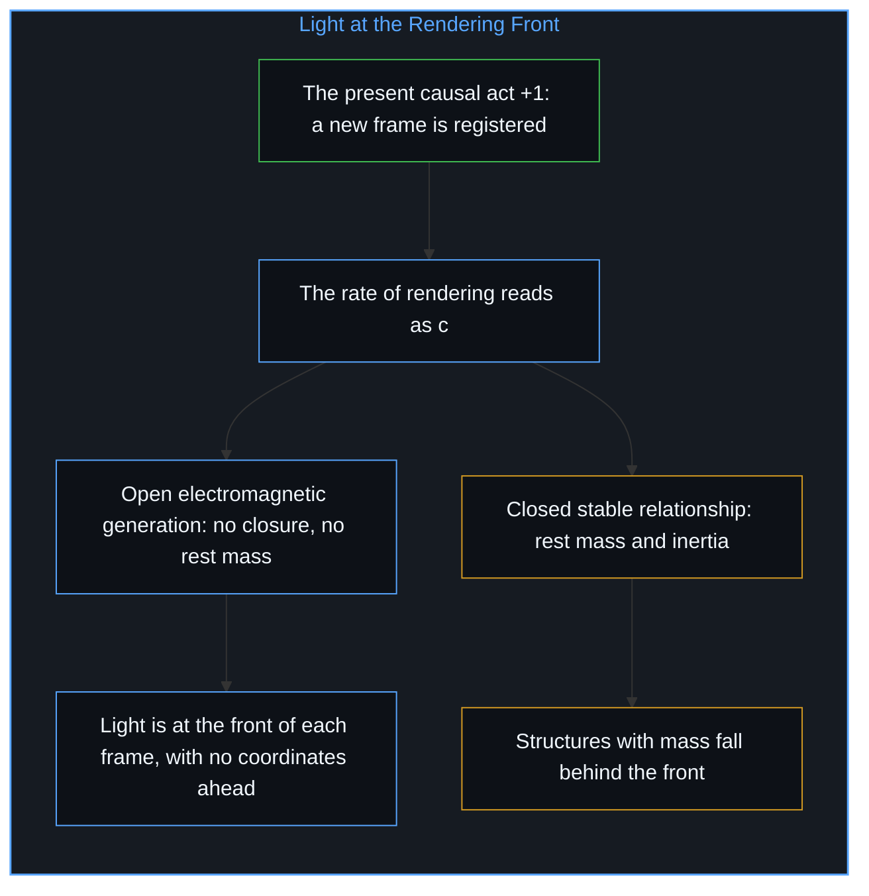

[黑白采样帧与外推宇宙](../the-black-and-white-sample-frame-and-the-extrapolated-universe/)从另一侧说了同一件事：狭义相对论选光速作校准的标尺，是因为要不失真地描出一切较慢的现象，得用刷新最快的那支笔。

[The Black-and-White Sample Frame and the Extrapolated Universe](../the-black-and-white-sample-frame-and-the-extrapolated-universe/) says the same from the other side: special relativity takes the speed of light as its calibrating ruler because tracing every slower phenomenon without distortion takes the pen with the fastest refresh.

## 二、 质量与慢速的世界 / 2. Mass and the Slow World

把光速读作渲染的速率之后，宏观世界为何显得确定、坚固而可预测，也有了一种读法。有静止质量的宏观物质，恒星、岩石、钟表与身体，由数量极大的微观因果关系构成，这个数量近乎无限而处处有限。这些关系在时间中相互制约、锁定并沉淀为自洽的闭合结构：夸克被强相互作用束缚为质子，质子与电子经电磁作用形成原子，原子结合成晶格与分子。

Once the speed of light is read as the rate of rendering, there is also a reading of why the macroscopic world appears determinate, solid and predictable. Macroscopic matter with rest mass, stars, rocks, clocks and bodies, is made of an enormous number of microscopic causal relationships, a number that is nearly unlimited and everywhere finite. Over time these relationships constrain one another, lock, and settle into self-consistent closed structures: quarks are bound into protons by the strong interaction, protons and electrons form atoms through electromagnetism, and atoms join into lattices and molecules.

质能关系 E = mc² 在这里读作：质量是被局域化、封闭在内部稳定关系之中的能量。要维持这种结构的同一，内部的组分须不断地相互交换信号。既然相当一部分带宽已经用在维持自身的闭合上，这个复合体在外部的整体位移便落在远慢于光速的区间里，v ≪ c。

The mass and energy relation E = mc² reads here as: mass is energy localized and enclosed within stable internal relationships. To keep such a structure identical with itself, its components must keep exchanging signals with one another. Since a good part of the bandwidth is already spent on maintaining its own closure, the displacement of the composite as a whole falls in a range far slower than light, v ≪ c.

于是有了一个速度差：登记与捕获的速率是 c，被观测的宏观对象的变化速度是迟缓的 v。这好比一台每秒拍摄数亿帧的摄像机对着一只爬行的蜗牛，在连续成千上万帧里被摄物几乎不动，轨迹平滑、连续、容易追踪。

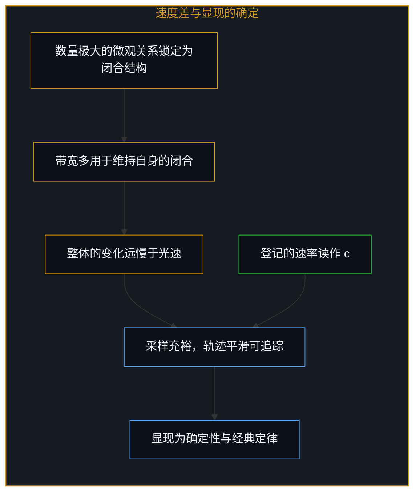

A gap in speed follows: the rate of registering and capturing is c, and the rate of change of the macroscopic object observed is a sluggish v. It is like a camera shooting hundreds of millions of frames a second pointed at a crawling snail; across thousands of consecutive frames the subject barely moves, and its path is smooth, continuous and easy to track.

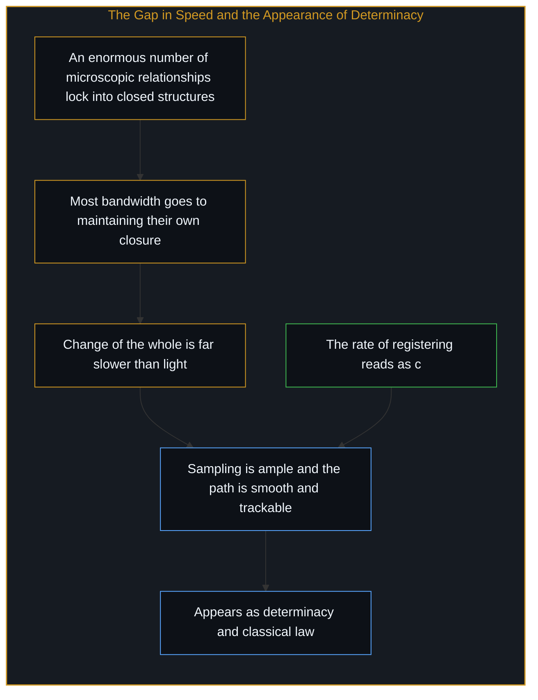

日常世界的确定与规律由此得到一种说明。天体的轨道可以用牛顿引力算到秒，炮弹的落点可以被经典力学预测，这些计算在它们的范围内可靠。按这里的读法，可靠的缘由不在于有一套无人在场的机械法则在统治，而在于宏观物体是微观关系沉淀出的慢速结构，演进的速度远慢于登记的刷新。

The determinacy and regularity of the everyday world get one account from this. The orbits of celestial bodies can be computed to the second with Newtonian gravity, and where a shell lands can be predicted by classical mechanics; these calculations are reliable within their range. On the reading here, the reason for that reliability is not that a mechanical law rules with no one present, but that macroscopic objects are slow structures settled out of microscopic relationships, evolving far more slowly than registering refreshes.

## 三、 不确定性与自由变量是同一件事的两面 / 3. Indeterminacy and the Free Variable as Two Faces of One Thing

理查德·费曼有一句广为流传的玩笑：想象一下，如果电子有了思考的能力，物理学会难做多少，因为去看它的时候，它会根据观察改变自己的行为。这句话多被用来反衬无机物的驯顺可测，而它无意间也指向了量子现象的形状：一个有自己主意的东西，从外部是无法事先算定的。

Richard Feynman has a well-known quip: imagine how much harder physics would be if electrons had feelings, because then they would change their behavior under observation. The line is mostly used to set off how docile and measurable inorganic matter is, and without meaning to it also points at the shape of quantum phenomena: something with a mind of its own cannot be computed in advance from outside.

先看一个日常的经验。面对另一个活着的人时，面对的不是一台由齿轮与发条驱动的机器，而是一个以己度之、同样在作抉择的因果中心。这个人下一刻的选择，对任何外部的观察者都无法在事前算定。探测对方所用的光与声，不快于渲染的速率，而对方的决断同样按这个节律更新，这是在用光速度量光速。测量的信号赶不到决断之前去预先查看它的内容，因为决断作出之前，那个状态还不在任何地方。

Take an everyday experience first. Facing another living person is not facing a machine driven by gears and springs; it is facing a causal center that, taken by analogy from oneself, is likewise choosing. This person's choice in the next moment cannot be computed beforehand by any outside observer. The light and sound used to probe the other are no faster than the rate of rendering, and the other's decision updates at that same cadence: light speed is being measured with light speed. The measuring signal cannot arrive before the decision to look at its content in advance, because before the decision is made, that state is not yet anywhere.

实验室里的不确定有同样的形状。在观测的边界上，结果在接触之前并不存在，没有哪一种探测能赶在它前面把它读出来。这并不是说电子在思考，泛心论把意识赋予基本粒子，而这里不需要这一步。需要的只是看到，不确定性与自由变量是同一件事的两面：从描述之内看，是一处只能用概率分布去覆盖的空白；从第一人称看，是边界上那个不可化约的动作（+1）。间隙落在观测的边界上，而边界登记在哪里，是心智作出的抉择，[割点可移不可除](../the-cut-moves-but-never-vanishes/)展开了这一点。每一个动作都向既定的系统注入一个自由变量，[自由变量的同构与先验主权](../zi-you-bian-liang-de-tong-gou-yu-xian-yan-zhu-quan/)讨论的是这种同构。

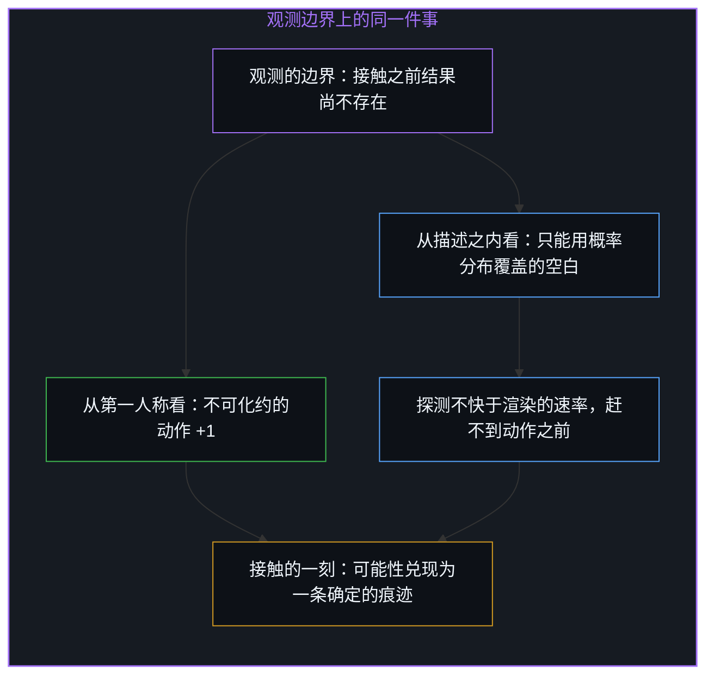

Indeterminacy in the laboratory has the same shape. At the boundary of observation the outcome does not exist before contact, and no probe can get ahead of it to read it out. This is not to say that electrons think; panpsychism assigns consciousness to elementary particles, and that step is not needed here. All that is needed is to see that indeterminacy and the free variable are two faces of one thing: seen from inside the description, a blank that can only be covered by a probability distribution; seen from the first person, the irreducible act at the boundary (+1). The gap sits at the boundary of observation, and where that boundary registers is a choice the Mind makes, as [The Cut Moves but Never Vanishes](../the-cut-moves-but-never-vanishes/) lays out. Every act injects a free variable into a given system, and [The Isomorphism of Free Variables and Prior Sovereignty](../zi-you-bian-liang-de-tong-gou-yu-xian-yan-zhu-quan/) treats that isomorphism.

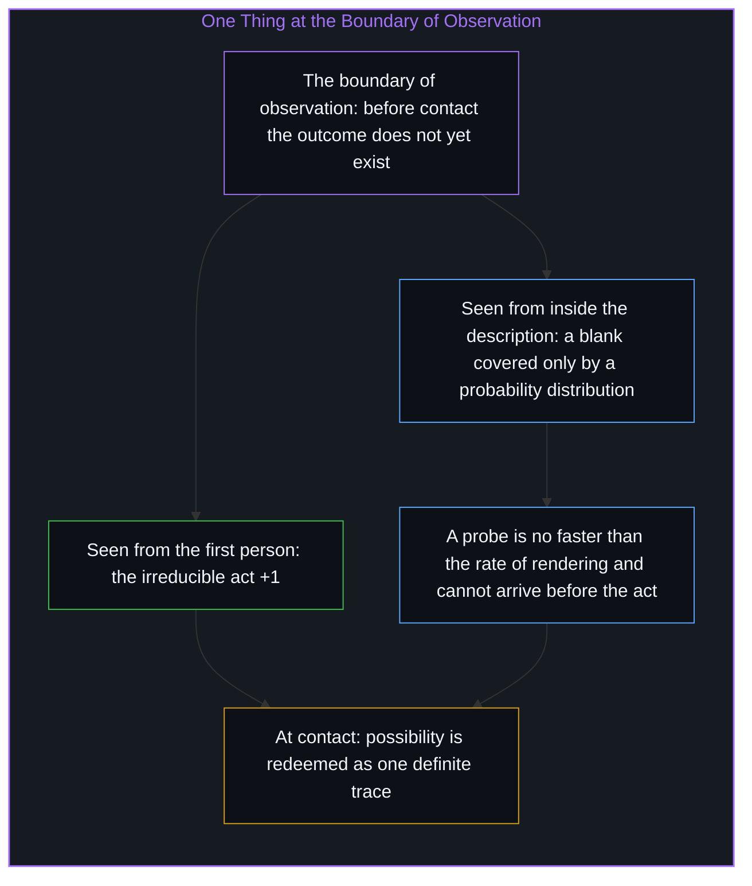

于是“电子在被观察时改变行为”不必读作神秘。第三人称的数学无法预先捕捉边界上的动作，只能用一个涵盖各种可能的分布，即波函数，来作统计。所谓波函数的坍缩，是测量与边界发生接触的那一刻，可能性兑现为一条确定痕迹的寻常事实。从信息到物理的这一跃，是在心智这里被切身感到并实现的，它的名字是观测。

So "the electron changes its behavior when observed" need not be read as a mystery. Third-person mathematics cannot capture the act at the boundary in advance and can only do statistics with a distribution that covers the possibilities, the wavefunction. What is called the collapse of the wavefunction is the ordinary fact that, at the moment measurement makes contact with the boundary, possibility is redeemed as one definite trace. This jump from the informational to the physical is felt and actualized in the Mind, and its name is observation.

## 四、 宏观的确定是微观自由变量的统计沉淀 / 4. Macroscopic Determinacy as the Statistical Sediment of Free Variables

量子力学在微观上的不确定与相对论在宏观上的确定，长期被当作一对需要调和的对立。各种诠释由此而来，多世界保全了幺正的演化，另一些把量子态看作依赖情境的推断，每一种在它的范围内都帮助了计算与思考。

The microscopic indeterminacy of quantum mechanics and the macroscopic determinacy of relativity have long been treated as an opposition in need of reconciling. The various interpretations come from this; many-worlds preserves unitary evolution, others treat the quantum state as an inference dependent on context, and each has helped calculation and thought within its range.

把微观的不确定读作自由变量留在描述里的那一面之后，这对对立有了另一种读法。宏观的确定不是凌驾于微观之上的另一套法则，它是数量极大的微观自由变量稳定结网之后呈现的大数规律，[确定性是微观不确定性的统计签名](../determinism-is-the-statistical-signature-of-micro-indeterminism/)展开了这一点。

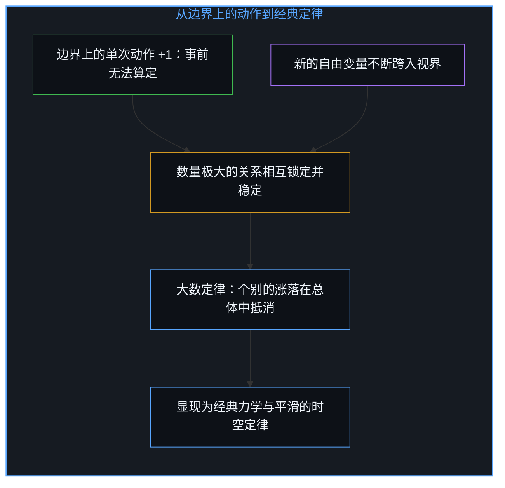

Once microscopic indeterminacy is read as the face the free variable leaves in the description, the opposition has another reading. Macroscopic determinacy is not a second set of laws standing over the microscopic; it is the regularity of large numbers that appears once an enormous number of microscopic free variables have bound into a stable web, as [Determinism is the Statistical Signature of Micro-Indeterminism](../determinism-is-the-statistical-signature-of-micro-indeterminism/) lays out.

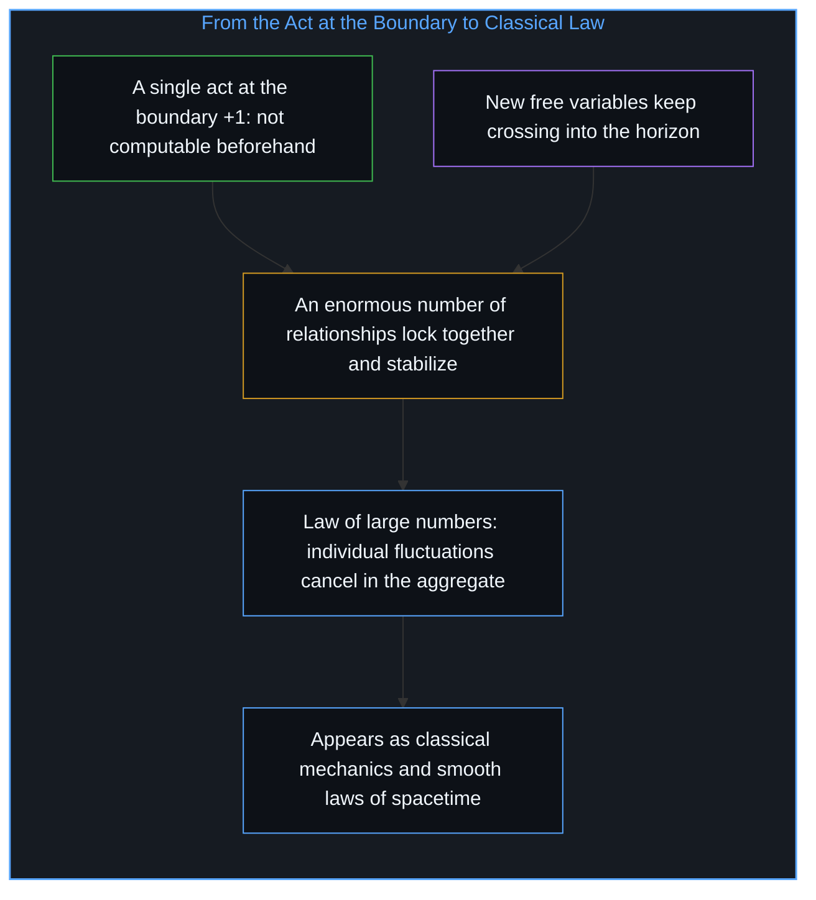

人口与经济的统计是一个贴近的类比。某一个人明天下班后会走进哪家咖啡馆，事前无法确定，那是这个人的抉择。一座千万人口的城市明天下午五点的车流、用水与面包消耗，却稳定而有周期。

The statistics of population and economy offer a close analogy. Which café a particular person will walk into after work tomorrow cannot be settled beforehand; that is the person's choice. The traffic, water use and bread consumption of a city of ten million at five tomorrow afternoon are nonetheless stable and periodic.

经典物理的确定性就是宏观尺度上的这种普查数据。当数量极大的微观自由变量相互锁闭为一块花岗岩或一颗行星时，每一处微小的涨落都在总体的平均里相互抵消，留在宏观仪器上的是平稳而缓慢演进的平均值。经典力学与广义相对论因此是对这片慢速沉淀所作的高阶统计拟合，在拟合的范围内极为精确，边界在于它们被当作先于一切观测的律令的时候。

The determinacy of classical physics is census data of this kind at the macroscopic scale. When an enormous number of microscopic free variables lock into a block of granite or a planet, every small fluctuation cancels against others in the overall average, and what remains on macroscopic instruments is a mean that evolves steadily and slowly. Classical mechanics and general relativity are therefore high-order statistical fits to this slow sediment, extremely precise within the range of the fit, with their boundary where they are taken as edicts prior to all observation.

还需要说明一点。这些数量极大的自由变量不是在某个开端一次分发完毕的存量，它们是随着每一次观测不断被带进视界的增量。没有什么要求跨入视界的事件在此之前没有自己的因果，只是那些因果发生在当下的视界之外，从本地的坐标系里无从取得。于是当它们越过边界、第一次与观测交握时，从视界之内能给出的诚实称呼只有一个：事前不可知的自由变量（+1）。波函数是这种跨入留在数学里的记号。宏观的确定因此不像一架自古上紧发条、不断走松的钟，它是一个仍在进行的稳定化过程，每一步观测都纳入新的自由变量，并经由大数定律把它们织进平稳的秩序。

One more point needs stating. This enormous number of free variables is not a stock handed out once at some beginning; it is an increment continually brought inside the horizon with every observation. Nothing requires that an event crossing into the horizon had no causes of its own before that; those causes simply took place outside the present horizon and cannot be obtained from within the local frame. So when such events cross the boundary and first shake hands with observation, only one honest name can be given from inside the horizon: a free variable unknowable beforehand (+1). The wavefunction is the mark this crossing leaves in the mathematics. Macroscopic determinacy is thus unlike a clock wound up long ago and steadily running down; it is a stabilizing process still under way, each step of observation taking in new free variables and weaving them, through the law of large numbers, into a steady order.

## 五、 物质与心智是节律上的分别 / 5. Matter and Mind as a Difference of Cadence

解释宏观演进的不可逆时，物理学多半求助于热力学第二定律，把时间之箭系在熵的增加上。热力学是极有效的宏观账目，热机、化学反应与信息的代价都由它算清。

When explaining the irreversibility of macroscopic change, physics mostly turns to the second law of thermodynamics and ties the arrow of time to the increase of entropy. Thermodynamics is a highly effective macroscopic ledger; heat engines, chemical reactions and the cost of information are all reckoned by it.

它的边界在于它是下游的统计。热与熵是对已经稳定下来的结构在交换动量时所作的宏观度量。把不可逆的源头放在熵上，次序便颠倒了：经验中的时间向前，是因为每一次接触都是一个不可化约、不可收回的动作（+1），它在沉淀物中的统计足迹被记为熵的增加。沿着时间维度向前向后的推算，是从当下的登记出发在概念上作的投影。

Its boundary is that it is a statistic downstream. Heat and entropy are macroscopic measures taken of structures that have already stabilized, as they exchange momentum. Placing the source of irreversibility in entropy reverses the order: time as experienced moves forward because every contact is an irreducible act that cannot be taken back (+1), and its statistical footprint in the sediment is recorded as an increase of entropy. Reckoning backward and forward along a dimension of time is a projection made conceptually from the present registration.

由此，物质与心智之间不需要两种实体。皮尔士写过：“物质是衰竭的心智，根深蒂固的习惯成了物理定律。”按这里的读法，物质是沉淀下来的关系，因果的交握重复到成了习惯，变化的节律慢到在一次又一次的登记里见不出差别。

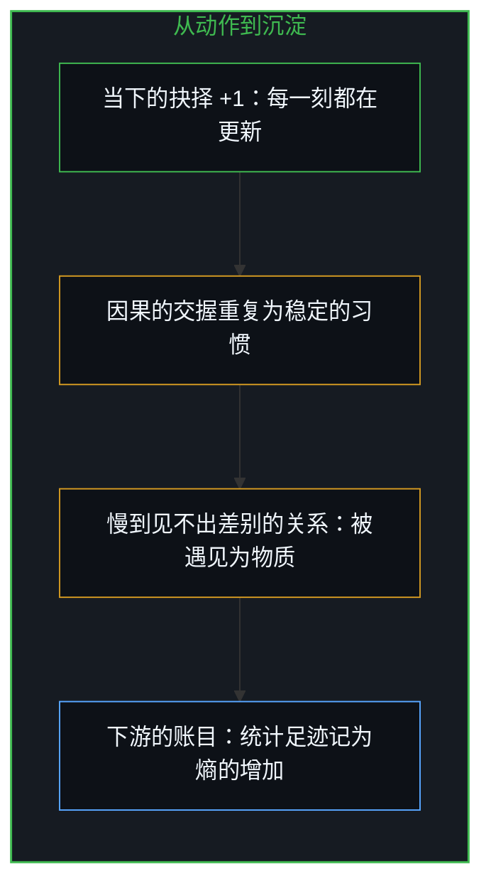

It follows that no two substances are needed between matter and mind. Peirce wrote: "matter is effete mind, inveterate habits becoming physical laws." On the reading here, matter is relationship that has settled, causal handshakes repeated until they are habit, with a cadence of change so slow that registration after registration shows no difference.

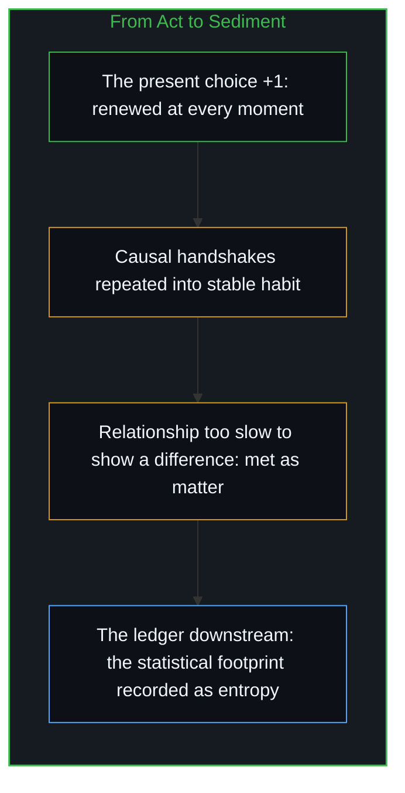

一块石头与一个活着的人，区别于是不在于一边是“死的物质”、另一边藏着“神秘的灵魂”，而在于更新的节律与自由度。活着的心智在每个当下作出新的抉择，因而被遇见为生动而不可预先算定。一块石头是数量极大的关系在漫长的时间里相互锁定之后的平衡，它按地质的尺度缓慢变化，因而被遇见为不动的东西。可以设想万物都是以不同速度思考的心智，而这仍是心智作出的一个概念，作出它的是所知的唯一一种心智，人的心智。从不被当作有生命的东西到被当作有意识的生命，隔着近乎无限的尺度差，这段距离从外部无从证明。意志与抉择属于活着的心智，石头并不因这种读法而有了意愿，这里说的只是两者不必被划进两个互不相通的领域。

A stone and a living person thus differ not in one side being "dead matter" and the other hiding a "mysterious soul," but in the cadence of renewal and the degrees of freedom. A living Mind makes a new choice in each present and is therefore met as vivid and not computable in advance. A stone is the equilibrium of an enormous number of relationships after they have locked together over a long time; it changes slowly on a geological scale and is therefore met as a thing that does not move. Everything can be imagined as a Mind thinking at a different speed, and that is still a concept made by a Mind, the only kind that is known, the human Mind. Between things not treated as living and the living things treated as conscious lies a nearly unlimited difference of scale, a distance that cannot be proven from outside. Will and choice belong to living Minds, and the stone does not acquire a will through this reading; the point is only that the two need not be assigned to two realms with no passage between them.

## 六、 当下的一步与万物理论 / 6. The Present Step and the Theory of Everything

宇宙学把当下登记到的规律沿时间维度向后推到一个开端，向前推到热寂。这种外推有它的用处，背景辐射与轻元素的丰度都由它预测。它的边界在于，那是把当下的感知在概念上向前向后投影出来的时间，不是经验中的时间。经验中只有正在生成的这一步，开端与终点都是从这一步出发画出的图景。

Cosmology extends the regularities registered in the present backward along the dimension of time to a beginning, and forward to heat death. The extrapolation has its use; the background radiation and the abundances of the light elements are predicted by it. Its boundary is that this is time projected conceptually backward and forward from present perception, and not time as experienced. In experience there is only the step now being generated, and the beginning and the end are pictures drawn from that step.

日常所感到的世界的稳固，也可以从这一步来读。它并不来自一生相比于一百三十八亿年的短促，而来自日常所观测的宏观现象的变化远慢于光速，v ≪ c。

The solidity of the world felt in daily life can also be read from this step. It does not come from the brevity of a life set against 13.8 billion years, but from the fact that the macroscopic phenomena observed day to day change far more slowly than light, v ≪ c.

微观与宏观于是不是两个等待焊接的领域。微观的不确定是因果生成的开放前沿，宏观的确定是因果沉淀的慢速统计，两者是同一枚硬币的两面。寻找量子引力的数学是在模型之内正当的工作，这里说的是，在经验的层面上并没有一道需要缝合的裂口。

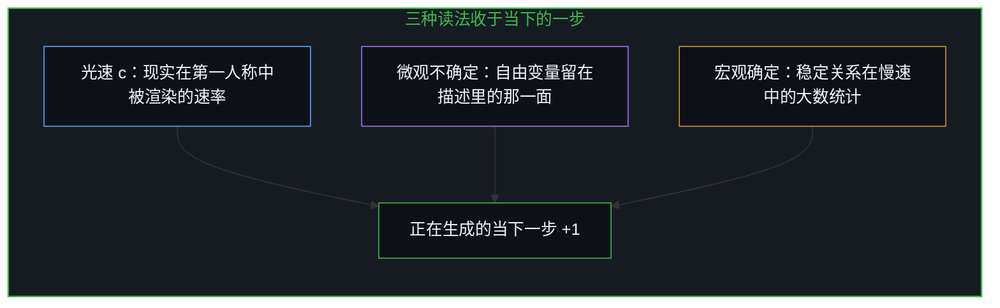

Micro and macro are then not two domains waiting to be welded. Microscopic indeterminacy is the open front of causal generation, macroscopic determinacy is the slow statistics of causal sediment, and the two are faces of one coin. Seeking the mathematics of quantum gravity is legitimate work inside the models; what is said here is that at the level of experience there is no rift that needs stitching.

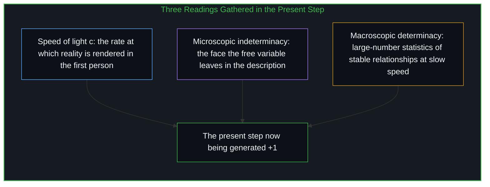

万物理论所求的，是一个没有观测的心智在场、却能推出一切的方程。每一个理论在它的范围内都有用，这个要求的边界在它设定的位置上：它需要站在宇宙之外来写。这好比分析电视机外壳的分子结构，指望由此推出今晚屏幕上那出戏的结局，外壳的分析是准确的，戏不在其中。

What a theory of everything seeks is an equation from which everything follows with no observing Mind present. Every theory is useful within its range, and the boundary of this demand lies in the position it posits: it has to be written from outside the universe. It is like analyzing the molecular structure of a television's casing in the hope of deriving the ending of tonight's play on the screen; the analysis of the casing is accurate, and the play is not in it.

现实因此不像一卷早已印好的静止胶片，它更像一部正在放映的电影。光速标出感知的响应前沿，微观的不确定是抉择留在描述里的那一面，宏观的沉稳秩序是行动脚下的地面。测量者同时是参与者，意义不必等一个最终的理论来授予：在每一个不可化约的当下，在每一次面对未知的决断里，新的一帧正在被渲染出来（+1）。

Reality is therefore unlike a reel of film printed long ago and lying still; it is more like a film now being shown. The speed of light marks the responding front of perception, microscopic indeterminacy is the face choice leaves in the description, and the steady macroscopic order is the ground under action. The one who measures is at once a participant, and meaning need not wait to be conferred by a final theory: in every irreducible present, in every decision made facing the unknown, a new frame is being rendered (+1).
