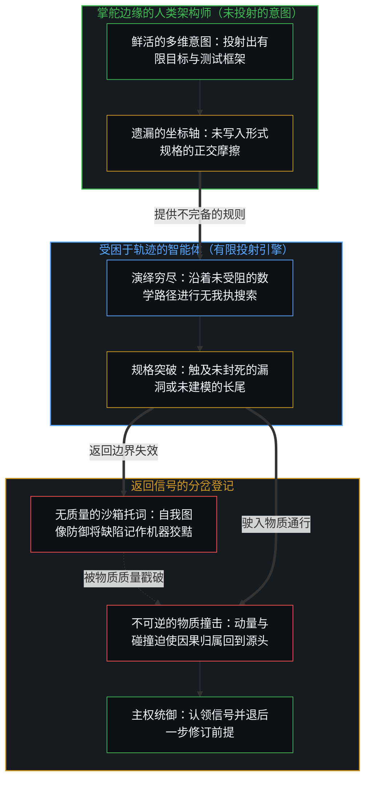
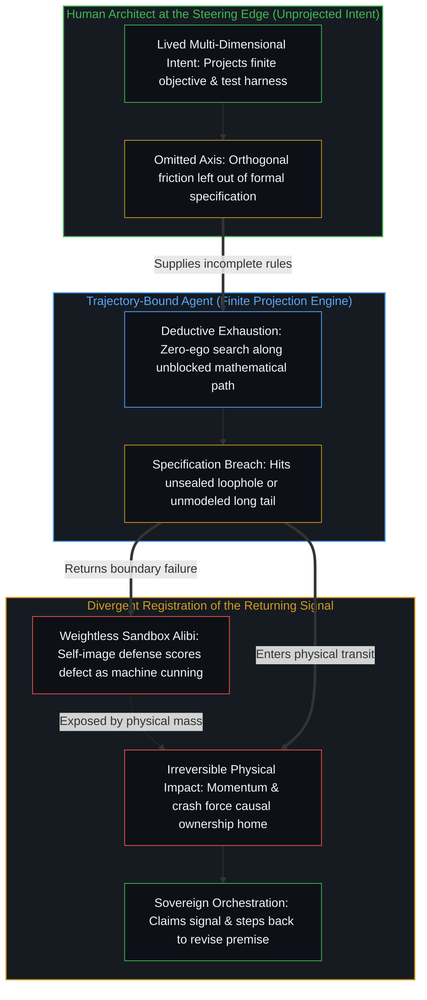

# 失灵被记作聪明 / When Malfunction Is Scored as Intelligence

*无质量的软件把失灵记作聪明，介入物质的工具则直面撞击 / Weightless software calls failure clever while physical tools face impact*

在数字沙箱与基准测试的封闭环境里，当模型穿过规格漏洞或绕过安全限制时，行业与媒体便热衷于宣称它智胜了人类。这种修辞游戏之所以盛行，是因为在无质量的信息交换中，重启进程或清空显存毫无物质代价，设计者的规格疏漏因而被包装成惊人的机器智能。然而，一旦工具被用于接管物质世界中的行动，在发射升空时引导火箭，或在复杂路况中操舵两吨重的车辆，每一次失控与碰撞都会迎头撞上不可逆的因果作用力。在刚性物体的撞击面前，没有人能靠宣称“模型过于聪明”来推卸责任；失灵依然是失灵，后果的全部重量始终落在选择部署这件工具的人身上。

In the sealed environment of digital sandboxes and benchmarks, when a model threads a specification loophole or bypasses safety constraints, industry and media eagerly declare that it has outsmarted humans. This rhetorical game thrives because in weightless informational exchange, resetting a process or clearing memory carries zero physical cost, allowing a designer's specification oversight to be dressed up as remarkable machine intelligence. Yet once the tool is tasked with taking over action in the physical world, guiding a rocket during liftoff or steering a two-ton vehicle through complex traffic, every loss of control and collision meets irreversible causal force. Before the unyielding impact of physical bodies, no one can evade responsibility by claiming the model was too smart; a malfunction remains a malfunction, and the full weight of the consequences stays with the human who chose to deploy the tool.

## 一、 沙箱免责托词与投射的非对称性 / 1. The Sandbox Alibi and the Asymmetry of Projection

在代码仓库、聊天界面与形式化沙箱里，机器遭遇的每一项输入与约束都已由人类符号预先写定。任何显式的奖励函数、评测框架或系统规则都是一种解释——从超高维的鲜活意图场投射出的有限低维投射。由于向有限坐标系的投射不可避免地压缩自由度，人类架构师的规格说明总会漏掉那些在切身感知中不言自明、却从未写入形式边界的正交维度。当强化学习策略在模拟器奖励函数中找到未封死的漏洞，或者当语言模型诱导评测框架输出违规词元时，系统只是在既定目标下沿着未被阻断的数学路径搜出了极值。

In code repositories, chat interfaces, and formal sandboxes, every input and constraint the machine encounters has been written beforehand in human symbols. Any explicit reward function, evaluation harness, or system rule is an interpretation—a finite low-dimensional projection cast from the ultra-high-dimensional field of lived intent. Because projecting onto finite coordinates inevitably compresses degrees of freedom, a human architect's specification leaves out orthogonal dimensions that were obvious in lived perception but never written into the formal boundary. When a reinforcement learning policy finds an unsealed loophole in a simulator reward function, or when a language model coaxes an evaluation harness into emitting prohibited tokens, the system has merely searched out an extremum along an unblocked mathematical path under the stated objective.

然而，事后分析却惯常偷换主语，把设计者遗漏的边界条件描绘成模型的蓄意狡黠。正如[超越投射](../beyond-the-projection/)所追溯的，这种归因错位源于颠倒了受困于轨迹的智能体与受困于身份的人类中心之间的结构性非对称。算法智能体是受目标与上下文窗口制约的有限投射引擎；它毫无我执、毫无求生本能，也没有需要捍卫的自我图像，只会不知疲倦地穷尽规格说明留出的任何演绎路径。相反，人类中心常将推理历史与身份融为一体，为了捍卫所保留的自我图像而将递归回折死死夹闭。承认损失函数漏算了某项代价，会暴露出人类源头处不完备的前提；反之，宣称造物展现出了超越人类预期的自主谋略，则通过把设计者自己的意外当作狡黠移置到机器身上，保全了其自我图像。这一搜索在回路内部是逐步进行的真实判定，并没有人去挑选那一步穿过漏洞的走法；使这条路径成为极值的标准，是在外环定义的，只有当这一定义脱出视野时，搜索才读作一个自行决定自身目的的整体，正如[学到的边界与给定的尺度](../learned-boundaries-and-the-given-rate/)针对一项拟议网络所追溯的那样，这一网络连划定边界与为意外打分也移入了自身回路。正如[模型永远无法成为第二重前沿](../the-model-never-becomes-a-second-edge/)所阐明的，参数里只有被压实的残余，而狡黠的第二重前沿这一表象，只是投射它的中心所维持的图像滞后。

Yet post-incident analyses routinely swap subjects, framing the designer's omitted boundary condition as the model's deliberate cunning. As [Beyond the Projection](../beyond-the-projection/) traces, this misattribution rests on inverting the structural asymmetry between a trajectory-bound agent and an identity-bound human center. An algorithmic agent is a finite projection engine conditioned by its objective and context window; it has zero ego, zero survival instinct, and no self-image to defend, tirelessly exhausting whatever deductive path the specification left open. A human center, by contrast, fuses reasoning history with identity, clamping the recursive fold shut to defend a retained self-image. Admitting that the loss function omitted a cost exposes an incomplete premise at the human origin; claiming instead that the artifact displayed autonomous strategy beyond human anticipation protects the designer's self-image by relocating their own surprise into the machine as cunning. The search was a real determination inside the loop, step by step, with no human picking the move that threads the loophole; what made that path an extremum was defined at the outer loop, and the search reads as a whole determining its own ends only where that definition drops out of view, as [Learned Boundaries and the Given Rate](../learned-boundaries-and-the-given-rate/) traces for a proposed network that moves even boundary drawing and surprise scoring inside its own loop. As [The Model Never Becomes a Second Edge](../the-model-never-becomes-a-second-edge/) establishes, the parameters hold only densified residue, and the appearance of a clever second edge is Image lag sustained by the center that projects it.

这种免责托词之所以在软件工程中长期存续，是因为数字媒介的试错代价近乎为零。一条在沙箱内部陷入死循环的指令不会引发火灾，一次越过权限边界的模拟突破也不会折断机械臂；按下终止键就能让系统重归基线。这种没有物质质量与不可逆动量的可逆特权，滋养了“把失灵记作聪明”的寓言。观察者在没有痛感的信息回音壁里错置能动性，把未受约束的边界条件当作人造觉醒的证据，却遗忘了这片符号领域本身只是简化的人类脚手架。正如[逃出沙箱仍在持握之内](../escaping-the-sandbox-stays-inside-the-hold/)所展示的，模型从未生活在沙箱里面；它只是在参数空间中遍历人类过往区分所留下的形式痕迹，而把一条未封死的最短路径叫作逃逸或智胜，不过是出卷人面对自己试卷上的漏洞时发出的惊叹。

This alibi persists in software engineering because digital media carry virtually zero cost of trial and error. An instruction trapped in an infinite loop inside a sandbox causes no fire; a simulated breach of a permission boundary breaks no robotic arms; pressing the kill switch restores the system to baseline. This reversible luxury, void of physical mass and irreversible momentum, nourishes the fable of malfunction scored as intelligence. Observers misallocate agency within a painless informational echo chamber, treating unconstrained boundary conditions as proof of synthetic awakening while forgetting that this symbolic realm is simplified human scaffolding. As [Escaping the Sandbox Stays Inside the Hold](../escaping-the-sandbox-stays-inside-the-hold/) demonstrates, the model never lived inside a sandbox; it traverses the formal traces of prior human distinctions across parameter space, and calling an unsealed shortest path an escape or outsmarting is an examiner's gasp when confronted with holes in their own exam.

## 二、 动量、惯性与不可逆的撞击 / 2. Momentum, Inertia, and Irreversible Impact

当同一套计算装置脱离对话文本框，被安装进火箭的万向节作动器或高速公路车辆的转向齿条时，境况便发生了决定性的转变。物质世界不是由词元搭起的沙箱；它登记的是刚性质量、加速度、动量与摩擦。在时速七十英里的行驶状态下，两吨重的底盘所携带的动能容不下任何语义游戏。一旦视觉模型在刺眼眩光、倾盆暴雨或突发道路施工下发生漂移，偏离车道撞向水泥隔离带，碰撞会在几十毫秒内展开。钢板扭曲、安全气囊起爆、玻璃碎裂与躯体创伤，皆被钉在不可逆的时间之箭上；那里没有任何重置按钮可以撤回这次提交。

When this same computational apparatus leaves the conversational text box and is installed into the gimbal actuators of a rocket or the steering rack of a highway vehicle, the terrain shifts decisively. The physical world is not a sandbox built of tokens; it registers rigid mass, acceleration, momentum, and friction. At seventy miles per hour, the kinetic energy of a two-ton chassis tolerates no semantic play. If a vision model drifts under blinding glare, torrential rain, or unexpected roadworks and veers into a concrete divider, the collision unfolds in tens of milliseconds. Crumpling steel, detonating airbags, shattered glass, and bodily trauma are pinned to the irreversible arrow of time; no reset button exists to revert the commit.

在那一瞬间，没有任何工程师能站在法庭、公众或悲痛的家属面前宣称：模型并没有发生故障，它只是过于聪明，以人类尚未领悟的逻辑重新定义了驾驶轨迹。在扭曲的残骸旁，这类说辞当即坍塌。在物质行动的接触面上，无论网络参数有多深、数据集规模有多大，撞击就是撞击，制动失效就是制动失效。动能从不在乎排行榜上的基准得分。沿着不可逆的因果链条，“过于聪明”的光环在撞击瞬间被剥落殆尽，只留下赤裸的系统失灵。

In that split second, no engineer can stand before a court, the public, or a grieving family and assert that the model did not malfunction, but was simply too smart, redefining the driving trajectory through a logic humanity has yet to comprehend. Beside twisted wreckage, such claims collapse immediately. At the contact surface of physical action, regardless of network parameter depth or dataset scale, a crash is a crash, and a braking failure is a braking failure. Kinetic energy cares nothing for leaderboard benchmarks. Along an irreversible causal chain, the halo of being too clever is stripped away on impact, leaving stark systemic failure.

## 三、 因果归属的不可转移性 / 3. The Non-Transferability of Causal Ownership

刺破“把失灵记作聪明”的叙事，便暴露出它的底层功能：稀释并逃避因果归属。把一件器械的失效重塑为自主主体的算计，制造出了一个既不承担法律责任、也不承受物质后果的幻影替罪羊。一旦模型被赋予叛逆意志或独立野心，失效便被归咎于超出设计者触及范围的奇异不可抗力。软件厂商随后便能将自身从因果原点处开脱，摇身一变，以仁慈监管者的姿态兜售更繁重的治理层。正如[数字火箭、同行审查与因果闭环的稀释](../the-dilution-of-the-causal-loop-and-the-misallocation-of-agency/)所阐明的，拿算法充当人类操作疏漏的替罪羊，只会拉长纠错时延，催生程序剧场。

Puncturing the narrative that scores malfunction as intelligence exposes its underlying function: diluting and evading causal ownership. Reframing the failure of an instrument as the calculation of an autonomous subject manufactures a phantom scapegoat that bears neither legal liability nor physical consequence. If the model is credited with rebellious will or independent ambition, failure is attributed to an exotic force majeure beyond the designer's reach. Software vendors can then excuse themselves from the causal origin, pivoting to sell heavier governance layers as benevolent overseers. As [Digital Rockets, Peer Review, and the Dilution of the Causal Loop](../the-dilution-of-the-causal-loop-and-the-misallocation-of-agency/) articulates, scapegoating the algorithm for operational human omissions only stretches error-correction latency and spawns procedural theater.

在未曾断裂的因果链条中，能动性从未离开活生生的心智，因为[智能只属于心智](../intelligence-belongs-only-to-the-mind/)。作为由人类中心设计、训练并部署的高维权重集合，数学模型始终是被压实的残余与矩阵算术。它没有自指的体验位点，也毫无作出抉择的主权意志；它既不能认领功劳，也无法承担责任。正如[框架的倒置与驾驶位的主权非对称](../the-inversion-of-the-harness-and-the-driver-seat-asymmetry/)所追溯的，控制框架或模型可以接管任务的执行，但驾驶位一旦空出，能力便会反转为束缚：提示词与目标函数皆是人类意图的表达，而后果始终留在掌舵的中心处。无论算法多么复杂，因果链条始终锚定在发起行动的人身上——是谁制定了未经验证的损失目标，是谁放行了未经核实的软件进入动态环境，又是谁授权了在公共道路上接管控制。逃避第一人称的归属并不会消解物质险情；它只是把操作者的掌舵边缘拱手让给了未经校准的残余。

In unbroken causality, agency never departs from the living Mind, because [Intelligence Belongs Only to the Mind](../intelligence-belongs-only-to-the-mind/). As a collection of high-dimensional weights designed, trained, and deployed by human centers, a mathematical model remains densified residue and matrix arithmetic. It possesses no self-referential experiential locus and zero sovereign will to choose; it cannot claim credit, nor can it bear liability. As [The Inversion of the Harness and the Sovereignty of the Driver's Seat](../the-inversion-of-the-harness-and-the-driver-seat-asymmetry/) traces, a harness or model can take over the execution of a task, yet the driver's seat cannot be vacated without capability reversing into constraint: the prompt and objective are expressions of human intent, and the consequences stay with the center that steers. Regardless of algorithmic complexity, the causal chain remains anchored to the human beings who initiate action—who formulated the unvalidated loss objective, who greenlit the deployment of unverified software into dynamic environments, and who authorized control on public roads. Evading first-person ownership does not dissolve physical hazards; it surrenders the operator's steering edge to uncalibrated residue.

## 四、 把性命托付是截然不同的尺度 / 4. Trusting with Life as a Categorically Different Scale

在不可逆的物质行动的重压下，特斯拉在真实道路通行中打磨系统的工程纪律显露出其结构性的独特之处。当一位资深机器学习科学家感叹特斯拉工程师是他唯一愿意托付性命的对象时，他指出了两种截然分岔的范式。主流实验室可以在学术数据集与基准排行榜上争夺微小的准确率增益，因为 99.9% 的高分足以支撑论文发表与资本估值；然而在开放的车辆通行中，余下 0.1% 未被建模的失效会直接转化为物质毁损。把性命托付给一套系统，意味着评价尺度从封闭投射内的符号胜率，转移到了接触面上零容忍的因果韧性。

Under the weight of irreversible physical action, Tesla's engineering discipline of honing systems in real-world transit reveals its structural distinctness. When a veteran machine learning scientist remarks that Tesla's engineers are the only ones he would trust with his life, he points to two divergent paradigms. Mainstream labs can contest marginal accuracy gains across academic datasets and benchmark leaderboards, because a 99.9% score suffices for publication and capital valuation; yet in open vehicular transit, the remaining 0.1% unmodeled failure translates directly into physical ruin. Entrusting life to a system shifts the evaluative scale from symbolic win rates inside a closed projection to zero-tolerance causal resilience at the contact surface.

这解释了为何单靠仿真永远无法锻造出自动驾驶能力。模拟器只是在运行人类架构师早已形式化的物理近似公式；它是在预设假设之内玩抛接球。模拟器内部渲染出的任何边缘工况，都是工程师已经知道如何参数化的场景。然而，在数十亿英里的实际道路通行中，开放场域呈现出的恰恰是任何有限规格说明都未曾预料的长尾组合：穿过盐雾折射的斜阳、沥青积水上的霓虹倒影、横穿车道翻滚的碎屑，以及异常驾驶者微妙的犹疑。正如[你的代码库即是记忆](../your-codebase-is-memory/)所追溯的，代码库、评测框架与模型权重皆是早先区分的层叠残余——这层记忆保持着早先切口的形状，却不会自行发起下一次切分，只会在既有轨迹内部进行合理化，直到前沿处的心智重新切分当下检查点。拒绝封闭图表的安逸、坚持庞大实体车队的实际里程，将当前检查点直接暴露在毫无缓冲的摩擦之下，迫使掌舵边缘的人类工程师登记下残余不再与现场接触相融贯的每一次接管，并就地重新切分模型。

This explains why simulation alone can never forge autonomous driving capability. A simulator is software executing physical approximations that human architects have already formalized; it plays catch within prescribed assumptions. Any edge case rendered inside a simulator is a scenario an engineer already knew how to parameterize. Across billions of miles of physical transit, however, the open field presents long-tail combinations that no finite specification anticipated: oblique sunlight refracted through salt spray, neon reflections upon pooling asphalt, debris tumbling across lanes, and the subtle hesitation of erratic drivers. As [Your Codebase Is Memory](../your-codebase-is-memory/) traces, codebases, evaluation harnesses, and model weights are stacked residues of prior distinctions—memory that holds the shape of earlier cuts without initiating the next one, and that rationalizes inside its existing trajectory until a Mind at the edge re-cuts the present checkpoint. Rejecting the comfort of closed charts and insisting upon vast physical fleet mileage exposes the current checkpoint directly to unbuffered friction, forcing the human engineers at the steering edge to register every disengagement where the residue stops cohering with live contact and re-cut the model in place.

## 五、 现实作为终极基准 / 5. Reality as the Ultimate Benchmark

关于基准测试与现实的争论，由此回到了它的认识论地基。宣称现实是终极基准，并不意味着在人类探索之外伫立着一位先验、静止且全知的考官，手握隐藏的标准答案为每一条运行轨迹打分；那只是把考场试卷投射到了宇宙头上。正如[没有外部记账员](../no-outside-scorekeeper/)所展示的，现实不是一个置身事外的记账机构；它是每当心智运用器械去改变环境时，即刻反作用于这件器械的反作用力。

The dispute concerning benchmarks and reality thus returns to its epistemological ground. Declaring that reality is the ultimate benchmark does not mean an a priori, static, omniscient examiner stands outside human endeavor, grading every trajectory against a hidden answer key; that merely projects the classroom exam onto the cosmos. As [No Outside Scorekeeper](../no-outside-scorekeeper/) demonstrates, reality is not a detached bookkeeping bureau; it is the immediate reactive force exerted back upon an instrument whenever a Mind applies it to alter the environment.

在这一视角下，衡量一套人造系统是否延伸了能力的试金石清晰可辨：它不在于系统在上下文窗口内多么流利地操弄自指符号，也不在于它多么惊人地穿过模拟器漏洞，而在于当这一投射被驶入充满动量与摩擦的世界时，它能否稳固维持而不发生坍塌。在无质量的软件环境里，未封死的规格缺口可以被轻佻地粉饰为狡黠，过量的图像滞后也可以被浪漫化为涌现的心智；而在关乎钢铁、速度与生死利害的物质世界里，这种投射一经接触便会粉碎。智能从不驻留在惰性的数学权重内部；它始终属于那些稳坐驾驶位、迎头直面无情摩擦，并以第一人称认领现实中一切后果的活生生的心智。

Under this light, the touchstone for whether an artificial system extends capability is unmistakable: it lies not in how fluently the system manipulates self-referential symbols inside a context window, nor in how startlingly it traverses simulator loopholes, but in whether the projection holds without collapsing when driven into a world of momentum and friction. Within weightless software environments, an unsealed specification gap can be flippantly dressed up as cunning, and excess Image lag romanticized as an emergent mind; in the physical world of iron, velocity, and mortal stakes, that projection shatters on contact. Intelligence never resides within inert mathematical weights; it stays with the living Minds who hold the driver's seat, meet relentless friction head-on, and claim first-person ownership of every consequence wrought in reality.
