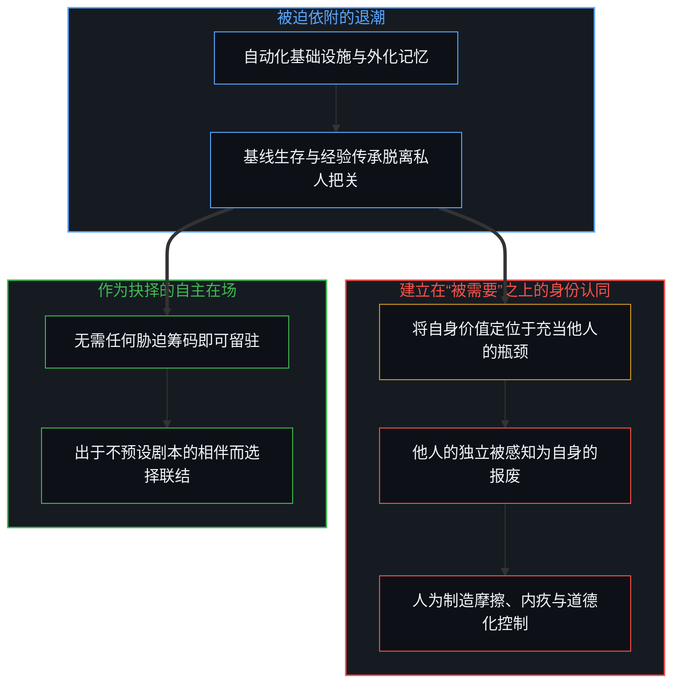
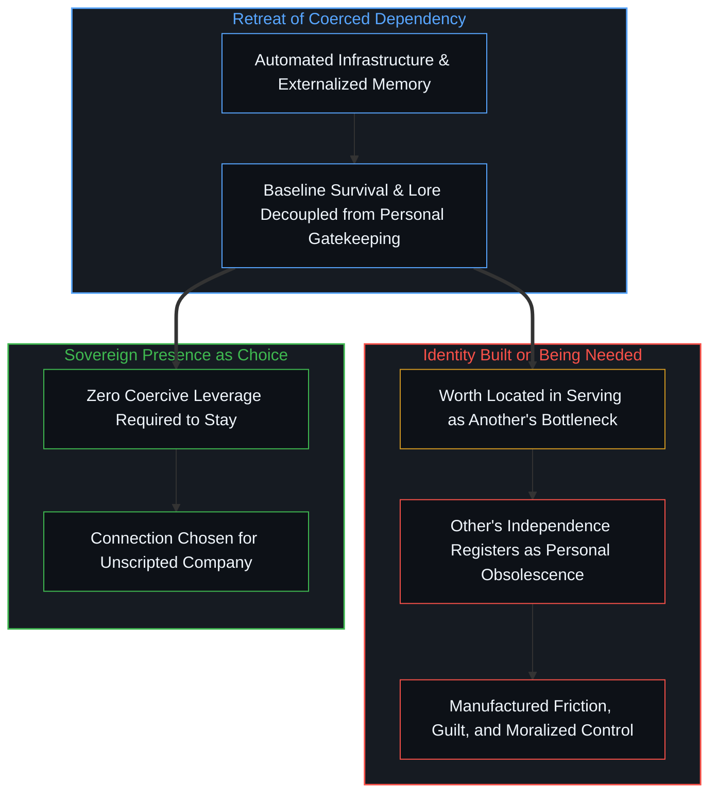

# 当被需要不再是尺度 / When Need Stops Being the Measure

*卸除被迫依附将关系还原为自愿在场，令建基于“被需要”的身份显形。 / Removing coerced dependency strips relationships down to voluntary presence, exposing identities built on being needed.*

在人类漫长的历史中，关系是由生存必需维系的。活下去需要协作，信息高度稀缺，劳作依赖体力，脱离群体即意味着暴露在危险之中。在那种条件下，爱、忠诚、义务与依附交织得如此紧密，以至于没人需要追问究竟是哪一根绳索在承重。只要一个人留下来，旁人很少需要追问他是出于深情，还是因为离开即意味着毁灭。“需要”完成了捆绑，而道德则负责为结果编织叙事。

For most of human history, relationships were held together by necessity. Survival required cooperation, information was scarce, labor was physical, and leaving a group meant exposure. Under those conditions, love, loyalty, duty, and dependence were braided so tightly that no one had to ask which strand was bearing the weight. If someone stayed, it was rarely necessary to ask whether they stayed out of affection or because the alternative was ruin. Need did the binding; morality narrated the result.

这一结构性前提正在瓦解。随着物质生产、物流网络与认知劳动越来越多地由自动化系统与非人格化的基础设施接管，独自生存的基线成本正趋近于零。一个人不再需要靠村庄才能吃饱饭，不再需要靠行会才能习得手艺，也不再需要靠伴侣才能熬过寒冬。就连外化记忆与问题求解的连续性——正如[你的代码库即是记忆](../your-codebase-is-memory/)所展示的，AI 智能体能够直接从磁盘上的代码库重建工作语境，而无需仰赖某个特定的人类中间人把前因后果装在脑子里——也正从私人把关迁移至公开、可检视的器物之中。“被需要”正在从人类关系中退潮。而在退潮之后，它留下了一个被匮乏掩盖了数千年的问题：当不再有任何人被迫需要自己时，人会怎样？

That structural condition is dissolving. As material production, logistics, and cognitive labor are increasingly handled by automated systems and impersonal infrastructure, the baseline cost of existing alone drops toward zero. A person no longer needs a village to eat, a guild to learn a craft, or a partner to survive winter. Even the continuity of externalized memory and problem-solving—where [Your Codebase Is Memory](../your-codebase-is-memory/) traces how a living Mind at the steering edge re-enters working context directly from durable files on disk rather than relying on a human gatekeeper to hold the lore in their head—migrates from personal bottlenecking into open, inspectable traces. Need is retreating from human relationships. And as it retreats, it leaves behind a question that scarcity hid for millennia: what happens to people when no one is forced to need them?

## 一、 交易借口的瓦解 / 1. The Collapse of the Transactional Alibi

匮乏曾提供过一个万能的借口。只要资源与能力受到严格配给，几乎任何形式的控制都可以被装点成关怀。要求顺从的父母，是在帮孩子适应残酷的世道；榨取服从的雇主，是在提供谋生的饭碗；监控一举一动的伴侣，是在护卫家庭的周全。因为匮乏的威胁确凿存在，供给者的筹码看起来就像仁慈，而依附者的顺从看起来就像感恩。

Scarcity provided a universal alibi. As long as resources and capabilities were tightly rationed, almost any form of control could be dressed up as care. The parent who demanded obedience was preparing the child for a harsh world. The employer who extracted submission was providing a livelihood. The partner who monitored every movement was protecting the household. Because the threat of deprivation was real, the leverage of the provider looked like benevolence, and the compliance of the dependent looked like gratitude.

当丰裕与自动化消除了这种威胁，借口便随之坍塌。如果一个孩子无需穿过父母的世界观就能触达人类知识的总和，父母对知识把关的执念就会暴露为对支配权的索取。如果一个人无需讨好庇护者就能维系物质生活，庇护者开出的条件就不再显得像严厉的爱，而是显露出胁迫的底色。丰裕就像一剂溶剂，溶解着每一段暗中依赖“人质机制”维系的关系。它并不会摧毁联结，但会剥离那些曾用来伪造联结的筹码。

When abundance and automation remove the threat, the alibi collapses. If a child can access the sum of human knowledge without passing through a parent's worldview, the parent's insistence on intellectual gatekeeping is exposed as a demand for dominance. If an individual can sustain their material life without appeasing a patron, the patron's conditions no longer register as tough love; they register as coercion. Abundance acts as a solvent on every relationship that secretly relied on a hostage mechanism. It does not destroy connection, but it strips away the leverage that used to counterfeit it.

## 二、 不可或缺者的身份危机 / 2. The Identity Crisis of the Indispensable

这种剥离触发了一场无声的恐慌，因为无数人把自身的全部价值感都建立在“被需要”之上——不是建立在看清事物、自由创造或享受他人陪伴之上，而是建立在充当他人生存、舒适或认可所必经的“瓶颈”之上。

This stripping-away triggers a quiet panic, because vast numbers of people have built their entire sense of worth around being needed. Not around seeing clearly, or creating freely, or enjoying another person's company, but around being the bottleneck through which someone else's survival, comfort, or validation must pass.

当你把自身价值锚定在对别人的效用上时，对方的独立就会在你的感知中呈现为你自身的报废。这也解释了为什么减轻人类负担的进程，常常会遭到那些自称想要助人者的抵制。把身份建立在“唯一答案来源”之上的教师，会在学生可以直接向机器提问时感到威胁；靠协调日常琐事来获取重要感的管理者，会在工作流自动运转时感到被掏空；把别人的无助错当成亲密的照护者，会把对方的康复体验为背叛与遗弃。

When you locate your value in your utility to others, their independence registers as your obsolescence. This is why the easing of human burdens so often meets resistance from the very people who claimed they wanted to help. A teacher whose identity rests on being the sole source of answers feels threatened when students can query a machine. A manager whose self-importance comes from coordinating routine tasks feels hollowed out when the workflow runs itself. A caregiver who mistakes another person's helplessness for intimacy experiences that person's recovery as abandonment.

在每一个案例中，这种痛苦都暴露出其目标从一开始就不是对方的丰盛。如果目标是让对方丰盛，重担的卸除本该带来如释重负的欣慰。痛苦本身证明了，那份重担才是真正的核心资产——它是把对方拴在原地的锚。

In each case, the distress reveals that the goal was never the other's flourishing. If the goal were flourishing, the removal of the burden would be a relief. The distress proves that the burden itself was the asset—it was the anchor keeping the other person tethered.

## 三、 为何过剩的精力会变成控制 / 3. Why Surplus Energy Turns into Control

当物质必需的旧绳索断裂时，那些不知道如何在没有“人质”的情况下存在的人，并不会就此放手。他们会发明新的稀缺。如果不能再靠食物、居所或信息捆住别人，他们就会试图用内疚、情感债务、意识形态纯洁性或人为制造的危机来捆绑对方。

When the old tethers of material necessity snap, people who do not know how to exist without a hostage do not simply let go. They invent new scarcities. If they can no longer bind others through food, shelter, or information, they attempt to bind them through guilt, emotional debt, ideological purity, or manufactured crises.

在优渥社会中，许多看起来像是高度道德敏感的现象，实际上是转移了阵地的把关行为。失去物质筹码之后，控制的冲动便迁徙到了心理与符号领域。人们精心搭建起一套套认可的障碍赛——言辞的规矩、顺从的仪式、没完没了的委屈清算——旨在重新确立这样一种状态：一个人的内心安宁，必须取决于另一个人的恩准。当生存不再强迫人们待在同一个房间里时，焦虑便搭建起一座法庭，把他们传唤回来。

Much of what looks like heightened moral sensitivity in comfortable societies is actually displaced gatekeeping. Having lost material leverage, the impulse to control migrates into the psychological and symbolic realms. People construct elaborate obstacle courses of validation—rules of speech, rituals of deference, endless processing of grievances—designed to reinstate the condition where one person's peace of mind depends on another person's permission. When survival no longer forces people into the room, anxiety builds a courtroom to summon them back.

## 四、 表演的枯竭 / 4. The Exhaustion of Performance

面对“必需性终结”的另一种反应，则是表演的升级。如果没人为了活命而需要你，那你便试图让自己作为一处景观变得不可或缺。人们把性格、创伤、才智或生活方式变成一场全天候的广播，指望用注意力来替代昔日相互依赖的纽带。

The alternative reaction to the end of necessity is an escalation of performance. When no one needs you for survival, the impulse is to make yourself indispensable as a spectacle. People turn their personalities, their trauma, their intellect, or their lifestyle into a broadcast, hoping that attention will substitute for the old bonds of mutual reliance.

然而，注意力是一种毫无摩擦的货币。因为观众付出注意力几乎不花成本，撤回它也毫无代价，所以它无从承载身份认同的重量。表演者被困在猎奇的跑步机上，试图从一群只是在打发时间的看客身上榨取永久的安全感。控制者与表演者逃避的是同一个虚空：他们恐惧地发现，一旦撤除所有交易筹码，自己竟不知道如何单纯地与另一个人共处——或者与自己共处。

But attention is a frictionless currency. Because it costs the viewer almost nothing to give and nothing to withdraw, it cannot bear the weight of an identity. The performer is trapped on a treadmill of novelty, trying to extract permanent security from an audience that is merely passing time. Both the controller and the performer are fleeing the same void: the terror of discovering that, once all transactional leverage is removed, they do not know how to simply be with another human being—or with themselves.

## 五、 余下之物：作为抉择的在场 / 5. What Remains: Presence as Choice

然而，“被需要”的退潮，只对那些原本虚假的东西才是一场悲剧。它所摧毁的，是把别人的脆弱当成自我替代品的能力；而它首次在普遍尺度上开启的，则是全然出自自愿的联结。

Yet the retreat of need is only a tragedy for what was already false. What it destroys is the ability to use another person's vulnerability as a substitute for a self. What it makes possible, for the first time at scale, is connection that is entirely voluntary.

当两个人相遇，彼此都不需要靠对方来获取生存、地位、情绪调节或实用效用时，所有熟悉的剧本都会归于沉寂。这里既没有什么可供榨取，也没有什么需要设防。如果他们留在房间里，那是因为他们选择留下。交谈不再是条款的博弈或债务的维系，而是两个完整经验中心之间不设终点的探索。

When two people meet and neither requires the other for survival, status, emotional regulation, or practical utility, every familiar script falls silent. There is nothing to extract and nothing to defend against. If they stay in the room, they stay because they choose to. The conversation is no longer a negotiation of terms or a maintenance of debt; it is an open-ended exploration between two complete centers of experience.

相比于相互依附那团温暖却令人窒息的浓雾，这是一种清冽得多的空气，起初甚至会让人觉得像是孤独。在匮乏中养成的每一个习惯，都期待联结带有某种重量——像是义务、紧迫感，或是匮乏被填满时的宽慰。而没有“需要”的关系不具备那种重量。它无法用“对方离开后你会崩溃到什么程度”或“没有你对方会崩溃到什么程度”来衡量。

This is a much colder air than the warm, suffocating fog of mutual dependency, and at first it feels like loneliness. Every habit built under scarcity expects a bond to feel like weight—like obligation, urgency, or the relief of a lack being filled. A relationship without need has no weight of that kind. It cannot be measured by how much you would collapse if the other person left, or how much they would collapse without you.

当“被需要”不再是尺度，唯一剩下可供分享的就只有在场。不是角色的扮演，不是依附关系的经营，而是在明知两扇门都未上锁的前提下，依然不假强求地选择一同看向这个世界。

When need stops being the measure, the only thing left to share is presence. Not the performance of a role, not the management of a dependency, but the unforced choice to look at the world together, knowing both doors are unlocked.
