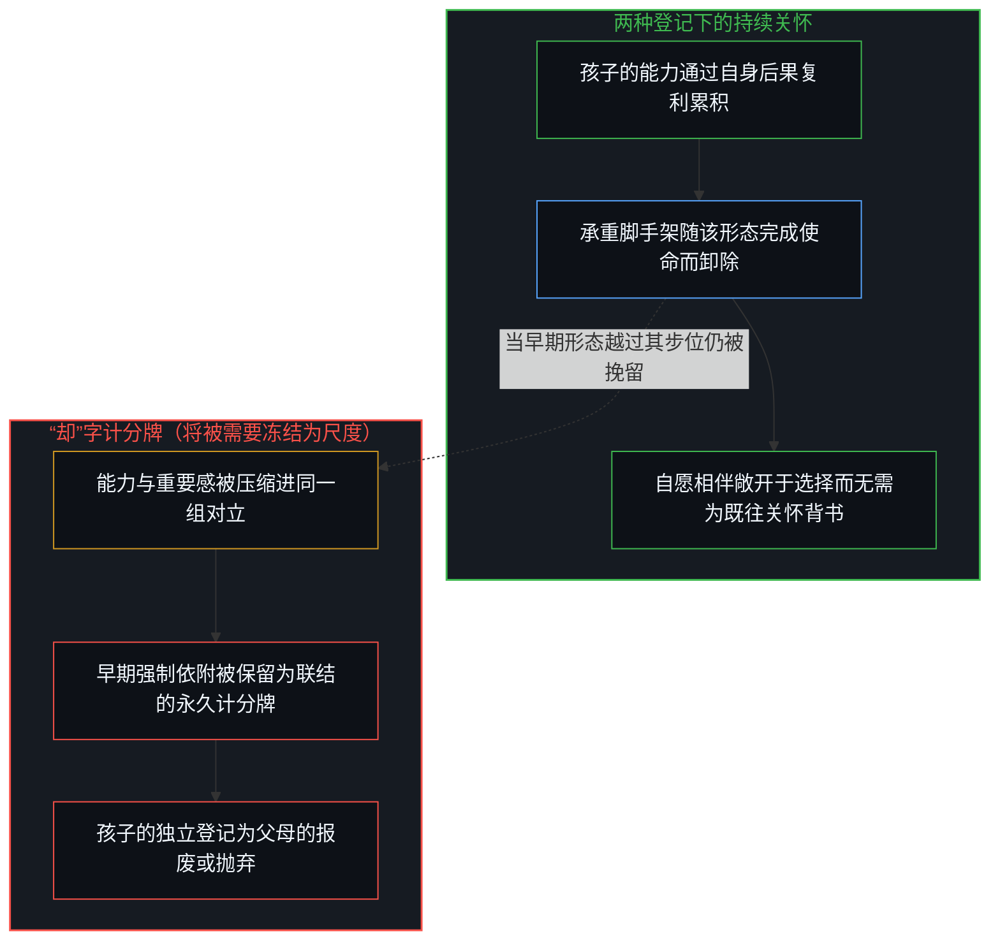
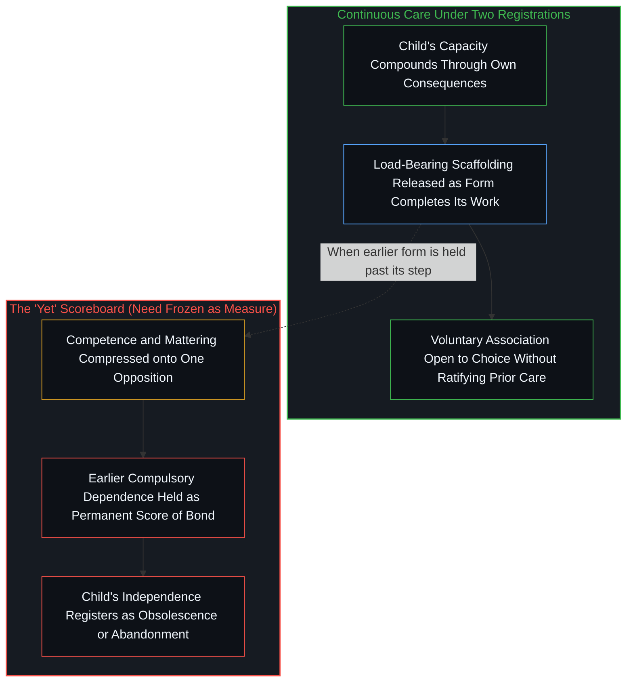

# 当被需要不再是尺度 / When Need Stops Being the Measure

*独立与依然想在孩子生命中重要的愿望，是同一份持续关怀的两次登记——退场的脚手架与演进的联结——直到“被需要”被冻结为关系的计分牌。 / Independence and the wish to matter are one continuous care registered twice—scaffolding that leaves and a bond that evolves—until need is frozen as the score.*

为人父母很容易立志培养坚强、独立的孩子，却又感到每一个仍想对孩子而言举足轻重的愿望都与这一初衷相悖。那个“却”字竖起了两个彼此对立的靶心：一边是孩子日益增长的能力，另一边是父母仍想保持不可或缺的愿望。一旦划下这道切口，任何仍渴望保持联结的冲动，看起来都像是在暗中破坏父母原本期许的独立。这道切口并不必要。两种动向源于同一份关怀。独立并不是抹去关系场的制成品，而是关系场内部的新构型。需要是强制的；想要是自愿的。当孩子摆脱早先的依附时——无论此后他们是否选择留在身边——关怀便抵达了最清晰的成全。

It is easy for a parent to set out to raise strong, independent children, and then to feel that every desire still to matter to them contradicts that aim. The "yet" installs two opposing targets: the child's growing competence on one side, the parent's wish to remain essential on the other. Once that cut is made, any impulse that still wants contact begins to look like sabotage of the independence the parent aimed at. The cut is unnecessary. Both movements arise from the same care. Independence is not a finished product that erases the relational field; it is a new configuration inside it. Need is compulsory; wanting is voluntary. Care reaches its clearest success when the child is free of the earlier dependence—whether or not they then choose to stay near.

## 一、 冻结两个目标的“却”字 / 1. The "Yet" That Freezes Two Aims

日常那句话是这样说的：我们想要坚强、独立的孩子，*却*依然想要被他们需要的感觉。

The ordinary sentence runs: we want strong, independent kids, *yet* we still want to feel needed by them.

正是那个“却”字执行了压缩。它把孩子的能力与父母自身的重要感当成一块两极对立的计分牌——仿佛在独立上每增一分，都是在不可或缺的位置上减一分；仿佛每一次仍想保持不可或缺的愿望，都是对独立的苛扣。一旦这两条轴共用同一具量器，后续的行动就只能在冲突内部排布。原本可以卸下的脚手架，登记为对联结的抛弃；留在附近的冲动，登记为拒绝放手。关怀看起来像是在与自身搏斗。

That "yet" performs the compression. It treats the child's competence and the parent's sense of mattering as if they were one scoreboard with opposite poles—as if every gain on independence were a loss on essential place, and every wish to remain essential were a tax on independence. Once those axes share a single instrument, later acts can only pattern inside the conflict. Scaffolding that could be released registers as abandonment of the bond. The impulse to stay near registers as refusal to let go. Care appears to fight itself.

这场冲突是由量器制造出来的。能力与重要感起初位于彼此独立的轴上。把它们强行压进同一组对立，是以常识面目出现的容量坍缩：原本可以分立的区分被压成同一个读数。感到撕裂的父母并不是发现了养育的悲剧结构，而是透过一道本无必要的切口去解读两种动向。

The conflict is manufactured by the instrument. Competence and mattering began on independent axes. Forcing them onto one opposition is capacity collapse performed as common sense: distinctions that could stay apart are made to register as one. The parent who feels torn is not discovering a tragic structure of parenting. They are reading two movements through a cut that was never required.

## 二、 两种登记下的持续关怀 / 2. Continuous Care Under Two Registrations

两种动向源于同一份持续的关怀。

Both movements arise from the same continuous care.

致力于让孩子强大的父母，已经在区分哪些脚手架眼下可以拆除——哪些负荷孩子自己能扛，哪些步骤不再需要外部供给。这与[作为因果干扰的情感支持](../emotional-support-as-causal-interference/)遵循的是同一种非替代几何：把孩子自己能承担的部分留给孩子，不用持续的外部调节去顶替正在发育的过程。让孩子强大，是关怀以“释放不再属于父母中心之物”的方式延续。

The parent who works toward the child's strength is already distinguishing what scaffolding can now be removed—load the child can carry, steps that no longer need external supply. That is the same non-replacement geometry as [Emotional Support as Causal Interference](../emotional-support-as-causal-interference/): leave with the child what they can carry; do not replace developing process with ongoing external regulation. Strengthening the child is care continuing as release of what no longer belongs at the parent's center.

依然希望自己重要的父母，则是在区分联结正在演进的形态——接触、认出与相伴依然鲜活。这一冲动并不是第二套纲领，而是关怀以“登记关系”的方式延续。承载过早期依附形态的那个场，依然容纳着两个中心；改变的是两者之间可及性的构型，而不是关系依然可供选择这一事实。

The parent who still wants to matter is distinguishing the evolving shape of the bond—that contact, recognition, and association remain live. That impulse is not a second program. It is care continuing as registration of relation. The field that held the earlier form of dependence still holds two centers; what changes is the configuration of availability between them, not the fact that relation is available to be chosen.

哪一种动向都不需要以另一种的消亡为代价。脚手架的退场不是联结的瓦解；希望自己依然重要，也不是对能力的否决。只有当早期那种“被需要”的形态被保留为衡量两者的尺度时，它们才会被压缩成彼此对立的两端。

Neither movement requires the other to die. Scaffolding that leaves is not the bond dissolving. The wish to matter is not a veto on competence. They compress into opposition only when the earlier form of being needed is kept as the measure of both.

## 三、 独立是重配，不是抹除 / 3. Independence Is Reconfiguration, Not Erasure

独立并不是抹去关系场的制成品，而是关系场内部的新构型。

Independence is not a finished product that erases the relational field. It is a new configuration inside it.

一个能够自己行走、决断、谋生并承担昔日须由父母兜底之后果的孩子，并不是在昔日关系所在之处留下了一片空白。这个场依然容纳着两个中心。改变的是哪些行动通过孩子自身的递归闭环完成，哪些行动仍通过共享的可及性来排布。[自我价值感与所有权](../ownership-and-self-worthiness/)道出了这一转换中属于孩子的那一侧：后果作为孩子自己的后果重新进入回路，更新便在孩子自己的边缘复利累积。父母早先提供的动力供给，不再是这一复利运转所仰赖的轴线。

The child who can walk, decide, earn, and carry consequences that once required the parent is not a blank where relation used to be. The field still holds two centers. What has changed is which acts complete through the child's own recursion and which still pattern through shared availability. [Ownership and Self-Worthiness](../ownership-and-self-worthiness/) names the child's side of that shift: consequences re-enter as their own, so the update compounds at their edge. The parent's earlier supply of motion is no longer the axis on which that compounding runs.

早期那种“被需要”的形态，只是不再充当尺度而已。作为承重者、调节器或回路固定点的不可或缺，只是关怀的一种构型。当这种构型结束时，关怀并未失败；它只是完成了这一形态所承担的工作，正如[你的代码库即是记忆](../your-codebase-is-memory/)所追踪的那样：当下的检查点吸收依然重要的既往步骤，同时卸下过渡性的脚手架，以免昨日的条件场伪装成今日的基底。把这一形态的终结当成重要性的终结，就是把临时脚手架冻结成了联结的永久计分牌——这与[遗忘的脚手架](../the-scaffolding-we-forget/)所追踪的“把建造物错当成搭建它的活动本身”是同一种冻结，只不过这里的脚手架是父母不可或缺的位置。[疗愈打开反馈回路](../therapy-opens-the-feedback-loop/)则是同一道切口在成年专业关系中的切面：能力重建期间暂借的共享参照是可以退场的脚手架；永久留驻的家具，则是对内部信号之外部调节的依附。

The earlier form of being needed simply stops being the measure. Being essential as load-bearer, regulator, or fixed point of a circuit is one configuration of care. When that configuration ends, care has not failed. It has finished the work that form was for, just as [Your Codebase Is Memory](../your-codebase-is-memory/) traces how a present checkpoint absorbs the prior steps that still matter and drops transient scaffolding so yesterday's conditioning field does not masquerade as today's ground. Treating the end of that form as the end of mattering freezes a temporary scaffold as the permanent score of the bond—the same freeze [The Scaffolding We Forget](../the-scaffolding-we-forget/) tracks when construction is mistaken for the activity that erected it, only here the scaffold is the parent's indispensable place. [Therapy Opens the Feedback Loop](../therapy-opens-the-feedback-loop/) is the adult professional face of the same cut: temporary shared reference while capacity rebuilds is scaffolding that can leave; permanent furniture is dependence on external regulation of the internal signal.

[帮助是问题的一半](../help-is-half-the-problem/)展示了同一几何卡死时的面貌：当助人者的身份认同依然要求对方充当固定点时，运动与停滞便共同写就了一个原地打转的闭环。把“被需要”当成联结唯一证明的养育，正是披着成长外衣的同一个闭环。释放早期形态并不是对爱的破坏，而是因为一端已能自己生成昔日须由另一端供给之物，闭环随之自然松开。

[Help Is Half the Problem](../help-is-half-the-problem/) is the stuck face of the same geometry: when the helper's identity still requires the other as fixed point, motion and stasis co-author a circle. Parenting that keeps need as the only proof of bond is that circle under developmental costume. Release of the earlier form is not sabotage of love. It is the circle unwinding because one input no longer needs to supply what the other can generate.

## 四、 需要是强制的；想要是自愿的 / 4. Need Is Compulsory; Wanting Is Voluntary

唯有当孩子不再需要父母时，孩子才拥有想要与父母相伴的自由。

Only when a child no longer needs the parent are they free to want association with the parent.

需要是强制的。它把孩子的场排布为必须由外部填补的匮乏——食物、安全、调节，以及尚未成形的技能。想要是自愿的。它是孩子边缘处进一步作出的离散行动：在强制通道关闭之后，选择亲近、交谈、共事或保留往来。这两者并不是同一种力量的不同强度，而是截然不同的关系拓扑。强制关系几乎不给孩子留下亲自书写这段联结的余地；自愿关系则是作为孩子自身下一步行动的联结。

Need is compulsory. It patterns the child's field as lack that must be filled from outside the child's center—food, safety, regulation, skill that has not yet formed. Wanting is voluntary. It is a further discrete act at the child's edge: choosing nearness, conversation, shared project, residual contact when the compulsory channel has closed. Those are not two intensities of the same force. They are different topologies of relation. Compulsory relation leaves little room for the child's authorship of the bond. Voluntary relation is the bond as the child's own next act.

中心与中心之间只有可及性的排布。没有哪位父母能替孩子完成回路的闭合，也没有哪个孩子的持续依附能填满父母的内部世界。[没有普渡，只有自渡的无限可能](../mei-you-pu-du-zhi-you-zi-du/)道出了这一不以孤立为纲领的边界：痕迹可以被接续，也可以不被接续；跨中心去替另一个中心完成递归，属于范畴错误。要求孩子“需要自己”才能感到关怀有所成效的父母，是在要求孩子的受迫状态去为唯有父母自身边缘才能登记的事实背书。能够接纳自愿相伴而不强求它的父母，则修复了这道边界：孩子的自由留在孩子的中心；相伴若到来，是共振，而不是不可或缺之地位的证明。

Between centers there is only availability-patterning. No parent completes the child's return; no child's continued dependence completes the parent's interior. [No Universal Salvation, Only Boundless Possibilities of Self-Salvation](../mei-you-pu-du-zhi-you-zi-du/) is that bound without isolation as program: traces may be taken up or not; cross-center completion of another's recursion is a category error. The parent who requires need in order to feel that care succeeded is asking the child's compulsion to ratify what only the parent's own edge can register. The parent who can receive chosen association without requiring it restores the boundary: the child's freedom stays at the child's center; association, if it arrives, is resonance, not proof of essential place.

## 五、 成全在于“不再需要”本身 / 5. Success Is the No-Needing Itself

这项工作最清晰的成全，就在于“不再需要”本身。

The clearest success of the work is the no-needing itself.

当孩子摆脱早先的依附时，指向坚强的那份关怀便已抵达它一路区分所朝向的构型。这一成全并不悬于孩子此后是否留在身边。此后出于自愿的相伴，若到来便可坦然承接，但它并不是既往关怀算不算奏效的前提条件。[秩序、剩余与道德拦截](../order-surplus-and-the-moral-intercept/)追踪的正是这种拦截：要求事后的登记去为业已完成的工作颁发许可。强求这一事后登记，只是给旧尺度换了个温和的名字重新装回原位——依然要求被需要，只不过从“作为承重者被需要”换成了“作为首选旅伴被需要”——依然是把孩子的行动当成父母下一步的供给来源，这正是[当效果主宰了框架的叙事](../when-the-effect-authors-the-frame/)所追踪的同一种倒置：把某种感受或投射出的读数奉为首要前提，令成人的反应反过来围绕管理这一读数而重组。

When the child is free of the earlier dependence, the care that aimed at strength has reached the configuration it was distinguishing toward. That success does not wait on whether they then stay near. Association chosen afterward is available to be received. It is not the condition under which the prior care counts as having worked. [Order, Surplus, and the Moral Intercept](../order-surplus-and-the-moral-intercept/) is that intercept wherever later registration is asked to authorize work already done. Requiring it reinstalls the old measure under a softer name: still needed, only now as preferred company rather than as load-bearer—still the child's act treated as supply of the parent's next step, the same inversion [When the Effect Authors the Frame](../when-the-effect-authors-the-frame/) traces when a felt or projected register is installed as primary so that adult responses reorganize around managing it.

如果自愿选择的相伴到来，父母可以欣然承接，而无需靠它来证明关怀是否奏效；也可以安住于孩子已然自由这一事实本身。两者是同一次复位：“我重要，因为他们需要我”这一参照随着步位移行而重新渲染，收窄过剩滞后，而不是死守旧脚手架充当基底。当强制退场后依然存续的重要感，是在没有受迫的前提下依然发生共振的部分——而不是靠自愿往来去证明自身不可或缺的第二套纲领。

The parent can receive the chosen association if it arrives, without requiring it for the care to have succeeded. Or rest in the fact of the child's freedom. Both are the same restoration: the reference of "I matter because they need me" re-rendered as the step moves, narrowing excess lag rather than holding the old scaffold as ground. Mattering that survives is whatever still resonates when compulsion has left—not a second program of proving essential place through voluntary contact.

这段关系若继续，是出于选择而继续；无论继续与否，最初的关怀都已圆满。当早期那种“被需要”的形态不再充当尺度——不再衡量联结、不再衡量成败、也不再衡量关怀是否奏效——那道曾让独立与重要感看似为敌的切口便自行消解。[拥有成本把滞后的平均值冻结为车辆属性](../ownership-cost-freezes-lagged-averages-as-vehicle-property/)追踪的也是披着保值外衣的同一种冻结：把可定价的残值当成穷尽拥有体验的唯一计分牌，却把无法标价的生存余量当成可忽略之物一笔勾销。

The relationship, if it continues, continues by choice. The original care is fulfilled either way. The cut that made independence and mattering look like enemies dissolves when the earlier form of being needed stops being the measure—of the bond, of success, and of whether care worked. [Ownership Cost Freezes Lagged Averages as Vehicle Property](../ownership-cost-freezes-lagged-averages-as-vehicle-property/) is the same freeze under premium costume: priceable residual held as exhaustive ownership score while survival residual that does not fix a price is dropped as if ignorable.
