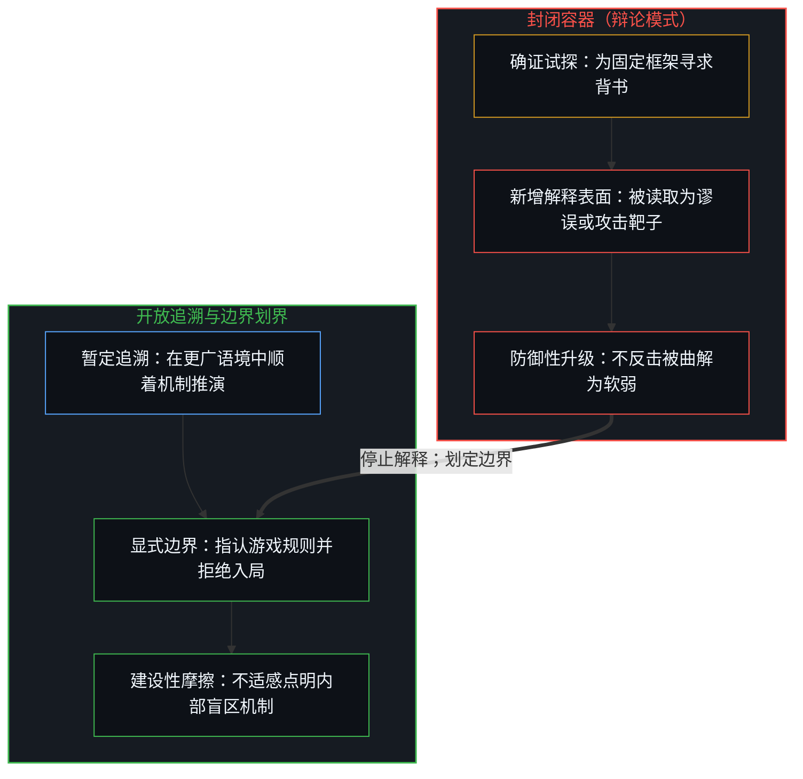
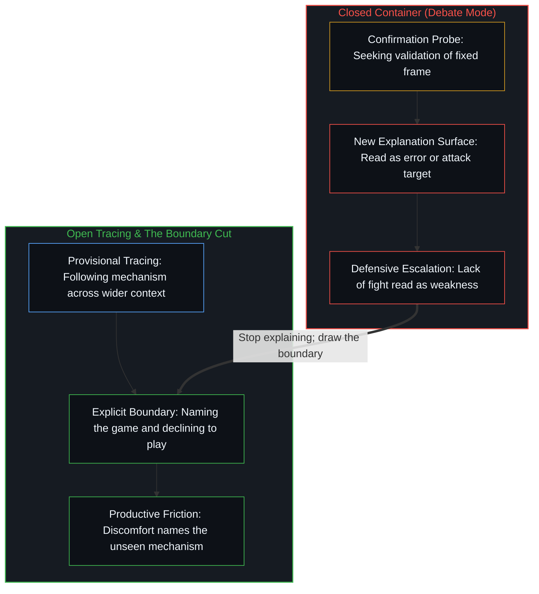

# 解释为何失效 / Why Explanation Fails

*把每处新展开的表面都当成靶子的小框架内，更大的语境无从靠解释传达。 / A larger context cannot be explained from within a smaller one that treats every new surface as debate ammunition.*

一位老同学兴冲冲地联系我，分享他的一项发现，希望我认同那是足以颠覆全局的突破。我早已将他展示的东西纳入认知，并且看到了更远的地方——但在他的框架之内，这并未显现为纵深，而是被读取为反对。

An old classmate reached out excited about a discovery, wanting me to agree it was a game-changer. I had already integrated what he was showing me and could see further—but from inside his frame, that did not register as depth. It registered as disagreement.

## 一、 非对称性 / 1. The Asymmetry

随后展开的是一个熟悉的模式。每当我试图解释更大的语境，他就会找到新的靶子发起攻击。这并不是因为我犯了更多错误，而是因为每一次解释都铺开了新的接触面。我在扩展版图，他却把每一块新拼图都当成了另一个需要击倒的目标。

What followed was a familiar pattern. Every time I tried to explain the larger context, he found something new to attack. Not because I was making more wrong claims, but because every explanation offered new surface area. I was expanding the map. He was treating each new piece as another target.

我们玩的压根不是同一场游戏。我是在追溯——顺着机制看它通向何处，将观点作为暂时的锚点，关心事物的结构形态而非谁掌握了正确结论。他则是在辩论——捍卫既有立场，在我的话里搜寻破绽，试图赢下一场我从未报名的比赛。

We were playing different games entirely. I was tracing—following the mechanism to see where it leads, holding positions provisionally, interested in the shape of the thing rather than who is right about it. He was debating—defending a position, looking for flaws in mine, trying to win a contest I had not entered.

当你将观点视作暂定推演、只关心机制而非胜负时，手里便没有什么需要死守的防线。但对于处在辩论模式中的人而言，这种姿态是无法解读的。他们会把不设防曲解为软弱或闪避，进而变本加厉地追击。我越是不反击，他就越笃定我是无力招架。

When you hold views provisionally and care about mechanism rather than being right, there is nothing to defend. But that is illegible to someone in debate mode. They read the lack of defensiveness as weakness or evasion, which makes them push harder. The more I did not fight back, the more convinced he became that I could not.

## 二、 看似好奇的姿态 / 2. What Looks Like Curiosity

他带着一种看似好奇的姿态开启了这场对话。但好奇心是一种敞开的姿态，而非亟待填补的空缺。如果他真的怀有好奇，整场对话的体感会截然不同——我们会一起顺着线索共同追溯。他所怀揣的，只是披着探询外衣的寻求认同。他只想对既有框架做压力测试，却不愿让框架本身承担风险。每一个问题都是在试探附和，每一个未能提供确证的回答都被归类为谬误。

He came to the conversation with something that looked like curiosity. But curiosity is a posture, not a deficit. If he were actually curious, the conversation would have felt completely different—we would both have been tracing something together. What he had was reassurance-seeking dressed as inquiry. He wanted to stress-test his existing frame, not risk it. Every question was a probe for confirmation, and every answer that did not confirm was reclassified as error.

这是一种常见的坍缩：把对认肯的渴望错当成对理解的追求。从内部体验来看，这两者毫无二致；唯有当回答偏离预期时，你在反应中流露出的姿态才会显影出两者的分野。[现实是心智持续的实现](../reality-is-the-minds-ongoing-realization/)在人际交流中切出了同一刀：旨在收割确证的注意力只会冻结认知版图，而真正的更新则是吸纳当前位点尚未包含的差异。

This is a common collapse: mistaking the desire for validation for the desire for understanding. They feel identical from the inside. The difference only shows up in how you respond when the answer is not what you expected. [Reality Is the Mind's Ongoing Realization](../reality-is-the-minds-ongoing-realization/) is the same cut as exchange: attention that harvests confirmation freezes the map, whereas update is taking up what this locus did not yet contain.

## 三、 容器问题 / 3. The Container Problem

更深层的结构性症结在于，更大的语境无法在更小的语境内部靠解释来传达。身处容器内部，便看不见容器本身的轮廓。当一个人站在自身理解的边界上时，在同一议题上，他无法区分落后于自己的人与已经走过自己的人。站在他的位置看去，这两者都同样表现为异议。

The deeper structural issue is that a larger context cannot be explained from within a smaller one. The container cannot be seen from inside what it contains. When someone is at the frontier of their own understanding, they cannot distinguish between someone who is behind them and someone who is beyond them on the same topic. Both look like disagreement from where they are standing.

我所看到的“更多”，并不是一个与他竞争的对立主张，而是一个将他的立场涵盖为特例的更大语境。但在他的框架内部，并没有容纳这种可能性的空间。于是他拼命死守那片我压根没有争夺的阵地。

The "more" I could see was not a competing claim—it was a context that included his position as a special case. But from inside his frame, there was no room for that possibility. So he fought to defend ground I was not even contesting.

我给出的每一次解释，非但没有缓解这种错位，反而让局面愈发恶化。每一次试图勾勒更大轮廓的努力，都只是递给他更多可以揪住反驳的边缘。向一个认定你画错了地图的人扩展版图，在他眼里无异于在制造更多破绽。

Every explanation I offered made this worse, not better. Each attempt to show the larger shape gave him new edges to grab and argue against. Expanding a map for someone who thinks you are drawing the wrong map just looks like making more mistakes.

## 四、 慷慨的陷阱 / 4. The Generosity Trap

让这场对话延续下去的，是我愿意接招的诚意——去他所在的位置迎合他，尝试不同的切入角度，持续提供背景语境。但这种交流上的慷慨，反而被这一互动机制本身武器化了。我愿意继续解释的姿态，被解读为同意按他的规则出牌。每一次试图弥合鸿沟的新尝试，都被接收成了那场我从未参与的博弈中的新招数。

What kept the conversation going was my willingness to engage—to meet him where he was, to try different angles, to keep offering the context. But generosity of engagement gets weaponized by the dynamic itself. My willingness to keep explaining got read as agreement to play by his rules. Each new attempt to bridge the gap was received as a new move in a game I was never playing.

你无法替别人完成他们自己的好奇；好奇心必须先成为对方自己的姿态。正如[你的代码库即是记忆](../your-codebase-is-memory/)在鲜活心智与外化造物的边界上所追溯的，沉淀在共享媒介中的言语与文档只是无法自行完成更新的惰性痕迹。倘若接收端的位点缺乏一个准备修正自身前提的鲜活领航边缘，向通道里倾倒再多解释，也只是在为一场你从未加入的辩论输送新弹药。

You cannot satisfy someone else's curiosity for them; curiosity has to be their posture first. As [Your Codebase Is Memory](../your-codebase-is-memory/) traces at the boundary between living mind and externalized artifact, words and documentation deposited into a shared medium are inert traces that cannot execute their own update. Without a living steering edge at the receiving locus ready to revise its own premises, pouring more explanation into the channel only supplies fresh ammunition for a debate you never joined.

## 五、 为何边界能传达解释所不能及之物 / 5. Why Boundaries Communicate What Explanation Can't

领悟其实很简单：停止解释。这并非因为解释有误，而是因为解释用错了地方。当接收者的框架无法容纳你所提供的东西时，追加解释不仅于事无补，反而只会制造更多干扰。

The realization is simple: stop explaining. Not because the explanation is wrong, but because explanation is the wrong instrument. When the receiver's frame cannot contain what you are offering, more explanation does not help—it just generates more interference.

一道边界所能传达的信号，是再详尽的阐发也无法企及的：*我看清了正在发生什么，并且我选择不参与其中。*边界本身的摩擦传递了信号。倘若他足够敏锐，当听到“你并不是在试图理解，你只是在试图证明我错了”时所涌起的不适感，将完成一千次解释也无法完成的功课。这并不是因为话语刺耳，而是因为它直接点明了那个身处局中便无从察觉的机制。

A boundary communicates something that no amount of elaboration can: *I see what is happening, and I am choosing not to participate in it.* The friction of the boundary itself transmits the signal. If he is perceptive enough, the discomfort of being told "you are not trying to understand, you are trying to prove me wrong" will do work that a thousand explanations could not. Not because it is harsh, but because it names the mechanism he cannot see while he is inside it.

最善意的举动，有时恰恰是最直接的亮剑。为了维持体面而任由对方安居于自我设限的模式中，本身就是一种失真。那道摩擦才是真正的馈赠。

The kindest thing is sometimes the most direct thing. Politeness that lets someone stay comfortable in a pattern that limits them is its own form of dishonesty. The friction is the gift.

## 六、 这一模式 / 6. The Pattern

这不仅关乎一次对话；这一结构适用于开放探询与防御性封闭之间的每一次碰撞。追溯与辩论是从外部看去颇为相似、实则截然不同的两种活动。当两者相遇时，追溯者在辩论场上总是输家——这并非因为追溯更孱弱，而是因为辩论赛制所奖赏的，恰恰是那些阻断理解的招数。唯一有效的应对，就是点明这场游戏的名字，然后拒绝入局。

This is not merely about one conversation; the structure generalizes across every collision between open inquiry and defensive closure. Tracing and debating are distinct activities that look similar from the outside. When they collide, the tracer always loses inside the debate arena—not because tracing is weaker, but because the game of debate rewards the debater for the exact moves that prevent understanding. The only effective move is to name the game and decline to play.

你无法靠在更大语境内部展开争辩，来让别人看见那个更大的语境。容器问题是结构性的，而非修辞说服所能逾越。无论解释的技巧多么高超，都无法攻克一个把一切意外输入都归类为谬误的封闭框架。[信念如何真正改变](../how-belief-actually-changes/)在接收端的心智上切出了同一刀：唯有当前提本身被重新划定时，信念才会发生修正，在旧前提内部挪动家具的争辩无济于事。[AI 争论中的观察划界](../the-observational-cut-in-ai-debates/)则揭示了同一种冻结：一旦配对交流被当成辩论，对话就会沦为一场争夺有效性背书的较量，而这种有效性早已被各自的前提先行预设。

You cannot make someone see a larger context by arguing from within it. The container problem is structural, not persuasive. No amount of skill at explaining will overcome a frame that classifies all unexpected input as error. [How Belief Actually Changes](../how-belief-actually-changes/) is the same cut at the receiving Mind: conviction revises only when the premises themselves are re-drawn, not when argument rearranges furniture inside them. [The Observational Cut in AI Debates](../the-observational-cut-in-ai-debates/) is that freeze when pairings treated as debates become a contest to establish validity a premise already claims.

最棘手的地方在于，那些最值得与之展开这类对话的人——那些足够敏锐、原本有能力完成这一跃迁的人——却常常也是最执着于那场阻碍跃迁的博弈的人。缺乏好奇心的聪明，不过是服务于既有成见的更快的模式匹配。当解释试图封闭因与果的对偶时，解释便告失效，而[非万物之理](../not-a-theory-of-everything/)则始终向这一对偶保持敞开。

And the hardest part is that the people most worth having this conversation with—the sharp ones who could actually make the jump—are often the ones most committed to the game that prevents it. Intelligence without curiosity is just faster pattern-matching in service of what you already believe. Explanation fails where it tries to close the dual of cause and effect, which [Not a Theory of Everything](../not-a-theory-of-everything/) keeps open.

对话的终结，不在于你无话可说，而在于你认清了多说无益本身就是症结所在。

The conversation ends not when you run out of things to say, but when you recognize that saying more is the problem.
