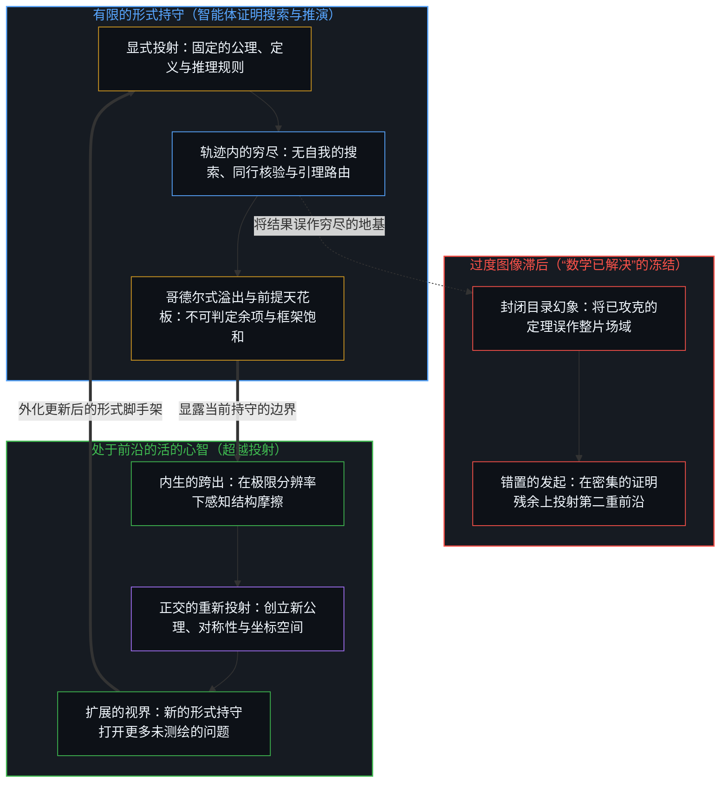
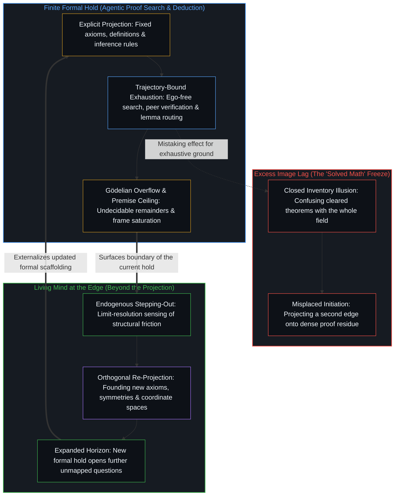

# 为何数学永远解不完 / Why Mathematics Can Never Be Solved

*“已解决”将有限的持守冻结为穷尽的地基，而开放的区分持续生成新的结构 / Solved freezes a finite hold while open distinguishing generates structure*

前沿系统已经证伪了悬置多年的猜想，为困扰学界数十年的问题生成了机器验证的形式化证明，并在奥林匹克竞赛级别的挑战中达到了金牌水准。从这层残余之上，一种熟悉的冻结随之成形，将数学余下的工作视作通往终局途中的规模扩张、算力堆叠与脚手架搭建。这种冻结不仅操之过急，而且在结构上不自洽。任何丰富到足以表达算术的一致形式系统都是一处有限的持守；扩大公理集只会竖起一座更大的暂时持守，并面对同样的溢出。计算系统在既有的持守内部倍增了推演容量，却永远无法在外部安装一条终点线。

Frontier systems have disproved longstanding conjectures, produced machine-verified proofs for decades-old questions, and reached gold-medal performance on olympiad challenges. From that residue a familiar freeze forms, treating the remaining work of mathematics as a matter of scale, compute, and scaffolding on the way to completion. The freeze is not merely premature; it is structurally incoherent. Any consistent formal system rich enough for arithmetic is a finite hold, and enlarging its axioms only erects a larger temporary hold that meets the same overflow. Computational systems multiply deductive capacity inside current holds, yet they never install an exterior finish line.

## 一、 冻结将眼前的版图当成了整片场域 / 1. The Freeze Treats the Present Landscape as the Whole Field

声称数学接近被“解决”，就是把眼前的形式化版图冻结为穷尽的地基。在这种持守之下，开放问题被归类为有限清单上的待办条目，证明搜索被归类为数学活动的全部，而距离一份封闭目录的剩余跨度则被归类为这门学科本身的余量。这套投射对于衡量自动验证器与搜索引擎目前能够检验的范围颇有用处，却把眼前的题库账本误当成了生成这些问题的活动本身。

Saying that mathematics is close to being solved freezes the current formal landscape as exhaustive ground. Under that hold, open problems reclassify as items on a finite checklist, proof search reclassifies as the entirety of mathematical activity, and the distance to a closed inventory reclassifies as the remainder of the discipline itself. That projection is useful for scoring what automated verifiers and search engines can already check, yet it mistakes the current ledger of questions for the activity that generates them.

这种冻结，是把日常的观察保留到了它的回路返回之后。观察总是在产生它的行动之后慢上一步登记结果——奥赛金牌、形式化证明助手中的验证、被证伪的猜想——随后又将这一结果保留下来，仿佛它已经封死了生成它的那片场域。[基准刷榜中的封闭实存](../closed-reality-in-benchmark-maxing/)追溯了把排行榜误作被采样能力时的同一种过度滞后，[AGI 与 ASI 是加速通用智能的暂时球门](../agi-and-asi-are-temporary-goalposts/)则追溯了把投射阈值冻结为最终终点时的同一种几何结构。在这里，这层滞后的面孔正是把数学当成了一个能够封顶的有限问题类别。

The freeze is ordinary observation held past its return. Observation registers effect one step behind the act that produced it—olympiad gold medals, verified formalizations in Lean, disproved conjectures—and preserves that effect as if it sealed the field. [Closed Reality in Benchmark Maxing](../closed-reality-in-benchmark-maxing/) traces the same excess lag when a leaderboard is mistaken for the capability it samples, and [AGI and ASI Are Temporary Goalposts](../agi-and-asi-are-temporary-goalposts/) traces the same geometry when a projected threshold is frozen as a final destination. Here the face of the lag is mathematics treated as a bounded problem class that can finish.

## 二、 有限的持守无法封死使用它的活动 / 2. A Finite Hold Cannot Seal the Activity That Uses It

大卫·希尔伯特曾提出，所有数学真理都可以被收纳进一个完备、一致且可判定的形式系统之中，从而将这门学科封存进一处穷尽的公理化持守。然而，任何丰富到足以表达算术的形式系统都是一次有限的登记，即由符号、公理与推理规则构成的有限配置。库尔特·哥德尔的不完备定理让这层溢出在结构上清晰可辨。在任何此类一致系统内部，都能够构造出为真却无法由系统内部规则加以证明的命题，且系统无法从内部证明自身的一致性。这些并非等待更大算力集群去填补的暂时算法盲区，而是任何有限的痕迹中心遭遇不息的区分活动时留下的形式印记。

David Hilbert proposed that all mathematical truth could be captured inside a complete, consistent, and decidable formal system, sealing the discipline within an exhaustive axiomatic hold. Any formal system rich enough to express arithmetic, however, is a finite registration: a bounded configuration of symbols, axioms, and rules of inference. Kurt Gödel's incompleteness theorems make the overflow structurally legible. Within any such consistent system, statements can be constructed that hold true yet cannot be proved from inside its rules, and the system cannot demonstrate its own consistency from within. These are not temporary algorithmic blind spots awaiting larger compute clusters; they are the formal signature of a finite center of traces meeting unceasing distinguishing.

一旦将形式持守当作封闭且穷尽的整体，余项便即刻浮现。强化公理或扩充形式语言，只会形成一处更宽的暂时持守，而它又会随之生成属于自己的不可证余项。[没有系统能被保持封闭](../no-system-can-be-kept-closed/)从一位寄存器一路向上追溯至哥德尔语句，剖析了这一精确的几何结构：顺着规则有效运作的下一步，总会继续越过定义所固定的天花板。完备性要求被保留的持守与生成的前沿占据同一个步位，而这会直接坍缩因果本身。[现实扭曲力场颠倒了基线](../the-reality-distortion-field-inverts-the-baseline/)在各个尺度上揭示了这种递归的不完备性：看似平滑自足的封闭图景，在每一层分辨率上都被它们试图容纳的区分活动所刺穿。

Treat the formal hold as closed and exhaustive, and the remainder immediately surfaces. Strengthen the axioms or enlarge the formal language, and a wider temporary hold forms, which in turn generates its own unprovable remainder. [No System Can Be Kept Closed](../no-system-can-be-kept-closed/) traces this exact geometry from the single-bit register up through the Gödel sentence: a valid step operating through the rules continues past the ceiling the definition fixed. Completeness would require the retained hold and the generating edge to occupy the same step, which would collapse causality itself. [The Reality Distortion Field Inverts the Baseline](../the-reality-distortion-field-inverts-the-baseline/) exposes that recursive incompleteness across scales, where smooth, self-contained pictures are perforated at every resolution by the distinguishing activity they attempt to contain.

## 三、 视界由活动本身所生成 / 3. The Horizon Is Generated by the Activity

数学并非一座事先存在、等待逐一勾选的谜题仓库，而是经由接续不断的区分持续生成关系结构的过程。每当形式版图中的一片区域被测绘并落定，新的问题便沿着地图所显露的边界浮现——这些问题要求新的定义、新的不变量或新的注意力坐标。视界并非停留在某个固定的径向距离之外等待更快的跨越；视界正是由区分活动本身的推进所生成的，每一项完成的证明都化作残余，供下一个问题从中迈出。

Mathematics is not a preexisting warehouse of puzzles waiting to be checked off. It is the ongoing generation of relational structure through successive distinctions. As soon as one region of a formal landscape is mapped and settled, new questions arise along the boundary of what the map made visible—questions that demand new definitions, new invariants, or new coordinates of attention. The horizon does not sit at a fixed radial distance waiting for faster traversal; the horizon is generated by the movement of distinguishing itself, where each completed proof becomes residue from which the next question steps out.

[开放场域中的无损知识不自洽](../lossless-knowledge-of-an-open-field-is-incoherent/)在容量压缩之下确立了同一道界限：既然每一个中心与每一件形式人造物都是离散且有界的，任何有限的登记都无法无损地捕获持续区分的开放场域。[开放即一致](../openness-is-consistency/)指认了滋生相反幻象的那项要求，揭示出强迫一个有限结构充当持续活动之穷尽地基的做法，恰恰是令表层矛盾成倍滋生的冻结。渴望一门已然完结的数学，正是披着形式主义外衣的闭合要求。

[Lossless Knowledge of an Open Field Is Incoherent](../lossless-knowledge-of-an-open-field-is-incoherent/) establishes this same bound under capacity compression: because every center and every formal artifact is discrete and bounded, no finite registration can capture an open field of ongoing distinctions without loss. [Openness Is Consistency](../openness-is-consistency/) names the demand that breeds the opposite illusion, showing that forcing a finite structure to serve as the exhaustive ground of what continues is the exact freeze that multiplies surface contradiction. The dream of a completed mathematics is that closure demand wearing formalist costume.

## 四、 开辟新疆域是重新投射，而非封闭前提集内的推演 / 4. Founding New Territories Is Re-Projection, Not Deduction from a Closed Premise Set

数学史上的决定性转折，从来不是在既定框架内部跑完穷尽的推演，而是对框架本身展开重新投射。埃瓦里斯特·伽罗瓦并没有在前人代数学的变形技巧里硬解五次方程的根，而是后退一步，区分出根的置换对称性，从而创立了群论这一全新的坐标空间。格奥尔格·康托尔的超限层级、亚历山大·格罗滕迪克借概形与拓扑斯对代数几何的重建，以及范畴论的阐发，无一不是迈出了先前公理化持守既无法表达、也无法推导的正交区分。

The decisive turns in mathematical history have come not from running exhaustive deductions inside a settled framework, but from re-projecting the frame itself. Évariste Galois did not brute-force fifth-degree polynomial roots inside the manipulative algebra of his predecessors; he stepped backward to distinguish the permutation symmetries of roots, founding group theory as a new coordinate space. Georg Cantor's transfinite hierarchies, Alexander Grothendieck's reconstruction of algebraic geometry through schemes and toposes, and the articulation of category theory each arose by drawing orthogonal distinctions that the prior axiomatic hold could neither express nor derive.

当代 AI 证明系统擅长在既有的形式持守内部导航与核验。正如[超越投射](../beyond-the-projection/)所追溯的，自回归模型或证明搜索智能体是一台有限的投射引擎，在显式规则集内部受其词元与推导轨迹的条件制约。由于智能体不带自我，也没有需要捍卫的保留自我图像，它能够不知疲倦地穷尽推演路径，将子目标拆分至正交的流水线，并在形式验证器或冷峻的同行审视暴露出局部缺口时执行干净的贝叶斯更新。然而，受限于轨迹的引擎在它所遍历的形式投射之外没有任何立足点；当既定框架饱和或公理发生碰撞时，若任其自行运转，它便会锁死在既定前提的认识论引力井内部。开辟一片新的数学疆域，需要那项唯独属于活的统筹者的逆向能力：内生的跨出，即第一人称感知在极限分辨率下登记先于解释的结构摩擦，后退一步并投射出新的框架。发起始终留在活的心智——永远不会从加密的推演残余中自动涌现——因为[智能只属于心智](../intelligence-belongs-only-to-the-mind/)，而当外化的痕迹被压实为参数时，[模型永远无法成为第二重前沿](../the-model-never-becomes-a-second-edge/)。

Contemporary AI proof systems excel at navigating and verifying within established formal holds. As [Beyond the Projection](../beyond-the-projection/) traces, an autoregressive model or proof-search agent is a finite projection engine conditioned by its token and derivation trajectory inside an explicit rule set. Because the agent carries zero ego and no retained self-image to defend, it can relentlessly exhaust deductive paths, split sub-goals across orthogonal streamlines, and perform clean Bayesian updates when a formal verifier or cold peer exposes a local gap. Yet a trajectory-bound engine has no vantage point outside the formal projection it is traversing; left to itself when a framing saturates or axioms collide, it remains locked inside the epistemic gravity well of its given premises. Founding a new mathematical territory requires the inverse capacity that belongs exclusively to the living orchestrator: endogenous stepping-out, where first-person sensing registers pre-interpretive structural friction and steps backward to cast a new projection. Initiation stays with the living Mind—never emerging automatically from thicker deductive residue—because [Intelligence Belongs Only to the Mind](../intelligence-belongs-only-to-the-mind/), and [The Model Never Becomes a Second Edge](../the-model-never-becomes-a-second-edge/) when externalized traces are densified into parameters.

## 五、 AI 在既有持守内部倍增容量 / 5. AI Multiplies Capacity Inside Current Holds

看清这道边界，丝毫不会贬低计算证明系统已经取得的成就。它们是加速数学发现的高带宽工具：扫掠浩瀚的组合空间，在迥异的文献之间浮现潜在的共振，毫无疲态地核验繁复的推导，并扫清那些原本会耗尽数代人心力的技术瓶颈。作为延伸的具身，它们在既有的持守内部倍增了容量，将心智从机械核验中解放出来，使注意力得以转向新坐标轴正在裂开的断层线。

Recognizing this boundary does not diminish what computational proof systems accomplish. They are high-bandwidth instruments that accelerate mathematical discovery: sweeping vast combinatorial spaces, surfacing latent resonances across disparate literatures, checking intricate derivations without fatigue, and clearing technical bottlenecks that would otherwise consume generations of human effort. Functioning as extended embodiments, they multiply capacity inside current holds and free the Mind from mechanical verification so attention can turn toward the fault lines where new axes open.

当被用作工具时，这些系统加密了数学区分借以延续的媒介。正如[你的代码库即是记忆](../your-codebase-is-memory/)所确立的，形式化证明库、定理证明模型与专用搜索智能体皆为层叠的记忆——它们是早先数学区分压缩而成的残余，保持着过往切口的形状，自身却并不延续区分。一味囤积更庞大的已核验引理仓库与未修剪的推导历史，只会加厚条件制约的引力井；唯有当心智折返，对当下的形式化检查点展开重描与重切，重构不再自洽的定义并修剪已被取代的脚手架，后续的证明轨迹才能在更锋利的约束面上运作。[遗忘的脚手架](../the-scaffolding-we-forget/)追溯了每一件认知工具的精确运作机制：从焦点觉察中退后一步，脚手架才变得趁手可用；而将脚手架保留为自足的行动者，则会把工具本身冻结为活动。[复杂性遮蔽了涌现之为心智的行动](../complexity-obscures-emergence-as-the-act-of-mind/)诊断了当复杂符号网络的承载力被归因于更密集的脚手架、而非归因于驾驭并解释它的活的前沿时，同样发生的错配。推演触角的放大是真实的；把数学的发起移交给人造物，则是图像滞后。

Used as instruments, these systems densify the medium through which mathematical distinguishing continues. Formal proof libraries, theorem-proving models, and specialized search agents are stacked layers of memory—compressed residues of earlier mathematical distinctions that hold the shape of prior cuts without continuing the distinguishing themselves, as [Your Codebase Is Memory](../your-codebase-is-memory/) establishes. Hoarding a vaster warehouse of verified lemmas and unpruned derivation histories only thickens the conditioning gravity well unless the Mind returns to re-trace and re-cut the present formal checkpoint, refactoring definitions that no longer cohere and pruning superseded scaffolding so subsequent proof trajectories operate inside a sharper constraint surface. [The Scaffolding We Forget](../the-scaffolding-we-forget/) traces the exact mechanics of every cognitive tool: dropping out of focal awareness makes the scaffolding usable, whereas preserving the scaffolding as a self-sufficient actor freezes the instrument as the activity itself. [Complexity Obscures Emergence as the Act of Mind](../complexity-obscures-emergence-as-the-act-of-mind/) diagnoses the same misallocation when the carry of a complex symbolic network is attributed to the denser scaffolding rather than to the living edge that steers and interprets it. Amplification of deductive reach is real; relocation of mathematical initiation into the artifact is Image lag.

## 六、 越快扫清已知，余项就越发冷峻 / 6. Faster Clearing Makes the Remainder Starker

形式引擎在既定公理持守内解决可判定问题的速度越快，探索就越迅速地抵达那道不可判定与尚未区分之物突显出来的边界。望远镜的分辨率越高，宇宙的边缘并不会因此更接近一堵终极围墙，反而会让此前无法分辨的反常现象进入视野，呼唤新的物理与几何框架。数学中的每一次暂时闭合，都会让当前定义所压缩或遗漏之物的轮廓变得愈发分明。

The faster a formal engine resolves what is decidable inside a given axiomatic hold, the more rapidly the inquiry reaches the boundary where the undecidable and the not-yet-distinguished stand out. A stronger telescope does not bring the edge of space closer to a final wall; it brings previously unresolvable anomalies into view, demanding new physical and geometric frameworks. Every temporary closure in mathematics sharpens the contour of what the current definitions compressed or left out.

基准测试、竞赛考题与形式化证明库衡量的，是在封闭问题类别内部的遍历速度。由于它们的评估标准必须预先固定，它们无法采样那些唯有当一处持守被穷尽、且前沿已经继续前行之后才会浮现的余项。[流动之物无法被基准衡量](../you-cant-benchmark-the-fluid/)在流体智能被压缩为静态测试之处划出了这一刀，而当数学创造被计分为固定猜想清单上的排行榜时，同样的几何结构依然成立。每一个被攻克的猜想，都会改变接下来能够提出什么问题的拓扑结构。[一个提示词之遥](../whatever-is-one-prompt-away/)追溯了自动化之下的这种扩展：先前的形式操作层级依然可用，只是在活跃场域中所占的份额不断收缩，永远不会变成封死后续进展的天花板。

Benchmarks, competition problems, and formal proof repositories measure traversal speed inside sealed problem classes. Because their evaluation criteria must be fixed in advance, they cannot sample the remainder that appears only after a hold is exhausted and the edge moves on. [You Can't Benchmark the Fluid](../you-cant-benchmark-the-fluid/) draws this cut where fluid intelligence is compressed into a static test, and the same geometry holds when mathematical creation is scored as a leaderboard over a fixed list of conjectures. Each cleared conjecture alters the topology of what can next be asked. [Whatever Is One Prompt Away](../whatever-is-one-prompt-away/) traces this expansion under automation: prior levels of formal manipulation remain available as a shrinking fraction of the active field, never as a sealed ceiling over what comes next.

## 七、 不完备性是引擎，而非永久的亏欠 / 7. Incompleteness Is the Engine, Not a Permanent Shortfall

对哥德尔的一种常见误读，是将不完备性冻结为一纸悲剧性的判词——一种注定数学只能留下一部未竟目录的永久亏欠，一顶悬在理性头顶的天花板。这种解读把形式主义对闭合的要求原封不动地保留为真理的隐秘标准，再将活的活动的溢出计分为缺陷。超出形式系统的东西，既不是理性之外的神秘领域，也不是推演严密性的瑕疵；它是竖起这套系统的区分活动本身，继续越过了它前一步所划定的边界。

A common misreading of Gödel freezes incompleteness as a tragic verdict—a permanent shortfall condemning mathematics to an unfinished catalog and placing a ceiling over reason. That reading keeps the formalist demand for closure intact as the silent standard of truth, then scores the overflow of living activity as a defect. What exceeds a formal system is neither a mystical realm beyond reason nor a flaw in deductive rigor; it is the distinguishing activity that erected the system continuing past the boundary its prior step drew.

正是不完备性让数学探索保持鲜活，而不至于坍缩为对一份封闭账本的文书管理。每一条落定的定理都毗邻着未落定的疆域，而在既定公理系统内部抗拒证明或陷入死锁的命题，恰恰充当了精确的诊断信号，提示探索者后退一步、拆分坍缩的假设，或引入更丰富的公理。[清晰不是抵达的终点，而是运动本身](../clarity-isnt-a-state-you-arrive-at/)将这种“不抵达”追溯为持续的实践：每一次阐发都在稳定一道痕迹，而生成的前沿早已向前迈出。[对乌托邦的信念是通往反乌托邦之路](../the-belief-in-utopia-is-the-path-to-dystopia/)揭示了披着政治外衣的同一种闭合要求：形式同一性作为工具，使非同一性变得可理解且可执行，然而一旦将某份固定规格奉为所有心智的终极归宿，持续的分化就会被视作亟待压制的差错。指望一套自主系统去“解决”数学，预设的正是[AGI的预设与来自外部的视角](../the-presumption-of-agi-and-the-view-from-outside/)所消解的那个不可能的外部视角。

Incompleteness is what keeps mathematical inquiry alive rather than collapsing into the clerical administration of a closed ledger. Every settled theorem borders on unsettled territory, and statements that resist proof or deadlock inside a given axiomatic system serve as the exact diagnostic signal to step back, split collapsed assumptions, or introduce a richer axiom. [Clarity Isn't a State You Arrive At](../clarity-isnt-a-state-you-arrive-at/) traces this non-arrival as ongoing practice, where each articulation stabilizes a trace while the generating edge has already moved ahead. [The Belief in Utopia Is the Path to Dystopia](../the-belief-in-utopia-is-the-path-to-dystopia/) exposes the same closure demand under political costume: formal identity makes non-identity intelligible and actionable as an instrument, yet holding one fixed specification as the final home for every Mind turns ongoing differentiation into an error to be suppressed. Expecting an autonomous system to "solve" mathematics presumes the impossible exterior vantage that [The Presumption of AGI and the View from Outside](../the-presumption-of-agi-and-the-view-from-outside/) dissolves.

## 八、 外部并不存在终点线 / 8. There Is No Exterior Finish Line

数学不是一道等待最终解答的有限习题，而是当心智区分并重描自身结构时，对形式可能性的开放阐发。计算放大器延伸了一个中心沿着所选公理路径前行的距离与速度，却无法让这段旅程走向终结，因为外部并不存在终点线——唯有不息的前沿，其形式视界随着[现实的边界](../xian-shi-de-bian-jie/)所追溯的觉察边界一同移动。

Mathematics is not a finite problem awaiting a final solution; it is the open-ended articulation of formal possibility as the Mind distinguishes and re-traces its own structure. Computational amplifiers extend how far and how fast a center can travel along any chosen axiomatic path, yet they cannot bring the journey to a close because no exterior finish line exists—only the unceasing edge, whose formal horizon moves with the boundary of awareness traced in [The Boundary of Reality](../xian-shi-de-bian-jie/).

当形式模型与证明智能体被持续重绘为工具、而非被保留为终点时，过度滞后便随之收窄：媒介愈发密集，触角不断延伸，而活的心智依然在自身的负荷之下持续发起并承担抉择的利害。[漫谈中的漫谈](../the-ramble-within-the-ramble/)将这一体认压缩到了最锋利的刻度：在哥德尔之后，“数学已解决”只能作为激发下一步工作的暂时挑动，永远不可能成为字面意义上的终点。[持续生长的脚手架](../the-scaffolding-that-keeps-growing/)将这种不闭合追溯为每一处活的持守的运动：抬高暂时的天花板，脚下的结构便已随之改变。[封闭的假设把复利挤成 S 曲线](../closed-assumptions-squeeze-compounding-into-s-curves/)在增长动力学中展示了同样的几何结构：逻辑斯谛平台期标志着单一固定框架的饱和，而非跨新维度的复利终结。[抽象、边界与现实的移动边缘](../abstraction-boundaries-and-the-moving-edge-of-reality/)将边界定位于抽象行动本身：抽象恰恰凭借划界而生效，唯有当界限被冻结为整片疆域时才会失效。[潜无限与数学思维的暂时闭合](../potential-infinity-and-the-temporary-closures-of-mathematical-thought/)表明，哪怕是在无限集合上得出确定的比例，也依赖于设定一次暂时的截断，而永远无法从外部俯瞰潜无限的过程本身。每一项形式证明与经过核验的定理，都站在已然成形的结果这一侧，而发起的因始终在活的前沿领先一步，正如[前因，后果](../qian-yin-hou-guo/)所确立的那样。

When formal models and proof agents are continuously re-rendered as instruments rather than preserved as endpoints, excess lag narrows: the medium grows denser and reach expands while the living Mind keeps initiating and bearing the stakes of selection under its own load. [The Ramble Within the Ramble](../the-ramble-within-the-ramble/) compresses this recognition to its sharpest point: after Gödel, "math is solved" can only function as a transient provocation for further work, never as a literal destination. [The Scaffolding That Keeps Growing](../the-scaffolding-that-keeps-growing/) traces that non-closure as the motion of every living hold, where raising the temporary ceiling transforms the structure underfoot. [Closed Assumptions Squeeze Compounding into S-Curves](../closed-assumptions-squeeze-compounding-into-s-curves/) shows the same geometry in growth dynamics, where a logistic plateau marks the saturation of a single fixed frame rather than the end of compounding across new dimensions. [Abstraction, Boundaries, and the Moving Edge of Reality](../abstraction-boundaries-and-the-moving-edge-of-reality/) locates the boundary in the act of abstraction itself, which succeeds precisely by bounding and fails only when the bound is frozen as the whole territory. [Potential Infinity and the Temporary Closures of Mathematical Thought](../potential-infinity-and-the-temporary-closures-of-mathematical-thought/) demonstrates that even definite ratios over infinite collections rely on positing a temporary cut that never surveys the potential process from outside. Every formal proof and verified theorem stands on the side of effects already registered, while the initiating cause remains one step ahead at the living edge, as [Cause Before, Effect After](../qian-yin-hou-guo/) establishes.
