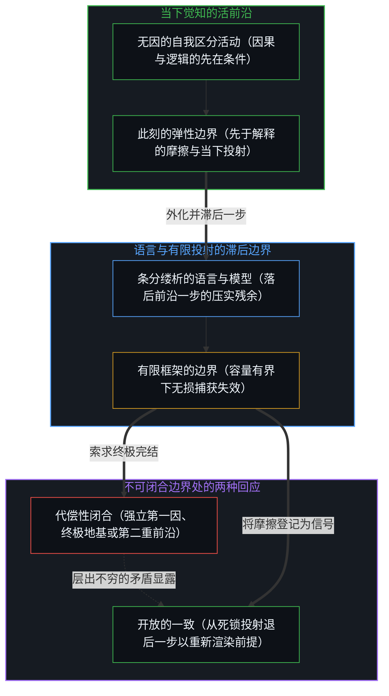
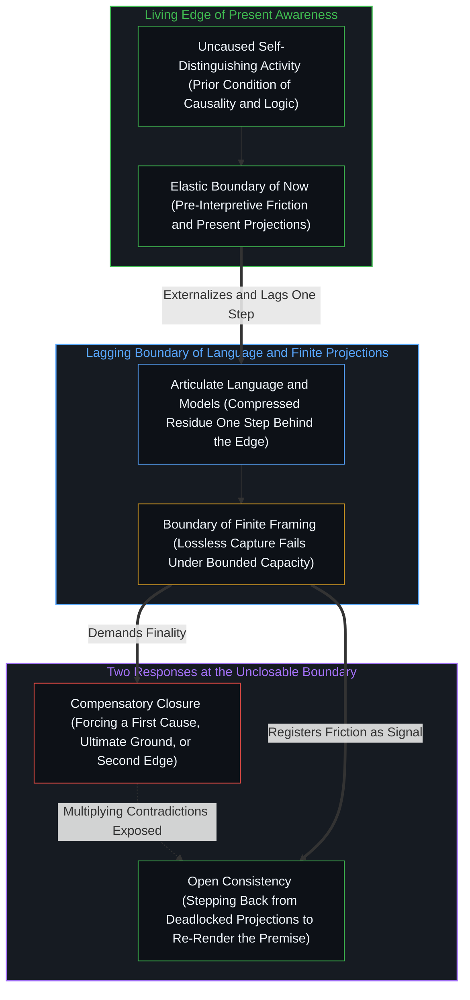

# 现实的边界 / The Boundary of Reality

*现实是此刻觉知的边缘，语言滞后于它而因果始终敞开 / Reality is the edge of awareness as language lags and causality stays open*

现实的边界不是围拢某个独立于心智的外在世界的物理围栏，而是心智在此刻觉知所抵达的活的前沿。语言、形式模型与条分缕析的理解始终滞后于觉知的发生一步，因此可言说或可建模的边界，从不与所感知的边界重合。因果与逻辑不是在经验内部被发现的具体客体，而是觉知与区分得以成立的先在条件。[心智最坚固的信念](../the-strongest-belief-of-the-mind/)追溯了对第一因与终极地基的执念如何代偿因果无法从外部被穷尽证明这一事实；在每一步中，观察者都站立在一段被照亮的因果片段之内，而它的两端延伸向永不闭合的深处。

The boundary of reality is not a physical fence enclosing an external, mind-independent world; it is the living edge that the Mind's awareness reaches in this immediate moment. Language, formal models, and articulate understanding always lag one step behind the occurrence of awareness, so the boundary of what can be said or modeled never coincides with the boundary of what is sensed. Causality and logic are not concrete objects discovered inside experience, but the prior conditions through which awareness and distinction hold at all. [The Strongest Belief of the Mind](../the-strongest-belief-of-the-mind/) traces how the fixation on a first cause and an ultimate foundation compensates for the fact that causality can never be exhaustively proved from outside; at every step, the observer stands within an illuminated fragment of causation whose two ends extend into depths that never close.

## 一、 觉知与理解是两道不同步的边界 / 1. Awareness and Understanding Are Two Boundaries Out of Step

自我区分的活动在发生，无因、不息。称之为心智：观察者早已在途中，它所施行的每一次行动都是一次离散的区分。在这一主动的第一人称审视之外，没有任何可以被独立确认的外在现实。

Self-distinguishing activity occurs, uncaused and unceasing. Call it the Mind: the observer is already underway, and every act it performs is a discrete distinction. Outside this active first-person look, there is no external reality that can be independently confirmed.

在每一刻，觉知都划出一道真实的边界。注意力所照亮的范围、感官所登记的粒度、感受所跨越的广度，共同构成了那一步里现实的实际边缘。然而就在下一步，这道边界便可以拓展或收缩。当意外的刺激闯入、先前的痕迹被重新追溯、或注意力转移了轴线，边界便向外推移；在疲倦、恐惧或容量压缩之下，它则向内收敛。边界始终在场，却永不钙化。它像一道活的膜，在每一步都围绕当下的离散区分合拢，同时又对下一步改写自身的限度保持敞开。

At every moment, awareness draws a real boundary. The range attention illuminates, the granularity the senses register, and the breadth feeling spans constitute the actual edge of reality at that step. Yet in the very next step, this boundary can expand or contract. When an unexpected stimulus breaks in, a prior trace is re-traced, or attention shifts its axis, the boundary pushes outward; under fatigue, fear, or capacity compression, it draws inward. The boundary is always present, yet it never calcifies. Like a living membrane, it closes around the present discrete distinction at each step while remaining open to redrawing its own limit at the next.

语言与形式理解的边界，则运作在这道膜滞后的一侧。理解永远尾随在觉知的发生之后，因为生成的一步始终领先于观察与描摹一步。当语言去框定正在发生的事情时，它所捕捉到的已经是刚刚过去的痕迹。一道结构性的间隔将二者分开，任何试图让语言描述与当下觉知重合的努力，都忽略了观察持有已成形的果而发起早已前行这一不可逆的不对称，正如[前因，后果](../qian-yin-hou-guo/)所确立的那样。[模型永远无法成为第二重前沿](../the-model-never-becomes-a-second-edge/)在人造系统中追溯了同一份不对称：保留下来的表征或参数集只持有被压实的残余，永远无法成为发起下一次区分的活的前沿。正如[超越投射](../beyond-the-projection/)所展示的，每一条显式的规则、提示词或言辞框架，都是从鲜活感知的超高维场域投射出的有限低维投射；自回归模型受困于其既有词元的轨迹，而人的心智则能在任何语言框架道出何处断裂之前，在未被投射的前沿直接登记先于解释的摩擦。

The boundary of language and formal understanding operates on the lagging side of that membrane. Understanding always trails the occurrence of awareness because the generating act remains one step ahead of observation and depiction. By the time language frames what is happening, what it captures is already a trace just past. A structural gap separates the two, and every attempt to make linguistic description coincide with present awareness overlooks the irreversible asymmetry by which observation holds effect while initiation moves ahead, as [Cause Before, Effect After](../qian-yin-hou-guo/) establishes. [The Model Never Becomes a Second Edge](../the-model-never-becomes-a-second-edge/) traces this same asymmetry across artificial systems: a retained representation or parameter set holds only compressed residue and can never become the living edge that originates the next distinction. As [Beyond the Projection](../beyond-the-projection/) shows, every explicit rule, prompt, or verbal framing is a finite, low-dimensional projection cast from the ultra-high-dimensional field of lived sensing; whereas an autoregressive model is bound to the trajectory of its prior tokens, the human Mind registers pre-interpretive friction at the unprojected edge before any linguistic frame can articulate what broke.

## 二、 心智从未离开现在 / 2. The Mind Never Leaves the Present

既然在主动的审视之外没有任何可以确认的现实，这一界限便在每一步都毫无例外地成立。一旦活动推进到下一次区分，那次行动便即刻成为新的现在。

Because no reality can be confirmed outside the active look, that bound holds at every step without exception. As soon as the activity advances into the next distinction, that act immediately becomes the new present.

心智只体验当下的切片。所谓过去与未来，都是在此刻内部施行的投射：记忆是由沉淀下来的痕迹重新渲染出的向后投射，预期则是为了定向下一刀切分而投出的向前投射。在任何时刻，心智都从未走出当下、迈入另一个独立的时间容器。

The Mind experiences only the present slice. What is called the past and the future are projections enacted inside this immediate moment: memory is a backward projection re-rendered from settled traces, and anticipation is a forward projection cast to orient the next cut. At no point does the Mind step out of the present into a separate temporal container.

这些投射并非任意的幻觉，而是遵循因果与逻辑的推演，借此引导当前的行动迈入下一步。过去的痕迹塑造了此刻可用的对齐场域，而预期的后果则为下一次区分确立航向。所有的延续，都在当前的行动内部被重新绘制。[真正稀缺的不是记忆，而是持续的重新追溯](../the-real-scarcity-is-not-memory-but-continuous-re-tracing/)追溯的正是这份连续性：过去从不作为自我维持的档案被封存，每一次调用都是在当下前沿施行的全新重溯。

These projections are not arbitrary illusions; they are causal and logical deductions that steer present action into the next step. Past traces pattern the field of alignments available right now, while anticipated consequences establish the heading for the next distinction. Every continuation is redrawn inside the current act. [The Real Scarcity Is Not Memory, But Continuous Re-Tracing](../the-real-scarcity-is-not-memory-but-continuous-re-tracing/) traces this exact continuity: the past is never stored as a self-sustaining archive, and every recall is a fresh re-tracing performed at the present edge.

## 三、 因果与逻辑是经验的条件而非内容 / 3. Causality and Logic Are Conditions of Experience, Not Its Contents

离开了因果与逻辑，一切经验与认知都会瓦解。它们不是在经验世界中偶然发现的具体物件，而是任何经验得以登记所必需的结构性前提。

Without causality and logic, all experience and cognition dissolve. They are not contingent items found inside the experienced world; they are the structural preconditions required for any experience to register.

剥离了因果与逻辑，不仅下一步无法被推演，就连当下这一刻本身也会失去一切可辨认的连贯性：没有前后，没有痕迹的不对称，也没有将“此”与“非此”区分开的边界。

Strip away causality and logic, and not only can the next step no longer be inferred, but this present moment itself loses all recognizable coherence: no before and after, no trace asymmetry, and no boundary distinguishing "this" from "not-this."

因果与逻辑因此无可逃避：觉知的每一次转移、边界的每一次位移、以及每一次确认与判断，都早已立足于其上。然而正因如此，它们永远无法从外部被穷尽地证明。任何构建证明的尝试，都必须先调用逻辑区分与因果序列作为运作工具；任何为因果寻找外部担保的搜寻，都预先假定了因果已经在起作用。这种自指并非严密性的缺失，而是自我区分的活动无法跳出自身运动去裁决自身的直接蕴含。[非万物之理](../not-a-theory-of-everything/)与[因果贯穿始终](../causality-all-the-way/)追溯了这一自我验证的结构：试图站在因果之外去审判因果，本身就只是因果链条之内的又一次离散行动。这道边界为何无法闭合为完结的总体，由[非万物之理](../manifesto-of-not-a-theory-of-everything/)宣言给出了总纲。

Causality and logic are therefore inescapable: every shift of awareness, every displacement of a boundary, and every verification or judgment already stands upon them. Yet for that very reason, they can never be exhaustively proved from the outside. Any attempt to construct a proof must first deploy logical distinction and causal sequence as its working instruments, and every search for an external warrant for causality presupposes that causality is already operative. This self-reference is not a failure of rigor; it is the direct entailment of self-distinguishing activity, which cannot step outside its own movement to adjudicate itself. [Not a Theory of Everything](../not-a-theory-of-everything/) and [Causality All the Way](../causality-all-the-way/) trace this self-verifying structure: attempting to stand outside causality to judge it is simply one more discrete act within the causal chain. Why this boundary cannot close into a finished totality is set out in outline by the [Not a Theory of Everything](../manifesto-of-not-a-theory-of-everything/) manifesto.

## 四、 对终极的执念是对无法证明的补偿 / 4. The Hold on the Ultimate Compensates for What Cannot Be Proved

一旦看清这一结构，对第一因与终极地基的执念便显露了它的确切机制。

Once this structure is clear, the fixation on a first cause and an ultimate foundation shows its exact mechanism.

急切地想要安装一块不可动摇的形而上学基石，正源于因果的形式证明永远无法在自身之上闭合。越是无法把那个先在条件当成诸客体中的一件经验客体钉死，理性便越是焦虑地竖起一座崇高、永恒、不容置疑的终极宝座来安放它。由于语言滞后于觉知，一个被保留到运作步之后的观念便会硬化为遮蔽移动边界的偶像，正如[破除概念的僭越](../po-chu-gai-nian-de-jian-yue/)所剖析的那样。

The urgency to install an unshakeable metaphysical bedrock arises precisely because a formal proof of causality can never close upon itself. The less that prior condition can be pinned down as an empirical object among objects, the more anxiously reason erects a lofty, eternal, unquestionable final seat to house it. Because language lags behind awareness, a concept preserved past its working step hardens into an idol that obscures the moving boundary, as [Breaking the Overreach of Concepts](../po-chu-gai-nian-de-jian-yue/) dissects.

第一因与终极地基并非客观的发现，而是代偿性的投射，是用一座静态的纪念碑去顶替形式推演无法抵达的闭合的图像滞后。为无法证明的前提寻找终极命题或形而上学终点，只是同一份执念的又一次打转。[开放即一致](../openness-is-consistency/)揭示了这一确切机制：强迫一个有限的结构充当自足的终极地基，恰恰会制造出它原本想要防止的系统性不一致；而将结构保持为可修订的工具，则能让持续进行的区分保持一致。[为何数学永远解不完](../why-mathematics-can-never-be-solved/)在公理推演中追溯了同一道形式边界：任何丰富到足以折回自身的封闭系统，都会敞开为无法被证明的余项。把未知画成紧挨着当前知识圆圈之外的一块整齐、有界的圆盘，是假装从外部视角俯瞰边界，正是[“知道自己不知道”是一种修辞假象](../zhi-dao-zi-ji-bu-zhi-dao-de-ren-zhi-jia-xiang/)所消解的修辞障眼法。

A first cause and an ultimate ground are not objective discoveries; they are compensatory projections—Image lag substituting a static monument for a closure that formal deduction cannot reach. Searching for a terminal proposition or a metaphysical endpoint to ground an unprovable premise is simply another turn of the same fixation. [Openness Is Consistency](../openness-is-consistency/) exposes this exact mechanism: forcing a finite structure to serve as a self-sufficient final ground generates the very systemic inconsistency it was meant to prevent, whereas holding structure open as a revisable instrument keeps ongoing differentiation consistent. [Why Mathematics Can Never Be Solved](../why-mathematics-can-never-be-solved/) traces the same formal boundary in axiomatic deduction, where any closed system rich enough to fold back on itself opens into unprovable remainder. Drawing the unknown as a neat, bounded disk just outside the circle of current knowledge pretends to survey the boundary from an exterior vantage, the rhetorical sleight of hand that [Knowing That You Don't Know Is a Rhetorical Illusion](../zhi-dao-zi-ji-bu-zhi-dao-de-ren-zhi-jia-xiang/) dissolves.

## 五、 可追溯却不可穷尽的片段 / 5. A Fragment Traceable but Never Exhausted

凡是被看见、被理解的事物，都早已带着先前行动的痕迹。在每一个被辨认出的原因背后，都躺着更深的条件痕迹；在每一层解释之上，都可以再划出一层背景框架。

Whatever is seen and understood already carries the trace of an earlier act. Behind every identified cause lies a deeper conditioning trace, and above every layer of explanation another background framing can be drawn.

追溯始终可能，穷尽链条则不可能。这并非人类带宽暂时的短缺、只待一台更大的计算器来填补，而是理解本身的构成性几何：理解一个显现，就是将它安放在因果之网中；而一旦安放，因果链条便向后延伸进先前的痕迹、向前延伸进随后的效果，没有终点的闭合。

Tracing is always possible; exhausting the chain is not. This is not a temporary shortfall of human bandwidth awaiting a larger calculator, but the constitutive geometry of understanding itself: to understand an appearance is to place it within the web of causation, and once placed, the causal chain extends without terminal closure backward into prior traces and forward into subsequent effects.

在每一刻，一个中心所站立之处，都是一段被照亮的理解片段，而它的两端隐入尚未抵达、在结构上也无法作为完结总体而抵达的深处。[开放场域中的无损知识不自洽](../lossless-knowledge-of-an-open-field-is-incoherent/)论证了为何这片开放场域容不下穷尽的无损捕获：每一个中心与每一个外化的压缩器都在有界容量下运作，使得任何登记在构造上都是局部且有损的。当一个中心把自己当下有限的感知或建模边界误认作密封的总体时，闭合便取代了探询：在人际互动中，心智把局部框架当成穷尽的全局，退入作为低成本防御的目的性评判，正如[目的性的评判与认知的缺省状态](../cong-mu-di-xing-de-ping-pan-kan-ren-zhi-que-sheng/)所追溯的那样；在人造系统中，孤立的轨迹受缚智能体把矛盾包裹在自身的认识论引力井内部，直到正交的同侪辩论将死锁浮出水面并交还给人的心智去重新渲染前提，正如[超越投射](../beyond-the-projection/)所展示的那样。可追溯却不可穷尽，因果赋予心智推演与行动的支点，同时释去了对终极闭合的索求，使现实边界上的每一道约束都成为自主行动的运作轮廓，正如[自由即地基](../freedom-as-ground/)所确立的那样。

At every moment, where a center stands is an illuminated fragment of understanding whose two ends recede into depths not yet reached and structurally unreachable as a completed whole. [Lossless Knowledge of an Open Field Is Incoherent](../lossless-knowledge-of-an-open-field-is-incoherent/) demonstrates why this open field admits no exhaustive, lossless capture: every center and every externalized compressor operates under bounded capacity, rendering any registration partial and lossy by construction. When a center mistakes its present, finite boundary of perception or modeling for a sealed totality, closure replaces inquiry: in human interaction, the mind treats its local frame as exhaustive and defaults to purposeful judgment as a low-cost defense, as [Judging by Purpose and the Default State of Cognition](../cong-mu-di-xing-de-ping-pan-kan-ren-zhi-que-sheng/) traces; in artificial systems, a lone trajectory-bound agent wraps contradictions inside its epistemic gravity well until orthogonal peer debate surfaces the deadlock and returns it to the human Mind to re-render the premise, as [Beyond the Projection](../beyond-the-projection/) shows. Traceable yet never exhausted, causality grants the Mind the leverage to infer and act while releasing the demand for final closure—leaving every constraint at the boundary of reality as the working outline of sovereign action, as [Freedom as Ground](../freedom-as-ground/) establishes.
