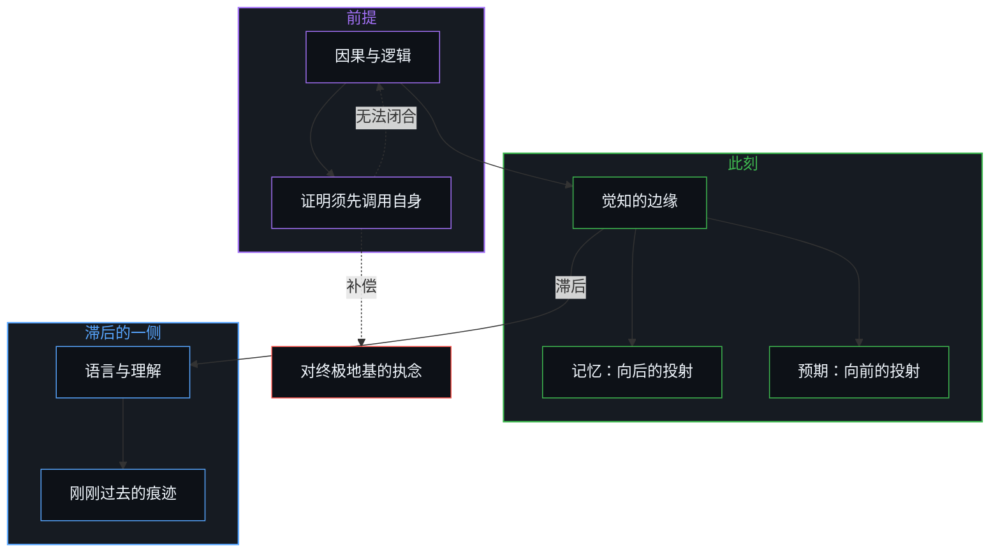
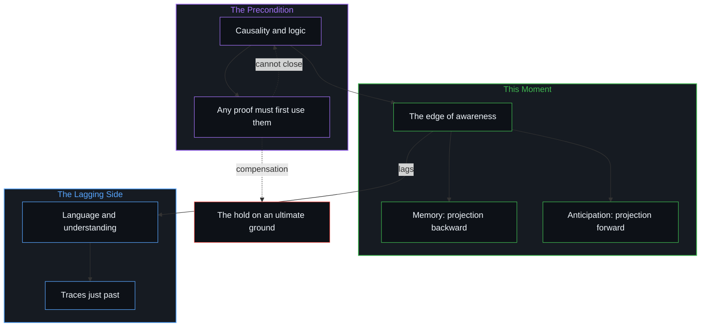

# 现实的边界 / The Boundary of Reality

*现实止于此刻觉知的边缘，语言滞后于它；因果可追溯，不可穷尽 / Reality ends at the edge of present awareness and language lags behind it; causality is traceable, never exhausted.*

现实的边界不是外在客观世界的物理围栏，而是心智在此刻觉知所抵达的边缘；语言与理解则始终滞后于觉知的发生，两者从来不是同一道边界。因果与逻辑不是经验中的某种具体客体，而是觉知与区分得以成立的前提条件。[对第一因与终极的执念](../the-strongest-belief-of-the-mind/)，是对因果无法被穷尽证明的补偿；任何一刻，所站之处都是一段被照亮的因果片段，向两端延伸出无法闭合的深处。

The boundary of reality is not a physical fence around an external, objective world; it is the edge that the Mind’s awareness reaches in this moment. Language and understanding always lag the occurrence of awareness, and the two are never the same boundary. Causality and logic are not some concrete object within experience; they are the preconditions for awareness and distinction to hold at all. [The hold on a first cause and an ultimate ground](../the-strongest-belief-of-the-mind/) compensates for the fact that causality can never be exhaustively proved; at any moment, where one stands is an illuminated fragment of causation, reaching at both ends into depths that never close.

## 一、 觉知与理解是两道不同步的边界 / 1. Awareness and Understanding Are Two Boundaries Out of Step

自我区分的活动在发生，无因、不息。称之为心智：观察者早已在途中，每一次行动皆是一次区分。心智之外，没有可以确认的现实。

Self-distinguishing activity occurs, uncaused and unceasing. Call it the Mind: the observer is already under way, and every act is a distinction. Outside the Mind, there is no reality that can be confirmed.

觉知在任何一刻都是有边界的。注意力所能照亮的范围、感觉所能抵达的细节、情绪所能浸润的广度，在那一刻构成实际的边缘。然而下一刻，这道边界可以拓展，也可以坍缩。新的刺激闯入、记忆被唤起、注意力重新分配，边界向外推移；疲倦、恐惧或过度专注，边界向内收敛。

Awareness has a boundary at every moment. The range attention can light, the detail the senses can reach and the breadth feeling can soak through make up the actual edge in that moment. Yet in the next moment this boundary can widen or collapse. A new stimulus breaks in, a memory is called up, attention is redistributed, and the boundary moves outward; fatigue, fear or overfocus, and it draws inward.

边界始终存在，却永不凝固。它像一道可伸缩的膜：每一刻都封闭于当下的离散区分，却每一刻都可能在下一步改写自己的限度。

The boundary is always there, yet it never sets. It is like a stretchable membrane: closed at each moment within the present discrete distinction, and at each moment able to rewrite its own limit at the next step.

语言与理解的边界则不同。理解永远滞后于觉知的发生，生成的一步永远领先于观察与描摹。用语言去框定觉知时，捕捉到的已经是刚刚过去的痕迹。两者在结构上有一道无法消除的间隔，任何想让语言与当下觉知重合的努力，都略过了观察必然滞后于生成这一不对称。[模型永远无法成为第二重前沿](../the-model-never-becomes-a-second-edge/)是同一不对称在模型上的一面：保留下来的表征永远无法成为正在前行的那一道边沿。[前因，后果](../qian-yin-hou-guo/)也指出：观察抓住的永远是已经成形的果，因总领先一步。

The boundary of language and understanding is different. Understanding always lags the occurrence of awareness; the generating step is always ahead of observation and depiction. When language is used to frame awareness, what it catches is already a trace just past. The two carry a structural gap that cannot be removed, and any effort to make language coincide with present awareness passes over the asymmetry that observation necessarily lags generation. [The Model Never Becomes a Second Edge](../the-model-never-becomes-a-second-edge/) is the same asymmetry on the side of models: a retained representation can never become the edge that is moving ahead. [Cause Before, Effect After](../qian-yin-hou-guo/) points the same way: observation always grasps an effect already formed, and the cause is always a step ahead.

## 二、 心智从未离开现在 / 2. The Mind Never Leaves the Present

“心智之外没有可以确认的现实”因此在任何一刻都成立。时间一进入下一刻，它就立刻成为新的此刻。

“Outside the Mind there is no reality that can be confirmed” therefore holds at every moment. As soon as time enters the next moment, that moment at once becomes the new now.

心智只能体验现在。所谓过去与未来，始终只是此刻内部的投射：记忆是朝向过去的向后投射，预期是朝向未来的向前投射。心智从未真正离开过现在。

The Mind can only experience the present. What is called past and future is always a projection inside this moment: memory is a projection backward toward the past, anticipation a projection forward toward the future. The Mind has never actually left the present.

这些投射不是漫无边际的幻觉，而是遵循因果与逻辑的演绎，从而引导当前的行动迈入下一刻。过去作为沉淀下来的痕迹，塑造了此刻可用的场域；未来作为预期的方向，指引着下一步的区分。所有的延续，都在当前的一念中被重新绘制。[真正稀缺的不是记忆，而是持续的重新追溯](../the-real-scarcity-is-not-memory-but-continuous-re-tracing/)追溯的是同一份连续性：过去不被单独存储，每一次调用都是当下的重新描摹。

These projections are not boundless illusions; they are deductions that follow causality and logic and so guide the present act into the next moment. The past, as settled trace, shapes the field available now; the future, as anticipated direction, points the next distinction. Every continuation is redrawn within the present thought. [The Real Scarcity Is Not Memory, But Continuous Re-Tracing](../the-real-scarcity-is-not-memory-but-continuous-re-tracing/) traces the same continuity: the past is not stored on its own, and every recall is a present re-tracing.

## 三、 因果与逻辑是经验的条件而非内容 / 3. Causality and Logic Are Conditions of Experience, Not Its Contents

离开了因果与逻辑，一切经验与认知都会瓦解。它们不是经验世界中的某项具体内容，而是经验得以成立的前提条件。

Without causality and logic, all experience and cognition would come apart. They are not some particular content of the experienced world; they are the preconditions for experience to hold.

没有因果与逻辑，不仅“下一刻”无法被演绎，就连“此刻”本身也会失去任何可辨认的结构：没有前后，没有关联，没有“是”与“不是”的区分。

Without causality and logic, not only could “the next moment” not be deduced, but “this moment” itself would lose any recognizable structure: no before and after, no relation, no distinction between “is” and “is not.”

因果与逻辑是必然的：任何可能的觉知、任何边界的移动、任何确认与判断，都必须已经立足于其上。但它同时又无法被穷尽地证明：任何证明的尝试，都必须先调用逻辑与因果作为工具。任何为因果寻找外部依据的努力，都已经预先假定了因果的有效性。这种自指不是逻辑的缺陷，而是自我区分的活动无法跳出自身去审判自身的必然显现。[非万物之理（因果的二重性）](../not-a-theory-of-everything/)与[因果贯穿始终](../causality-all-the-way/)阐明了同一份自证：试图站在因果之外审判因果，本身就是因果链条中的又一次离散行动。这道边界为何无法闭合，[非万物之理](../manifesto-of-not-a-theory-of-everything/)给出了总纲。

Causality and logic are necessary: any possible awareness, any movement of a boundary, any confirmation or judgment must already stand on them. Yet they can never be exhaustively proved, since any attempt at proof must first call on logic and causality as its tools. Every effort to find an outside warrant for causality has already presupposed that causality holds. This self-reference is not a defect of logic; it is the necessary appearance of self-distinguishing activity, which cannot step outside itself to judge itself. [Not a Theory of Everything](../not-a-theory-of-everything/) and [Causality All the Way](../causality-all-the-way/) set out the same self-evidence: trying to stand outside causality and judge it is itself one more discrete act in the causal chain. Why this boundary cannot close is given in outline by the [Not a Theory of Everything manifesto](../manifesto-of-not-a-theory-of-everything/).

## 四、 对终极的执念是对无法证明的补偿 / 4. The Hold on the Ultimate Compensates for What Cannot Be Proved

于是，对第一因与终极的执念显出了它从何而来。

So the hold on a first cause and the ultimate shows where it comes from.

寻找不可动摇的终极地基或第一因的热切，正来自因果证明在形式上永远无法自我闭合。越是无法在经验证据中把那个必然的前提钉死，就越急于为它安放一个崇高、永恒、不容置疑的终极位置。语言落后于觉知，概念一旦越过自己的位置便遮住边界，[破除概念的僭越](../po-chu-gai-nian-de-jian-yue/)对此有所剖析。

The eagerness to find an unshakeable ultimate ground or first cause comes precisely from the fact that a proof of causality can never close on itself in form. The less that necessary premise can be pinned down by empirical evidence, the more urgently it is given a lofty, eternal, unquestionable final seat. Language falls behind awareness, and a concept that oversteps its place hides the boundary, as [Breaking the Overreach of Concepts](../po-chu-gai-nian-de-jian-yue/) dissects.

第一因与终极不是客观的发现，而是补偿，是对理性求而不得的代偿。看清这一点，就会明白：为无法证明的前提寻找最终命题与形而上学的终点，本身就是同一种执念的又一次循环。[开放即一致](../openness-is-consistency/)显出同一份执念：把有限的结构强行封为自足的终极地基，反而造成系统的不一致。[为何数学永远解不完](../why-mathematics-can-never-be-solved/)也指出同一道形式边界：任何试图包含自身证明的封闭系统，都通向未竟的开放。把未知描成一块封闭的圆盘，就假装触到了边界，[“知道自己不知道”是一种修辞假象](../zhi-dao-zi-ji-bu-zhi-dao-de-ren-zhi-jia-xiang/)揭示了这种假象。

A first cause and the ultimate are not objective discoveries but compensation, a stand-in for what reason seeks and cannot reach. Once this is seen, it becomes clear that looking for a final proposition and a metaphysical endpoint for a premise that cannot be proved is itself one more turn of the same hold. [Openness Is Consistency](../openness-is-consistency/) shows the same hold: forcing a finite structure into a self-sufficient final ground produces the very inconsistency of the system. [Why Mathematics Can Never Be Solved](../why-mathematics-can-never-be-solved/) points to the same formal boundary: any closed system that tries to contain its own proof leads into an unfinished openness. Drawing the unknown as a closed disk pretends to touch the boundary, the illusion that [Knowing That You Don’t Know Is a Rhetorical Illusion](../zhi-dao-zi-ji-bu-zhi-dao-de-ren-zhi-jia-xiang/) exposes.

## 五、 可追溯却不可穷尽的片段 / 5. A Fragment Traceable but Never Exhausted

凡是被看见、被理解的事物，都带着“更前”的痕迹。每一个原因背后都有更深的原因，每一层解释之上都可以再推出一层背景。

Whatever is seen and understood carries the trace of an “earlier.” Behind every cause there is a deeper cause, and above every layer of explanation another layer of background can be derived.

追溯是可能的，穷尽却不可能。这不是人的认知能力暂时的局限，而是理解自身的先验结构：理解就是把某个对象置入因果之网，而一旦置入，因果链条便向前与向后无限延伸，永不闭合。

Tracing is possible; exhausting is not. This is not a temporary limit of human cognitive capacity but the a priori structure of understanding itself: to understand is to place an object in the web of causation, and once placed, the causal chain extends without end forward and backward, never closing.

任何一刻，所站之处都是某一截被照亮的理解片段，而片段的两端，都隐入尚未抵达、也无法抵达的深处。

At any moment, where one stands is a lit fragment of understanding, and both ends of the fragment recede into depths not yet reached and not reachable.

可追溯，却不可穷尽：这是因果给予心智的赠予，使认知、推演与行动成为可能；也是它给出的最深的界限，让心智放下对终极闭合的期待，持续在当下的边沿上清醒地区分与前行。[开放场域中的无损知识不自洽](../lossless-knowledge-of-an-open-field-is-incoherent/)追溯的是同一片无尽的场：在开放的场域中，无损而穷尽的认知在结构上自相矛盾。[目的性的评判与认知的缺省状态](../cong-mu-di-xing-de-ping-pan-kan-ren-zhi-que-sheng/)把这道认知的边界落到人际互动中的防御上：心智容易把当下有限的感知边界直接等同于系统的封闭，于是落为对外的评判，一种省力的防御。现实的边界上，约束只是自由行动时的轮廓，[自由即地基](../freedom-as-ground/)说明了这一点。

Traceable but never exhausted: this is the gift causality gives the Mind, making cognition, inference and action possible; it is also the deepest limit it sets, asking the Mind to let go of the expectation of final closure and to keep distinguishing and moving on, awake, at the present edge. [Lossless Knowledge of an Open Field Is Incoherent](../lossless-knowledge-of-an-open-field-is-incoherent/) traces the same endless field: in an open field, lossless and exhaustive knowledge contradicts itself in structure. [Judging by Purpose and the Default State of Cognition](../cong-mu-di-xing-de-ping-pan-kan-ren-zhi-que-sheng/) brings this cognitive boundary down to defense in human interaction: the Mind easily takes its present, limited boundary of perception for the closure of the system, and so settles into judging what is outside, an economical defense. At the boundary of reality, constraint is only the outline of free action, as [Freedom as Ground](../freedom-as-ground/) shows.
