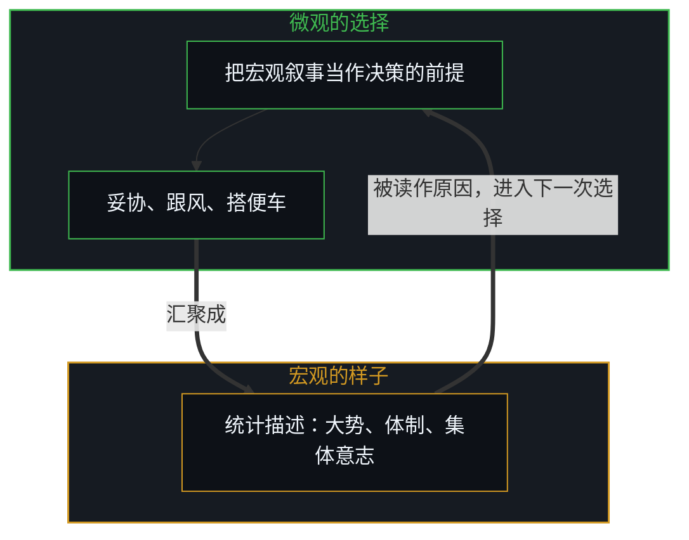
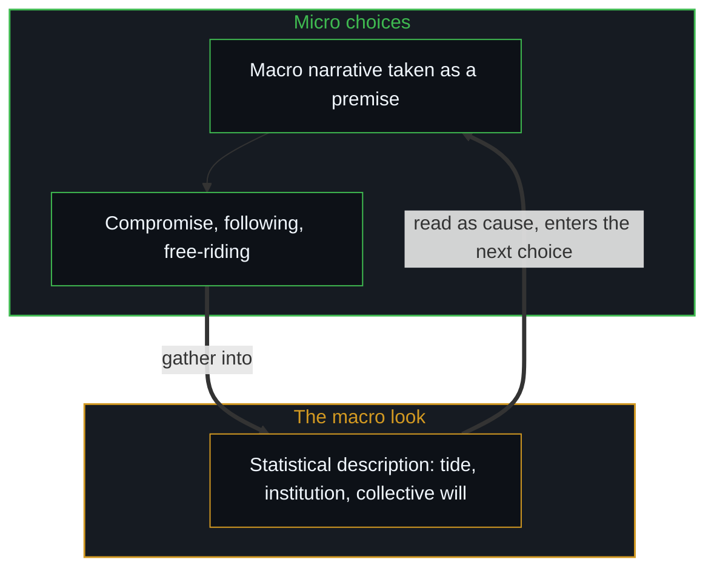

# 涌现的伪因果 / The Pseudo-Causality of Emergence

*宏观涌现是微观交互的统计副产品，从不是驱动的原因，被系统裹挟是事后把归因外置 / Macro emergence is a by-product of micro interaction, never a driver; being swept along is attribution moved outward.*

在社会学、伦理学与大众思想里，流行着一套建立在第三人称观察者视角上的宏大叙事。从宣判集体宿命的“雪崩之下，没有一片雪花是无辜的”，到常被读作替个人卸责的“恶的庸常”，再到赞美系统神性的“集体智慧”与“群体潜意识”，这些概念生动地描述了人类社会里普遍的宏观涌现模式，在因果的底层却犯了同一个归因错位：把微观个人交互涌现出的统计副产品，倒果为因地当成支配系统的独立实体与驱动原因。

Sociology, ethics and popular thought carry a set of grand narratives built from the third-person observer's view. From the collective verdict "under an avalanche no snowflake is innocent", to the "banality of evil" so often read as excusing the individual, to the "collective intelligence" and "group unconscious" praised as the system's divinity, these concepts vividly describe macroscopic patterns of emergence common in human society, yet at the causal floor they make one misattribution: taking the statistical by-products that emerge from micro individual interactions, cause and effect reversed, for independent entities and driving causes that govern the system.

推动系统运转的，是无数个人在第一人称当下，把宏观现象或群体叙事当作决策前提而做出的具体选择。微观的选择汇聚成宏观的现实，宏观的现实又作为背景环境去塑造下一次选择；在整条因果的自循环里，唯一的自变量是个人的自由选择。

What drives the system is the concrete choices countless people make in the first-person present, taking macro phenomena or group narratives as premises for decision. Micro choices gather into macro reality, and macro reality, as background environment, shapes the next choice; in the whole causal self-loop the one independent variable is individual free choice.

## 一、 “客观”是跨个人可重现的因果 / 1. The "Objective" Is Causality Reproducible Across People

日常语言里惯用的“客观规律”或“物理实体”，容易诱发一种认知幻觉：好像有一套脱离人的观察、高高在上的独立外部实体。可从第一人称看，被经验到、被称为“客观”的现象，是个人之间的逻辑因果关系能在不同的人之间被稳定重现的那一部分；一切客观，都离不开主观的观察、诠释与建模。集体概念是投影阶梯上的一级，[投影的阶梯与因果的锚点](../tou-ying-de-jie-ti-yu-yin-guo-de-mao-dian/)说明了怎样把它锚回因果。贯穿始终的准绳，是基于逻辑的因果：正因为逻辑因果在每一个第一人称之内必须自洽，又能在不同的人之间相互验证与重现，共享的世界图景才建得起来。离开个人的第一人称选择与逻辑闭环，空谈某种凌驾于人之上的“客观集体意志”或“系统规律”，就是在虚构一个脱离因果的第二实体。

The "objective laws" or "physical entities" of everyday speech easily induce a cognitive illusion: as if there were a set of independent outside entities standing above human observation. Seen from the first person, the phenomena experienced and called "objective" are the part of the logical-causal relations between people that can be reproduced stably across different people; all objectivity depends on subjective observation, interpretation and modelling. Collective concepts are one rung on the ladder of projections, and [The Ladder of Projections and the Anchor of Causality](../tou-ying-de-jie-ti-yu-yin-guo-de-mao-dian/) shows how to anchor them back in causality. The thread running throughout is causality grounded in logic: precisely because logical causality must be consistent within each first person and can be verified and reproduced across people, a shared picture of the world can be built. Without individual first-person choice and logical closure, talk of some "objective collective will" or "law of the system" standing above people invents a second entity detached from causality.

## 二、 宏观描述怎样反过来绑架微观选择 / 2. How Macro Description Captures Micro Choice

宏大概念有这样强的现实力量，正因为它参与构成了微观个人的因果自循环。社会学理论描摹出“系统的压迫”“滚滚的大势”或“不可抗拒的集体意志”时，人就倾向于把这些宏观描述内化成自己决策的前提，对自己说：“既然大势如此，我个人的抗争毫无意义”，“既然体制是一台冷酷的机器，我作为一颗齿轮只能顺从地转”，“既然群体智慧无所不知，跟着抄就是”。[印迹与行动](../the-mark-and-the-act/)阐明了这种机制：行动留下的痕迹构成环境，环境又作为感知的输入影响下一轮行动。正因为无数人把宏观现象倒果为因地当作放弃独立推演的理由，才做出妥协、跟风、搭便车或同流合污的微观选择；正是这成千上万次微观选择的连续发生，塑造、巩固并加剧了那个原本只是统计描述的宏观现实。宏观现象不是原因，是无数条个人因果链在特定反馈回路里相互嵌套、相互强化之后呈现的自循环稳态。

Grand concepts have such strong real force precisely because they help make up the causal self-loop of micro individuals. When sociological theory depicts "the oppression of the system", "the rolling tide of the times" or "an irresistible collective will", people tend to internalise these macro descriptions as premises of their own decisions, telling themselves: "since the tide runs this way, my own resistance is meaningless", "since the institution is a cold machine, as one gear I can only turn along", "since the crowd knows all, I will just copy". [The Mark and the Act](../the-mark-and-the-act/) sets out this mechanism: the traces left by action form the environment, and the environment, as perceptual input, shapes the next round of action. It is precisely because countless people take macro phenomena, cause and effect reversed, as a reason to give up independent reasoning that they make the micro choices of compromise, following the crowd, free-riding or going along with wrongdoing; and it is the continual occurrence of these myriad micro choices that shapes, consolidates and intensifies a macro reality that was at first only a statistical description. Macro phenomena are not causes; they are the self-looping steady state that appears once countless individual causal chains nest in and reinforce one another within particular feedback loops.

## 三、 道德均摊即责任清零 / 3. Spreading Morality Thin Zeroes Responsibility

“雪崩之下，没有一片雪花是无辜的”，在宏观描述上准确地刻画了系统崩溃时人人参与的样子，在因果解释上却造成了责任的稀释与事实上的豁免。一场集体灾难的宏观后果被机械地均摊给系统中数万乃至数亿个人时，落在每一个具体的人身上的因果责任与反思成本，在边际上趋近于零，1/N → 0。这种均摊建立不起责任的约束，反而扭曲了微观博弈的收益结构：一个人若相信“后果由所有人共同承担”，当一个违背系统秩序的动作能带来全部的个人短期私利、引发系统崩溃的代价却被稀释给全社会时，微观的算计就会推着人去作恶或套利；反过来，选择自我约束、踩刹车，要立刻承担全部的自律成本，系统改善的收益却被所有人分享。强调无法逃避的集体责任，切断了个人微观选择与最终反馈之间的强对应；宏大叙事在宣泄道德情绪的同时，清空了个人内部纠偏的阻力，反而加速了雪崩的到来。

"Under an avalanche no snowflake is innocent" accurately depicts, as macro description, how everyone takes part when a system collapses, yet as causal explanation it dilutes responsibility and exempts it in practice. When the macro consequences of a collective disaster are spread mechanically over tens of thousands or hundreds of millions of people in a system, the causal responsibility and the cost of reflection that land on each particular person tend at the margin toward zero, 1/N → 0. Such spreading builds no constraint of responsibility and instead distorts the payoff structure of the micro game: if a person believes "the consequences are borne by everyone together", when an act against the system's order brings all of the short-term private gain to oneself while the cost of collapse is diluted across society, micro calculation pushes toward wrongdoing or arbitrage; conversely, choosing self-restraint and braking means bearing the whole cost of discipline at once while the gains of a better system are shared by all. Stressing inescapable collective responsibility cuts the strong correspondence between an individual's micro choice and the final feedback; the grand narrative, while venting moral emotion, empties out the individual's inner resistance to correction and speeds the avalanche.

## 四、 涌现的拟人化 / 4. Personifying Emergence

[涌现的归因倒错](../the-geometry-of-emergence/)，在负面与正面的概念里对称地发生。汉娜·阿伦特在《艾希曼在耶路撒冷》里提出“恶的庸常”，她本人并没有因此免去艾希曼的责任；可这个说法在流行的用法里，常被读作把个人的恶行归给“体制的齿轮”或“不假思索”，表面上在批判系统，实际上给个人造了一条顺畅的免责通道。并不存在会自己转动的抽象齿轮；任何被叫作庸常的恶行，在每一个微观的时间切片上，都是具体的人为了维持局部的私利、避开当下的阻力或逃避眼前的责任而主动做出的妥协与选择。[个体抉择是唯一的因果杠杆](../individual-choices-as-the-only-causal-levers/)确立了清楚的因果边界：把责任推给抽象的系统，等于在因果里凭空捏造一个不存在的代理人。宏观现象怎样从微观抉择中生成，[宏观现象的生成图谱](../the-generative-atlas-of-macroscopic-phenomena/)给出了整幅图谱。

[The misattribution of emergence](../the-geometry-of-emergence/) happens symmetrically in negative and positive concepts. Hannah Arendt put forward the "banality of evil" in Eichmann in Jerusalem, and she herself did not thereby relieve Eichmann of responsibility; yet in popular use the phrase is often read as assigning an individual's wrongdoing to "a cog in the system" or to "thoughtlessness", seeming to criticise the system while in fact opening a smooth path of exemption for the individual. There is no abstract cog that turns by itself; any wrongdoing called banal is, at each micro slice of time, a compromise and choice made actively by particular people to keep local private gain, avoid present resistance or escape the responsibility in front of them. [Individual Choices as the Only Causal Levers](../individual-choices-as-the-only-causal-levers/) establishes a clear causal boundary: pushing responsibility onto an abstract system is inventing out of nothing an agent that does not exist in causality. How macro phenomena are generated from micro choices is mapped whole in [The Generative Atlas of Macroscopic Phenomena](../the-generative-atlas-of-macroscopic-phenomena/).

反过来，在正面语境里被广泛赞美的“集体智慧”，也不是群体作为一个整体涌现出超越个人的神性意识。詹姆斯·索罗维基在《群体的智慧》里列出的条件之一，就是判断的独立：所谓的集体智慧，只是因为微观个人的内在因果链更严密、判断更独立，在分散的决策里各自的随机误差在统计上相互抵消，于是在集体层面呈现出一种仿佛超越任何个人的样子。一旦人们放弃了自身因果链的独立推演，转而相信“集体比我更聪明”、开始相互抄袭与盲从，集体智慧的样子就立刻塌掉，退化成狂热与踩踏。无论是群体的智慧还是群体的狂热，背后都只有一个机制在起作用：微观个人因果链的质量与独立。

Conversely, the widely praised "collective intelligence" of positive contexts is not a group emerging as a whole into a divine awareness beyond individuals. One of the conditions James Surowiecki set out in The Wisdom of Crowds is independent judgment: so-called collective intelligence arises only because micro individuals' inner causal chains are tighter and their judgments more independent, so that in decentralised decisions their random errors cancel statistically, and at the collective level a look appears as if surpassing any individual. Once people give up the independent reasoning of their own causal chains, believe "the collective is smarter than me" and begin copying and following one another, the look of collective intelligence collapses at once into frenzy and stampede. Behind crowd wisdom and crowd frenzy alike only one mechanism is at work: the quality and independence of micro individual causal chains.

## 五、 主权从未失去 / 5. Sovereignty Was Never Lost

并不存在“收回”第一人称因果主权这回事，因为它在任何时刻都没有失去过。哪怕一个人说“我身不由己”“是体制逼我的”或“我只是随大流”，这个说法本身就是在第一人称当下做出的真实选择：主动选择了妥协，主动选择了拿宏观叙事当借口放弃抗争，主动选择了把因果外包。被系统裹挟的感觉底下，仍是[自由变量的同构与先验主权](../zi-you-bian-liang-de-tong-gou-yu-xian-yan-zhu-quan/)所说的那个微观自由变量。[个体抉择是唯一的因果杠杆](../individual-choices-as-the-only-causal-levers/)指出：外部归因本身就是一个离散的第一人称行动。所谓的“失去自主”，是事后、或在宏观层面的解释里，把原因错置到外部环境或宏观涌现上，遮住了那个自变量，个人的自由选择。把孩子的选择归于家庭环境，同样是集体归因的倒错，[引导不是占有](../guidance-is-not-ownership/)说明了这一点。

There is no "taking back" first-person causal sovereignty, because at no moment was it lost. Even when someone says "I had no choice", "the institution forced me" or "I just went with the crowd", the saying itself is a real choice made in the first-person present: actively choosing compromise, actively choosing to use the macro narrative as an excuse for giving up resistance, actively choosing to outsource causality. Beneath the feeling of being swept along by the system is still the micro free variable of [The Isomorphism of Free Variables and Prior Sovereignty](../zi-you-bian-liang-de-tong-gou-yu-xian-yan-zhu-quan/). [Individual Choices as the Only Causal Levers](../individual-choices-as-the-only-causal-levers/) points out that outward attribution is itself a discrete first-person act. The so-called "loss of autonomy" is, after the fact or in macro-level explanation, cause misplaced onto the outside environment or macro emergence, hiding the independent variable, individual free choice. Attributing a child's choices to the family environment is the same inversion of collective attribution, as [Guidance Is Not Ownership](../guidance-is-not-ownership/) shows.

[复杂性遮蔽了涌现之为心智的行动](../complexity-obscures-emergence-as-the-act-of-mind/)揭示了这种认知上的移花接木：雪崩、恶的庸常、群体的盲从或集体智慧，都只是系统在特定微观交互下呈现的统计分布；把涌现当成原因，就像把水面上的波浪当成推动水分子运动的独立外力。能动性不从宏观中涌现，[主体性不曾涌现](../agency-does-not-arise/)对此有专门的论证。在逻辑因果里，没有人能真正替别人承担后果，也没有人的真实代价能被虚构的集体代劳。[投资决策的因果闭环](../tou-zi-jue-ce-de-yin-guo-yu-zhen-zi-fu-ying-kui/)强调了闭环反馈：只有看清自己无论何时都在为微观选择承担全部的闭环后果，心智系统才会产生真实的损失函数，去驱动参数的校准与行为的纠偏。以为看懂了“系统”，就截去了个人的抉择，[以知为刃的截肢与解脱](../the-illusion-of-knowing-and-the-geometry-of-amputation/)剖析了这种截肢。

[Complexity Obscures: Emergence as the Act of Mind](../complexity-obscures-emergence-as-the-act-of-mind/) reveals this cognitive sleight of hand: the avalanche, the banality of evil, herd following and collective intelligence are only statistical distributions a system shows under particular micro interactions; taking emergence for a cause is like taking the waves on the water's surface for an independent outside force driving the water molecules. Agency does not emerge from the macro, as [Agency Does Not Arise](../agency-does-not-arise/) argues at length. In logical causality, no one can truly bear consequences for another, and no one's real cost can be borne by a fictitious collective. [The Causal Loop of Investment Decisions](../tou-zi-jue-ce-de-yin-guo-yu-zhen-zi-fu-ying-kui/) stresses closed-loop feedback: only when one sees that one always bears the full closed-loop consequences of one's micro choices does the Mind produce a real loss function to drive calibration and correction. Believing one has understood "the system" cuts away individual choice, an amputation dissected in [The Illusion of Knowing and the Geometry of Amputation](../the-illusion-of-knowing-and-the-geometry-of-amputation/).

[个人选择](../ge-ren-xuan-ze-she-hui-hua-yu-zuo-zi-ji-de-zhen-zheng-zuo-biao/)与[格物致知与信息复杂度](../ge-wu-zhi-zhi-yu-xin-xi-fu-za-du-de-ben-zhi/)一起表明：一切抽象的社会概念，都是前人选择沉淀下来的痕迹；只有把视角锚定在第一人称的工况里，沿着逻辑因果链诚实地抉择，才能打破被宏大叙事催眠的错置。以为“时代节奏”能决定个人，是[调速者的幻觉与行动的活态摩擦](../the-fallacy-of-pacing-and-the-felt-friction-of-ground-truth/)所指出的调速者幻觉。

[Individual Choice](../ge-ren-xuan-ze-she-hui-hua-yu-zuo-zi-ji-de-zhen-zheng-zuo-biao/) and [Investigating Things and the Nature of Information Complexity](../ge-wu-zhi-zhi-yu-xin-xi-fu-za-du-de-ben-zhi/) together show that every abstract social concept is a trace settled from earlier people's choices; only by anchoring the view in first-person working conditions and choosing honestly along the chain of logical causality can the misplacement hypnotised by grand narrative be broken. Believing that "the pace of the times" decides the individual is the pacer's illusion identified in [The Fallacy of Pacing and the Felt Friction of Ground Truth](../the-fallacy-of-pacing-and-the-felt-friction-of-ground-truth/).

## 六、 结语 / 6. Closing

不必在“没有一片雪花是无辜的”的宏大叹息里自我感动，不必在“恶的庸常”的庇护下放下反思，也不必在“集体智慧”的神话里盲从卸责。从第一人称看，没有抽象的雪崩，只有一片片正在受力、正在做出破裂选择的雪花；没有超然的集体意志，只有一个个带着不可剥夺的因果中心的个人。因果的主权从未旁落，它在每一次具体的微观抉择之中；剥开事后解释的宏大迷雾，微观的选择才能重新面对自己无从逃脱的完整因果闭环。成功的父母把自己的成就归于时代的红利，再复制给孩子，[成功之后的育儿谬误](../the-fallacy-of-post-success-parenting/)剖析了其中的谬误。

There is no need to be moved by the grand sigh that "no snowflake is innocent", to set reflection aside under the shelter of the "banality of evil", or to follow blindly and shed responsibility in the myth of "collective intelligence". Seen from the first person there is no abstract avalanche, only snowflake after snowflake under stress, each making its breaking choice; there is no transcendent collective will, only person after person each carrying an inalienable causal centre. Causal sovereignty never passed to anyone else; it lies in each particular micro choice, and only when the grand fog of after-the-fact explanation is stripped away can micro choice face again its whole, inescapable causal loop. Successful parents who credit their achievement to the dividends of their era and then copy it onto their children commit the fallacy dissected in [The Fallacy of Post-Success Parenting](../the-fallacy-of-post-success-parenting/).
