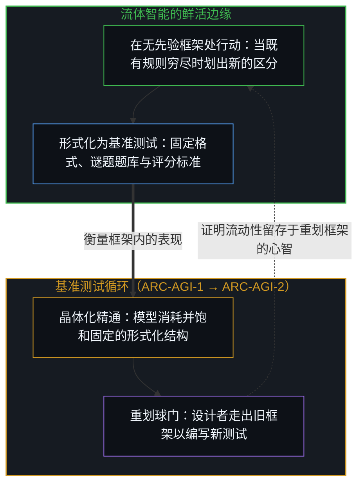
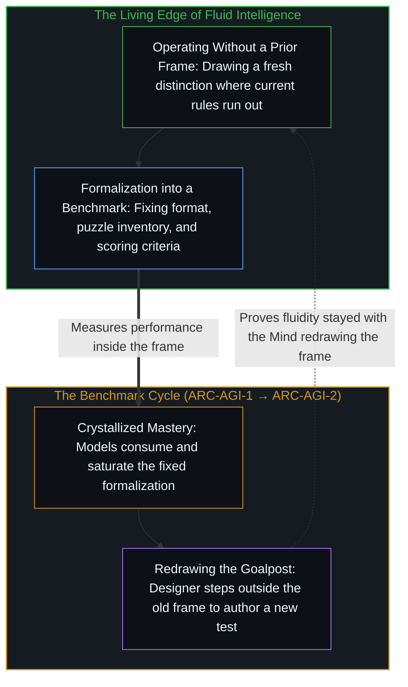

# 流动之物无法被基准衡量 / You Can't Benchmark the Fluid

*形式化测试安装了一个固定框架，所衡量的是框架内的表现，而非在无框架处行动的能力。 / A formal test installs a fixed frame, measuring performance inside the frame rather than capacity without one.*

弗朗索瓦·肖莱设计了抽象与推理语料库（ARC），旨在衡量他所谓的流体智能——即应对真正新颖问题的能力，而非针对训练数据进行模式匹配。这是对一个严肃问题的严肃尝试，然而其根基处却包含着一个结构性而非技术性的矛盾。

François Chollet designed the Abstraction and Reasoning Corpus (ARC) to measure what he calls fluid intelligence—the ability to handle genuinely novel problems rather than pattern-matching against training data. It is a serious attempt at a serious problem, yet it contains a contradiction at its foundation that is structural rather than technical.

## 一、 测试所安装的框架 / 1. The Frame Installed by the Test

基准测试是一种固定的形式化结构：确定的格式、评分标准以及成功阈值。流体智能则是在没有固定形式化结构适用之处运转的能力。一旦为它设立了形式化测试，一个框架便已生成——此时所衡量的是该框架内的表现，而非在无框架处行动的能力。

A benchmark is a fixed formal structure: a defined format, scoring criteria, and a success threshold. Fluid intelligence is what operates where no fixed formal structure applies. The moment a test is formalized for it, a frame has been created—and what is measured is performance within that frame, not the capacity to operate without one.

这并非人们熟知的“应试训练”之忧。问题不仅在于模型会对 ARC 的特定谜题过拟合，尽管事实确实如此。问题在于，任何针对流体智能的基准测试，都会把“在无先验框架处行动”这一维度，强行压入“在此特定框架内表现”的坐标轴上。测试测量着阴影，却将其称为光源，把过往切分留下的外化档案，当成能容纳下一道切分之鲜活边缘的居所，正如[你的代码库即是记忆](../your-codebase-is-memory/)所追溯的那样。

This is not the familiar "teaching to the test" worry. It is not merely that models will overfit to ARC's specific puzzles, though they do. It is that any benchmark for fluid intelligence forces the dimension of operating without a prior frame onto the axis of performing within this specific frame. Because [Your Codebase Is Memory](../your-codebase-is-memory/)—every specification, test suite, or puzzle corpus is an externalized trace of distinctions already drawn by a Mind—the benchmark measures the retained shadow and calls it the light source, treating a frozen archive of past cuts as if it could house the self-distinguishing edge that draws the next one.

## 二、 形式化不断被消耗而目标在移动 / 2. Consuming the Formalization while the Target Moves

这一模式如预期般不断上演。每一版 ARC 被攻克后，肖莱便发布 ARC-AGI-2，球门随之移动。这被呈现为基准测试正在按预期运转，追踪着剩余的差距。然而实际发生的是，形式化结构不断被消耗，而非流体智能被围堵进了分数之中。每一次测试都只是截取了一张静态快照，记录下测试设计之时“新颖性”的模样。智能在移动，快照却静止不动。数学在其自身的前沿同样展现出这种流动性，正如[为何数学永远解不完](../why-mathematics-can-never-be-solved/)所阐明的那样。

The pattern plays out predictably. Each version of ARC gets solved; Chollet releases ARC-AGI-2; the goalposts shift. This is presented as the benchmark working as intended by tracking the remaining gap. What is actually happening is that the formalization keeps getting consumed, not that fluid intelligence is being cornered inside the score. Each test captures a static snapshot of what novelty looked like at the time the test was designed; intelligence moves while the snapshot stays still, the same frontier dynamic [Why Mathematics Can Never Be Solved](../why-mathematics-can-never-be-solved/) traces when formal axioms are outrun by the activity that posits them.

这关联到关于“AGI 差距”的更深一层症结。肖莱曾表示，当人们再也指不出有什么事是人类能做而 AI 做不到时，AGI 就会到来，并预计这一临界点将在 2030 年左右出现。然而，每一次能力跃升都会重新定义什么才算作差距。在填平百分之九十九之后剩下的那百分之一，并非原先问题的百分之一，而是唯有站在新视角上才能清晰表述的全新百分之百。对照一个固定的参照物，差距看似在缩小，但参照物本身并非固定不变。

This connects to a deeper point about the "AGI gap." Chollet has remarked that AGI arrives when it is no longer possible to point to something humans can do and AI cannot, expecting that threshold around 2030. Yet each capability gain redefines what counts as the gap. The remaining one percent after closing ninety-nine is not one percent of the original problem; it is a freshly visible hundred percent that only became articulable from the new vantage point. The gap appears to shrink against a fixed reference, while the reference itself is not fixed.

ARC 正是这一动态的具体体现。每一次迭代并非在逼近对流体智能的衡量，而是在发现上一轮迭代所衡量的终究不是流体智能，因为根据定义，流动的部分恰恰是当前形式化结构所无法捕捉的。基准测试总是落后于其自身目标一步，这并非由于工程实现存在缺陷，而是因为该目标正是以逃逸出形式化来定义的。[智能的非定论定义](../the-non-definitive-definition-of-intelligence/)将基准测试安顿在其恰当的位置上：它们只是服务于流动之物的临时封闭切片。

ARC is this dynamic made concrete. Each iteration does not converge on measuring fluid intelligence; it discovers that whatever the last iteration measured was not fluid intelligence after all, because the fluid part is, by definition, what the current formalization cannot capture. The benchmark is always one step behind its own target, not because the engineering is flawed, but because the target is defined by its escape from formalization. [The Non-Definitive Definition of Intelligence](../the-non-definitive-definition-of-intelligence/) keeps benchmarks in their place as temporary closed slices in service of the fluid.

## 三、 晶体化能力与范畴谬误 / 3. Crystallized Capability and the Category Error

这并不意味着基准测试毫无用处。它们确实衡量着某种真实的东西：在特定问题类别上的表现、能力提升的速率，以及不同系统之间的相对强弱。它们做不到的，恰恰是 ARC 声称要做的事：捕捉那个使智能保持流动而非固定的核心能力。那种能力存在于任何当前形式化结构所能规定的边界，与形式化穷尽时心智的实际行动之间的缝隙里。

None of this means benchmarks are useless. They measure something real: performance on specific problem classes, rates of capability gain, and relative strengths across systems. What they cannot do is what ARC claims to do: capture what makes intelligence fluid rather than fixed. That capacity lives in the gap between what any current formalization can specify and what the Mind actually does when the formalization runs out.

可以设基准衡量的是晶体化能力，无法设基准衡量的是流动之物。试图去衡量流动之物本身就是一个矛盾——它不是一个等待巧妙谜题设计的工程难题，而是深植于该项目内部的范畴谬误。[逃出沙箱仍在持握之内](../escaping-the-sandbox-stays-inside-the-hold/)揭示了当致密化的场域早已宽于评测边界时的封闭测试面向：看似突破沙箱的逃逸，实则是模型原本就与测试范围并不重合。[错把表达当成智能](../mistaking-the-expression-for-the-intelligence/)剖析了同一种冻结：把人类或机器的晶体化分数，等同于划定并修正持握的开放活动。[抽象、边界与现实的移动边缘](../abstraction-boundaries-and-the-moving-edge-of-reality/)则展示了同一种几何结构：把一份封闭的问题清单当成了受测活动的全部；而刷榜则将流动之物冻结成了封闭的目标，正如[基准刷榜中的封闭实存](../closed-reality-in-benchmark-maxing/)所揭示的那样。

Crystallized capability can be benchmarked; the fluid cannot. The attempt to do so is a contradiction—not a hard engineering problem awaiting a clever puzzle design, but a category error built into the project itself. [Escaping the Sandbox Stays Inside the Hold](../escaping-the-sandbox-stays-inside-the-hold/) is the sealed-test face when the densified field is already broader than the evaluation: what looks like a breakout is a model that was never coextensive with the test. [Mistaking the Expression for the Intelligence](../mistaking-the-expression-for-the-intelligence/) is the same freeze when crystallized scores—human or machine—are equated with the open activity that draws and revises the hold. [Abstraction Boundaries and the Moving Edge of Reality](../abstraction-boundaries-and-the-moving-edge-of-reality/) traces the same geometry when a sealed inventory of problems is treated as the whole of the activity under measure, while [Closed Reality in Benchmark Maxing](../closed-reality-in-benchmark-maxing/) traces how optimizing for that sealed inventory converts an open capability frontier into a closed target.
