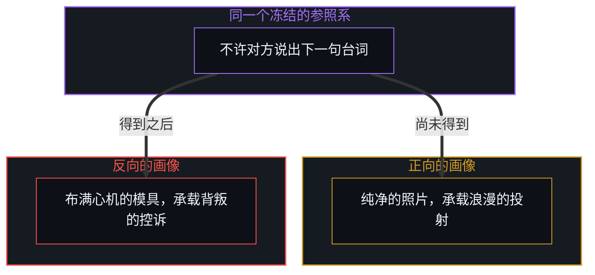
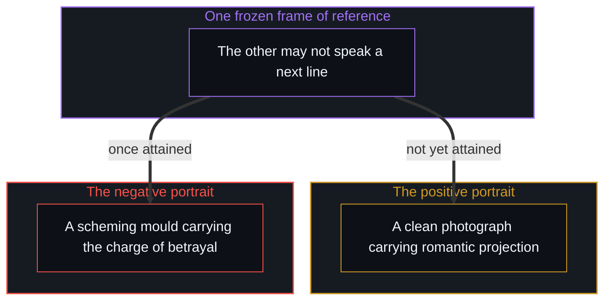

# 有条件的自由 / Conditional Freedom

*把自由抵押给外部条件的批准，无论条件满足与否，心智都已完成自我套锁 / Mortgage freedom to the approval of outside conditions and, met or unmet, the Mind has already locked itself in.*

卢梭在《社会契约论》开篇写道：“人是生而自由的，却无往不在枷锁之中。自以为是其他一切主人的人，反而比其他一切更是奴隶。”卢梭敏锐地看到了人普遍陷入拘束的表象，找到了自由这个无可争辩的起点，却在后面的推演里给自由套上了集体公意与契约的重重枷锁，并给出了很雄辩的合理化论证。

Rousseau opens The Social Contract: "Man is born free, and everywhere he is in chains. One thinks himself the master of others, and still remains a greater slave than they." Rousseau keenly saw the surface of people's general constraint and found freedom as an indisputable starting point, yet in the reasoning that follows he put the heavy chains of the general will and the contract on freedom and gave a most eloquent justification for them.

所谓“有条件的自由”，从来不是外部强加的物理牢狱，而是心智主动给自己的自由套上的条件枷锁；这道锁链一旦在认知上被焊死，无论那个条件在现实里是否满足，主体都已经不自由了。

So-called "conditional freedom" is never a physical prison imposed from outside but a chain of conditions the Mind itself puts on its own freedom; once that chain is welded shut in understanding, the subject is already unfree, whether or not the condition is met in reality.

## 一、 卢梭的倒错与自己套上的枷锁 / 1. Rousseau's Inversion and the Self-Applied Chain

[自由即地基](../freedom-as-ground/)确立了自由的本体地位：自由不是克服了重重阻碍之后在终点被颁发的奖赏，而是心智在当下这一刻做出区分与抉择的原初地基。卢梭的倒错在于，他把枷锁当成某种独立于个人的客观世界结构，进而想靠构建一套完美的外部制度来赎回自由。可枷锁从来没法从外部自己装上；心智之所以无往不在枷锁之中，正是因为它用了自己无可剥夺的自由，主动选择把裁决权抵押给外部世界。

[Freedom as Ground](../freedom-as-ground/) establishes the ontological standing of freedom: freedom is not a prize awarded at the finish after overcoming obstacles but the original ground on which the Mind distinguishes and chooses at this very moment. Rousseau's inversion lies in treating the chain as some objective structure of the world independent of the individual, and so trying to redeem freedom by building a perfect outside institution. Yet a chain can never install itself from outside; the Mind is everywhere in chains precisely because it used its own inalienable freedom to choose to mortgage the right of decision to the outside world.

一个人宣称“只有满足了 X，我才是自由的”时，就已经在句法上完成了一次因果倒置。X 可以是金钱、社会地位、伴侣的忠诚、体制的许可，或某种道德上的正当。一旦这个前提成立，主体的自由就不再是自己行动的属性，而成了依附于 X 的派生物。承认枷锁是自己加上去的，不是给任何外在的不公颁发道德正当性，而是把因果责任从“加在我身上的外部命运”收回来：亲手给自己戴上锁链的那只手，从始至终是自己的。

When someone declares "only once X is met am I free", a causal inversion has already been completed in the syntax. X may be money, social standing, a partner's loyalty, an institution's permission or some moral justification. Once this premise holds, the subject's freedom is no longer a property of their own action but a derivative hanging on X. Acknowledging that the chain was put on by oneself grants no moral justification to any outside injustice; it takes causal responsibility back from "the outside fate laid on me": the hand that put the chain on was one's own from start to finish.

## 二、 财务自由的假象 / 2. The Illusion of Financial Freedom

现代社会对“财务自由”的集体热情，是这个句法最显眼的当代注脚。匮乏的时候，贫穷被当事人登记为一切不自由的唯一根源，“只要有了钱，我就能做自己”；财富累积到天文数字时，金钱又立刻被重新登记为必须严防死守、持续增值、并要在得到某种外部合理化的批准之后才敢动用的神圣资产。两端看似是天壤之别的阶级命运，在运作的机制上却是同一套奴役语法的两种读数：

The collective enthusiasm of modern society for "financial freedom" is this syntax's most visible contemporary footnote. In scarcity, poverty is registered by the person as the sole source of all unfreedom, "once I have money I can be myself"; when wealth piles up to astronomical figures, money is at once re-registered as a sacred asset to be guarded, kept growing and touched only after some outside justification approves it. The two ends look like class fates worlds apart, yet in the mechanism they are two readings of one grammar of servitude:

- 没钱时，外部的“匮乏”是不行动的借口；
- 有钱时，外部的“风险”与“规则”成了不行动的借口。

- without money, outside "scarcity" is the excuse for not acting;
- with money, outside "risk" and "rules" become the excuse for not acting.

孙宇晨在社交网络上公开的那篇长文与随后的纠纷，提供了一个很有解剖价值的现实标本。以任何常规的财富尺度衡量，五千万美元对他的资产体量都可以忽略不计；可在这场拉锯里真正忽略不了的，不是具体的数字，而是“这一笔支出必须先得到一个外部权威的批准”，无论是白纸黑字的协议、世俗彩礼的规矩、严苛的条款约束，还是来自 AI 模型 Claude 的逻辑否决。批准一旦被确立为行动的前提，给或不给就脱离了第一人称的选择，退化成向外部索取理由的官僚程序；随后的翻脸、控诉与推卸，是这个程序自然的演进：先把裁决权交出去，再抱怨裁决受制于外部。账面上的数字也许早已实现了“财务自由”，主体的自由却从未发生过；膨胀的资产负债表唯一证明的，是锁链从来不在匮乏里。

The long piece Justin Sun published on social media and the dispute that followed offer a real specimen of great value for dissection. By any ordinary measure of wealth, fifty million dollars is negligible against his holdings; yet what could not be neglected in the tug-of-war was not the figure but "this outlay must first be approved by an outside authority", whether a written agreement, the customs of a bride price, strict contractual terms or a logical veto from the AI model Claude. Once approval is set as the precondition of acting, giving or withholding leaves first-person choice and degrades into a bureaucratic procedure of asking outside for reasons; the falling-out, accusations and shifting of blame that follow are that procedure's natural course: first hand over the right of decision, then complain that the decision is ruled from outside. The figures on the books may long since have reached "financial freedom", yet the subject's freedom never took place; the swollen balance sheet proves only that the chain was never in scarcity.

## 三、 冻结的画像：从神圣投射到怨恨的模具 / 3. The Frozen Portrait: From Sacred Projection to the Mould of Resentment

这种把自由抵押给外部条件的认知机制，在亲密关系里更隐蔽。许多人所谓的“爱”，从一开始就不是对着那个会呼吸、会开口、有自己欲望与条件的活人，而是对着一张在心智里被提前冻结的“画像”。[超越的定相](../the-fixed-image-of-transcendence/)揭示了这种凝固：照片里的形象没有下一句不可预测的台词，所以可以被无限地投射。先有一张照片生成的完美形象，在零现实交互的前提下，爱就已经在主体的脑海里成立，成立的是一个自我投射模型的封闭自洽，[表征的闭环](../the-closed-loop-of-representation/)说明了这种闭环。

This cognitive mechanism of mortgaging freedom to outside conditions is subtler in intimate relationships. What many call "love" is from the start directed not at the living person who breathes, speaks and has desires and conditions of their own, but at a "portrait" frozen in advance in the Mind. [The Fixed Image of Transcendence](../the-fixed-image-of-transcendence/) reveals this setting: the figure in a photograph has no unpredictable next line and so can be projected onto without limit. First a perfect figure generated from a photograph, and with zero real interaction, love already holds in the subject's mind, what holds being the closed consistency of a model of self-projection, as [The Closed Loop of Representation](../the-closed-loop-of-representation/) shows.

多年之后，当事人想用世俗的财富、地位与穷追不舍去抹平距离，以为只要填平距离，这张心智画像就能在现实里安全着陆。可真正落地的那一刻，活人的复杂、利益的计算与不可控涌进来，撑破了单薄的画像外壳。嫌弃与怨恨随之很快滋生：在追求阶段被视作“诚意证明”的物质付出，在追到之后被指控为“对方的势利与算计”。坐标系从没改变，只是同一个参照系从“尚未得到的执念”翻转成了“得到之后发现货不对板的受骗感”。在随后那篇数万字、被标上“虚构”的公开长文里，被描摹的那位女性同样不是现实中的她：

Years later, the person tries to erase the distance with worldly wealth, standing and relentless pursuit, believing that once the distance is filled the portrait in the Mind can land safely in reality. Yet at the moment of landing, a living person's complexity, calculation of interests and uncontrollability pour in and burst the thin shell of the portrait. Distaste and resentment grow quickly after: material giving seen during pursuit as "proof of sincerity" is accused, once won, of being "the other's snobbery and calculation". The coordinate system never changed; the same frame of reference only flipped from "the fixation not yet attained" to "the feeling of being cheated once the goods did not match". In the public account of tens of thousands of words that followed, labelled "fiction", the woman depicted is likewise not the woman in reality:

1. 最初的照片，是一张纯净、空洞的正向画像，用来承载无条件的浪漫投射；
2. 后来的长文，是一张布满心机、算计与勒索的反向画像，用来承载被背叛之后的道德控诉。

1. the first photograph, a clean, empty positive portrait to carry unconditional romantic projection;
2. the later account, a negative portrait full of scheming, calculation and extortion to carry the moral accusation of betrayal.

这两张画像方向相反，结构却同构：它们都不承认对方是一个有独立意志、会继续说出下一句台词的活人。所谓“无条件的爱”，给的是前一张虚幻的偶像；随后“有条件的切割、起诉与文学化的示众”，砸向的是后一张妖魔化的模具。在这场数年的纠葛里，真实的对方从始至终没进入过他的视野。

The two portraits face opposite ways yet share one structure: neither acknowledges the other as a living person with an independent will who will go on to speak the next line. So-called "unconditional love" was given to the first, an illusory idol; the "conditional severing, lawsuit and literary public display" that followed struck the second, a demonised mould. Through the years of this entanglement, the real other never once entered his view.

## 四、 广场审判：把裁决权交出去 / 4. Trial in the Square: Handing Over the Right of Decision

把私密的情感公之于众，并不只是为了毁损名誉；毁损至少还预设有一个被歪曲的真实主体需要纠偏。在这类事件里，当事人做的，是把那张最新锻造的反向画像推到足够多的观众面前，想借大众的共鸣把它凝固成不可辩驳的“客观事实”。[验证中因果权能的分配](../the-allocation-of-causal-power-in-validation/)揭示了这种公共验证的机制：向法院提起诉讼，向舆论广场抛出长文，表面上是在进攻，骨子里是在乞求裁决；寻求的是自我合理化，从广场反射回来的，却是各怀立场的二次诠释。

Making private feelings public is not only about damaging a reputation; damage at least presupposes a real subject distorted and in need of correction. In events of this kind, what the person does is push the newly forged negative portrait before enough onlookers, hoping public resonance will set it into an irrefutable "objective fact". [The Allocation of Causal Power in Validation](../the-allocation-of-causal-power-in-validation/) reveals the mechanism of such public validation: filing a lawsuit and throwing a long account into the square of opinion look like attack on the surface and are at bottom a plea for a verdict; what is sought is self-justification, and what reflects back from the square is second-hand interpretation from every partisan position.

公众没有义务、也没有能力进入任何一方复杂的心智黑盒，人们只是带着各自早已成型的现成模具前来围观：厌女的模子负责填充拜金的细节，仇富的模子负责填充为富不仁的笑料。事实在这里并不重要，只是给大众的模具填槽的原料；真正的理解与认同几乎没有发生，发生的是大量网民用自己心智的残影去套裁这件事。最后留下的公共残渣，从来不是受害者的清白，而是极度降维之后的笑料；巨额的身家与公众的声望，并没有成为抵御这层笑料的护城河。一个人越想借公共广场完成自我辩护，就越是把自己的精神主权抵押给了一群从不打算为他辩护的看客。

The public has neither the duty nor the ability to enter either side's complex mental black box; people come to watch carrying their own ready-made moulds: the misogynist mould fills in the details of gold-digging, the mould of resentment toward the rich fills in the jokes about wealth without virtue. Facts matter little here, serving only as raw material to fill the slots of public moulds; real understanding and recognition hardly happen, and what happens is great numbers of internet users tailoring the affair to the afterimages of their own minds. What remains in the end as public residue is never the victim's innocence but a joke reduced to its fewest dimensions; vast wealth and public standing were no moat against that joke. The more one tries to complete one's self-defence through the public square, the more one mortgages one's own sovereignty of spirit to onlookers who never meant to defend one.

## 五、 收回手柄：锁不在世界的结构里 / 5. Taking Back the Handle: The Lock Is Not in the World's Structure

多数人也许永远不会面对要不要给出五千万美元的抉择，也很少有把私情编成数万字长文、再立案博弈的舞台。可这并不意味着就幸免于这种奴役；区别只在锁链的焊料不同：

Most people may never face the choice of whether to give fifty million dollars, and few have a stage on which to turn a private affair into tens of thousands of words and then a lawsuit. Yet this does not mean they are spared this servitude; the difference lies only in the solder of the chain:

- 有人缺钱，认定缺钱是自己无法施展抱负的唯一原因；
- 有人缺认可，认定别人的冷漠摧毁了自己的价值；
- 有人缺一个被理解的理由，认定伴侣未能契合脑中的画像就是背叛。

- some lack money and decide that lacking money is the one reason they cannot pursue their ambitions;
- some lack recognition and decide that others' indifference has destroyed their worth;
- some lack a reason to be understood and decide that a partner's failure to fit the portrait in their head is betrayal.

修饰词千变万化，底层的奴役语法却不改。只要“我必须先满足某个外部条件，才算自由、才算拥有爱、才算站得住脚”这句话一出口，无论那个条件将来是被满足还是被粉碎，心智都已经在锁链之中了。[个体抉择是唯一的因果杠杆](../individual-choices-as-the-only-causal-levers/)与[自我价值感与所有权](../ownership-and-self-worthiness/)指出了解脱的路径：如果只把这类事件当作八卦，这个清晰的时代标本就浪费了；它的价值，在于用极度夸张的尺度把这套奴役语法放大到肉眼可见。把自由抵押给结果，痛苦由此而来，[约束基底与自由自否](../the-substrate-of-constraint-and-the-self-denial-of-freedom/)对此有更完整的展开。

The modifiers vary endlessly; the underlying grammar of servitude does not change. The moment the sentence "I must first meet some outside condition before I count as free, as loved, as standing on firm ground" is spoken, whether the condition is later met or shattered, the Mind is already in chains. [Individual Choices as the Only Causal Levers](../individual-choices-as-the-only-causal-levers/) and [Ownership and Self-Worthiness](../ownership-and-self-worthiness/) point the way out: if events of this kind are taken only as gossip, a clear specimen of the times is wasted; its value lies in magnifying this grammar of servitude, at an exaggerated scale, until it is visible to the naked eye. Mortgaging freedom to outcomes is where the suffering comes from, and [The Substrate of Constraint and the Self-Denial of Freedom](../the-substrate-of-constraint-and-the-self-denial-of-freedom/) unfolds this more fully.

看清了这套语法，它才与自己的每一次抉择真正相关：

Once this grammar is seen, it begins to bear on one's own every choice:

- 这一次给予或拒绝，是否还在乞求某个外部权威的盖章？
- 是否还在把眼前的活人，硬塞进自己不许更新的僵死画像？
- 是否还在想把属于第一人称的抉择与担当，让渡给喧嚣的广场？

- is this giving or refusing still begging for some outside authority's stamp?
- is the living person in front of one still being forced into a dead portrait one will not allow to update?
- is the choice and responsibility that belong to the first person still being handed to the clamour of the square?

把因果的手柄收回来。行为仍在发生，借口不再向外索取。锁链从来不是这个世界的客观结构，它只是主体自己还没松开的那一步执念。

Take the causal handle back. Action still happens; excuses are no longer sought outside. The chain was never an objective structure of the world; it is only the one step of fixation the subject has not yet let go of.
