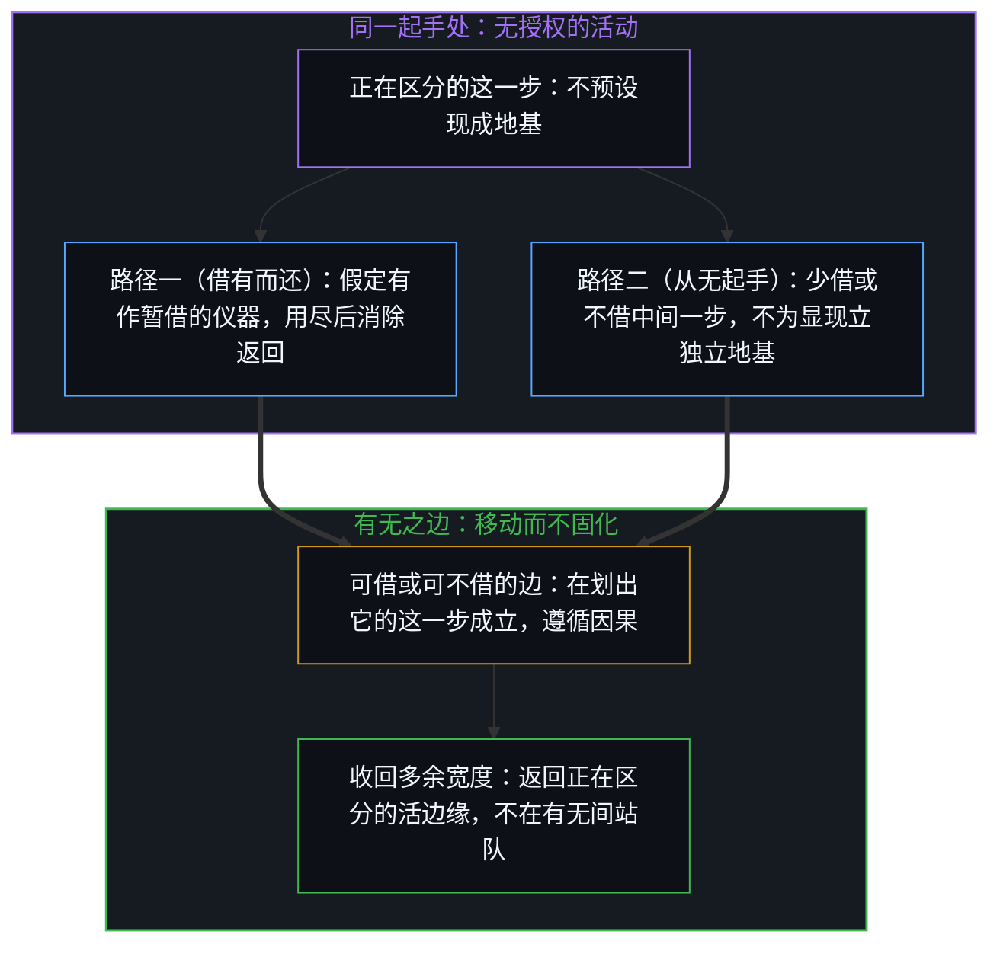
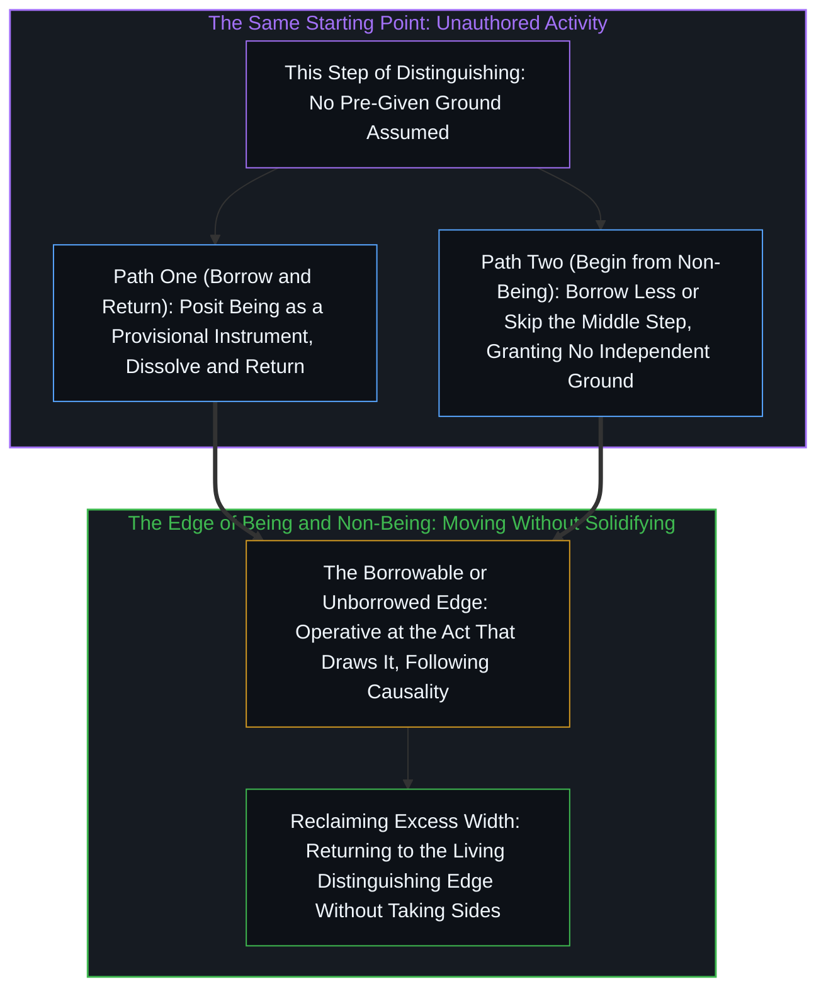

# 有无之边 / The Edge of Being and Non-Being

*自我、他人与世界皆是同一区分的切分；办法在可借可还的边，不在有无对错。 / Self, other, and world are cuts of the same distinction; the method lies at the borrowable edge, not in taking sides.*

自我、他人、世界都是分别。办法从无授权起手——借有而还，或不借——返回的是正在区分的这一步，不是有或无。

Self, other, and world are all distinctions. The method begins without prior authorization—borrowing being and returning it, or not borrowing at all—and what it returns to is this very step of distinguishing, neither being nor non-being.

## 一、 分别心 / 1. The Distinguishing Mind

经验中所面对的世界，是这个内心世界：其中有一个“我”、有“他人”、有“身外”。三者不是三种独立实体，而是同一活动做出的区分。分别心不是病，是活动本身。问题是把区分的产物当成地基。

The world encountered in experience is this inner world: within it there is an "I," an "other," and an "outside." The three are not three independent entities, but distinctions drawn by the same activity. The distinguishing mind is not an ailment; it is the activity itself. Confusion begins when the product of distinction is mistaken for the ground.

## 二、 纠结 / 2. Entanglement

纠结发生在两条线之间：“我是因”——活在自我世界的主动；“他是因”——活在他人世界的被动。两者各自成立，被压成一条：必须二选一。不是改选边，是解除共用坐标——每个中心保留自己的边界，共振发生，但不交出位置。

Entanglement happens between two lines: "I am the cause"—acting within the self-world; and "they are the cause"—being acted upon within the other-world. Each holds on its own axis, yet both get compressed into one: a forced choice between the two. The way out is not switching sides, but releasing the forced sharing of coordinates—each center keeps its own boundary, resonance occurs, and no locus is surrendered.

## 三、 有无 / 3. Being and Non-Being

内心之外的世界，无从在活动之外核对有无。智慧、知识、高低之见若在有无之间站队，是在加固同一个问题：问题要求一个它无法提供的外部站位。[作茧不是自缚](../zuo-jian-bu-shi-zi-fu/)是同一无从：谈论正在进行的这个位置，就是心智；没有一步能先走出再回头解释。

Whether a world outside the mind exists or does not exist cannot be verified outside the activity itself. Whenever wisdom, knowledge, or hierarchies of insight take sides between being and non-being, they reinforce the very same question: a question that demands an external vantage it can never supply. [Spinning a Cocoon Is Not Binding Oneself](../zuo-jian-bu-shi-zi-fu/) traces this same impossibility: the locus from which the talking proceeds is the mind itself; no step can walk outside first and turn back to explain it.

## 四、 方法 / 4. The Method

方法不回答有无，只处理参考系的宽度。第一种操作是假定有，最后消除并返回：让显现站着，当暂借的仪器，不当答案；用尽指认后收回。返回不是抵达终点，是收回本轮多出的宽度。清晰是反复移动，从不到达。第二种操作是从无开始：不给任何显现独立地基，以无授权为边。

The method does not answer the question of being and non-being; it operates only on the width of the reference frame. The first operation posits being, then dissolves it and returns: let the appearance stand as a provisional instrument rather than an answer, and reclaim it once the pointing is done. Returning is not arriving at a destination; it is narrowing the excess width added in this round. Clarity is repeated movement that never arrives. The second operation begins from non-being: granting no independent ground to any appearance, with non-authorization as its edge.

## 五、 同一起点 / 5. The Same Starting Point

两条形态不同，起点同一个：假定有，是从无开始的。若已有现成的有，就不需要假定。假定承认：尚无一物有权当起点——安放一个有，用它，消除它，返回。有是借来的仪器；无是起手处。从无开始，是少借或不借这中间一步。[何谓形而上学？作为将追寻命名为目的的一刀](../what-is-metaphysics-as-the-cut-that-names-the-seeking-as-destination/)在哲学追问中标出了同一道界限：从无出发，是在任何假定之有被奉为地基之前，从无授权的边缘起手；一旦把“无”或“存在”名词化为常驻的哲学母题，追寻就会被冻结成终点。

The two operations differ in form, yet share the same starting point: positing being begins from non-being. If a ready-made being were already on hand, there would be no need to posit it. To posit is to acknowledge that nothing holds prior entitlement to serve as origin—set a being in place, use it, dissolve it, and return. Being is the borrowed instrument; non-being is where the hand starts. Beginning from non-being simply borrows less, or skips that intermediate step altogether. [What Is Metaphysics? As the Cut That Names the Seeking as Destination](../what-is-metaphysics-as-the-cut-that-names-the-seeking-as-destination/) marks this same threshold in philosophical inquiry: setting out from non-being means starting at the unauthored edge before any posited being is enthroned as ground, whereas nominalizing "Nothing" or "Being" into a standing philosophical theme freezes the seeking into a destination.

## 六、 边 / 6. The Edge

有与无都不是答案。有是可借的边，无是可不借的边。办法在边，不在有无对错。把其中一条封成唯一正路或最终答案，即是站队。[只要它不被保持为空](../only-if-it-is-not-kept-empty/)是同一站队在器之用上的面孔：把“空”封成永久理想，与把“有”封成地基，是同一种过宽的参照。[你的代码库即是记忆](../your-codebase-is-memory/)在外化造物上追溯了同一边界：代码库或记录下的记忆，只是活边缘暂借为工作脚手架的“假定之有”；一旦这些累积痕迹被当成替代当下判断的自足地基，它们就会冻结那场写下它们的区分活动本身。

Neither being nor non-being is the answer. Being is the edge that can be borrowed; non-being is the edge that need not be borrowed. The method lies at the edge, not in adjudicating right or wrong between being and non-being. Sealing either one as the sole true path or final answer is taking sides. [Only If It Is Not Kept Empty](../only-if-it-is-not-kept-empty/) exposes this same side-taking in the use of an instrument: enshrining "emptiness" as a permanent ideal and enshrining "being" as a fixed ground are the same over-wide reference. [Your Codebase Is Memory](../your-codebase-is-memory/) traces the same boundary in externalized artifacts: a codebase or recorded memory is posited being borrowed as working scaffolding by the living edge, and the moment those accumulated traces are treated as a self-sustaining ground replacing present judgment, they freeze the very distinguishing activity that wrote them.

边在划出它的这一步成立，但不固定：下一步就不在同一处。它遵循因果，保持自洽。[前因，后果](../qian-yin-hou-guo/)是同一边在因果间隔上的登记：轨迹只能单向塑造；参照与解释滞后于观察，前因种下的后果就登记为外因。

At the act that draws it, the edge holds without fixing: at the next step it is no longer in the same place. It follows causality and remains internally coherent. [Cause Before, Effect After](../qian-yin-hou-guo/) registers this same edge across the causal interval: traces shape only in one direction; when reference and interpretation lag behind observation, the effects planted by prior causes register as arriving from outside.

## 七、 不软化 / 7. Without Softening

日常写作里，平衡、弱化、留退路，常常是在补救一种不配有的“无条件定论”：话说得像从外部拍板，所以要用副词把锋刃磨钝。这里不是这种情形。地基是相对于每一次区分的运作——任何显现、任何边，都只在其区分活动中成立，没有可站到外面去裁定的第二块基石。软化不是谦虚，是在相对性上再叠一层虚假的不确定，把框架的清晰抹掉。断言直接落地；需要收回的不是语气，是参考系的宽度。有与无的边界，正是果有别于因的那道分界，[非万物之理](../not-a-theory-of-everything/)给出了它的最简形式。

In everyday writing, balancing, hedging, and leaving escape hatches often compensate for an undeserved "absoluteness": a claim spoken as if handed down from outside must have its blade blunted with qualifiers. That is not what is happening here. The ground operates relative to each act of distinction—every appearance and every edge holds only within the distinguishing activity that constitutes it, with no second foundation outside from which to adjudicate. Softening is not modesty; it stacks false uncertainty on top of relativity and blurs the clarity of the frame. Assertions land directly; what gets re-rendered narrower is not the tone, but the width of the reference frame. The boundary between being and non-being is the very cut where effect differs from cause, and [Not a Theory of Everything](../not-a-theory-of-everything/) gives its minimal form.
