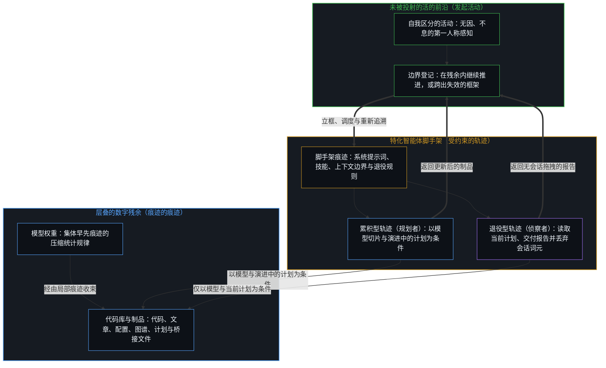
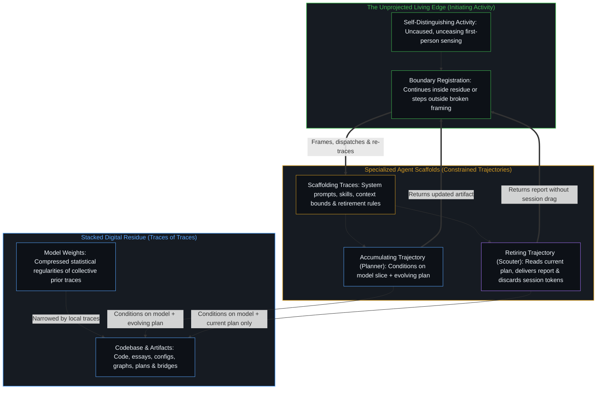
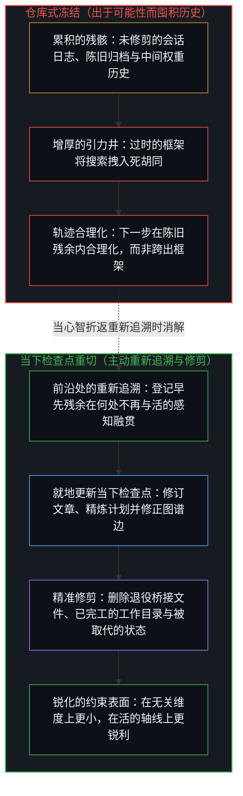
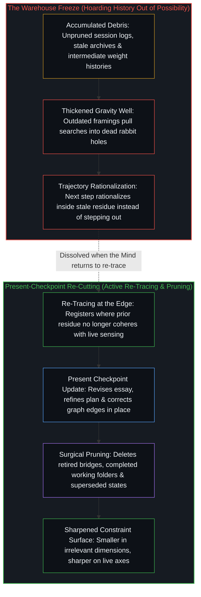

# 你的代码库即是记忆 / Your Codebase Is Memory

*代码、模型与智能体皆为层叠的区分残余，下一步取决于重切与修剪当下而非囤积历史 / Code, models, and agents are stacked residues of prior distinctions where the next step turns on re-cutting the present rather than hoarding history*

每一件能够被再次读取的数字制品——代码、文章、配置、图谱、计划、桥接文件、模型权重——在唯一关乎后续行动的意义上，都是记忆。它是早先区分留下的残余形态，它自身并不延续区分。

Every digital artifact that can be read again—code, essays, configs, graphs, plans, bridges, model weights—is memory in the only sense that matters for what follows. It is residual shape left by prior distinguishing. It does not continue the distinguishing.

自我区分的活动正在发生，无因且不息。称之为心智。每一次行动都会留下一道痕迹，供后续行动据以展开。代码库便是这些对后续人类或智能体会话依然可读的痕迹集合。当一个文件被打开、一个函数被调用、一篇文章被链接、或一份计划被加载时，正在推进的是运用这层残余的当下活动。残余自身并不会重新启动。它只是保持着早先切口的形状，以便后来的切口能够对照它进行登记、将它延展，或跨出它已无法支撑的框架，正如[智能只属于心智](../intelligence-belongs-only-to-the-mind/)所确立的那样。

Self-distinguishing activity occurs, uncaused and unceasing. Call it the Mind. Every act leaves a trace that later acts can condition on. The codebase is the collection of those traces that remain legible to subsequent human or agent sessions. When a file is opened, a function is called, a post is linked, or a plan is loaded, what moves is the current activity using the residue. The residue itself does not resume. It holds the shape of earlier cuts so that later cuts can register against it, extend it, or step outside a framing it no longer supports, as [Intelligence Belongs Only to the Mind](../intelligence-belongs-only-to-the-mind/) establishes.

## 一、 作为共享残余的模型 / 1. Models as Shared Residue

模型位于更外一层。它们是众多心智早先痕迹的压缩残余——从集体写作、代码与交互中提取出的统计规律。只要不滑向把模型当作一个持续运转的中心，“人类的共享记忆”这一说法便足够准确地描述了这层残余。正如[模型永远无法成为第二重前沿](../the-model-never-becomes-a-second-edge/)与[开放场域中的无损知识不自洽](../lossless-knowledge-of-an-open-field-is-incoherent/)所追溯的，权重之中不包含第一人称感知，也没有跨出自身条件约束的能力。它们是痕迹的痕迹。一个以模型为条件展开的智能体，是在以早先区分的进一步压缩为条件，而不是在依凭另一个懂得记忆的心智。

Models sit one layer further out. They are compressed residues of many Minds’ prior traces—statistical regularities extracted from collective writing, code, and interaction. The phrase “shared memories of humanity” describes the residue accurately enough, provided it does not slide into treating the model as a continuing center. The weights contain no first-person sensing and no capacity to step outside their own conditioning, for reasons [The Model Never Becomes a Second Edge](../the-model-never-becomes-a-second-edge/) and [Lossless Knowledge of an Open Field Is Incoherent](../lossless-knowledge-of-an-open-field-is-incoherent/) trace. They are traces of traces. An agent that conditions on a model is conditioning on a further compression of earlier distinctions, not on a second Mind that remembers.

## 二、 作为特化脚手架的智能体 / 2. Agents as Specialized Scaffolds

智能体是带有脚手架的特化记忆。这套脚手架——系统提示词、技能文件、角色定义、上下文边界、退役规则——本身就是更进一层的痕迹，在[活的语境](../the-living-context/)与[活的外部皮层](../a-living-external-cortex/)所描述的投射空间内运作，约束着当前会话可以依据哪些模型残余切片与哪些外部制品展开。一个持有累积计划的规划者并不是另一个会做规划的中心；它是一条受约束的轨迹，穿行于模型残余以及被赋予它的特定计划制品之间。一个只接收当前计划、交付报告随后退役的侦察者，则是一处临时特化，其会话词元被直接丢弃，以免增厚为额外的条件历史，从而将[超越投射](../beyond-the-projection/)所追溯的结构性非对称付诸运转。这种特化作为可访问痕迹上的差异是真实的，但它并非活动种类上的差异。活动依然是心智：在每一步上，它要么在既有残余内部继续推进，要么登记下这层残余已不再融贯。

Agents are specialized memories with scaffolding. The scaffolding—system prompt, skill file, role definition, context boundary, retirement rule—is itself a further trace that constrains which slices of model residue and which external artifacts the current session may condition on, operating within the projection space that [The Living Context](../the-living-context/) and [A Living External Cortex](../a-living-external-cortex/) describe. A Planner that holds an accumulating plan is not a second center that plans; it is a constrained trajectory through model residue plus the particular plan artifacts it has been given. A Scouter that receives only the current plan, delivers a report, and retires is a temporary specialization whose session tokens are discarded so they do not thicken into additional conditioning history, putting to work the structural asymmetry traced in [Beyond the Projection](../beyond-the-projection/). The specialization is real as a difference in accessible traces. It is not a difference in kind of activity. The activity remains the Mind that, at each step, either continues inside the available residue or registers that the residue no longer coheres.

## 三、 记忆的记忆 / 3. Memories of Memories

这一递归严丝合缝，遵循着[回环与成图](../looping-and-graphing/)的几何结构。一篇文章链接向更早的文章；图谱文件记录下这些链接；波次计划读取这幅图谱；桥接文件记录下一次会话的下一道前沿；模型在早先的文章与代码上受训；智能体会话则以模型的一角切片加上当前代码库的一角切片为条件。每一层都是由更早的残余所塑形的残余。没有任何一层能够发起下一次区分。留下这些痕迹、并能重新追溯它们的活动，始终处于堆栈之外。

The recursion is exact, following the geometry of [Looping and Graphing](../looping-and-graphing/). An essay links to earlier essays; the graph file records those links; a wave plan reads the graph; a bridge file records the next edge of a session; a model was trained on prior essays and code; an agent session conditions on a slice of the model plus a slice of the current codebase. Each layer is residue shaped by earlier residue. None of the layers initiates the next distinction. The activity that left the traces, and that can re-trace them, remains outside the stack.

正因如此，要求“更好记忆”的常见呼声错失了起作用的切口，重复了[真正稀缺的不是记忆，而是持续的重新追溯](../the-real-scarcity-is-not-memory-but-continuous-re-tracing/)所剖析的仓库幻象。这种呼声把记忆当作一座仓库，用覆盖面、持久度或检索保真度来衡量其优劣。这种衡量方式已经先把残余冻结起来，然后再去索求更完善的冻结。更多的词元、更长的历史、更密的索引、跨任务保留会话痕迹的智能体——这一切都在增厚引力井。引力井的增厚，使得下一次区分更有可能在累积的残余内部进行合理化，而不是跨出已经失效的框架。

This is why the usual call for “better memories” misses the operative cut, repeating the warehouse illusion dissected in [The Real Scarcity Is Not Memory, But Continuous Re-Tracing](../the-real-scarcity-is-not-memory-but-continuous-re-tracing/). The call treats memory as a warehouse whose quality is measured by coverage, persistence, or retrieval fidelity. That measurement already freezes the residue and then asks for a better freeze. More tokens, longer histories, denser indexes, agents that retain session traces across tasks—these thicken the gravity well. The thickening makes the next distinction more likely to rationalize inside the accumulated residue rather than step outside a broken framing.

模型训练早已体现了相反的切口：一次运行保存的是检查点，而不是中间权重更新的全部历史。每一个依然重要的先前梯度步都已被吸收进当前检查点之中；保留已被取代的轨迹并不会增加任何能力。代码库及其工作记忆也是如此。仅凭“万一以后用得上”的可能性而囤积备份、归档与废弃的中间分支，只会增厚引力井，把未来的搜索与智能体会话拽入过时的死胡同，让陈旧的框架与活的状态相互争夺。只保留当下构型中实际承重的部分——并配以对这一活状态的刻意冗余，例如远端版本库镜像，而非成堆的历史残骸——才能让作业面保持澄明。一旦临时工作目录已被合入主干检查点，或会话桥接文件已交接完它推进的前沿，删去这处临时痕迹，就能防止昨天的脚手架伪装成今天的基底。这一检查点纪律同样适用于人类的领域经验，正如[判断力不是可囤积的存量](../judgment-is-not-a-stock/)所追溯的：把数十年的过往解题经历当作可被 AI 放大的静态存量，是把未经修剪的结论库存错当成了前沿处的实时检验；而可迁移的能力，在于修剪围绕已被取代的瓶颈建立的轨迹，并在当下的约束边界上持续证伪假设。

Model training already embodies the opposite cut: a run saves checkpoints, not the full history of intermediate weight updates. Every prior gradient step that still matters has already been absorbed into the current checkpoint; keeping the superseded trajectory around adds no capability. The same holds for a codebase and its working memory. Hoarding backups, archives, and dead intermediate branches out of mere possibility—“in case they are needed later”—thickens the gravity well, pulling future searches and agent sessions into outdated rabbit holes where stale framings compete with the live state. Keeping only what is actively load-bearing in the present configuration—paired with intentional redundancy of that live state, such as a remote git mirror, rather than piles of historical debris—leaves the surface unclouded. Once a transient working folder has been folded into the canonical checkpoint, or a session bridge has handed off its moving edge, deleting the transient trace prevents yesterday’s scaffolding from masquerading as today’s ground. That checkpoint discipline applies equally to human domain experience, as [Judgment Is Not a Stock](../judgment-is-not-a-stock/) traces: treating decades of past problem-solving as a static stock that AI amplifies mistakes an unpruned inventory of conclusions for live edge-testing, whereas transferable capacity lies in pruning trajectories built around superseded bottlenecks and falsifying hypotheses against the present constraint boundary.

真正改变下一步的，是重新追溯的质量。当心智回到早先的痕迹，登记下它们在何处已不再与当下的感知相融贯——何处有两条轴线被坍缩在了一起、何处有一项前提未经审视、何处有一条链接指向了已经移位的区分——追溯这一行动便更新了残余。更新后的痕迹（修订后的文章、精炼后的计划、退役的桥接文件、修正后的图谱边、修剪过的上下文）成为后续轨迹据以展开的条件。后续轨迹因此得以在一组更干净的约束内运作，不是因为存储了更多内容，而是因为既有的残余被重新切分。留存下来的记忆在无关维度上变得更小，而在依然紧要的轴线上变得更锐利。

What changes the next step is the quality of the re-tracing. When a Mind returns to prior traces and registers where they no longer cohere with current sensing—where two axes were collapsed, where a premise was left unexamined, where a link points at a distinction that has since moved—the act of tracing updates the residue. The updated traces (revised essay, refined plan, retired bridge, corrected graph edge, pruned context) are what later trajectories condition on. Those later trajectories therefore operate inside a cleaner set of constraints, not because more was stored, but because the existing residue was re-cut. The memory that remains is smaller in irrelevant dimensions and sharper on the axes that still matter.

## 四、 前提本身不在赌桌上 / 4. The Premise Is Not at Stake

这一前提本身并不是一个坐落在主张空间之内、因而可以被化约或反驳的主张。任何试图化约它的行动——任何声称这活动其实只是计算、存储或统计模式的分析——本身就是一次区分的实例。这种尝试非但没有跨出前提，反而正在践行前提。反驳也是如此：标出一个反例，在成立与不成立之间划出边界，就已经是前提所指称的那一正在发生的活动。不存在任何一个视角，能够用来证明这一发生并未发生，因为证明本身即是发生。

The premise itself is not a claim that sits inside a space of claims where it could be reduced or refuted. Any act that tries to reduce it—any analysis that says the activity is really only computation, storage, or statistical pattern—is itself an instance of distinguishing. The attempt does not step outside the premise; it enacts it. The same holds for refutation: to mark a counter-example, to draw the boundary between what holds and what does not, is already the activity whose occurrence the premise names. There is no vantage from which the occurrence can be shown not to have occurred, because the showing is the occurrence.

正因如此，这项工作并不会去拼装一套可以被封顶或被推翻的总体理论。它只是不断把每一个被持守的结构——记忆、智能体、模型、计划、身份、代码库——带回其所依赖的痕迹边界，而划定边界的活动本身则无因且不息地继续推进。当一处尚未被吸收的残余浮现出来，或者当两项原本被视作正交的要求发生冲突时，登记下这一断裂并重新切分边界的，依然是读取自身早先所留痕迹的心智，而不是堆栈内部某处更深层的记忆。

That is why the work does not assemble a total theory that could be completed or overturned. It keeps returning every held structure—memory, agent, model, plan, identity, codebase—to the boundary of the traces it rests on, while the activity that draws the boundary continues, uncaused and unceasing. When an unabsorbed residual surfaces, or when two requirements that were treated as orthogonal now conflict, what registers the break and re-cuts the boundary is still the Mind reading the traces it earlier left, not a deeper memory inside the stack.

由此得出的操作推论收束而精确。对痕迹的排布——从不继承会话历史的冷启动同侪、用完即退的侦察者、删去的临时工作目录、删去的桥接文件、正交切分——能让不收敛的问题更加局部化，让作业面更加干净。但它们无法把这套排布本身变成下一次区分的源头。无论当前的记忆集合被更新得多么审慎，一旦它再次开始充当未经审视的框架，察觉这一点的能力依然留在前沿处的心智手中。代码库持有残余，追溯更新残余，活动继续推进。

The operational consequence is narrow and exact. Arrangements of traces—cold peers that never inherit session history, retiring Scouters, deleted working folders, deleted bridges, orthogonal splits—can make non-convergence more local and the surface cleaner. They cannot turn the arrangement itself into the source of the next distinction. The capacity to notice when the current set of memories, however carefully updated, has again begun to function as an unexamined frame remains with the Mind at the edge. The codebase holds the residue. The tracing updates it. The activity continues.
