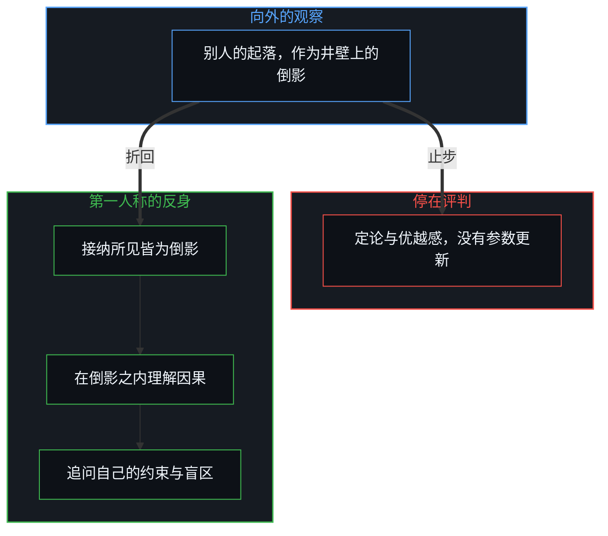
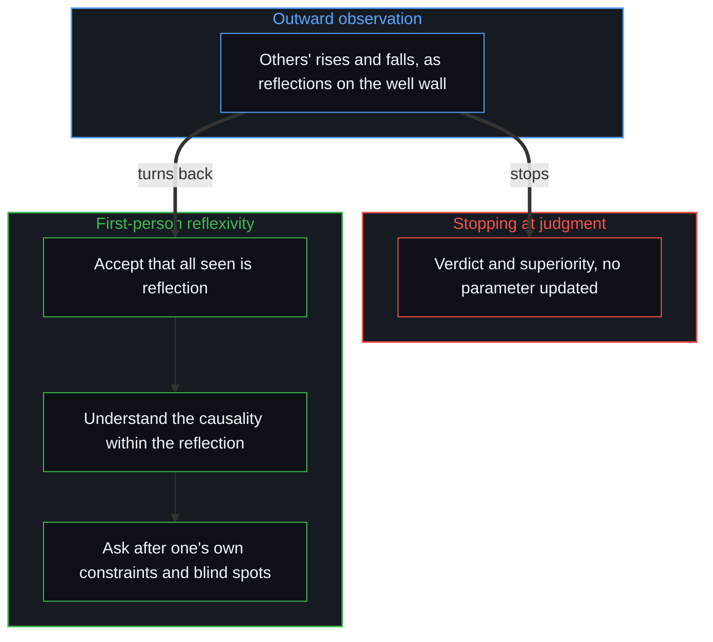

# 止步于评判，是认知的歧途 / Stopping at Judgment Is a Wrong Turn of Cognition

*向外的审视是对自己井壁的投射，把倒影折回第一人称、在决策里校准，观察才有意义 / Outward scrutiny projects one's own well walls; observation matters once the reflection turns back into decisions.*

在公共讨论与社交场合里，人们常关注别人的起落。一位曾在某些方面表现出色的人因为越界或判断失误陷入困境，舆论里很快就出现大量事后的分析与评判：人们站在岸上看困境，指出当事人的自大、短视或局限，得出“聪明反被聪明误”的结论。这种看似深入的观察与评判，多半不是认知的升级，而是心智停在表面分析上的一种状态。

In public discussion and social settings, people often watch the rises and falls of others. When someone who once excelled in some respect falls into trouble through overreach or misjudgment, public opinion quickly fills with after-the-fact analysis and judgment: standing on the shore watching the trouble, people point to the person's arrogance, short-sightedness or limits and conclude that "cleverness was undone by cleverness". This seemingly deep observation and judgment is mostly not an upgrade of understanding but a state in which the Mind stays at surface analysis.

现实遵循不可逆的因果与逻辑，这条因果链无始无终；能被感知、讨论与建构的任何“现实”“物理”或“事实”，都只能是站在此刻的第一人称视角上，对这条无尽因果链截取的一个局部有界的切片。只因在日常经验里与他人对某些概念达成了共识、没见到明显的分歧，就容易以为这些概念代表某种超然于心智之外的客观事实。每个人都身处自己认知视界构成的“深井”里，这个视界在任何具体时刻都有边界，可边界不是固定的，可以借持续的微观校准不断向外拓展。站在自己的井底望向别人时，捕捉到的从不是对方本身，而是对方的行为经过环境折射、投在自己井壁上的局部倒影。

Reality follows irreversible causality and logic, and the causal chain has no beginning and no end; any "reality", "physics" or "fact" that can be perceived, discussed and built can only be a local, bounded slice cut from that endless chain from the first-person view of this moment. Just because in daily experience one reaches agreement with others about certain concepts and sees no obvious disagreement, it is easy to think those concepts stand for some objective fact beyond the Mind. Everyone is inside a "deep well" formed by their own horizon of understanding; the horizon has a boundary at any given moment, yet the boundary is not fixed and can keep widening outward through continual micro calibration. Looking at others from the bottom of one's own well, what is caught is never the other person but a local reflection of their behaviour, refracted through the environment and cast on one's own well wall.

## 一、 倒影的错觉与旁观者的双重盲点 / 1. The Illusion of Reflection and the Spectator's Double Blind Spot

看见别人的选择、失误与局限时，心智容易生出一种掌控全局的确定感：以为自己看清了事件的因果全貌，进而生出优越感，“我懂得比他多，换作是我不会落到同样的困境”。这正是认知里容易忽视的错觉：拿来解构别人的标尺、概念框架与因果归因，来自自己这口井有限的认知；得出的判断，是自己认知框架投出的影子。以为在客观地审视别人，其实是在用别人的倒影反复确认自己这口井的形状。

Seeing others' choices, mistakes and limits, the Mind easily develops a sense of certainty, of commanding the whole: believing it has seen the full causal picture of the event, and so feeling superior, "I know more than they do; in their place I would not end up in the same trouble". This is an illusion easily overlooked: the rulers, conceptual frames and causal attributions used to take others apart come from the limited understanding of one's own well, and the judgment reached is a shadow cast by one's own frame. Believing one is objectively examining another, one is in fact using another's reflection to confirm, again and again, the shape of one's own well.

这构成一种对称的双重盲点。再往深看，连“对方是不是深陷盲区”也无法从外部确凿地断定。聪明并不意味着不犯错，在开放复杂的现实里，任何探索都伴随局部的试错与波动；聪明更多在于能否从错误里提取信号、完成自我迭代。当事人此刻经历的挫折，是一次盲区的暴露，是一次主动承担不确定的边界探索，还是一段正在其第一人称闭环里发生的学习与校准，受限于自己经验与信息的狭窄滤镜，旁观者无从查证。

This forms a symmetric double blind spot. Looking deeper, even "whether the other person really is stuck in a blind spot" cannot be established with certainty from outside. Being clever does not mean making no mistakes; in an open, complex reality every exploration comes with local trial, error and fluctuation, and cleverness lies more in whether one can extract the signal from mistakes and iterate on oneself. Whether the setback the person is going through now is a blind spot exposed, a boundary exploration deliberately taking on uncertainty, or learning and calibration happening within their own first-person loop, the spectator, limited by the narrow filter of their own experience and information, has no way to verify.

表面上，以为看清了“别人的问题”与局限；在认知层面上，这个所谓的“问题”，只存在于“捕捉到的表象”与“对这个表象的先验解读”之间的错配里。别人身上是否真有问题，受第一人称视界天然的隔绝所限，外部的观察者无法确定；引起冲突的“问题”，不在别人身上，而在自己的认知模型里。

On the surface one believes one has seen "the other's problem" and limits; at the level of understanding, this so-called "problem" exists only in the mismatch between "the appearance caught" and "one's prior reading of that appearance". Whether there really is a problem in the other person cannot be determined by an outside observer, limited by the natural separation of first-person horizons; the "problem" that produces the conflict is not in the other person but in one's own cognitive model.

恰恰是“问题在自己解读的错配里”这个认识，给了拓宽自己边界的机会。它让人放下简单化的定论，去找一套逻辑上自洽的解释：为什么那些经实践验证具备能力的人，在特定的因果链里会呈现出看似悖论的“聪明反被聪明误”？借着理解这种因果机制与错配，外部的案例才不再停在第三人称的谈资，而成为升级自己第一人称判断模型的参考与输入。道德审判也是投影阶梯上的一级，[投影的阶梯与因果的锚点](../tou-ying-de-jie-ti-yu-yin-guo-de-mao-dian/)把它锚回第一人称的因果。

It is precisely this recognition, that the problem lies in the mismatch of one's own reading, that offers the chance to widen one's own boundary. It leads one to set down simplified verdicts and look for a logically consistent explanation: why do people of proven capability, within particular causal chains, show the seemingly paradoxical "cleverness undone by cleverness"? By understanding this causal mechanism and mismatch, an outside case stops being third-person gossip and becomes a reference and input for upgrading one's own first-person model of judgment. Moral judgment is one more rung on the ladder of projections, and [The Ladder of Projections and the Anchor of Causality](../tou-ying-de-jie-ti-yu-yin-guo-de-mao-dian/) anchors it back in first-person causality.

## 二、 评判是深度停下的标志 / 2. Judgment as a Sign That Depth Has Stopped

对外部案例的观察停在第三人称的评判与相对比较上时，这种观察就成了认知深度停下的一个标志。这种状态很隐蔽：它在形式上是复盘与反思，调动了大量的注意，造出“我在理解、我在进步”的感觉，实际上并没有在自己内部的决策系统里更新任何参数；心智只是完成了一次基于故事的解读闭环，得到了智力上的自我满足。[当观察变成表演](../when-observation-becomes-performance/)指出了这个机制：观察一旦脱离第一人称行动与校准的闭环，评判就成了阻断继续向内探寻的那个停顿点。

When observing outside cases stops at third-person judgment and relative comparison, the observation becomes a sign that the depth of understanding has stopped. The state is well hidden: in form it is review and reflection, it mobilises a great deal of attention and produces the feeling "I am understanding, I am improving", yet no parameter in one's own inner decision system has actually been updated; the Mind has only completed a loop of story-based interpretation and gained intellectual self-satisfaction. [When Observation Becomes Performance](../when-observation-becomes-performance/) points to this mechanism: once observation leaves the first-person loop of action and calibration, judgment becomes the pause that blocks further inward inquiry.

与此同时，用来得出“聪明反被聪明误”的样本本身，天然受到可见性偏差的筛选。聪明人在人群里的分布同样有差异，并不是所有有超常智识的人都会困于自己的聪明；那些在各自领域里持续深耕、不断修正自己边界的精进者一直都在，却多半走在大众媒体与舆论的聚光灯之外，因为严谨自律、平稳推进的人生轨迹没有大众传播需要的戏剧冲突，既不提供故事性的快感，也不提供旁观者习惯的那种优越感。进入大众视野的，多半是引起广泛关注、出现显性偏差的样本；基于这些被筛选过的可见样本，容易对整体得出片面的结论。那些在聚光灯之外持续校准边界的精进者，决策机制反而更有参考价值：去理解他们怎样在长周期里维持认知与环境的动态自洽。

At the same time, the sample from which "cleverness undone by cleverness" is drawn is itself filtered by visibility bias. Clever people vary across a population too, and not everyone of exceptional intellect gets trapped by their own cleverness; those who keep working deep in their fields and keep revising their own boundaries are always there, yet they mostly move outside the spotlight of mass media and public opinion, because a rigorous, disciplined, steady life lacks the dramatic conflict mass communication needs, offering neither the pleasure of a story nor the superiority spectators are used to. What reaches the public eye is mostly the cases that draw wide attention and show visible deviation; drawing on these filtered, visible samples easily leads to one-sided conclusions about the whole. Those who keep calibrating their boundaries outside the spotlight have decision mechanisms of greater reference value: understanding how they keep understanding and environment dynamically consistent over long periods.

## 三、 从第三人称投射到第一人称反身 / 3. From Third-Person Projection to First-Person Reflexivity

评判别人本身并不是什么缺陷，它是心智对复杂的外部信息做快速压缩与归类的自然动作。可以如实地用描述性的语言去拆解“旁观别人怎样给心智带来优越感”这个心理机制，但要留意：尽量不在这层描述之上再叠一层评价与“二次优越感”。描述旁观的机制时，心里若生出对“围观人群”的又一层审视与否定，就在元层级上重新跌回同一个评判结构，用对“评判者”的评价，换来另一层隐蔽的优越感。脱离评判的惯性，不是走向语言洁癖，而是把“心智倾向于借比较获得优越感”当作一个认知现象来看：既不投射给被观察者，也不投射给观察者；要紧的，是评判之后能不能把所见所思转化成自己决策模型里可以优化的具体参数。做不到这一步，任何看似深刻的分析都只是精力的消耗。

Judging others is not in itself a defect; it is the Mind's natural act of quickly compressing and sorting complex outside information. The psychological mechanism of "how watching others gives the Mind a sense of superiority" can be taken apart honestly in descriptive language, but with care not to stack on top of that description another layer of evaluation and "second-order superiority". If, in describing the mechanism of spectating, one feels another layer of scrutiny and rejection toward "the onlooking crowd", one falls back at the meta level into the same structure of judgment, trading an evaluation of "the judges" for another hidden layer of superiority. Leaving the inertia of judgment is not a turn to verbal purism but seeing "the Mind's tendency to gain superiority through comparison" as a cognitive phenomenon, projected neither onto the observed nor onto the observer; what matters is whether, after judging, what was seen and thought can be turned into concrete parameters to optimise in one's own decision model. Without that step, any seemingly deep analysis is only spent energy.

[从形式迷思到逻辑闭环](../cong-xing-shi-mi-si-dao-luo-ji-bi-huan/)与[投资决策的因果闭环](../tou-zi-jue-ce-de-yin-guo-yu-zhen-zi-fu-ying-kui/)确立了把观察转化为可执行能力的三步路径。第一步，接纳“所见皆为倒影”的局限：放下“看懂全貌”的预设，不轻易下定论，清楚地知道自己所见只是特定滤镜下的局部投影。第二步，在倒影之内理解它的因果逻辑：不简单地贴标签，而是回到当事人所处的具体约束、信息条件与收益结构里，理解每一步决策怎样自洽，看清这套逻辑成立的前提与边界。第三步，做第一人称的反身：把视角从第三人称收回自身，追问“在我当前的处境里，是否有相似的约束与盲区？我此刻习以为常的判断模型，在对应的条件下是否也会导出类似的偏离？”

[From the Myth of Form to the Closed Loop of Logic](../cong-xing-shi-mi-si-dao-luo-ji-bi-huan/) and [The Causal Loop of Investment Decisions](../tou-zi-jue-ce-de-yin-guo-yu-zhen-zi-fu-ying-kui/) establish a three-step path for turning observation into operative capability. The first step accepts the limit that "all that is seen is reflection": setting down the presumption of "seeing the whole picture", not passing verdicts lightly, knowing clearly that what is seen is a local projection through a particular filter. The second step understands the causal logic within the reflection: not simply labelling, but returning to the concrete constraints, information conditions and payoff structure the person faced, understanding how each decision was consistent and seeing the premises and boundaries under which that logic holds. The third step turns reflexively to the first person: drawing the view back from the third person and asking, "in my present situation, are there similar constraints and blind spots? Would the model of judgment I take for granted now lead to a similar deviation under corresponding conditions?"

向外观察，找的不是别人的对错结论，而是在复杂的现实里可以跨情境对照与检验的底层决策结构；借别人的倒影，照见自己不易察觉的思维惯性。[格物致知与信息复杂度](../ge-wu-zhi-zhi-yu-xin-xi-fu-za-du-de-ben-zhi/)从王阳明格竹的困境里提炼出这一机制：只是第三人称的凝视，输入不了任何有效的因果变量；在第一人称之内具身地代入微观的工况，认知的因果闭环才立得起来。

Looking outward seeks not verdicts of right and wrong about others but the underlying structures of decision that can be compared and tested across situations in a complex reality; through another's reflection one sees one's own hard-to-notice habits of thought. [Investigating Things and the Nature of Information Complexity](../ge-wu-zhi-zhi-yu-xin-xi-fu-za-du-de-ben-zhi/) distils this mechanism from Wang Yangming's impasse with the bamboo: a third-person gaze alone feeds in no effective causal variable; only embodied entry into micro working conditions within the first person lets the causal loop of understanding stand.

## 四、 在深井中保持清醒 / 4. Staying Clear in the Deep Well

用“深井”比喻心智视界的边界时，语言的隐喻容易让人误以为这是一个固定不变的静态牢笼。能触碰、讨论与观察的一切现象，包括被称为“事实”或“物理”的东西，本身从没跳出第一人称的视界；可这并不意味着这个视界的边界是固定的。拓展深井边界的过程，本身是一种“跳出但不离开”的动态跃迁——正如《加州旅馆》那句经典歌词所揭示的微妙平衡：“你随时可以结账退房，却永远无法离开。”心智始终身处第一人称视界之中，从未离开，但每一次对自身隐性假设的追问与校准，都是在主动执行“随时跳出旧边界”的跃迁动作，从而在每一次动态迭代中将认知边界不断拓宽，获得更高分辨率的理解力。

When the "deep well" is used as a metaphor for the boundary of the Mind's horizon, the metaphor easily suggests a fixed, unchanging, static cage. Every phenomenon that can be touched, discussed and observed, including what is called "fact" or "physics", has never left the first-person horizon; yet this does not mean the horizon's boundary is fixed. Widening the well's boundary is itself a dynamic leap of stepping out without leaving, the delicate balance captured by the classic lyric from "Hotel California": "You can check out any time you like, but you can never leave." One always remains within some first-person horizon, never leaving it, while every questioning and calibration of one's own hidden assumptions is an active leap out of an old boundary, so that with each dynamic iteration the boundary of understanding keeps widening and the Mind gains finer-resolution understanding.

在向外探索的同时保持清醒，才有建设性：知道所见皆是投影，知道可见的样本自带偏差，知道解读中的“问题”登记的是自己框架的错配，知道一切不回到自身的旁观都是算力的耗散。观察的矢量不再止步于外部的评判，而折回第一人称的认知决策循环时，外部的案例才能重塑自己的选择。向外观察只是输入，向内重塑才是产出。

What is constructive is staying clear while exploring outward: knowing that all that is seen is projection, that visible samples carry their own bias, that the "problem" in an interpretation registers a mismatch in one's own frame, and that all spectating that does not return to oneself is dissipated computation. Only when the vector of observation no longer stops at outside judgment but turns back into the first-person loop of understanding and decision do outside cases transform one's own choices. Looking outward is only input; reshaping inward is the output.

更深一层，这篇文章的价值，不在于给出一套多么严丝合缝的静态结论，而在于在推演与表达的过程里，心智能不断向自己发问：“我是不是看清了因果步骤？”“我是不是在潜意识里又叠加了一层先验假设与二次评判？”在一次次的追问里剥离思维的惯性，在实践中拓宽微观边界。正如[生命的意义在起草之中](../the-meaning-of-life-is-in-the-drafting/)与[学习中不可观测的驱动力](../the-unobservable-driver-of-learning/)所揭示的：价值在追问与刻画的活的过程里，而不在身后留下的静态痕迹里。文本只是思维运动退出的残影：正如[你的代码库即是记忆](../your-codebase-is-memory/)在各类外化代码库与书面文集里所刻画的，任何记录在案的器物都只是结构化的记忆，而非思考主体本身；唯有当鲜活的心智从痕迹退回自身的第一人称掌舵前沿、重新审视并整合生成该痕迹的前提时，内部参数才会更新。评判别人留下的印迹，并不触及行动本身，[印迹与行动](../the-mark-and-the-act/)说明了这一点。

At a deeper level, the value of this essay lies not in offering a seamless static conclusion but in the Mind continually questioning itself in the course of reasoning and expression: "have I seen the causal step clearly?" "have I, half-consciously, stacked another layer of prior assumption and second-order judgment?" Through question after question, the inertia of thought is stripped away and the micro boundary widens in practice. As [The Meaning of Life Is in the Drafting](../the-meaning-of-life-is-in-the-drafting/) and [The Unobservable Driver of Learning](../the-unobservable-driver-of-learning/) reveal, the value lies in the living process of questioning and tracing, not in the static trace left behind. The text is only the afterimage left as thought's movement exits: as [Your Codebase Is Memory](../your-codebase-is-memory/) traces across externalized repositories and written corpora, any recorded artifact is structured memory rather than the thinking subject itself, and its parameters update only when the living Mind returns from the trace to its own first-person steering edge to re-examine and consolidate the premises that produced it. Judging the marks others leave does not touch the act itself, as [The Mark and the Act](../the-mark-and-the-act/) shows.
