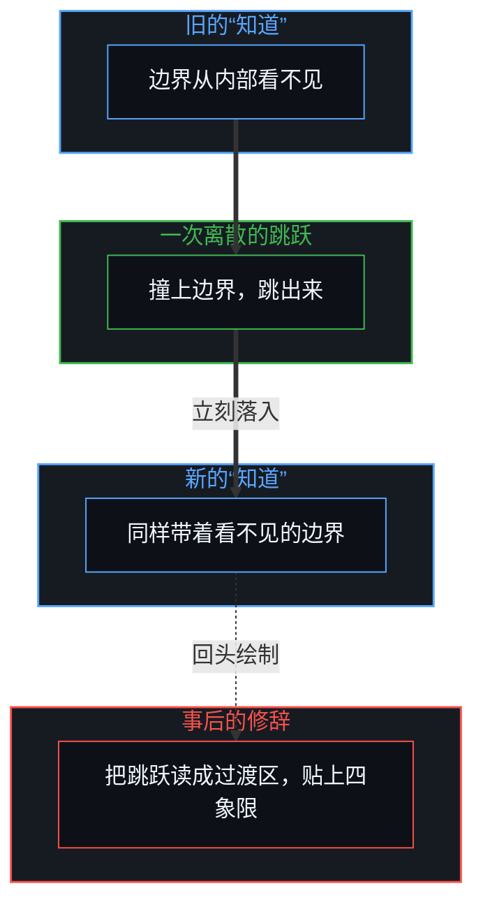
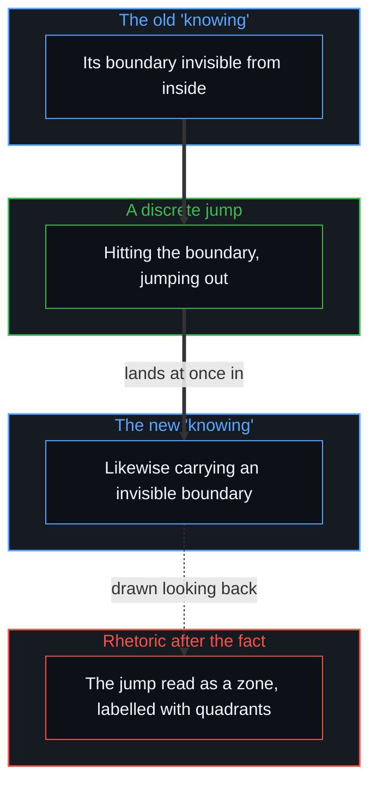

# “知道自己不知道”是一种修辞假象 / Knowing That You Don't Know Is a Rhetorical Illusion

*把未知预设为可描摹的封闭圆盘，是用高阶修辞免除触碰边界的认知外包 / Presuming the unknown a closed, outlinable disc outsources, by elevated rhetoric, the work of touching the boundary.*

现在有一种很常见的现象：把一个听起来很宏大、抽象的高维问题抛给大语言模型，“有没有比这更高级的思维模型”“终极认知的底层逻辑是什么”“超越人类文明的超级智能会怎样构建世界观”，然后把模型生成的、结构严谨、辞藻华丽的长篇大论，当作自己的深度思考向外展示。

A very common phenomenon now: throw a grand-sounding, abstract, high-dimensional question at a large language model, "is there a more advanced thinking model than this", "what is the underlying logic of ultimate cognition", "how would a superintelligence beyond human civilisation build its worldview", and then display the model's rigorously structured, ornately worded discourse as one's own deep thinking.

这与学生把题目丢给模型、把生成的答案不假思索地交上去，在结构上没有两样：外表呈现出掌握知识的完满形态，内部却没有发生一丝真实的理解；搬运的是词组、框架与句式，跳过的是区别与推演的真实成本，最后造出来的，只是一场关于“知道”的幻觉。

This is structurally no different from a student throwing a problem at a model and handing in the generated answer without thought: the outside shows the complete form of mastered knowledge, while inside not a trace of real understanding has happened; what is carried over is phrases, frameworks and sentence patterns, what is skipped is the real cost of distinguishing and reasoning, and what is produced in the end is only an illusion of "knowing".

这种技术时代的搬运值得拆开，是因为它与一套更古老、流传更广、也更受尊崇的话术同构，那就是被奉为认知圣杯的格言：“我知道自己不知道”。顺着这个台阶往上，还有元认知、达克效应、降维打击、认知飞升。它们听起来像是在更高的维度保持清醒，实际上常是同一种认知外包：用一套现成的高阶修辞，免去自己去触碰并承受认知边界破裂的劳作。

This technological-age carrying is worth taking apart because it is isomorphic with an older, more widespread and more revered formula, the maxim held up as a holy grail of cognition: "I know that I don't know". Climbing on from that step there are metacognition, the Dunning–Kruger effect, "dimensional strikes" and "cognitive ascension". They sound like staying clear at a higher dimension, yet in practice are often the same cognitive outsourcing: using a ready-made set of higher-order rhetoric to spare oneself the labour of touching, and bearing the breaking of, the boundary of one's understanding.

## 一、 概念的偷渡：封闭的圆盘与全知的视角 / 1. A Smuggled Concept: The Closed Disc and the All-Knowing View

“知道自己不知道”之所以一听就让人觉得很有哲学美感与自省的深度，是因为它在底层偷偷预设了两个没被审视的前提：

"Knowing that I don't know" sounds at once philosophically beautiful and deeply self-aware because it quietly presupposes, at bottom, two unexamined premises:

1. 知识有一个客观存在、已经划定的固定边界：好像全人类的知识是一个完整的封闭圆盘，一块被我占领，是已知，剩下那块是还没被我占领的区域，是未知；于是“知道自己不知道”就变成“我已经洞悉了这个圆盘的全部轮廓，并且清醒地知道自己目前只站在其中的一小块”。
2. 这个圆盘的总量是有限的、可以被预先封装的：否则所谓“剩下那部分”在逻辑上就无从谈起。如果知识是开放的，边界随着行动的推进而不断动态地生成，这句话就失去了立足点。

1. Knowledge has an objectively existing, already drawn fixed boundary: as if all human knowledge were a complete closed disc, one part occupied by me, the known, and the rest not yet occupied by me, the unknown; so "knowing that I don't know" becomes "I have grasped the whole outline of the disc and know clearly that I now stand on only a small part of it".
2. The disc's total is finite and can be packaged in advance: otherwise "the rest" could not be spoken of at all. If knowledge is open, its boundary generated continually and dynamically as action advances, the sentence loses its footing.

把这两个隐藏的预设摊开，逻辑的破绽就露了出来。如果真的知道那道边界在哪里、边界之外还剩下什么具体内容，那么对“不知道的事物”实际上已经有了正面的知识，至少已经勾勒出了它的轮廓、范围与存在的形态；这时再说“我不知道”，只是在用已知体系里的语言硬去命名未知，这不是无知，而是一种隐秘的自负。更深的矛盾在于，[开放场域中的无损知识不自洽](../lossless-knowledge-of-an-open-field-is-incoherent/)指出，对开放领域全景式的无损掌握在逻辑上自相矛盾：只要承认现实是开放的、认知的边界是动态演进的，就永远不可能站到一个“已经完成”的系统之外，反身指着它宣称自己已经看清了未知的全貌。

Once these two hidden presuppositions are laid out, the logical flaw shows. If one really knew where the boundary lies and what specific content remains beyond it, one would already have positive knowledge of "what is not known", having at least sketched its outline, extent and form of existence; saying "I don't know" then only forces the language of the known system onto the unknown, which is not ignorance but a hidden conceit. The deeper contradiction is that, as [Lossless Knowledge of an Open Field Is Incoherent](../lossless-knowledge-of-an-open-field-is-incoherent/) points out, a panoramic, lossless grasp of an open field is logically self-contradictory: as long as reality is acknowledged as open and the boundary of understanding as evolving, one can never stand outside a "completed" system and point back at it, claiming to have seen the whole shape of the unknown.

严谨、干净的本体论表述只有一句：

The rigorous, clean ontological statement is only this:

> 我只能确认，我当前所掌握的这套理解是有局限的；  
> 我无法从内部完整地看见这个局限在客观上究竟长什么样，更无法站在全知的视角宣称自己已经掌握了未知区域的轮廓。

> I can only confirm that the understanding I hold now is limited;  
> I cannot see from inside what that limit objectively looks like, still less claim from an all-knowing view to have grasped the outline of the unknown.

这句话不需要预设任何封闭的知识总量，也不需要假装自己已经摸到了未知的边缘，它只是对当前有限认知的有效性做一次诚实的确权。

The statement needs no presupposed closed total of knowledge and no pretence of having touched the edge of the unknown; it is only an honest confirmation of the validity of present, finite understanding.

## 二、 界限的不可见与跳跃造成的四象限 / 2. The Invisible Bound and the Quadrants a Jump Produces

再往下追：为什么人们这样热衷于把认知切成“不知道自己不知道”“知道自己不知道”“不知道自己知道”“知道自己知道”这套看似深奥的四象限阶梯？这个假象的来由，是混淆了“身处界限之内”与“发生跳跃之时”的几何关系：

Following further: why are people so keen to cut understanding into the seemingly profound four-quadrant ladder of "not knowing that one doesn't know", "knowing that one doesn't know", "not knowing that one knows" and "knowing that one knows"? The illusion comes from confusing the geometry of "being within a bound" with that of "the moment a jump happens":

1. 界限在内部是看不见的：在任何一个当下的认知状态里，已知与未知之间确实有一道界限；可只要还身处当前这套“知道”的界限之内，就无法从内部看见自身的边界长什么样，就像鱼无法在水里测量水域的外壳，任何认知框架都无法在自身系统之内测绘自己的终点。
2. 认知的突破是一次离散的跳跃：只有真正撞上既有的边界、完成突破、“跳出来”的那一刻，回望过去，才恍然发现“原来之前的知道是有狭隘边界的”；可在跳出来的同一个瞬间，并没有进入某种超脱一切的上帝视角，而是立刻落进了一个全新的、同样带着未知界限的“知道”之中。
3. 把跳跃的瞬间误读为静态的过渡区间：正因为从旧界限到新界限之间经历了一次离散的跳跃，事后复盘时，人们就把这次跳跃带来的心智震荡，错认成一个客观存在的“过渡缓冲区”；语言的修辞随即跟进，给这个并不存在的中间地带贴上标签：把跳跃前夕的直觉发挥或事后验证叫作“不知道自己知道”，把跳跃发生时感到的狭隘反差叫作“知道自己不知道”，再把更远的、尚未触碰的广袤世界叫作“不知道自己不知道”。

1. The bound is invisible from inside: in any present state of understanding there is indeed a bound between known and unknown; yet as long as one remains within the bound of the present "knowing", one cannot see from inside what one's own boundary looks like, just as a fish cannot measure the shell of the water from within it, and no cognitive frame can map its own end from inside its system.
2. A breakthrough in understanding is a discrete jump: only at the moment one really hits the existing boundary, breaks through and "jumps out", looking back, does one suddenly find that "the earlier knowing had a narrow boundary"; yet in that same moment of jumping out one enters no God's-eye view above it all but lands at once in a new "knowing" that likewise carries an unknown bound.
3. The moment of the jump misread as a static transition zone: precisely because a discrete jump lay between the old bound and the new, people reviewing afterward mistake the mental shock of the jump for an objectively existing "transition buffer"; rhetoric follows at once and labels this non-existent middle ground: the intuition just before the jump or the verification after it becomes "not knowing that one knows", the sense of narrow contrast at the moment of the jump becomes "knowing that one doesn't know", and the vast, farther world not yet touched becomes "not knowing that one doesn't know".

[现实的边界](../xian-shi-de-bian-jie/)与[抽象、边界与现实的移动边缘](../abstraction-boundaries-and-the-moving-edge-of-reality/)揭示了这种概念的偷渡：在本体的结构里，只有“一个已知”与“一个未知”，以及二者之间那道当下从内部无法确定的移动界限。所谓“不知道自己知道”，在逻辑上自相矛盾：知识不是存放在潜意识仓库里的现成死物，尚未被心智在当下实际划出的区分，在本体上就是无知，[信息是什么](../what-information-is/)。所谓“知道自己不知道”，同样是事后站在跳跃之后的新立足点上，回头画出的虚假地图。并没有一个可以事先推演、层层进阶的四象限矩阵；只有当活着的心智在当下承受边界的破裂、完成向外的一跃，未知的一角才真的被点亮为已知。除此之外，一切想在跳跃发生之前就宣称已经看透了认知区间的元语言，都是对触碰边界的逃避。

[The Boundary of Reality](../xian-shi-de-bian-jie/) and [Abstraction, Boundaries, and the Moving Edge of Reality](../abstraction-boundaries-and-the-moving-edge-of-reality/) reveal this conceptual smuggling: in the ontological structure there is only "one known" and "one unknown", and between them a moving bound that cannot be fixed from inside in the present. So-called "not knowing that one knows" is logically self-contradictory: knowledge is not a ready-made dead object stored in a warehouse of the unconscious, and a distinction the Mind has not actually drawn in the present is, ontologically, ignorance, as in [What Information Is](../what-information-is/). So-called "knowing that one doesn't know" is likewise a false map drawn after the fact, looking back from the new footing after the jump. There is no four-quadrant matrix that can be worked out in advance and climbed level by level; only when a living Mind bears the breaking of the boundary in the present and makes the leap outward is a corner of the unknown really lit up as known. Beyond that, every metalanguage that claims, before the jump happens, to have seen through the intervals of understanding is an avoidance of touching the boundary.

## 三、 修辞性的谦逊 / 3. Rhetorical Humility

“知道自己不知道”之所以比单纯的无知更有迷惑性，正在于它多裹了一层自我感动的修辞糖衣。它用一种高阶的元语言，造出一种凌驾于无知之上的认知幻象；说话的人容易陷入一种微妙的心态：我都已经公开承认自己“知道自己不知道”了，已经在哲学层面完成了自我审判。于是，真实的挑战与边界的摩擦再度来临时，这句话立刻变成最坚固的免责挡板：“我已经够谦逊地承认我不知道了，你何必再苛求我？”表面上是对知识极致的谦逊，底下是用语言修饰过的认知自负。真正的谦逊，是敞开边界去承受现实的重击与重塑；修辞性的谦逊，却用一张预先贴好的元标签，把探索的通道焊死：既然已经升华到了“知不知”的高度，当下具体的碰撞就被降级为多余的琐碎。

"Knowing that I don't know" is more misleading than plain ignorance precisely because it wears an extra coating of self-congratulating rhetoric. It uses a higher-order metalanguage to create an illusion of understanding standing above ignorance; the speaker easily falls into a subtle frame of mind: I have publicly admitted that I "know I don't know", and so have completed my self-judgment at the philosophical level. So when real challenge and the friction of the boundary come again, the sentence at once becomes the sturdiest shield of exemption: "I have humbly admitted I don't know; why demand more of me?" On the surface it is the utmost humility about knowledge; beneath, it is cognitive conceit dressed in language. Real humility opens the boundary to bear reality's blows and reshaping; rhetorical humility seals the passage of exploration with a meta-label stuck on in advance: having risen to the height of "knowing not knowing", the concrete collision of the present is demoted to superfluous detail.

元认知、底层逻辑、认知飞升，常走同一条自我催眠的路。不是说自省与方法论没有价值，而是“我已经站在更高一层俯视全局”这个姿态本身，容易被固化成一种新的知识资产，用来免去下一次在泥泞中思考的真实痛苦。[持续生长的脚手架](../the-scaffolding-that-keeps-growing/)追溯这个姿态：退后一步去俯瞰一个结构，就把它冻结成一个完成的物件，把敞开挪进观察者的距离里，而脚下的结构早已变了形状。

Metacognition, underlying logic and cognitive ascension often walk the same road of self-hypnosis. Not that self-reflection and method lack value; rather, the posture "I already stand one level up surveying the whole" easily hardens into a new knowledge asset used to spare oneself the real pain of thinking in the mud next time. [The Scaffolding That Keeps Growing](../the-scaffolding-that-keeps-growing/) traces this posture: stepping back to survey a structure freezes it as a finished object and moves openness into the observer's distance, while the structure underfoot has already changed shape.

把大模型的高阶输出当成个人的思考，是这个幻觉的技术加速器。过去，一个人要读大量典籍才能堆砌出看似玄奥的高阶词汇；现在，只需输入几个指令，AI 就能在几秒钟里吐出结构无懈可击的“顶级框架”。展示认知形态的门槛降到了零，沉淀认知所必需的理解成本被全盘跳过；幻觉由此完成了终极的迭代：不仅显得博学，而且显得早已跳出三界外，在框架之上操纵框架。提问的句式，也显出提问时所站的位置：如果问题总是“还有没有更高维度的框架”“更顶级的认知是什么”，默认的其实是一座可以无限向上攀爬的确定性梯子，却从没停下来审视，用来搜寻“更高框架”的这套认知装置，自身的局限究竟在哪里。[好奇没有最终的形态](../curiosity-has-no-final-form/)揭示了这种停滞：把历史遗留的抽象容器当作终点，只会让思维陷进测量自身残影的漫长时滞。

Taking a large model's higher-order output for personal thinking is this illusion's technological accelerator. In the past one had to read a great many classics to pile up lofty-seeming vocabulary; now a few prompts make AI produce, in seconds, a flawlessly structured "top-tier framework". The threshold for displaying the form of understanding has dropped to zero while the cost of understanding needed to settle it is skipped entirely; the illusion thereby completes its final iteration: looking not only learned but long since beyond the world, manipulating frameworks from above them. The form of a question also shows where the asker stands: if the question is always "is there a higher-dimensional framework" or "what is more top-tier cognition", what is presumed is a ladder of certainty one can climb without end, without ever stopping to examine where the limits lie of the very cognitive apparatus used to search for "a higher framework". [Curiosity Has No Final Form](../curiosity-has-no-final-form/) reveals this stagnation: taking historically inherited abstract containers as the end only traps thinking in a long lag of measuring its own afterimages.

## 四、 AI 作为探针，而不是替身 / 4. AI as Probe, Not Stand-In

正确使用大模型，不是把思考与判别的本职工作外包给算法，再把外包生成的精美文本认领为自己已经完成的认知跃迁。[智能只属于心智](../intelligence-belongs-only-to-the-mind/)确立了这条边界：智能与理解只属于活着的行动主体，模型是高维统计概率沉淀下来的符号生成装置。AI 能发挥的最大效用，是做提问者的一枚高灵敏度探针：

Using a large model rightly is not outsourcing the proper work of thinking and distinguishing to an algorithm and then claiming the polished outsourced text as a cognitive leap one has completed oneself. [Intelligence Belongs Only to the Mind](../intelligence-belongs-only-to-the-mind/) establishes this boundary: intelligence and understanding belong only to the living acting subject, and a model is a symbol-generating apparatus settled from high-dimensional statistical probability. The greatest use AI can serve is as a high-sensitivity probe for the questioner:

- 把提问者思维里含混的概念逼到墙角；
- 把藏在论证底层的隐性假设暴露出来；
- 把某种自圆其说的推演推到它自身无法维系的破裂极限。

- driving the vague concepts in the questioner's thinking into a corner;
- exposing the hidden assumptions buried at the bottom of an argument;
- pushing a self-justifying line of reasoning to the breaking limit it cannot sustain.

在整个过程里，承受负荷、做出区分、完成重构的施力主体，始终要是提问者本人；模型是刺破幻象的手术刀与探针，不是替代大脑运转的替身。把 AI 用反了，是把问题抛出去、把答案全盘接收，完成一次只停在视网膜表面的掌控仪式；学生应付作业是这样，成年人对外展示“高维认知”也是这样。[Token 效率、模拟与无法弥合的间隙](../token-efficiency-emulation-and-the-unclosable-gap/)揭露了这种仿制：可以用很低的计算代币去模拟高阶结论的词汇序列，但这并不等于走过了得出这个结论所必须经历的认知路径。

Throughout, the force-bearing subject who carries the load, makes the distinctions and completes the reconstruction must remain the questioner; the model is a scalpel and probe that pierces illusion, not a stand-in that runs in place of the brain. Using AI backwards is throwing the question out, taking the answer whole and completing a ritual of mastery that stays on the surface of the retina; a student getting through homework does this, and so does an adult displaying "high-dimensional cognition". [Token Efficiency, Emulation, and the Unclosable Gap](../token-efficiency-emulation-and-the-unclosable-gap/) exposes this imitation: the vocabulary sequence of a higher-order conclusion can be emulated with very few computational tokens, but that does not mean the cognitive path one must travel to reach the conclusion has been walked.

所以，判断一个人是在借 AI 深度思考，还是在用 AI 批量生产思维的假肢，不必看贴出来的输出有多宏大，也不必看搬运的模型多前沿，只需看问题是否真正扎进了自己思维的盲区与边界。如果提问只是在收集更高阶的修辞标签，那么即使生成的回答再精妙，也只是一场词汇的廉价批发。

So whether someone is thinking deeply with AI or mass-producing prostheses of thought with it is judged not by how grand the posted output is, nor by how cutting-edge the model carried over, but only by whether the question really pierces the blind spots and boundaries of one's own thinking. If the question only collects higher-order rhetorical labels, then however exquisite the generated answer, it is only a cheap wholesale of vocabulary.

## 五、 认知生长的边缘 / 5. The Edge Where Understanding Grows

把一切伪饰的元修辞拆开之后，认知的真相其实很朴素。不知道就是不知道；在不知道之上再叠一层“我知道我不知道”的自我赏玩，既不能让无知缩减分毫，只会给下一次真实的碰撞平添阻碍。有生长价值的动作只有一个：把全部的注意锚定在当前能被清楚感知的边界上，然后有意识地驱使自己的理解去正面撞击它。

With all the decorative metarhetoric taken apart, the truth of understanding is quite plain. Not knowing is not knowing; stacking a layer of self-admiring "I know I don't know" on top of not knowing does not shrink ignorance a whit and only adds obstacles to the next real collision. There is only one act with value for growth: anchoring all attention on the boundary that can be clearly felt now, and deliberately driving one's understanding to strike it head on.

意识到局限，不是为了在虚荣心上给自己颁一枚“保持谦卑”的道德勋章，而是为了给下一次具体、精准的区别腾出得以发生的空间。[信息是什么](../what-information-is/)确立了信息与知识的源头：知识的增加，来自活着的心灵在当下划出全新的界限，而不是在既有的词汇库里清点存量。所谓反思与内省，不是脱离现实、悬在半空中给自己的思维打分，而是让正在进行的推理去承受它自身无法解释的反例与重压。

Recognising one's limits is not for awarding oneself a moral medal of "staying humble" for vanity's sake but for making room for the next concrete, precise distinction to happen. [What Information Is](../what-information-is/) establishes the source of information and knowledge: knowledge grows from a living Mind drawing a new boundary in the present, not from counting stock in an existing vocabulary. So-called reflection and introspection is not scoring one's own thinking while hanging in mid-air, detached from reality, but letting the reasoning under way bear the counterexamples and weight it cannot itself explain.

AI 只有被嵌进这套撞击的动作里，才释放出工具的价值：照亮盲区，极限施压，把某种陈旧的理论推到崩溃的边缘。可工具永远替代不了崩溃与重生的过程本身，那种认知被撕开、拆解、再重新组织起来的阵痛，只能由当事人在自己的心智里亲自承担。更高维的理论、更玄妙的认知框架、更宏大的元认知地图，在探索中都可以作为临时的脚手架；一旦被占有者固化成身份的优越感，就迅速坍缩成一个封闭的假想圆盘。思维要持续进化，靠的从来不是在脑海里把圆盘的虚线画得更大，而是清醒地认领当前这块有限立足点的全部边界，然后从这块立足点的边缘向外迈出一步。边界之外没有任何预设的标签与框架；那里有的，只是尚未发生的理解，与等待被划出的新世界。

AI releases its value as a tool only when embedded in this act of striking: lighting up blind spots, applying pressure to the limit, pushing some stale theory to the edge of collapse. Yet a tool can never replace the process of collapse and rebirth itself; the pain of understanding being torn open, taken apart and reorganised can only be borne by the person in their own Mind. Higher-dimensional theories, subtler cognitive frameworks and grander metacognitive maps can all serve as temporary scaffolding in exploration; once hardened by their holder into a sense of superior identity, they collapse at once into a closed imaginary disc. Thinking keeps evolving not by drawing the dotted line of the disc ever larger in the head but by clearly owning the whole boundary of the finite footing one stands on now, and stepping outward from its edge. Beyond the boundary there are no preset labels or frameworks; there is only understanding not yet happened, and a new world waiting to be drawn.
