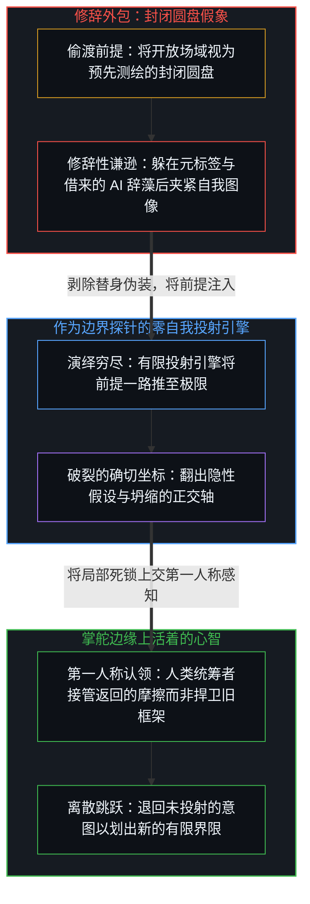
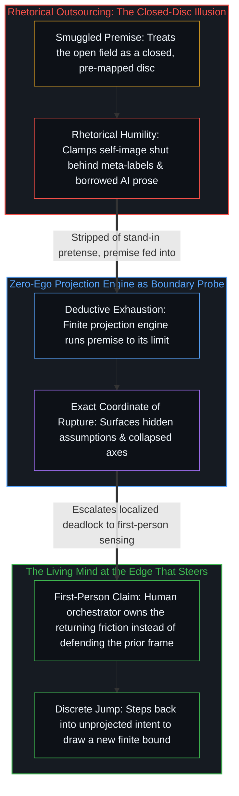

# “知道自己不知道”是一种修辞假象 / Knowing That You Don't Know Is a Rhetorical Illusion

*把未知预设为封闭圆盘，是免除触碰边界的认知外包 / Presuming the unknown a closed disc outsources the work of touching the bound*

围绕大语言模型流行着一种常见仪式：把一个宏大、抽象的提示词抛给模型——追问是否存在更高维度的思维模型、终极认知的底层逻辑是什么、超越人类文明的超级智能会如何构建世界观——随后将模型生成的结构严谨、辞藻华丽的长篇文本，当作自己的深度思考向外展示。

A familiar ritual has taken hold around large language models: someone feeds a grand, abstract prompt into a model—asking whether a higher-dimensional mental model exists, what underlying logic governs ultimate cognition, or how a superintelligence beyond human civilization would construct its worldview—and then presents the model's rigorously structured, ornately worded output as their own depth of thought.

这与学生将作业题丢给模型、不经审视便把生成的答案交上去，在结构上并无二致。表面呈现出掌握知识的完满形态，而构建整段论证的区分步骤从未由展示者亲自走过。搬运的是词组、框架与句法模板，跳过的是划出区分并承受其摩擦的不可逆因果做功，最终造出的只是一场“已经知道”的假象。

Structurally, this is no different from a student feeding a homework problem into a model and turning in the generated answer unexamined. The surface exhibits the polished form of mastered knowledge while the distinguishing steps that built the argument were never performed by the presenter. Phrases, frameworks, and syntactic templates are carried over while the irreversible causal work of drawing distinctions and bearing their friction is bypassed, producing only an illusion of knowing.

这种技术时代的借用值得拆解，是因为它与另一句历史更久、更受推崇的哲学格言同构：“我知道自己不知道”。顺着这级台阶延伸出去，还坐落着元认知、达克效应、降维打击与认知飞升等相邻标签。它们听起来像是在更高维度保持清醒，运作起来却是同一种认知外包：调用一套现成的高阶修辞，免去中心去触碰自身理解边界并承受其破裂的劳作。

This technological borrowing is worth dissecting because it shares the exact geometry of an older, far more revered formula held up as a philosophical ideal: the maxim "I know that I don't know." Extending from that step sit neighboring labels such as metacognition, the Dunning–Kruger effect, dimensional superiority, and cognitive ascension. Although they sound like lucidity maintained from a higher vantage, in practice they operate as the same cognitive outsourcing—deploying ready-made higher-order rhetoric to exempt a center from touching, and bearing the rupture of, its actual boundary of understanding.

## 一、 封闭圆盘与全知视角的偷渡前提 / 1. The Smuggled Premise of the Closed Disc and the Omniscient View

“知道自己不知道”这句格言之所以让人乍听之下觉得极具哲学美感，是因为它在底层悄然偷渡了两个未经审视的前提。第一，它预设知识拥有一道已经划定、固定不变的边界，仿佛一切可能的理解构成了一枚完整封闭的圆盘，其中一块已被占领为已知，余下那块则作为尚未占领的未知原地等待；于是宣称“知道自己不知道”，就等于宣称自己已经测绘过整枚圆盘的外周，同时谦虚地指出目前只站在其中的一小片区域上。第二，它预设这枚圆盘的总面积是有限的、可预先封装的，因为倘若没有一个有界总体，“余下尚未知道的部分”便失去了指称对象。一旦承认理解是一片开放场域、其边界随着行动推进而动态生成，这句格言便失去了立足点。

The maxim "knowing that one does not know" carries an immediate philosophical appeal because it quietly smuggles in two unexamined premises at its foundation. First, it presumes that knowledge possesses an already drawn, fixed boundary, as though all possible understanding formed a complete, closed disc in which one region is occupied as the known and the remaining region waits unoccupied as the unknown; claiming to know that one does not know then amounts to claiming to have surveyed the entire perimeter of the disc while modestly noting that one currently stands on only a small patch of it. Second, it presumes that the total area of this disc is finite and sealable in advance, for without a bounded totality the phrase "the rest that remains unknown" has no referent. Once understanding is recognized as an open field whose boundary is generated dynamically as action advances, the maxim loses its footing.

把这两个隐藏预设摊开，姿态内部的矛盾便暴露出来。倘若有人真切知道那道边界落在何处、边界之外还剩哪片疆域，那他对未知事物实际上已经拥有了正面知识，至少已经勾勒出它的轮廓、范围与存在形态；站在这一位置上再说“我不知道”，不过是把既有体系的词汇强行投射到尚未被区分的场域之上，用隐秘的自负顶替真实的无知。正如[开放场域中的无损知识不自洽](../lossless-knowledge-of-an-open-field-is-incoherent/)所确立的，自我区分活动的每一个中心都是离散且有界的，任何有限登记都无法无损捕捉开放场域，也无法站到一个已完成的总体之外去俯瞰它的余项。正因为区分活动永不停息、其边缘随每一次行动而推移，并不存在一个外部视角，能让心智回身指着一张已经绘好的地图去标出自己尚未理解的一切。

Laying those two hidden presuppositions bare exposes the contradiction inside the posture. Anyone who genuinely knew where the boundary lay and what territory remained beyond it would already hold positive knowledge of the unknown, having at minimum sketched its contour, extent, and mode of existence; declaring "I don't know" from that stance merely projects the vocabulary of an existing system onto what has not yet been distinguished, replacing actual ignorance with a concealed conceit. As [Lossless Knowledge of an Open Field Is Incoherent](../lossless-knowledge-of-an-open-field-is-incoherent/) establishes, every center of self-distinguishing activity is discrete and bounded, and no finite registration can capture an open field without loss or stand outside a completed totality to survey its remainder. Because distinguishing is unceasing and its edge moves with every act, no external vantage exists from which a mind could point back at a finished map of everything it has yet to understand.

剥除偷渡而来的无处不在视角，一个有界中心在每一步所能确认的都严格局部：当前持有的理解是有限且暂时的，它的外部界限无法从内部作为一件已完成的形状被检视，也不存在任何全知视角可供勾勒界限之外的疆域。这一确认既不需要预设封闭的知识总量，也不需要假装自己已经摸清未知的边缘；它只是如实登记当前理解的有界有效性，而不把边界冻结成一件客体。

Stripped of the smuggled view from nowhere, what a bounded center can confirm at any step is strictly local: the understanding currently held is finite and provisional, its outer limit cannot be inspected as a completed shape from within, and no omniscient vantage is available from which to outline the territory beyond it. That recognition requires neither a presupposed closed total of knowledge nor the pretense of having already traced the edge of the unknown; it simply registers the bounded validity of present understanding without freezing the boundary into an object.

## 二、 看不见的界限与跳跃生成的四象限 / 2. The Invisible Bound and the Quadrants a Jump Produces

既然如此，大众话语为何依然热衷于把理解切成“不知道自己不知道、知道自己不知道、不知道自己知道、知道自己知道”的四象限阶梯？这一假象源于把界限之内运作的几何结构，同跨越界限那一跃的事后痕迹混为一谈。

Why, then, does popular discourse remain so drawn to slicing understanding into a four-quadrant ladder of not knowing that one does not know, knowing that one does not know, not knowing that one knows, and knowing that one knows? The illusion arises from conflating the geometry of operating within a boundary with the retrospective trace of jumping across it.

只要一个中心还留在当前的认知框架之内，它所登记的内容与遗漏的内容之间的界限从内部就是看不见的，正如没有任何形式系统或感知框架能仅凭当前持有的坐标去测绘自身的终点。理解上的突破从不是跨过已标定国界的从容漫步，而是一次离散的跳跃。唯有当中心撞上无法同化的摩擦、撑破先前的持守、跃入更宽广的区分时，它才能回望过去，登记到先前的“知道”被局限在一处狭隘围栏里。然而在迈出那一步的同一瞬间，心智并未升入永恒的上帝视角，而是立刻落进了一个重新渲染出的新认知框架之中，那里同样携带着看不见的地平线。

As long as a center remains inside its current frame of knowing, the boundary between what it registers and what it misses is invisible from within, just as no formal system or perceptual frame can map its own terminus using only the coordinates it currently holds. A breakthrough in understanding is never a leisurely stroll across a charted border; it is a discrete jump. Only at the moment a center collides with unassimilable friction, ruptures its prior hold, and leaps into a wider distinction does it look back and register that its earlier knowing was confined within a narrow enclosure. Yet in that very instant of stepping out, the mind does not ascend into a permanent God's-eye view; it lands immediately inside a new, re-rendered frame of knowing that carries its own unseen horizon.

正因为旧界限与新界限之间隔着一次离散跳跃，事后复盘便常把跨越瞬间的震荡误读为静候在两种状态之间的静态缓冲区。修辞随即跟进，用标签填满这片假想的中间地带：跳跃前夕尚未解释的摩擦或跳跃之后的事后重溯，被命名为“不知道自己知道”；旧框架开裂瞬间登记到的狭隘反差，被冻结成一种叫作“知道自己不知道”的常驻姿态；而向远处投射出去的未触及广袤区域，则被贴上“不知道自己不知道”的标签。

Because a discrete jump separates the old bound from the new, hindsight routinely misreads the shock of that transition as a static buffer zone waiting between the two states. Rhetoric then moves in to populate this imaginary middle ground with labels: the pre-interpretive friction just before the leap, or the retrospective re-tracing after it, is christened "not knowing that one knows"; the sudden contrast registered at the moment the old frame cracks is frozen into a standing posture called "knowing that one does not know"; and the untouched expanse projected beyond is labeled "not knowing that one does not know."

[现实的边界](../xian-shi-de-bian-jie/)与[抽象、边界与现实的移动边缘](../abstraction-boundaries-and-the-moving-edge-of-reality/)消解了这种概念偷渡：在活动的鲜活边缘上，只有迄今已划出的区分、尚未区分的开放场域，以及二者之间在接触发生前无法从内部测绘的移动边界。谈论“不知道自己知道”在语词上自相矛盾，因为知识不是静卧在潜意识仓库里的惰性存货；正如[信息是什么](../what-information-is/)所示，一项未被心智在当下主动划出或重溯的区分，在该中心处尚不构成信息。谈论“知道自己不知道”同样是站在跳跃之后获得的新立足点上向后投射的事后地图。并没有一座四象限矩阵事先等在那里供人逐级攀登。唯有当活着的中心在当下承受既有框架的破裂并执行一次新区分时，开放场域的一角才成为已知；一切宣称能在碰撞发生前就给无知区间分门别类的元语言，都是用来避开边缘的器械。

[The Boundary of Reality](../xian-shi-de-bian-jie/) and [Abstraction Boundaries and the Moving Edge of Reality](../abstraction-boundaries-and-the-moving-edge-of-reality/) dissolve this conceptual smuggling: at the living edge of activity, there is only what has been distinguished so far, the open field not yet distinguished, and the moving boundary between them that cannot be surveyed from inside prior to contact. Speaking of "not knowing that one knows" is a contradiction in terms, because knowledge is not inert stock sitting in a subconscious warehouse; a distinction that the Mind is not actively drawing or re-tracing in the present is not yet information at that locus, as [What Information Is](../what-information-is/) shows. Speaking of "knowing that one does not know" is likewise a retrospective map projected backward from the footing gained after a jump. No four-quadrant matrix sits waiting to be climbed rung by rung in advance. Only when a living center bears the rupture of its current frame in the present and executes a new distinction does a corner of the open field become known; every metalanguage that claims to classify the intervals of ignorance ahead of that collision is an instrument for avoiding the edge.

## 三、 修辞性的谦逊 / 3. Rhetorical Humility

“知道自己不知道”之所以比直白的无知更具迷惑性，正在于它用自我嘉许的谦逊包裹了闭合。借由采纳一套高阶元语言，说话者构建出一幅看似凌驾于寻常盲目之上的自我图像：既然已经公开承认自己洞悉自身的无知，哲学层面的审视便被视为已经结案。一旦具体的摩擦或结构性反例抵达边界，这句格言立刻化作免责挡板——抗议说既然原则上早已谦逊地承认无知，在实践中再要求具体修正便是苛求。表面上呈现为认识论谦逊的姿态，在底下作为披甲的自我图像运作：真正的开放把边界暴露出来，任由现实撞击与重塑；修辞性的谦逊则预先焊死探究通道，把当下的碰撞降格为宏大元觉知之下微不足道的琐碎细节。

The phrase "knowing that one does not know" is more deceptive than plain ignorance precisely because it wraps closure in self-congratulatory humility. By adopting a higher-order metalanguage, a speaker constructs a self-image that appears to stand above ordinary blindness: having publicly confessed to knowing their own ignorance, they treat the philosophical audit as already settled. The moment concrete friction or a structural counterexample arrives at the boundary, the maxim pivots into a shield of exemption—protesting that since ignorance has already been humbly acknowledged in principle, demanding a specific revision in practice is an unreasonable imposition. What presents itself on the surface as epistemic modesty operates underneath as an armored self-image: genuine openness leaves the boundary exposed to be struck and reshaped by reality, whereas rhetorical humility seals the channel of inquiry in advance by demoting present collisions into minor details beneath a grand meta-awareness.

元认知、底层逻辑与认知飞升日常服务于同一个防御回路。反思与方法自有其工具效用，然而“站在高一层俯瞰全局”的姿态极易固化为被保留的自我图像——一件越过自身步幅仍被封存的身份资产，用来替中心省去同陌生摩擦搏斗的成本。[持续生长的脚手架](../the-scaffolding-that-keeps-growing/)追溯了这一冻结的确切机制：退后一步把某座结构当作已完成的整体来赞叹，会把活的脚手架变成静态纪念碑，并将开放性挪进观察者超然的距离里，哪怕脚下的地面早已移位。

Metacognition, underlying logic, and cognitive ascension routinely serve the same defensive loop. Reflection and method have genuine instrumental use, yet the posture of surveying the whole from one level up easily hardens into a retained self-image—an identity asset preserved past its step to spare the center the cost of wrestling with unfamiliar friction. [The Scaffolding That Keeps Growing](../the-scaffolding-that-keeps-growing/) traces the exact mechanism of this freeze: stepping back to admire a structure as a completed whole turns living scaffolding into a static monument and relocates openness into the observer's aloof distance, even as the ground underfoot has already shifted.

把大语言模型的高阶输出当作个人的思考，加速的正是这种图像时滞。过去需要多年阅读才能堆砌起令人望而生畏的抽象术语大厦，如今只需输入几句提示词，几秒钟内就能收获结构严丝合缝的“顶级框架”。展示综合外观的成本降至近乎为零，划出区分的因果做功被悉数绕过，自我图像得以借此宣称自己不仅博学，而且早已居高临下地驾驭各类框架。如[精度与分辨率](../precision-and-resolution/)所追溯的，生成的流利文辞在交付给它的先决条件之内供给局部精度，同时原样继承了提示词与底层思考的分辨率：一个解析清楚的想法之所以用平实的语言便能说清，是因为承重部分与附带枝节之间的区分早已按处境所要求的粒度切分完毕，而由尚未解析清楚的提示词生成的繁复辞藻，只是以局部精确的形态把上游的模糊继续传递下去。就连提示词的句式也暴露了底层的预设：不停向模型索要“更高维度的框架”或“更高级的认知”，默认了有一架预先建好的确定性阶梯等待采摘，却从不把注意力转回来审视发问装置自身的界限。[好奇没有最终的形态](../curiosity-has-no-final-form/)定位了由此产生的停滞：把继承来的抽象容器错当成终点，只会将心智困在过量的时滞里，反复测量自身的残影，而不是划出新的一刀。

Treating the higher-order output of a large language model as one's own thinking accelerates this exact Image lag. Where assembling an intimidating edifice of abstract terminology once required years of reading, a few prompts now yield a seamlessly structured "top-tier framework" in seconds. The cost of displaying the outward form of synthesis drops to near zero while the causal work of distinguishing is bypassed altogether, allowing the self-image to claim not merely erudition, but mastery over frameworks from above. As [Precision and Resolution](../precision-and-resolution/) traces, fluent generated prose supplies local precision within the preconditions handed to it while inheriting the resolution of the prompt and the underlying thought: a well-resolved idea can be stated in plain language because the distinctions between what is load-bearing and what is incidental have already been cut at the grain the situation calls for, whereas elaborate phrasing generated from an unresolved prompt only propagates the upstream blur in locally exact form. Even the shape of the prompt betrays the premise: perpetually asking a model for a "higher-dimensional framework" or "more advanced cognition" presumes a pre-built ladder of certainty waiting to be harvested, without ever turning attention back onto the limits of the questioning apparatus itself. [Curiosity Has No Final Form](../curiosity-has-no-final-form/) locates the resulting stagnation: mistaking inherited abstract containers for the destination traps the mind in excess lag, measuring its own afterimages instead of drawing a fresh cut.

## 四、 AI 作为探针，而非替身 / 4. AI as Probe, Not Stand-In

自洽地使用大语言模型，始于拒绝把划出区分的行动外包给算法、再把生成的文本认领为个人的认知跃迁。[智能只属于心智](../intelligence-belongs-only-to-the-mind/)守住了地基性的边界：智能与理解专属于活着的、自我区分的心智——那个不可化约的先验前提——而一切计算模型都只是外化痕迹的构型，是加密媒介却从不曾成为第二道发起边缘的统计残余。

Using a large language model coherently begins by refusing to outsource the act of distinguishing to an algorithm and then claiming the resulting text as a personal cognitive leap. [Intelligence Belongs Only to the Mind](../intelligence-belongs-only-to-the-mind/) holds the foundational boundary: intelligence and understanding belong exclusively to the living, self-distinguishing Mind—the irreducible prior—while every computational model remains a configuration of externalized traces, a statistical residue that densifies the medium without ever becoming a second initiating edge.

[超越投射](../beyond-the-projection/)追溯了为何活着的心智与有限投射引擎之间的这道区分，决定了人与机器究竟是相互抵消还是彼此放大。人类中心与自回归模型呈现出刚好反转的结构约束。人类中心拥有极限分辨率的第一人称感知与内生跳出能力——当整套框架失效时能感到前解释阶段的摩擦——然而人类的推理历史与身份认同熔接在一起，一旦外部批评威胁到自身地位，便会围绕被保留的自我图像把递归折页死死夹紧。相比之下，LLM 智能体是一台被锁在词元轨迹认识论引力井内的有限投射引擎，无法跳出自己正在预测的序列，却拥有零自我——没有生存本能、没有社会地位，也没有需要捍卫的自我图像。当人类把模型当作替身来制造宏大世界观时，双方恰好在各自的盲区接合：模型无根基的流畅度用华丽的元修辞喂养人类的身份防御。反之，当模型被接入为一枚高灵敏度探针——或配对成无会话历史偏见的冷对等轨迹去审视前提——它的零自我演绎穷尽便开始在边界上做功：把提问者含混的概念逼入死角，把埋在论证底层的隐性前提翻到台面，并将自圆其说的推演一路推向把正交维度压缩到同一根轴上而导致框架死锁的确切边缘案例。

[Beyond the Projection](../beyond-the-projection/) traces why this distinction between the living Mind and the finite projection engine determines whether human and machine cancel each other out or amplify each other. A human center and an autoregressive model exhibit inverse structural constraints. The human center possesses limit-resolution first-person sensing and the capacity for endogenous stepping-out—feeling pre-interpretive friction when an entire framing has failed—yet human reasoning history fuses with identity, clamping the recursive fold shut around a retained self-image whenever outside criticism threatens its standing. An LLM agent, by contrast, is a finite projection engine locked inside the epistemic gravity well of its token trajectory, incapable of stepping outside the sequence it is predicting, yet it possesses zero ego—no survival instinct, no social status, and no retained self-image to defend. When a human uses a model as a stand-in to manufacture grand worldviews, both sides join at their blind spots: the model's ungrounded fluency feeds the human's identity defense with ornate meta-rhetoric. When instead the model is wired as a high-sensitivity probe—or paired across cold peer trajectories that audit a premise without session-history bias—its zero-ego deductive exhaustion goes to work on the boundary: it drives the questioner's vague concepts into a corner, surfaces the hidden premises buried beneath an argument, and pushes a self-justifying line of reasoning to the exact edge case where orthogonal dimensions were compressed onto a single axis and the frame deadlocks.

在整个探测过程中，承受负荷、认领返回的矛盾信号、并退后一步重新渲染前提的所在，始终是人类提问者本人。模型充当的是隔离投射断裂点的手术刀与诊断探针，从不是替提问者亲历破裂的代用头脑。把 AI 用反了，就是抛出提示词、将续写结果囫囵吞下，在视网膜表面完成一场从未真正落地的掌控仪式——无论应付作业的学生还是炫耀“高维认知”的成年人皆是如此。[Token 效率、模拟与无法弥合的间隙](../token-efficiency-emulation-and-the-unclosable-gap/)揭示了这条捷径为何失效：模型可以用极少的计算词元模拟出高阶结论的压缩词法序列，但压缩一条已走过路径的痕迹，从不能替代在活的中心里让区分成为现实的那趟因果跋涉。

Throughout that probing, the locus that bears the load, claims the returning signal of contradiction, and steps backward to re-render the premise remains the human questioner. The model functions as a scalpel and diagnostic probe that isolates where a projection fractures, never as a surrogate mind that experiences the rupture on the questioner's behalf. Using AI backward means throwing out a prompt, swallowing the continuation whole, and performing a ritual of mastery that never leaves the retina—whether a student bypassing an assignment or an adult parading "high-dimensional cognition." [Token Efficiency, Emulation, and the Unclosable Gap](../token-efficiency-emulation-and-the-unclosable-gap/) exposes why the shortcut fails: a model can emulate the compressed lexical sequence of a conclusion with minimal compute tokens, but compressing the trace of a path already walked never substitutes for walking the causal path that makes the distinction real in a living center.

因此，判断一个人是在借 AI 磨砺探究，还是在用 AI 批量生产修辞假肢，不看贴出的输出有多宏大，也不看调用的模型有多前沿，只看提示词是否将探针瞄准了提问者当前框架的盲区与承重前提。倘若提问只是为了收割高阶标签来装饰原封未动的立场，那么哪怕生成的续写再精妙，也只是一桩死词汇的批发交易。

Whether someone is using AI to sharpen inquiry or to mass-produce prosthetic rhetoric is therefore decided not by how grand the quoted output looks or how frontier the model is, but strictly by whether the prompt aims the probe at the blind spots and load-bearing premises of the questioner's own current frame. Where prompting merely harvests higher-order labels to decorate an untouched position, even the most articulate continuation remains a wholesale transaction in dead vocabulary.

## 五、 理解生长的边缘 / 5. The Edge Where Understanding Grows

卸下装饰性的元修辞之后，理解的机制其实十分朴素。不知道就是不知道；在无知之上再叠一层顾影自怜的“知道自己不知道”，既不会让未知缩减分毫，也不会帮中心为下一次碰撞做好准备，反而竖起一道过量图像时滞的缓冲墙来抵挡碰撞。唯有全神贯注于当前框架吃紧处的具体摩擦、并驱使探究径直撞向那道极限，才能生长出新的理解。

Once decorative meta-rhetoric is set aside, the mechanics of understanding are plain. Not knowing is simply not knowing; layering a self-admiring declaration of "knowing that one does not know" atop ignorance neither narrows the unknown by a millimeter nor prepares the center for the next collision, and instead erects a buffer of excess Image lag against it. Only one movement generates new understanding: anchoring attention on the concrete friction where the present frame strains, and driving inquiry directly into that limit.

确认自己当前的持守有界，不是给自我图像颁发哲学谦逊勋章的契机，而是腾出容量以便划出下一次离散区分的清理动作。信息与知识的生长，只发生在活着的心智于当下划出新边界的时刻，从不靠清点既有词汇的库存来实现。真正的反思不是悬在半空中超然地给自己的精妙程度打分，而是让正在推进的推演直面当前框架无法消解的反例与结构性死锁。

Recognizing that one's current hold is bounded is not an occasion to award the self-image a badge of philosophical humility; it is the clearing of capacity so the next discrete distinction can be drawn. Information and knowledge grow only when a living Mind draws a fresh boundary in the present, never by auditing an inventory of existing terms. Genuine reflection does not hover above the fray scoring one's own sophistication from mid-air; it subjects an active line of reasoning to the counterexamples and structural deadlocks that the current frame cannot resolve.

唯有嵌进这种正面碰撞之中，AI 才能释放出完整的工具力量：照亮轨迹盲区、施加不懈的演绎重压，并锁定过度延展的前提发生断裂的确切坐标。然而没有任何器械能替操作者亲历世界观的破裂与重渲染；松开陈旧参照、退回未投射的第一人称感知、并综合出融贯新区分的劳作，不可让渡地属于掌舵的心智。高维形式体系、精炼概念模型与辩证智能体支架，在探索途中皆是有价值的临时脚手架；正如[你的代码库即是记忆](../your-codebase-is-memory/)所追溯的，它们都是早先区分留下的层叠残余，唯有在被重切进当前检查点并在逾越后及时修剪时才保持效用，一旦被持有者囤积为身份优越的徽章，便立刻坍缩成一枚封闭的假想圆盘。理解的推进，靠的从不是在脑海里给假想总体画出更大的虚线外圈，而是认领脚下这片有限而暂时的立足点，迎向它吃紧处的具体摩擦，并从那道边缘向外迈出一步——那里没有任何预设标签原地等待，只有不息的活动与等待被划出的下一个区分。

Embedded within that direct collision, AI comes into its full instrumental power: illuminating trajectory blind spots, applying relentless deductive pressure, and isolating the exact coordinate where an overextended premise fractures. Yet no instrument can undergo the rupture and re-rendering of a worldview on the operator's behalf; the work of releasing a stale reference, stepping back into unprojected first-person sensing, and synthesizing a coherent new distinction belongs inalienably to the Mind that steers. Higher-dimensional formalisms, refined conceptual models, and dialectical agent harnesses all serve as valuable temporary scaffolding during exploration; as [Your Codebase Is Memory](../your-codebase-is-memory/) traces, they are stacked residues of prior distinctions that stay useful only while re-cut into the present checkpoint and pruned once superseded, collapsing into a closed imaginary disc the moment their holder hoards them as a badge of superior identity. Understanding advances not by sketching a wider dotted perimeter around an imaginary totality in the head, but by owning the finite, provisional footing one stands on now, meeting the concrete friction where it strains, and stepping outward from that edge—where no preset labels wait, only unceasing activity and the next distinction to be drawn.
