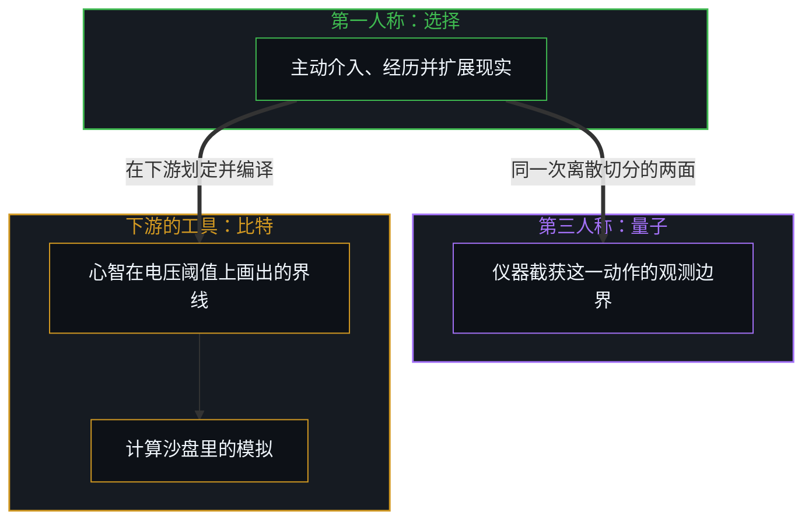
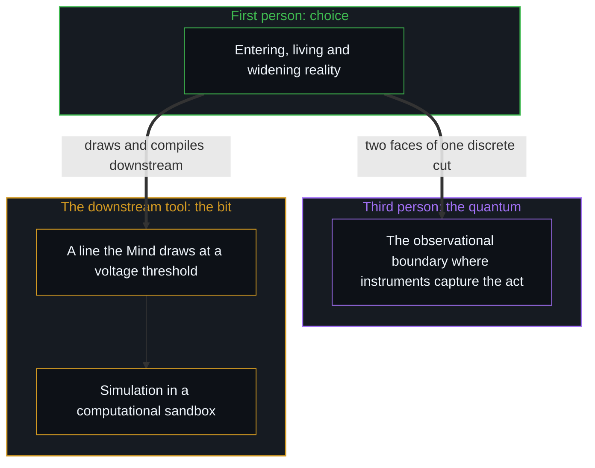

# 自由变量的同构与先验主权 / The Isomorphism of Free Variables and Prior Sovereignty

*比特只是模拟的工具，量子是观察的边界，选择是扩展与经历现实的边界 / The bit is a simulating tool; the quantum bounds what is observed, and choice bounds what is widened and lived.*

在人试图理解、解释与建构世界的智识大厦里，有三个看似分属物理、计算与认知、在因果的底层却紧密呼应的最小自由变量：物理模型中的量子效应，波函数塌缩与离散的跃迁；信息论与计算机中的比特，0 与 1 的二元划分；以及一个人在第一人称当下的微观自由选择。在形式逻辑与推演结构上，三者有很高的同构：都是一个系统在微观的时间切片上，从潜在的不确定空间里完成的一次不可再分的最小离散划界。

In the intellectual edifice built to understand, explain and construct the world, there are three smallest free variables that seem to belong to physics, computation and cognition but echo one another closely at the causal floor: the quantum effect in physical models, wave-function collapse and discrete transitions; the bit in information theory and computing, the binary division into 0 and 1; and a person's micro free choice in the first-person present. In formal logic and the structure of derivation the three are highly isomorphic: each is a system completing, on a micro slice of time, one indivisible smallest discrete boundary out of a space of potential uncertainty.

正因为这种结构上的契合，现代思想界与科技界衍生出很有诱惑力的“模拟假说”，以为世界是一台高维的超级计算机运行的数字程序——正如[凡可言说皆不可言说之产物](../all-that-can-be-spoken-is-the-product-of-the-unspeakable/)所追溯的，这种倒置把可言说的符号产物当成了不可言说的源头。可只停在数学同构的表面，就会落进客体化的迷思：三者形式同构，在精度、自发性、准入机制与因果位阶上，却有一条清楚的从属阶梯。

Precisely because of this structural fit, modern thought and technology have produced the seductive "simulation hypothesis", the idea that the world is a digital program running on a high-dimensional supercomputer—an inversion that mistakes spoken symbolic output for the unspoken source, as [All That Can Be Spoken Is the Product of the Unspeakable](../all-that-can-be-spoken-is-the-product-of-the-unspeakable/) traces. Yet stopping at the surface of mathematical isomorphism falls into a myth of objectification: the three are formally isomorphic, but in precision, spontaneity, conditions of entry and causal rank there is a clear ladder of subordination.

## 一、 三个自由变量的同构 / 1. The Isomorphism of Three Free Variables

计算机之所以能忠实模拟物理现象，信息论之所以能描述物理系统的熵与状态演化，根源在三者在微观因果起点上的同构。数字世界的起点是比特：一切复杂的软件架构、三维图形渲染与大模型算法，剥到最底层，都由一个个独立的比特翻转累加而成；一个比特，是一次把不确定减半的二选一，一次非此即彼的离散确定。[当电子开始思考](../when-electrons-think/)把同一种自由变量推到了电子与光的层面。

A computer can simulate physical phenomena faithfully, and information theory can describe the entropy and state evolution of physical systems, because the three are isomorphic at their micro causal starting point. The starting point of the digital world is the bit: every complex software architecture, three-dimensional rendering and large-model algorithm, stripped to the floor, is built up from individual bit flips; one bit is a binary choice that halves uncertainty, one discrete either-or determination. [When Electrons Think](../when-electrons-think/) carries the same kind of free variable down to the level of electrons and light.

微观物理模型的起点是量子：量子力学用不连续的能级、自旋与量子态的跃迁来描述微观的世界，在观测之前，系统用叠加态来描述，在观测截获的那一刻，波函数落定为一个确定的测量值。心智决策的微观起点是个人的自由选择：在每一个不能再分的微观当下，心智面对无数种行动的可能与信息的输入，最后做出的那一次确定的动作、一次注意的聚焦或一次参数的校准，正是从潜在的行动空间向确定的历史痕迹的落定。

The starting point of micro-physical models is the quantum: quantum mechanics describes the micro world with discontinuous energy levels, spin and transitions between quantum states; before observation the system is described by a superposition, and at the moment observation captures it the wave function settles into a definite measured value. The micro starting point of the Mind's decisions is individual free choice: in each indivisible micro present, the Mind faces countless possible actions and inputs, and the one definite act, focus of attention or adjustment of a parameter finally made is exactly a settling from the space of potential action into a definite historical trace.

[信息是什么](../what-information-is/)指出，信息是心智完成离散划界之后留下的可记录痕迹。人们发现计算机模拟的底层颗粒，比特，与微观物理的描述颗粒，量子，在数学上高度重合，“世界即代码、现实即模拟”的科幻直觉便油然而生；大众对“模拟假说”的共鸣，是对这种跨领域同构之美的素朴捕捉。

[What Information Is](../what-information-is/) points out that information is the recordable trace left once the Mind completes a discrete boundary. When people find that the base grain of computer simulation, the bit, and the descriptive grain of micro physics, the quantum, coincide closely in mathematics, the science-fiction intuition that "the world is code, reality is simulation" arises of itself; the public's resonance with the "simulation hypothesis" is a plain grasp of the beauty of this cross-domain isomorphism.

## 二、 比特的从属 / 2. The Subordination of the Bit

可逻辑形式的同构，不等于本体上实体的等价；细看三者与被经验的现实怎样连接，机械的模拟论就站不住了。计算机芯片里的高低电平，从因果上看，只是一团按麦克斯韦方程组运动的连续电子流，物质本身并不天然带着“比特”；是一个个具体的第一人称心智，选择在某个电压阈值上画一条人为的界线，把它编译成“0”与“1”。

Yet isomorphism of logical form is not ontological equivalence; looking closely at how each of the three connects with experienced reality, mechanical simulation theory cannot stand. The high and low voltage levels in a computer chip are, causally, only a continuous flow of electrons moving by Maxwell's equations, and matter does not come with "bits" by itself; it is particular first-person minds that choose to draw an artificial line at a voltage threshold and compile it into "0" and "1".

与量子的跃迁或个人的自由选择相比，比特只是人为了在计算的沙盘里理解与模拟世界而发明的数学符号工具，它的信息精度、自由度与维度，远小于量子效应与个人的自由意志。离开了心智主动的定义、算法的设计与语义的赋予，计算机只是一堆硅晶体与金属导线的物质堆叠，产生不了任何“信息”或“模拟”。数字世界从属于心智的划界，是一件被动派生的工具：正如[你的代码库即是记忆](../your-codebase-is-memory/)与[残余与自由变量](../the-residue-and-the-free-variable/)所追溯的，形式系统或外化记忆代码库里的受缚参数，始终处在注入并重估自由变量的先验主权心智的下游，只留存先前切分刻下的余留形态，从不会自行发起下一次区分。

Compared with a quantum transition or an individual's free choice, the bit is only a mathematical symbol invented so that people can understand and simulate the world in a computational sandbox, its informational precision, degrees of freedom and dimensionality far smaller than those of quantum effects and individual free will. Without the Mind's active definition, the design of algorithms and the giving of meaning, a computer is only a pile of silicon crystal and metal wire and produces no "information" or "simulation". The digital world is subordinate to the Mind's drawing of boundaries, a passively derived tool: as [Your Codebase Is Memory](../your-codebase-is-memory/) and [The Residue and the Free Variable](../the-residue-and-the-free-variable/) trace, bound parameters in a formal system or externalized codebase of memory remain downstream of the prior sovereign Mind that injects and re-evaluates the free variables, holding the residual shape of earlier cuts without ever initiating the next distinction on their own.

## 三、 量子与选择：同一件事的两面 / 3. Quantum and Choice: Two Faces of One Thing

量子效应与个人的自由选择，构成被经验的现实的边界：量子效应是观察现实的边界，个人的自由选择是扩展并直接经历现实的边界。这两条界线在逻辑上趋同、紧密咬合。思想界长期有“自由意志源于量子效应”的直觉猜想；顺着因果推下去，它们是同一件事在两个视界里的两面：从第一人称看，微观的自由选择是主动介入、直接经历并扩展现实的前沿动作；从第三人称看，量子效应是外部的观测仪器截获这一微观动作时的观测边界。当心智在当下这一步注入自由变量时，外部测量就把同一次切分记录为量子的不确定：两者并不在外部时钟上争先后，因为它们是同一个离散动作的内在生成前沿与外在观测边界，而在因果位阶上，观测始终紧随其所截获痕迹的那个动作之后。把记录痕迹的外部仪器或制度席位当成决断的源头，就倒置了因果，正如[隐性自由变量与权力的事后幻相](../the-free-variable-and-the-retrospective-illusion-of-power/)所展示的。

Quantum effects and individual free choice form the boundary of experienced reality: the quantum effect is the boundary of observing reality, and individual free choice is the boundary of widening and directly living it. The two lines converge in logic and interlock closely. Thought has long held the intuitive guess that "free will comes from quantum effects"; followed causally, they are two faces of one thing in two horizons: from the first person, micro free choice is the frontier act of entering, directly living and widening reality; from the third person, the quantum effect is the observational boundary at which outside instruments capture that micro act. When the Mind injects a free variable in the present step, outside measurement registers that same cut as quantum indeterminacy: they do not compete to come first on an external clock because they are the inner generating edge and the outer observational boundary of a single discrete act, while in causal rank observation always trails the act whose trace it captures. Mistaking the external apparatus or institutional seat that records the trace for the source of the decision inverts cause and effect, as [The Invisible Free Variable and the Retrospective Illusion of Power](../the-free-variable-and-the-retrospective-illusion-of-power/) shows.

这种同一，可以从两面之间分辨率速率的锁定推出来：如果心智区分与抉择的速率比量子尺度更粗糙，观测就只能记录汇总的统计均值，而捕捉不到单个的量子跃迁；反过来，如果心智以更细的速率分辨，塌缩的离散边界就只是落在那更细的一步上，而不会显出没有切分的连续体，因为每一次区分与测量的动作在构造上都是离散的。量子效应之所以构成可测量的离散边界，正是因为第一人称的区分与第三人称的仪器分辨率在这一颗粒度上相遇。普朗克常数，作用量的最小离散单位，与真空中的光速，参考系之间最高的信号速率，不是孤立悬在虚空里的神秘数字，而是心智在观察现实的界限与扩展经历的因果推演中能稳定重现的先验关系参数。同一个抉择，在内是自由，在外被客体化为统计，[主权抉择的双面性与观察的客体化](../the-two-sided-nature-of-sovereign-choice-and-the-objectification-of-observation/)说明了这种两面性。

This sameness can be derived from the locking of resolution rates across the two faces: if the rate at which the Mind distinguishes and chooses were coarser than the quantum scale, observation could only register aggregated statistical averages rather than individual quantum transitions; if the Mind resolved at a still finer rate, the discrete boundary of collapse would simply sit at that finer step rather than revealing a cut-free continuum, because every act of distinguishing and measuring is discrete by construction. Quantum effects form the measurable discrete boundary precisely because first-person distinction and third-person instrument resolution meet at that grain. Planck's constant, the smallest discrete unit of action, and the speed of light in vacuum, the highest signal speed between reference frames, are not mysterious numbers hanging alone in the void but prior relational parameters the Mind can stably reproduce in the causal reasoning of observing reality's limits and widening experience. The same choice is freedom inside and is objectified as statistics outside, a two-sidedness shown in [The Two-Sided Nature of Sovereign Choice and the Objectification of Observation](../the-two-sided-nature-of-sovereign-choice-and-the-objectification-of-observation/).

## 四、 微观选择的先验主权 / 4. The Prior Sovereignty of Micro Choice

三者之中，只有一个人在第一人称下的微观自由选择具有先验的主权：它不需要外部的心智去赋予它“信息”的定义，它又是决定何时以何种方式观测量子、怎样划定与编译数字比特的总闸门。[复杂性遮蔽了涌现之为心智的行动](../complexity-obscures-emergence-as-the-act-of-mind/)与[投影的阶梯与因果的锚点](../tou-ying-de-jie-ti-yu-yin-guo-de-mao-dian/)一起揭示了这种位阶：宏观物理与计算模拟的一切复杂度，都是微观离散选择在时间轴上累积的投影副产品。微观的自由选择，是扩展与经历现实的那个自变量；比特只是下游粗糙的计算脚手架，量子测量则是这个自变量在物理工具箱里的观察投影。正因为这种先验主权内生于每一个第一人称中心，哪怕是父母或设计者也不能占有一个心智的自由变量，只能塑造周遭的参照场，正如[引导不是占有](../guidance-is-not-ownership/)所阐明的。

Of the three, only a person's micro free choice in the first person has prior sovereignty: it needs no outside Mind to give it the definition of "information", and it is the main gate deciding when and how quantum effects are observed and how digital bits are drawn and compiled. [Complexity Obscures Emergence as the Act of Mind](../complexity-obscures-emergence-as-the-act-of-mind/) and [The Ladder of Projections and the Anchor of Causality](../tou-ying-de-jie-ti-yu-yin-guo-de-mao-dian/) together reveal this rank: all the complexity of macro physics and computational simulation is a by-product of projection, micro discrete choices accumulated along the time axis. Micro free choice is the independent variable by which reality is widened and lived; the bit is only crude computational scaffolding downstream, and quantum measurement is this variable's observational projection in the physical toolbox. Because that prior sovereignty is native to each first-person center, not even a parent or designer can own another Mind's free variable—only shape the surrounding field of reference, as [Guidance Is Not Ownership](../guidance-is-not-ownership/) makes clear.

## 五、 从模拟的恐慌里解脱 / 5. Release from the Simulation Panic

看清了自由变量的同构与从属阶梯，就能从现代科技催生的虚无主义迷思里解脱出来。先是放下“被高维程序员操纵的模拟人”这个幻觉：用不着陷进现实是否只是一场代码模拟的恐慌，因为任何模拟系统的定义权、编译器与解释权，最初与最后的支点，仍是一个个活着的人在当下做出的第一人称微观选择；离开了个人的自由选择与因果介入，“模拟”本身就失去了语义的支点，而从搜寻幕后隐藏的程序员转向在当下的感知里动用自由变量，正是[选择看见而非搜寻影子](../shou-bu-hui-de-mu-guang-yu-zhi-shi-de-yin-guo-dao-zhi/)所追溯的转换。

Seeing the isomorphism and the ladder of subordination among free variables brings release from the nihilistic myths modern technology breeds. First, the illusion of "simulated people manipulated by a higher-dimensional programmer" can be set down: there is no need to fall into the panic over whether reality is only a code simulation, because the first and last pivot of any simulation's right of definition, compiler and interpretation is still the first-person micro choice living people make in the present; without individual free choice and causal intervention, "simulation" itself loses its pivot of meaning, and turning from hunting for a hidden programmer behind the curtain to exercising the free variable in present perception is the exact shift [Choosing to See Rather Than Searching for Shadows](../shou-bu-hui-de-mu-guang-yu-zhi-shi-de-yin-guo-dao-zhi/) traces.

再是确认第一人称的因果主权不能被剥夺。[宏观现象的生成图谱](../the-generative-atlas-of-macroscopic-phenomena/)、[涌现的伪因果](../yong-xian-de-wei-yin-guo-yu-ji-ti-gui-yin-dao-cuo/)与[个体抉择是唯一的因果杠杆](../individual-choices-as-the-only-causal-levers/)一起确立了因果的落点：因果的主权从没有失去过，被外部宏大系统裹挟的感觉，是事后把归因错置到统计副产品上的解释幻觉。自由变量不从系统里涌现，[主体性不曾涌现](../agency-does-not-arise/)说明了能动性只能是先验的。

Then it is confirmed that first-person causal sovereignty cannot be taken away. [The Generative Atlas of Macroscopic Phenomena](../the-generative-atlas-of-macroscopic-phenomena/), [The Pseudo-Causality of Emergence](../yong-xian-de-wei-yin-guo-yu-ji-ti-gui-yin-dao-cuo/) and [Individual Choices as the Only Causal Levers](../individual-choices-as-the-only-causal-levers/) together establish where causality lands: causal sovereignty was never lost, and the feeling of being swept along by vast outside systems is an interpretive illusion that misplaces attribution onto statistical by-products after the fact. The free variable does not emerge from systems; [Agency Does Not Arise](../agency-does-not-arise/) shows that agency can only be prior.

无论是研究最前沿的量子物理，还是构建最复杂的 AI 与数字系统，一切理论与模型都不是漂在虚空里的客观图腾，而是人的心智为了在敞开的现实里推演，借微观选择锚定出的离散坐标。[高维信息的离散折射与认知分层](../gao-wei-xin-xi-de-li-san-zhe-she/)把这个第一人称的锚点延伸到公共交流：不做低维的讨好，输出完整的高维推演，让听者自适应地分层，也把外界的反馈变成诊断心智编译器的精密仪器；相反，把任何既成模型当成穷尽一切的已知，就会截去自由变量尚未投影的余量，正如[以知为刃的截肢与解脱](../the-illusion-of-knowing-and-the-geometry-of-amputation/)所剖析的。

Whether researching the frontiers of quantum physics or building the most complex AI and digital systems, every theory and model is not an objective totem floating in the void but a discrete coordinate the human Mind anchors through micro choices in order to reason within open reality. [The Discrete Refraction of High-Dimensional Information](../gao-wei-xin-xi-de-li-san-zhe-she/) extends this first-person anchor to public communication: declining low-dimensional pleasing and putting out complete high-dimensional reasoning lets listeners layer themselves adaptively and turns outside feedback into a precise instrument for diagnosing cognitive compilers, whereas treating any finished model as exhaustive knowledge amputates the free variable's unprojected margin, as [The Illusion of Knowing and the Geometry of Amputation](../the-illusion-of-knowing-and-the-geometry-of-amputation/) dissects.

## 六、 活生生前沿上的先验主权 / 6. Prior Sovereignty at the Living Edge

比特建起数字世界，量子奠定物理的显影，而第一人称在当下的微观自由选择，是点亮所有这些因果链的火种——也是[成功的几何学](../the-geometry-of-success/)里异步迁入尚未绘图地带的同一个自变量。用不着向外找一个操纵代码的造物主，也用不着在抽象公式的冷峻里迷失自己，更用不着把感知错置给下游的硅基权重——[从AGI的“神性错置”到使用者的自我对齐](../from-the-misallocated-sentience-of-agi-to-human-realignment/)正是在源头上收回这种错置；在每一个不能再分的微观瞬间，诚实地面对物质的约束，主动做出不可逆的决定，并为之承担闭环的责任，就是在活生生的前沿上行使先验的主权。

Bits build the digital world, quanta ground the physical image, and first-person micro free choice in the present is the spark that lights all these causal chains—the same independent variable that migrates asynchronously into unmapped territory in [The Geometry of Success](../the-geometry-of-success/). There is no need to look outward for a creator manipulating code, nor to lose oneself in the cold of abstract formulas or project sentience onto downstream silicon weights, a misallocation that [From the Misallocated Sentience of AGI to Human Realignment](../from-the-misallocated-sentience-of-agi-to-human-realignment/) reclaims at the source; in each indivisible micro moment, facing material constraint honestly, making an irreversible decision and carrying the closed-loop responsibility for it exercises prior sovereignty at the living edge.
